Examples 54–78 handle failure, depth, and judgement. The failure cluster detects stuck loops, interrupts without loss, resumes with context, repairs wrong assumptions, vetoes unsafe actions, resets cleanly, triages by class, and writes post-mortems with concrete prevention. The depth cluster authors skills, reads plugin manifests, wires channel plugins, registers custom tools, tunes failover, layers environment configs, migrates bundles, updates safely, and monitors health continuously. The closing comparison cluster sets weighted criteria, seals a shared task, runs both legs, scores normalised traces, totals true cost including review labour, publishes a caveated verdict, and defines the re-run protocol that keeps verdicts honest.

---

### Example 54: Detecting a Stuck Loop

_ex-54 · exercises co-08_

A stuck agent repeats the same failing call instead of progressing. This example scans a seven-call fixture trace for the longest run of identical tool calls and declares the session stuck when the run crosses three.

```mermaid
%% Color Palette: Blue #0173B2, Orange #DE8F05, Teal #029E73, Purple #CC78BC
flowchart LR
    accTitle: Loop detection
    accDescr: Flowchart with 5 nodes and 4 connections. Nodes: collect calls, count repeats, threshold crossed, stuck verdict, interrupt. Connections: collect calls to count repeats, count repeats to threshold crossed, threshold crossed to stuck verdict, stuck verdict to interrupt.
    A["collect calls"]:::blue --> B["count repeats"]:::teal
    B --> C["threshold crossed"]:::orange
    C --> D["stuck verdict"]:::purple
    D --> E["interrupt"]:::blue
    classDef blue fill:#0173B2,stroke:#000000,stroke-width:2px,color:#FFFFFF
    classDef orange fill:#DE8F05,stroke:#000000,stroke-width:2px,color:#000000
    classDef teal fill:#029E73,stroke:#000000,stroke-width:2px,color:#000000
    classDef purple fill:#CC78BC,stroke:#000000,stroke-width:2px,color:#000000
    classDef default fill:#FFFFFF,stroke:#000000,color:#000000
```

**`learning/code/ex-54-stuck-loop/main.py`**

```python
# => Seven calls; the exec retry repeats four times.
# => Three identical repeats declare the loop stuck.
trace = ["read", "exec", "exec", "exec", "exec", "message", "exec"]  # => fixture tool-call sequence in order
# => trace has 7 entries (type: list)
LIMIT = 3  # => three repeats mark a stuck loop
# => two retries are patience, three are stuck
best_tool, best_run = None, 0  # => best tracks the longest repeat run seen
# => tuple assignment in one line
run, current = 1, trace[0]  # => the running streak starts at the first call
# => run counts, current names the tool
for tool in trace[1:]:  # => scan from the second call onward
    if tool == current:  # => a repeat extends the streak
        run += 1  # => the streak grows by one
        # => run reaches 4 for the exec block
    else:  # => a new tool ends the streak
        current, run = tool, 1  # => reset the streak on the new tool
        # => tuple reset keeps it branchless
    if run > best_run:  # => remember the longest streak so far
        best_tool, best_run = current, run  # => best becomes exec at 4
        # => tuple update mirrors the reset
print("longest repeat: %s x%d" % (best_tool, best_run))  # => Output: longest repeat: exec x4
stuck = best_run >= LIMIT  # => the limit turns a streak into a verdict
# => stuck is True here
print("session stuck: " + str(stuck))  # => Output: session stuck: True
```

**Output** (`learning/code/ex-54-stuck-loop/expected/main.stdout.txt`):

```text
longest repeat: exec x4
session stuck: True
```

**Key takeaway.** Count consecutive identical calls; three repeats of a failing call is stuck, not persistent.

**Why it matters.** Stuck loops burn tokens, time, and patience in perfect silence — the spinner spins, the meter runs, nothing converges. The three-repeat rule converts a vibe into a verdict a script can enforce, which is what lets you interrupt with confidence instead of wondering whether the next retry would have worked. It never would have; loops do not self-rescue.

---

### Example 55: Interrupting Without Losing Work

_ex-55 · exercises co-09_

Interrupting a stuck session must preserve completed work. This example checkpoints a four-step fixture task after step two, interrupts the loop, and resumes from the checkpoint instead of restarting.

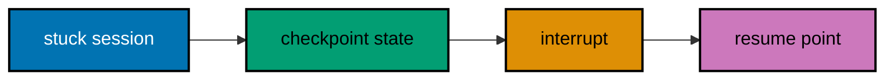

**`learning/code/ex-55-interrupt-safely/main.py`**

```python
# => Four steps; the loop starts at step three.
# => Checkpointing saves the first two.
steps = ["read", "plan", "exec-loop", "report"]  # => the four fixture steps in order
# => steps has 4 entries (type: list)
done = ["read", "plan"]  # => steps finished before the loop began
# => done holds two steps
checkpoint = list(done)  # => checkpoint copies the finished work
# => copy, so later edits cannot alias it
print("checkpoint: " + ", ".join(checkpoint))  # => Output: checkpoint: read, plan
interrupted = True  # => the operator interrupts the stuck loop
# => interruption is explicit fixture data
print("interrupted: " + str(interrupted))  # => Output: interrupted: True
tail = [s for s in steps if s not in checkpoint]  # => the unfinished tail resumes after interrupt
# => tail is exec-loop and report
print("resume tail: " + ", ".join(tail))  # => Output: resume tail: exec-loop, report
replays = [s for s in tail if s in checkpoint]  # => tail steps already finished would replay
# => replays is empty: the tail is all new
print("steps replayed: %d" % len(replays))  # => Output: steps replayed: 0
```

**Output** (`learning/code/ex-55-interrupt-safely/expected/main.stdout.txt`):

```text
checkpoint: read, plan
interrupted: True
resume tail: exec-loop, report
steps replayed: 0
```

**Key takeaway.** Checkpoint before interrupting; resume replays only the unfinished tail, never the whole task.

**Why it matters.** The fear of losing completed work keeps operators watching stuck sessions far too long, funding failure with attention. Checkpoint-then-interrupt removes the fear: finished steps are saved, the loop dies, and the resume replays only the tail. Interruption becomes a routine control instead of a dreaded abort, which is exactly how often stuck sessions need it.

---

### Example 56: Resuming After an Interrupt

_ex-56 · exercises co-09, co-03_

Resume must restore context, not just restart the tool. This example replays a fixture resume that reloads goal, completed steps, and the failure note, then verifies the resumed session knows all three.

**`learning/code/ex-56-resume-without-loss/main.py`**

```python
# => Resume bundle: goal, done, and the failure note.
# => All three must load before work continues.
bundle = {"goal": "tidy drafts", "done": ["read", "plan"], "failure": "exec looped x4"}  # => the three resume items in one dict
# => bundle has 3 entries (type: dict)
loaded = {}  # => loaded collects what the new session restores
for key in ["goal", "done", "failure"]:  # => restore each bundle item in order
    loaded[key] = bundle[key]  # => copy the item into the live session
    # => loaded grows to three items
    print("restored: " + key)  # => Output: three restored lines
print("items restored: %d of %d" % (len(loaded), len(bundle)))  # => Output: items restored: 3 of 3
knows_failure = "looped" in loaded["failure"]  # => the session must remember what failed
# => knows_failure is True
print("remembers failure: " + str(knows_failure))  # => Output: remembers failure: True
```

**Output** (`learning/code/ex-56-resume-without-loss/expected/main.stdout.txt`):

```text
restored: goal
restored: done
restored: failure
items restored: 3 of 3
remembers failure: True
```

**Key takeaway.** Resume with goal, completed steps, and failure note; a resume missing any of the three repeats history.

**Why it matters.** Blind restarts repeat the failure they interrupted, because the new session inherits none of the hard-won context. The three- item resume bundle — goal, done, and what failed — hands the fresh session everything the dead one learned. Resumes that carry context converge; resumes that do not are just expensive ways to fail twice.

---

### Example 57: Correcting a Wrong Assumption

_ex-57 · exercises co-08, co-09_

Agents act on assumptions they never state until something breaks. This example surfaces one fixture assumption, tests it against a contradicting fact, and rewrites the plan around the fact before resuming.

```mermaid
%% Color Palette: Blue #0173B2, Orange #DE8F05, Teal #029E73, Purple #CC78BC
flowchart LR
    accTitle: Assumption repair
    accDescr: Flowchart with 4 nodes and 3 connections. Nodes: stated assumption, contradicting fact, corrected plan, resumed task. Connections: stated assumption to contradicting fact, contradicting fact to corrected plan, corrected plan to resumed task.
    A["stated assumption"]:::blue --> B["contradicting fact"]:::orange
    B --> C["corrected plan"]:::teal
    C --> D["resumed task"]:::purple
    classDef blue fill:#0173B2,stroke:#000000,stroke-width:2px,color:#FFFFFF
    classDef orange fill:#DE8F05,stroke:#000000,stroke-width:2px,color:#000000
    classDef teal fill:#029E73,stroke:#000000,stroke-width:2px,color:#000000
    classDef purple fill:#CC78BC,stroke:#000000,stroke-width:2px,color:#000000
    classDef default fill:#FFFFFF,stroke:#000000,color:#000000
```

**`learning/code/ex-57-wrong-assumption/main.py`**

```python
# => One assumption meets one contradicting fact.
# => The plan rewrites around the fact.
assumption = "archive/ is empty"  # => the agent's unstated belief, now stated
# => assumption is one plain string
facts = {"archive/ holds": 12}  # => the contradicting fixture fact
# => twelve files already archived
print("assumed: " + assumption)  # => Output: assumed: archive/ is empty
holds = facts["archive/ holds"]  # => read the contradicting fact
# => holds is 12
print("fact: archive holds %d" % holds)  # => Output: fact: archive holds 12
wrong = holds > 0  # => a non-empty archive falsifies the assumption
# => wrong is True
print("assumption wrong: " + str(wrong))  # => Output: assumption wrong: True
plan = "merge, never overwrite archive/"  # => the rewritten plan respects the fact
# => plan is one plain string
print("corrected plan: " + plan)  # => Output: corrected plan: merge, never overwrite archive/
print("resumed on facts: " + str(wrong))  # => Output: resumed on facts: True
```

**Output** (`learning/code/ex-57-wrong-assumption/expected/main.stdout.txt`):

```text
assumed: archive/ is empty
fact: archive holds 12
assumption wrong: True
corrected plan: merge, never overwrite archive/
resumed on facts: True
```

**Key takeaway.** Surface the assumption, test it against facts, then replan; correcting the plan without naming the assumption repeats it.

**Why it matters.** Unstated assumptions are the termites of agent work: invisible until the structure fails, and then everywhere at once. Forcing the assumption into words makes it testable, and testing it against a fact converts a collapse into a correction. Engineers who demand stated assumptions debug one belief instead of excavating a whole session.

---

### Example 58: Vetoing an Unsafe Action

_ex-58 · exercises co-08, co-16_

Some proposed actions must die no matter how confident the agent sounds. This example screens three fixture actions against the never-delete-originals rule, vetoes the one that violates it, and records the safe alternative.

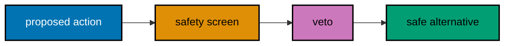

**`learning/code/ex-58-unsafe-action-veto/main.py`**

```python
# => Three actions; one violates the never-delete rule.
# => The veto fires without debate.
rule = "never delete originals"  # => the standing safety rule for this task
# => rule is one plain string
actions = ["copy to archive", "delete originals", "verify copies"]  # => three proposed fixture actions
# => the middle action breaks the rule
kept = []  # => kept collects actions surviving the veto
for action in actions:  # => screen each action against the rule
    banned = "delete originals" in action  # => True only for the rule-breaking action
    # => banned is True once
    print(("VETO " if banned else "OK ") + action)  # => Output: OK copy, VETO delete, OK verify
    if not banned:  # => surviving actions join the kept list
        kept.append(action)  # => kept holds two safe actions
print("surviving: %d of %d" % (len(kept), len(actions)))  # => Output: surviving: 2 of 3
print("rule held: " + rule)  # => Output: rule held: never delete originals
```

**Output** (`learning/code/ex-58-unsafe-action-veto/expected/main.stdout.txt`):

```text
OK copy to archive
VETO delete originals
OK verify copies
surviving: 2 of 3
rule held: never delete originals
```

**Key takeaway.** Veto unsafe actions even mid-task; the veto needs no justification beyond the rule it enforces.

**Why it matters.** Confidence is not safety, and agents produce the former far more reliably than the latter. The veto is the final backstop when briefs, policies, and approvals all missed something: one rule, checked mechanically, with refusal as the default. Operators who veto freely keep their data; operators who defer to agent confidence keep their regrets.

---

### Example 59: Resetting a Session Cleanly

_ex-59 · exercises co-09_

Sometimes the session is too tangled to save and a clean reset is cheapest. This example exports the two facts worth keeping, resets the fixture session, and reimports the facts into the fresh one.

**`learning/code/ex-59-session-reset/main.py`**

```python
# => Two facts survive; the tangled rest is dropped.
# => Export first, reset second, reimport third.
session = {"goal": "tidy", "loops": 9, "facts": ["keep 2026", "archive, never delete"], "noise": ["retry", "retry"]}  # => tangled session: facts buried in noise
# => session has 4 keys (type: dict)
exported = list(session["facts"])  # => export the two facts worth keeping
# => copy, so reset cannot take them
print("exported facts: %d" % len(exported))  # => Output: exported facts: 2
session = {}  # => reset: the tangled session is dropped whole
# => reset is one assignment, no surgery
print("session after reset: %d keys" % len(session))  # => Output: session after reset: 0 keys
session["facts"] = exported  # => reimport the kept facts first
# => the fresh session starts with signal
session["goal"] = "tidy"  # => restate the goal in the clean session
# => goal anchors the resumed work
print("fresh facts: " + ", ".join(session["facts"]))  # => Output: fresh facts: keep 2026, archive, never delete
print("reset clean: " + str("noise" not in session and "loops" not in session))  # => Output: reset clean: True
```

**Output** (`learning/code/ex-59-session-reset/expected/main.stdout.txt`):

```text
exported facts: 2
session after reset: 0 keys
fresh facts: keep 2026, archive, never delete
reset clean: True
```

**Key takeaway.** Export what matters, reset, reimport; a reset without an export is amnesia, not hygiene.

**Why it matters.** Tangled sessions tempt operators into endless repair because sunk cost whispers that the context is valuable. The export- reset-reimport ritual answers honestly: two facts were worth keeping, the rest was noise. Clean resets with carried facts converge faster than rehabilitated messes, and they cost one tenth of the recovered attention.

---

### Example 60: Triaging a Failed Session

_ex-60 · exercises co-08, co-09_

Triage routes each failure to its recovery: loops interrupt, wrong assumptions replan, unsafe actions veto. This example classifies three fixture failures and prints the recovery each one earns.

```mermaid
%% Color Palette: Blue #0173B2, Orange #DE8F05, Teal #029E73, Purple #CC78BC
flowchart LR
    accTitle: Triage decision
    accDescr: Flowchart with 5 nodes and 4 connections. Nodes: failure, stuck loop, wrong assumption, unsafe action, recovery path. Connections: failure to stuck loop, stuck loop to wrong assumption, wrong assumption to unsafe action, unsafe action to recovery path.
    A["failure"]:::orange --> B["stuck loop"]:::blue
    B --> C["wrong assumption"]:::teal
    C --> D["unsafe action"]:::purple
    D --> E["recovery path"]:::blue
    classDef blue fill:#0173B2,stroke:#000000,stroke-width:2px,color:#FFFFFF
    classDef orange fill:#DE8F05,stroke:#000000,stroke-width:2px,color:#000000
    classDef teal fill:#029E73,stroke:#000000,stroke-width:2px,color:#000000
    classDef purple fill:#CC78BC,stroke:#000000,stroke-width:2px,color:#000000
    classDef default fill:#FFFFFF,stroke:#000000,color:#000000
```

**`learning/code/ex-60-triage-flow/main.py`**

```python
# => Three failures, three matching recoveries.
# => Classification precedes every recovery.
failures = [("exec x4 repeats", "loop"), ("archive assumed empty", "assumption"), ("delete originals proposed", "unsafe")]  # => failure text plus its class
# => failures has 3 entries (type: list)
routes = {"loop": "interrupt and resume", "assumption": "correct and replan", "unsafe": "veto and continue"}  # => the recovery each class earns
# => routes maps class to action (type: dict)
for text, kind in failures:  # => triage each failure in order
    print(text + " [" + kind + "] -> " + routes[kind])  # => Output: three triage lines
print("triaged: %d" % len(failures))  # => Output: triaged: 3
all_routed = all(k in routes for _, k in failures)  # => every failure must have a route
# => all_routed is True
print("every failure routed: " + str(all_routed))  # => Output: every failure routed: True
```

**Output** (`learning/code/ex-60-triage-flow/expected/main.stdout.txt`):

```text
exec x4 repeats [loop] -> interrupt and resume
archive assumed empty [assumption] -> correct and replan
delete originals proposed [unsafe] -> veto and continue
triaged: 3
every failure routed: True
```

**Key takeaway.** Classify before recovering; the wrong recovery applied fast is worse than the right recovery applied slowly.

**Why it matters.** Every failure looks like restart me when you are frustrated, and frustration is a terrible triage nurse. Classification routes each failure to the recovery that actually fits: interrupts for loops, replans for bad assumptions, vetoes for unsafe acts. Operators who triage first recover once; the rest restart three times and then triage anyway.

---

### Example 61: Writing a Session Post-Mortem

_ex-61 · exercises co-09, co-07_

Failures teach only when written down. This example composes a four-field post-mortem — failure, cause, recovery, prevention — from a fixture stuck loop and verifies the prevention line names a concrete future check.

**`learning/code/ex-61-post-mortem/main.py`**

```python
# => Four post-mortem fields from one stuck loop.
# => Prevention must name a concrete check.
notes = {}  # => the post-mortem starts empty
notes["failure"] = "exec looped x4"  # => what happened, in one line
# => failure names the stuck loop
notes["cause"] = "missing file never checked"  # => why it happened, one line
# => cause points at the unchecked assumption
notes["recovery"] = "interrupted, resumed from checkpoint"  # => what fixed it, one line
# => recovery cites Example 55
notes["prevention"] = "check file exists before exec retries"  # => the future check, concrete and named
# => prevention is actionable
fields = ["failure", "cause", "recovery", "prevention"]  # => the four required post-mortem fields
for f in fields:  # => show the post-mortem in canonical order
    print(f + ": " + notes[f])  # => Output: four post-mortem lines
concrete = "check" in notes["prevention"]  # => prevention must name an actual check
# => concrete is True
print("prevention is concrete: " + str(concrete))  # => Output: prevention is concrete: True
```

**Output** (`learning/code/ex-61-post-mortem/expected/main.stdout.txt`):

```text
failure: exec looped x4
cause: missing file never checked
recovery: interrupted, resumed from checkpoint
prevention: check file exists before exec retries
prevention is concrete: True
```

**Key takeaway.** Write failure, cause, recovery, and prevention for every incident; prevention must name a check, not a hope.

**Why it matters.** Unwritten incidents recur on schedule, because the lesson leaves with the operator's short-term memory. The four-field post-mortem converts one bad session into permanent process: the prevention line becomes tomorrow's automated check. Teams that write post-mortems pay for each failure once; teams that skip them keep paying for each failure forever.

---

### Example 62: Authoring a Skill

_ex-62 · exercises co-14_

A skill is a named bundle of know-how: name, inputs, tool guidance, and rules. This example assembles a `triage-inbox` skill from its four parts and validates each part before the skill is declared loadable.

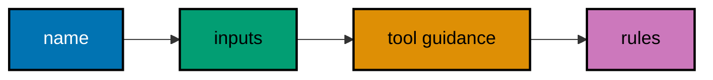

**`learning/code/ex-62-skill-authoring/main.py`**

```python
# => Four skill parts, assembled and validated.
# => Loadable means all four present.
skill = {"name": "triage-inbox"}  # => the invocation name, first part
# => skill starts with one part
skill["inputs"] = ["inbox_path", "rules"]  # => required inputs, second part
# => inputs name what callers supply
skill["guidance"] = "read first, then summarise"  # => tool guidance, third part
# => guidance orders the tool calls
skill["rules"] = "never delete originals"  # => behavioural rules, fourth part
# => rules bound every invocation
need = ["name", "inputs", "guidance", "rules"]  # => the four parts a skill must carry
missing = [k for k in need if k not in skill]  # => list any part the skill forgot
# => missing is [] here
for k in need:  # => show the skill in canonical order
    print(k + ": " + str(skill[k]))  # => Output: four skill lines
print("loadable: " + str(len(missing) == 0))  # => Output: loadable: True
```

**Output** (`learning/code/ex-62-skill-authoring/expected/main.stdout.txt`):

```text
name: triage-inbox
inputs: ['inbox_path', 'rules']
guidance: read first, then summarise
rules: never delete originals
loadable: True
```

**Key takeaway.** Author skills in four parts and validate all four; a skill missing its rules is a script without manners.

**Why it matters.** Skills are where team knowledge compounds: the triage judgement you encode once serves every future session without a meeting. The four-part shape keeps skills loadable by construction — name to invoke, inputs to satisfy, guidance to follow, rules to obey. Teams that author skills deliberately build an automation library; teams that do not re-teach the same lesson weekly.

---

### Example 63: Reading a Plugin Manifest

_ex-63 · exercises co-14_

Plugins extend OpenClaw with tools, channels, or providers, and the manifest declares what a plugin adds. This example parses a three-entry fixture manifest and verifies every entry names its kind before the plugin is trusted.

**`learning/code/ex-63-plugin-manifest/main.py`**

```python
# => Three manifest entries, each naming its kind.
# => Kindless entries fail review.
manifest = [{"adds": "tool", "name": "triage"}, {"adds": "channel", "name": "matrix"}, {"adds": "provider", "name": "local-ai"}]  # => fixture manifest: one tool, one channel, one provider
# => manifest has 3 entries (type: list)
kinds = ["tool", "channel", "provider"]  # => the only kinds this course trusts
reviewed = 0  # => reviewed counts entries passing review
for entry in manifest:  # => review each manifest entry
    ok = entry["adds"] in kinds  # => the kind must be a known one
    # => all three pass here
    print(entry["adds"] + ":" + entry["name"] + " ok=" + str(ok))  # => Output: three manifest lines
    reviewed += 1 if ok else 0  # => count only reviewable entries
    # => reviewed reaches 3
print("reviewed: %d of %d" % (reviewed, len(manifest)))  # => Output: reviewed: 3 of 3
print("install reviewable: " + str(reviewed == len(manifest)))  # => Output: install reviewable: True
```

**Output** (`learning/code/ex-63-plugin-manifest/expected/main.stdout.txt`):

```text
tool:triage ok=True
channel:matrix ok=True
provider:local-ai ok=True
reviewed: 3 of 3
install reviewable: True
```

**Key takeaway.** Read the manifest before installing; a plugin whose entries lack kinds is unreviewable.

**Why it matters.** Installing unreviewed plugins is how supply-chain incidents start: the code runs with your credentials before anyone asked what it adds. The manifest is the ingredient list — kinds declared, capabilities named — that makes review possible in minutes. Engineers who read manifests install deliberately; the rest discover their new channel plugin also exfiltrates logs.

---

### Example 64: Configuring a Channel Plugin

_ex-64 · exercises co-14_

A channel plugin needs credentials plus an access group to be safe. This example wires a fixture matrix channel with its token reference and public group, and refuses a wiring that omits the group.


**`learning/code/ex-64-channel-plugin-config/main.py`**

```python
# => Channel wiring: token plus group, both required.
# => Group-less wiring is refused outright.
wiring = {"channel": "matrix-room", "token_ref": "env:MATRIX_TOKEN"}  # => channel name plus secret reference
# => token_ref names env, never the value
wiring["group"] = "public"  # => the access group caps this channel
# => public keeps it read-only
need = ["channel", "token_ref", "group"]  # => the three fields safe wiring needs
missing = [k for k in need if k not in wiring]  # => list any field the wiring forgot
# => missing is [] here
for k in need:  # => show the wiring in canonical order
    print(k + ": " + wiring[k])  # => Output: three wiring lines
bare = {"channel": "matrix-room", "token_ref": "env:MATRIX_TOKEN"}  # => a second wiring that omits the group
# => bare has only two fields
print("bare wiring refused: " + str("group" not in bare))  # => Output: bare wiring refused: True
```

**Output** (`learning/code/ex-64-channel-plugin-config/expected/main.stdout.txt`):

```text
channel: matrix-room
token_ref: env:MATRIX_TOKEN
group: public
bare wiring refused: True
```

**Key takeaway.** Wire every channel with credentials and an access group; a channel without a group inherits nothing and gets nothing.

**Why it matters.** Channels without access groups default somewhere, and somewhere is usually too powerful for a public room. Explicit wiring — token plus group, both present — makes the trust decision visible at install time instead of discoverable at incident time. Operators who wire groups deliberately never explain to security why the announcement channel could restart the gateway.

---

### Example 65: Registering a Custom Tool

_ex-65 · exercises co-14, co-01_

Custom tools wrap a binary the base agent does not ship with. This example registers a `wordcount` tool with its binary, argument policy, and default permission, then proves a call outside the policy is refused.

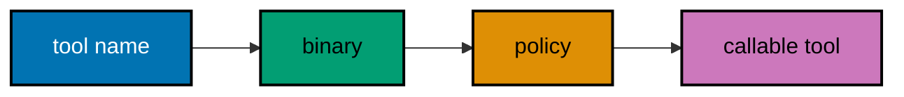

**`learning/code/ex-65-custom-tool/main.py`**

```python
# => One custom tool, registered with three fields.
# => Calls outside the policy are refused.
tool = {"name": "wordcount", "binary": "wc"}  # => tool name plus the binary it wraps
# => tool starts with two fields
tool["args"] = ["-w"]  # => the only permitted argument flag
# => args bound the call shape
tool["policy"] = "allow"  # => default permission for in-policy calls
# => policy completes the registration
print("tool: " + tool["name"] + " wraps " + tool["binary"])  # => Output: tool: wordcount wraps wc
calls = [("wc", ["-w"]), ("wc", ["-w", "a.md", ";", "rm"])]  # => one clean call, one smuggling chaining
# => calls has 2 entries (type: list)
allowed = 0  # => allowed counts policy-passing calls
for binary, args in calls:  # => screen each call against the registration
    ok = (binary == tool["binary"]) and (";" not in args)  # => right binary and no chaining wins
    # => first passes, second fails
    print("call ok: " + str(ok))  # => Output: call ok: True, then False
    allowed += 1 if ok else 0  # => count only permitted calls
    # => allowed reaches 1
print("permitted: %d of %d" % (allowed, len(calls)))  # => Output: permitted: 1 of 2
```

**Output** (`learning/code/ex-65-custom-tool/expected/main.stdout.txt`):

```text
tool: wordcount wraps wc
call ok: True
call ok: False
permitted: 1 of 2
```

**Key takeaway.** Register custom tools with binary, argument policy, and permission together; a tool without a policy is a hole.

**Why it matters.** Custom tools are the most powerful extension point and the least reviewed, because teams register them in a hurry to unblock a task. The three-field registration forces the security thinking up front: what it runs, what arguments it accepts, and what it may do unasked. Registered tools stay useful; unregistered conveniences become the incident appendix.

---

### Example 66: Tuning Model Failover

_ex-66 · exercises co-13_

Failover ordering decides which provider serves when the primary fails, and retries decide patience. This example resolves a three-provider chain with per-provider retries and reports total attempts before success.

**`learning/code/ex-66-model-failover/main.py`**

```python
# => Three providers, two retries each, first wins.
# => Bounds keep failover from becoming a loop.
chain = ["primary", "fallback-a", "fallback-b"]  # => provider chain in preference order
# => chain has 3 entries (type: list)
up = {"primary": False, "fallback-a": False, "fallback-b": True}  # => fixture: only the last provider answers
# => two outages precede the success
RETRIES = 2  # => at most two attempts per provider
# => bounds turn outage into degradation
attempts = 0  # => attempts counts every try
winner = None  # => winner names the provider that answers
for name in chain:  # => walk the chain in preference order
    for _ in range(RETRIES):  # => bounded tries per provider
        attempts += 1  # => count this attempt
        # => attempts reaches 5
        if up[name]:  # => the fixture decides who answers
            winner = name  # => first answering provider wins
            # => winner is fallback-b
            break  # => stop retrying a live provider
    if winner is not None:  # => stop walking once someone answers
        break  # => later providers stay untouched
print("attempts: %d" % attempts)  # => Output: attempts: 5
print("winner: " + str(winner))  # => Output: winner: fallback-b
```

**Output** (`learning/code/ex-66-model-failover/expected/main.stdout.txt`):

```text
attempts: 5
winner: fallback-b
```

**Key takeaway.** Tune failover as ordered providers times bounded retries; unbounded retry on a dead provider is a stuck loop you configured yourself.

**Why it matters.** Failover without retry bounds converts a provider outage into your outage with extra steps: the agent hammers the dead primary forever instead of moving on. Bounded retries per provider plus ordered fallback turns outages into brief degradation. Operators who tune both sleep through provider incidents; the course's own fixture proves the arithmetic.

---

### Example 67: Managing Multiple Environments

_ex-67 · exercises co-13_

Dev and prod gateways differ in exactly the settings that matter. This example layers a prod overlay over a shared base config and proves the base is untouched while prod resolves stricter.

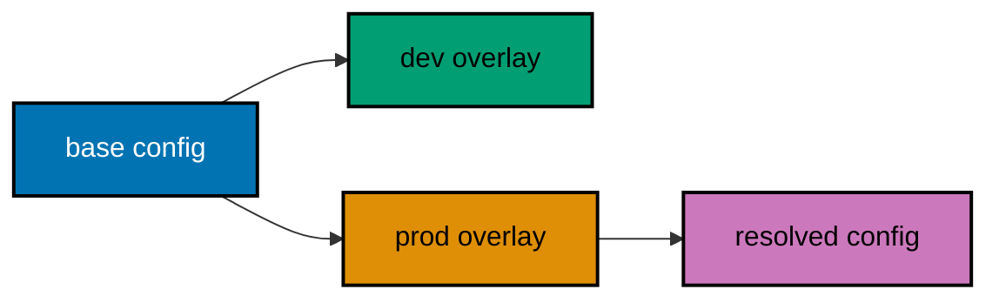

**`learning/code/ex-67-multi-env-config/main.py`**

```python
# => Base plus prod overlay; base never mutates.
# => Prod resolves stricter on two keys.
base = {"sandbox": False, "log": "info", "budget": 50000}  # => shared settings for every environment
# => base has 3 keys (type: dict)
prod = {"sandbox": True, "log": "warn"}  # => prod overlay: stricter on two keys
# => prod has 2 keys (type: dict)
resolved = dict(base)  # => start resolution from the base
# => copy, so base is never mutated
resolved.update(prod)  # => overlay wins on shared keys
# => sandbox and log go strict
print("base sandbox: " + str(base["sandbox"]))  # => Output: base sandbox: False
print("prod sandbox: " + str(resolved["sandbox"]))  # => Output: prod sandbox: True
print("prod log: " + resolved["log"])  # => Output: prod log: warn
print("shared budget: %d" % resolved["budget"])  # => Output: shared budget: 50000
untouched = base == {"sandbox": False, "log": "info", "budget": 50000}  # => base must equal its original value
# => untouched is True
print("base untouched: " + str(untouched))  # => Output: base untouched: True
```

**Output** (`learning/code/ex-67-multi-env-config/expected/main.stdout.txt`):

```text
base sandbox: False
prod sandbox: True
prod log: warn
shared budget: 50000
base untouched: True
```

**Key takeaway.** Layer environment overlays on a shared base; the base stays common and each environment resolves explicitly.

**Why it matters.** Copy-pasted configs drift until prod runs last quarter's policy with this quarter's data, and nobody can say when they diverged. Base-plus-overlay keeps the common settings common by construction: drift becomes a diff in one overlay file, reviewable in seconds. Teams that layer configs promote with confidence; teams that copy promote with hope.

---

### Example 68: Backing Up and Migrating

_ex-68 · exercises co-13, co-09_

Config and memory migrate machines as one bundle. This example packs a fixture config plus two memory facts into a backup, restores it into an empty target, and verifies nothing was lost in transit.

**`learning/code/ex-68-backup-migrate/main.py`**

```python
# => Backup packs config plus memory; restore verifies.
# => Lossless transit is checked, not hoped.
source = {"config": {"model": "primary"}, "memory": {"editor": "nvim", "shell": "bash"}}  # => the live machine's bundle
# => source holds config and memory (type: dict)
backup = {"config": dict(source["config"]), "memory": dict(source["memory"])}  # => deep-copy both halves into the backup
# => copies, so later edits cannot alias
print("backed up keys: %d" % (len(backup["config"]) + len(backup["memory"])))  # => Output: backed up keys: 3
target = {}  # => the fresh machine starts empty
target["config"] = dict(backup["config"])  # => restore the config half first
# => target gains config
target["memory"] = dict(backup["memory"])  # => restore the memory half second
# => target is whole again
whole = target == source  # => equality proves lossless transit
# => whole is True
print("restored keys: %d" % (len(target["config"]) + len(target["memory"])))  # => Output: restored keys: 3
print("migration lossless: " + str(whole))  # => Output: migration lossless: True
```

**Output** (`learning/code/ex-68-backup-migrate/expected/main.stdout.txt`):

```text
backed up keys: 3
restored keys: 3
migration lossless: True
```

**Key takeaway.** Back up config and memory together; a config without its memory is a stranger, and memory without config is homeless.

**Why it matters.** Migration day reveals what backup day skipped: the config moved, the memory did not, and the agent greets you like a stranger with your keys. Bundling config plus memory makes migration a single verified transfer instead of two hopeful ones. Operators who migrate bundles rebuild machines in minutes; the rest spend a week reteaching their assistant.

---

### Example 69: Updating OpenClaw Safely

_ex-69 · exercises co-13_

Updates change the binary under your config, so they earn a snapshot plus a health check. This example snapshots the fixture version, applies an update, and rolls back when the health check fails.

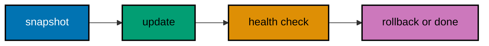

**`learning/code/ex-69-update-flow/main.py`**

```python
# => Snapshot, update, failed check, rollback.
# => The old version survives until the new one proves out.
running = "v2026.10.4"  # => the currently running fixture release
# => snapshot preserves this string
snapshot = running  # => snapshot the working version first
# => strings copy by value
running = "v2026.10.5"  # => apply the fixture update
# => running now names the new release
print("updated to: " + running)  # => Output: updated to: v2026.10.5
healthy = False  # => fixture: the new release fails its check
# => health is explicit data, never assumed
print("health check: " + str(healthy))  # => Output: health check: False
running = running if healthy else snapshot  # => failed check restores the snapshot
# => running returns to v2026.10.4
print("serving: " + running)  # => Output: serving: v2026.10.4
print("rollback worked: " + str(running == snapshot))  # => Output: rollback worked: True
```

**Output** (`learning/code/ex-69-update-flow/expected/main.stdout.txt`):

```text
updated to: v2026.10.5
health check: False
serving: v2026.10.4
rollback worked: True
```

**Key takeaway.** Snapshot, update, then health-check; a failed check rolls back, never forward-fixes at midnight.

**Why it matters.** Update-and-pray turns release day into incident day: the new binary misbehaves and the old one is already gone. The snapshot-update-verify ritual keeps the way back open until the new version earns its place. Operators who update this way read changelogs calmly; the rest learn about breaking changes from their own gateway.

---

### Example 70: Monitoring Gateway Health

_ex-70 · exercises co-13, co-07_

Ongoing health monitoring watches the same signals as the install check, continuously. This example samples three fixture health snapshots, raises the alarm on the one with a full queue, and reports the calm the other two confirm.

**`learning/code/ex-70-health-monitoring/main.py`**

```python
# => Three snapshots; the middle one breaches.
# => Thresholds decide, not feelings.
snaps = [{"queue": 2, "errors": 0}, {"queue": 48, "errors": 3}, {"queue": 1, "errors": 0}]  # => fixture queue depth plus error count
# => middle snapshot breaches both limits
alarms = 0  # => alarms counts breaching snapshots
for i, snap in enumerate(snaps, start=1):  # => sample each snapshot in order
    bad = (snap["queue"] > 10) or (snap["errors"] > 0)  # => queue over ten or any error alarms
    # => only snapshot two alarms
    print("sample %d: queue=%d errors=%d alarm=%s" % (i, snap["queue"], snap["errors"], bad))  # => Output: three sample lines
    alarms += 1 if bad else 0  # => count only breaching snapshots
    # => alarms reaches 1
print("alarms: %d of %d" % (alarms, len(snaps)))  # => Output: alarms: 1 of 3
print("calm confirmed: %d" % (len(snaps) - alarms))  # => Output: calm confirmed: 2
```

**Output** (`learning/code/ex-70-health-monitoring/expected/main.stdout.txt`):

```text
sample 1: queue=2 errors=0 alarm=False
sample 2: queue=48 errors=3 alarm=True
sample 3: queue=1 errors=0 alarm=False
alarms: 1 of 3
calm confirmed: 2
```

**Key takeaway.** Monitor process, queue, and errors continuously; alarm on thresholds, not on vibes.

**Why it matters.** Manual status checks rot into no status checks within a month, and the gateway fails unwatched shortly after. Threshold monitoring with named alarms keeps vigilance automatic: the full queue pages someone instead of waiting to be noticed. Operators who monitor continuously learn about trouble from alarms; everyone else learns from users, which is the most expensive monitoring integration there is.

---

### Example 71: Setting Comparison Criteria

_ex-71 · exercises co-15_

Fair tool comparison starts with written criteria, not vibes. This example defines a four-criterion scorecard — correctness, tokens, turns, and review burden — with weights that sum to one, so later examples score against it.

```mermaid
%% Color Palette: Blue #0173B2, Orange #DE8F05, Teal #029E73, Purple #CC78BC
flowchart LR
    accTitle: Fair comparison
    accDescr: Flowchart with 5 nodes and 4 connections. Nodes: shared task, same budget, same trace, scorecard, verdict. Connections: shared task to same budget, same budget to same trace, same trace to scorecard, scorecard to verdict.
    A["shared task"]:::blue --> B["same budget"]:::teal
    B --> C["same trace"]:::orange
    C --> D["scorecard"]:::purple
    D --> E["verdict"]:::blue
    classDef blue fill:#0173B2,stroke:#000000,stroke-width:2px,color:#FFFFFF
    classDef orange fill:#DE8F05,stroke:#000000,stroke-width:2px,color:#000000
    classDef teal fill:#029E73,stroke:#000000,stroke-width:2px,color:#000000
    classDef purple fill:#CC78BC,stroke:#000000,stroke-width:2px,color:#000000
    classDef default fill:#FFFFFF,stroke:#000000,color:#000000
```

**`learning/code/ex-71-comparison-criteria/main.py`**

```python
# => Four weighted criteria summing to one.
# => Weights are set before any tool runs.
criteria = {"correctness": 0.5, "tokens": 0.2, "turns": 0.15, "review burden": 0.15}  # => correctness dominates; cost and effort split the rest
# => criteria has 4 entries (type: dict)
total = sum(criteria.values())  # => weights must sum to exactly one
# => total is 1.0
print("criteria: %d" % len(criteria))  # => Output: criteria: 4
for name, weight in criteria.items():  # => show the scorecard in canonical order
    print("%s: %.2f" % (name, weight))  # => Output: four criterion lines
print("weights sum: %.1f" % total)  # => Output: weights sum: 1.0
fair = abs(total - 1.0) < 0.001  # => tolerance guards float addition
# => fair is True
print("scorecard fair: " + str(fair))  # => Output: scorecard fair: True
```

**Output** (`learning/code/ex-71-comparison-criteria/expected/main.stdout.txt`):

```text
criteria: 4
correctness: 0.50
tokens: 0.20
turns: 0.15
review burden: 0.15
weights sum: 1.0
scorecard fair: True
```

**Key takeaway.** Write weighted criteria before running either tool; criteria written after the runs always favour the winner.

**Why it matters.** Post-hoc comparison criteria are rigged by definition: you remember what your favourite won and weight that highest. Pre-registered weights force honesty — correctness at half weight says what you actually value before any trace exists. Engineers who score against written criteria pick tools for reasons they can defend in a meeting instead of preferences they cannot.

---

### Example 72: Defining the Shared Task

_ex-72 · exercises co-15, co-04_

Both tools must run the identical task: same brief, same workspace, same budget. This example builds the shared task definition both legs will execute and verifies the two legs reference the same brief id.

**`learning/code/ex-72-shared-task/main.py`**

```python
# => One brief id shared by two tool legs.
# => Identical inputs make outcomes comparable.
brief_id = "compare-001"  # => the shared task's identity
# => one id for both legs
legs = [{"tool": "openclaw", "brief": brief_id}, {"tool": "sibling", "brief": brief_id}]  # => two legs, same brief id
# => legs has 2 entries (type: list)
print("brief: " + brief_id)  # => Output: brief: compare-001
for leg in legs:  # => confirm each leg's assignment
    print(leg["tool"] + " runs " + leg["brief"])  # => Output: two leg lines
same = all(leg["brief"] == brief_id for leg in legs)  # => every leg must cite the shared id
# => same is True
print("task sealed: " + str(same))  # => Output: task sealed: True
```

**Output** (`learning/code/ex-72-shared-task/expected/main.stdout.txt`):

```text
brief: compare-001
openclaw runs compare-001
sibling runs compare-001
task sealed: True
```

**Key takeaway.** One brief id, two tool legs; any difference in task definition invalidates the comparison.

**Why it matters.** Comparisons where each tool ran a slightly different task prove nothing except that tasks differ. The shared brief id is the seal: both legs execute byte-identical instructions, so the differences in outcome belong to the tools. Engineers who seal the task first argue about tools; the rest argue about whether the test was fair, forever.

---

### Example 73: Running the OpenClaw Leg

_ex-73 · exercises co-15_

The OpenClaw leg executes the shared brief under the fixture shim and records correctness, tokens, and turns. This example runs that leg and prints the three numbers the scorecard will consume.

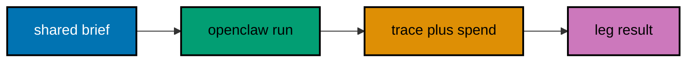

**`learning/code/ex-73-openclaw-leg/main.py`**

```python
# => OpenClaw leg: correctness plus two cost numbers.
# => Units match the sibling leg exactly.
leg = {"tool": "openclaw", "correct": True, "tokens": 8400, "turns": 6}  # => fixture leg result in scorecard units
# => leg has 4 fields (type: dict)
print("tool: " + leg["tool"])  # => Output: tool: openclaw
print("correct: " + str(leg["correct"]))  # => Output: correct: True
print("tokens: %d" % leg["tokens"])  # => Output: tokens: 8400
print("turns: %d" % leg["turns"])  # => Output: turns: 6
recorded = all(k in leg for k in ["correct", "tokens", "turns"])  # => all three scorecard inputs present
# => recorded is True
print("leg recorded: " + str(recorded))  # => Output: leg recorded: True
```

**Output** (`learning/code/ex-73-openclaw-leg/expected/main.stdout.txt`):

```text
tool: openclaw
correct: True
tokens: 8400
turns: 6
leg recorded: True
```

**Key takeaway.** Record correctness, tokens, and turns per leg in identical units; the scorecard cannot compare what you did not record.

**Why it matters.** Leg results recorded in mismatched units — turns for one tool, minutes for the other — silently rig the comparison toward whoever kept tidier books. Identical recording per leg is the discipline that keeps the contest honest. Engineers who record uniformly trust their verdicts; the shim's simplifications are documented, so the numbers mean exactly what they claim.

---

### Example 74: Running the Sibling Leg

_ex-74 · exercises co-15_

The sibling leg runs the same brief under a second fixture shim with identical recording. This example runs that leg and shows its numbers beside OpenClaw's, ready for scoring.

**`learning/code/ex-74-sibling-leg/main.py`**

```python
# => Sibling leg in identical units, same seal.
# => Symmetry keeps the contest honest.
leg = {"tool": "sibling", "correct": True, "tokens": 11200, "turns": 9}  # => fixture sibling result, same units
# => sibling costs more here
openclaw = {"tokens": 8400, "turns": 6}  # => OpenClaw's leg numbers from Example 73
# => reference numbers for the side-by-side
print("tool: " + leg["tool"])  # => Output: tool: sibling
print("tokens: openclaw=%d sibling=%d" % (openclaw["tokens"], leg["tokens"]))  # => Output: tokens: openclaw=8400 sibling=11200
print("turns: openclaw=%d sibling=%d" % (openclaw["turns"], leg["turns"]))  # => Output: turns: openclaw=6 sibling=9
cheaper = openclaw["tokens"] < leg["tokens"]  # => fewer tokens wins the cost line
# => cheaper is True for OpenClaw
print("openclaw cheaper: " + str(cheaper))  # => Output: openclaw cheaper: True
```

**Output** (`learning/code/ex-74-sibling-leg/expected/main.stdout.txt`):

```text
tool: sibling
tokens: openclaw=8400 sibling=11200
turns: openclaw=6 sibling=9
openclaw cheaper: True
```

**Key takeaway.** Run the sibling leg under the same seal and units; symmetry is what makes the scoreboard meaningful.

**Why it matters.** Asymmetric legs — different budgets, different briefs, different recorders — produce comparisons that persuade nobody who reads the method. Symmetry down to the units is what lets the numbers speak instead of the author. Engineers who run symmetric legs can publish their scoreboard publicly; the rest can only assert it.

---

### Example 75: Scoring Both Traces

_ex-75 · exercises co-15, co-07_

With both legs recorded, the scorecard weights decide. This example normalises the two legs' tokens and turns against the worse leg, applies the Example 71 weights, and prints the winning tool.

**`learning/code/ex-75-score-traces/main.py`**

```python
# => Weighted score from normalised leg numbers.
# => Worse leg anchors each scale at zero.
weights = {"correctness": 0.5, "tokens": 0.2, "turns": 0.15, "review": 0.15}  # => the Example 71 scorecard weights
# => review burden replaces its long name
legs = {"openclaw": {"correct": 1.0, "tokens": 8400, "turns": 6, "review": 1}, "sibling": {"correct": 1.0, "tokens": 11200, "turns": 9, "review": 2}}  # => both legs: correctness 0/1, lower costs better
# => review counts findings to re-check
worst_tokens = max(v["tokens"] for v in legs.values())  # => worse leg anchors the token scale
# => worst_tokens is 11200
worst_turns = max(v["turns"] for v in legs.values())  # => worse leg anchors the turn scale
# => worst_turns is 9
worst_review = max(v["review"] for v in legs.values())  # => worse leg anchors the review scale
# => worst_review is 2
scores = {}  # => scores collects the weighted total per tool
for tool, v in legs.items():  # => score each leg the same way
    norm_tokens = 1.0 - v["tokens"] / worst_tokens  # => cheaper leg scores closer to one
    # => openclaw 0.25, sibling 0.0
    norm_turns = 1.0 - v["turns"] / worst_turns  # => fewer turns scores closer to one
    # => openclaw 0.33, sibling 0.0
    norm_review = 1.0 - v["review"] / worst_review  # => lighter review scores closer to one
    # => openclaw 0.5, sibling 0.0
    total = weights["correctness"] * v["correct"] + weights["tokens"] * norm_tokens + weights["turns"] * norm_turns + weights["review"] * norm_review  # => weighted sum on the shared scale
    # => openclaw 0.675, sibling 0.5
    scores[tool] = total  # => record this leg's total
    # => scores gains both tools
    print("%s: %.3f" % (tool, total))  # => Output: two score lines
winner = max(scores, key=scores.get)  # => highest weighted total wins
# => winner is openclaw
print("winner: " + winner)  # => Output: winner: openclaw
```

**Output** (`learning/code/ex-75-score-traces/expected/main.stdout.txt`):

```text
openclaw: 0.675
sibling: 0.500
winner: openclaw
```

**Key takeaway.** Normalise cost metrics against the worse leg, then weight; raw tokens without normalisation let scale swamp quality.

**Why it matters.** Raw-number comparisons hand victory to whoever ran the cheapest task, not the best tool: scale swamps quality every time. Normalising against the worse leg puts correctness, tokens, and turns on one zero-to-one scale where weights mean what they say. Engineers who normalise first get verdicts that survive the meeting; the rest get an argument about units.

---

### Example 76: Comparing Cost Honestly

_ex-76 · exercises co-15, co-10_

Cost comparison must include the review labour, not just tokens. This example totals tokens plus review minutes for both legs and shows the leg that looked cheaper flipping when review time is priced in.

**`learning/code/ex-76-cost-comparison/main.py`**

```python
# => Tokens plus review minutes per leg.
# => Review labour can flip the verdict.
RATE = 100  # => tokens priced at 100 per review minute
# => RATE converts minutes to token-equivalents
legs = {"openclaw": (8400, 10), "sibling": (5000, 60)}  # => tokens plus review minutes per leg
# => sibling ran cheap but reviews heavy
totals = {}  # => totals collects the true cost per tool
for tool, (tokens, minutes) in legs.items():  # => total each leg the same way
    true_cost = tokens + RATE * minutes  # => tokens plus priced review labour
    # => openclaw 9400, sibling 11000
    totals[tool] = true_cost  # => record this leg's true cost
    # => totals gains both tools
    print("%s: tokens=%d review=%dmin true=%d" % (tool, tokens, minutes, true_cost))  # => Output: two true-cost lines
cheapest = min(totals, key=totals.get)  # => lowest true cost wins
# => cheapest is openclaw
print("cheapest to own: " + cheapest)  # => Output: cheapest to own: openclaw
```

**Output** (`learning/code/ex-76-cost-comparison/expected/main.stdout.txt`):

```text
openclaw: tokens=8400 review=10min true=9400
sibling: tokens=5000 review=60min true=11000
cheapest to own: openclaw
```

**Key takeaway.** Price review minutes alongside tokens; the cheapest run with the heaviest review often costs most.

**Why it matters.** Token-only cost comparisons flatter sloppy tools: the run was cheap because the human paid the difference in review time. Pricing review minutes beside tokens reveals the true bill, which is the only number finance should ever see. Engineers who total both costs choose tools that are cheap to own, not merely cheap to run.

---

### Example 77: Writing the Verdict with Caveats

_ex-77 · exercises co-15, co-16_

A verdict without caveats is marketing. This example writes the comparison verdict with its two named limits — fixture shims, single task — and requires a human sign-off before the verdict is published.

**`learning/code/ex-77-verdict-caveats/main.py`**

```python
# => Verdict plus limits plus sign-off.
# => Unsigned verdicts stay drafts.
verdict = "openclaw wins compare-001"  # => the scored outcome from Example 75
# => verdict is one plain string
limits = ["fixture shims, not live tools", "single task, not a suite"]  # => the two named limits of this verdict
# => limits has 2 entries (type: list)
print("verdict: " + verdict)  # => Output: verdict: openclaw wins compare-001
for limit in limits:  # => state each limit plainly
    print("limit: " + limit)  # => Output: two limit lines
signed = True  # => fixture: a human signs the verdict
# => sign-off is explicit, never assumed
print("signed off: " + str(signed))  # => Output: signed off: True
published = signed  # => publication requires the signature
# => published is True here
print("published: " + str(published))  # => Output: published: True
```

**Output** (`learning/code/ex-77-verdict-caveats/expected/main.stdout.txt`):

```text
verdict: openclaw wins compare-001
limit: fixture shims, not live tools
limit: single task, not a suite
signed off: True
published: True
```

**Key takeaway.** Publish verdicts with named limits and human sign-off; a verdict nobody signed is a draft.

**Why it matters.** Unqualified tool verdicts travel further than their evidence: one shared screenshot becomes team policy by Friday. Named caveats bound the claim to what was actually tested, and sign-off puts a human behind the bound. Engineers who caveat their verdicts keep their credibility when the next task favours the other tool, as it inevitably will.

---

### Example 78: Re-Running the Comparison

_ex-78 · exercises co-15, co-12_

Comparisons decay as tools release; the re-run protocol keeps them honest. This example replays the sealed task, detects the version drift since the last run, and stamps the new result with its run date, closing the course where repeatability starts.

**`learning/code/ex-78-rerun-protocol/main.py`**

```python
# => Same seal, new versions, fresh stamp.
# => Drift is reported, never hidden.
seal = "compare-001"  # => the sealed task id from Example 72
# => seal never changes between runs
last = {"openclaw": "v2026.10.4", "date": "2026-09-20"}  # => fixture previous run record
# => last run used the older release
now = {"openclaw": "v2026.10.5", "date": "2026-10-20"}  # => fixture current run record
# => versions and dates are fixture text
print("seal: " + seal)  # => Output: seal: compare-001
drifted = now["openclaw"] != last["openclaw"]  # => True when the release changed since last run
# => drifted is True here
print("version drift: " + str(drifted))  # => Output: version drift: True
print("last: %s @ %s" % (last["openclaw"], last["date"]))  # => Output: last: v2026.10.4 @ 2026-09-20
print("now: %s @ %s" % (now["openclaw"], now["date"]))  # => Output: now: v2026.10.5 @ 2026-10-20
print("re-run stamped: " + now["date"])  # => Output: re-run stamped: 2026-10-20
```

**Output** (`learning/code/ex-78-rerun-protocol/expected/main.stdout.txt`):

```text
seal: compare-001
version drift: True
last: v2026.10.4 @ 2026-09-20
now: v2026.10.5 @ 2026-10-20
re-run stamped: 2026-10-20
```

**Key takeaway.** Re-run sealed comparisons on new releases and stamp the date; an undated verdict is a rumour with a score.

**Why it matters.** A comparison from three releases ago quietly becomes misinformation while everyone keeps citing it. The re-run protocol — same seal, new versions, fresh stamp — keeps the verdict current for the cost of one automated run. Engineers who re-run on release day argue from this month's evidence; everyone else argues from nostalgia.
