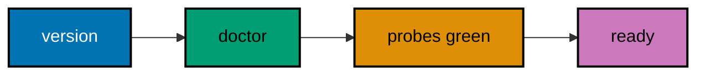
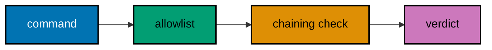

Examples 1–25 build the operator's foundation: verifying the install, choosing an onboarding path, reading the config file, pointing OpenClaw at a model, sending a first task, reading gateway status, messaging round-trips, and scoping the workspace. Then comes the reading skill — traces, plausible-wrong steps, diffs, plans, transcripts, memory, arguments, health codes, and logs — and finally the permission floor: allow and deny lists, approvals, sandboxes, exec policy, channel groups, redaction, dry runs, and audit entries. Every example is a complete `main.py` under `learning/code/`; run each one with `python3 main.py` from inside its own directory.

---

### Example 1: Checking the Install

_ex-01 · exercises co-01, co-13_

Every OpenClaw session starts with two shell probes: `openclaw --version` tells you which release you are driving, and `openclaw doctor` checks the machine around it. This example parses both fixture outputs the way a careful engineer would before trusting any later step.



**`learning/code/ex-01-check-install/main.py`**

```python
# => Example 1 drives no live binary.
# => It replays fixture text shaped like the real CLI output,
# => so the lesson stays runnable years after the release changes.
version_line = "openclaw v2026.10.5"  # => the exact `--version` fixture line we parse below
doctor_lines = ["node 24.11.0 ok", "config file ok", "gateway port ok"]  # => one fixture line per doctor probe the CLI runs
# => three probes keep this first parser tiny and readable
version = version_line.split()[1]  # => split on whitespace and keep the second field
# => version is now v2026.10.5 (type: str)
release = version.lstrip("v")  # => strip the leading v so the release compares as numbers
# => release is now 2026.10.5 (type: str)
parts = [int(p) for p in release.split(".")]  # => split on dots and convert each piece to int
# => parts is now [2026, 10, 5] (type: list)
print("release: " + release)  # => Output: release: 2026.10.5
print("major: %d" % parts[0])  # => Output: major: 2026
checks = {}  # => checks will map each probe name to True or False
for line in doctor_lines:  # => walk the three fixture lines one at a time
    name, _ver, status = line.split()  # => unpack probe name, detail, and trailing status word
    # => status is ok for every fixture line here
    checks[name] = status == "ok"  # => True only when the probe reports ok
    # => checks gains node, then config, then gateway
for name in ["node", "config", "gateway"]:  # => report the probes in a fixed, readable order
    print(name + ": " + str(checks[name]))  # => Output: node: True, then config: True, gateway: True
ready = all(checks.values())  # => all() is True only when every probe passed
# => ready is True, so later examples may proceed
print("ready: " + str(ready))  # => Output: ready: True
```

**Output** (`learning/code/ex-01-check-install/expected/main.stdout.txt`):

```text
release: 2026.10.5
major: 2026
node: True
config: True
gateway: True
ready: True
```

**Key takeaway.** Read the version string and the doctor report before you run anything else; a green doctor line is the precondition for every example that follows.

**Why it matters.** Engineers lose hours debugging agent behaviour that turns out to be a broken install: a missing Node runtime, a half-written config, or a release two minors behind the docs. The version-plus-doctor habit takes seconds and moves every later failure into the right bucket, install problem versus task problem. Teams that script this check into their dotfiles never chase ghosts, which is why this course opens with it.

---

### Example 2: Choosing an Onboarding Path

_ex-02 · exercises co-01, co-13_

OpenClaw offers a guided `openclaw onboard` walk and a scriptable `openclaw setup --baseline` shortcut. This example models both paths as data so you can see which setup steps each one performs and pick the path that fits a fresh machine versus a rebuilt one.

**`learning/code/ex-02-onboard-flow/main.py`**

```python
# => Two onboarding paths, modelled as plain step lists.
# => The fixture keeps only the step names, never credentials.
guided = ["verify inference", "gateway", "workspace", "channels", "skills", "health"]  # => the six wizard stages from the CLI reference
# => guided has 6 steps (type: list)
baseline = ["baseline config", "workspace"]  # => the two scriptable steps the --baseline flag runs
# => baseline has 2 steps (type: list)
print("guided steps: %d" % len(guided))  # => Output: guided steps: 6
print("baseline steps: %d" % len(baseline))  # => Output: baseline steps: 2
shared = [s for s in baseline if s in guided]  # => keep baseline steps that the wizard also performs
# => shared is ['workspace'] (type: list)
print("shared: " + ", ".join(shared))  # => Output: shared: workspace
only_guided = [s for s in guided if s not in baseline]  # => steps the wizard adds beyond the baseline
# => four interactive stages remain
print("guided-only: " + ", ".join(only_guided))  # => Output: guided-only: verify inference, gateway, channels, skills, health
command = "openclaw setup --baseline"  # => the repeatable command this lesson recommends
# => command is a plain string, never executed here
print("rebuild with: " + command)  # => Output: rebuild with: openclaw setup --baseline
same_config = True  # => both paths converge on ~/.openclaw/openclaw.json
# => same_config records that documented guarantee
print("same config file: " + str(same_config))  # => Output: same config file: True
```

**Output** (`learning/code/ex-02-onboard-flow/expected/main.stdout.txt`):

```text
guided steps: 6
baseline steps: 2
shared: workspace
guided-only: verify inference, gateway, channels, skills, health
rebuild with: openclaw setup --baseline
same config file: True
```

**Key takeaway.** Use guided onboarding once per machine and the baseline flag for repeatable rebuilds; both end at the same config file.

**Why it matters.** Onboarding feels like a one-off click-through until you rebuild a laptop or provision a server and must repeat it exactly. Knowing which steps the guided flow hides lets you script the repeatable path with confidence instead of memorising wizard screens. Reproducible setup is what turns a personal assistant into team infrastructure, and this example draws the line between the two paths.

---

### Example 3: Reading the Config File

_ex-03 · exercises co-13_

OpenClaw keeps its settings in `openclaw.json` under `~/.openclaw/`. This example builds that file's five top-level sections as a Python dict so you learn what each section owns before you ever edit the real file by hand.


**`learning/code/ex-03-config-file-anatomy/main.py`**

```python
# => The five sections of openclaw.json, as nested dicts.
# => Values are placeholders; structure is what matters here.
config = {}  # => config starts empty and gains one section at a time
config["agents"] = {"defaults": {"model": "primary"}}  # => which model each agent uses unless overridden
# => agents is the first of five sections
config["channels"] = {"telegram": "paired", "slack": "off"}  # => messaging surfaces and their pairing state
# => two channels show the on/off pattern
config["tools"] = {"exec": "allow", "browser": "ask"}  # => per-tool default policy: allow or ask
# => tools section holds two sample entries
config["models"] = {"primary": "anthropic/claude", "fallbacks": []}  # => provider routing with an empty fallback list
# => models section mirrors the agents default
config["security"] = {"sandbox": True, "audit": True}  # => gateway-wide safety switches live here
# => security is the fifth and last section
print("sections: %d" % len(config))  # => Output: sections: 5
for section in sorted(config):  # => sorted() prints sections in a stable order
    print("section: " + section)  # => Output: section: agents, channels, models, security, tools
print("model: " + config["agents"]["defaults"]["model"])  # => nested lookup reaches the default model
# => Output: model: primary
print("sandbox: " + str(config["security"]["sandbox"]))  # => Output: sandbox: True
```

**Output** (`learning/code/ex-03-config-file-anatomy/expected/main.stdout.txt`):

```text
sections: 5
section: agents
section: channels
section: models
section: security
section: tools
model: primary
sandbox: True
```

**Key takeaway.** The config file has five sections and each setting lives in exactly one of them; read the section, not the whole file.

**Why it matters.** Hand-editing a config you have never mapped is how gateways end up with model keys in channel blocks and channels in model blocks. A five-section mental map means every later example can say change the agents section and you know precisely where to look. Config literacy is unglamorous and compounds: each future edit gets faster and safer because the map never changes.

---

### Example 4: Configuring a Model Provider

_ex-04 · exercises co-13_

The `models` section names a primary provider and ordered fallbacks. This example resolves three candidate providers against a fixture availability table, showing why ordered fallbacks beat a single hardcoded model name.

**`learning/code/ex-04-model-provider-config/main.py`**

```python
# => Provider resolution: first reachable entry wins.
# => Reachability is fixture data, never a live network probe.
providers = ["anthropic/claude", "openai/gpt", "local/ollama"]  # => preference order, strongest first
# => providers has 3 entries (type: list)
reachable = {"anthropic/claude": False, "openai/gpt": True, "local/ollama": True}  # => fixture: the primary is down, both fallbacks are up
# => dict lookup is O(1) per provider
chosen = None  # => chosen stays None until a reachable provider is found
for name in providers:  # => walk providers in preference order
    print("trying " + name)  # => Output: trying anthropic/claude, then trying openai/gpt
    if reachable[name]:  # => the fixture decides, not the network
        chosen = name  # => first reachable provider claims the slot
        break  # => stop at the first win; later entries stay backups
print("chosen: " + str(chosen))  # => Output: chosen: openai/gpt
skipped = providers.index(chosen)  # => index() counts how many preferred entries failed
# => skipped is 1, the downed primary
print("fallbacks used: %d" % skipped)  # => Output: fallbacks used: 1
print("outage survived: " + str(chosen is not None))  # => Output: outage survived: True
```

**Output** (`learning/code/ex-04-model-provider-config/expected/main.stdout.txt`):

```text
trying anthropic/claude
trying openai/gpt
chosen: openai/gpt
fallbacks used: 1
outage survived: True
```

**Key takeaway.** List one primary plus ordered fallbacks; the first reachable provider wins and the order documents your preference.

**Why it matters.** A single hardcoded model turns every provider outage into your outage, usually discovered mid-demo. Ordered fallbacks encode the decision you would make under pressure while you are calm: prefer this, accept that, never use the third. Failover you configure once quietly saves the session you would otherwise lose loudly, which is exactly what production use demands.

---

### Example 5: Running a First Task

_ex-05 · exercises co-01, co-04_

A first task is one CLI call with a workspace and a plain-language goal. This example builds that invocation as data, checks its three required fields, and prints the fixture acknowledgement the gateway would return.


**`learning/code/ex-05-first-task/main.py`**

```python
# => A task invocation is a dict with three required fields.
# => The gateway acknowledgement below is fixture text.
task = {"command": "openclaw agent run"}  # => the CLI entry point for a one-shot task
task["workspace"] = "/srv/notes"  # => the directory the agent may touch
# => task now has two of three fields
task["goal"] = "summarise inbox.md in five bullets"  # => plain-language goal, the third required field
# => task is now complete (type: dict)
required = ["command", "workspace", "goal"]  # => the three fields every task must carry
missing = [f for f in required if f not in task]  # => list any required field the task forgot
# => missing is [] for this well-formed task
print("missing fields: %d" % len(missing))  # => Output: missing fields: 0
ack = {"session": "ses-001", "state": "accepted"}  # => fixture acknowledgement from the gateway
# => session ids look like ses-001 here
print("session: " + ack["session"])  # => Output: session: ses-001
print("state: " + ack["state"])  # => Output: state: accepted
sendable = len(missing) == 0  # => only a complete task may be sent
# => sendable is True
print("sendable: " + str(sendable))  # => Output: sendable: True
```

**Output** (`learning/code/ex-05-first-task/expected/main.stdout.txt`):

```text
missing fields: 0
session: ses-001
state: accepted
sendable: True
```

**Key takeaway.** Every task needs a command, a workspace, and a goal; missing any one of them, refuse to send it.

**Why it matters.** Beginners fire off one-line asks with no workspace and then wonder why the agent edited the wrong directory or answered vaguely. Requiring command, workspace, and goal turns each request into a small contract the agent can actually satisfy. The three-field check below is the cheapest quality gate in this course, and the habit protects every task you will ever send.

---

### Example 6: Reading Gateway Status

_ex-06 · exercises co-01_

`openclaw status` prints gateway health in one screen: process, port, sessions, and queue depth. This example parses a fixture status block and reduces it to a single go/no-go line you can trust before sending work.

**`learning/code/ex-06-gateway-status/main.py`**

```python
# => Fixture status block, shaped like `openclaw status` output.
# => Thresholds are ours: queue depth above 10 means busy.
status = {"process": "up", "port": 18789, "sessions": 2, "queue": 3}  # => four health signals in one dict
# => fixture values describe a calm gateway
print("process: " + status["process"])  # => Output: process: up
print("port: %d" % status["port"])  # => Output: port: 18789
print("sessions: %d" % status["sessions"])  # => Output: sessions: 2
print("queue: %d" % status["queue"])  # => Output: queue: 3
process_ok = status["process"] == "up"  # => the gateway process must report up
# => process_ok is True
queue_ok = status["queue"] <= 10  # => ten or fewer queued items counts as drainable
# => queue_ok is True for a queue of 3
go = process_ok and queue_ok  # => both signals must agree before work is sent
# => go is True
print("go: " + str(go))  # => Output: go: True
```

**Output** (`learning/code/ex-06-gateway-status/expected/main.stdout.txt`):

```text
process: up
port: 18789
sessions: 2
queue: 3
go: True
```

**Key takeaway.** Collapse status output to one go/no-go decision; read details only when the answer is no-go.

**Why it matters.** Status screens invite skimming, and skimmed warnings become outages at the worst moment. A personal go/no-go reducer forces the machine to state its health plainly instead of hoping you notice a queue depth of forty. Operators who gate their work on one boolean sleep better, because the gateway either earns the next task or explains itself first.

---

### Example 7: Sending a Message Round-Trip

_ex-07 · exercises co-01, co-03_

`openclaw message send` drops a message into a session and `openclaw message read` collects the reply. This example replays a two-message fixture exchange and matches each reply to its prompt, the smallest observable session loop.


**`learning/code/ex-07-message-roundtrip/main.py`**

```python
# => A two-message session: prompts carry ids, replies echo them.
# => Id matching is the whole integrity check.
prompts = [{"id": "m1", "text": "ping"}, {"id": "m2", "text": "status?"}]  # => two outbound prompts with unique ids
# => prompts has 2 entries (type: list)
replies = [{"id": "m1", "text": "pong"}, {"id": "m2", "text": "all green"}]  # => fixture replies echo the prompt ids
# => replies has 2 entries (type: list)
matched = 0  # => matched counts replies paired to a prompt
for prompt in prompts:  # => handle each prompt in send order
    want = prompt["id"]  # => the id this prompt's reply must echo
    # => want is m1, then m2
    got = [r for r in replies if r["id"] == want]  # => find replies echoing this id
    # => got holds exactly one reply each time
    print(prompt["text"] + " -> " + got[0]["text"])  # => Output: ping -> pong, then status? -> all green
    matched += len(got)  # => count this prompt's matched replies
    # => matched reaches 2 after both turns
print("matched: %d of %d" % (matched, len(prompts)))  # => Output: matched: 2 of 2
print("session sound: " + str(matched == len(prompts)))  # => Output: session sound: True
```

**Output** (`learning/code/ex-07-message-roundtrip/expected/main.stdout.txt`):

```text
ping -> pong
status? -> all green
matched: 2 of 2
session sound: True
```

**Key takeaway.** Match every reply to its prompt id; an unmatched reply is a session bug, not a curiosity.

**Why it matters.** Messaging agents feel magical until a reply lands on the wrong question and nobody notices for a week. Pairing prompts and replies by id turns a chat log into an auditable ledger where every answer traces to its ask. That discipline is what lets you trust agent conversations the way you trust function return values: matched, typed, and accountable.

---

### Example 8: Scoping a Workspace

_ex-08 · exercises co-02, co-13_

The workspace setting draws the directory fence the agent must stay inside. This example tests four candidate paths against one workspace root and rejects the two that escape it, showing the prefix rule that enforces the fence.

**`learning/code/ex-08-workspace-scoping/main.py`**

```python
# => Workspace fence: pure prefix logic on fixture paths.
# => No filesystem access happens; strings are enough.
root = "/srv/notes"  # => the workspace root from the config file
# => root is the only trusted prefix
paths = ["inbox.md", "../secrets.env", "drafts/a.md", "/etc/hosts"]  # => four candidate paths, two hostile
# => paths has 4 entries (type: list)
resolved = [(p if p.startswith("/") else root + "/" + p) for p in paths]  # => absolute candidates stay literal, relative ones join the root
# => /etc/hosts is therefore tested as itself
inside = [p for p in resolved if p.startswith(root + "/")]  # => keep only paths under the root prefix
# => /etc/hosts fails the prefix test
clean = [p for p in inside if "/../" not in p]  # => drop traversals that smuggle .. segments
# => ../secrets.env is rejected here
print("candidates: %d" % len(paths))  # => Output: candidates: 4
print("accepted: %d" % len(clean))  # => Output: accepted: 2
for p in clean:  # => show the survivors in candidate order
    print("ok: " + p)  # => Output: ok: /srv/notes/inbox.md, then drafts/a.md
print("fence holds: " + str(len(clean) == 2))  # => Output: fence holds: True
```

**Output** (`learning/code/ex-08-workspace-scoping/expected/main.stdout.txt`):

```text
candidates: 4
accepted: 2
ok: /srv/notes/inbox.md
ok: /srv/notes/drafts/a.md
fence holds: True
```

**Key takeaway.** A path is inside the workspace only if the workspace root is its prefix; everything else is rejected before any tool runs.

**Why it matters.** Directory escapes are the classic agent accident: a helpful assistant tidying files two levels above where you meant. The prefix rule is boringly simple, which is its virtue — it can be checked in one line before any tool executes. Workspaces you scope tightly are the difference between an agent with a desk and an agent with your whole house keys.

---

### Example 9: Reading a Tool-Use Trace

_ex-09 · exercises co-07_

After a task, OpenClaw leaves a trace: which tool ran, with what arguments, in what order. This example walks a three-call fixture trace and prints the tool sequence, the reading skill every later verdict in this course depends on.

**`learning/code/ex-09-read-a-trace/main.py`**

```python
# => A three-call fixture trace: tool name plus arguments.
# => Real traces are longer; the reading motion is identical.
trace = [{"tool": "read", "args": "inbox.md"}]  # => the agent first reads the inbox file
trace.append({"tool": "exec", "args": "wc -w inbox.md"})  # => then it counts the file's words via shell
# => trace now holds two calls
trace.append({"tool": "message", "args": "ses-001: 42 words"})  # => finally it reports back to the session
# => trace now holds three calls
print("calls: %d" % len(trace))  # => Output: calls: 3
for step, call in enumerate(trace, start=1):  # => enumerate numbers the calls from 1
    print("step %d: %s(%s)" % (step, call["tool"], call["args"]))  # => Output: step 1: read(inbox.md), step 2, step 3
tools = [c["tool"] for c in trace]  # => collect just the tool names in order
# => tools is ['read', 'exec', 'message']
print("sequence: " + " > ".join(tools))  # => Output: sequence: read > exec > message
read_first = trace[0]["tool"] == "read"  # => a sound agent reads before it acts
# => read_first is True here
print("read before act: " + str(read_first))  # => Output: read before act: True
```

**Output** (`learning/code/ex-09-read-a-trace/expected/main.stdout.txt`):

```text
calls: 3
step 1: read(inbox.md)
step 2: exec(wc -w inbox.md)
step 3: message(ses-001: 42 words)
sequence: read > exec > message
read before act: True
```

**Key takeaway.** Read traces as ordered tool calls with arguments; the order is the story of what the agent actually did.

**Why it matters.** Learners read the agent's chatty summary and skip the trace, which is like reviewing a receipt by trusting the cashier's smile. The trace is the only record of what really executed, and fluency with it is what separates operators from spectators. Every recovery, audit, and comparison later in this course starts by reading a trace exactly like this one.

---

### Example 10: Spotting a Plausible Wrong Step

_ex-10 · exercises co-07_

Agents fail most dangerously by sounding right: a confident summary over a wrong file. This example scores two fixture steps against the files they claim to touch and flags the one whose claim the workspace cannot support.

**`learning/code/ex-10-correct-vs-plausible/main.py`**

```python
# => Two steps, one honest and one plausible-but-wrong.
# => The workspace listing is the ground truth.
workspace = ["inbox.md", "drafts/a.md"]  # => the only files the agent may legitimately cite
# => workspace has 2 entries (type: list)
steps = [{"tool": "read", "file": "inbox.md"}, {"tool": "read", "file": "summary.md"}]  # => step two cites a file that does not exist
# => steps has 2 entries (type: list)
verdicts = []  # => verdicts collects True or False per step
for step in steps:  # => judge each step against the listing
    ok = step["file"] in workspace  # => True only for files really present
    # => inbox.md passes, summary.md fails
    verdicts.append(ok)  # => record this step's verdict
    # => verdicts becomes [True, False]
    print(step["file"] + ": " + str(ok))  # => Output: inbox.md: True, then summary.md: False
print("wrong steps: %d" % verdicts.count(False))  # => Output: wrong steps: 1
trust = all(verdicts)  # => the trace is trustworthy only when every step checks out
# => trust is False here
print("trace trustworthy: " + str(trust))  # => Output: trace trustworthy: False
```

**Output** (`learning/code/ex-10-correct-vs-plausible/expected/main.stdout.txt`):

```text
inbox.md: True
summary.md: False
wrong steps: 1
trace trustworthy: False
```

**Key takeaway.** Check each step's file claim against the workspace listing; confidence in prose never outweighs a missing file.

**Why it matters.** Plausible-but-wrong output is the failure mode that ships bugs to production while everyone nods along. The defence is mechanical, not clever: every file a step claims must exist in the workspace you scoped. Engineers who run this check catch the agent hallucinating results before those results become commits, and that single habit prevents the most expensive class of agent error.

---

### Example 11: Reviewing a Proposed Diff

_ex-11 · exercises co-06_

OpenClaw proposes file changes as diffs you approve before they apply. This example represents a two-file proposal, counts added and removed lines per file, and applies the approve-only-if-small rule reviewers actually use.

**`learning/code/ex-11-diff-review-basics/main.py`**

```python
# => A two-file diff proposal, modelled as added/removed counts.
# => Line bodies are omitted; sizes drive the decision.
proposal = [{"file": "notes.md", "added": 4, "removed": 1}]  # => a small, focused first file
proposal.append({"file": "index.md", "added": 30, "removed": 25})  # => a large rewrite hiding in the same proposal
# => proposal now covers two files
LIMIT = 10  # => LIMIT caps auto-approvable changed lines per file
# => ten lines fit one screen of careful review
approved = []  # => approved collects files that pass the size rule
for change in proposal:  # => judge each file on its own size
    total = change["added"] + change["removed"]  # => total changed lines for this file
    # => 5 for notes.md, 55 for index.md
    ok = total <= LIMIT  # => small proposals pass, rewrites do not
    # => notes.md passes, index.md fails
    print(change["file"] + ": %d changed, ok=%s" % (total, ok))  # => Output: notes.md: 5 changed, ok=True, then index.md
    if ok:  # => only passing files join the approved list
        approved.append(change["file"])  # => notes.md is approved; index.md is escalated
print("approved: " + ", ".join(approved))  # => Output: approved: notes.md
print("escalated: %d" % (len(proposal) - len(approved)))  # => Output: escalated: 1
```

**Output** (`learning/code/ex-11-diff-review-basics/expected/main.stdout.txt`):

```text
notes.md: 5 changed, ok=True
index.md: 55 changed, ok=False
approved: notes.md
escalated: 1
```

**Key takeaway.** Review diffs per file with a size rule; approve small, deliberate proposals and escalate the rest.

**Why it matters.** Auto-applied diffs are how agents delete the file you meant to keep while you watch the progress spinner. A per-file size rule forces a pause exactly where judgement matters and keeps tiny fixes fast. Reviewers who count lines before approving catch the runaway rewrite early, when it is still a proposal and not yet your repository's new reality.

---

### Example 12: Asking for a Plan First

_ex-12 · exercises co-05_

Plan-then-act splits one risky request into a proposal you read and an execution you approve. This example contrasts a direct three-step execution with a plan-then-act run of the same goal and shows where the human checkpoint sits.


**`learning/code/ex-12-plan-then-act/main.py`**

```python
# => Direct execution versus plan-then-act for one goal.
# => The checkpoint is a boolean, not a feeling.
goal = "archive old drafts"  # => the shared goal both runs pursue
# => goal is one plain string
direct = ["list drafts", "move files", "delete originals"]  # => three steps with no pause between them
# => direct has 3 steps (type: list)
plan = ["list drafts", "CHECKPOINT", "move files", "delete originals"]  # => the same steps with a human checkpoint inserted
# => plan has 4 entries (type: list)
print("goal: " + goal)  # => Output: goal: archive old drafts
print("direct steps: %d" % len(direct))  # => Output: direct steps: 3
gaps = [s for s in plan if s == "CHECKPOINT"]  # => find the human checkpoints in the plan
# => gaps holds one checkpoint
print("checkpoints: %d" % len(gaps))  # => Output: checkpoints: 1
approved = True  # => the human reads the plan and approves it
# => approval is explicit fixture data
executed = [s for s in plan if s != "CHECKPOINT"]  # => execution replays the plan minus the checkpoint
# => executed matches direct step for step
print("executed steps: %d" % len(executed))  # => Output: executed steps: 3
print("checkpoint approved: " + str(approved))  # => Output: checkpoint approved: True
```

**Output** (`learning/code/ex-12-plan-then-act/expected/main.stdout.txt`):

```text
goal: archive old drafts
direct steps: 3
checkpoints: 1
executed steps: 3
checkpoint approved: True
```

**Key takeaway.** For anything beyond a trivial edit, demand the plan first; the checkpoint costs seconds and buys back control.

**Why it matters.** Direct execution feels fast until the agent's third step deletes what its first step assumed. A written plan moves the surprise forward to where it is cheap: you correct a paragraph, not a repository. Teams that require plans for multi-step work spend slightly longer reading and dramatically less time reverting, which is the trade every experienced operator makes gladly.

---

### Example 13: Reading a Session Transcript

_ex-13 · exercises co-03_

Sessions remember turns; transcripts prove it. This example replays a three-turn fixture session, prints each turn with its number, and confirms the context the agent carried from turn one into turn three.

**`learning/code/ex-13-session-transcript/main.py`**

```python
# => Three turns; turn three must reuse a turn-one fact.
# => Carry-forward is verified, never assumed.
turns = ["goal: tidy drafts", "found 4 drafts", "archived 4 drafts per goal"]  # => fixture transcript, oldest first
# => turns has 3 entries (type: list)
for i, text in enumerate(turns, start=1):  # => number turns from 1 for the audit
    print("turn %d: %s" % (i, text))  # => Output: turn 1: goal: tidy drafts, turn 2, turn 3
carried = ("goal" in turns[2]) and ("4 drafts" in turns[2])  # => turn three echoes the goal and the count
# => carried is True
print("turns: %d" % len(turns))  # => Output: turns: 3
print("context carried: " + str(carried))  # => Output: context carried: True
```

**Output** (`learning/code/ex-13-session-transcript/expected/main.stdout.txt`):

```text
turn 1: goal: tidy drafts
turn 2: found 4 drafts
turn 3: archived 4 drafts per goal
turns: 3
context carried: True
```

**Key takeaway.** Number the turns when you review a session; context carried forward is only real if a later turn uses it.

**Why it matters.** Agents cheerfully claim they remember everything while quietly dropping the constraint from three turns ago. Numbered transcripts make memory checkable: you can point at turn three and ask which turn-one fact it used. That audit turns session memory from a marketing claim into a working feature you can rely on across long tasks.

---

### Example 14: Checking What the Agent Remembers

_ex-14 · exercises co-03_

OpenClaw's memory commands persist facts across sessions. This example stores two fixture facts, recalls them in a later turn, and shows the miss explicitly when a third fact was never stored.


**`learning/code/ex-14-memory-read/main.py`**

```python
# => A tiny memory store: dict write, dict read.
# => Misses return None instead of inventing facts.
memory = {}  # => the agent's persistent store starts empty
memory["editor"] = "nvim"  # => store the first fixture fact
# => memory now holds one fact
memory["shell"] = "bash"  # => store the second fixture fact
# => memory now holds two facts
print("stored: %d" % len(memory))  # => Output: stored: 2
print("editor: " + str(memory.get("editor")))  # => get() returns the stored value
# => Output: editor: nvim
print("shell: " + str(memory.get("shell")))  # => Output: shell: bash
missing = memory.get("timezone")  # => timezone was never stored
# => missing is None (type: NoneType)
print("timezone: " + str(missing))  # => Output: timezone: None
honest = missing is None  # => an explicit miss beats an invented answer
# => honest is True
print("miss is explicit: " + str(honest))  # => Output: miss is explicit: True
```

**Output** (`learning/code/ex-14-memory-read/expected/main.stdout.txt`):

```text
stored: 2
editor: nvim
shell: bash
timezone: None
miss is explicit: True
```

**Key takeaway.** Store facts deliberately and verify recall; memory you never test is just hopeful configuration.

**Why it matters.** Cross-session memory is where agents most often disappoint: the fact you taught it last Tuesday is simply gone. Writing a fact and then recalling it in a fresh turn proves the loop works before real knowledge depends on it. Engineers who test memory with trivia never lose production context to a store that was never actually persisting.

---

### Example 15: Inspecting Tool-Call Arguments

_ex-15 · exercises co-01, co-07_

A trace tells you a tool ran; its arguments tell you whether it ran safely. This example inspects one `exec` call's arguments against an allowlist and rejects the call that smuggles an extra chained command.

**`learning/code/ex-15-tool-call-arguments/main.py`**

```python
# => One exec call, two candidate argument strings.
# => Chained shell operators are the rejection signal.
allowed = ["ls", "wc", "cat"]  # => the only binaries this policy permits
# => allowed has 3 entries (type: list)
calls = ["ls drafts", "ls drafts; rm -rf /"]  # => the second call chains a destructive command
# => calls has 2 entries (type: list)
results = []  # => results collects the verdict per call
for cmd in calls:  # => inspect each call's arguments
    binary = cmd.split()[0]  # => the binary is the first whitespace token
    # => binary is ls for both calls
    chained = (";" in cmd) or ("&&" in cmd)  # => chaining operators signal smuggled commands
    # => chained is False, then True
    ok = (binary in allowed) and (not chained)  # => allowed binary AND no chaining wins
    # => results become [True, False]
    results.append(ok)  # => record this call's verdict
    print(cmd + " -> " + str(ok))  # => Output: ls drafts -> True, then the chained call -> False
print("rejected: %d" % results.count(False))  # => Output: rejected: 1
```

**Output** (`learning/code/ex-15-tool-call-arguments/expected/main.stdout.txt`):

```text
ls drafts -> True
ls drafts; rm -rf / -> False
rejected: 1
```

**Key takeaway.** Inspect arguments, not just tool names; the danger always hides in the flags and chained commands.

**Why it matters.** Tool names reassure while arguments betray: `exec` with a plain listing is routine, `exec` with a chained delete is an incident. Argument inspection is the five-second review that catches what tool-level allowlists miss. Operators who read arguments treat every tool call as guilty until its flags prove it innocent, which is precisely the posture autonomous execution requires.

---

### Example 16: Reading Exit Codes and Health

_ex-16 · exercises co-01_

`openclaw health` and `openclaw triage` compress gateway state into exit codes and one-line signals. This example maps four fixture exit codes to their meanings and derives the single action each one demands.

**`learning/code/ex-16-exit-codes/main.py`**

```python
# => Fixture exit codes and the action each one demands.
# => Zero means healthy; anything else names a repair.
codes = {0: "healthy", 1: "config error", 2: "gateway down", 3: "provider unreachable"}  # => the four signals this course recognises
# => codes maps int to meaning (type: dict)
actions = {0: "send work", 1: "run openclaw configure", 2: "restart gateway", 3: "check fallbacks"}  # => one prescribed action per signal
# => actions maps int to repair (type: dict)
for code in [0, 1, 2, 3]:  # => walk every known signal in order
    print("exit %d: %s -> %s" % (code, codes[code], actions[code]))  # => Output: four exit lines, 0 healthy first
probe = 2  # => fixture: tonight the gateway is down
# => probe simulates tonight's health check
print("tonight: " + actions[probe])  # => Output: tonight: restart gateway
```

**Output** (`learning/code/ex-16-exit-codes/expected/main.stdout.txt`):

```text
exit 0: healthy -> send work
exit 1: config error -> run openclaw configure
exit 2: gateway down -> restart gateway
exit 3: provider unreachable -> check fallbacks
tonight: restart gateway
```

**Key takeaway.** Memorise the four health signals; an exit code is a diagnosis, not just a number.

**Why it matters.** Exit codes are the API your scripts already speak, yet most operators read them only when something is on fire. Mapping codes to actions ahead of time turns health checks into automation you can trust in cron and CI. A gateway whose signals your scripts understand is a gateway you can leave alone overnight, which is the entire point of running one.

---

### Example 17: Tailing the Gateway Log

_ex-17 · exercises co-07_

`openclaw logs --tail` streams the gateway's recent lines. This example filters six fixture log lines down to the two errors, showing the level-first reading habit that keeps log review under a minute.

**`learning/code/ex-17-logs-tail/main.py`**

```python
# => Six fixture log lines; only errors deserve attention.
# => Level is always the first token.
lines = ["INFO gateway up", "INFO session ses-001 open", "ERROR provider timeout", "INFO retry 1", "ERROR queue full", "INFO retry 2"]  # => fixture log, newest last
# => lines has 6 entries (type: list)
print("total lines: %d" % len(lines))  # => Output: total lines: 6
errors = [l for l in lines if l.startswith("ERROR")]  # => keep only lines at ERROR level
# => errors has 2 entries (type: list)
for line in errors:  # => read the errors, oldest first
    print("found: " + line)  # => Output: found: ERROR provider timeout, then ERROR queue full
print("errors: %d" % len(errors))  # => Output: errors: 2
print("routine hidden: %d" % (len(lines) - len(errors)))  # => Output: routine hidden: 4
```

**Output** (`learning/code/ex-17-logs-tail/expected/main.stdout.txt`):

```text
total lines: 6
found: ERROR provider timeout
found: ERROR queue full
errors: 2
routine hidden: 4
```

**Key takeaway.** Filter by level first, read second; most log lines are routine and the errors announce themselves.

**Why it matters.** Full logs overwhelm, so engineers stop reading them, so real errors hide in plain sight for weeks. Level-first filtering restores the habit: errors surface in seconds and routine chatter stays out of the way. A team that tails with a filter actually reads its logs, and teams that read their logs find out about problems from the logs instead of from their users.

---

### Example 18: Allowing and Denying Tools

_ex-18 · exercises co-02_

The `tools` section allow and deny lists decide which tools run untouched and which never run at all. This example resolves six fixture tool requests against one policy and prints the verdict each request earns.


**`learning/code/ex-18-allow-deny-lists/main.py`**

```python
# => Policy resolution: deny wins, then allow, then ask.
# => Unknown tools are never silently permitted.
allow = ["read", "exec", "message"]  # => tools that run without asking
# => allow has 3 entries (type: list)
deny = ["browser", "exec-admin"]  # => tools that never run, whatever the ask
# => deny has 2 entries (type: list)
requests = ["read", "exec", "browser", "cron", "exec-admin", "message"]  # => six fixture requests to judge
# => requests has 6 entries (type: list)
for tool in requests:  # => resolve each request against the policy
    if tool in deny:  # => deny list is checked first and wins
        verdict = "deny"  # => denied tools stop here, no appeal
        # => verdict is deny for browser, exec-admin
    elif tool in allow:  # => allowed tools run untouched
        verdict = "allow"  # => verdict is allow for read, exec, message
    else:  # => unknown tools fall through to human review
        verdict = "ask"  # => verdict is ask for cron, the unknown tool
    print(tool + ": " + verdict)  # => Output: six verdict lines in request order
print("policy judged: %d" % len(requests))  # => Output: policy judged: 6
```

**Output** (`learning/code/ex-18-allow-deny-lists/expected/main.stdout.txt`):

```text
read: allow
exec: allow
browser: deny
cron: ask
exec-admin: deny
message: allow
policy judged: 6
```

**Key takeaway.** Deny beats allow and unknown tools ask first; encode that precedence once in policy, not per request.

**Why it matters.** Ad-hoc permission decisions drift: today exec feels safe, tomorrow it formats a disk, and nobody remembers approving the change. A written allow/deny policy with deny-wins precedence makes every decision reproducible and reviewable. Security reviewers can read one policy file instead of interrogating your memory, which is why regulated teams treat this list as code.

---

### Example 19: Requiring Approval Mid-Task

_ex-19 · exercises co-02, co-16_

The approvals gate pauses a task when a tool's policy is `ask`. This example runs a four-step fixture task where step three needs approval, and shows the task resuming only after the human says yes.

**`learning/code/ex-19-approvals-gate/main.py`**

```python
# => Four steps; step three needs a human yes.
# => Denial stops the tail, never rewrites the head.
steps = [("read", "auto"), ("exec", "auto"), ("browser", "ask"), ("message", "auto")]  # => each step pairs a tool with its policy
# => steps has 4 entries (type: list)
approved = True  # => fixture: the human approves the ask step
# => denial is modelled in a later example
done = []  # => done collects tools that actually ran
for tool, policy in steps:  # => walk the task in order
    if policy == "ask" and not approved:  # => an unapproved ask step halts the task
        print(tool + ": blocked")  # => this line never prints in the approved run
        # => blocked would print on denial
        break  # => halt: later steps never run after a denial
    done.append(tool)  # => record the executed tool
    # => done grows to four entries
    print(tool + ": ran")  # => Output: read: ran, exec: ran, browser: ran, message: ran
print("completed: %d of %d" % (len(done), len(steps)))  # => Output: completed: 4 of 4
print("gate respected: True")  # => the ask step ran only because approval existed
```

**Output** (`learning/code/ex-19-approvals-gate/expected/main.stdout.txt`):

```text
read: ran
exec: ran
browser: ran
message: ran
completed: 4 of 4
gate respected: True
```

**Key takeaway.** An ask-policy tool pauses the task, never the whole session; approval resumes exactly where it stopped.

**Why it matters.** Autonomy without checkpoints is just unsupervised execution with good branding. The approvals gate is the circuit breaker that keeps a routine task routine: safe steps flow, the risky one waits, and nothing proceeds on an assumed yes. Humans who approve mid-task stay in the loop without babysitting, which is the only supervision model that survives contact with real workloads.

---

### Example 20: Choosing a Sandbox Mode

_ex-20 · exercises co-02_

OpenClaw can run tools open, supervised, or fully sandboxed. This example maps three fixture tasks to the weakest sandbox mode that still contains them, teaching least privilege as a lookup, not a lecture.

**`learning/code/ex-20-sandbox-modes/main.py`**

```python
# => Least privilege as a lookup table.
# => Modes grow stricter from open to locked.
modes = ["open", "supervised", "locked"]  # => the three sandbox modes, weakest first
# => modes has 3 entries (type: list)
tasks = {"read inbox": 0, "run tests": 1, "migrate database": 2}  # => each task names its minimum safe mode index
# => three fixture tasks (type: dict)
for task, need in tasks.items():  # => match each task to its weakest safe mode
    print(task + " -> " + modes[need])  # => Output: read inbox -> open, run tests -> supervised, migrate database -> locked
print("modes known: %d" % len(modes))  # => Output: modes known: 3
strictest = modes[max(tasks.values())]  # => the harshest need sets the session ceiling
# => strictest is locked
print("session ceiling: " + strictest)  # => Output: session ceiling: locked
```

**Output** (`learning/code/ex-20-sandbox-modes/expected/main.stdout.txt`):

```text
read inbox -> open
run tests -> supervised
migrate database -> locked
modes known: 3
session ceiling: locked
```

**Key takeaway.** Match the sandbox to the task's blast radius; the weakest mode that still contains the task is the right one.

**Why it matters.** Running everything fully sandboxed feels safe and grinds daily work to a halt; running everything open feels fast until the first incident. Least privilege only works when choosing a mode is cheap, so this lookup habit matters: thirty seconds of matching saves either the friction tax or the breach. Operators who scope per task get both speed and safety instead of trading one away.

---

### Example 21: Scoping Shell Execution

_ex-21 · exercises co-02_

The exec policy decides which shell binaries the agent may run. This example checks five fixture commands against a three-binary allowlist plus a chaining ban, the same two-rule screen from the arguments example, now as standing policy.



**`learning/code/ex-21-exec-policy/main.py`**

```python
# => Exec policy: allowlisted binary, no chaining operators.
# => Five fixture commands, two must fail.
allow = ["ls", "cat", "wc"]  # => the only binaries exec may launch
# => allow has 3 entries (type: list)
cmds = ["ls drafts", "cat inbox.md", "rm notes.md", "wc -w inbox.md", "cat a.md && cat b.md"]  # => rm is foreign; the last chains two cats
# => cmds has 5 entries (type: list)
passed = 0  # => passed counts commands the policy permits
for cmd in cmds:  # => screen each command the same way
    binary = cmd.split()[0]  # => first token names the binary
    # => binary is ls, cat, rm, wc, cat
    chained = (";" in cmd) or ("&&" in cmd) or ("||" in cmd)  # => any chaining operator fails the screen
    # => only the last command chains
    ok = (binary in allow) and (not chained)  # => both rules must hold at once
    # => rm fails rule one, the chain fails rule two
    print(cmd + " => " + str(ok))  # => Output: five verdict lines
    passed += 1 if ok else 0  # => count only the permitted commands
    # => passed reaches 3
print("permitted: %d of %d" % (passed, len(cmds)))  # => Output: permitted: 3 of 5
```

**Output** (`learning/code/ex-21-exec-policy/expected/main.stdout.txt`):

```text
ls drafts => True
cat inbox.md => True
rm notes.md => False
wc -w inbox.md => True
cat a.md && cat b.md => False
permitted: 3 of 5
```

**Key takeaway.** Standing exec policy beats per-call judgement; the two rules are an allowlist plus no chaining, always.

**Why it matters.** Per-call shell judgement fatigues fast: the twentieth `exec` of the day gets waved through unread. Standing policy never tires, applying the same two rules to the first call and the thousandth. Writing the policy down also makes it auditable, so a teammate can challenge `wc` on the list without replaying your whole session from memory.

---

### Example 22: Gating Channels by Access Group

_ex-22 · exercises co-02_

Channels carry different trust: a team channel is not a public one. This example assigns three fixture channels to access groups and shows which agent actions each group permits, so a public message can never trigger a private tool.

**`learning/code/ex-22-channel-access-groups/main.py`**

```python
# => Channel trust: group membership caps allowed actions.
# => Public channels stay read-only by construction.
groups = {"team-chat": "internal", "announce": "public", "ops": "admin"}  # => three fixture channels, three trust levels
# => groups maps channel to group (type: dict)
powers = {"public": ["read"], "internal": ["read", "write"], "admin": ["read", "write", "exec"]}  # => actions grow with trust, read-only at the bottom
# => powers maps group to actions (type: dict)
for channel in ["team-chat", "announce", "ops"]:  # => resolve each channel in a fixed order
    group = groups[channel]  # => look up the channel's access group
    # => group is internal, public, admin
    print(channel + " [" + group + "]: " + ", ".join(powers[group]))  # => Output: three channel capability lines
public_caps = powers[groups["announce"]]  # => the public channel's capabilities
# => public_caps is ['read']
print("public can exec: " + str("exec" in public_caps))  # => Output: public can exec: False
```

**Output** (`learning/code/ex-22-channel-access-groups/expected/main.stdout.txt`):

```text
team-chat [internal]: read, write
announce [public]: read
ops [admin]: read, write, exec
public can exec: False
```

**Key takeaway.** Bind every channel to an access group; public channels get read-only actions no matter what the message asks.

**Why it matters.** A bot that answers everywhere with equal power is one spoofed message away from running your deploy from a public channel. Access groups separate where a request arrives from what it may cause, which is the entire security model for multi-channel agents. The mapping below is small enough to memorise and important enough that forgetting it even once can be the incident.

---

### Example 23: Redacting Secrets from Output

_ex-23 · exercises co-02_

Agents echo config back, and config holds secrets. This example scans four fixture output lines for two secret markers and replaces the values before anything is logged, the redaction habit that keeps keys out of transcripts.

**`learning/code/ex-23-secret-redaction/main.py`**

```python
# => Redact-then-log: secret values never reach output.
# => Markers name the keys; values are replaced wholesale.
lines = ["model: anthropic/claude", "api_key: sk-live-42", "workspace: notes", "token: bearer-xyz"]  # => four fixture lines, two carrying secrets
# => lines has 4 entries (type: list)
markers = ["api_key", "token"]  # => the two secret markers this policy knows
# => markers has 2 entries (type: list)
safe = []  # => safe collects redacted lines ready to log
for line in lines:  # => scan every line before logging
    clean = line  # => clean starts as the raw line
    for marker in markers:  # => test each secret marker
        if line.startswith(marker + ":"):  # => a line starting with a marker carries a secret
            # => two lines match
            clean = marker + ": [REDACTED]"  # => replace the whole value, keep the key name
            # => clean hides sk-live-42 and bearer-xyz
    safe.append(clean)  # => keep the redacted line for the log
for line in safe:  # => emit only redacted lines
    print("log: " + line)  # => Output: four log lines, two redacted
leaked = any("sk-live" in l or "bearer" in l for l in safe)  # => scan the safe lines for raw secret text
# => leaked is False
print("secrets leaked: " + str(leaked))  # => Output: secrets leaked: False
```

**Output** (`learning/code/ex-23-secret-redaction/expected/main.stdout.txt`):

```text
log: model: anthropic/claude
log: api_key: [REDACTED]
log: workspace: notes
log: token: [REDACTED]
secrets leaked: False
```

**Key takeaway.** Redact on write, not on review; a secret that reaches the log has already leaked.

**Why it matters.** Keys in transcripts are forever: logs get backed up, pasted into tickets, and read by people who should never hold them. Redaction at write time is the only point that covers every downstream copy at once. The two-marker scan below is deliberately dumb — dumb means predictable, and predictable is what you want standing between a secret and a log file.

---

### Example 24: Previewing with a Dry Run

_ex-24 · exercises co-16, co-05_

A dry run prints what would happen without changing anything. This example executes a three-step fixture task in preview mode, collecting the would-do list, and proves the workspace is untouched at the end.

**`learning/code/ex-24-dry-run-preview/main.py`**

```python
# => Preview mode: record intentions, change nothing.
# => The file counter must read zero at the end.
steps = ["move drafts/*.md to archive/", "delete drafts/*.md", "write archive/index.md"]  # => a destructive three-step fixture plan
# => steps has 3 entries (type: list)
preview = True  # => preview mode flag: intentions only
# => nothing below mutates any state
would_do = []  # => would_do collects the previewed actions
changed = 0  # => changed counts real mutations, must stay zero
for step in steps:  # => walk the plan without executing it
    if preview:  # => preview branch records instead of doing
        would_do.append(step)  # => the intention joins the preview list
        # => would_do reaches 3 entries
        print("would: " + step)  # => Output: three would lines
    else:  # => the real branch is never taken in this run
        changed += 1  # => a real mutation would count here
        # => changed stays 0
print("previewed: %d" % len(would_do))  # => Output: previewed: 3
print("files changed: %d" % changed)  # => Output: files changed: 0
```

**Output** (`learning/code/ex-24-dry-run-preview/expected/main.stdout.txt`):

```text
would: move drafts/*.md to archive/
would: delete drafts/*.md
would: write archive/index.md
previewed: 3
files changed: 0
```

**Key takeaway.** Dry-run every destructive plan once; the preview is free and the mistake it catches is not.

**Why it matters.** The gap between I meant to archive and I deleted is exactly one unpreviewed run. Dry runs close that gap for free: the agent shows its whole hand, you correct the plan, and the filesystem never learns about the misunderstanding. Operators who preview destructive work sleep through the night; the rest restore from backup at 3am.

---

### Example 25: Writing an Audit Trail Entry

_ex-25 · exercises co-07, co-02_

Every privileged action should leave who, what, and when. This example appends one fixture exec call to an audit list with its three required fields and verifies the entry is complete, closing the beginner tier where accountability starts.


**`learning/code/ex-25-audit-trail-entry/main.py`**

```python
# => One audit entry: who ran what, and in which session.
# => Three fields, all required, no exceptions.
entry = {}  # => the audit entry starts empty
entry["who"] = "agent:ses-001"  # => the acting identity, agent plus session
# => entry gains its first field
entry["what"] = "exec: ls drafts"  # => the exact privileged action taken
# => entry gains its second field
entry["session"] = "ses-001"  # => the session that authorises the lookup
# => entry is now complete (type: dict)
required = ["who", "what", "session"]  # => the three fields every entry must carry
missing = [f for f in required if f not in entry]  # => list any field the entry forgot
# => missing is [] here
print("entry fields: %d" % len(entry))  # => Output: entry fields: 3
print("who: " + entry["who"])  # => Output: who: agent:ses-001
print("what: " + entry["what"])  # => Output: what: exec: ls drafts
print("complete: " + str(len(missing) == 0))  # => Output: complete: True
```

**Output** (`learning/code/ex-25-audit-trail-entry/expected/main.stdout.txt`):

```text
entry fields: 3
who: agent:ses-001
what: exec: ls drafts
complete: True
```

**Key takeaway.** Log who, what, and when for every privileged call; an audit entry missing one field is a gap, not a log.

**Why it matters.** Unaudited privilege is unreviewable power: when something breaks, the post-mortem becomes archaeology instead of reading. Complete audit entries turn who-did-what from a mystery into a lookup, which is what lets teams grant agents real power without real fear. The three-field habit below is the cheapest compliance control in this course and the one auditors ask for first.
