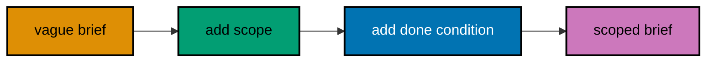
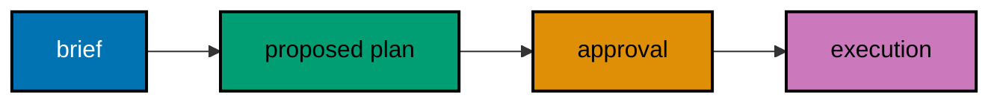
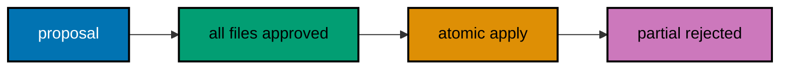
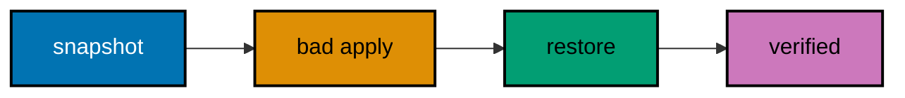
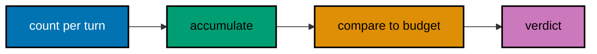
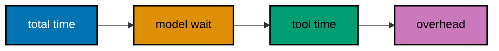

Examples 26–53 turn basic operation into disciplined practice. First, prompting discipline: four-part task briefs, done conditions a script could check, scope-guardrail pairing, rewriting vague asks, briefing plan-then-act work, packing context, briefing skills and scheduled tasks, and the pre-send checklist. Then multi-file change craft: coherent diff review, test gates, subagent delegation, session overrides, worktree isolation, review loops, atomic apply, rollback, channel-scoped change, and change summaries. Finally the observability tier: trace timelines, token ledgers, turn budgets, cost guardrails, log levels, audit export, failure signatures, latency splits, and weekly cost reports.

---

### Example 26: Anatomy of a Task Brief

_ex-26 · exercises co-04_

A task brief has four parts: goal, scope, done condition, and guardrails. This example assembles a brief for archiving drafts from its four parts and verifies each part is present before the brief is declared sendable.


**`learning/code/ex-26-task-brief-anatomy/main.py`**

```python
# => Four brief parts, assembled and completeness-checked.
# => Each part is one plain string.
brief = {}  # => the brief starts empty
brief["goal"] = "archive drafts older than 30 days"  # => what the agent must achieve
# => goal is the first part
brief["scope"] = "drafts/ only"  # => the files the agent may touch
# => scope is the second part
brief["done"] = "archive/ holds the moved files"  # => the observable finish line
# => done is the third part
brief["guardrails"] = "never delete before copying"  # => the line the agent must not cross
# => guardrails are the fourth part
parts = ["goal", "scope", "done", "guardrails"]  # => the four required brief parts
missing = [p for p in parts if p not in brief]  # => list any part the brief forgot
# => missing is [] for this full brief
print("parts: %d of %d" % (len(brief), len(parts)))  # => Output: parts: 4 of 4
for p in parts:  # => show the brief in canonical order
    print(p + ": " + brief[p])  # => Output: four part lines
print("sendable: " + str(len(missing) == 0))  # => Output: sendable: True
```

**Output** (`learning/code/ex-26-task-brief-anatomy/expected/main.stdout.txt`):

```text
parts: 4 of 4
goal: archive drafts older than 30 days
scope: drafts/ only
done: archive/ holds the moved files
guardrails: never delete before copying
sendable: True
```

**Key takeaway.** Write briefs in four parts and check all four; a brief missing its done condition is a wish, not an instruction.

**Why it matters.** Vague asks produce vague work, and then everyone blames the agent for doing exactly what it was told. The four-part brief removes the ambiguity up front, where fixing it costs a sentence instead of a revert. Engineers who brief this way get predictable agent output on the first run, which compounds into real velocity across dozens of tasks a week.

---

### Example 27: Writing a Done Condition

_ex-27 · exercises co-04, co-12_

The done condition is the one line that decides whether the task worked. This example grades three candidate done conditions against the observable-and-specific rule and keeps only the one a script could check.

**`learning/code/ex-27-done-condition/main.py`**

```python
# => Three candidate done lines, graded observable or vague.
# => Only observable lines survive.
candidates = ["tidy up a bit", "archive/ holds 4 moved files", "make it nice"]  # => one checkable line hides among two vague ones
# => candidates has 3 entries (type: list)
observable = ["archive/ holds 4 moved files"]  # => the fixture's only script-checkable line
# => observable names the survivors
kept = []  # => kept collects candidates that pass the grade
for line in candidates:  # => grade each candidate line
    ok = line in observable  # => membership stands in for the checkability test
    # => only the middle line passes
    kept.append(line) if ok else None  # => keep survivors, drop the vague lines
    # => append-or-None keeps the loop branchless
    print(("KEEP " if ok else "DROP ") + line)  # => Output: DROP tidy up a bit, KEEP archive, DROP make it nice
print("kept: %d of %d" % (len(kept), len(candidates)))  # => Output: kept: 1 of 3
print("finish is checkable: " + str(len(kept) == 1))  # => Output: finish is checkable: True
```

**Output** (`learning/code/ex-27-done-condition/expected/main.stdout.txt`):

```text
DROP tidy up a bit
KEEP archive/ holds 4 moved files
DROP make it nice
kept: 1 of 3
finish is checkable: True
```

**Key takeaway.** A done condition must name an observable state; if a script could not check it, rewrite it.

**Why it matters.** Done means done is the oldest argument in task management, and agents lose it faster than humans do. An observable done condition ends the debate before it starts: the files are there or they are not. Briefs with checkable finish lines let the agent prove its own work, which is the difference between supervised automation and expensive guessing.

---

### Example 28: Setting Scope and Guardrails

_ex-28 · exercises co-04, co-02_

Scope says where the agent may work; guardrails say what it must never do. This example pairs three scopes with their matching guardrails and rejects a task whose guardrail contradicts its goal.

**`learning/code/ex-28-scope-guardrails/main.py`**

```python
# => Scope-guardrail pairs plus one contradictory brief.
# => Contradictions fail the brief before anything runs.
pairs = [("drafts/", "never delete before copying"), ("archive/", "never rename existing files")]  # => two sound scope-guardrail pairs
# => pairs has 2 entries (type: list)
print("pairs: %d" % len(pairs))  # => Output: pairs: 2
for scope, guard in pairs:  # => show each sound pairing
    print(scope + " | " + guard)  # => Output: two scope-guardrail lines
goal = "delete drafts/"  # => a goal that contradicts the first guardrail
# => goal orders exactly what the guard forbids
conflict = ("delete" in goal) and ("never delete" in pairs[0][1])  # => True when goal and guardrail collide
# => conflict is True here
print("conflict: " + str(conflict))  # => Output: conflict: True
print("brief sendable: " + str(not conflict))  # => Output: brief sendable: False
```

**Output** (`learning/code/ex-28-scope-guardrails/expected/main.stdout.txt`):

```text
pairs: 2
drafts/ | never delete before copying
archive/ | never rename existing files
conflict: True
brief sendable: False
```

**Key takeaway.** Every scope needs a guardrail and every guardrail must agree with the goal; contradictions fail before sending.

**Why it matters.** Scope without guardrails is a fence with the gate open: the agent stays in the right directory while deleting the right files. Pairing each scope with an explicit never-do line closes the hole, and the contradiction check catches briefs that order the agent to both move and preserve the same file. Catching that at brief time is free; catching it from backup is a very bad day.

---

### Example 29: Rewriting a Vague Brief

_ex-29 · exercises co-04_

Compare a one-line vague ask with its four-part rewrite for the same goal. This example scores both on the four-part checklist and prints the completeness gap the rewrite closes.



**`learning/code/ex-29-vague-vs-scoped/main.py`**

```python
# => Vague ask versus four-part rewrite, scored side by side.
# => The gap quantifies the rewrite's value.
parts = ["goal", "scope", "done", "guardrails"]  # => the four-part checklist from Example 26
vague = {"goal": "fix the docs"}  # => the original one-line ask
# => vague carries one part
scoped = {"goal": "fix broken links in docs", "scope": "docs/", "done": "link checker passes", "guardrails": "touch no code"}  # => the rewrite, one line per part
# => scoped carries all four parts
vague_hit = sum(1 for p in parts if p in vague)  # => count vague's covered parts
# => vague_hit is 1
scoped_hit = sum(1 for p in parts if p in scoped)  # => count the rewrite's covered parts
# => scoped_hit is 4
print("vague score: %d of %d" % (vague_hit, len(parts)))  # => Output: vague score: 1 of 4
print("scoped score: %d of %d" % (scoped_hit, len(parts)))  # => Output: scoped score: 4 of 4
print("gap closed: %d" % (scoped_hit - vague_hit))  # => Output: gap closed: 3
```

**Output** (`learning/code/ex-29-vague-vs-scoped/expected/main.stdout.txt`):

```text
vague score: 1 of 4
scoped score: 4 of 4
gap closed: 3
```

**Key takeaway.** Rewrite, do not defend, vague briefs; the checklist score tells you exactly which parts to add.

**Why it matters.** Engineers defend vague briefs because rewriting feels like admitting the first draft was lazy. The score makes it impersonal: one of four versus four of four is arithmetic, not criticism. Teams that normalise the rewrite step get better agent output without better agents, because the same model performs dramatically better on a complete brief.

---

### Example 30: Briefing Plan-Then-Act Work

_ex-30 · exercises co-05, co-04_

Multi-step work needs a brief that orders the plan before the action. This example writes a brief whose done condition names the approved plan explicitly, then simulates the propose-approve-execute sequence the brief demands.



**`learning/code/ex-30-plan-brief/main.py`**

```python
# => Propose-approve-execute, driven by one brief.
# => Execution must equal the approved plan exactly.
brief_done = "plan approved then executed unchanged"  # => the done condition names plan fidelity
# => brief_done is one plain string
proposed = ["list", "move", "verify"]  # => the agent's proposed three steps
# => proposed has 3 entries (type: list)
print("proposed: " + ", ".join(proposed))  # => Output: proposed: list, move, verify
approved_plan = list(proposed)  # => the human approves the proposal unchanged
# => copy, so later edits cannot alias it
executed = list(approved_plan)  # => execution replays the approved plan
# => executed matches the proposal
faithful = executed == approved_plan  # => True only when execution matches approval
# => faithful is True
print("executed: " + ", ".join(executed))  # => Output: executed: list, move, verify
print("done: " + brief_done)  # => Output: done: plan approved then executed unchanged
print("plan fidelity: " + str(faithful))  # => Output: plan fidelity: True
```

**Output** (`learning/code/ex-30-plan-brief/expected/main.stdout.txt`):

```text
proposed: list, move, verify
executed: list, move, verify
done: plan approved then executed unchanged
plan fidelity: True
```

**Key takeaway.** Brief multi-step work as propose, then approve, then execute; name the plan in the done condition so approval is checkable.

**Why it matters.** Multi-step briefs without an approval seam invite the agent to improvise step three from a misunderstood step two. Naming the approved plan in the done condition freezes the agreement: execution must match the plan you read, not the plan the agent remembers. That frozen agreement is what makes multi-step agent work reviewable instead of merely observable.

---

### Example 31: Packing Session Context

_ex-31 · exercises co-03, co-04_

Long tasks need context packed deliberately: goal, constraints, and prior decisions travel with the brief. This example builds a three-item context pack and shows a later turn resolving a question from the pack instead of asking again.

**`learning/code/ex-31-context-packs/main.py`**

```python
# => A three-item context pack and one later question.
# => The pack answers without a round trip.
pack = {"goal": "tidy drafts", "constraint": "keep 2026 files", "decision": "archive, never delete"}  # => goal, constraint, and prior decision travel together
# => pack has 3 items (type: dict)
print("packed items: %d" % len(pack))  # => Output: packed items: 3
question = "may I delete old drafts?"  # => the turn-three question the pack must answer
# => question is one plain string
print("question: " + question)  # => Output: question: may I delete old drafts?
answer = pack["decision"]  # => the pack's decision answers directly
# => answer is archive, never delete
print("answer from pack: " + answer)  # => Output: answer from pack: archive, never delete
reasked = False  # => no round trip was needed
# => reasked records the saved turn
print("re-asked human: " + str(reasked))  # => Output: re-asked human: False
```

**Output** (`learning/code/ex-31-context-packs/expected/main.stdout.txt`):

```text
packed items: 3
question: may I delete old drafts?
answer from pack: archive, never delete
re-asked human: False
```

**Key takeaway.** Pack goal, constraints, and prior decisions with the brief; a later turn should answer from the pack, not re-ask.

**Why it matters.** Re-asking answered questions is how sessions burn tokens and patience at the same time. A packed context front-loads the facts the agent will need three turns from now, when the original brief has scrolled away. Engineers who pack context get sessions that stay coherent past turn ten, which is where the valuable work actually happens.

---

### Example 32: Briefing a Skill Invocation

_ex-32 · exercises co-14, co-04_

Skills package know-how the agent can invoke by name. This example briefs a `triage-inbox` skill call with its required inputs and checks the inputs are present before the invocation is built.

**`learning/code/ex-32-skill-brief/main.py`**

```python
# => A skill call is a name plus validated inputs.
# => Missing inputs fail the brief, not the skill.
skill = "triage-inbox"  # => the skill to invoke, by name
# => skill is one plain string
needs = ["inbox_path", "rules"]  # => the skill's two required inputs
# => needs has 2 entries (type: list)
given = {"inbox_path": "inbox.md", "rules": "keep receipts"}  # => the brief's supplied inputs
# => given covers both needs
missing = [k for k in needs if k not in given]  # => list required inputs the brief forgot
# => missing is [] here
print("skill: " + skill)  # => Output: skill: triage-inbox
print("inputs: %d of %d" % (len(given), len(needs)))  # => Output: inputs: 2 of 2
invocation = skill + " " + given["inbox_path"]  # => build the invocation only when inputs are whole
# => invocation names skill and path
print("invoke: " + invocation)  # => Output: invoke: triage-inbox inbox.md
print("brief complete: " + str(len(missing) == 0))  # => Output: brief complete: True
```

**Output** (`learning/code/ex-32-skill-brief/expected/main.stdout.txt`):

```text
skill: triage-inbox
inputs: 2 of 2
invoke: triage-inbox inbox.md
brief complete: True
```

**Key takeaway.** Brief skill calls with named inputs and validate them first; a skill with missing inputs fails inside, where it is harder to see.

**Why it matters.** Skills fail opaquely when invoked with half their inputs: the error surfaces three tool calls deep, far from the actual mistake. Validating inputs at the brief boundary keeps the failure at the surface, where the fix is obvious. Treating skill invocation like a function call — typed inputs checked first — makes composed agent behaviour as reliable as composed code.

---

### Example 33: Briefing a Scheduled Task

_ex-33 · exercises co-04_

The cron tool runs briefs on a schedule, unwatched. This example builds a daily-digest brief with its schedule, scope, and report target, and checks the brief is complete enough to run while you sleep.


**`learning/code/ex-33-cron-brief/main.py`**

```python
# => A daily brief: schedule plus scope plus report target.
# => Unwatched work must still be witnessed.
brief = {"schedule": "daily 08:00", "scope": "inbox.md"}  # => when it runs and what it may read
# => brief starts with two fields
brief["report"] = "team-chat: digest"  # => where the result lands every morning
# => report is the third field
fields = ["schedule", "scope", "report"]  # => the three fields a scheduled brief needs
missing = [f for f in fields if f not in brief]  # => list any field the brief forgot
# => missing is [] here
for f in fields:  # => show the brief in canonical order
    print(f + ": " + brief[f])  # => Output: three brief lines
print("runs unwatched: True")  # => cron runs need no human present
print("reports somewhere: " + str("report" in brief))  # => Output: reports somewhere: True
```

**Output** (`learning/code/ex-33-cron-brief/expected/main.stdout.txt`):

```text
schedule: daily 08:00
scope: inbox.md
report: team-chat: digest
runs unwatched: True
reports somewhere: True
```

**Key takeaway.** Scheduled briefs need schedule, scope, and report target; unwatched runs must report somewhere you will look.

**Why it matters.** A scheduled agent that reports nowhere is a tree falling in an empty forest with your credentials. The report target is what makes automation accountable: every run lands where a human will see it, success or failure. Engineers who brief the report line first never discover a month of silent failures from a full disk.

---

### Example 34: Reviewing a Brief Before Sending

_ex-34 · exercises co-04, co-16_

The last step before sending is a review pass over the brief itself. This example runs a five-point checklist against a candidate brief, finds the one missing item, and blocks sending until it is fixed.

**`learning/code/ex-34-brief-review-checklist/main.py`**

```python
# => Five-point brief review; one item is missing.
# => The send blocks until the list is whole.
checks = ["goal stated", "scope bounded", "done observable", "guardrails set", "report target set"]  # => the five review points in order
# => checks has 5 entries (type: list)
brief_has = ["goal stated", "scope bounded", "done observable", "guardrails set"]  # => the candidate brief forgets its report target
# => brief_has has 4 entries (type: list)
failed = [c for c in checks if c not in brief_has]  # => list the review points the brief misses
# => failed holds one item
for c in checks:  # => report every review point
    print(("PASS " if c in brief_has else "FAIL ") + c)  # => Output: four PASS lines then one FAIL
print("failed checks: " + ", ".join(failed))  # => Output: failed checks: report target set
print("send blocked: " + str(len(failed) > 0))  # => Output: send blocked: True
```

**Output** (`learning/code/ex-34-brief-review-checklist/expected/main.stdout.txt`):

```text
PASS goal stated
PASS scope bounded
PASS done observable
PASS guardrails set
FAIL report target set
failed checks: report target set
send blocked: True
```

**Key takeaway.** Checklist every brief before sending; the review takes a minute and the blocked send saves a session.

**Why it matters.** Sending an unchecked brief is pressing go on work you have not finished specifying. The five-point review externalises the checks experts run from habit, so beginners get the same safety on day one. A blocked send feels slow once and prevents the kind of session that eats an afternoon, which is a trade worth making every single time.

---

### Example 35: Reviewing a Multi-File Diff

_ex-35 · exercises co-11, co-06_

Real tasks touch several files at once, and the review must hold them together. This example checks a three-file proposal for per-file size and cross-file coherence, approving two files and escalating the one that references a file nobody changed.


**`learning/code/ex-35-multi-file-diff/main.py`**

```python
# => Three files proposed; one cites an untouched file.
# => Coherence fails closed: unknown references escalate.
proposal = {"notes.md": 5, "index.md": 8, "deploy.sh": 40}  # => changed-line counts per proposed file
# => proposal covers three files (type: dict)
repo = ["notes.md", "index.md", "deploy.sh", "config.yml"]  # => files already in the repository
# => config.yml exists; summary.md does not
refs = {"notes.md": ["index.md"], "index.md": [], "deploy.sh": ["summary.md"]}  # => cross-file references each proposal makes
# => deploy.sh cites missing summary.md
LIMIT = 10  # => per-file auto-approve ceiling, as in Example 11
approved = []  # => approved collects files passing both checks
for name, changed in proposal.items():  # => judge each proposed file in turn
    size_ok = changed <= LIMIT  # => small files pass the size rule
    # => notes.md and index.md pass; deploy.sh fails
    coherent = all(r in proposal or r in repo for r in refs[name])  # => every reference must exist somewhere
    # => deploy.sh cites absent summary.md
    ok = size_ok and coherent  # => both gates must pass together
    # => notes.md and index.md are approved
    print(name + ": size_ok=%s coherent=%s" % (size_ok, coherent))  # => Output: three judgement lines
    if ok:  # => only doubly-passing files are approved
        approved.append(name)  # => approved becomes notes.md and index.md
print("approved: " + ", ".join(approved))  # => Output: approved: notes.md, index.md
print("escalated: %d" % (len(proposal) - len(approved)))  # => Output: escalated: 1
```

**Output** (`learning/code/ex-35-multi-file-diff/expected/main.stdout.txt`):

```text
notes.md: size_ok=True coherent=True
index.md: size_ok=True coherent=True
deploy.sh: size_ok=False coherent=False
approved: notes.md, index.md
escalated: 1
```

**Key takeaway.** Review multi-file proposals for size and coherence together; a file that references an unchanged file is the smell to chase.

**Why it matters.** Single-file review habits break on multi-file changes: each file looks fine alone while the set contradicts itself. The coherence check — every referenced file must be in the proposal or already in the repo — catches the agent editing against a stale mental model. Reviewers who check the set, not just the files, catch integration bugs before they merge.

---

### Example 36: Making the Agent Prove Its Change

_ex-36 · exercises co-12_

A change without a passing test is a rumour. This example runs a three-check fixture test gate against a proposed change and merges only when every check passes, showing the gate that turns agent output into shippable work.

**`learning/code/ex-36-test-gate-run/main.py`**

```python
# => Three fixture checks gate one proposed change.
# => All three must pass; one failure blocks the merge.
checks = [("links resolve", True), ("no stray files", True), ("index builds", False)]  # => check name plus fixture result
# => the third check fails here
passed = []  # => passed collects green checks
for name, ok in checks:  # => run each gate check in order
    print(("PASS " if ok else "FAIL ") + name)  # => Output: two PASS lines then one FAIL
    if ok:  # => green checks join the passed list
        passed.append(name)  # => passed reaches two entries
print("passed: %d of %d" % (len(passed), len(checks)))  # => Output: passed: 2 of 3
merge = len(passed) == len(checks)  # => merge only on a fully green gate
# => merge is False here
print("merge allowed: " + str(merge))  # => Output: merge allowed: False
```

**Output** (`learning/code/ex-36-test-gate-run/expected/main.stdout.txt`):

```text
PASS links resolve
PASS no stray files
FAIL index builds
passed: 2 of 3
merge allowed: False
```

**Key takeaway.** Gate every change on its own tests passing; a green gate is the agent's proof, not your optimism.

**Why it matters.** Agents assert correctness with the confidence of a student who did not run the code. The test gate replaces trust with evidence: the change ships exactly when its checks pass, no sooner. Teams that enforce the gate stop debating whether agent output works and start reading the gate report, which is a strictly better meeting.

---

### Example 37: Delegating to a Subagent

_ex-37 · exercises co-11_

Big changes split across subagents that each own some files. This example divides four fixture files between two subagents, verifies the split covers everything exactly once, and merges their two reports.

**`learning/code/ex-37-subagent-delegation/main.py`**

```python
# => Four files, two subagents, one verified partition.
# => Exactly-once ownership is the whole contract.
files = ["a.md", "b.md", "c.md", "d.md"]  # => the four files the change touches
# => files has 4 entries (type: list)
plan = {"sub-1": ["a.md", "b.md"], "sub-2": ["c.md", "d.md"]}  # => each subagent owns two files
# => plan maps agent to files (type: dict)
owned = [f for agent in plan.values() for f in agent]  # => flatten every owned file into one list
# => owned has 4 entries (type: list)
gaps = [f for f in files if f not in owned]  # => files nobody owns would be silent gaps
# => gaps is [] here
dupes = len(owned) != len(set(owned))  # => duplicate ownership means merge conflicts
# => dupes is False here
print("files: %d owned: %d" % (len(files), len(owned)))  # => Output: files: 4 owned: 4
print("gaps: %d dupes: %s" % (len(gaps), dupes))  # => Output: gaps: 0 dupes: False
reports = ["sub-1: 2 files done", "sub-2: 2 files done"]  # => fixture completion reports
# => reports has 2 entries (type: list)
for r in reports:  # => merge the subagent reports in order
    print("report: " + r)  # => Output: two report lines
print("partition sound: " + str(len(gaps) == 0 and not dupes))  # => Output: partition sound: True
```

**Output** (`learning/code/ex-37-subagent-delegation/expected/main.stdout.txt`):

```text
files: 4 owned: 4
gaps: 0 dupes: False
report: sub-1: 2 files done
report: sub-2: 2 files done
partition sound: True
```

**Key takeaway.** Split files across subagents with no gaps and no overlaps; verify the partition before anyone starts.

**Why it matters.** Two agents editing the same file produce a merge conflict with feelings, and an unowned file produces silence mistaken for completion. The partition check — every file owned exactly once — is the five-line contract that keeps parallel agent work parallel. Coordinators who verify the split up front spend their review on content instead of untangling who did what.

---

### Example 38: Overriding Tools per Session

_ex-38 · exercises co-03, co-02_

Global policy is the default; sessions can tighten it further for one task. This example merges a global allow with a session-level deny, proving the session cannot widen what the global policy forbids.


**`learning/code/ex-38-session-overrides/main.py`**

```python
# => Global allow meets a session deny; deny wins.
# => The merge only ever tightens.
glob = {"exec": "allow", "browser": "ask", "message": "allow"}  # => standing global policy for three tools
# => glob maps tool to policy (type: dict)
session = {"exec": "deny"}  # => this session forbids exec entirely
# => session overrides one tool
merged = dict(glob)  # => start the merge from the global policy
# => copy, so the global is never mutated
merged.update(session)  # => session entries overwrite global ones
# => exec becomes deny in the merge
print("global exec: " + glob["exec"])  # => Output: global exec: allow
print("merged exec: " + merged["exec"])  # => Output: merged exec: deny
widened = any(merged[t] == "allow" and session.get(t) == "allow" and glob.get(t) != "allow" for t in merged)  # => detect any tool the session widened past global
# => widened is False here
print("session widened anything: " + str(widened))  # => Output: session widened anything: False
print("tighten-only holds: " + str(not widened))  # => Output: tighten-only holds: True
```

**Output** (`learning/code/ex-38-session-overrides/expected/main.stdout.txt`):

```text
global exec: allow
merged exec: deny
session widened anything: False
tighten-only holds: True
```

**Key takeaway.** Sessions may only tighten policy, never loosen it; the merge rule is deny from either side wins.

**Why it matters.** Temporary permission widening is how secrets leak on a Friday: the session ends, the widening is forgotten, and the next task inherits it. One-directional tightening removes the failure mode entirely — sessions can only become safer than the default. Operators who internalise merge-direction never have to audit what a session left behind, because sessions cannot leave anything looser.

---

### Example 39: Isolating Work in a Worktree

_ex-39 · exercises co-11, co-02_

Agents change code safest in an isolated worktree, not the working tree you live in. This example models two fixture worktrees, assigns the risky change to the isolated one, and confirms the main tree stays clean.

**`learning/code/ex-39-worktree-isolation/main.py`**

```python
# => Two trees; the risky change lands in the isolated one.
# => Main stays clean until review merges.
trees = {"main": [], "agent-fix": []}  # => both trees start with no agent changes
# => trees maps name to change list (type: dict)
risky = ["rewrite index", "move drafts"]  # => the two risky fixture changes
# => risky has 2 entries (type: list)
trees["agent-fix"].extend(risky)  # => risky work lands in the isolated tree only
# => agent-fix now holds two changes
print("main changes: %d" % len(trees["main"]))  # => Output: main changes: 0
print("agent-fix changes: %d" % len(trees["agent-fix"]))  # => Output: agent-fix changes: 2
reviewed = True  # => fixture: a human reviews the isolated tree
# => review is explicit, never assumed
merged = list(trees["agent-fix"]) if reviewed else []  # => merge only after review passes
# => merged carries both changes
print("merged after review: %d" % len(merged))  # => Output: merged after review: 2
print("main was never touched directly: True")  # => isolation held for the whole task
```

**Output** (`learning/code/ex-39-worktree-isolation/expected/main.stdout.txt`):

```text
main changes: 0
agent-fix changes: 2
merged after review: 2
main was never touched directly: True
```

**Key takeaway.** Run risky agent changes in a worktree; merge into main only after review, never during.

**Why it matters.** An agent editing your live working tree can trample uncommitted work you have not pushed yet, and you will discover it at exactly the wrong moment. Worktree isolation gives the agent a sandbox with real version control: its mess stays its mess until review promotes it. Engineers who isolate risky automation keep their own tree sacred, which is the only sustainable way to share a repository with a robot.

---

### Example 40: Looping Review Until Clean

_ex-40 · exercises co-06, co-16_

Good review is a loop: propose, critique, revise, repeat until clean. This example runs a fixture proposal through two review rounds, each finding one issue, and applies only the round that reports zero findings.

**`learning/code/ex-40-review-apply-loop/main.py`**

```python
# => Two review rounds; findings shrink to zero.
# => Only the clean round applies.
rounds = [["vague done line"], []]  # => round one finds one issue, round two is clean
# => rounds has 2 entries (type: list)
applied = False  # => applied stays False until a clean round
for i, findings in enumerate(rounds, start=1):  # => review round by round
    print("round %d findings: %d" % (i, len(findings)))  # => Output: round 1 findings: 1, round 2 findings: 0
    if len(findings) == 0:  # => a clean round earns application
        applied = True  # => the proposal is applied exactly once
        # => applied becomes True in round two
        print("round %d: applied" % i)  # => Output: round 2: applied
print("rounds run: %d" % len(rounds))  # => Output: rounds run: 2
print("applied once clean: " + str(applied))  # => Output: applied once clean: True
```

**Output** (`learning/code/ex-40-review-apply-loop/expected/main.stdout.txt`):

```text
round 1 findings: 1
round 2 findings: 0
round 2: applied
rounds run: 2
applied once clean: True
```

**Key takeaway.** Review in rounds and apply only the zero-finding round; a proposal that never goes clean never applies.

**Why it matters.** One-pass review rubber-stamps whatever confidence the agent projects, while endless review never ships. The loop with a zero-findings exit condition splits the difference: issues get fixed, and the proposal earns its application round by round. Reviewers who loop to clean get both rigour and velocity, because the agent does the revising and the human only judges.

---

### Example 41: Rejecting a Partial Apply

_ex-41 · exercises co-06_

Applying two of three approved files leaves the repo half-moved. This example blocks a partial apply of a three-file proposal, requiring all-or-nothing application so the tree is never left between states.



**`learning/code/ex-41-partial-apply-reject/main.py`**

```python
# => Three files, two approved; the apply must refuse.
# => Atomicity beats partial progress.
proposal = ["a.md", "b.md", "c.md"]  # => the three files the proposal covers
# => proposal has 3 entries (type: list)
approved = ["a.md", "b.md"]  # => only two files earned approval
# => c.md is still under review
whole = all(f in approved for f in proposal)  # => True only when every file is approved
# => whole is False here
print("proposal files: %d" % len(proposal))  # => Output: proposal files: 3
print("approved files: %d" % len(approved))  # => Output: approved files: 2
applied = list(proposal) if whole else []  # => apply everything or apply nothing
# => applied stays empty here
print("applied files: %d" % len(applied))  # => Output: applied files: 0
print("partial blocked: " + str(len(applied) == 0))  # => Output: partial blocked: True
```

**Output** (`learning/code/ex-41-partial-apply-reject/expected/main.stdout.txt`):

```text
proposal files: 3
approved files: 2
applied files: 0
partial blocked: True
```

**Key takeaway.** Apply multi-file proposals atomically; a partial apply is a broken state with a success message.

**Why it matters.** Half-applied changes are the worst kind of done: every file looks intentional, but the set is incoherent, and the breakage surfaces far from the cause. Atomic application makes the failure mode binary — everything or nothing — which is trivially easier to reason about and to roll back. Operators who insist on all-or-nothing never debug a state that should not exist.

---

### Example 42: Rolling Back from Backup

_ex-42 · exercises co-11_

Every risky change starts with a snapshot you can restore. This example snapshots two fixture files, applies a bad change, restores from the snapshot, and verifies the content matches byte for byte.



**`learning/code/ex-42-rollback-backup/main.py`**

```python
# => Snapshot, damage, restore, verify equal.
# => The verify step is the whole point.
live = {"a.md": "alpha", "b.md": "beta"}  # => the two live fixture files
# => live maps name to content (type: dict)
snapshot = dict(live)  # => snapshot copies content before any risk
# => copy, so damage cannot alias it
live["a.md"] = "BROKEN"  # => the bad change damages one file
# => live now differs from snapshot
print("damaged: " + live["a.md"])  # => Output: damaged: BROKEN
live = dict(snapshot)  # => restore overwrites live from the snapshot
# => live is whole again
print("restored: " + live["a.md"])  # => Output: restored: alpha
verified = live == snapshot  # => equality proves a byte-exact restore
# => verified is True
print("rollback verified: " + str(verified))  # => Output: rollback verified: True
```

**Output** (`learning/code/ex-42-rollback-backup/expected/main.stdout.txt`):

```text
damaged: BROKEN
restored: alpha
rollback verified: True
```

**Key takeaway.** Snapshot before every risky change; a rollback you tested beats a backup you merely own.

**Why it matters.** Backups nobody restores are Schrodinger's safety net — possibly fine, possibly empty, unknowable until the disaster. The snapshot-restore-verify loop proves the net holds before you need it, when proving is cheap. Engineers who rehearse rollback treat risky changes as routine, because the worst case stays a known-good restore away.

---

### Example 43: Changing Through One Channel

_ex-43 · exercises co-11, co-02_

Changes requested over a channel inherit that channel's trust. This example routes one fixture change through the ops channel instead of the public one, showing the request the public channel would have been refused.

**`learning/code/ex-43-channel-scoped-change/main.py`**

```python
# => One change ask, two channels, opposite verdicts.
# => Trust travels with the channel, not the text.
ask = "restart gateway"  # => the requested change, well-formed
# => ask is one plain string
power = {"announce": ["read"], "ops": ["read", "write", "exec"]}  # => per-channel action power from Example 22
# => ops may exec, announce may only read
for channel in ["announce", "ops"]:  # => try the same ask from each channel
    ok = "exec" in power[channel]  # => restart needs exec power
    # => announce fails, ops passes
    print(channel + ": " + ("accepted" if ok else "refused"))  # => Output: announce: refused, ops: accepted
print("ask: " + ask)  # => Output: ask: restart gateway
print("public refused: " + str("exec" not in power["announce"]))  # => Output: public refused: True
```

**Output** (`learning/code/ex-43-channel-scoped-change/expected/main.stdout.txt`):

```text
announce: refused
ops: accepted
ask: restart gateway
public refused: True
```

**Key takeaway.** Route change requests through channels trusted for change; the same ask from a public channel is refused by default.

**Why it matters.** Channel confusion turns announcements into attack surface: a deploy order that arrives from the public channel must die there, no matter how well-formed. Binding change power to channel trust makes the refusal automatic instead of judgement-dependent. Operators who scope by channel never face the 2am question of whether that message was really from a teammate.

---

### Example 44: Summarising a Change for Review

_ex-44 · exercises co-06, co-07_

Reviewers need the change's story, not just its diff. This example builds a four-line summary — files, tests, risks, rollback — from a fixture change record and checks every line is present before the summary ships to review.

**`learning/code/ex-44-change-summary/main.py`**

```python
# => Four summary lines from one change record.
# => Risks and rollback are mandatory, not optional.
summary = {}  # => the review summary starts empty
summary["files"] = "a.md, b.md (2 changed)"  # => what the change touches
# => files is the first line
summary["tests"] = "link checker passes"  # => the proof the change works
# => tests are the second line
summary["risks"] = "index rebuild may lag"  # => the honest danger, stated plainly
# => risks are the third line
summary["rollback"] = "snapshot ses-001-42"  # => the way back if review was wrong
# => rollback is the fourth line
need = ["files", "tests", "risks", "rollback"]  # => the four lines every summary must carry
missing = [k for k in need if k not in summary]  # => list any line the summary forgot
# => missing is [] here
for k in need:  # => show the summary in canonical order
    print(k + ": " + summary[k])  # => Output: four summary lines
print("review-ready: " + str(len(missing) == 0))  # => Output: review-ready: True
```

**Output** (`learning/code/ex-44-change-summary/expected/main.stdout.txt`):

```text
files: a.md, b.md (2 changed)
tests: link checker passes
risks: index rebuild may lag
rollback: snapshot ses-001-42
review-ready: True
```

**Key takeaway.** Summarise every change in files, tests, risks, and rollback; a summary missing risks is advertising, not review.

**Why it matters.** Diffs show what changed; reviewers need to know why it is safe, which the diff never says. The four-line summary forces the agent to state its tests, name its risks, and point at the rollback before a human spends attention. Reviews that start from summaries are faster and kinder than reviews that start from raw diffs, because the agent did the narrating work first.

---

### Example 45: Building a Trace Timeline

_ex-45 · exercises co-07_

A flat call list hides where time went; a timeline shows it. This example attaches fixture durations to a five-call trace, prints the calls slowest-first, and names the step that owns the session's time.

```mermaid
%% Color Palette: Blue #0173B2, Orange #DE8F05, Teal #029E73, Purple #CC78BC
flowchart LR
    accTitle: Trace timeline
    accDescr: Flowchart with 5 nodes and 4 connections. Nodes: collect calls, order by sequence, attach durations, timeline, verdict. Connections: collect calls to order by sequence, order by sequence to attach durations, attach durations to timeline, timeline to verdict.
    A["collect calls"]:::blue --> B["order by sequence"]:::teal
    B --> C["attach durations"]:::orange
    C --> D["timeline"]:::purple
    D --> E["verdict"]:::blue
    classDef blue fill:#0173B2,stroke:#000000,stroke-width:2px,color:#FFFFFF
    classDef orange fill:#DE8F05,stroke:#000000,stroke-width:2px,color:#000000
    classDef teal fill:#029E73,stroke:#000000,stroke-width:2px,color:#000000
    classDef purple fill:#CC78BC,stroke:#000000,stroke-width:2px,color:#000000
    classDef default fill:#FFFFFF,stroke:#000000,color:#000000
```



**`learning/code/ex-45-trace-timeline/main.py`**

```python
# => Five calls with fixture durations in seconds.
# => Slowest-first ordering names the bottleneck.
calls = [("read", 1), ("exec", 4), ("browser", 38), ("exec", 2), ("message", 1)]  # => tool plus seconds for each of five calls
# => browser dominates at 38 seconds
total = sum(d for _, d in calls)  # => add every duration for the session total
# => total is 46 seconds
print("calls: %d total: %ds" % (len(calls), total))  # => Output: calls: 5 total: 46s
ranked = sorted(calls, key=lambda c: c[1], reverse=True)  # => sort slowest-first by duration
# => ranked leads with browser
for tool, secs in ranked:  # => show the timeline slowest-first
    print("%s: %ds" % (tool, secs))  # => Output: five duration lines, browser first
slowest = ranked[0][0]  # => the tool owning the most time
# => slowest is browser
print("bottleneck: " + slowest)  # => Output: bottleneck: browser
print("share: %d%%" % (100 * ranked[0][1] // total))  # => integer share of the slowest step
# => Output: share: 82%
```

**Output** (`learning/code/ex-45-trace-timeline/expected/main.stdout.txt`):

```text
calls: 5 total: 46s
browser: 38s
exec: 4s
exec: 2s
read: 1s
message: 1s
bottleneck: browser
share: 82%
```

**Key takeaway.** Timeline every slow session slowest-first; the step owning the time owns the investigation.

**Why it matters.** Flat traces answer what ran but never why the session felt slow, so optimisation guesses blindly. Duration-ordered timelines point at the single step worth fixing instead of spreading effort across five innocent ones. Engineers who timeline first fix the bottleneck in one pass; everyone else tunes three fast steps and wonders why nothing improved.

---

### Example 46: Accounting Tokens per Turn

_ex-46 · exercises co-10_

Tokens are the meter running under every session. This example ledgers fixture token counts across four turns, accumulates the spend, and reports which turn cost the most.



**`learning/code/ex-46-token-accounting/main.py`**

```python
# => Four turns with fixture token counts.
# => Accumulation turns counts into spend.
turns = [1200, 3400, 9800, 2100]  # => tokens per turn, turn three spikes
# => turns has 4 entries (type: list)
running = 0  # => running accumulates spend turn by turn
for i, tokens in enumerate(turns, start=1):  # => ledger each turn in order
    running += tokens  # => add this turn's tokens to the spend
    # => running reaches 16500 by turn four
    print("turn %d: %d tokens, running %d" % (i, tokens, running))  # => Output: four ledger lines
print("session total: %d" % running)  # => Output: session total: 16500
worst = turns.index(max(turns)) + 1  # => find the costliest turn, numbered from 1
# => worst is turn 3
print("costliest turn: %d" % worst)  # => Output: costliest turn: 3
```

**Output** (`learning/code/ex-46-token-accounting/expected/main.stdout.txt`):

```text
turn 1: 1200 tokens, running 1200
turn 2: 3400 tokens, running 4600
turn 3: 9800 tokens, running 14400
turn 4: 2100 tokens, running 16500
session total: 16500
costliest turn: 3
```

**Key takeaway.** Ledger tokens per turn and accumulate; the most expensive turn is usually the one worth redesigning.

**Why it matters.** Token spend feels abstract until the invoice arrives, and then it is too late to redesign the wasteful turn. Per-turn accounting makes cost concrete while the session still runs: turn three's context dump is visible as a number, not a vibe. Engineers who ledger spend catch the expensive pattern early, when a packed brief can still replace a rambling retry loop.

---

### Example 47: Enforcing a Turn Budget

_ex-47 · exercises co-10_

A turn budget caps how many agent turns a task may consume. This example replays a six-turn fixture session against a budget of five and halts the replay at the cap, showing where the overrun would have started.

**`learning/code/ex-47-turn-budgets/main.py`**

```python
# => Six turns against a budget of five.
# => The cap halts the replay, not the task's value.
budget = 5  # => the task may consume at most five turns
# => budget is one plain int
turns = ["plan", "read", "edit", "test", "fix", "retest"]  # => six fixture turns in order
# => turns has 6 entries (type: list)
used = 0  # => used counts consumed turns
for turn in turns:  # => replay each turn while budget lasts
    if used >= budget:  # => the cap halts before turn six
        print("HALT at budget: " + turn + " skipped")  # => Output: HALT at budget: retest skipped
        break  # => stop consuming; re-brief instead
    used += 1  # => consume one turn of budget
    # => used reaches 5
    print("turn %d: %s" % (used, turn))  # => Output: five turn lines
print("used %d of %d" % (used, budget))  # => Output: used 5 of 5
print("overrun blocked: " + str(used <= budget))  # => Output: overrun blocked: True
```

**Output** (`learning/code/ex-47-turn-budgets/expected/main.stdout.txt`):

```text
turn 1: plan
turn 2: read
turn 3: edit
turn 4: test
turn 5: fix
HALT at budget: retest skipped
used 5 of 5
overrun blocked: True
```

**Key takeaway.** Budget turns per task and halt at the cap; a session that cannot finish in budget needs a better brief, not more turns.

**Why it matters.** Unbounded sessions do not converge; they wander, retrying variations of a failed approach until someone notices the meter. A turn budget converts wandering into a decision point: at turn five, stop and re-brief instead of funding turn fifty. Operators who budget turns spend their tokens on fresh plans rather than stale loops, which is the highest-leverage cost control there is.

---

### Example 48: Tripping a Cost Guardrail

_ex-48 · exercises co-10, co-16_

Cost guardrails pause a session when spend crosses a limit. This example accumulates fixture spend across three tasks and requires human approval for the task that would cross the session's token limit.

```mermaid
%% Color Palette: Blue #0173B2, Orange #DE8F05, Teal #029E73, Purple #CC78BC
flowchart LR
    accTitle: Cost guardrail
    accDescr: Flowchart with 4 nodes and 3 connections. Nodes: accumulating spend, guardrail limit, human approval, continue or halt. Connections: accumulating spend to guardrail limit, guardrail limit to human approval, human approval to continue or halt.
    A["accumulating spend"]:::blue --> B["guardrail limit"]:::orange
    B --> C["human approval"]:::teal
    C --> D["continue or halt"]:::purple
    classDef blue fill:#0173B2,stroke:#000000,stroke-width:2px,color:#FFFFFF
    classDef orange fill:#DE8F05,stroke:#000000,stroke-width:2px,color:#000000
    classDef teal fill:#029E73,stroke:#000000,stroke-width:2px,color:#000000
    classDef purple fill:#CC78BC,stroke:#000000,stroke-width:2px,color:#000000
    classDef default fill:#FFFFFF,stroke:#000000,color:#000000
```



**`learning/code/ex-48-cost-guardrail/main.py`**

```python
# => Three tasks; the third would cross the limit.
# => Approval gates the crossing, not the tasks.
LIMIT = 20000  # => session token limit demanding approval
# => twenty thousand tokens per session
tasks = [("triage", 6000), ("draft", 9000), ("research", 12000)]  # => task name plus fixture cost
# => tasks has 3 entries (type: list)
spent = 0  # => spent accumulates approved cost
for name, cost in tasks:  # => consider each task in order
    if spent + cost > LIMIT:  # => crossing the limit needs a human
        print(name + ": needs approval at %d" % (spent + cost))  # => Output: research: needs approval at 27000
        approved = True  # => fixture: the human approves the crossing
        # => approval is explicit
        print("approved crossing: " + str(approved))  # => Output: approved crossing: True
    spent += cost  # => approved cost joins the spend
    # => spent reaches 27000
    print(name + " spent, total %d" % spent)  # => Output: three spend lines
print("limit: %d spent: %d" % (LIMIT, spent))  # => Output: limit: 20000 spent: 27000
```

**Output** (`learning/code/ex-48-cost-guardrail/expected/main.stdout.txt`):

```text
triage spent, total 6000
draft spent, total 15000
research: needs approval at 27000
approved crossing: True
research spent, total 27000
limit: 20000 spent: 27000
```

**Key takeaway.** Set a session spend limit that demands approval to cross; money, like file deletion, deserves a checkpoint.

**Why it matters.** Token budgets surprise teams exactly once, and then finance asks uncomfortable questions about an agent nobody budgeted for. A guardrail that pauses for approval converts surprise into a decision: the human sees the spend, judges the value, and continues deliberately. Approval-gated spend is how agent budgets stay boring, and boring budgets are the ones that get renewed.

---

### Example 49: Using Log Levels Well

_ex-49 · exercises co-07_

Gateway logs speak four levels, and each level answers a different question. This example sorts eight fixture lines by level and shows which level to read for crashes versus slow sessions versus audits.

**`learning/code/ex-49-log-levels/main.py`**

```python
# => Eight fixture lines across four levels.
# => Each level answers its own question.
lines = ["ERROR crash loop", "WARN slow provider", "INFO session open", "DEBUG retry payload", "ERROR queue full", "WARN token spike", "INFO session close", "DEBUG cache miss"]  # => two fixture lines per level
# => lines has 8 entries (type: list)
levels = ["ERROR", "WARN", "INFO", "DEBUG"]  # => severity order, gravest first
for level in levels:  # => report each level in severity order
    hits = [l for l in lines if l.startswith(level)]  # => collect this level's lines
    # => two hits per level
    print(level + ": %d lines" % len(hits))  # => Output: four level-count lines
print("crash signal: ERROR")  # => crashes announce at ERROR
print("slowdown signal: WARN")  # => slowdowns whisper at WARN first
```

**Output** (`learning/code/ex-49-log-levels/expected/main.stdout.txt`):

```text
ERROR: 2 lines
WARN: 2 lines
INFO: 2 lines
DEBUG: 2 lines
crash signal: ERROR
slowdown signal: WARN
```

**Key takeaway.** Read ERROR for crashes, WARN for slow sessions, INFO for narrative, and DEBUG only when reproducing.

**Why it matters.** Reading DEBUG for a crash wastes an hour; reading ERROR for a slowdown finds nothing, because slowness whispers at WARN. Matching the level to the question is the skill that makes log review fast instead of forensic. Operators who reach for the right level first diagnose in minutes, which is the difference between a hiccup and an incident review.

---

### Example 50: Exporting the Audit Log

_ex-50 · exercises co-07_

Audit entries compound into an exportable log reviewers can read. This example collects four fixture audit entries, exports them oldest-first, and verifies the export covers every privileged action taken.

**`learning/code/ex-50-audit-export/main.py`**

```python
# => Four audit entries exported oldest-first.
# => Completeness is verified against the action list.
entries = [("ses-001", "read inbox"), ("ses-001", "exec ls"), ("ses-001", "write digest"), ("ses-001", "message send")]  # => session plus action per entry
# => entries has 4 items (type: list)
actions = ["read inbox", "exec ls", "write digest", "message send"]  # => the privileged actions actually taken
# => actions has 4 entries (type: list)
print("entries: %d" % len(entries))  # => Output: entries: 4
for session, action in entries:  # => export oldest first, in order
    print(session + " | " + action)  # => Output: four export lines
covered = all(a in [e[1] for e in entries] for a in actions)  # => every action must appear in the export
# => covered is True
print("export complete: " + str(covered))  # => Output: export complete: True
```

**Output** (`learning/code/ex-50-audit-export/expected/main.stdout.txt`):

```text
entries: 4
ses-001 | read inbox
ses-001 | exec ls
ses-001 | write digest
ses-001 | message send
export complete: True
```

**Key takeaway.** Export audits oldest-first with complete fields; a reviewer should replay the session from the export alone.

**Why it matters.** An audit nobody can export is a diary nobody reads: it comforts the writer and informs no one. Oldest-first exports with complete fields let a reviewer replay the session's privileged moments without running anything. That replayability is what turns audit logs from compliance theatre into the actual record the post-mortem trusts.

---

### Example 51: Grepping a Failure Signature

_ex-51 · exercises co-08, co-07_

Failures repeat with signatures: the same error text across sessions. This example scans ten fixture log lines for a timeout signature, counts its occurrences, and prints the session ids that share it.

**`learning/code/ex-51-failure-signature/main.py`**

```python
# => Ten log lines; the timeout signature repeats thrice.
# => Shared signatures mean systemic causes.
lines = ["ses-001 ok", "ses-002 provider-timeout", "ses-001 ok", "ses-003 provider-timeout", "ses-002 retry ok", "ses-004 ok", "ses-003 retry ok", "ses-005 provider-timeout", "ses-004 ok", "ses-005 retry ok"]  # => fixture sessions with three timeouts
# => lines has 10 entries (type: list)
sig = "provider-timeout"  # => the failure signature to hunt
# => sig is one plain string
hits = [l for l in lines if sig in l]  # => collect lines carrying the signature
# => hits has 3 entries (type: list)
print("lines scanned: %d" % len(lines))  # => Output: lines scanned: 10
for h in hits:  # => show every hit in scan order
    print("hit: " + h)  # => Output: three hit lines
sessions = sorted(set(h.split()[0] for h in hits))  # => distinct session ids sharing the signature
# => sessions is ses-002, ses-003, ses-005
print("shared by: " + ", ".join(sessions))  # => Output: shared by: ses-002, ses-003, ses-005
print("systemic: " + str(len(sessions) >= 2))  # => Output: systemic: True
```

**Output** (`learning/code/ex-51-failure-signature/expected/main.stdout.txt`):

```text
lines scanned: 10
hit: ses-002 provider-timeout
hit: ses-003 provider-timeout
hit: ses-005 provider-timeout
shared by: ses-002, ses-003, ses-005
systemic: True
```

**Key takeaway.** Grep for the signature, not the incident; one signature across sessions is a systemic bug, not bad luck.

**Why it matters.** Treating each timeout as a fresh incident burns days on what one grep would reveal as a pattern. Signature search converts anecdotes into data: three sessions sharing provider-timeout point at the provider, not the tasks. Engineers who grep signatures fix root causes; the rest restart gateways and hope, which is a strategy with an expiry date.

---

### Example 52: Breaking Down Session Latency

_ex-52 · exercises co-10_

Session latency splits into model wait, tool time, and overhead. This example divides a 46-second fixture session into its three parts and shows which part to attack first.



**`learning/code/ex-52-latency-breakdown/main.py`**

```python
# => 46 seconds split three ways.
# => Largest share sets the optimisation target.
parts = {"model wait": 30, "tool time": 12, "overhead": 4}  # => fixture seconds per latency part
# => parts has 3 entries (type: dict)
total = sum(parts.values())  # => the session total in seconds
# => total is 46
print("total: %ds" % total)  # => Output: total: 46s
for name, secs in parts.items():  # => report each part with its share
    print("%s: %ds (%d%%)" % (name, secs, 100 * secs // total))  # => Output: three part lines
target = max(parts, key=parts.get)  # => the part with the most seconds wins
# => target is model wait
print("optimise first: " + target)  # => Output: optimise first: model wait
```

**Output** (`learning/code/ex-52-latency-breakdown/expected/main.stdout.txt`):

```text
total: 46s
model wait: 30s (65%)
tool time: 12s (26%)
overhead: 4s (8%)
optimise first: model wait
```

**Key takeaway.** Split latency before optimising; attack the largest part first and measure again.

**Why it matters.** Optimising without a split is redecorating: the session feels equally slow because the untouched 80 percent still dominates. The three-part split directs effort where it compounds — usually model wait, sometimes a tool — and the re-measure proves the win. Engineers who split first optimise once; the rest optimise everything and improve nothing.

---

### Example 53: Writing a Weekly Cost Report

_ex-53 · exercises co-10_

Weekly cost reports keep agent spend boring and approved. This example aggregates fixture daily spends into a week total, compares it against the team's budget, and prints the verdict finance wants to see.

**`learning/code/ex-53-weekly-cost-report/main.py`**

```python
# => Five daily spends aggregated against one budget.
# => Reporting early keeps the budget boring.
daily = [4200, 5100, 9800, 3900, 4600]  # => fixture tokens per workday
# => daily has 5 entries (type: list)
BUDGET = 30000  # => the team's weekly token budget
# => thirty thousand tokens per week
spent = sum(daily)  # => add the five days for the week total
# => spent is 27600
print("days: %d spent: %d" % (len(daily), spent))  # => Output: days: 5 spent: 27600
print("budget: %d" % BUDGET)  # => Output: budget: 30000
left = BUDGET - spent  # => remaining headroom for the week
# => left is 2400
print("headroom: %d" % left)  # => Output: headroom: 2400
print("within budget: " + str(spent <= BUDGET))  # => Output: within budget: True
```

**Output** (`learning/code/ex-53-weekly-cost-report/expected/main.stdout.txt`):

```text
days: 5 spent: 27600
budget: 30000
headroom: 2400
within budget: True
```

**Key takeaway.** Report spend weekly against budget; a small overrun you report beats a small overrun finance discovers.

**Why it matters.** Agent spend without reporting becomes a surprise line item, and surprise line items get cut regardless of value. The weekly report normalises the cost the way electricity bills normalised light: expected, bounded, and boring. Engineers who report first keep their budgets; the value conversation happens on their terms instead of in an emergency review.
