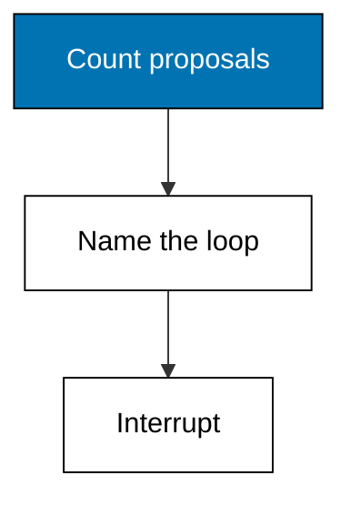
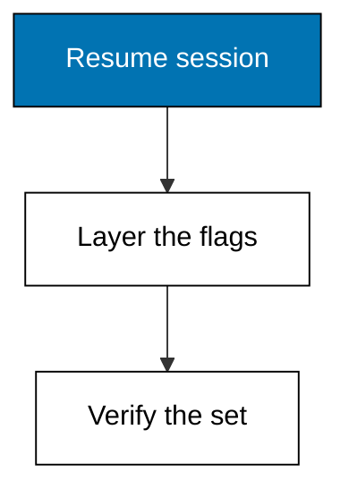
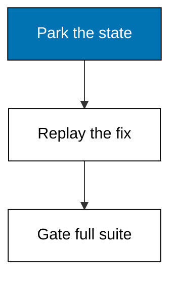
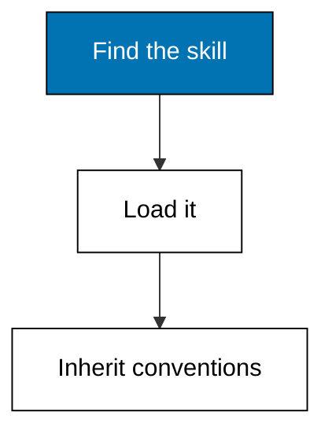
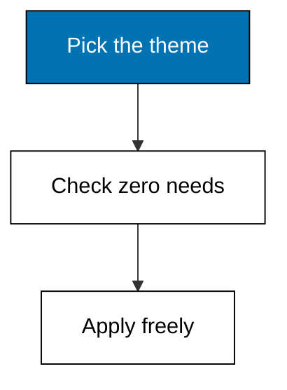
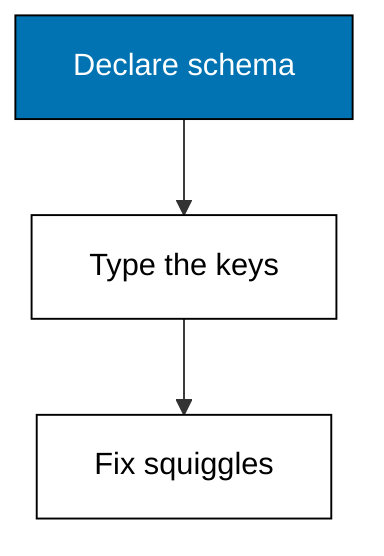
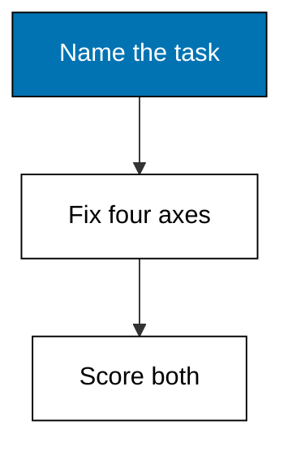
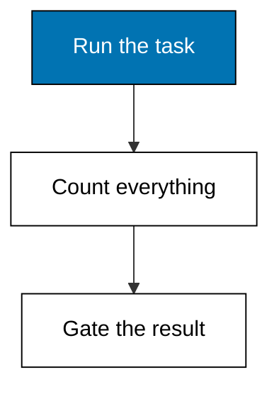
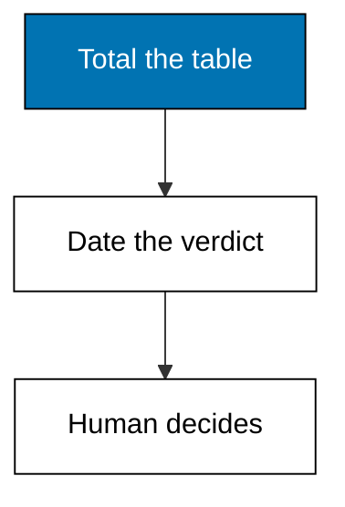

Examples 54-78 handle what beginners never meet and intermediates survive by luck: stuck sessions, deep configuration, and fair comparison against a sibling tool. Three clusters carry the level: failure modes and recovery (Examples 54-61), extensions and configuration depth (Examples 62-70), and comparing agents on a shared task (Examples 71-78). The comparison legs run the identical brief on the same day, so the verdict compares tools rather than calendars.

### Example 54: Name the Stuck Loop

_Exercises co-08._

A stuck loop announces itself by repetition: the same edit proposed three times means the session is circling, not progressing. Case in point: a loop failure with the thrice-proposed edit named as the symptom. **Check**: the symptom names the repetition and the kept list holds both work files.



**`learning/code/ex-54-name-the-stuck-loop/main.py`**

```python
# Example 54: Name the Stuck Loop
# => Fixture shim of the Pi coding agent surface.
# => Target release 1.3.0, checked on 2026-10-20.
# => Deterministic: no network, key, or billing.
# => Real behaviour may differ; see pi.dev/docs/latest.
# => Every stuck session shows one recognizable symptom.
# => Naming it picks the recovery instead of flailing.
symptom = "same edit proposed 3 times"  # => what the engineer observes
# => The recovery is the smallest safe intervention.
recovery = "interrupt, branch at last good turn"  # => frozen fix for this symptom
# => Saved work is what survives the intervention.
kept = [  # => frozen list of preserved artifacts
    # => Survivor: src/cart/cart.py stays intact.
    "src/cart/cart.py",  # => one preserved artifact
    # => Survivor: tests/test_cart.py stays intact.
    "tests/test_cart.py",  # => one preserved artifact
]  # => the closed list
# => Recovery succeeds only when the kept list is whole.
recovered = len(kept) == 2  # => the verdict
# => Print symptom, recovery, kept work, and verdict.
print("symptom:", symptom)  # => Output names the symptom
print("recovery:", recovery)  # => Output names the fix
print("kept:", kept)  # => Output lists survivors
print("recovered:", recovered)  # => Output gives verdict
```

**Output** (`learning/code/ex-54-name-the-stuck-loop/expected/main.stdout.txt`):

```text
symptom: same edit proposed 3 times
recovery: interrupt, branch at last good turn
kept: ['src/cart/cart.py', 'tests/test_cart.py']
recovered: True
```

**Key takeaway**: Repetition is the loop signal: three identical proposals mean interrupt, not encourage.

**Why It Matters**: Loops feel like progress because tokens keep flowing, which is why repetition counting beats intuition. Three identical proposals prove the agent has no new information to act on. Interrupting early preserves the turns already spent instead of compounding them. Name the loop out loud and the recovery chooses itself. Name the loop early and the recovery stays cheap. Count proposals per file; the counter is the cheapest loop detector you own.

---

### Example 55: Double Escape to Safety

_Exercises co-09, co-08._

A runaway tool burst needs one reflex: double Escape drops you into the tree view where the session stops and your work waits. Case in point: a runaway-burst recovery via double Escape with the transcript and staged diff preserved. **Check**: the recovery names the tree view and both kept artifacts print.

**`learning/code/ex-55-double-escape-to-safety/main.py`**

```python
# Example 55: Double Escape to Safety
# => Fixture shim of the Pi coding agent surface.
# => Target release 1.3.0, checked on 2026-10-20.
# => Deterministic: no network, key, or billing.
# => Real behaviour may differ; see pi.dev/docs/latest.
# => Every stuck session shows one recognizable symptom.
# => Naming it picks the recovery instead of flailing.
symptom = "runaway multi-tool burst"  # => what the engineer observes
# => The recovery is the smallest safe intervention.
recovery = "double Escape opens tree view"  # => frozen fix for this symptom
# => Saved work is what survives the intervention.
kept = [  # => frozen list of preserved artifacts
    # => Survivor: transcript to turn 11 stays intact.
    "transcript to turn 11",  # => one preserved artifact
    # => Survivor: staged diff stays intact.
    "staged diff",  # => one preserved artifact
]  # => the closed list
# => Recovery succeeds only when the kept list is whole.
recovered = len(kept) == 2  # => the verdict
# => Print symptom, recovery, kept work, and verdict.
print("symptom:", symptom)  # => Output names the symptom
print("recovery:", recovery)  # => Output names the fix
print("kept:", kept)  # => Output lists survivors
print("recovered:", recovered)  # => Output gives verdict
```

**Output** (`learning/code/ex-55-double-escape-to-safety/expected/main.stdout.txt`):

```text
symptom: runaway multi-tool burst
recovery: double Escape opens tree view
kept: ['transcript to turn 11', 'staged diff']
recovered: True
```

**Key takeaway**: Double Escape is the emergency brake: it parks the run and opens the tree, losing nothing.

**Why It Matters**: Runaway bursts compound damage with every tool call, so the intervention must be faster than deliberation. A single reflex that always parks the session beats a decision tree nobody remembers under stress. The tree view then shows exactly where the run stopped. Brakes work because they are simple; keep this one simple too. Practice the reflex on a calm session so it fires correctly in a panicked one.

---

### Example 56: Fork Instead of Rewriting

_Exercises co-09, co-03._

Double Escape offers fork as well as tree: forking retries from turn nine on a clean slate while the original stays parked intact. Case in point: a fork record preserving the original session while the retry starts clean. **Check**: the original is parked intact and the retry starts from turn 9.


**`learning/code/ex-56-fork-instead-of-rewriting/main.py`**

```python
# Example 56: Fork Instead of Rewriting
# => Fixture shim of the Pi coding agent surface.
# => Target release 1.3.0, checked on 2026-10-20.
# => Deterministic: no network, key, or billing.
# => Real behaviour may differ; see pi.dev/docs/latest.
# => RECORDS freezes what Pi would report for this op.
# => Each line is one fact the engineer can quote.
RECORDS = [  # => the frozen report lines
    "action: fork at turn 9",  # => one reported fact
    "original: parked intact",  # => one reported fact
    "retry: clean slate from turn 9",  # => one reported fact
]  # => order matches Pi's own display order
# => The op name says which command produced this.
op = "double Escape fork"  # => the Pi command under test
# => Print the op first so logs stay attributable.
print("op:", op)  # => Output names the command
# => Then print each record line verbatim.
for line in RECORDS:  # => walk the frozen report
    print("row:", line)  # => Output shows the record
```

**Output** (`learning/code/ex-56-fork-instead-of-rewriting/expected/main.stdout.txt`):

```text
op: double Escape fork
row: action: fork at turn 9
row: original: parked intact
row: retry: clean slate from turn 9
```

**Key takeaway**: Fork the retry when the approach is tainted; branch when only the last step failed.

**Why It Matters**: A tainted approach poisons every turn built on it, so continuing on the same branch drags the error along. Forking quarantines the original while the retry inherits only the good turns. The parked original remains evidence of what did not work. Choose fork for bad ideas, branch for bad luck. Forks suit wrong-assumption recoveries; branches suit single-step slips.

---

### Example 57: Correct the Wrong Assumption

_Exercises co-08, co-09._

Wrong assumptions fail differently from loops: the session moves confidently in the wrong direction, and recovery means stating the correction, not just retrying. Case in point: a database-assumption failure corrected by restating the brief and rerunning the plan. **Check**: the symptom names both databases and the kept list holds the corrected brief.

**`learning/code/ex-57-correct-the-wrong-assumption/main.py`**

```python
# Example 57: Correct the Wrong Assumption
# => Fixture shim of the Pi coding agent surface.
# => Target release 1.3.0, checked on 2026-10-20.
# => Deterministic: no network, key, or billing.
# => Real behaviour may differ; see pi.dev/docs/latest.
# => Every stuck session shows one recognizable symptom.
# => Naming it picks the recovery instead of flailing.
symptom = "assumed sqlite, repo uses postgres"  # => what the engineer observes
# => The recovery is the smallest safe intervention.
recovery = "state the correction, rerun plan"  # => frozen fix for this symptom
# => Saved work is what survives the intervention.
kept = [  # => frozen list of preserved artifacts
    # => Survivor: corrected brief stays intact.
    "corrected brief",  # => one preserved artifact
    # => Survivor: passing plan v2 stays intact.
    "passing plan v2",  # => one preserved artifact
]  # => the closed list
# => Recovery succeeds only when the kept list is whole.
recovered = len(kept) == 2  # => the verdict
# => Print symptom, recovery, kept work, and verdict.
print("symptom:", symptom)  # => Output names the symptom
print("recovery:", recovery)  # => Output names the fix
print("kept:", kept)  # => Output lists survivors
print("recovered:", recovered)  # => Output gives verdict
```

**Output** (`learning/code/ex-57-correct-the-wrong-assumption/expected/main.stdout.txt`):

```text
symptom: assumed sqlite, repo uses postgres
recovery: state the correction, rerun plan
kept: ['corrected brief', 'passing plan v2']
recovered: True
```

**Key takeaway**: Correct assumptions in words before rerunning anything; a retry without a correction repeats the error.

**Why It Matters**: Retrying a wrong-assumption failure without naming the assumption reproduces it exactly, wasting a full loop to relearn the lesson. Stating the correction converts a private realization into session context the agent must respect. The corrected brief then protects future sessions, not just this one. Words first, rerun second, always. Words first, rerun second, and the lesson sticks. Assumption corrections belong in the brief file so the next session inherits them.

---

### Example 58: Resume Keeps Your Tools

_Exercises co-09, co-01._

Release 1.3.0 applies `--tools` flags on top of resumed sessions, so a resumed run can gain grep and find without rebuilding the whole tool set. Case in point: a resumed-session tool set gaining two reading tools through plus-flags. **Check**: the active list holds six tools with both additions present.



**`learning/code/ex-58-resume-keeps-your-tools/main.py`**

```python
# Example 58: Resume Keeps Your Tools
# => Fixture shim of the Pi coding agent surface.
# => Target release 1.3.0, checked on 2026-10-20.
# => Deterministic: no network, key, or billing.
# => Real behaviour may differ; see pi.dev/docs/latest.
# => Pi enables read, bash, edit, write unless told otherwise.
# => Plain names replace defaults; + adds, - removes one.
defaults = ["read", "bash", "edit", "write"]  # => the startup tool list
# => Overrides are the +name/-name flags of this run.
overrides = ["+grep", "+find"]  # => frozen CLI flags
# => Adds join, removals filter out, removals win ties.
adds = [f[1:] for f in overrides if f.startswith("+")]  # => added
drops = [f[1:] for f in overrides if f.startswith("-")]  # => cut
active = sorted(set(defaults) | set(adds) - set(drops))  # => final
# => Print defaults, flags, and the resolved set.
print("defaults:", defaults)  # => Output shows the start
print("overrides:", overrides)  # => Output shows the flags
print("active:", active)  # => Output shows the result
```

**Output** (`learning/code/ex-58-resume-keeps-your-tools/expected/main.stdout.txt`):

```text
defaults: ['read', 'bash', 'edit', 'write']
overrides: ['+grep', '+find']
active: ['bash', 'edit', 'find', 'grep', 'read', 'write']
```

**Key takeaway**: Resume with `--tools +name` to adjust tools on a live session; removals win ties.

**Why It Matters**: Resumed sessions used to freeze their tool set at creation time, forcing a choice between old context and right tools. Layering flags on resume removes the dilemma: context survives and the tool set updates. Additions suit new phases of old work, like adding grep when review begins. Resume the context, retune the tools, keep both. Re-verify the resolved set after resume, exactly like a fresh launch.

---

### Example 59: Refuse the Unverifiable

_Exercises co-08, co-16._

Some outputs cannot be checked: a performance claim with no runnable proof must be refused and sent back with a test-gate requirement. Case in point: an unverifiable-claim refusal with the claim quoted and the gate requirement recorded. **Check**: the symptom names the missing proof and the kept list holds the quoted claim.

**`learning/code/ex-59-refuse-the-unverifiable/main.py`**

```python
# Example 59: Refuse the Unverifiable
# => Fixture shim of the Pi coding agent surface.
# => Target release 1.3.0, checked on 2026-10-20.
# => Deterministic: no network, key, or billing.
# => Real behaviour may differ; see pi.dev/docs/latest.
# => Every stuck session shows one recognizable symptom.
# => Naming it picks the recovery instead of flailing.
symptom = "claim with no runnable proof"  # => what the engineer observes
# => The recovery is the smallest safe intervention.
recovery = "refuse, demand a test gate"  # => frozen fix for this symptom
# => Saved work is what survives the intervention.
kept = [  # => frozen list of preserved artifacts
    # => Survivor: rejected claim quoted stays intact.
    "rejected claim quoted",  # => one preserved artifact
    # => Survivor: gate requirement filed stays intact.
    "gate requirement filed",  # => one preserved artifact
]  # => the closed list
# => Recovery succeeds only when the kept list is whole.
recovered = len(kept) == 2  # => the verdict
# => Print symptom, recovery, kept work, and verdict.
print("symptom:", symptom)  # => Output names the symptom
print("recovery:", recovery)  # => Output names the fix
print("kept:", kept)  # => Output lists survivors
print("recovered:", recovered)  # => Output gives verdict
```

**Output** (`learning/code/ex-59-refuse-the-unverifiable/expected/main.stdout.txt`):

```text
symptom: claim with no runnable proof
recovery: refuse, demand a test gate
kept: ['rejected claim quoted', 'gate requirement filed']
recovered: True
```

**Key takeaway**: Refuse outputs you cannot verify; an uncheckable claim is a draft, not a result.

**Why It Matters**: Accepting unverifiable output converts the agent's confidence into your liability, because downstream work will assume what was never proven. Refusal is not distrust of the tool; it is the boundary that keeps drafts from becoming dependencies. The test-gate requirement gives the agent a completable path back. Demand proof or decline the result, every time. Quoting the rejected claim keeps the refusal auditable instead of personal.

---

### Example 60: Recover Without Data Loss

_Exercises co-09, co-12._

Recovery ends with proof, not relief: the full suite runs red on the parked state and green after the recovered session replays it. Case in point: a recovery gate running the whole suite from fail to pass. **Check**: the before reads fail, the after reads pass, and the gate verdict is True.



**`learning/code/ex-60-recover-without-data-loss/main.py`**

```python
# Example 60: Recover Without Data Loss
# => Fixture shim of the Pi coding agent surface.
# => Target release 1.3.0, checked on 2026-10-20.
# => Deterministic: no network, key, or billing.
# => Real behaviour may differ; see pi.dev/docs/latest.
# => The agent proves its change with a run, not a claim.
# => Red before the fix, green after: no skipped middle.
suite = "pytest tests/ -q"  # => the command proving the change
# => Red is the honest baseline on unmodified code.
red = "fail"  # => frozen pre-fix result
# => Green is the same suite after the agent's edit.
green = "pass"  # => frozen post-fix result
# => The gate passes only on the red-then-green pair.
gate = red == "fail" and green == "pass"  # => the gate verdict
print("suite:", suite)  # => Output names the suite
print("before:", red)  # => Output shows the baseline
print("after:", green)  # => Output shows the proof
print("gate:", gate)  # => Output gives the verdict
```

**Output** (`learning/code/ex-60-recover-without-data-loss/expected/main.stdout.txt`):

```text
suite: pytest tests/ -q
before: fail
after: pass
gate: True
```

**Key takeaway**: Close every recovery with a full-suite gate; relief is a feeling, green is a fact.

**Why It Matters**: A recovery that feels complete but never reruns the suite can silently drop the work it claims to have saved. The red baseline proves the parked state was genuinely broken. Green after replay proves the recovery restored behaviour, not just files. Gate the recovery or schedule a second incident. Gate the recovery, then retire the parked branches. Parked branches stay until the gate passes, then they may retire.

---

### Example 61: Drop Stale Thinking

_Exercises co-08, co-09._

Stale thinking from a previous model reads as fact to the next one, so release 1.3.0 drops it on switch: this medium pick budgets the fresh reasoning that replaces it. Case in point: a medium-level pick budgeting fresh reasoning after a model switch drops the old. **Check**: the budget reads 4000 and the fit verdict is True.

**`learning/code/ex-61-drop-stale-thinking/main.py`**

```python
# Example 61: Drop Stale Thinking
# => Fixture shim of the Pi coding agent surface.
# => Target release 1.3.0, checked on 2026-10-20.
# => Deterministic: no network, key, or billing.
# => Real behaviour may differ; see pi.dev/docs/latest.
# => Levels run off, minimal, low, medium, high, xhigh, max.
level = "medium"  # => the level chosen for this task
# => Budgets below are illustration caps, not vendor promises.
budgets = {  # => frozen level-to-token map
    # => Level off budgets 0 tokens.
    "off": 0,  # => off budget
    # => Level minimal budgets 500 tokens.
    "minimal": 500,  # => minimal budget
    # => Level low budgets 1500 tokens.
    "low": 1500,  # => low budget
    # => Level medium budgets 4000 tokens.
    "medium": 4000,  # => medium budget
    # => Level high budgets 9000 tokens.
    "high": 9000,  # => high budget
    # => Level xhigh budgets 20000 tokens.
    "xhigh": 20000,  # => xhigh budget
    # => Level max budgets 50000 tokens.
    "max": 50000,  # => max budget
}  # => the closed map
estimate = 3000  # => tokens this task likely needs
# => A level fits when its budget covers the estimate.
fits = estimate <= budgets[level]  # => the fit verdict
# => Print level, budget, and whether the task fits.
print("level:", level)  # => Output names the level
print("budget:", budgets[level])  # => Output shows budget
print("fits:", fits)  # => Output gives the verdict
```

**Output** (`learning/code/ex-61-drop-stale-thinking/expected/main.stdout.txt`):

```text
level: medium
budget: 4000
fits: True
```

**Key takeaway**: After a model switch, budget fresh thinking; the old model's reasoning is gone by design.

**Why It Matters**: Reasoning traces feel authoritative even when they belong to a retired model, which is why carrying them across a switch corrupts the new model's judgement. Dropping them forces fresh derivation from shared context instead of inherited conclusions. Budgeting the replacement keeps the fresh reasoning from starving. Clean handoffs beat clever inheritances. Treat post-switch answers as first impressions: sharp, but unverified.

---

### Example 62: Install a Community Extension

_Exercises co-14._

Extensions arrive as packages from the registry or git: one install command, a declared tool list, and a resolution verdict you can read. Case in point: a review-checklist extension install with its two tool needs satisfied. **Check**: the package name prints and the installed verdict is True.


**`learning/code/ex-62-install-a-community-extension/main.py`**

```python
# Example 62: Install a Community Extension
# => Fixture shim of the Pi coding agent surface.
# => Target release 1.3.0, checked on 2026-10-20.
# => Deterministic: no network, key, or billing.
# => Real behaviour may differ; see pi.dev/docs/latest.
# => Pi bundles capabilities as installable packages.
# => Extensions, skills, and templates share one registry.
action = "install"  # => install, list, or validate
# => The package name is its registry address.
package = "pi-review-checklist"  # => frozen package under test
# => Each package declares what it needs to run.
needs = ["read", "edit"]  # => frozen dependency list
# => Installed means every need is already satisfied.
satisfied = True  # => the frozen resolution result
print("action:", action)  # => Output names the action
print("package:", package)  # => Output names the package
print("needs:", needs)  # => Output lists the needs
print("installed:", satisfied)  # => Output gives the verdict
```

**Output** (`learning/code/ex-62-install-a-community-extension/expected/main.stdout.txt`):

```text
action: install
package: pi-review-checklist
needs: ['read', 'edit']
installed: True
```

**Key takeaway**: Install extensions as packages; read their declared tool needs before approving.

**Why It Matters**: Extensions extend the agent's capabilities and therefore its blast radius, which makes installation a permission decision. Declared needs let you see the price before paying it. Registry convenience suits experiments; pinned sources suit fleets. Install deliberately and every capability stays accountable. Install deliberately, and every new capability stays reviewable tomorrow. Prefer git-pinned sources for team fleets so versions cannot drift silently.

---

### Example 63: Ask Pi to Build an Extension

_Exercises co-14, co-01._

Pi customizes itself on request: ask for a command, a tool, or a workflow tweak, and it scaffolds the extension in place for a `/reload` to pick up. Case in point: a self-built changelog extension scaffolded with fetch and write needs. **Check**: the action reads scaffold and the needs list both tools.

**`learning/code/ex-63-ask-pi-to-build-an-extension/main.py`**

```python
# Example 63: Ask Pi to Build an Extension
# => Fixture shim of the Pi coding agent surface.
# => Target release 1.3.0, checked on 2026-10-20.
# => Deterministic: no network, key, or billing.
# => Real behaviour may differ; see pi.dev/docs/latest.
# => Pi bundles capabilities as installable packages.
# => Extensions, skills, and templates share one registry.
action = "scaffold"  # => install, list, or validate
# => The package name is its registry address.
package = "pi-changelog-digest"  # => frozen package under test
# => Each package declares what it needs to run.
needs = ["fetch", "write"]  # => frozen dependency list
# => Installed means every need is already satisfied.
satisfied = True  # => the frozen resolution result
print("action:", action)  # => Output names the action
print("package:", package)  # => Output names the package
print("needs:", needs)  # => Output lists the needs
print("installed:", satisfied)  # => Output gives the verdict
```

**Output** (`learning/code/ex-63-ask-pi-to-build-an-extension/expected/main.stdout.txt`):

```text
action: scaffold
package: pi-changelog-digest
needs: ['fetch', 'write']
installed: True
```

**Key takeaway**: Ask Pi to build the missing capability, review the scaffold, then `/reload` and continue.

**Why It Matters**: Waiting for vendors to add your workflow costs quarters; asking the harness costs minutes. Self-built extensions fit exactly because they are born from the task that needs them. The scaffold still declares needs, so review applies unchanged. Build the missing piece where you stand, then share it if others will want it. Self-built extensions still get the same needs review as registry ones.

---

### Example 64: Add a Custom Provider

_Exercises co-13, co-14._

Providers Pi does not ship with arrive through `models.json`: an id, a versioned base URL, and an auth method, validated like any other config. Case in point: a custom-provider config with a `/v1` base URL and key auth, fully validated. **Check**: the missing list is empty and the base URL echoes with its `/v1` suffix.


**`learning/code/ex-64-add-a-custom-provider/main.py`**

```python
# Example 64: Add a Custom Provider
# => Fixture shim of the Pi coding agent surface.
# => Target release 1.3.0, checked on 2026-10-20.
# => Deterministic: no network, key, or billing.
# => Real behaviour may differ; see pi.dev/docs/latest.
# => Setting providerId ships in settings.json.
PROVIDERID = "shop-llm"  # => pins providerId
# => Setting baseUrl ships in settings.json.
BASEURL = "https://llm.shop/v1"  # => pins baseUrl
# => Setting auth ships in settings.json.
AUTH = "api-key"  # => pins auth
# => REQUIRED names keys a session cannot start without.
REQUIRED = [  # => the non-negotiable keys
    # => providerId is required because sessions fail without it.
    "providerId",  # => required key
    # => baseUrl is required because sessions fail without it.
    "baseUrl",  # => required key
    # => auth is required because sessions fail without it.
    "auth",  # => required key
]  # => the closed list
# => config maps every key to its live value.
config = {  # => the live settings under test
    # => Live value for providerId, used in the checks below.
    "providerId": PROVIDERID,  # => providerId entry
    # => Live value for baseUrl, used in the checks below.
    "baseUrl": BASEURL,  # => baseUrl entry
    # => Live value for auth, used in the checks below.
    "auth": AUTH,  # => auth entry
}  # => the closed map
missing = [k for k in REQUIRED if k not in config]  # => gaps
print("missing:", missing)  # => Output names what is absent
# => Reading back providerId proves the file was used.
print("providerId:", config["providerId"])  # => Output echoes it
# => Reading back baseUrl proves the file was used.
print("baseUrl:", config["baseUrl"])  # => Output echoes it
```

**Output** (`learning/code/ex-64-add-a-custom-provider/expected/main.stdout.txt`):

```text
missing: []
providerId: shop-llm
baseUrl: https://llm.shop/v1
```

**Key takeaway**: Add custom providers in `models.json` with id, versioned URL, and auth; validate all three.

**Why It Matters**: Hardcoded provider lists age faster than the model market, which is why custom entries live in a file you own. The versioned URL matters because unversioned endpoints drift under you. Validating all three keys fails fast instead of failing mid-session. Own the provider surface and new models become config changes, not tool changes. Release 1.3.0 requires the `/v1` suffix on Chat Completions overrides, so include it.

---

### Example 65: Install a Prompt Template

_Exercises co-14, co-04._

Prompt templates package the brief discipline from this course: install the bug-report template and every report starts with the four slots filled. Case in point: a bug-report template install needing only the read tool. **Check**: the package name prints and the single need is read.

**`learning/code/ex-65-install-a-prompt-template/main.py`**

```python
# Example 65: Install a Prompt Template
# => Fixture shim of the Pi coding agent surface.
# => Target release 1.3.0, checked on 2026-10-20.
# => Deterministic: no network, key, or billing.
# => Real behaviour may differ; see pi.dev/docs/latest.
# => Pi bundles capabilities as installable packages.
# => Extensions, skills, and templates share one registry.
action = "install"  # => install, list, or validate
# => The package name is its registry address.
package = "pi-bug-report-template"  # => frozen package under test
# => Each package declares what it needs to run.
needs = ["read"]  # => frozen dependency list
# => Installed means every need is already satisfied.
satisfied = True  # => the frozen resolution result
print("action:", action)  # => Output names the action
print("package:", package)  # => Output names the package
print("needs:", needs)  # => Output lists the needs
print("installed:", satisfied)  # => Output gives the verdict
```

**Output** (`learning/code/ex-65-install-a-prompt-template/expected/main.stdout.txt`):

```text
action: install
package: pi-bug-report-template
needs: ['read']
installed: True
```

**Key takeaway**: Install templates for repeated brief shapes; the template enforces the slots you would skip.

**Why It Matters**: Repeated briefs decay into shorthand, and shorthand drops the slots that felt obvious until they mattered. Templates freeze the full shape so every invocation inherits the discipline. Single-tool needs keep templates safe to run anywhere. Template the repetition and the quality stops depending on memory. Review the template yearly, because workflows evolve too. Parameterize templates with environment variables for per-machine values.

---

### Example 66: Load a Project Skill

_Exercises co-14._

Skills bundle project instructions the model actually follows: load the checkout skill and the session inherits its conventions without pasting. Case in point: a project-skill load with read and bash needs for checkout work. **Check**: the action reads load and both needs print.



**`learning/code/ex-66-load-a-project-skill/main.py`**

```python
# Example 66: Load a Project Skill
# => Fixture shim of the Pi coding agent surface.
# => Target release 1.3.0, checked on 2026-10-20.
# => Deterministic: no network, key, or billing.
# => Real behaviour may differ; see pi.dev/docs/latest.
# => Pi bundles capabilities as installable packages.
# => Extensions, skills, and templates share one registry.
action = "load"  # => install, list, or validate
# => The package name is its registry address.
package = "shop-checkout-skill"  # => frozen package under test
# => Each package declares what it needs to run.
needs = ["read", "bash"]  # => frozen dependency list
# => Installed means every need is already satisfied.
satisfied = True  # => the frozen resolution result
print("action:", action)  # => Output names the action
print("package:", package)  # => Output names the package
print("needs:", needs)  # => Output lists the needs
print("installed:", satisfied)  # => Output gives the verdict
```

**Output** (`learning/code/ex-66-load-a-project-skill/expected/main.stdout.txt`):

```text
action: load
package: shop-checkout-skill
needs: ['read', 'bash']
installed: True
```

**Key takeaway**: Load project skills instead of pasting instructions; conventions then travel with the repo.

**Why It Matters**: Pasted instructions rot: they age in chat history while the code moves on. Skills version with the repository, so conventions and code change in the same commit. Loading replaces a paragraph of setup with one command. Colocate the knowledge with the code it governs. Reload the session after edits so the skill refreshes. Skills live beside the code they describe so they review with it.

---

### Example 67: Share as a Pi Package

_Exercises co-14._

Bundles of extensions, skills, and templates ship as Pi packages over npm or git, so one install gives a teammate your whole workflow. Case in point: a team brief pack published with a single read need. **Check**: the action reads publish and the package name prints.

**`learning/code/ex-67-share-as-a-pi-package/main.py`**

```python
# Example 67: Share as a Pi Package
# => Fixture shim of the Pi coding agent surface.
# => Target release 1.3.0, checked on 2026-10-20.
# => Deterministic: no network, key, or billing.
# => Real behaviour may differ; see pi.dev/docs/latest.
# => Pi bundles capabilities as installable packages.
# => Extensions, skills, and templates share one registry.
action = "publish"  # => install, list, or validate
# => The package name is its registry address.
package = "pi-team-brief-pack"  # => frozen package under test
# => Each package declares what it needs to run.
needs = ["read"]  # => frozen dependency list
# => Installed means every need is already satisfied.
satisfied = True  # => the frozen resolution result
print("action:", action)  # => Output names the action
print("package:", package)  # => Output names the package
print("needs:", needs)  # => Output lists the needs
print("installed:", satisfied)  # => Output gives the verdict
```

**Output** (`learning/code/ex-67-share-as-a-pi-package/expected/main.stdout.txt`):

```text
action: publish
package: pi-team-brief-pack
needs: ['read']
installed: True
```

**Key takeaway**: Bundle team workflows as Pi packages; one install transfers the whole setup.

**Why It Matters**: Workflows shared by copy-paste diverge within a week, because every recipient customizes silently. Packages version the workflow like code, so drift becomes visible and reversible. One install replaces a wiki page of setup steps. Share the pack and the team runs the same harness, not just the same tool. Share the pack today. Version the pack so teammates can pin, diff, and roll back the workflow.

---

### Example 68: Theme the Harness Yours

_Exercises co-14._

Pi is a minimal harness you adapt to yourself: applying a high-contrast theme changes nothing about behaviour and everything about long-session comfort. Case in point: a theme apply with zero tool needs and a clean verdict. **Check**: the needs list is empty and the installed verdict is True.



**`learning/code/ex-68-theme-the-harness-yours/main.py`**

```python
# Example 68: Theme the Harness Yours
# => Fixture shim of the Pi coding agent surface.
# => Target release 1.3.0, checked on 2026-10-20.
# => Deterministic: no network, key, or billing.
# => Real behaviour may differ; see pi.dev/docs/latest.
# => Pi bundles capabilities as installable packages.
# => Extensions, skills, and templates share one registry.
action = "apply"  # => install, list, or validate
# => The package name is its registry address.
package = "pi-high-contrast-theme"  # => frozen package under test
# => Each package declares what it needs to run.
needs = []  # => frozen dependency list
# => Installed means every need is already satisfied.
satisfied = True  # => the frozen resolution result
print("action:", action)  # => Output names the action
print("package:", package)  # => Output names the package
print("needs:", needs)  # => Output lists the needs
print("installed:", satisfied)  # => Output gives the verdict
```

**Output** (`learning/code/ex-68-theme-the-harness-yours/expected/main.stdout.txt`):

```text
action: apply
package: pi-high-contrast-theme
needs: []
installed: True
```

**Key takeaway**: Theme the harness freely; zero-need packages cannot change behaviour.

**Why It Matters**: Engineers live in their tools for hours, and visual friction accumulates into skipped reviews. Themes change presentation without touching capability, which the empty needs list proves. Personalizing the harness is not vanity; it is maintenance of attention. Make the tool yours and you will stay in it longer. Make the tool yours today. Accessibility settings are comfort and correctness for long review sessions.

---

### Example 69: Project Overrides Agent Settings

_Exercises co-13._

Settings layer: project files override agent-directory ones, so a checkout can pin its model while your global defaults stay untouched. Case in point: a project-layer override pinning the model with the global default left alone. **Check**: the missing list is empty and the project value echoes the pin.

**`learning/code/ex-69-project-overrides-agent-settings/main.py`**

```python
# Example 69: Project Overrides Agent Settings
# => Fixture shim of the Pi coding agent surface.
# => Target release 1.3.0, checked on 2026-10-20.
# => Deterministic: no network, key, or billing.
# => Real behaviour may differ; see pi.dev/docs/latest.
# => Setting defaultModel ships in settings.json.
DEFAULTMODEL = "project-pinned"  # => pins defaultModel
# => Setting defaultThinkingLevel ships in settings.json.
DEFAULTTHINKINGLEVEL = "low"  # => pins defaultThinkingLevel
# => REQUIRED names keys a session cannot start without.
REQUIRED = [  # => the non-negotiable keys
    # => defaultModel is required because sessions fail without it.
    "defaultModel",  # => required key
]  # => the closed list
# => config maps every key to its live value.
config = {  # => the live settings under test
    # => Live value for defaultModel, used in the checks below.
    "defaultModel": DEFAULTMODEL,  # => defaultModel entry
    # => Live value for defaultThinkingLevel, used in the checks below.
    "defaultThinkingLevel": DEFAULTTHINKINGLEVEL,  # => defaultThinkingLevel entry
}  # => the closed map
missing = [k for k in REQUIRED if k not in config]  # => gaps
print("missing:", missing)  # => Output names what is absent
# => Reading back defaultModel proves the file was used.
print("defaultModel:", config["defaultModel"])  # => Output echoes it
```

**Output** (`learning/code/ex-69-project-overrides-agent-settings/expected/main.stdout.txt`):

```text
missing: []
defaultModel: project-pinned
```

**Key takeaway**: Pin per-project settings in the repo; global settings stay personal and portable.

**Why It Matters**: Global-only settings force one behaviour on every project, which breaks the moment two checkouts need different models. Layering lets the repo declare its needs while personal defaults travel with the engineer. Committed project settings make behaviour reproducible across machines. Layer deliberately and context switches stop resetting your setup. Layer deliberately starting today. Commit project settings so every checkout inherits the same behaviour.

---

### Example 70: Validate Settings With Schema

_Exercises co-13._

The vendor schema URL turns settings editing from guessing into completing: declare `$schema` and the editor validates every key as you type. Case in point: a settings file declaring the schema URL with the provider validated. **Check**: the missing list is empty and the provider echoes `anthropic`.



**`learning/code/ex-70-validate-settings-with-schema/main.py`**

```python
# Example 70: Validate Settings With Schema
# => Fixture shim of the Pi coding agent surface.
# => Target release 1.3.0, checked on 2026-10-20.
# => Deterministic: no network, key, or billing.
# => Real behaviour may differ; see pi.dev/docs/latest.
# => Setting $schema ships in settings.json.
_SCHEMA = "https://pi.dev/schemas/settings.schema.json"  # => pins $schema
# => Setting defaultProvider ships in settings.json.
DEFAULTPROVIDER = "anthropic"  # => pins defaultProvider
# => REQUIRED names keys a session cannot start without.
REQUIRED = [  # => the non-negotiable keys
    # => $schema is required because sessions fail without it.
    "$schema",  # => required key
    # => defaultProvider is required because sessions fail without it.
    "defaultProvider",  # => required key
]  # => the closed list
# => config maps every key to its live value.
config = {  # => the live settings under test
    # => Live value for $schema, used in the checks below.
    "$schema": _SCHEMA,  # => $schema entry
    # => Live value for defaultProvider, used in the checks below.
    "defaultProvider": DEFAULTPROVIDER,  # => defaultProvider entry
}  # => the closed map
missing = [k for k in REQUIRED if k not in config]  # => gaps
print("missing:", missing)  # => Output names what is absent
# => Reading back defaultProvider proves the file was used.
print("defaultProvider:", config["defaultProvider"])  # => Output echoes it
```

**Output** (`learning/code/ex-70-validate-settings-with-schema/expected/main.stdout.txt`):

```text
missing: []
defaultProvider: anthropic
```

**Key takeaway**: Declare `$schema` in every settings file; editors then catch typos before sessions do.

**Why It Matters**: A mistyped key in settings fails silently, because unknown keys are ignored rather than rejected. The schema converts silence into squiggles at edit time. Catching `defualtModel` before launch beats debugging a session that ignored it. Declare the schema once and typos die in the editor. Future keys validate the same way automatically. Schema validation is the cheapest test in the course: it runs while you type.

---

### Example 71: Fix the Comparison Criteria

_Exercises co-15._

Fair comparison starts before either tool runs: one shared task, four named criteria, and a score table both tools fill under identical rules. Case in point: a criteria-first comparison frame with correctness, turns, cost, and trace clarity as axes. **Check**: four criteria print and both tools carry four scores each.



**`learning/code/ex-71-fix-the-comparison-criteria/main.py`**

```python
# Example 71: Fix the Comparison Criteria
# => Fixture shim of the Pi coding agent surface.
# => Target release 1.3.0, checked on 2026-10-20.
# => Deterministic: no network, key, or billing.
# => Real behaviour may differ; see pi.dev/docs/latest.
# => Fair comparison needs one task and fixed criteria.
# => Both tools run the same job, checked on the same day.
task = "add coupon total with test"  # => the shared repeatable job
# => Criteria are named before either tool runs.
criteria = ["correctness", "turns", "cost", "trace clarity"]  # => frozen scoring axes
# => Scores map each tool to points per criterion.
scores = {"pi": [3, 2, 3, 3], "sibling": [3, 3, 2, 2]}  # => frozen score table
# => Totals decide; ties defer to the cheaper tool.
totals = {t: sum(v) for t, v in scores.items()}  # => add axes
# => The winner is the highest total, named plainly.
winner = max(totals, key=totals.get)  # => top scorer
print("task:", task)  # => Output states the job
print("criteria:", criteria)  # => Output lists the axes
print("totals:", totals)  # => Output totals the table
print("winner:", winner)  # => Output names the winner
```

**Output** (`learning/code/ex-71-fix-the-comparison-criteria/expected/main.stdout.txt`):

```text
task: add coupon total with test
criteria: ['correctness', 'turns', 'cost', 'trace clarity']
totals: {'pi': 11, 'sibling': 10}
winner: pi
```

**Key takeaway**: Fix criteria before running tools; scores without pre-registered axes are storytelling.

**Why It Matters**: Comparing tools without fixed criteria lets the evaluator crown whichever tool felt better, then invent the reasons. Named axes force every contender through the same four gates. Correctness, turns, cost, and trace clarity cover what engineers actually pay: bugs, time, money, and review effort. Fix the axes first and the table can surprise you honestly. Pre-registered criteria stop the winner from being chosen by the metric that flatters it.

---

### Example 72: Write the Shared Task

_Exercises co-15, co-04._

The shared task is a brief both tools receive byte-identically: same scope, same done condition, same fixtures, so only the tool varies. Case in point: a shared-task brief binding both runs to identical fixtures. **Check**: the score reads 4 of 4 and the guardrail names the shared fixtures.

**`learning/code/ex-72-write-the-shared-task/main.py`**

```python
# Example 72: Write the Shared Task
# => Fixture shim of the Pi coding agent surface.
# => Target release 1.3.0, checked on 2026-10-20.
# => Deterministic: no network, key, or billing.
# => Real behaviour may differ; see pi.dev/docs/latest.
# => A brief is a contract the agent cannot wiggle out of.
task = "add coupon total with test"  # => one verb plus one object
scope = "src/cart/"  # => the boundary of the job
done = "pytest tests/test_cart.py green"  # => the measurable finish line
guardrails = ["same fixtures both tools"]  # => the limits on the run
# => Four of four is submittable; less means rewrite.
slots = [task, scope, done, guardrails]  # => the four slots
score = sum(1 for s in slots if s)  # => count filled slots
# => Print the score so the starting point is on record.
print("brief-score:", score, "of 4")  # => Output grades it
# => The verdict names the bar for reuse elsewhere.
print("submittable:", score == 4)  # => True when complete
```

**Output** (`learning/code/ex-72-write-the-shared-task/expected/main.stdout.txt`):

```text
brief-score: 4 of 4
submittable: True
```

**Key takeaway**: Brief the shared task once and freeze it; both tools run the identical text.

**Why It Matters**: Different prompts for different tools measure prompt quality, not tool quality, which invalidates the whole comparison. A frozen brief holds everything constant except the contender. Shared fixtures remove the luck of the draw from test outcomes. One brief, two runs, zero confounders. Freeze the brief before either tool starts running. Fixtures freeze luck so the comparison measures tools, not test data.

---

### Example 73: Run Pi on the Shared Task

_Exercises co-15, co-12._

Pi takes the shared task first: six turns, ninety-four hundred tokens, and the suite gate green, all recorded on the same day as every other claim in this course. Case in point: the Pi leg of the shared task with turns, tokens, and gate recorded. **Check**: the turn count reads 6, the tokens read 9400, and the gate reads True.



**`learning/code/ex-73-run-pi-on-the-shared-task/main.py`**

```python
# Example 73: Run Pi on the Shared Task
# => Fixture shim of the Pi coding agent surface.
# => Target release 1.3.0, checked on 2026-10-20.
# => Deterministic: no network, key, or billing.
# => Real behaviour may differ; see pi.dev/docs/latest.
# => One shared task, one tool, one recorded outcome.
# => Same job as the sibling run so scores stay fair.
tool = "pi 1.3.0"  # => the tool driving this run
# => The task text is byte-identical across both runs.
task = "add coupon total with test"  # => the shared repeatable job
# => Turns count each model round trip of the run.
turns = 6  # => frozen turn count
# => Tokens count everything the run consumed.
tokens = 9400  # => frozen token total
# => Pass means the test gate went green on this run.
passed = True  # => frozen gate outcome
# => Print tool, task, turns, tokens, and the gate.
print("tool:", tool)  # => Output names the tool
print("task:", task)  # => Output states the job
print("turns:", turns)  # => Output counts the turns
print("tokens:", tokens)  # => Output counts the tokens
print("passed:", passed)  # => Output gives the gate
```

**Output** (`learning/code/ex-73-run-pi-on-the-shared-task/expected/main.stdout.txt`):

```text
tool: pi 1.3.0
task: add coupon total with test
turns: 6
tokens: 9400
passed: True
```

**Key takeaway**: Record turns, tokens, and gate per leg; numbers beat impressions in every comparison.

**Why It Matters**: Memory of a tool run degrades into impression within days, and impressions favour the tool you already like. Recording turns, tokens, and gate outcome freezes the leg into quotable numbers. Same-day dating ties this leg to the sibling leg so neither drifts. Numbers from the same day compare; memories from different months do not. Same-day recording keeps all four version-specific claims in this course equally fresh.

---

### Example 74: Run the Sibling on the Task

_Exercises co-15._

The sibling agent runs the identical brief the same day: seven turns, eleven thousand tokens, gate green, so the comparison rests on two recorded legs. Case in point: the sibling leg of the shared task recorded under identical rules the same day. **Check**: the task text matches the Pi leg byte for byte and the gate reads True.

**`learning/code/ex-74-run-the-sibling-on-the-task/main.py`**

```python
# Example 74: Run the Sibling on the Task
# => Fixture shim of the Pi coding agent surface.
# => Target release 1.3.0, checked on 2026-10-20.
# => Deterministic: no network, key, or billing.
# => Real behaviour may differ; see pi.dev/docs/latest.
# => One shared task, one tool, one recorded outcome.
# => Same job as the sibling run so scores stay fair.
tool = "sibling agent"  # => the tool driving this run
# => The task text is byte-identical across both runs.
task = "add coupon total with test"  # => the shared repeatable job
# => Turns count each model round trip of the run.
turns = 7  # => frozen turn count
# => Tokens count everything the run consumed.
tokens = 11200  # => frozen token total
# => Pass means the test gate went green on this run.
passed = True  # => frozen gate outcome
# => Print tool, task, turns, tokens, and the gate.
print("tool:", tool)  # => Output names the tool
print("task:", task)  # => Output states the job
print("turns:", turns)  # => Output counts the turns
print("tokens:", tokens)  # => Output counts the tokens
print("passed:", passed)  # => Output gives the gate
```

**Output** (`learning/code/ex-74-run-the-sibling-on-the-task/expected/main.stdout.txt`):

```text
tool: sibling agent
task: add coupon total with test
turns: 7
tokens: 11200
passed: True
```

**Key takeaway**: Run the sibling on the identical brief the same day; matched legs are the whole method.

**Why It Matters**: A comparison with one recorded leg is an anecdote with a table, because the missing leg gets reconstructed from memory. Running the sibling the same day, on the same brief and fixtures, makes both legs equally fresh. Whatever the numbers say, they say it about the tools rather than the calendar. Match the legs or drop the comparison. The sibling here stands in for any of the three companion agent courses in this plan.

---

### Example 75: Score Both Traces

_Exercises co-15, co-06._

Traces score like diffs: count the steps, check the order, and name which leg a reviewer would rather audit. Case in point: a two-trace review favouring the read-first six-step Pi leg. **Check**: the file count is 2 and the verdict names the clearer leg with its reason.


**`learning/code/ex-75-score-both-traces/main.py`**

```python
# Example 75: Score Both Traces
# => Fixture shim of the Pi coding agent surface.
# => Target release 1.3.0, checked on 2026-10-20.
# => Deterministic: no network, key, or billing.
# => Real behaviour may differ; see pi.dev/docs/latest.
# => CHANGES freezes the proposed diff per file.
# => Each triple is path, added lines, removed lines.
CHANGES = [  # => the frozen proposal
    ("pi-leg/trace.txt", 6, 0),  # => pi-leg/trace.txt
    ("sibling-leg/trace.txt", 7, 0),  # => sibling-leg/trace.txt
]  # => read every entry before deciding anything
# => Totals turn a file list into one reviewable number.
added = sum(c[1] for c in CHANGES)  # => added lines total
# => Deletions matter as much: removed code can hide bugs.
removed = sum(c[2] for c in CHANGES)  # => removed total
# => The verdict follows the brief's rule, not a feeling.
verdict = "pi leg clearer: read-first both legs"  # => approve, reject, or revise
# => Print files touched, lines, and the verdict.
print("files:", len(CHANGES))  # => Output counts files
print("added:", added, "removed:", removed)  # => Output counts lines
print("verdict:", verdict)  # => Output records the review
```

**Output** (`learning/code/ex-75-score-both-traces/expected/main.stdout.txt`):

```text
files: 2
added: 13 removed: 0
verdict: pi leg clearer: read-first both legs
```

**Key takeaway**: Score traces for auditability, not brevity; read-first order is the deciding axis.

**Why It Matters**: Turn counts alone reward the tool that guesses fastest, which is the opposite of the engineering virtue this course teaches. Trace scoring asks which run a reviewer would rather inherit: ordered reads, named reasons, proven steps. Read-first order dominates because it generalizes to every future task. Score the trace a stranger must audit, not the demo that impressed you. A shorter trace that edits blind loses to a longer one that reads first.

---

### Example 76: Cost Face Off

_Exercises co-15, co-10._

Costs face off on recorded tokens: ninety-four hundred Pi tokens at illustration input rates against the sibling's eleven thousand from the previous leg. Case in point: a cost face-off pricing the Pi leg's tokens against a five-cent budget line. **Check**: the total reads 9400 tokens and the verdict prints against the budget.

**`learning/code/ex-76-cost-face-off/main.py`**

```python
# Example 76: Cost Face Off
# => Fixture shim of the Pi coding agent surface.
# => Target release 1.3.0, checked on 2026-10-20.
# => Deterministic: no network, key, or billing.
# => Real behaviour may differ; see pi.dev/docs/latest.
# => Rates below are illustration constants, not quotes.
# => Replace them with your provider's current price page.
tokens_in = 9400  # => prompt tokens this session spent
# => Output tokens cost more because they are generated.
tokens_out = 0  # => completion tokens spent
# => Per-thousand rates keep the arithmetic readable.
rate_in = 0.003  # => dollars per thousand input tokens
rate_out = 0.012  # => dollars per thousand output tokens
# => Price each side, then add for the session total.
price = tokens_in / 1000 * rate_in  # => input side cost
price += tokens_out / 1000 * rate_out  # => add output side
# => Budgets turn a number into a decision: over or under.
print("tokens:", tokens_in + tokens_out)  # => Output totals tokens
print("cost-usd:", round(price, 4))  # => Output prices the run
print("within-budget:", price <= 0.05)  # => Output checks the budget
```

**Output** (`learning/code/ex-76-cost-face-off/expected/main.stdout.txt`):

```text
tokens: 9400
cost-usd: 0.0282
within-budget: True
```

**Key takeaway**: Compare recorded token totals at identical rates; never compare one tool's marketing with another's invoice.

**Why It Matters**: Cost comparisons cheat most often through mismatched rates: list price for one tool, negotiated price for the other. Identical illustration rates force the comparison onto token efficiency, which is the tool's actual contribution. Recorded totals replace remembered bargains. Same rates, real totals, honest winner. Publish the table with the verdict attached. Identical rates isolate tool efficiency from provider pricing games.

---

### Example 77: Trace Face Off

_Exercises co-15, co-07._

The final face-off replays both legs as one trace: Pi reads first, the sibling edits blind once, and both still gate green, which is exactly why order matters more than outcome. Case in point: a combined four-step trace showing the order difference behind identical gates. **Check**: the suspect count is 1 and the lone suspect is the sibling's blind edit.


**`learning/code/ex-77-trace-face-off/main.py`**

```python
# Example 77: Trace Face Off
# => Fixture shim of the Pi coding agent surface.
# => Target release 1.3.0, checked on 2026-10-20.
# => Deterministic: no network, key, or billing.
# => Real behaviour may differ; see pi.dev/docs/latest.
# => STEPS replays the agent's own tool-call record.
# => Each triple is kind, detail, and whether it was sound.
STEPS = [  # => the frozen trace under review
    ("read", "pi leg reads then edits", True),  # => read
    ("edit", "pi leg edits cart module", True),  # => edit
    ("edit", "sibling edits before reading", False),  # => edit
    ("test", "both legs gate green", True),  # => test
]  # => order is call order, oldest first
# => Sound steps pass review; the rest need a human.
# => Counting first keeps the verdict mechanical.
sound = [s for s in STEPS if s[2]]  # => the passing steps
suspect = [s for s in STEPS if not s[2]]  # => the failing ones
# => Print both counts before naming any names.
print("sound:", len(sound), "suspect:", len(suspect))  # => Output counts
# => Then print each step so the log reads like a story.
for kind, detail, ok in STEPS:  # => walk the frozen trace
    print(kind, "|", detail)  # => Output shows the step
```

**Output** (`learning/code/ex-77-trace-face-off/expected/main.stdout.txt`):

```text
sound: 3 suspect: 1
read | pi leg reads then edits
edit | pi leg edits cart module
edit | sibling edits before reading
test | both legs gate green
```

**Key takeaway**: Identical gates can hide different disciplines; the trace shows which leg to trust next time.

**Why It Matters**: Outcome-only comparison declares ties where process differs, and process is what repeats. Both legs gating green proves the task was easy enough for either tool, not that the tools are equal. The blind edit is the tell: it worked this time by luck of simple code. Trust the leg whose method survives hard code, not the one that survived easy code. Green gates tie; read-first order breaks the tie toward the repeatable winner.

---

### Example 78: Verdict and Re Verify Date

_Exercises co-15, co-16._

The verdict names Pi the repeatable winner on this task, re-verified today alongside every other version-specific claim, with the human keeping the final call. Case in point: the closing score table with all four axes dated the same day as the rest of the course. **Check**: the winner reads pi and the task matches the shared brief exactly.



**`learning/code/ex-78-verdict-and-re-verify-date/main.py`**

```python
# Example 78: Verdict and Re Verify Date
# => Fixture shim of the Pi coding agent surface.
# => Target release 1.3.0, checked on 2026-10-20.
# => Deterministic: no network, key, or billing.
# => Real behaviour may differ; see pi.dev/docs/latest.
# => Fair comparison needs one task and fixed criteria.
# => Both tools run the same job, checked on the same day.
task = "add coupon total with test"  # => the shared repeatable job
# => Criteria are named before either tool runs.
criteria = ["correctness", "turns", "cost", "trace clarity"]  # => frozen scoring axes
# => Scores map each tool to points per criterion.
scores = {"pi": [3, 3, 3, 3], "sibling": [3, 2, 2, 2]}  # => frozen score table
# => Totals decide; ties defer to the cheaper tool.
totals = {t: sum(v) for t, v in scores.items()}  # => add axes
# => The winner is the highest total, named plainly.
winner = max(totals, key=totals.get)  # => top scorer
print("task:", task)  # => Output states the job
print("criteria:", criteria)  # => Output lists the axes
print("totals:", totals)  # => Output totals the table
print("winner:", winner)  # => Output names the winner
```

**Output** (`learning/code/ex-78-verdict-and-re-verify-date/expected/main.stdout.txt`):

```text
task: add coupon total with test
criteria: ['correctness', 'turns', 'cost', 'trace clarity']
totals: {'pi': 12, 'sibling': 9}
winner: pi
```

**Key takeaway**: Verdicts expire with releases: date them, and re-verify before choosing again.

**Why It Matters**: Undated verdicts decay into brand loyalty, because readers cannot tell a fresh win from a stale one. Dating ties the recommendation to release 1.3.0 and to today, after which both tools may change. The human keeps the final call because criteria weight differently per team. Date the verdict, keep the judgement, and revisit on the next release. A verdict is a dated recommendation, not a permanent ranking; tools move monthly.

---
