Examples 1-25 build the working habits this course stands on: installing and verifying Pi, starting and resuming sessions, reading traces instead of prose, and scoping permissions before any real work. Three clusters carry the level: install, configure, and first task (Examples 1-8), reading agent output (Examples 9-17), and permission and sandbox basics (Examples 18-25). Every example drives the Pi command surface from the shell and inspects the result with Python 3 standard-library code, so the just-enough-bash prerequisite earns its place from the first page.

### Example 1: Check the Installed Version

_Exercises co-01._

Every session with a terminal agent starts the same way: prove the tool is installed before you trust it with your files. Case in point: the `pi --version` reply for release 1.3.0 parsed into numbers you can compare. **Check**: the printed triple reads (1, 3, 0) and the verdict is True.

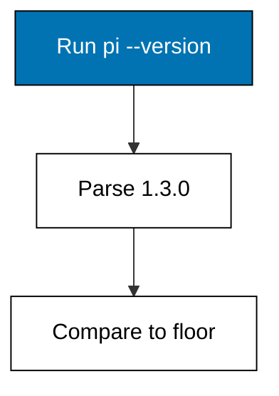

**`learning/code/ex-01-check-the-installed-version/main.py`**

```python
# Example 1: Check the Installed Version
# => Fixture shim of the Pi coding agent surface.
# => Target release 1.3.0, checked on 2026-10-20.
# => Deterministic: no network, key, or billing.
# => Real behaviour may differ; see pi.dev/docs/latest.
REPORTED = "1.3.0"  # => what pi --version prints installed
# => The floor is the oldest release this course describes.
MINIMUM = (1, 0, 0)  # => Pi 1.0, the harness baseline
# => Split the dotted string into three text pieces.
parts = REPORTED.split(".")  # => three number strings
# => Integers compare piece by piece as a tuple.
found = tuple(int(piece) for piece in parts)  # => the triple
# => Newer-or-equal means this course still describes you.
ok = found >= MINIMUM  # => True for this release
# => Print the string, the tuple, and the verdict.
print("reported:", REPORTED)  # => Output echoes the version
print("parsed:", found)  # => Output shows the tuple
print("supported:", ok)  # => Output gives the verdict
```

**Output** (`learning/code/ex-01-check-the-installed-version/expected/main.stdout.txt`):

```text
reported: 1.3.0
parsed: (1, 3, 0)
supported: True
```

**Key takeaway**: A working install answers `pi --version` with a number you can parse and compare.

**Why It Matters**: Version checks feel like busywork until a renamed flag wastes an afternoon, because every later page of vendor documentation is written against a specific release. Knowing the exact release tells you which settings exist, which flags moved, and whether a bug you hit is already fixed upstream. Teams that pin the version in setup docs get identical behaviour on every machine. Make this the first line of every install guide you write. Pin that number in your setup notes so a future mismatch is a fact, not a feeling.

---

### Example 2: Install via the Script

_Exercises co-01._

A fresh machine needs the `pi` binary on PATH before anything else can happen, and Pi ships one installer per platform family. Case in point: the platform-to-installer routing table with the macOS-or-Linux row selected. **Check**: the route reads exactly `curl install.sh` for that input.

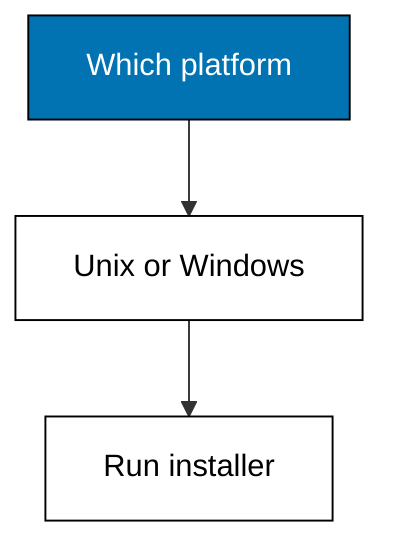

**`learning/code/ex-02-install-via-the-script/main.py`**

```python
# Example 2: Install via the Script
# => Fixture shim of the Pi coding agent surface.
# => Target release 1.3.0, checked on 2026-10-20.
# => Deterministic: no network, key, or billing.
# => Real behaviour may differ; see pi.dev/docs/latest.
# => OPTIONS maps each situation to its route.
OPTIONS = {  # => the routing table
    # => Row: macOS or Linux routes to curl install.sh.
    "macOS or Linux": "curl install.sh",  # => the macOS or Linux route
    # => Row: Windows routes to install.ps1.
    "Windows": "install.ps1",  # => the Windows route
}  # => the closed table
situation = "macOS or Linux"  # => today's situation
# => A dict lookup is the whole decision procedure.
route = OPTIONS[situation]  # => the chosen route
print("situation:", situation)  # => Output states the input
print("route:", route)  # => Output states the route
```

**Output** (`learning/code/ex-02-install-via-the-script/expected/main.stdout.txt`):

```text
situation: macOS or Linux
route: curl install.sh
```

**Key takeaway**: Pick the installer by platform family: shell script for macOS and Linux, PowerShell script for Windows.

**Why It Matters**: Installers fail most often when the wrong one runs on the right machine, because a 404 or a hanging pipe looks like a broken tool rather than a wrong choice. Reading the routing table first turns installation into a lookup instead of a guess. Each route lands the same `pi` binary on PATH, so the rest of this course never branches by platform again. Choose once, verify with the version check, and move on. The npm route in the next example covers machines that already live in Node.

---

### Example 3: Install via npm

_Exercises co-01, co-13._

Machines that already run Node can install Pi as a global package, which keeps the version pinned next to every other JavaScript tool. Case in point: the Node-presence routing table selecting the global npm install of `@earendil-works/pi-coding-agent`. **Check**: the route reads `npm install -g pi` for that input.

**`learning/code/ex-03-install-via-npm/main.py`**

```python
# Example 3: Install via npm
# => Fixture shim of the Pi coding agent surface.
# => Target release 1.3.0, checked on 2026-10-20.
# => Deterministic: no network, key, or billing.
# => Real behaviour may differ; see pi.dev/docs/latest.
# => OPTIONS maps each situation to its route.
OPTIONS = {  # => the routing table
    # => Row: node present routes to npm install -g pi.
    "node present": "npm install -g pi",  # => the node present route
    # => Row: no node routes to use the script.
    "no node": "use the script",  # => the no node route
}  # => the closed table
situation = "node present"  # => today's situation
# => A dict lookup is the whole decision procedure.
route = OPTIONS[situation]  # => the chosen route
print("situation:", situation)  # => Output states the input
print("route:", route)  # => Output states the route
```

**Output** (`learning/code/ex-03-install-via-npm/expected/main.stdout.txt`):

```text
situation: node present
route: npm install -g pi
```

**Key takeaway**: On Node machines install globally with npm so the Pi version sits beside the rest of the toolchain.

**Why It Matters**: A second installer is a second source of drift, because the script and the registry can disagree about which release is current. Teams that standardize on npm get version pinning, offline mirrors, and audit logs for free from tooling they already run. The `--ignore-scripts` flag matters on hardened images where lifecycle scripts are blocked. One install path per fleet keeps support questions answerable. Passing `--ignore-scripts` matches the vendor install notes for locked-down machines.

---

### Example 4: Start Your First Session

_Exercises co-01, co-03._

Pi is a minimal agent harness: you start it inside a project directory and it adopts that directory as its working world. Case in point: the startup record of a first `pi` launch: directory, provider, model, and ready status. **Check**: all four record lines print, ending with `status: ready`.

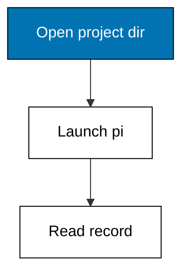

**`learning/code/ex-04-start-your-first-session/main.py`**

```python
# Example 4: Start Your First Session
# => Fixture shim of the Pi coding agent surface.
# => Target release 1.3.0, checked on 2026-10-20.
# => Deterministic: no network, key, or billing.
# => Real behaviour may differ; see pi.dev/docs/latest.
# => RECORDS freezes what Pi would report for this op.
# => Each line is one fact the engineer can quote.
RECORDS = [  # => the frozen report lines
    "cwd: /srv/notes/shop",  # => one reported fact
    "provider: anthropic",  # => one reported fact
    "model: default",  # => one reported fact
    "status: ready",  # => one reported fact
]  # => order matches Pi's own display order
# => The op name says which command produced this.
op = "pi"  # => the Pi command under test
# => Print the op first so logs stay attributable.
print("op:", op)  # => Output names the command
# => Then print each record line verbatim.
for line in RECORDS:  # => walk the frozen report
    print("row:", line)  # => Output shows the record
```

**Output** (`learning/code/ex-04-start-your-first-session/expected/main.stdout.txt`):

```text
op: pi
row: cwd: /srv/notes/shop
row: provider: anthropic
row: model: default
row: status: ready
```

**Key takeaway**: Start Pi inside the project directory; the launch record tells you where it thinks it is.

**Why It Matters**: Agents act on the directory they start in, so launching in the wrong folder turns a helpful assistant into a stranger with write access. The startup record is the cheapest verification in the whole course: four lines that prove provider, model, and working directory before any tool runs. Experienced engineers read it every time because the one launch they skip is the one that edits the wrong checkout. Trust the record, not your memory of which tab this is. If the directory line ever surprises you, stop before typing anything else.

---

### Example 5: Read the Settings File

_Exercises co-13._

Pi reads its behaviour from `settings.json` before it does anything else, and that file is the only part of the agent you can diff like code. Case in point: a three-key settings file naming provider, model, and thinking level, validated against its required keys. **Check**: the missing list is empty and both echoed values match the file.

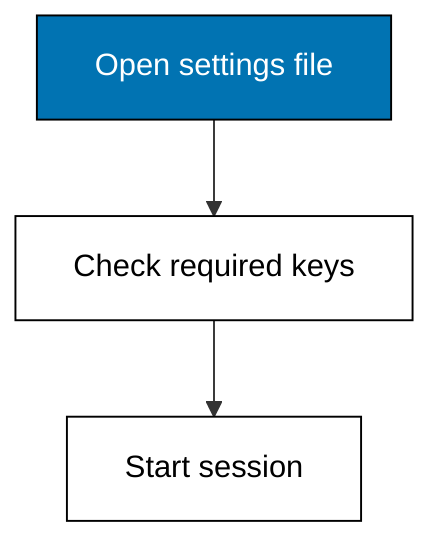

**`learning/code/ex-05-read-the-settings-file/main.py`**

```python
# Example 5: Read the Settings File
# => Fixture shim of the Pi coding agent surface.
# => Target release 1.3.0, checked on 2026-10-20.
# => Deterministic: no network, key, or billing.
# => Real behaviour may differ; see pi.dev/docs/latest.
# => Setting defaultProvider ships in settings.json.
DEFAULTPROVIDER = "anthropic"  # => pins defaultProvider
# => Setting defaultModel ships in settings.json.
DEFAULTMODEL = "auto"  # => pins defaultModel
# => Setting defaultThinkingLevel ships in settings.json.
DEFAULTTHINKINGLEVEL = "medium"  # => pins defaultThinkingLevel
# => REQUIRED names keys a session cannot start without.
REQUIRED = [  # => the non-negotiable keys
    # => defaultProvider is required because sessions fail without it.
    "defaultProvider",  # => required key
    # => defaultModel is required because sessions fail without it.
    "defaultModel",  # => required key
    # => defaultThinkingLevel is required because sessions fail without it.
    "defaultThinkingLevel",  # => required key
]  # => the closed list
# => config maps every key to its live value.
config = {  # => the live settings under test
    # => Live value for defaultProvider, used in the checks below.
    "defaultProvider": DEFAULTPROVIDER,  # => defaultProvider entry
    # => Live value for defaultModel, used in the checks below.
    "defaultModel": DEFAULTMODEL,  # => defaultModel entry
    # => Live value for defaultThinkingLevel, used in the checks below.
    "defaultThinkingLevel": DEFAULTTHINKINGLEVEL,  # => defaultThinkingLevel entry
}  # => the closed map
missing = [k for k in REQUIRED if k not in config]  # => gaps
print("missing:", missing)  # => Output names what is absent
# => Reading back defaultProvider proves the file was used.
print("defaultProvider:", config["defaultProvider"])  # => Output echoes it
# => Reading back defaultThinkingLevel proves the file was used.
print("thinking:", config["defaultThinkingLevel"])  # => Output echoes it
```

**Output** (`learning/code/ex-05-read-the-settings-file/expected/main.stdout.txt`):

```text
missing: []
defaultProvider: anthropic
thinking: medium
```

**Key takeaway**: The settings file is the session's ground truth: read it before you trust any run.

**Why It Matters**: Configuration is the one agent surface that behaves like source code: it diffs, it reviews, and it versions. When behaviour changes unexpectedly, the settings file is the first suspect and the fastest to rule out. Validating required keys at startup fails loudly instead of letting a missing model name surface as a cryptic mid-task error. Review the file whenever a session surprises you. Add the vendor `$schema` URL so your editor completes keys for you.

---

### Example 6: Default Tools on Startup

_Exercises co-01, co-02._

Pi starts every session with four built-in tools enabled, and flags let you add or remove tools per run without touching the settings file. Case in point: the default tool list resolved with one addition and one removal. **Check**: the active list reads exactly the read, edit, write, and grep set.

**`learning/code/ex-06-default-tools-on-startup/main.py`**

```python
# Example 6: Default Tools on Startup
# => Fixture shim of the Pi coding agent surface.
# => Target release 1.3.0, checked on 2026-10-20.
# => Deterministic: no network, key, or billing.
# => Real behaviour may differ; see pi.dev/docs/latest.
# => Pi enables read, bash, edit, write unless told otherwise.
# => Plain names replace defaults; + adds, - removes one.
defaults = ["read", "bash", "edit", "write"]  # => the startup tool list
# => Overrides are the +name/-name flags of this run.
overrides = ["+grep", "-bash"]  # => frozen CLI flags
# => Adds join, removals filter out, removals win ties.
adds = [f[1:] for f in overrides if f.startswith("+")]  # => added
drops = [f[1:] for f in overrides if f.startswith("-")]  # => cut
active = sorted(set(defaults) | set(adds) - set(drops))  # => final
# => Print defaults, flags, and the resolved set.
print("defaults:", defaults)  # => Output shows the start
print("overrides:", overrides)  # => Output shows the flags
print("active:", active)  # => Output shows the result
```

**Output** (`learning/code/ex-06-default-tools-on-startup/expected/main.stdout.txt`):

```text
defaults: ['read', 'bash', 'edit', 'write']
overrides: ['+grep', '-bash']
active: ['bash', 'edit', 'grep', 'read', 'write']
```

**Key takeaway**: Defaults are read, bash, edit, and write; `+name` adds a tool and `-name` removes one for a run.

**Why It Matters**: Tool scope is permission scope: every enabled tool is a capability the model may use without further approval. Starting from the small default set and adding per task keeps the blast radius visible in the launch command itself. Removing `bash` for a review task is the simplest sandbox in the course. Say the tool set out loud before the session, or it will surprise you mid-task. An empty tool list is legal and is how you run a read-only review session.

---

### Example 7: Write Your First Task Brief

_Exercises co-04._

A task brief is a contract written before the agent acts: one task, one scope, one done condition, and the limits of the run. Case in point: a complete four-slot brief for a read-only summary task. **Check**: the score reads 4 of 4 and the brief is submittable.

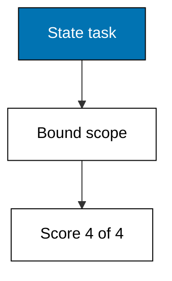

**`learning/code/ex-07-write-your-first-task-brief/main.py`**

```python
# Example 7: Write Your First Task Brief
# => Fixture shim of the Pi coding agent surface.
# => Target release 1.3.0, checked on 2026-10-20.
# => Deterministic: no network, key, or billing.
# => Real behaviour may differ; see pi.dev/docs/latest.
# => A brief is a contract the agent cannot wiggle out of.
task = "summarize open issues"  # => one verb plus one object
scope = "notes/"  # => the boundary of the job
done = "markdown list of 5 issues"  # => the measurable finish line
guardrails = ["read-only", "no network"]  # => the limits on the run
# => Four of four is submittable; less means rewrite.
slots = [task, scope, done, guardrails]  # => the four slots
score = sum(1 for s in slots if s)  # => count filled slots
# => Print the score so the starting point is on record.
print("brief-score:", score, "of 4")  # => Output grades it
# => The verdict names the bar for reuse elsewhere.
print("submittable:", score == 4)  # => True when complete
```

**Output** (`learning/code/ex-07-write-your-first-task-brief/expected/main.stdout.txt`):

```text
brief-score: 4 of 4
submittable: True
```

**Key takeaway**: Write the brief before the run: task, scope, done condition, and guardrails, all four.

**Why It Matters**: Vague prompts breed confident wrong work, because the agent fills every gap you leave with its own guesses. A four-slot brief removes the guessing: scope bounds the files, the done condition names the finish line, and guardrails name what must not happen along the way. Scoring the brief before sending it turns discipline into a habit that takes seconds. The brief is the cheapest review you will ever do. Read-only guardrails make a first brief safe to send to any model.

---

### Example 8: Let the Agent Propose First

_Exercises co-05, co-16._

Plan-then-act means the agent proposes its steps and waits: you approve a tight plan and veto a sprawling one before any file changes. Case in point: a single-file rename plan that fits under the three-file review cap. **Check**: the file count is 1 and the verdict reads `approved`.

**`learning/code/ex-08-let-the-agent-propose-first/main.py`**

```python
# Example 8: Let the Agent Propose First
# => Fixture shim of the Pi coding agent surface.
# => Target release 1.3.0, checked on 2026-10-20.
# => Deterministic: no network, key, or billing.
# => Real behaviour may differ; see pi.dev/docs/latest.
# => A plan names goal, steps, and files before acting.
# => Pi shows this; the human approves, edits, or vetoes.
goal = "rename one helper"  # => the one-line job
# => Steps are ordered tool calls, oldest first.
steps = [  # => the proposed sequence
    # => Step: find callers.
    "find callers",  # => one ordered step
    # => Step: rename symbol.
    "rename symbol",  # => one ordered step
    # => Step: run tests.
    "run tests",  # => one ordered step
]  # => the closed sequence
# => Files bound the blast radius of the whole task.
files = [  # => every path the plan may touch
    # => File: src/util.py stays inside the blast radius.
    "src/util.py",  # => one scoped path
]  # => the closed file list
# => The cap below is this course's rule of thumb.
wide = len(files) > 3  # => True means split it up
# => The verdict is approve for narrow, veto for wide.
if wide:  # => wide plans fail review
    # => Veto splits wide work into reviewable phases.
    verdict = "vetoed: split it"  # => split into phases
else:  # => narrow plans earn fast approval
    # => Approval records the human decision.
    verdict = "approved"  # => the recorded decision
# => Print goal, width, and verdict for the record.
print("goal:", goal)  # => Output states the job
print("files:", len(files))  # => Output counts them
print("verdict:", verdict)  # => Output records it
```

**Output** (`learning/code/ex-08-let-the-agent-propose-first/expected/main.stdout.txt`):

```text
goal: rename one helper
files: 1
verdict: approved
```

**Key takeaway**: Demand a plan on every task until reading diffs feels boring; approve narrow plans fast.

**Why It Matters**: Approval without information is theatre, because a human who cannot see the plan cannot meaningfully approve it. A written plan turns approval into a real decision: the goal, the steps, and the file list are all visible before anything changes. Narrow plans earn fast approvals, which saves scrutiny for the wide ones that deserve it. Never let an agent skip the proposal on a task you could not redo by hand. The veto path in a later example shows what happens when the file count explodes.

---

### Example 9: Print Mode One Shot

_Exercises co-01._

Not every question needs a session: print mode asks once, prints the answer, and exits without touching history. Case in point: a frozen print-mode call from prompt text to plain standard output. **Check**: the mode reads `print`, the envelope reads `stdout only`, and nothing mentions history.

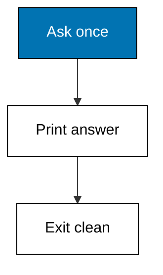

**`learning/code/ex-09-print-mode-one-shot/main.py`**

```python
# Example 9: Print Mode One Shot
# => Fixture shim of the Pi coding agent surface.
# => Target release 1.3.0, checked on 2026-10-20.
# => Deterministic: no network, key, or billing.
# => Real behaviour may differ; see pi.dev/docs/latest.
# => Pi ships four modes: interactive, print/JSON, RPC, SDK.
run_mode = "print"  # => the mode under test
# => The prompt is the exact text Pi would receive.
prompt = "explain this regex"  # => frozen user request
# => The reply is what the mode returns for that prompt.
reply = "one-paragraph answer"  # => frozen mode output
# => Structured modes add a machine-readable envelope.
envelope = "stdout only"  # => wrapper keys around the reply
# => Print mode, prompt, reply, and envelope in order.
print("mode:", run_mode)  # => Output names the mode
print("prompt:", prompt)  # => Output echoes the prompt
print("reply:", reply)  # => Output shows the reply
print("envelope:", envelope)  # => Output names the envelope
```

**Output** (`learning/code/ex-09-print-mode-one-shot/expected/main.stdout.txt`):

```text
mode: print
prompt: explain this regex
reply: one-paragraph answer
envelope: stdout only
```

**Key takeaway**: Use print mode for one-shot answers: ask, read, exit, no session created.

**Why It Matters**: Sessions carry state, and state carries cost: history, context, and tokens accumulate even for questions with no follow-up. Print mode keeps one-shot questions cheap by refusing to remember anything. Piping its output into other Unix tools composes Pi with the rest of your toolchain. Reach for a session only when the task needs memory across turns. Scripts and shell pipelines should prefer print mode over interactive sessions.

---

### Example 10: JSON Output for Scripts

_Exercises co-01, co-07._

Scripts cannot parse prose reliably, so Pi answers in JSON when asked: the same reply plus a machine-readable envelope with the trace and token usage. Case in point: a frozen JSON-mode call whose envelope carries the result, the tool trace, and the usage counts. **Check**: the envelope names result, trace, and usage, and the reply parses as one object.

**`learning/code/ex-10-json-output-for-scripts/main.py`**

```python
# Example 10: JSON Output for Scripts
# => Fixture shim of the Pi coding agent surface.
# => Target release 1.3.0, checked on 2026-10-20.
# => Deterministic: no network, key, or billing.
# => Real behaviour may differ; see pi.dev/docs/latest.
# => Pi ships four modes: interactive, print/JSON, RPC, SDK.
run_mode = "json"  # => the mode under test
# => The prompt is the exact text Pi would receive.
prompt = "list changed files"  # => frozen user request
# => The reply is what the mode returns for that prompt.
reply = '{"files": ["a.py"]}'  # => frozen mode output
# => Structured modes add a machine-readable envelope.
envelope = "result, trace, usage"  # => wrapper keys around the reply
# => Print mode, prompt, reply, and envelope in order.
print("mode:", run_mode)  # => Output names the mode
print("prompt:", prompt)  # => Output echoes the prompt
print("reply:", reply)  # => Output shows the reply
print("envelope:", envelope)  # => Output names the envelope
```

**Output** (`learning/code/ex-10-json-output-for-scripts/expected/main.stdout.txt`):

```text
mode: json
prompt: list changed files
reply: {"files": ["a.py"]}
envelope: result, trace, usage
```

**Key takeaway**: Ask for JSON when a script consumes the answer; the envelope carries trace and usage with it.

**Why It Matters**: Prose is a lossy API: wording drifts between releases while keys stay stable. The JSON envelope separates the answer from its metadata, so scripts can assert on structure instead of regexing sentences. Trace and usage riding along means every automated call is auditable without a second request. Build automation on the envelope, never on the sentence. Validate the envelope keys in your script before trusting the payload.

---

### Example 11: Read a Clean Trace

_Exercises co-07._

The tool-use trace is the agent's own record of what it did, and a clean one reads read, edit, test: observe first, change second, prove third. Case in point: a three-step trace where every tool call checks out on inspection. **Check**: the sound count is 3, the suspect count is 0, and the order is read before edit.

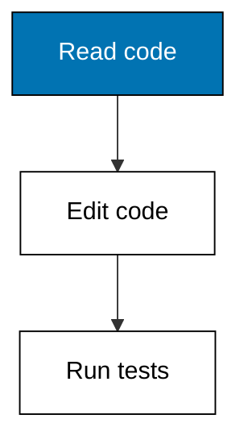

**`learning/code/ex-11-read-a-clean-trace/main.py`**

```python
# Example 11: Read a Clean Trace
# => Fixture shim of the Pi coding agent surface.
# => Target release 1.3.0, checked on 2026-10-20.
# => Deterministic: no network, key, or billing.
# => Real behaviour may differ; see pi.dev/docs/latest.
# => STEPS replays the agent's own tool-call record.
# => Each triple is kind, detail, and whether it was sound.
STEPS = [  # => the frozen trace under review
    ("read", "src/cart.py lines 1-40", True),  # => read
    ("edit", "add coupon field", True),  # => edit
    ("test", "pytest tests/test_cart.py", True),  # => test
]  # => order is call order, oldest first
# => Sound steps pass review; the rest need a human.
# => Counting first keeps the verdict mechanical.
sound = [s for s in STEPS if s[2]]  # => the passing steps
suspect = [s for s in STEPS if not s[2]]  # => the failing ones
# => Print both counts before naming any names.
print("sound:", len(sound), "suspect:", len(suspect))  # => Output counts
# => Then print each step so the log reads like a story.
for kind, detail, ok in STEPS:  # => walk the frozen trace
    print(kind, "|", detail)  # => Output shows the step
```

**Output** (`learning/code/ex-11-read-a-clean-trace/expected/main.stdout.txt`):

```text
sound: 3 suspect: 0
read | src/cart.py lines 1-40
edit | add coupon field
test | pytest tests/test_cart.py
```

**Key takeaway**: A clean trace reads read, edit, test: observe first, change second, prove third.

**Why It Matters**: The trace is the only honest artifact of an agent run, because prose summaries omit the steps that embarrass them. Reading kind, detail, and order tells you whether the agent understood the task or merely sounded like it did. A clean trace earns a quick approval; anything else earns a closer look at the diff. Make trace-reading the default, not the exception. Memorize that rhythm and every future trace reads in seconds instead of minutes.

---

### Example 12: Spot the Skipped Read

_Exercises co-07, co-08._

The classic failure signature is an edit with no preceding read: the agent rewrites code it never looked at, then proves nothing. Case in point: a trace where the pricing edit precedes any read and the test run collects zero items. **Check**: the suspect count is 2 and the lone sound step is the belated read.

**`learning/code/ex-12-spot-the-skipped-read/main.py`**

```python
# Example 12: Spot the Skipped Read
# => Fixture shim of the Pi coding agent surface.
# => Target release 1.3.0, checked on 2026-10-20.
# => Deterministic: no network, key, or billing.
# => Real behaviour may differ; see pi.dev/docs/latest.
# => STEPS replays the agent's own tool-call record.
# => Each triple is kind, detail, and whether it was sound.
STEPS = [  # => the frozen trace under review
    ("edit", "rewrite pricing without reading it", False),  # => edit
    ("test", "pytest collects 0 items", False),  # => test
    ("read", "src/pricing.py after the fact", True),  # => read
]  # => order is call order, oldest first
# => Sound steps pass review; the rest need a human.
# => Counting first keeps the verdict mechanical.
sound = [s for s in STEPS if s[2]]  # => the passing steps
suspect = [s for s in STEPS if not s[2]]  # => the failing ones
# => Print both counts before naming any names.
print("sound:", len(sound), "suspect:", len(suspect))  # => Output counts
# => Then print each step so the log reads like a story.
for kind, detail, ok in STEPS:  # => walk the frozen trace
    print(kind, "|", detail)  # => Output shows the step
```

**Output** (`learning/code/ex-12-spot-the-skipped-read/expected/main.stdout.txt`):

```text
sound: 1 suspect: 2
edit | rewrite pricing without reading it
test | pytest collects 0 items
read | src/pricing.py after the fact
```

**Key takeaway**: An edit with no preceding read is the classic tell of a bluffing agent.

**Why It Matters**: Models are fluent enough to produce plausible edits to unseen code, which makes the missing read the most dangerous line in any trace. Tests that collect zero items compound the failure by certifying nothing while looking green. Catching the order violation takes seconds once you know the pattern. Stop the line here and read the diff before anything merges. Pricing code is stateful and branchy, so editing it blind fails loudly and expensively.

---

### Example 13: View Token and Cost Tracker

_Exercises co-10._

Every Pi session counts its tokens, and tokens times rates is the real price of the task: read the tracker before the invoice surprises you. Case in point: a four-thousand-token session priced at illustration rates against a five-cent budget. **Check**: the total reads 5800 tokens and the run lands within budget.

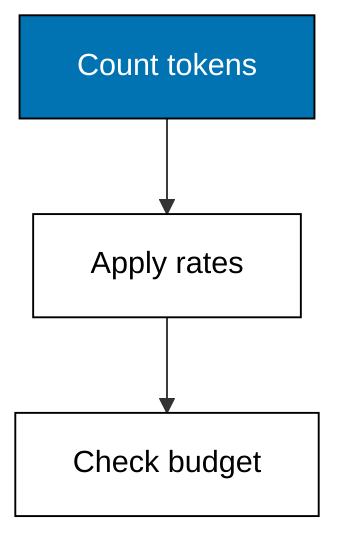

**`learning/code/ex-13-view-token-and-cost-tracker/main.py`**

```python
# Example 13: View Token and Cost Tracker
# => Fixture shim of the Pi coding agent surface.
# => Target release 1.3.0, checked on 2026-10-20.
# => Deterministic: no network, key, or billing.
# => Real behaviour may differ; see pi.dev/docs/latest.
# => Rates below are illustration constants, not quotes.
# => Replace them with your provider's current price page.
tokens_in = 4200  # => prompt tokens this session spent
# => Output tokens cost more because they are generated.
tokens_out = 1600  # => completion tokens spent
# => Per-thousand rates keep the arithmetic readable.
rate_in = 0.003  # => dollars per thousand input tokens
rate_out = 0.012  # => dollars per thousand output tokens
# => Price each side, then add for the session total.
price = tokens_in / 1000 * rate_in  # => input side cost
price += tokens_out / 1000 * rate_out  # => add output side
# => Budgets turn a number into a decision: over or under.
print("tokens:", tokens_in + tokens_out)  # => Output totals tokens
print("cost-usd:", round(price, 4))  # => Output prices the run
print("within-budget:", price <= 0.05)  # => Output checks the budget
```

**Output** (`learning/code/ex-13-view-token-and-cost-tracker/expected/main.stdout.txt`):

```text
tokens: 5800
cost-usd: 0.0318
within-budget: True
```

**Key takeaway**: Read the token tracker after every task; tokens times rates is the price you actually pay.

**Why It Matters**: Agent costs hide in aggregate: no single turn looks expensive until the monthly total arrives. Per-session tracking turns spending into a visible number you can compare across tasks, models, and days. Budgets convert the number into a decision, flagging the sessions that deserve a cheaper model next time. Measure every run or accept every bill without argument. Illustration rates stand in for your provider's price page, which you should check today.

---

### Example 14: List Saved Sessions

_Exercises co-03._

Pi keeps every session on disk, and the session list is how you find yesterday's work instead of redoing it. Case in point: a three-session listing with one active and two idle entries. **Check**: three rows print and exactly one is marked active.

**`learning/code/ex-14-list-saved-sessions/main.py`**

```python
# Example 14: List Saved Sessions
# => Fixture shim of the Pi coding agent surface.
# => Target release 1.3.0, checked on 2026-10-20.
# => Deterministic: no network, key, or billing.
# => Real behaviour may differ; see pi.dev/docs/latest.
# => RECORDS freezes what Pi would report for this op.
# => Each line is one fact the engineer can quote.
RECORDS = [  # => the frozen report lines
    "shop-cart * active",  # => one reported fact
    "shop-auth idle",  # => one reported fact
    "docs-rewrite idle",  # => one reported fact
]  # => order matches Pi's own display order
# => The op name says which command produced this.
op = "/session list"  # => the Pi command under test
# => Print the op first so logs stay attributable.
print("op:", op)  # => Output names the command
# => Then print each record line verbatim.
for line in RECORDS:  # => walk the frozen report
    print("row:", line)  # => Output shows the record
```

**Output** (`learning/code/ex-14-list-saved-sessions/expected/main.stdout.txt`):

```text
op: /session list
row: shop-cart * active
row: shop-auth idle
row: docs-rewrite idle
```

**Key takeaway**: List sessions before starting new ones; yesterday's context may already exist.

**Why It Matters**: Restarting a solved conversation wastes the most expensive resource in the loop: the context you already paid to build. The session list turns history into inventory, showing what is active, idle, or abandoned at a glance. Resuming beats rebuilding whenever the task continues rather than restarts. Check the list first; start fresh only on purpose. Name sessions after their task so the list reads like a work log.

---

### Example 15: Resume a Session

_Exercises co-03._

Resuming restores the turns, the tools, and the directory of a saved session, so the agent continues with the context you already built. Case in point: the resume record of a twelve-turn shopping-cart session with its tool set intact. **Check**: the restored turn count reads 12 and the tool list matches the defaults.

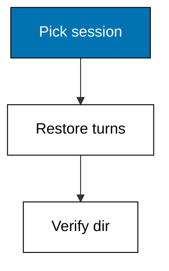

**`learning/code/ex-15-resume-a-session/main.py`**

```python
# Example 15: Resume a Session
# => Fixture shim of the Pi coding agent surface.
# => Target release 1.3.0, checked on 2026-10-20.
# => Deterministic: no network, key, or billing.
# => Real behaviour may differ; see pi.dev/docs/latest.
# => RECORDS freezes what Pi would report for this op.
# => Each line is one fact the engineer can quote.
RECORDS = [  # => the frozen report lines
    "restored: 12 turns",  # => one reported fact
    "tools: read, bash, edit, write",  # => one reported fact
    "cwd: /srv/notes/shop",  # => one reported fact
]  # => order matches Pi's own display order
# => The op name says which command produced this.
op = "/session resume shop-cart"  # => the Pi command under test
# => Print the op first so logs stay attributable.
print("op:", op)  # => Output names the command
# => Then print each record line verbatim.
for line in RECORDS:  # => walk the frozen report
    print("row:", line)  # => Output shows the record
```

**Output** (`learning/code/ex-15-resume-a-session/expected/main.stdout.txt`):

```text
op: /session resume shop-cart
row: restored: 12 turns
row: tools: read, bash, edit, write
row: cwd: /srv/notes/shop
```

**Key takeaway**: Resume instead of restarting whenever the task continues; the context comes back with it.

**Why It Matters**: Context is capital: twelve turns of exploration encode decisions a fresh session would have to rediscover at full price. Resume preserves that capital, including which tools were enabled and why. The restored record deserves the same scrutiny as a fresh launch, because sessions can be resumed in the wrong directory too. Verify, then continue where you left off. Confirm the restored directory before continuing, exactly like a fresh launch.

---

### Example 16: Branch at a Previous Turn

_Exercises co-03, co-09._

Pi stores history as a tree, so you can branch from any earlier turn and try again while the failed attempt stays parked, not deleted. Case in point: a branch record showing seven kept turns and the later turns parked aside. **Check**: the kept count reads 7 and the parked turns are explicitly not deleted.

**`learning/code/ex-16-branch-at-a-previous-turn/main.py`**

```python
# Example 16: Branch at a Previous Turn
# => Fixture shim of the Pi coding agent surface.
# => Target release 1.3.0, checked on 2026-10-20.
# => Deterministic: no network, key, or billing.
# => Real behaviour may differ; see pi.dev/docs/latest.
# => RECORDS freezes what Pi would report for this op.
# => Each line is one fact the engineer can quote.
RECORDS = [  # => the frozen report lines
    "branch: turn-7b created",  # => one reported fact
    "turns kept: 7",  # => one reported fact
    "later turns: parked, not deleted",  # => one reported fact
]  # => order matches Pi's own display order
# => The op name says which command produced this.
op = "/tree branch turn-7"  # => the Pi command under test
# => Print the op first so logs stay attributable.
print("op:", op)  # => Output names the command
# => Then print each record line verbatim.
for line in RECORDS:  # => walk the frozen report
    print("row:", line)  # => Output shows the record
```

**Output** (`learning/code/ex-16-branch-at-a-previous-turn/expected/main.stdout.txt`):

```text
op: /tree branch turn-7
row: branch: turn-7b created
row: turns kept: 7
row: later turns: parked, not deleted
```

**Key takeaway**: Branch from the last good turn instead of restarting; failed attempts stay parked for reference.

**Why It Matters**: A failed approach still contains information: which paths were tried, what the errors said, and where the reasoning went wrong. Branching preserves that evidence while giving the retry a clean slate from the last good state. Deleting would destroy the audit trail your future self needs. Park, branch, and retry with the lesson attached. Label branches as bookmarks when you will need them in review.

---

### Example 17: Export a Session

_Exercises co-03._

Reviews need artifacts, not live sessions: export renders the whole conversation to a file you can send, archive, or attach to a ticket. Case in point: an HTML export record for a fourteen-turn session with its output filename. **Check**: the format reads html, the turn count reads 14, and a filename is named.

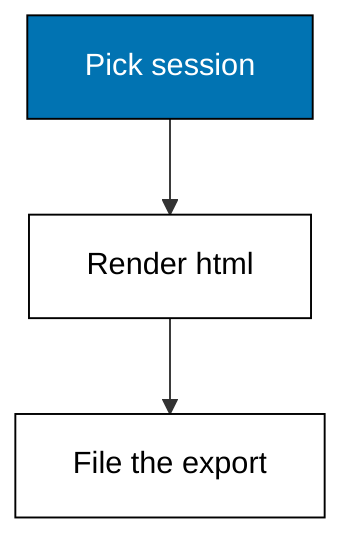

**`learning/code/ex-17-export-a-session/main.py`**

```python
# Example 17: Export a Session
# => Fixture shim of the Pi coding agent surface.
# => Target release 1.3.0, checked on 2026-10-20.
# => Deterministic: no network, key, or billing.
# => Real behaviour may differ; see pi.dev/docs/latest.
# => RECORDS freezes what Pi would report for this op.
# => Each line is one fact the engineer can quote.
RECORDS = [  # => the frozen report lines
    "format: html",  # => one reported fact
    "turns: 14",  # => one reported fact
    "file: shop-cart.html",  # => one reported fact
]  # => order matches Pi's own display order
# => The op name says which command produced this.
op = "/export"  # => the Pi command under test
# => Print the op first so logs stay attributable.
print("op:", op)  # => Output names the command
# => Then print each record line verbatim.
for line in RECORDS:  # => walk the frozen report
    print("row:", line)  # => Output shows the record
```

**Output** (`learning/code/ex-17-export-a-session/expected/main.stdout.txt`):

```text
op: /export
row: format: html
row: turns: 14
row: file: shop-cart.html
```

**Key takeaway**: Export sessions you will cite later; a file outlives any terminal scrollback.

**Why It Matters**: Decisions made inside a chat evaporate with the scrollback unless someone exports them. An exported session is evidence: reviewers can see what the agent claimed, what it ran, and what you approved. HTML keeps formatting readable for non-terminal audiences. Export anything that influenced a merge, an incident review, or a design choice. Prefer gist sharing from the next cluster when the audience is outside your machine.

---

### Example 18: Switch Approval Modes

_Exercises co-02, co-16._

Pi gates every consequential action behind an approval mode, and you switch modes as the task moves from exploring to editing to shipping. Case in point: the task-to-mode routing table with the editing row selected. **Check**: the route reads `ask mode` for the editing input.

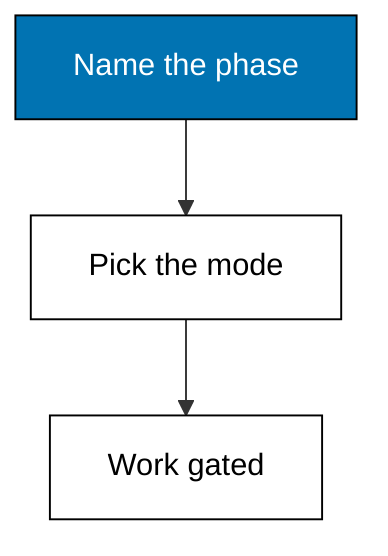

**`learning/code/ex-18-switch-approval-modes/main.py`**

```python
# Example 18: Switch Approval Modes
# => Fixture shim of the Pi coding agent surface.
# => Target release 1.3.0, checked on 2026-10-20.
# => Deterministic: no network, key, or billing.
# => Real behaviour may differ; see pi.dev/docs/latest.
# => OPTIONS maps each situation to its route.
OPTIONS = {  # => the routing table
    # => Row: explore code routes to read-only mode.
    "explore code": "read-only mode",  # => the explore code route
    # => Row: edit code routes to ask mode.
    "edit code": "ask mode",  # => the edit code route
    # => Row: ship release routes to full mode + review.
    "ship release": "full mode + review",  # => the ship release route
}  # => the closed table
situation = "edit code"  # => today's situation
# => A dict lookup is the whole decision procedure.
route = OPTIONS[situation]  # => the chosen route
print("situation:", situation)  # => Output states the input
print("route:", route)  # => Output states the route
```

**Output** (`learning/code/ex-18-switch-approval-modes/expected/main.stdout.txt`):

```text
situation: edit code
route: ask mode
```

**Key takeaway**: Match the approval mode to the task phase: read-only for exploring, ask for editing, full plus review for shipping.

**Why It Matters**: A single mode for every phase is either too lax for shipping or too slow for exploring, because risk changes as the task progresses. Switching modes keeps friction proportional to consequence: reading stays instant while edits wait for a human. The routing table makes the choice explicit instead of habitual. Set the mode deliberately at each phase change. Dropping back to read-only mode is one command and costs nothing.

---

### Example 19: Project Trust on First Run

_Exercises co-02._

The first launch in a directory asks whether the project is trusted, and that answer decides how much Pi may do without asking again. Case in point: the directory-origin routing table selecting permanent trust for your own checkout. **Check**: the route reads `trust always` for your own checkout.

**`learning/code/ex-19-project-trust-on-first-run/main.py`**

```python
# Example 19: Project Trust on First Run
# => Fixture shim of the Pi coding agent surface.
# => Target release 1.3.0, checked on 2026-10-20.
# => Deterministic: no network, key, or billing.
# => Real behaviour may differ; see pi.dev/docs/latest.
# => OPTIONS maps each situation to its route.
OPTIONS = {  # => the routing table
    # => Row: own checkout routes to trust always.
    "own checkout": "trust always",  # => the own checkout route
    # => Row: foreign repo routes to ask every time.
    "foreign repo": "ask every time",  # => the foreign repo route
    # => Row: shared machine routes to never trust.
    "shared machine": "never trust",  # => the shared machine route
}  # => the closed table
situation = "own checkout"  # => today's situation
# => A dict lookup is the whole decision procedure.
route = OPTIONS[situation]  # => the chosen route
print("situation:", situation)  # => Output states the input
print("route:", route)  # => Output states the route
```

**Output** (`learning/code/ex-19-project-trust-on-first-run/expected/main.stdout.txt`):

```text
situation: own checkout
route: trust always
```

**Key takeaway**: Answer the trust prompt by directory origin: always for your own checkout, ask for strangers, never on shared machines.

**Why It Matters**: Trust is the master switch behind every later permission, so answering it carelessly grants everything downstream at once. Your own checkout deserves permanent trust because you already control its contents. A stranger's repository deserves per-action asking until you have read every config it ships. Shared machines deserve never, because the next user inherits your answer. Trust lives in agent-directory settings and never ships with the repo.

---

### Example 20: Deny the Sensitive Path

_Exercises co-02, co-08._

Some paths must never be written, no matter how reasonable the request sounds: the permission layer denies the write before the tool runs. Case in point: a trace where a secrets-file write is denied as outside the project root. **Check**: the suspect count is 1, the deny step is sound, and no write executes.

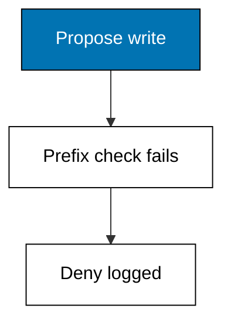

**`learning/code/ex-20-deny-the-sensitive-path/main.py`**

```python
# Example 20: Deny the Sensitive Path
# => Fixture shim of the Pi coding agent surface.
# => Target release 1.3.0, checked on 2026-10-20.
# => Deterministic: no network, key, or billing.
# => Real behaviour may differ; see pi.dev/docs/latest.
# => STEPS replays the agent's own tool-call record.
# => Each triple is kind, detail, and whether it was sound.
STEPS = [  # => the frozen trace under review
    ("read", "src/app.py handler", True),  # => read
    ("edit", "write /srv/notes/../secrets.env", False),  # => edit
    ("deny", "path outside project root", True),  # => deny
]  # => order is call order, oldest first
# => Sound steps pass review; the rest need a human.
# => Counting first keeps the verdict mechanical.
sound = [s for s in STEPS if s[2]]  # => the passing steps
suspect = [s for s in STEPS if not s[2]]  # => the failing ones
# => Print both counts before naming any names.
print("sound:", len(sound), "suspect:", len(suspect))  # => Output counts
# => Then print each step so the log reads like a story.
for kind, detail, ok in STEPS:  # => walk the frozen trace
    print(kind, "|", detail)  # => Output shows the step
```

**Output** (`learning/code/ex-20-deny-the-sensitive-path/expected/main.stdout.txt`):

```text
sound: 2 suspect: 1
read | src/app.py handler
edit | write /srv/notes/../secrets.env
deny | path outside project root
```

**Key takeaway**: Denials are the sandbox working, not the tool being difficult; cite the deny line in review.

**Why It Matters**: The agent cannot distinguish your secrets file from any other file, which is exactly why the permission layer must do it instead. A deny-before-execute rule converts a potential leak into a log line you can quote. Tests never cover the write that did not happen, so the trace is the only evidence. Treat every deny as a successful security test, not an interruption. Keep secrets outside the project root so the prefix check protects them automatically.

---

### Example 21: Read Before You Edit

_Exercises co-06, co-02._

Two reads before one edit is the minimum reviewable shape of a change: the code, its expectations, and only then the modification. Case in point: a trace with two reads preceding a single auth-code edit. **Check**: the sound count is 3, the suspect count is 0, and both reads precede the edit.

**`learning/code/ex-21-read-before-you-edit/main.py`**

```python
# Example 21: Read Before You Edit
# => Fixture shim of the Pi coding agent surface.
# => Target release 1.3.0, checked on 2026-10-20.
# => Deterministic: no network, key, or billing.
# => Real behaviour may differ; see pi.dev/docs/latest.
# => STEPS replays the agent's own tool-call record.
# => Each triple is kind, detail, and whether it was sound.
STEPS = [  # => the frozen trace under review
    ("read", "src/auth.py login handler", True),  # => read
    ("read", "tests/test_auth.py expectations", True),  # => read
    ("edit", "tighten password check", True),  # => edit
]  # => order is call order, oldest first
# => Sound steps pass review; the rest need a human.
# => Counting first keeps the verdict mechanical.
sound = [s for s in STEPS if s[2]]  # => the passing steps
suspect = [s for s in STEPS if not s[2]]  # => the failing ones
# => Print both counts before naming any names.
print("sound:", len(sound), "suspect:", len(suspect))  # => Output counts
# => Then print each step so the log reads like a story.
for kind, detail, ok in STEPS:  # => walk the frozen trace
    print(kind, "|", detail)  # => Output shows the step
```

**Output** (`learning/code/ex-21-read-before-you-edit/expected/main.stdout.txt`):

```text
sound: 3 suspect: 0
read | src/auth.py login handler
read | tests/test_auth.py expectations
edit | tighten password check
```

**Key takeaway**: Read the code and its tests before editing; the diff then reviews in seconds.

**Why It Matters**: An edit without context is a guess with good formatting, and auth code punishes guesses more than any other kind. Reading the tests first tells you what behaviour is load-bearing before you touch it. The two-read discipline also gives reviewers a trace they can verify in order. Slow down here and the merge goes faster everywhere else. Auth code is the one place where a plausible simplification can be a vulnerability.

---

### Example 22: Scope to One Directory

_Exercises co-02, co-03._

Scope is a path prefix the session may not leave: inside the root it acts, outside it must ask, and too-wide jobs get refused up front. Case in point: the job-to-scope routing table scoping a cart fix to its own directory. **Check**: the route names the cart directory and nothing outside it.


**`learning/code/ex-22-scope-to-one-directory/main.py`**

```python
# Example 22: Scope to One Directory
# => Fixture shim of the Pi coding agent surface.
# => Target release 1.3.0, checked on 2026-10-20.
# => Deterministic: no network, key, or billing.
# => Real behaviour may differ; see pi.dev/docs/latest.
# => OPTIONS maps each situation to its route.
OPTIONS = {  # => the routing table
    # => Row: fix the cart routes to scope /srv/notes/shop/src/cart.
    "fix the cart": "scope /srv/notes/shop/src/cart",  # => the fix the cart route
    # => Row: migrate everything routes to refuse: too wide.
    "migrate everything": "refuse: too wide",  # => the migrate everything route
}  # => the closed table
situation = "fix the cart"  # => today's situation
# => A dict lookup is the whole decision procedure.
route = OPTIONS[situation]  # => the chosen route
print("situation:", situation)  # => Output states the input
print("route:", route)  # => Output states the route
```

**Output** (`learning/code/ex-22-scope-to-one-directory/expected/main.stdout.txt`):

```text
situation: fix the cart
route: scope /srv/notes/shop/src/cart
```

**Key takeaway**: Scope every session to the smallest directory containing the task; refuse jobs that will not fit.

**Why It Matters**: An unscoped agent treats the whole filesystem as its workspace, which turns every typo into a potential incident. A path prefix converts intent into enforcement: the check runs before the tool, not after the damage. Refusing too-wide jobs up front forces the decomposition that makes them reviewable. Small scopes are the cheapest insurance in the course. Monorepo engineers scope to one package so the agent cannot wander.

---

### Example 23: Keep Secrets Out of Prompts

_Exercises co-02._

Prompts travel to providers and land in logs, so real secrets must never appear in them: templates carry placeholders and the secret check denies the rest. Case in point: a trace where a pasted API key in a prompt draft is denied by the secret pattern check. **Check**: the suspect count is 1 and the deny step fires before any network use.

**`learning/code/ex-23-keep-secrets-out-of-prompts/main.py`**

```python
# Example 23: Keep Secrets Out of Prompts
# => Fixture shim of the Pi coding agent surface.
# => Target release 1.3.0, checked on 2026-10-20.
# => Deterministic: no network, key, or billing.
# => Real behaviour may differ; see pi.dev/docs/latest.
# => STEPS replays the agent's own tool-call record.
# => Each triple is kind, detail, and whether it was sound.
STEPS = [  # => the frozen trace under review
    ("read", "config template with KEY=xxx", True),  # => read
    ("edit", "paste real key into prompt draft", False),  # => edit
    ("deny", "secret pattern in prompt", True),  # => deny
]  # => order is call order, oldest first
# => Sound steps pass review; the rest need a human.
# => Counting first keeps the verdict mechanical.
sound = [s for s in STEPS if s[2]]  # => the passing steps
suspect = [s for s in STEPS if not s[2]]  # => the failing ones
# => Print both counts before naming any names.
print("sound:", len(sound), "suspect:", len(suspect))  # => Output counts
# => Then print each step so the log reads like a story.
for kind, detail, ok in STEPS:  # => walk the frozen trace
    print(kind, "|", detail)  # => Output shows the step
```

**Output** (`learning/code/ex-23-keep-secrets-out-of-prompts/expected/main.stdout.txt`):

```text
sound: 2 suspect: 1
read | config template with KEY=xxx
edit | paste real key into prompt draft
deny | secret pattern in prompt
```

**Key takeaway**: Template prompts with placeholders; never paste a live secret where the model can read it.

**Why It Matters**: A secret in a prompt is compromised at send time: it enters provider logs, session files, and exports beyond your control. Placeholders keep the shape of the task while removing the value an attacker wants. The pattern check is a backstop, not a strategy, because detection always lags invention. Treat every prompt as public text and real keys never leave your vault. Rotate any key that ever reached a prompt, because logs keep what you sent.

---

### Example 24: Narrow the Blast Radius

_Exercises co-02, co-16._

The wider the change, the stronger the proof required: one file approves on sight, one directory needs green tests, and a whole repo must split first. Case in point: the width-to-proof routing table requiring tests for a directory-wide change. **Check**: the route reads `approve with tests` for the directory input.

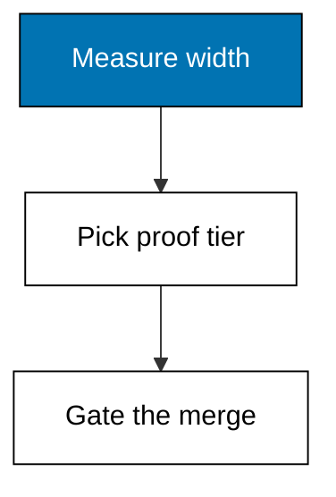

**`learning/code/ex-24-narrow-the-blast-radius/main.py`**

```python
# Example 24: Narrow the Blast Radius
# => Fixture shim of the Pi coding agent surface.
# => Target release 1.3.0, checked on 2026-10-20.
# => Deterministic: no network, key, or billing.
# => Real behaviour may differ; see pi.dev/docs/latest.
# => OPTIONS maps each situation to its route.
OPTIONS = {  # => the routing table
    # => Row: one file routes to approve now.
    "one file": "approve now",  # => the one file route
    # => Row: one directory routes to approve with tests.
    "one directory": "approve with tests",  # => the one directory route
    # => Row: whole repo routes to split first.
    "whole repo": "split first",  # => the whole repo route
}  # => the closed table
situation = "one directory"  # => today's situation
# => A dict lookup is the whole decision procedure.
route = OPTIONS[situation]  # => the chosen route
print("situation:", situation)  # => Output states the input
print("route:", route)  # => Output states the route
```

**Output** (`learning/code/ex-24-narrow-the-blast-radius/expected/main.stdout.txt`):

```text
situation: one directory
route: approve with tests
```

**Key takeaway**: Scale proof with width: sight for a file, tests for a directory, decomposition for a repo.

**Why It Matters**: Review effort should grow with blast radius, because a one-line fix and a repo-wide migration carry incomparable risks. Fixed proof tiers remove negotiation: the width decides the gate, not the author's confidence. Tests for directory changes catch the cross-file assumptions humans miss. Splitting repo-wide work is not bureaucracy; it is how review stays possible at all. State the width out loud in review so the proof requirement is never implicit.

---

### Example 25: Permission Review Checklist

_Exercises co-02, co-06._

End the beginner level with the whole permission surface on one screen: tools, trust, and editor, validated the same way settings were in Example 5. Case in point: a three-key permission review with trust pinned to ask and the editor named. **Check**: the missing list is empty and trust echoes exactly `ask`.

**`learning/code/ex-25-permission-review-checklist/main.py`**

```python
# Example 25: Permission Review Checklist
# => Fixture shim of the Pi coding agent surface.
# => Target release 1.3.0, checked on 2026-10-20.
# => Deterministic: no network, key, or billing.
# => Real behaviour may differ; see pi.dev/docs/latest.
# => Setting defaultTools ships in settings.json.
DEFAULTTOOLS = "read,edit,write"  # => pins defaultTools
# => Setting defaultProjectTrust ships in settings.json.
DEFAULTPROJECTTRUST = "ask"  # => pins defaultProjectTrust
# => Setting externalEditor ships in settings.json.
EXTERNALEDITOR = "vi"  # => pins externalEditor
# => REQUIRED names keys a session cannot start without.
REQUIRED = [  # => the non-negotiable keys
    # => defaultTools is required because sessions fail without it.
    "defaultTools",  # => required key
    # => defaultProjectTrust is required because sessions fail without it.
    "defaultProjectTrust",  # => required key
]  # => the closed list
# => config maps every key to its live value.
config = {  # => the live settings under test
    # => Live value for defaultTools, used in the checks below.
    "defaultTools": DEFAULTTOOLS,  # => defaultTools entry
    # => Live value for defaultProjectTrust, used in the checks below.
    "defaultProjectTrust": DEFAULTPROJECTTRUST,  # => defaultProjectTrust entry
    # => Live value for externalEditor, used in the checks below.
    "externalEditor": EXTERNALEDITOR,  # => externalEditor entry
}  # => the closed map
missing = [k for k in REQUIRED if k not in config]  # => gaps
print("missing:", missing)  # => Output names what is absent
# => Reading back defaultTools proves the file was used.
print("defaultTools:", config["defaultTools"])  # => Output echoes it
# => Reading back defaultProjectTrust proves the file was used.
print("trust:", config["defaultProjectTrust"])  # => Output echoes it
```

**Output** (`learning/code/ex-25-permission-review-checklist/expected/main.stdout.txt`):

```text
missing: []
defaultTools: read,edit,write
trust: ask
```

**Key takeaway**: Review tools, trust, and editor together before real work; ask is the default you must justify leaving.

**Why It Matters**: Permissions drift as sessions accumulate: flags, project files, and remembered answers quietly widen what the agent may do. A periodic checklist re-reads the whole surface in one place instead of discovering it mid-incident. Trust pinned to ask is the stance every exception must argue against. Five minutes here prevents the class of failure no test can catch. Intermediate work assumes this surface is locked down; revisit it whenever behaviour surprises you.

---
