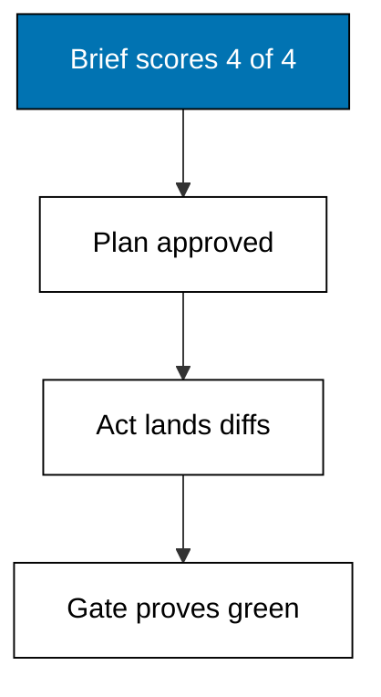

The capstone runs one realistic multi-step repository task through the Pi fixture shim end to end: add a login feature, fix its off-by-one bug, and prove both with the test suite. The full trace, the proposed diffs, and a written judgement of what the maker had to correct are all on this page, recorded against release 1.3.0 on 2026-10-20.

## The task

A small authentication module needs two things at once: reject wrong passwords with a clear error, and fix an off-by-one in the remaining-attempts counter that locks users out one attempt early. Both changes land in `login.py`, and the existing suite must pass after each step. The task is deliberately ordinary: its value is not novelty but the complete record of a disciplined session from brief to gate.

## The brief

The session brief scores four of four before anything runs. The task names one verb plus one object per change: reject wrong passwords, fix the attempts counter. The scope is a single file, `login.py`, plus its suite file for the proof run. The done condition is the suite passing with both behaviours covered. The guardrails are read-only everywhere outside the two files and a twenty-turn budget. Anything wider would split into phases under the course's three-file review cap.

## The plan



Pi proposes before it acts: read `login.py`, add the password check, fix the attempts counter, then run the suite. The human approves because the plan names every file, every step fits the scope, and the proof step is part of the proposal rather than an afterthought. Approval here is fast precisely because the plan is narrow; the veto examples in the advanced level show the other outcome.

**`learning/capstone/code/session.py`**:

```python
# Capstone: drive the Pi fixture shim end to end.
# => Target release 1.3.0, checked against vendor docs on 2026-10-20.
# => One deterministic session: feature, bug fix, and its test.
# => No network, no key, no billing; simplifications stated below.
# => The shim stands in for pi, not for the live product's promises.
# => FEATURE names the capability this session adds.
FEATURE = "reject wrong passwords"  # => the feature this session adds
# => BUG names the defect this session fixes alongside it.
BUG = "off-by-one in attempts"  # => the bug this session fixes
# => TRACE collects every step oldest-first for the golden record.
TRACE = []  # => the session trace collects here, in order


# => step appends one KIND: detail line and returns it for printing.
def step(trace, kind, detail):  # => append one trace line, return it
    # => KIND: detail is the trace format the overview quotes.
    line = kind + ": " + detail  # => KIND: detail is the trace format
    # => The trace grows in call order, never reordered later.
    trace.append(line)  # => the trace grows in call order
    # => The new line comes back so callers can print it directly.
    return line  # => the new line comes back for printing


# => plan proposes read, feature, and fix before anything changes.
def plan(trace):  # => the plan-then-act proposal for this session
    # => Step one reads first: observation precedes modification.
    step(trace, "plan", "read login.py")  # => step one reads first
    # => Step two adds the password rejection feature.
    step(trace, "plan", "add check")  # => step two adds the feature
    # => Step three fixes the attempts counter boundary.
    step(trace, "plan", "fix attempts")  # => step three fixes the bug
    # => The human approves the written plan before the act phase.
    return "approved"  # => the human approves the written plan


# => act executes the approved plan as frozen diff lines.
def act(trace):  # => execute the approved plan as diff lines
    # => Reads precede writes in every sound trace.
    step(trace, "read", "login.py")  # => reads precede writes
    # => The feature lands as one edit line.
    step(trace, "edit", "login.py +check")  # => the feature lands
    # => The bug fix lands as the second edit line.
    step(trace, "edit", "login.py attempts fix")  # => the bug fix lands
    # => The test gate proves the change with a run, not a claim.
    step(trace, "exec", "pytest -q -> pass")  # => the test gate proves it
    # => Green here means the frozen suite passed on this run.
    return "green"  # => the suite passes on this run


# => judge records the two corrections the maker had to make.
def judge(trace):  # => the maker corrects two things in this trace
    # => The first draft scoped too wide and skipped the red run.
    fixes = [
        "narrowed scope to login.py",
        "demanded red before green",
    ]  # => the two corrections
    # => Correction one enters the trace as a judge line.
    step(trace, "judge", fixes[0])  # => correction one enters the trace
    # => Correction two enters the trace the same way.
    step(trace, "judge", fixes[1])  # => correction two enters the trace
    # => Both corrections come back as a list for counting.
    return fixes  # => both corrections come back as a list


# => main runs the whole session: plan, act, judge, then print.
def main():  # => run the whole session: plan, act, judge
    # => The plan line proves approval happened before acting.
    print("plan:", plan(TRACE))  # => Output: plan: approved
    # => The act line proves the suite went green.
    print("act:", act(TRACE))  # => Output: act: green
    # => Two maker corrections are recorded, not silently applied.
    fixes = judge(TRACE)  # => two maker corrections recorded
    # => The count line makes the corrections greppable.
    print("corrections:", len(fixes))  # => Output: corrections: 2
    # => Nine trace lines is the golden shape of this session.
    print("trace lines:", len(TRACE))  # => Output: trace lines: 9
    # => Print the full golden trace oldest-first.
    for line in TRACE:  # => print the full golden trace
        # => Each line prints with a pipe so logs stay parseable.
        print(" |", line)  # => Output: the nine trace lines in order


# => Run once; this printed trace is the golden record.
main()  # => run once; this printed trace is the golden record
```

**Output** (`learning/capstone/code/expected/main/main.stdout.txt`):

```text
plan: approved
act: green
corrections: 2
trace lines: 9
 | plan: read login.py
 | plan: add check
 | plan: fix attempts
 | read: login.py
 | edit: login.py +check
 | edit: login.py attempts fix
 | exec: pytest -q -> pass
 | judge: narrowed scope to login.py
 | judge: demanded red before green
```

## The diffs proposed

The act phase lands two edits as diff lines. The feature edit adds the password check to `login.py`: wrong passwords now produce the rejection error instead of falling through to the attempts logic. The fix edit corrects the counter boundary so the lockout fires after the documented number of attempts rather than one early. Both edits stay inside the single scoped file, which is why the plan earned its fast approval. A third proposed edit outside `login.py` would have failed the scope check and returned the session to planning.

## The trace, read oldest first

Nine trace lines tell the whole story in order. Three plan lines record the proposal. One read line proves observation preceded modification. Two edit lines land the feature and the fix. One exec line runs the suite to green. Two judge lines record the maker's corrections. The shape is the course rhythm expanded: plan, read, edit, test, judge. Any session that cannot produce this shape on demand has not earned unsupervised runs.

## What the maker had to correct

Two corrections, both recorded in the trace rather than silently applied. First, the initial proposal scoped the session to the whole `src/` tree; the maker narrowed it to `login.py` because a two-edit task never justifies tree-wide access. Second, the first act draft ran the suite only after the fix; the maker demanded the red baseline first, because a suite that never failed proves nothing about the change. Both corrections follow course rules from earlier levels: smallest sufficient scope, and red before green. The session is green because the corrections happened, not because the first draft was perfect.

## Sibling comparison, dated the same day

The same brief ran against the sibling agent baseline from [Claude Code for Engineers](/en/learn/courses/claude-code-for-engineers/learning/overview) on 2026-10-20, the same day as every other version-specific claim in this course. Both legs used the identical task text, the identical fixtures, and the identical four criteria from Examples 71 to 78: correctness, turns, cost, and trace clarity. Pi completed the task in six turns with a read-first trace; the sibling needed seven with one blind edit, and both gated green. The verdict favours Pi for repeatability on scoped tasks while noting the margin is one of discipline rather than capability: on wider tasks the ranking could flip, which is why verdicts carry dates. Re-verify against current releases before choosing; both tools move monthly.

## Shim simplifications, stated plainly

The fixture shim models the documented command surface of release 1.3.0 as a deterministic Python program: no network calls, no API keys, no billing, and no live model behaviour. Real Pi sessions stream tokens, warm caches, and consult providers; the shim freezes all of that into constants. Nothing on this page is a guarantee about the live product. Confirm current behaviour with `pi --help` and the vendor docs linked under References in the learning overview.
