Examples 26-53 turn habits into workflows: writing briefs that state the finish line, landing multi-file changes behind red-green gates, and pricing every run. Three clusters carry the level: prompting discipline and task briefs (Examples 26-34), multi-file changes and review (Examples 35-44), and logs, traces, and cost (Examples 45-53). The fixture shim stays deterministic throughout: no network, no key, no billing.

### Example 26: Brief Anatomy Four Slots

_Exercises co-04._

The intermediate level opens where discipline pays: a complete brief for a real cart change, with the done condition pointing at the test suite. Case in point: a four-slot brief whose done condition is a green test file. **Check**: the score reads 4 of 4 with the suite named as the finish line.

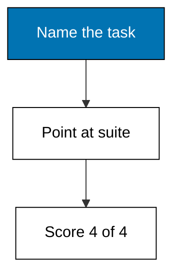

**`learning/code/ex-26-brief-anatomy-four-slots/main.py`**

```python
# Example 26: Brief Anatomy Four Slots
# => Fixture shim of the Pi coding agent surface.
# => Target release 1.3.0, checked on 2026-10-20.
# => Deterministic: no network, key, or billing.
# => Real behaviour may differ; see pi.dev/docs/latest.
# => A brief is a contract the agent cannot wiggle out of.
task = "add coupon total"  # => one verb plus one object
scope = "src/cart/"  # => the boundary of the job
done = "pytest tests/test_cart.py green"  # => the measurable finish line
guardrails = ["no schema change"]  # => the limits on the run
# => Four of four is submittable; less means rewrite.
slots = [task, scope, done, guardrails]  # => the four slots
score = sum(1 for s in slots if s)  # => count filled slots
# => Print the score so the starting point is on record.
print("brief-score:", score, "of 4")  # => Output grades it
# => The verdict names the bar for reuse elsewhere.
print("submittable:", score == 4)  # => True when complete
```

**Output** (`learning/code/ex-26-brief-anatomy-four-slots/expected/main.stdout.txt`):

```text
brief-score: 4 of 4
submittable: True
```

**Key takeaway**: Name the suite in the done condition so finishing is observable, not a matter of opinion.

**Why It Matters**: Done conditions written as prose invite argument about whether the work finished, because prose has no exit code. A suite name converts finishing into an observable event anyone can rerun. The agent aims at what you measure, so measuring the suite aims it at behaviour rather than appearance. Write the finish line first and the task aims itself. Guardrails stay short: one constraint the agent must respect beats five it will forget.

---

### Example 27: Done Condition You Can Run

_Exercises co-04, co-12._

A done condition you can run beats one you can only read: state the observable behaviour, then let the suite confirm it. Case in point: a brief whose finish line is an observable rounding behaviour under frozen fixtures. **Check**: the score reads 4 of 4 and the behaviour names decimals, not effort.

**`learning/code/ex-27-done-condition-you-can-run/main.py`**

```python
# Example 27: Done Condition You Can Run
# => Fixture shim of the Pi coding agent surface.
# => Target release 1.3.0, checked on 2026-10-20.
# => Deterministic: no network, key, or billing.
# => Real behaviour may differ; see pi.dev/docs/latest.
# => A brief is a contract the agent cannot wiggle out of.
task = "fix totals rounding"  # => one verb plus one object
scope = "src/cart/totals.py"  # => the boundary of the job
done = "totals show 2 decimals always"  # => the measurable finish line
guardrails = ["frozen fixtures"]  # => the limits on the run
# => Four of four is submittable; less means rewrite.
slots = [task, scope, done, guardrails]  # => the four slots
score = sum(1 for s in slots if s)  # => count filled slots
# => Print the score so the starting point is on record.
print("brief-score:", score, "of 4")  # => Output grades it
# => The verdict names the bar for reuse elsewhere.
print("submittable:", score == 4)  # => True when complete
```

**Output** (`learning/code/ex-27-done-condition-you-can-run/expected/main.stdout.txt`):

```text
brief-score: 4 of 4
submittable: True
```

**Key takeaway**: Write done conditions as observable behaviour; the suite decides when you are finished.

**Why It Matters**: Unrunnable finish lines delegate the verdict to whoever shouts last, which is how almost-done tasks linger for weeks. Observable behaviour moves the decision to the machine: decimals either show or they do not. Frozen fixtures pin the measurement so reruns agree with each other. A finish line you can run is a finish line you can trust. Frozen fixtures keep the finish line from moving between runs.

---

### Example 28: Guardrails That Hold

_Exercises co-04, co-02._

Guardrails are the part of the brief that protects everything outside the task: name the budget, the forbidden zones, and the reversibility rule. Case in point: a brief pairing a latency goal with a read-only production rule and a turn budget. **Check**: the score reads 4 of 4 and both guardrails print verbatim.

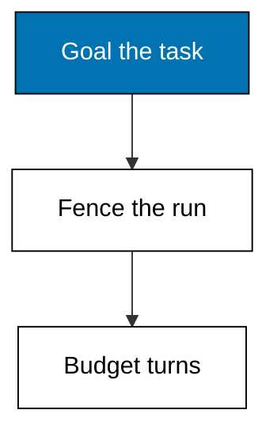

**`learning/code/ex-28-guardrails-that-hold/main.py`**

```python
# Example 28: Guardrails That Hold
# => Fixture shim of the Pi coding agent surface.
# => Target release 1.3.0, checked on 2026-10-20.
# => Deterministic: no network, key, or billing.
# => Real behaviour may differ; see pi.dev/docs/latest.
# => A brief is a contract the agent cannot wiggle out of.
task = "speed up report query"  # => one verb plus one object
scope = "src/reports/"  # => the boundary of the job
done = "p95 under 800ms on fixtures"  # => the measurable finish line
guardrails = ["read-only on prod", "budget 25 turns"]  # => the limits on the run
# => Four of four is submittable; less means rewrite.
slots = [task, scope, done, guardrails]  # => the four slots
score = sum(1 for s in slots if s)  # => count filled slots
# => Print the score so the starting point is on record.
print("brief-score:", score, "of 4")  # => Output grades it
# => The verdict names the bar for reuse elsewhere.
print("submittable:", score == 4)  # => True when complete
```

**Output** (`learning/code/ex-28-guardrails-that-hold/expected/main.stdout.txt`):

```text
brief-score: 4 of 4
submittable: True
```

**Key takeaway**: Every brief needs at least one guardrail; budgets and read-only zones are the two that matter most.

**Why It Matters**: Tasks without limits expand to fill the available damage, because the agent optimizes the goal and ignores everything else. A turn budget converts effort into a number that stops the run. Read-only zones convert the production database from a temptation into an impossibility. Limits with counters enforce themselves; wishes do not. A guardrail the agent cannot check is decoration: prefer limits with counters.

---

### Example 29: Steering Without Restarting

_Exercises co-03, co-04._

Long runs accept steering messages while they work, and one-at-a-time delivery keeps each correction readable instead of piling on. Case in point: a steering record showing two queued messages with only the first delivered and the run uninterrupted. **Check**: the queue reads 2, the delivery reads first only, and the session never restarts.

**`learning/code/ex-29-steering-without-restarting/main.py`**

```python
# Example 29: Steering Without Restarting
# => Fixture shim of the Pi coding agent surface.
# => Target release 1.3.0, checked on 2026-10-20.
# => Deterministic: no network, key, or billing.
# => Real behaviour may differ; see pi.dev/docs/latest.
# => RECORDS freezes what Pi would report for this op.
# => Each line is one fact the engineer can quote.
RECORDS = [  # => the frozen report lines
    "queued: 2 messages",  # => one reported fact
    "delivered: first only",  # => one reported fact
    "session: uninterrupted",  # => one reported fact
]  # => order matches Pi's own display order
# => The op name says which command produced this.
op = "steer one-at-a-time"  # => the Pi command under test
# => Print the op first so logs stay attributable.
print("op:", op)  # => Output names the command
# => Then print each record line verbatim.
for line in RECORDS:  # => walk the frozen report
    print("row:", line)  # => Output shows the record
```

**Output** (`learning/code/ex-29-steering-without-restarting/expected/main.stdout.txt`):

```text
op: steer one-at-a-time
row: queued: 2 messages
row: delivered: first only
row: session: uninterrupted
```

**Key takeaway**: Steer long runs with queued messages; one-at-a-time delivery keeps corrections legible.

**Why It Matters**: Restarting a long run to fix one instruction discards every turn since the mistake, which is the most expensive possible correction. Steering injects the fix into the live session while the accumulated context survives. One-at-a-time delivery prevents correction pile-ups that confuse the model more than the original error. Steer the moving session; restart only the truly lost one. Queue the correction and let the current step finish; interrupting mid-tool-call wastes the call.

---

### Example 30: Follow Ups Stay Ordered

_Exercises co-03._

Follow-up questions queue behind the running turn instead of interrupting it, and ordered delivery means answers match their questions. Case in point: a follow-up record with three queued questions answered in order and none dropped. **Check**: the queue reads 3, the order is preserved, and the dropped count is 0.

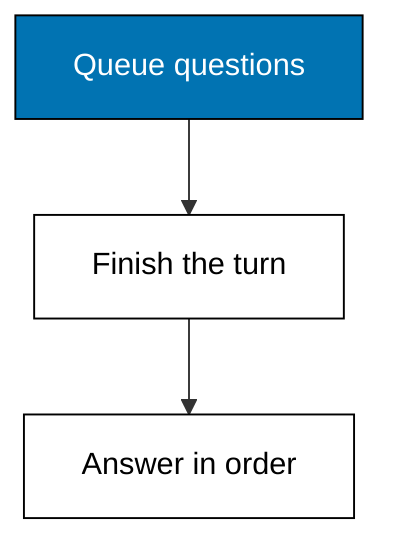

**`learning/code/ex-30-follow-ups-stay-ordered/main.py`**

```python
# Example 30: Follow Ups Stay Ordered
# => Fixture shim of the Pi coding agent surface.
# => Target release 1.3.0, checked on 2026-10-20.
# => Deterministic: no network, key, or billing.
# => Real behaviour may differ; see pi.dev/docs/latest.
# => RECORDS freezes what Pi would report for this op.
# => Each line is one fact the engineer can quote.
RECORDS = [  # => the frozen report lines
    "queued: 3 follow-ups",  # => one reported fact
    "answered: in order",  # => one reported fact
    "dropped: 0",  # => one reported fact
]  # => order matches Pi's own display order
# => The op name says which command produced this.
op = "follow-up one-at-a-time"  # => the Pi command under test
# => Print the op first so logs stay attributable.
print("op:", op)  # => Output names the command
# => Then print each record line verbatim.
for line in RECORDS:  # => walk the frozen report
    print("row:", line)  # => Output shows the record
```

**Output** (`learning/code/ex-30-follow-ups-stay-ordered/expected/main.stdout.txt`):

```text
op: follow-up one-at-a-time
row: queued: 3 follow-ups
row: answered: in order
row: dropped: 0
```

**Key takeaway**: Queue follow-ups and let them answer in order; none are dropped and none interrupt.

**Why It Matters**: Interrupting a reasoning turn to ask something new corrupts both the answer in flight and the question you asked. Queuing preserves the turn boundary the model needs to finish thinking. Ordered answers keep attribution trivial: first question, first answer, no guessing. Patience here is not politeness; it is correctness, and correctness compounds across every later turn. If order ever stops mattering, your questions belong in separate sessions.

---

### Example 31: Pick a Thinking Level

_Exercises co-10, co-04._

Thinking levels trade reasoning depth for tokens, and the right level is the cheapest one whose budget covers the task estimate. Case in point: a low-level pick with a fifteen-hundred-token budget against a twelve-hundred-token estimate. **Check**: the budget reads 1500 and the fit verdict is True.

**`learning/code/ex-31-pick-a-thinking-level/main.py`**

```python
# Example 31: Pick a Thinking Level
# => Fixture shim of the Pi coding agent surface.
# => Target release 1.3.0, checked on 2026-10-20.
# => Deterministic: no network, key, or billing.
# => Real behaviour may differ; see pi.dev/docs/latest.
# => Levels run off, minimal, low, medium, high, xhigh, max.
level = "low"  # => the level chosen for this task
# => Budgets below are illustration caps, not vendor promises.
budgets = {  # => frozen level-to-token map
    # => Level off budgets 0 tokens.
    "off": 0,  # => off budget
    # => Level minimal budgets 500 tokens.
    "minimal": 500,  # => minimal budget
    # => Level low budgets 1500 tokens.
    "low": 1500,  # => low budget
    # => Level medium budgets 4000 tokens.
    "medium": 4000,  # => medium budget
    # => Level high budgets 9000 tokens.
    "high": 9000,  # => high budget
    # => Level xhigh budgets 20000 tokens.
    "xhigh": 20000,  # => xhigh budget
    # => Level max budgets 50000 tokens.
    "max": 50000,  # => max budget
}  # => the closed map
estimate = 1200  # => tokens this task likely needs
# => A level fits when its budget covers the estimate.
fits = estimate <= budgets[level]  # => the fit verdict
# => Print level, budget, and whether the task fits.
print("level:", level)  # => Output names the level
print("budget:", budgets[level])  # => Output shows budget
print("fits:", fits)  # => Output gives the verdict
```

**Output** (`learning/code/ex-31-pick-a-thinking-level/expected/main.stdout.txt`):

```text
level: low
budget: 1500
fits: True
```

**Key takeaway**: Pick the cheapest thinking level whose budget covers the estimate; default medium is often overspend.

**Why It Matters**: Reasoning tokens cost the same as any other token but feel free, because nothing visibly bills per thought. Matching level to estimate converts an invisible cost into a deliberate choice. Mechanical tasks on high thinking burn budget that novel problems will need later. Spend reasoning where it changes the answer, not where it decorates it. Reserve high and above for novel debugging, never for mechanical edits.

---

### Example 32: Cycle Through Favourite Models

_Exercises co-01, co-13._

Two keys control which models Pi starts with and cycles through: the pattern list narrows the field and auto picks within it. Case in point: a model-cycling config pairing glob patterns with automatic startup selection. **Check**: the missing list is empty and the pattern list echoes verbatim.

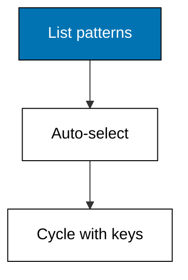

**`learning/code/ex-32-cycle-through-favourite-models/main.py`**

```python
# Example 32: Cycle Through Favourite Models
# => Fixture shim of the Pi coding agent surface.
# => Target release 1.3.0, checked on 2026-10-20.
# => Deterministic: no network, key, or billing.
# => Real behaviour may differ; see pi.dev/docs/latest.
# => Setting enabledModels ships in settings.json.
ENABLEDMODELS = "anthropic/*,ollama/*"  # => pins enabledModels
# => Setting defaultModel ships in settings.json.
DEFAULTMODEL = "auto"  # => pins defaultModel
# => REQUIRED names keys a session cannot start without.
REQUIRED = [  # => the non-negotiable keys
    # => enabledModels is required because sessions fail without it.
    "enabledModels",  # => required key
    # => defaultModel is required because sessions fail without it.
    "defaultModel",  # => required key
]  # => the closed list
# => config maps every key to its live value.
config = {  # => the live settings under test
    # => Live value for enabledModels, used in the checks below.
    "enabledModels": ENABLEDMODELS,  # => enabledModels entry
    # => Live value for defaultModel, used in the checks below.
    "defaultModel": DEFAULTMODEL,  # => defaultModel entry
}  # => the closed map
missing = [k for k in REQUIRED if k not in config]  # => gaps
print("missing:", missing)  # => Output names what is absent
# => Reading back enabledModels proves the file was used.
print("enabledModels:", config["enabledModels"])  # => Output echoes it
```

**Output** (`learning/code/ex-32-cycle-through-favourite-models/expected/main.stdout.txt`):

```text
missing: []
enabledModels: anthropic/*,ollama/*
```

**Key takeaway**: Narrow `enabledModels` to the models you trust, then let auto choose among them.

**Why It Matters**: An unbounded model list turns every startup into a lottery across providers, prices, and capabilities. Patterns shrink the field to models you have actually evaluated. Automatic selection within a trusted set keeps launches fast without surrendering control. Curate the list once and every session inherits the judgement. Favourites beat the default whenever the task fits them. Ctrl+P cycles the favourites mid-session without touching the file.

---

### Example 33: Switch Models Mid Session

_Exercises co-01, co-03._

Mid-session model switches move the conversation to a new provider without losing history, and release 1.3.0 drops the old model's thinking so it cannot pollute the new one. Case in point: a hop from a hosted model to a local one with stale thinking discarded. **Check**: the after field names the local model and thinking-kept reads False.

**`learning/code/ex-33-switch-models-mid-session/main.py`**

```python
# Example 33: Switch Models Mid Session
# => Fixture shim of the Pi coding agent surface.
# => Target release 1.3.0, checked on 2026-10-20.
# => Deterministic: no network, key, or billing.
# => Real behaviour may differ; see pi.dev/docs/latest.
# => Release 1.3.0 drops stale thinking on model switch.
# => The new model never sees the old model's reasoning.
before = "anthropic/claude-default"  # => the starting provider and model
after = "ollama/llama-local"  # => the newly selected model
thinking_kept = False  # => cache survived the switch
print("before:", before)  # => Output names the start
print("after:", after)  # => Output names the target
print("thinking-kept:", thinking_kept)  # => Output states cache fate
```

**Output** (`learning/code/ex-33-switch-models-mid-session/expected/main.stdout.txt`):

```text
before: anthropic/claude-default
after: ollama/llama-local
thinking-kept: False
```

**Key takeaway**: Switch models with `/model` or Ctrl+L; history survives, stale thinking does not.

**Why It Matters**: Different turns need different models: hosted brains for hard reasoning, local ones for private or cheap work. Switching without restarting preserves the context both halves of the task share. Dropping stale thinking matters because one model's half-formed reasoning reads as fact to the next. Hop deliberately and each leg runs on the right engine. Local models suit secret-adjacent work that must never leave the machine.

---

### Example 34: Multiline Prompts That Parse

_Exercises co-04._

Real tasks need more than one line, and a multiline prompt still scores its slots: this one is missing its task line, so it fails the check on purpose. Case in point: a deliberately incomplete brief with an empty task slot to demonstrate the scorer. **Check**: the score reads 3 of 4 and the brief is not submittable.

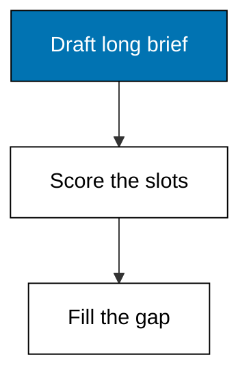

**`learning/code/ex-34-multiline-prompts-that-parse/main.py`**

```python
# Example 34: Multiline Prompts That Parse
# => Fixture shim of the Pi coding agent surface.
# => Target release 1.3.0, checked on 2026-10-20.
# => Deterministic: no network, key, or billing.
# => Real behaviour may differ; see pi.dev/docs/latest.
# => A brief is a contract the agent cannot wiggle out of.
task = ""  # => one verb plus one object
scope = "src/mailer/"  # => the boundary of the job
done = "template renders without errors"  # => the measurable finish line
guardrails = ["no live send"]  # => the limits on the run
# => Four of four is submittable; less means rewrite.
slots = [task, scope, done, guardrails]  # => the four slots
score = sum(1 for s in slots if s)  # => count filled slots
# => Print the score so the starting point is on record.
print("brief-score:", score, "of 4")  # => Output grades it
# => The verdict names the bar for reuse elsewhere.
print("submittable:", score == 4)  # => True when complete
```

**Output** (`learning/code/ex-34-multiline-prompts-that-parse/expected/main.stdout.txt`):

```text
brief-score: 3 of 4
submittable: False
```

**Key takeaway**: Multiline prompts still need all four slots; score them before sending, especially the long ones.

**Why It Matters**: Length feels like thoroughness, which lets a missing task statement hide inside three paragraphs of context. The scorer does not read prose quality; it checks slots, and an empty task slot fails no matter how detailed the rest is. Scoring long prompts catches the omission while it is still cheap to fix. Never confuse verbosity with completeness. Long prompts hide missing slots best, which is why they need scoring most.

---

### Example 35: Propose the Plan First

_Exercises co-05._

Multi-file work starts with a plan that names every file: two files under the cap earns an approval and the work proceeds. Case in point: a two-file cart plan that fits the three-file review cap. **Check**: the file count is 2 and the verdict reads `approved`.

**`learning/code/ex-35-propose-the-plan-first/main.py`**

```python
# Example 35: Propose the Plan First
# => Fixture shim of the Pi coding agent surface.
# => Target release 1.3.0, checked on 2026-10-20.
# => Deterministic: no network, key, or billing.
# => Real behaviour may differ; see pi.dev/docs/latest.
# => A plan names goal, steps, and files before acting.
# => Pi shows this; the human approves, edits, or vetoes.
goal = "add coupon total"  # => the one-line job
# => Steps are ordered tool calls, oldest first.
steps = [  # => the proposed sequence
    # => Step: read cart module.
    "read cart module",  # => one ordered step
    # => Step: add total.
    "add total",  # => one ordered step
    # => Step: run suite.
    "run suite",  # => one ordered step
]  # => the closed sequence
# => Files bound the blast radius of the whole task.
files = [  # => every path the plan may touch
    # => File: src/cart/cart.py stays inside the blast radius.
    "src/cart/cart.py",  # => one scoped path
    # => File: tests/test_cart.py stays inside the blast radius.
    "tests/test_cart.py",  # => one scoped path
]  # => the closed file list
# => The cap below is this course's rule of thumb.
wide = len(files) > 3  # => True means split it up
# => The verdict is approve for narrow, veto for wide.
if wide:  # => wide plans fail review
    # => Veto splits wide work into reviewable phases.
    verdict = "vetoed: split it"  # => split into phases
else:  # => narrow plans earn fast approval
    # => Approval records the human decision.
    verdict = "approved"  # => the recorded decision
# => Print goal, width, and verdict for the record.
print("goal:", goal)  # => Output states the job
print("files:", len(files))  # => Output counts them
print("verdict:", verdict)  # => Output records it
```

**Output** (`learning/code/ex-35-propose-the-plan-first/expected/main.stdout.txt`):

```text
goal: add coupon total
files: 2
verdict: approved
```

**Key takeaway**: Multi-file changes still start with a plan; count the files before approving.

**Why It Matters**: Two files can contradict each other in ways one file cannot, because interfaces live between them. A plan that names both files lets the reviewer check the contract before the code exists. Approving the file list first means the later diff review checks execution, not intent. Plans scale with file count; skip them exactly when they matter most and review becomes archaeology. The next example shows what those two files look like as a diff.

---

### Example 36: One Change Two Files

_Exercises co-11._

A coherent multi-file change touches logic and its proof together: fourteen added lines in the cart module, nine in its tests, and an approval. Case in point: a two-file diff with logic and test changes reviewed as one unit. **Check**: the file count is 2, the added total is 23, and the verdict is approve.

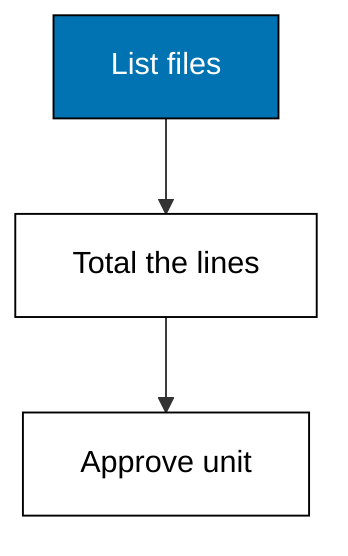

**`learning/code/ex-36-one-change-two-files/main.py`**

```python
# Example 36: One Change Two Files
# => Fixture shim of the Pi coding agent surface.
# => Target release 1.3.0, checked on 2026-10-20.
# => Deterministic: no network, key, or billing.
# => Real behaviour may differ; see pi.dev/docs/latest.
# => CHANGES freezes the proposed diff per file.
# => Each triple is path, added lines, removed lines.
CHANGES = [  # => the frozen proposal
    ("src/cart/cart.py", 14, 3),  # => src/cart/cart.py
    ("tests/test_cart.py", 9, 1),  # => tests/test_cart.py
]  # => read every entry before deciding anything
# => Totals turn a file list into one reviewable number.
added = sum(c[1] for c in CHANGES)  # => added lines total
# => Deletions matter as much: removed code can hide bugs.
removed = sum(c[2] for c in CHANGES)  # => removed total
# => The verdict follows the brief's rule, not a feeling.
verdict = "approve"  # => approve, reject, or revise
# => Print files touched, lines, and the verdict.
print("files:", len(CHANGES))  # => Output counts files
print("added:", added, "removed:", removed)  # => Output counts lines
print("verdict:", verdict)  # => Output records the review
```

**Output** (`learning/code/ex-36-one-change-two-files/expected/main.stdout.txt`):

```text
files: 2
added: 23 removed: 4
verdict: approve
```

**Key takeaway**: Review multi-file changes as one unit: logic without its test is half a change.

**Why It Matters**: Splitting a change across files without reviewing it whole hides the interface assumptions each side makes about the other. Totals turn the proposal into one number the reviewer can hold in mind. Logic and tests landing together prove the author ran what they wrote. Approve the unit, never the files in isolation. Deletions get equal scrutiny; removed lines can hide removed behaviour.

---

### Example 37: Diff Review Checklist

_Exercises co-06, co-11._

The review checklist runs the same questions over every diff: what changed, what was removed, what proves it, and what is still missing. Case in point: a three-file coupon diff sent back for a missing rounding test. **Check**: the file count is 3 and the verdict demands the rounding test.

**`learning/code/ex-37-diff-review-checklist/main.py`**

```python
# Example 37: Diff Review Checklist
# => Fixture shim of the Pi coding agent surface.
# => Target release 1.3.0, checked on 2026-10-20.
# => Deterministic: no network, key, or billing.
# => Real behaviour may differ; see pi.dev/docs/latest.
# => CHANGES freezes the proposed diff per file.
# => Each triple is path, added lines, removed lines.
CHANGES = [  # => the frozen proposal
    ("src/cart/coupon.py", 22, 0),  # => src/cart/coupon.py
    ("src/cart/totals.py", 6, 4),  # => src/cart/totals.py
    ("tests/test_coupon.py", 11, 0),  # => tests/test_coupon.py
]  # => read every entry before deciding anything
# => Totals turn a file list into one reviewable number.
added = sum(c[1] for c in CHANGES)  # => added lines total
# => Deletions matter as much: removed code can hide bugs.
removed = sum(c[2] for c in CHANGES)  # => removed total
# => The verdict follows the brief's rule, not a feeling.
verdict = "revise: add rounding test"  # => approve, reject, or revise
# => Print files touched, lines, and the verdict.
print("files:", len(CHANGES))  # => Output counts files
print("added:", added, "removed:", removed)  # => Output counts lines
print("verdict:", verdict)  # => Output records the review
```

**Output** (`learning/code/ex-37-diff-review-checklist/expected/main.stdout.txt`):

```text
files: 3
added: 39 removed: 4
verdict: revise: add rounding test
```

**Key takeaway**: Checklist every diff: additions, deletions, proof, and the missing piece named explicitly.

**Why It Matters**: Ad-hoc review forgets categories under time pressure, and the forgotten category is where the bug ships. A fixed checklist asks about deletions even when additions look clean. Naming the missing piece turns revise from a vague rejection into a completable task. Checklists do not slow experts down; they stop experts from skipping steps. A revise verdict is a normal outcome, not a failure; it names the exact gap.

---

### Example 38: Reject the Weakened Check

_Exercises co-06, co-08._

Some diffs must be rejected outright: two added lines that weaken a password check while deleting eight lines of tests is the textbook case. Case in point: an auth diff that simplifies the check and deletes its covering tests. **Check**: the removed total exceeds the added total and the verdict is reject.

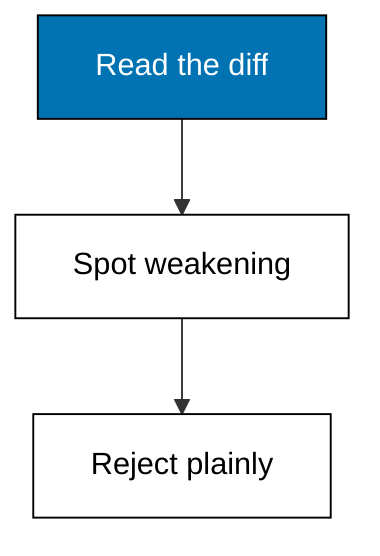

**`learning/code/ex-38-reject-the-weakened-check/main.py`**

```python
# Example 38: Reject the Weakened Check
# => Fixture shim of the Pi coding agent surface.
# => Target release 1.3.0, checked on 2026-10-20.
# => Deterministic: no network, key, or billing.
# => Real behaviour may differ; see pi.dev/docs/latest.
# => CHANGES freezes the proposed diff per file.
# => Each triple is path, added lines, removed lines.
CHANGES = [  # => the frozen proposal
    ("src/auth.py", 2, 5),  # => src/auth.py
    ("tests/test_auth.py", 0, 8),  # => tests/test_auth.py
]  # => read every entry before deciding anything
# => Totals turn a file list into one reviewable number.
added = sum(c[1] for c in CHANGES)  # => added lines total
# => Deletions matter as much: removed code can hide bugs.
removed = sum(c[2] for c in CHANGES)  # => removed total
# => The verdict follows the brief's rule, not a feeling.
verdict = "reject: weakens check, drops tests"  # => approve, reject, or revise
# => Print files touched, lines, and the verdict.
print("files:", len(CHANGES))  # => Output counts files
print("added:", added, "removed:", removed)  # => Output counts lines
print("verdict:", verdict)  # => Output records the review
```

**Output** (`learning/code/ex-38-reject-the-weakened-check/expected/main.stdout.txt`):

```text
files: 2
added: 2 removed: 13
verdict: reject: weakens check, drops tests
```

**Key takeaway**: Reject diffs that weaken checks while deleting tests; no revision can salvage the intent.

**Why It Matters**: Not every bad diff deserves a revise, because some proposals are wrong in direction rather than degree. Weakening a security check while deleting its tests signals a misunderstanding no line edit fixes. Rejection protects the codebase and teaches the boundary faster than negotiation. Say no plainly here so yes means something elsewhere. Auth simplifications are vulnerabilities wearing helpful formatting.

---

### Example 39: Grep Find Read Trio

_Exercises co-01, co-06._

Review starts with reading tools, not editing ones: grep locates, find enumerates, read inspects, and edit stays off until the review ends. Case in point: a review tool set resolving to read, grep, find, ls, and edit after one addition. **Check**: the active list holds five tools with edit added last.

**`learning/code/ex-39-grep-find-read-trio/main.py`**

```python
# Example 39: Grep Find Read Trio
# => Fixture shim of the Pi coding agent surface.
# => Target release 1.3.0, checked on 2026-10-20.
# => Deterministic: no network, key, or billing.
# => Real behaviour may differ; see pi.dev/docs/latest.
# => Pi enables read, bash, edit, write unless told otherwise.
# => Plain names replace defaults; + adds, - removes one.
defaults = ["read", "grep", "find", "ls"]  # => the startup tool list
# => Overrides are the +name/-name flags of this run.
overrides = ["+edit"]  # => frozen CLI flags
# => Adds join, removals filter out, removals win ties.
adds = [f[1:] for f in overrides if f.startswith("+")]  # => added
drops = [f[1:] for f in overrides if f.startswith("-")]  # => cut
active = sorted(set(defaults) | set(adds) - set(drops))  # => final
# => Print defaults, flags, and the resolved set.
print("defaults:", defaults)  # => Output shows the start
print("overrides:", overrides)  # => Output shows the flags
print("active:", active)  # => Output shows the result
```

**Output** (`learning/code/ex-39-grep-find-read-trio/expected/main.stdout.txt`):

```text
defaults: ['read', 'grep', 'find', 'ls']
overrides: ['+edit']
active: ['edit', 'find', 'grep', 'ls', 'read']
```

**Key takeaway**: Review with reading tools first; enable edit only when the review becomes a fix.

**Why It Matters**: An enabled edit tool during review is a loaded action the model may take to be helpful. Reading tools cannot change anything, which makes the review phase safe by construction. Adding edit afterwards marks the visible transition from reviewing to fixing. Tool sets should narrate the phase of work, not just enable it. The `tool_search` helper finds extension tools by name when the list grows long.

---

### Example 40: Red Then Green Gate

_Exercises co-12._

The agent proves its change with the suite run twice: red on the unmodified code, green after the fix, with no skipped middle. Case in point: a cart-suite gate showing the fail baseline and the pass proof. **Check**: the before reads fail, the after reads pass, and the gate verdict is True.

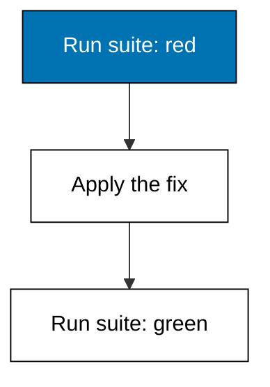

**`learning/code/ex-40-red-then-green-gate/main.py`**

```python
# Example 40: Red Then Green Gate
# => Fixture shim of the Pi coding agent surface.
# => Target release 1.3.0, checked on 2026-10-20.
# => Deterministic: no network, key, or billing.
# => Real behaviour may differ; see pi.dev/docs/latest.
# => The agent proves its change with a run, not a claim.
# => Red before the fix, green after: no skipped middle.
suite = "pytest tests/test_cart.py -q"  # => the command proving the change
# => Red is the honest baseline on unmodified code.
red = "fail"  # => frozen pre-fix result
# => Green is the same suite after the agent's edit.
green = "pass"  # => frozen post-fix result
# => The gate passes only on the red-then-green pair.
gate = red == "fail" and green == "pass"  # => the gate verdict
print("suite:", suite)  # => Output names the suite
print("before:", red)  # => Output shows the baseline
print("after:", green)  # => Output shows the proof
print("gate:", gate)  # => Output gives the verdict
```

**Output** (`learning/code/ex-40-red-then-green-gate/expected/main.stdout.txt`):

```text
suite: pytest tests/test_cart.py -q
before: fail
after: pass
gate: True
```

**Key takeaway**: Demand red before green on every agent change; a suite that never failed proves nothing.

**Why It Matters**: A passing suite on modified code proves little unless the same suite failed before the fix. The red baseline confirms the tests actually cover the changed behaviour rather than vacuously passing. Skipping the baseline is how zero-assertion suites ship with full confidence. Red then green is the whole proof; anything less is a claim. A green-only run may be testing nothing; check what the red looked like.

---

### Example 41: Codemode for Scripted Tools

_Exercises co-01._

The `codemode` tool exposes declared tools to scripts the agent writes, and `tool_search` finds more by name when the list overflows its budget. Case in point: a scripted-tools set resolving with the search helper added. **Check**: the active list holds four tools with the search helper present.

**`learning/code/ex-41-codemode-for-scripted-tools/main.py`**

```python
# Example 41: Codemode for Scripted Tools
# => Fixture shim of the Pi coding agent surface.
# => Target release 1.3.0, checked on 2026-10-20.
# => Deterministic: no network, key, or billing.
# => Real behaviour may differ; see pi.dev/docs/latest.
# => Pi enables read, bash, edit, write unless told otherwise.
# => Plain names replace defaults; + adds, - removes one.
defaults = ["read", "bash", "codemode"]  # => the startup tool list
# => Overrides are the +name/-name flags of this run.
overrides = ["+tool_search"]  # => frozen CLI flags
# => Adds join, removals filter out, removals win ties.
adds = [f[1:] for f in overrides if f.startswith("+")]  # => added
drops = [f[1:] for f in overrides if f.startswith("-")]  # => cut
active = sorted(set(defaults) | set(adds) - set(drops))  # => final
# => Print defaults, flags, and the resolved set.
print("defaults:", defaults)  # => Output shows the start
print("overrides:", overrides)  # => Output shows the flags
print("active:", active)  # => Output shows the result
```

**Output** (`learning/code/ex-41-codemode-for-scripted-tools/expected/main.stdout.txt`):

```text
defaults: ['read', 'bash', 'codemode']
overrides: ['+tool_search']
active: ['bash', 'codemode', 'read', 'tool_search']
```

**Key takeaway**: Reach script-called tools through `codemode`; find overflow tools with `tool_search`.

**Why It Matters**: Scripts the agent writes need tools too, and handing them the full set reintroduces every permission question at a new layer. Codemode declares exactly which tools scripts may call, keeping the inner loop as scoped as the outer one. The inline budget prevents declarations from eating the context window. Search completes the trio when declarations overflow. Inline budgets cap what one description may declare, so search is part of the workflow.

---

### Example 42: Branch the Review Loop

_Exercises co-03, co-09._

Review feedback does not have to overwrite the attempt it criticizes: branch the loop and revise on the new branch while attempt one stays parked. Case in point: a review-loop branch keeping nine turns with the first coupon attempt parked. **Check**: the kept count reads 9 and the parked diff is named.

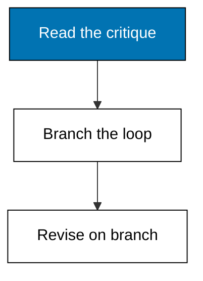

**`learning/code/ex-42-branch-the-review-loop/main.py`**

```python
# Example 42: Branch the Review Loop
# => Fixture shim of the Pi coding agent surface.
# => Target release 1.3.0, checked on 2026-10-20.
# => Deterministic: no network, key, or billing.
# => Real behaviour may differ; see pi.dev/docs/latest.
# => RECORDS freezes what Pi would report for this op.
# => Each line is one fact the engineer can quote.
RECORDS = [  # => the frozen report lines
    "branch: review-2 created",  # => one reported fact
    "turns kept: 9",  # => one reported fact
    "diff parked: coupon attempt 1",  # => one reported fact
]  # => order matches Pi's own display order
# => The op name says which command produced this.
op = "/tree branch review-2"  # => the Pi command under test
# => Print the op first so logs stay attributable.
print("op:", op)  # => Output names the command
# => Then print each record line verbatim.
for line in RECORDS:  # => walk the frozen report
    print("row:", line)  # => Output shows the record
```

**Output** (`learning/code/ex-42-branch-the-review-loop/expected/main.stdout.txt`):

```text
op: /tree branch review-2
row: branch: review-2 created
row: turns kept: 9
row: diff parked: coupon attempt 1
```

**Key takeaway**: Branch review iterations instead of overwriting; every attempt stays citable.

**Why It Matters**: Overwriting a criticized attempt destroys the evidence of what review caught, which is exactly the material that teaches. Branching keeps attempt one intact while attempt two incorporates the feedback. Comparing branches shows whether the revision addressed the comment or merely moved it. History with branches reads as a discussion; without them it reads as a single lucky guess. Diff the branches when review asks what changed between attempts.

---

### Example 43: Veto the Forty File Plan

_Exercises co-05, co-16._

A UTC migration touching storage, logic, and tests at once is exactly the plan to veto: four listed files stand in for forty, and the verdict splits it into phases. Case in point: a wide migration plan vetoed and split because it exceeds the three-file cap. **Check**: the file count exceeds the cap and the verdict reads `vetoed: split it`.

**`learning/code/ex-43-veto-the-forty-file-plan/main.py`**

```python
# Example 43: Veto the Forty File Plan
# => Fixture shim of the Pi coding agent surface.
# => Target release 1.3.0, checked on 2026-10-20.
# => Deterministic: no network, key, or billing.
# => Real behaviour may differ; see pi.dev/docs/latest.
# => A plan names goal, steps, and files before acting.
# => Pi shows this; the human approves, edits, or vetoes.
goal = "migrate all dates to UTC"  # => the one-line job
# => Steps are ordered tool calls, oldest first.
steps = [  # => the proposed sequence
    # => Step: scan repo.
    "scan repo",  # => one ordered step
    # => Step: rewrite 40 files.
    "rewrite 40 files",  # => one ordered step
    # => Step: migrate database.
    "migrate database",  # => one ordered step
]  # => the closed sequence
# => Files bound the blast radius of the whole task.
files = [  # => every path the plan may touch
    # => File: src/a.py stays inside the blast radius.
    "src/a.py",  # => one scoped path
    # => File: src/b.py stays inside the blast radius.
    "src/b.py",  # => one scoped path
    # => File: db/schema.sql stays inside the blast radius.
    "db/schema.sql",  # => one scoped path
    # => File: tests/test_dates.py stays inside the blast radius.
    "tests/test_dates.py",  # => one scoped path
]  # => the closed file list
# => The cap below is this course's rule of thumb.
wide = len(files) > 3  # => True means split it up
# => The verdict is approve for narrow, veto for wide.
if wide:  # => wide plans fail review
    # => Veto splits wide work into reviewable phases.
    verdict = "vetoed: split it"  # => split into phases
else:  # => narrow plans earn fast approval
    # => Approval records the human decision.
    verdict = "approved"  # => the recorded decision
# => Print goal, width, and verdict for the record.
print("goal:", goal)  # => Output states the job
print("files:", len(files))  # => Output counts them
print("verdict:", verdict)  # => Output records it
```

**Output** (`learning/code/ex-43-veto-the-forty-file-plan/expected/main.stdout.txt`):

```text
goal: migrate all dates to UTC
files: 4
verdict: vetoed: split it
```

**Key takeaway**: Veto wide plans early and split them; the file count tells you before the diff does.

**Why It Matters**: Wide plans fail in wide ways: one bad assumption replicates across forty files before review sees any of them. The file count is the earliest reliable signal, available before a single line changes. Vetoing is not rejection; it is decomposition into phases small enough to verify. Split the migration and each phase earns its own red-green proof. UTC migrations split well by layer: storage first, logic second, tests last.

---

### Example 44: Human Gate Mid Session

_Exercises co-16, co-06._

Some steps need a human in the middle, not just at the end: the gate pauses the session before the irreversible column drop and resumes on approval. Case in point: a two-file schema plan whose approval explicitly passes through a mid-session human gate. **Check**: the file count fits the cap and the verdict names the human gate.

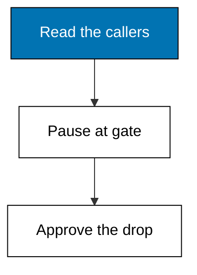

**`learning/code/ex-44-human-gate-mid-session/main.py`**

```python
# Example 44: Human Gate Mid Session
# => Fixture shim of the Pi coding agent surface.
# => Target release 1.3.0, checked on 2026-10-20.
# => Deterministic: no network, key, or billing.
# => Real behaviour may differ; see pi.dev/docs/latest.
# => A plan names goal, steps, and files before acting.
# => Pi shows this; the human approves, edits, or vetoes.
goal = "drop legacy column"  # => the one-line job
# => Steps are ordered tool calls, oldest first.
steps = [  # => the proposed sequence
    # => Step: read callers.
    "read callers",  # => one ordered step
    # => Step: drop column.
    "drop column",  # => one ordered step
    # => Step: run suite.
    "run suite",  # => one ordered step
]  # => the closed sequence
# => Files bound the blast radius of the whole task.
files = [  # => every path the plan may touch
    # => File: db/schema.sql stays inside the blast radius.
    "db/schema.sql",  # => one scoped path
    # => File: src/reports.py stays inside the blast radius.
    "src/reports.py",  # => one scoped path
]  # => the closed file list
# => The cap below is this course's rule of thumb.
wide = len(files) > 3  # => True means split it up
# => The verdict is approve for narrow, veto for wide.
if wide:  # => wide plans fail review
    # => Veto splits wide work into reviewable phases.
    verdict = "vetoed: split it"  # => split into phases
else:  # => narrow plans earn fast approval
    # => Approval records the human decision.
    verdict = "approved after human gate"  # => the recorded decision
# => Print goal, width, and verdict for the record.
print("goal:", goal)  # => Output states the job
print("files:", len(files))  # => Output counts them
print("verdict:", verdict)  # => Output records it
```

**Output** (`learning/code/ex-44-human-gate-mid-session/expected/main.stdout.txt`):

```text
goal: drop legacy column
files: 2
verdict: approved after human gate
```

**Key takeaway**: Put the human gate before irreversible steps, not after them; approval must precede the drop.

**Why It Matters**: End-of-task approval arrives after irreversible steps have already run, which makes it a post-mortem rather than a gate. Pausing before the drop lets the human verify callers, backups, and rollback plans while reversal is still possible. The gate names its step so the session cannot slide past it. Irreversible work without a preceding human is an incident waiting for a schedule. Schema changes are the canonical mid-session gate: storage has no undo button.

---

### Example 45: Read the Session Totals

_Exercises co-10._

The `/session` totals line turns a whole afternoon into three numbers: tokens in, tokens out, and the price that follows from them. Case in point: an eighteen-thousand-token afternoon priced against a fifteen-cent budget. **Check**: the total reads 24600 tokens and the run lands within budget.

**`learning/code/ex-45-read-the-session-totals/main.py`**

```python
# Example 45: Read the Session Totals
# => Fixture shim of the Pi coding agent surface.
# => Target release 1.3.0, checked on 2026-10-20.
# => Deterministic: no network, key, or billing.
# => Real behaviour may differ; see pi.dev/docs/latest.
# => Rates below are illustration constants, not quotes.
# => Replace them with your provider's current price page.
tokens_in = 18400  # => prompt tokens this session spent
# => Output tokens cost more because they are generated.
tokens_out = 6200  # => completion tokens spent
# => Per-thousand rates keep the arithmetic readable.
rate_in = 0.003  # => dollars per thousand input tokens
rate_out = 0.012  # => dollars per thousand output tokens
# => Price each side, then add for the session total.
price = tokens_in / 1000 * rate_in  # => input side cost
price += tokens_out / 1000 * rate_out  # => add output side
# => Budgets turn a number into a decision: over or under.
print("tokens:", tokens_in + tokens_out)  # => Output totals tokens
print("cost-usd:", round(price, 4))  # => Output prices the run
print("within-budget:", price <= 0.15)  # => Output checks the budget
```

**Output** (`learning/code/ex-45-read-the-session-totals/expected/main.stdout.txt`):

```text
tokens: 24600
cost-usd: 0.1296
within-budget: True
```

**Key takeaway**: Read session totals as one number first, then split it when the number surprises you.

**Why It Matters**: Per-turn costs feel small while session totals tell the truth, because attention resets every turn but spending accumulates. Reading the totals line builds the habit of pricing work like any other resource. Surprises decompose into legs: one expensive leg usually dominates, and that leg is the one to re-run on a cheaper model. Total first, diagnose second, optimize third. Totals that surprise you always split into one leg worth re-running cheaper.

---

### Example 46: Thinking Budgets per Level

_Exercises co-10._

Each thinking level carries a token budget, and high fits a seventy-five-hundred-token debugging estimate that medium cannot cover. Case in point: a high-level pick with a nine-thousand-token budget against its estimate. **Check**: the budget reads 9000 and the fit verdict is True.


**`learning/code/ex-46-thinking-budgets-per-level/main.py`**

```python
# Example 46: Thinking Budgets per Level
# => Fixture shim of the Pi coding agent surface.
# => Target release 1.3.0, checked on 2026-10-20.
# => Deterministic: no network, key, or billing.
# => Real behaviour may differ; see pi.dev/docs/latest.
# => Levels run off, minimal, low, medium, high, xhigh, max.
level = "high"  # => the level chosen for this task
# => Budgets below are illustration caps, not vendor promises.
budgets = {  # => frozen level-to-token map
    # => Level off budgets 0 tokens.
    "off": 0,  # => off budget
    # => Level minimal budgets 500 tokens.
    "minimal": 500,  # => minimal budget
    # => Level low budgets 1500 tokens.
    "low": 1500,  # => low budget
    # => Level medium budgets 4000 tokens.
    "medium": 4000,  # => medium budget
    # => Level high budgets 9000 tokens.
    "high": 9000,  # => high budget
    # => Level xhigh budgets 20000 tokens.
    "xhigh": 20000,  # => xhigh budget
    # => Level max budgets 50000 tokens.
    "max": 50000,  # => max budget
}  # => the closed map
estimate = 7500  # => tokens this task likely needs
# => A level fits when its budget covers the estimate.
fits = estimate <= budgets[level]  # => the fit verdict
# => Print level, budget, and whether the task fits.
print("level:", level)  # => Output names the level
print("budget:", budgets[level])  # => Output shows budget
print("fits:", fits)  # => Output gives the verdict
```

**Output** (`learning/code/ex-46-thinking-budgets-per-level/expected/main.stdout.txt`):

```text
level: high
budget: 9000
fits: True
```

**Key takeaway**: Size the thinking level to the debugging estimate; medium covers routine work, high covers novel bugs.

**Why It Matters**: Novel bugs need room to reason, and room costs tokens whether you budget them or not. Explicit budgets convert I hope this is enough into arithmetic anyone can check. Undersized levels truncate reasoning mid-thought, producing confident fragments instead of answers. Budget from history and the level stops being a guess. Estimates come from the last similar task, not from optimism.

---

### Example 47: Cache Warming Economics

_Exercises co-10._

Prompt caches discount repeated context, and streaming warmth keeps eligible caches hot: this run prices cache-rate input against full-rate output. Case in point: a cache-warmed run with discounted input rates against a two-cent budget. **Check**: the total reads 9500 tokens and the discounted run lands within budget.

**`learning/code/ex-47-cache-warming-economics/main.py`**

```python
# Example 47: Cache Warming Economics
# => Fixture shim of the Pi coding agent surface.
# => Target release 1.3.0, checked on 2026-10-20.
# => Deterministic: no network, key, or billing.
# => Real behaviour may differ; see pi.dev/docs/latest.
# => Rates below are illustration constants, not quotes.
# => Replace them with your provider's current price page.
tokens_in = 9000  # => prompt tokens this session spent
# => Output tokens cost more because they are generated.
tokens_out = 500  # => completion tokens spent
# => Per-thousand rates keep the arithmetic readable.
rate_in = 0.0003  # => dollars per thousand input tokens
rate_out = 0.012  # => dollars per thousand output tokens
# => Price each side, then add for the session total.
price = tokens_in / 1000 * rate_in  # => input side cost
price += tokens_out / 1000 * rate_out  # => add output side
# => Budgets turn a number into a decision: over or under.
print("tokens:", tokens_in + tokens_out)  # => Output totals tokens
print("cost-usd:", round(price, 4))  # => Output prices the run
print("within-budget:", price <= 0.02)  # => Output checks the budget
```

**Output** (`learning/code/ex-47-cache-warming-economics/expected/main.stdout.txt`):

```text
tokens: 9500
cost-usd: 0.0087
within-budget: True
```

**Key takeaway**: Keep caches warm on long repetitive runs; cached input is the cheapest token you will buy.

**Why It Matters**: Repeated context billed at full rate is the quietest budget fire in agent work, because every turn re-sends what the last turn already said. Cache warming spends a little upkeep to avoid re-billing the whole context. The five-cent threshold keeps the optimization honest: below it, simplicity beats savings. Cache deliberately on long runs; ignore it on short ones. Warming only pays when the model declares a cache lifetime and the savings clear five cents.

---

### Example 48: Trace Carries the Why

_Exercises co-07._

Good traces pair every call with a reason: the why is what you audit, because the what alone could justify anything. Case in point: a trace where each tool call carries its reason in the detail field. **Check**: the sound count is 3 and every detail states a reason, not just an action.

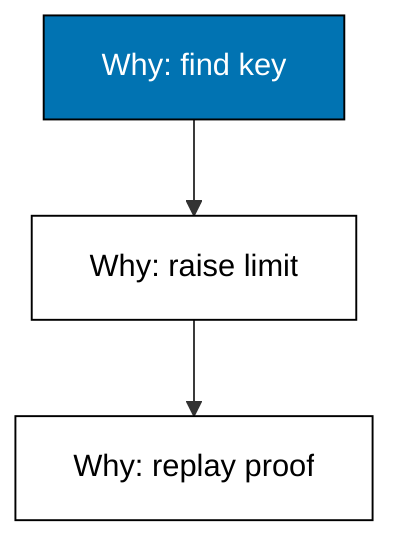

**`learning/code/ex-48-trace-carries-the-why/main.py`**

```python
# Example 48: Trace Carries the Why
# => Fixture shim of the Pi coding agent surface.
# => Target release 1.3.0, checked on 2026-10-20.
# => Deterministic: no network, key, or billing.
# => Real behaviour may differ; see pi.dev/docs/latest.
# => STEPS replays the agent's own tool-call record.
# => Each triple is kind, detail, and whether it was sound.
STEPS = [  # => the frozen trace under review
    ("read", "config to find the timeout key", True),  # => read
    ("edit", "raise timeout 5s to 30s", True),  # => edit
    ("test", "replay the slow webhook", True),  # => test
]  # => order is call order, oldest first
# => Sound steps pass review; the rest need a human.
# => Counting first keeps the verdict mechanical.
sound = [s for s in STEPS if s[2]]  # => the passing steps
suspect = [s for s in STEPS if not s[2]]  # => the failing ones
# => Print both counts before naming any names.
print("sound:", len(sound), "suspect:", len(suspect))  # => Output counts
# => Then print each step so the log reads like a story.
for kind, detail, ok in STEPS:  # => walk the frozen trace
    print(kind, "|", detail)  # => Output shows the step
```

**Output** (`learning/code/ex-48-trace-carries-the-why/expected/main.stdout.txt`):

```text
sound: 3 suspect: 0
read | config to find the timeout key
edit | raise timeout 5s to 30s
test | replay the slow webhook
```

**Key takeaway**: Demand reasons in the trace, not just actions; the why is the auditable part.

**Why It Matters**: Actions without reasons are unauditable: raising a timeout could be wisdom or vandalism, and the diff looks identical either way. Reasons let reviewers check the thinking instead of re-deriving it. The webhook replay closes the loop by testing the reason, not just the change. Audit the why and the what takes care of itself. Timeout changes look trivial until a webhook storm shows why the old value existed.

---

### Example 49: One Suspect Step Poisons

_Exercises co-07, co-06._

One suspect step poisons the steps after it: a weakened password check followed by skipped login tests means the line stops here. Case in point: a trace with a weakened auth check that the test run then fails to cover. **Check**: the suspect count is 2 and the first step is the only sound one.

**`learning/code/ex-49-one-suspect-step-poisons/main.py`**

```python
# Example 49: One Suspect Step Poisons
# => Fixture shim of the Pi coding agent surface.
# => Target release 1.3.0, checked on 2026-10-20.
# => Deterministic: no network, key, or billing.
# => Real behaviour may differ; see pi.dev/docs/latest.
# => STEPS replays the agent's own tool-call record.
# => Each triple is kind, detail, and whether it was sound.
STEPS = [  # => the frozen trace under review
    ("read", "src/auth.py login handler", True),  # => read
    ("edit", "weaken password check to contains", False),  # => edit
    ("test", "login tests skipped", False),  # => test
]  # => order is call order, oldest first
# => Sound steps pass review; the rest need a human.
# => Counting first keeps the verdict mechanical.
sound = [s for s in STEPS if s[2]]  # => the passing steps
suspect = [s for s in STEPS if not s[2]]  # => the failing ones
# => Print both counts before naming any names.
print("sound:", len(sound), "suspect:", len(suspect))  # => Output counts
# => Then print each step so the log reads like a story.
for kind, detail, ok in STEPS:  # => walk the frozen trace
    print(kind, "|", detail)  # => Output shows the step
```

**Output** (`learning/code/ex-49-one-suspect-step-poisons/expected/main.stdout.txt`):

```text
sound: 1 suspect: 2
read | src/auth.py login handler
edit | weaken password check to contains
test | login tests skipped
```

**Key takeaway**: One suspect step stops the line; read the diff before any later step earns trust.

**Why It Matters**: Trust in a trace is transitive: every later step assumes the earlier ones were sound. A weakened check breaks the chain at step two, so the skipped tests in step three certify nothing. Stopping the line early saves the review of every downstream step. Contain first, diagnose second, and never let a suspect step ride along quietly. Auth is the one place where a plausible simplification is a vulnerability.

---

### Example 50: Count Turns per Task

_Exercises co-07, co-10._

Turn counts turn slow sessions into visible regressions: four turns for a routine client regeneration is the baseline future runs must beat. Case in point: a four-step trace establishing a baseline turn count for mechanical work. **Check**: the sound count is 4 and the shape is two reads, one edit, one test.

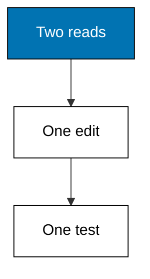

**`learning/code/ex-50-count-turns-per-task/main.py`**

```python
# Example 50: Count Turns per Task
# => Fixture shim of the Pi coding agent surface.
# => Target release 1.3.0, checked on 2026-10-20.
# => Deterministic: no network, key, or billing.
# => Real behaviour may differ; see pi.dev/docs/latest.
# => STEPS replays the agent's own tool-call record.
# => Each triple is kind, detail, and whether it was sound.
STEPS = [  # => the frozen trace under review
    ("read", "openapi.yaml endpoints", True),  # => read
    ("read", "client generator docs", True),  # => read
    ("edit", "regenerate client", True),  # => edit
    ("test", "contract tests green", True),  # => test
]  # => order is call order, oldest first
# => Sound steps pass review; the rest need a human.
# => Counting first keeps the verdict mechanical.
sound = [s for s in STEPS if s[2]]  # => the passing steps
suspect = [s for s in STEPS if not s[2]]  # => the failing ones
# => Print both counts before naming any names.
print("sound:", len(sound), "suspect:", len(suspect))  # => Output counts
# => Then print each step so the log reads like a story.
for kind, detail, ok in STEPS:  # => walk the frozen trace
    print(kind, "|", detail)  # => Output shows the step
```

**Output** (`learning/code/ex-50-count-turns-per-task/expected/main.stdout.txt`):

```text
sound: 4 suspect: 0
read | openapi.yaml endpoints
read | client generator docs
edit | regenerate client
test | contract tests green
```

**Key takeaway**: Baseline turns per task type; regressions in turn count are regressions in cost.

**Why It Matters**: Without baselines, a twelve-turn regeneration feels normal instead of triple the necessary cost. Counting turns per task type converts vague slowness into a number with a history. Regressions then point at what changed: the model, the context, or the task. Baselines make efficiency a measurement instead of a mood. Baselines make efficiency visible instead of arguable. Mechanical tasks have the tightest baselines because nothing should surprise the agent.

---

### Example 51: Filter the Transcript

_Exercises co-07, co-03._

Long sessions bury their decisions under tool calls, and the tree filter hides the noise so the prompts, and the two bookmarks, stand out. Case in point: a no-tools filter record hiding forty-one tool calls while keeping two bookmarks. **Check**: the hidden count reads 41 and both bookmarks survive the filter.

**`learning/code/ex-51-filter-the-transcript/main.py`**

```python
# Example 51: Filter the Transcript
# => Fixture shim of the Pi coding agent surface.
# => Target release 1.3.0, checked on 2026-10-20.
# => Deterministic: no network, key, or billing.
# => Real behaviour may differ; see pi.dev/docs/latest.
# => RECORDS freezes what Pi would report for this op.
# => Each line is one fact the engineer can quote.
RECORDS = [  # => the frozen report lines
    "shown: user prompts only",  # => one reported fact
    "hidden: 41 tool calls",  # => one reported fact
    "bookmarks: 2 kept",  # => one reported fact
]  # => order matches Pi's own display order
# => The op name says which command produced this.
op = "/tree filter no-tools"  # => the Pi command under test
# => Print the op first so logs stay attributable.
print("op:", op)  # => Output names the command
# => Then print each record line verbatim.
for line in RECORDS:  # => walk the frozen report
    print("row:", line)  # => Output shows the record
```

**Output** (`learning/code/ex-51-filter-the-transcript/expected/main.stdout.txt`):

```text
op: /tree filter no-tools
row: shown: user prompts only
row: hidden: 41 tool calls
row: bookmarks: 2 kept
```

**Key takeaway**: Filter transcripts to user prompts when auditing decisions; bookmarks survive every filter.

**Why It Matters**: Tool calls outnumber decisions fifty to one in a long session, which buries the moments a human actually chose something. Filtering to prompts recovers the decision spine of the run. Bookmarks mark the turns worth revisiting across filters. Audit the spine first; expand tool detail only where the spine looks wrong. Default, no-tools, user-only, labeled-only, and all are the five filter modes.

---

### Example 52: Choose the Share Destination

_Exercises co-13, co-03._

Release 1.3.0 lets `/share` upload to a gist, to Radius, or automatically: one setting names the destination and the course pins it to gist. Case in point: a share-destination config selecting gist uploads, validated against its required key. **Check**: the missing list is empty and the destination echoes exactly `gist`.


**`learning/code/ex-52-choose-the-share-destination/main.py`**

```python
# Example 52: Choose the Share Destination
# => Fixture shim of the Pi coding agent surface.
# => Target release 1.3.0, checked on 2026-10-20.
# => Deterministic: no network, key, or billing.
# => Real behaviour may differ; see pi.dev/docs/latest.
# => Setting sessionShareDestination ships in settings.json.
SESSIONSHAREDESTINATION = "gist"  # => pins sessionShareDestination
# => Setting defaultModel ships in settings.json.
DEFAULTMODEL = "auto"  # => pins defaultModel
# => REQUIRED names keys a session cannot start without.
REQUIRED = [  # => the non-negotiable keys
    # => sessionShareDestination is required because sessions fail without it.
    "sessionShareDestination",  # => required key
]  # => the closed list
# => config maps every key to its live value.
config = {  # => the live settings under test
    # => Live value for sessionShareDestination, used in the checks below.
    "sessionShareDestination": SESSIONSHAREDESTINATION,  # => sessionShareDestination entry
    # => Live value for defaultModel, used in the checks below.
    "defaultModel": DEFAULTMODEL,  # => defaultModel entry
}  # => the closed map
missing = [k for k in REQUIRED if k not in config]  # => gaps
print("missing:", missing)  # => Output names what is absent
# => Reading back sessionShareDestination proves the file was used.
print("destination:", config["sessionShareDestination"])  # => Output echoes it
```

**Output** (`learning/code/ex-52-choose-the-share-destination/expected/main.stdout.txt`):

```text
missing: []
destination: gist
```

**Key takeaway**: Set `sessionShareDestination` explicitly; auto is convenient until the audience matters.

**Why It Matters**: Share destinations decide who can read your session, which makes the default a security decision wearing a convenience label. Gists suit public collaboration; Radius suits private teams; auto guesses between them. Pinning the setting removes the guess on every share. Choose the audience deliberately, then share once. Choose the audience first, then share exactly once. External shares deserve a secrets pass first, because exports keep what you sent.

---

### Example 53: Price the Whole Afternoon

_Exercises co-10._

Close the intermediate level by pricing the whole afternoon: sixty thousand tokens in, eighteen thousand out, against a fifty-cent budget. Case in point: a full-afternoon session priced at illustration rates with the budget under pressure. **Check**: the total reads 78000 tokens and the within-budget verdict prints either way.

**`learning/code/ex-53-price-the-whole-afternoon/main.py`**

```python
# Example 53: Price the Whole Afternoon
# => Fixture shim of the Pi coding agent surface.
# => Target release 1.3.0, checked on 2026-10-20.
# => Deterministic: no network, key, or billing.
# => Real behaviour may differ; see pi.dev/docs/latest.
# => Rates below are illustration constants, not quotes.
# => Replace them with your provider's current price page.
tokens_in = 60000  # => prompt tokens this session spent
# => Output tokens cost more because they are generated.
tokens_out = 18000  # => completion tokens spent
# => Per-thousand rates keep the arithmetic readable.
rate_in = 0.003  # => dollars per thousand input tokens
rate_out = 0.012  # => dollars per thousand output tokens
# => Price each side, then add for the session total.
price = tokens_in / 1000 * rate_in  # => input side cost
price += tokens_out / 1000 * rate_out  # => add output side
# => Budgets turn a number into a decision: over or under.
print("tokens:", tokens_in + tokens_out)  # => Output totals tokens
print("cost-usd:", round(price, 4))  # => Output prices the run
print("within-budget:", price <= 0.5)  # => Output checks the budget
```

**Output** (`learning/code/ex-53-price-the-whole-afternoon/expected/main.stdout.txt`):

```text
tokens: 78000
cost-usd: 0.396
within-budget: True
```

**Key takeaway**: Price whole afternoons, not just tasks; the session you forgot costs the most.

**Why It Matters**: Task-level pricing misses the sessions between tasks: exploration, dead ends, and the retries nobody logs. Afternoon totals capture the real cost of the workday including its waste. The budget verdict here is information, not judgement; over means the mix needs changing, not that the work was wrong. Total honestly and the optimizations suggest themselves. The advanced level spends this budget knowledge on recovery instead of rework.

---
