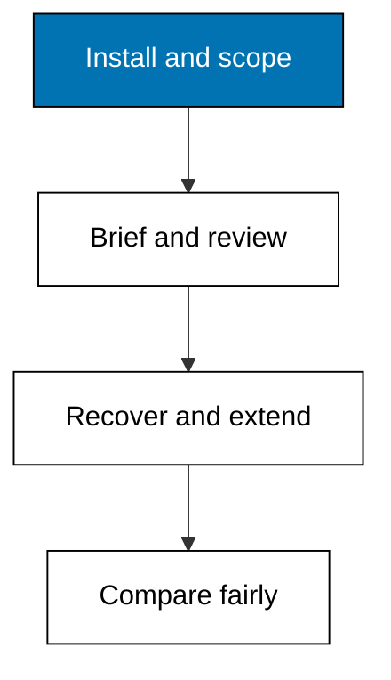

Prerequisites for this course: [agentic-coding](/en/learn/courses/agentic-coding/learning/overview) for the draft-and-verify discipline this course applies to one named tool, [version-control-and-git](/en/learn/courses/version-control-and-git/learning/overview) for the diffs and checkpoints every session here relies on, and [just-enough-bash](/en/learn/courses/just-enough-bash/learning/overview) because every example starts from a shell invocation. Comfort with a terminal, Git, and reading a diff is assumed throughout.

## Why this exists -- the big idea

**The problem before the solution**: a learner choosing between agent tools today has no repeatable, criteria-based comparison and ends up picking by brand recognition alone. **Keep this if you forget everything else**: treat the agent's output as a draft from a fast junior, not as a fact; verify everything it claims before you act on it.

## Tensions and trade-offs -- when NOT to reach for this

- **Speed versus understanding**: delegating the code you most need to understand trades short-term velocity for long-term ignorance of your own system. Verify most where it matters most; delegate most where it matters least.
- **Automation bias is the real risk**: a fluent, confident answer invites you to skip the review it most needs. The tool's persuasiveness is inversely correlated with your scrutiny unless you force the loop.
- **When NOT**: high-stakes, novel, or security-critical logic, and any situation where you cannot cheaply verify the output. If you cannot test or review it fast, the agent's speed is a liability, not an asset.

## Lineage -- where this tool sits

Terminal coding agents grew out of autocomplete and chat assistants into programs that read repositories, plan, edit, run commands, and iterate. Pi is Earendil's entry: a minimal harness verified for this course at release 1.3.0, documented at the vendor docs linked under References below. It wins over pure hand-coding for routine work because the leverage on boilerplate, mechanical refactors, and first drafts is large, but only under the discipline this course teaches. The generic side of that discipline lives in agentic-coding; this course is the tool-specific side.

## How this course is organized

[Beginner](/en/learn/courses/pi-coding-agent-for-engineers/learning/beginner) (Examples 1-25) installs, starts sessions, reads output, and scopes permissions. [Intermediate](/en/learn/courses/pi-coding-agent-for-engineers/learning/intermediate) (Examples 26-53) writes briefs, lands multi-file changes behind tests, and counts cost. [Advanced](/en/learn/courses/pi-coding-agent-for-engineers/learning/advanced) (Examples 54-78) recovers stuck sessions, configures deeply, and compares agents fairly. The [capstone](/en/learn/courses/pi-coding-agent-for-engineers/learning/capstone/overview) runs one realistic multi-step task end to end, and [drilling](/en/learn/courses/pi-coding-agent-for-engineers/drilling/overview) turns the concepts into recall, katas, and checklists.

## About the fixture shim

Every runnable example drives a deterministic fixture shim of the Pi coding agent CLI and its file-system effects, never the live product: no real network call, no real account, and no billing. The shim models the documented command surface of release 1.3.0 as checked on 2026-10-20, and its behaviour is a deliberate simplification, not a guarantee about the live product. Where the simplification matters, the example says so. Confirm any current behaviour with `pi --help` on your own install.

## References

- Pi coding agent homepage (vendor Earendil Inc., install routes, four modes, providers, session tree). Accessed 2026-10-20. [Pi homepage](https://pi.dev)
- Pi changelog (release 1.3.0 dated 2026-10-15, the version this course verified: `sessionShareDestination`, clean model switching, resumed-session tools). Accessed 2026-10-20. [Pi changelog](https://pi.dev/changelog)
- Pi settings reference (`defaultTools`, thinking levels, `sessionShareDestination`, project trust, cache warming). Accessed 2026-10-20. [Pi settings reference](https://pi.dev/docs/latest/settings)
- Pi documentation (sessions, `/tree`, `/export`, `/share`, models, providers). Accessed 2026-10-20. [Pi documentation](https://pi.dev/docs/latest)
- Pi coding-agent source (extensions, skills, prompt templates, themes, packages, RPC and SDK usage). Accessed 2026-10-20. [Pi coding-agent source](https://github.com/earendil-works/pi/tree/main/packages/coding-agent)
- Sibling comparison baseline in this plan: [Claude Code for Engineers](/en/learn/courses/claude-code-for-engineers/learning/overview) - accessed 2026-10-20; the capstone comparison reuses its agent-loop vocabulary on the same day as every other version-specific claim.
- Legacy material this course migrates and re-verifies: Pi coding agent legacy pages - accessed 2026-10-20; facts mined from those pages were re-checked against the vendor links above on the same date rather than copied as already correct.

## Examples by Level

### Beginner (Examples 1–25)

- [Example 1: Check the Installed Version](/en/learn/courses/pi-coding-agent-for-engineers/learning/beginner#example-1-check-the-installed-version)
- [Example 2: Install via the Script](/en/learn/courses/pi-coding-agent-for-engineers/learning/beginner#example-2-install-via-the-script)
- [Example 3: Install via npm](/en/learn/courses/pi-coding-agent-for-engineers/learning/beginner#example-3-install-via-npm)
- [Example 4: Start Your First Session](/en/learn/courses/pi-coding-agent-for-engineers/learning/beginner#example-4-start-your-first-session)
- [Example 5: Read the Settings File](/en/learn/courses/pi-coding-agent-for-engineers/learning/beginner#example-5-read-the-settings-file)
- [Example 6: Default Tools on Startup](/en/learn/courses/pi-coding-agent-for-engineers/learning/beginner#example-6-default-tools-on-startup)
- [Example 7: Write Your First Task Brief](/en/learn/courses/pi-coding-agent-for-engineers/learning/beginner#example-7-write-your-first-task-brief)
- [Example 8: Let the Agent Propose First](/en/learn/courses/pi-coding-agent-for-engineers/learning/beginner#example-8-let-the-agent-propose-first)
- [Example 9: Print Mode One Shot](/en/learn/courses/pi-coding-agent-for-engineers/learning/beginner#example-9-print-mode-one-shot)
- [Example 10: JSON Output for Scripts](/en/learn/courses/pi-coding-agent-for-engineers/learning/beginner#example-10-json-output-for-scripts)
- [Example 11: Read a Clean Trace](/en/learn/courses/pi-coding-agent-for-engineers/learning/beginner#example-11-read-a-clean-trace)
- [Example 12: Spot the Skipped Read](/en/learn/courses/pi-coding-agent-for-engineers/learning/beginner#example-12-spot-the-skipped-read)
- [Example 13: View Token and Cost Tracker](/en/learn/courses/pi-coding-agent-for-engineers/learning/beginner#example-13-view-token-and-cost-tracker)
- [Example 14: List Saved Sessions](/en/learn/courses/pi-coding-agent-for-engineers/learning/beginner#example-14-list-saved-sessions)
- [Example 15: Resume a Session](/en/learn/courses/pi-coding-agent-for-engineers/learning/beginner#example-15-resume-a-session)
- [Example 16: Branch at a Previous Turn](/en/learn/courses/pi-coding-agent-for-engineers/learning/beginner#example-16-branch-at-a-previous-turn)
- [Example 17: Export a Session](/en/learn/courses/pi-coding-agent-for-engineers/learning/beginner#example-17-export-a-session)
- [Example 18: Switch Approval Modes](/en/learn/courses/pi-coding-agent-for-engineers/learning/beginner#example-18-switch-approval-modes)
- [Example 19: Project Trust on First Run](/en/learn/courses/pi-coding-agent-for-engineers/learning/beginner#example-19-project-trust-on-first-run)
- [Example 20: Deny the Sensitive Path](/en/learn/courses/pi-coding-agent-for-engineers/learning/beginner#example-20-deny-the-sensitive-path)
- [Example 21: Read Before You Edit](/en/learn/courses/pi-coding-agent-for-engineers/learning/beginner#example-21-read-before-you-edit)
- [Example 22: Scope to One Directory](/en/learn/courses/pi-coding-agent-for-engineers/learning/beginner#example-22-scope-to-one-directory)
- [Example 23: Keep Secrets Out of Prompts](/en/learn/courses/pi-coding-agent-for-engineers/learning/beginner#example-23-keep-secrets-out-of-prompts)
- [Example 24: Narrow the Blast Radius](/en/learn/courses/pi-coding-agent-for-engineers/learning/beginner#example-24-narrow-the-blast-radius)
- [Example 25: Permission Review Checklist](/en/learn/courses/pi-coding-agent-for-engineers/learning/beginner#example-25-permission-review-checklist)

### Intermediate (Examples 26–53)

- [Example 26: Brief Anatomy Four Slots](/en/learn/courses/pi-coding-agent-for-engineers/learning/intermediate#example-26-brief-anatomy-four-slots)
- [Example 27: Done Condition You Can Run](/en/learn/courses/pi-coding-agent-for-engineers/learning/intermediate#example-27-done-condition-you-can-run)
- [Example 28: Guardrails That Hold](/en/learn/courses/pi-coding-agent-for-engineers/learning/intermediate#example-28-guardrails-that-hold)
- [Example 29: Steering Without Restarting](/en/learn/courses/pi-coding-agent-for-engineers/learning/intermediate#example-29-steering-without-restarting)
- [Example 30: Follow Ups Stay Ordered](/en/learn/courses/pi-coding-agent-for-engineers/learning/intermediate#example-30-follow-ups-stay-ordered)
- [Example 31: Pick a Thinking Level](/en/learn/courses/pi-coding-agent-for-engineers/learning/intermediate#example-31-pick-a-thinking-level)
- [Example 32: Cycle Through Favourite Models](/en/learn/courses/pi-coding-agent-for-engineers/learning/intermediate#example-32-cycle-through-favourite-models)
- [Example 33: Switch Models Mid Session](/en/learn/courses/pi-coding-agent-for-engineers/learning/intermediate#example-33-switch-models-mid-session)
- [Example 34: Multiline Prompts That Parse](/en/learn/courses/pi-coding-agent-for-engineers/learning/intermediate#example-34-multiline-prompts-that-parse)
- [Example 35: Propose the Plan First](/en/learn/courses/pi-coding-agent-for-engineers/learning/intermediate#example-35-propose-the-plan-first)
- [Example 36: One Change Two Files](/en/learn/courses/pi-coding-agent-for-engineers/learning/intermediate#example-36-one-change-two-files)
- [Example 37: Diff Review Checklist](/en/learn/courses/pi-coding-agent-for-engineers/learning/intermediate#example-37-diff-review-checklist)
- [Example 38: Reject the Weakened Check](/en/learn/courses/pi-coding-agent-for-engineers/learning/intermediate#example-38-reject-the-weakened-check)
- [Example 39: Grep Find Read Trio](/en/learn/courses/pi-coding-agent-for-engineers/learning/intermediate#example-39-grep-find-read-trio)
- [Example 40: Red Then Green Gate](/en/learn/courses/pi-coding-agent-for-engineers/learning/intermediate#example-40-red-then-green-gate)
- [Example 41: Codemode for Scripted Tools](/en/learn/courses/pi-coding-agent-for-engineers/learning/intermediate#example-41-codemode-for-scripted-tools)
- [Example 42: Branch the Review Loop](/en/learn/courses/pi-coding-agent-for-engineers/learning/intermediate#example-42-branch-the-review-loop)
- [Example 43: Veto the Forty File Plan](/en/learn/courses/pi-coding-agent-for-engineers/learning/intermediate#example-43-veto-the-forty-file-plan)
- [Example 44: Human Gate Mid Session](/en/learn/courses/pi-coding-agent-for-engineers/learning/intermediate#example-44-human-gate-mid-session)
- [Example 45: Read the Session Totals](/en/learn/courses/pi-coding-agent-for-engineers/learning/intermediate#example-45-read-the-session-totals)
- [Example 46: Thinking Budgets per Level](/en/learn/courses/pi-coding-agent-for-engineers/learning/intermediate#example-46-thinking-budgets-per-level)
- [Example 47: Cache Warming Economics](/en/learn/courses/pi-coding-agent-for-engineers/learning/intermediate#example-47-cache-warming-economics)
- [Example 48: Trace Carries the Why](/en/learn/courses/pi-coding-agent-for-engineers/learning/intermediate#example-48-trace-carries-the-why)
- [Example 49: One Suspect Step Poisons](/en/learn/courses/pi-coding-agent-for-engineers/learning/intermediate#example-49-one-suspect-step-poisons)
- [Example 50: Count Turns per Task](/en/learn/courses/pi-coding-agent-for-engineers/learning/intermediate#example-50-count-turns-per-task)
- [Example 51: Filter the Transcript](/en/learn/courses/pi-coding-agent-for-engineers/learning/intermediate#example-51-filter-the-transcript)
- [Example 52: Choose the Share Destination](/en/learn/courses/pi-coding-agent-for-engineers/learning/intermediate#example-52-choose-the-share-destination)
- [Example 53: Price the Whole Afternoon](/en/learn/courses/pi-coding-agent-for-engineers/learning/intermediate#example-53-price-the-whole-afternoon)

### Advanced (Examples 54–78)

- [Example 54: Name the Stuck Loop](/en/learn/courses/pi-coding-agent-for-engineers/learning/advanced#example-54-name-the-stuck-loop)
- [Example 55: Double Escape to Safety](/en/learn/courses/pi-coding-agent-for-engineers/learning/advanced#example-55-double-escape-to-safety)
- [Example 56: Fork Instead of Rewriting](/en/learn/courses/pi-coding-agent-for-engineers/learning/advanced#example-56-fork-instead-of-rewriting)
- [Example 57: Correct the Wrong Assumption](/en/learn/courses/pi-coding-agent-for-engineers/learning/advanced#example-57-correct-the-wrong-assumption)
- [Example 58: Resume Keeps Your Tools](/en/learn/courses/pi-coding-agent-for-engineers/learning/advanced#example-58-resume-keeps-your-tools)
- [Example 59: Refuse the Unverifiable](/en/learn/courses/pi-coding-agent-for-engineers/learning/advanced#example-59-refuse-the-unverifiable)
- [Example 60: Recover Without Data Loss](/en/learn/courses/pi-coding-agent-for-engineers/learning/advanced#example-60-recover-without-data-loss)
- [Example 61: Drop Stale Thinking](/en/learn/courses/pi-coding-agent-for-engineers/learning/advanced#example-61-drop-stale-thinking)
- [Example 62: Install a Community Extension](/en/learn/courses/pi-coding-agent-for-engineers/learning/advanced#example-62-install-a-community-extension)
- [Example 63: Ask Pi to Build an Extension](/en/learn/courses/pi-coding-agent-for-engineers/learning/advanced#example-63-ask-pi-to-build-an-extension)
- [Example 64: Add a Custom Provider](/en/learn/courses/pi-coding-agent-for-engineers/learning/advanced#example-64-add-a-custom-provider)
- [Example 65: Install a Prompt Template](/en/learn/courses/pi-coding-agent-for-engineers/learning/advanced#example-65-install-a-prompt-template)
- [Example 66: Load a Project Skill](/en/learn/courses/pi-coding-agent-for-engineers/learning/advanced#example-66-load-a-project-skill)
- [Example 67: Share as a Pi Package](/en/learn/courses/pi-coding-agent-for-engineers/learning/advanced#example-67-share-as-a-pi-package)
- [Example 68: Theme the Harness Yours](/en/learn/courses/pi-coding-agent-for-engineers/learning/advanced#example-68-theme-the-harness-yours)
- [Example 69: Project Overrides Agent Settings](/en/learn/courses/pi-coding-agent-for-engineers/learning/advanced#example-69-project-overrides-agent-settings)
- [Example 70: Validate Settings With Schema](/en/learn/courses/pi-coding-agent-for-engineers/learning/advanced#example-70-validate-settings-with-schema)
- [Example 71: Fix the Comparison Criteria](/en/learn/courses/pi-coding-agent-for-engineers/learning/advanced#example-71-fix-the-comparison-criteria)
- [Example 72: Write the Shared Task](/en/learn/courses/pi-coding-agent-for-engineers/learning/advanced#example-72-write-the-shared-task)
- [Example 73: Run Pi on the Shared Task](/en/learn/courses/pi-coding-agent-for-engineers/learning/advanced#example-73-run-pi-on-the-shared-task)
- [Example 74: Run the Sibling on the Task](/en/learn/courses/pi-coding-agent-for-engineers/learning/advanced#example-74-run-the-sibling-on-the-task)
- [Example 75: Score Both Traces](/en/learn/courses/pi-coding-agent-for-engineers/learning/advanced#example-75-score-both-traces)
- [Example 76: Cost Face Off](/en/learn/courses/pi-coding-agent-for-engineers/learning/advanced#example-76-cost-face-off)
- [Example 77: Trace Face Off](/en/learn/courses/pi-coding-agent-for-engineers/learning/advanced#example-77-trace-face-off)
- [Example 78: Verdict and Re Verify Date](/en/learn/courses/pi-coding-agent-for-engineers/learning/advanced#example-78-verdict-and-re-verify-date)
