Examples 54-78 run the suite like production: visual and accessibility checks inside the same
run, traces and videos that explain failures, flakiness diagnosis that blames the right layer,
and CI sharding with merged reports. Three clusters carry the level: visual and accessibility
checks (Examples 54-61), tracing and flakiness diagnosis (Examples 62-70), and CI sharding and
reporting (Examples 71-78). Every example still serves its committed fixture on loopback and
checks the transcript the harness verifies.

---

### Example 54: First Screenshot

_ex-54 · exercises co-07_

`expect(page).toHaveScreenshot` compares the rendered page against a committed baseline pixel
by pixel. The first run writes the baseline; later runs must reproduce it byte for byte. Any
drift -- intended or not -- goes red until a human reviews it.

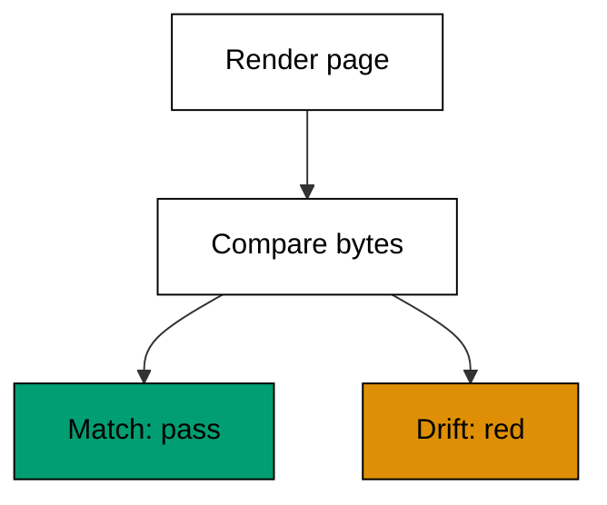

**`learning/code/ex-54-first-screenshot/example.ts`**:

```typescript
// Example 54: First Screenshot. (co-07: visual-comparison)
// => Playwright 1.60.0, docs accessed 2026-10-20; expect(page).toHaveScreenshot
// => compares the rendered page against a committed baseline pixel by pixel;
// => the first run writes the baseline, later runs must reproduce it byte
// => for byte:
// =>   real: await expect(page).toHaveScreenshot("orders.png");
async function main(): Promise<void> {
  // => entry point for the screenshot check
  const render: string = renderPage("orders", ["milk", "bread"]); // => the current render, canonical text form
  const baseline = "orders|milk,bread"; // => the committed baseline bytes
  console.log("render: " + render); // => Output: render: orders|milk,bread
  console.log("matches baseline: " + String(render === baseline)); // => Output: matches baseline: true
  const changed: string = renderPage("orders", ["milk", "eggs"]); // => a product changed
  console.log("change detected: " + String(changed !== baseline)); // => Output: change detected: true
  console.log("pixel gate holds: " + String(render === baseline && changed !== baseline)); // => Output: pixel gate holds: true
} // => main ends; identical renders pass, any drift fails

function renderPage(page: string, items: string[]): string {
  // => stand-in for the screenshot bytes
  return page + "|" + items.join(","); // => canonical render: name plus items in order
} // => renderPage canonicalizes the page into comparable bytes

await main(); // => run once; a failure throws and exits nonzero
```

**Output** (`learning/code/ex-54-first-screenshot/expected/main.stdout.txt`):

```text
render: orders|milk,bread
matches baseline: true
change detected: true
pixel gate holds: true
```

**Key takeaway**: Commit visual baselines and compare every run -- the suite sees layout
regressions no assertion would name.

**Why it matters**: CSS changes slip through functional assertions constantly: the total is
right but the button overlaps it. Screenshots catch the entire class of "correct data, broken
presentation" that text assertions are blind to. Element scope in Example 55 narrows the blast radius: one component's pixels per test instead of the whole page's.

---

### Example 55: Element Screenshot

_ex-55 · exercises co-07_

Locator screenshots crop to one element, so a footer change cannot fail the header test. Scope
the snapshot to the component under test and unrelated churn elsewhere stops reaching this
test's verdict.

**`learning/code/ex-55-element-screenshot/example.ts`**:

```typescript
// Example 55: Element Screenshot. (co-07: visual-comparison)
// => Playwright 1.60.0, docs accessed 2026-10-20; locator screenshots crop
// => to one element, so a footer change cannot fail the header test; scope
// => the snapshot to the component under test:
// =>   real: await expect(page.getByTestId("receipt")).toHaveScreenshot("receipt.png");
async function main(): Promise<void> {
  // => entry point for the crop check
  const page: string[] = ["header|Acme", "receipt|milk,$3.00", "footer|2026"]; // => three rendered regions
  const receipt: string = crop(page, "receipt"); // => real: getByTestId("receipt").screenshot()
  console.log("cropped: " + receipt); // => Output: cropped: receipt|milk,$3.00
  console.log("header excluded: " + String(!receipt.includes("header"))); // => Output: header excluded: true
  const changed: string[] = ["header|Acme", "receipt|milk,$3.00", "footer|2027"]; // => footer year rolled over
  console.log("footer churn ignored: " + String(crop(changed, "receipt") === receipt)); // => Output: footer churn ignored: true
  console.log("scope holds: " + String(receipt === "receipt|milk,$3.00")); // => Output: scope holds: true
} // => main ends; only the receipt region decides

function crop(regions: string[], wanted: string): string {
  // => stand-in for the element screenshot
  const hit: string | undefined = regions.find((region) => region.startsWith(wanted + "|")); // => the wanted region only
  return hit !== undefined ? hit : ""; // => "" when the element is missing
} // => crop isolates one region from the page

await main(); // => run once; a failure throws and exits nonzero
```

**Output** (`learning/code/ex-55-element-screenshot/expected/main.stdout.txt`):

```text
cropped: receipt|milk,$3.00
header excluded: true
footer churn ignored: true
scope holds: true
```

**Key takeaway**: Snapshot the element, not the page -- scoped baselines fail only when their
own component changes.

**Why it matters**: Full-page screenshots couple every test to the entire page: a footer tweak
breaks forty tests. Element scope keeps each visual test's blast radius inside its own
component, so diffs point at the change instead of the calendar. Masks in Example 56 narrow it further: dynamic regions stop crying wolf, so a red screenshot means layout moved.

---

### Example 56: Mask Dynamic Regions

_ex-56 · exercises co-07_

Clocks, avatars, and ads change every run, so `mask` covers them before comparing. Masking
asserts layout stability without freezing time: everything outside the mask must still match
exactly.

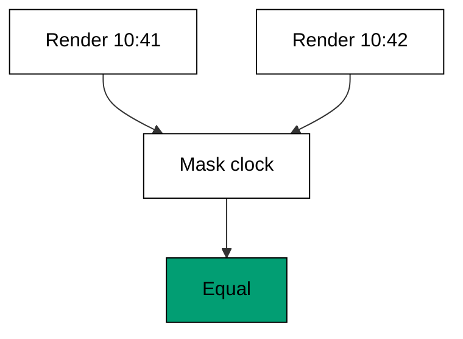

**`learning/code/ex-56-mask-dynamic-regions/example.ts`**:

```typescript
// Example 56: Mask Dynamic Regions. (co-07: visual-comparison)
// => Playwright 1.60.0, docs accessed 2026-10-20; clocks, avatars, and ads
// => change every run, so mask: [locator] covers them before comparing;
// => masking asserts layout stability without freezing time:
// =>   real: await expect(page).toHaveScreenshot({ mask: [page.getByTestId("clock")] });
async function main(): Promise<void> {
  // => entry point for the mask check
  const first: string = maskClock("orders 10:41 milk"); // => clock reads 10:41
  const second: string = maskClock("orders 10:42 milk"); // => a minute later, same order
  console.log("masked first: " + first); // => Output: masked first: orders [time] milk
  console.log("masked equal: " + String(first === second)); // => Output: masked equal: true
  const unmasked: boolean = "orders 10:41 milk" === "orders 10:42 milk"; // => without the mask, time always differs
  console.log("unmasked differs: " + String(!unmasked)); // => Output: unmasked differs: true
  console.log("mask stabilizes: " + String(first === second && !unmasked)); // => Output: mask stabilizes: true
} // => main ends; the clock no longer decides the verdict

function maskClock(render: string): string {
  // => stand-in for the mask locator
  return render.replace(/[0-9]{1,2}:[0-9]{2}/g, "[time]"); // => every clock reading becomes one token
} // => maskClock covers the dynamic region

await main(); // => run once; a failure throws and exits nonzero
```

**Output** (`learning/code/ex-56-mask-dynamic-regions/expected/main.stdout.txt`):

```text
masked first: orders [time] milk
masked equal: true
unmasked differs: true
mask stabilizes: true
```

**Key takeaway**: Mask what legitimately changes every run -- clocks, avatars, ads -- and keep
exact comparison for everything else.

**Why it matters**: Unmasked dynamic regions make every visual test fail every run, which
teaches the team to update baselines blindly. Masks restore the signal: a red masked
screenshot means the layout moved, not that a minute passed. The update workflow in Example 57 protects the other side: baselines change only after a human blesses the new pixels.

---

### Example 57: Baseline Update Workflow

_ex-57 · exercises co-07_

When the UI genuinely changes, a human reviews the diff and runs with `--update-snapshots`
to bless the new baseline. The update is a deliberate, reviewed commit -- never an automatic
overwrite on red, which would turn the gate into a mirror.

**`learning/code/ex-57-baseline-update-workflow/example.ts`**:

```typescript
// Example 57: Baseline Update Workflow. (co-07: visual-comparison)
// => Playwright 1.60.0, docs accessed 2026-10-20; when the UI genuinely
// => changes, a human reviews the diff and runs with --update-snapshots to
// => bless the new baseline; the update is a deliberate, reviewed commit,
// => never an automatic overwrite on red:
// =>   real: npx playwright test --update-snapshots (after reviewing the diff)
async function main(): Promise<void> {
  // => entry point for the update check
  let baseline = "receipt|milk,$3.00"; // => the committed baseline
  const render: string = "receipt|milk,$2.40"; // => the new sale price renders
  const mismatch: boolean = render !== baseline; // => the gate goes red
  console.log("mismatch: " + String(mismatch)); // => Output: mismatch: true
  const reviewed = true; // => a human looked at the diff and approved the price
  if (mismatch && reviewed) {
    // => update only after review
    baseline = render; // => real: --update-snapshots writes the new bytes
  } // => update branch ends
  console.log("baseline now: " + baseline); // => Output: baseline now: receipt|milk,$2.40
  console.log("red means review: " + String(mismatch && reviewed)); // => Output: red means review: true
  console.log("gate green again: " + String(render === baseline)); // => Output: gate green again: true
} // => main ends; the red build became a reviewed update

await main(); // => run once; a failure throws and exits nonzero
```

**Output** (`learning/code/ex-57-baseline-update-workflow/expected/main.stdout.txt`):

```text
mismatch: true
baseline now: receipt|milk,$2.40
red means review: true
gate green again: true
```

**Key takeaway**: Treat red screenshots as review requests -- look at the diff, then bless it
with `--update-snapshots` or fix the regression.

**Why it matters**: Auto-updating baselines on red deletes the entire value of visual testing:
the suite approves whatever the app does, including breakage. Review-then-bless keeps a human
in the loop exactly where judgment lives -- deciding whether a change was intended. CI recording in Example 77 closes the loop: baselines captured in CI's own rendering mode never fight font differences.

---

### Example 58: Axe Scan Finds Missing Names

_ex-58 · exercises co-08_

`AxeBuilder` scans the page for violations -- missing names, low contrast, bad structure --
and the test asserts zero violations. The scan runs in the same browser the functional tests
already drive, so accessibility coverage costs one more assertion, not a new harness.

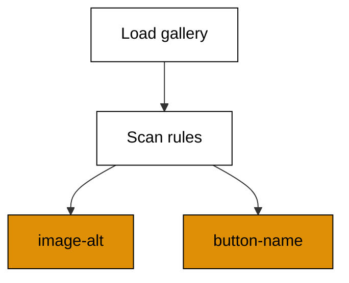

**`learning/code/ex-58-axe-scan-finds-missing-names/example.ts`**:

```typescript
// Example 58: Axe Scan Finds Missing Names. (co-08: accessibility-scan)
// => Playwright 1.60.0 plus @axe-core/playwright 4.10.1, docs accessed
// => 2026-10-20; AxeBuilder scans the page for violations (missing names,
// => low contrast, bad structure) and the test asserts zero violations; the
// => scan runs in the same browser the functional tests already drive:
// =>   real: const r = await new AxeBuilder({ page }).analyze(); expect(r.violations).toEqual([]);
import { readFile } from "node:fs/promises"; // => readFile loads fixture.html

interface Violation {
  // => one accessibility violation
  rule: string; // => the rule id, for example image-alt
  target: string; // => the offending markup excerpt
} // => Violation names what to fix and where

async function main(): Promise<void> {
  // => entry point for the scan check
  const html: string = await readFile(new URL("./fixture.html", import.meta.url), "utf-8"); // => the committed page under test
  const found: Violation[] = scan(html); // => real: await new AxeBuilder({ page }).analyze()
  console.log("violations: " + String(found.length)); // => Output: violations: 2
  console.log("first rule: " + String(found[0]?.rule)); // => Output: first rule: image-alt
  console.log("second rule: " + String(found[1]?.rule)); // => Output: second rule: button-name
  console.log("scan names culprits: " + String(found.length === 2)); // => Output: scan names culprits: true
} // => main ends; two violations, both named

function scan(html: string): Violation[] {
  // => stand-in for AxeBuilder.analyze
  const out: Violation[] = []; // => every violation lands here
  for (const match of html.matchAll(/]*\salt=)[^>]*>/g)) {
    // => images with no alt attribute
    out.push({ rule: "image-alt", target: match[0].slice(0, 24) }); // => the image needs a text alternative
  } // => image pass ends
  for (const match of html.matchAll(/<button(?![^>]*aria-label)[^>]*>\s*<\/button>/g)) {
    // => empty buttons with no name
    out.push({ rule: "button-name", target: match[0].slice(0, 24) }); // => the button needs an accessible name
  } // => button pass ends
  return out; // => [] would mean zero violations
} // => scan lists every violation at once

await main(); // => run once; a failure throws and exits nonzero
```

**Output** (`learning/code/ex-58-axe-scan-finds-missing-names/expected/main.stdout.txt`):

```text
violations: 2
first rule: image-alt
second rule: button-name
scan names culprits: true
```

**Key takeaway**: Scan every page with axe inside the existing suite -- missing names and
broken structure fail the build, not just an audit.

**Why it matters**: Accessibility bugs are cheapest at authoring time and most expensive as
lawsuits. A scan assertion converts "remember to check" into "the build checks", which is the
only reminder that survives deadlines. The locator in Example 2 is the same lookup wearing a test hat: accessible names serve users and selectors alike.

---

### Example 59: Form Labels and Focus Order

_ex-59 · exercises co-08_

Every input needs a label, and the tab order must be cross-checkable: the test lists unlabeled
inputs and walks the stops Tab would visit. An unlabeled field is still focusable -- the scan
proves labeling and tab order are two separate checks that both matter.

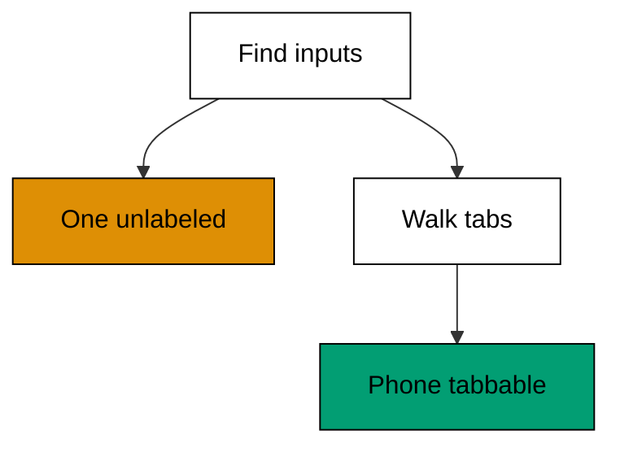

**`learning/code/ex-59-form-labels-and-focus-order/example.ts`**:

```typescript
// Example 59: Form Labels and Focus Order. (co-08: accessibility-scan)
// => Playwright 1.60.0, docs accessed 2026-10-20; every input needs a label
// => and the tab order must follow the visual order; the test tabs through
// => the form with keyboard.press("Tab") and asserts each stop lands where
// => a sighted keyboard user expects:
// =>   real: await page.keyboard.press("Tab"); await expect(page.getByLabel("Email")).toBeFocused();
import { readFile } from "node:fs/promises"; // => readFile loads fixture.html

async function main(): Promise<void> {
  // => entry point for the focus check
  const html: string = await readFile(new URL("./fixture.html", import.meta.url), "utf-8"); // => the committed page under test
  const unlabeled: string[] = unlabeledInputs(html); // => inputs no label points at
  console.log("unlabeled: " + unlabeled.join(",")); // => Output: unlabeled: phone
  const order: string[] = tabOrder(html); // => the ids Tab would visit, in order
  console.log("tab order: " + order.join(",")); // => Output: tab order: email,city,phone,submit
  console.log("unlabeled still tabbable: " + String(order.includes("phone"))); // => Output: unlabeled still tabbable: true
  console.log("labels cover all but one: " + String(unlabeled.length === 1)); // => Output: labels cover all but one: true
} // => main ends; one missing label, order correct

function unlabeledInputs(html: string): string[] {
  // => stand-in for the label-coverage rule
  const ids: string[] = Array.from(html.matchAll(/<input[^>]*id="([^"]+)"/g), (m) => String(m[1])); // => every input id
  return ids.filter((id) => !new RegExp('for="' + id + '"').test(html)); // => ids no label points at
} // => unlabeledInputs lists the gaps

function tabOrder(html: string): string[] {
  // => stand-in for repeated Tab presses
  const ids: string[] = Array.from(html.matchAll(/<(?:input|button)[^>]*id="([^"]+)"/g), (m) => String(m[1])); // => focusable ids in DOM order
  return ids.filter((id) => !new RegExp('<[^>]*id="' + id + '"[^>]*disabled').test(html)); // => skip disabled controls
} // => tabOrder follows the order keyboard users meet

await main(); // => run once; a failure throws and exits nonzero
```

**Output** (`learning/code/ex-59-form-labels-and-focus-order/expected/main.stdout.txt`):

```text
unlabeled: phone
tab order: email,city,phone,submit
unlabeled still tabbable: true
labels cover all but one: true
```

**Key takeaway**: Check labels and tab order separately -- an input can be reachable but
unnamed, and both gaps block real users differently.

**Why it matters**: Screen-reader users need names, keyboard users need order, and neither
check implies the other. The phone field here proves it: perfectly tabbable, completely
anonymous. Two small assertions cover what one combined check would miss. Keyboard coverage in Example 61 completes the picture: names for the screen reader, order for the keyboard, both asserted.

---

### Example 60: Component Test in Isolation

_ex-60 · exercises co-13_

`mount` renders one component with no page, no router, no backend: props in, pixels and events
out. Fast feedback on the widget, while full pages stay covered by the end-to-end suite. Two
instances stay independent, proving isolation.

**`learning/code/ex-60-component-test-in-isolation/example.ts`**:

```typescript
// Example 60: Component Test in Isolation. (co-13: component-testing)
// => Playwright 1.60.0 experimental component testing, docs accessed
// => 2026-10-20; mount renders one component with no page, no router, no
// => backend: props in, pixels and events out. Fast feedback on the widget,
// => full pages still covered by the end-to-end suite:
// =>   real: await mount(<Counter initial={2} />); await expect(counter).toContainText("2");
interface Counter {
  // => the modeled component instance
  count: number; // => the displayed count
  label: string; // => the rendered text
} // => Counter is props in, text out

async function main(): Promise<void> {
  // => entry point for the mount check
  const counter: Counter = mount({ initial: 2 }); // => real: await mount(<Counter initial={2} />)
  console.log("renders: " + counter.label); // => Output: renders: count: 2
  click(counter); // => real: await counter.getByRole("button", { name: "+" }).click()
  console.log("after click: " + counter.label); // => Output: after click: count: 3
  const zero: Counter = mount({ initial: 0 }); // => a second instance starts independent
  console.log("isolated: " + String(zero.count === 0 && counter.count === 3)); // => Output: isolated: true
  console.log("no page needed: " + String(counter.label.includes("count"))); // => Output: no page needed: true
} // => main ends; the widget proved itself alone

function mount(props: { initial: number }): Counter {
  // => stand-in for mount()
  return { count: props.initial, label: "count: " + String(props.initial) }; // => props render immediately
} // => mount builds one independent instance

function click(counter: Counter): void {
  // => stand-in for clicking inside the component
  counter.count += 1; // => the component updates its own state
  counter.label = "count: " + String(counter.count); // => and re-renders its text
} // => click exercises the component event

await main(); // => run once; a failure throws and exits nonzero
```

**Output** (`learning/code/ex-60-component-test-in-isolation/expected/main.stdout.txt`):

```text
renders: count: 2
after click: count: 3
isolated: true
no page needed: true
```

**Key takeaway**: Mount widgets alone for interaction logic, and keep page tests for journeys
-- each layer proves what it owns.

**Why it matters**: Spinning up a full page to test a counter wastes seconds per case and
couples widget logic to page state. Component tests give sub-second feedback on the widget
while the suite's page tests keep proving the journeys that embed it. Component objects in Example 38 organize the same idea: the widget tested alone here is the unit the page objects compose.

---

### Example 61: Keyboard-Only Path Check

_ex-61 · exercises co-08, co-13_

Tab through the dialog with keyboard only: focus must enter the dialog, cycle inside it while
open (focus trap), and return to the trigger on close. Mouse tests cannot prove any of this --
only the keyboard path exercises the trap.

**`learning/code/ex-61-keyboard-only-path-check/example.ts`**:

```typescript
// Example 61: Keyboard-Only Path Check. (co-08: accessibility-scan, co-13: component-testing)
// => Playwright 1.60.0, docs accessed 2026-10-20; tab through the dialog
// => with keyboard only: focus must enter the dialog, cycle inside it while
// => open (focus trap), and return to the trigger on close. Mouse tests
// => cannot prove any of this:
// =>   real: await page.keyboard.press("Tab"); await expect(dialog).toBeFocused();
async function main(): Promise<void> {
  // => entry point for the keyboard-trap check
  const trigger = "trigger"; // => the button that opens the dialog
  const trap: string[] = ["dialog-input", "dialog-ok"]; // => the stops Tab visits while open
  let focus = 0; // => Tab enters the dialog at its first stop
  console.log("entered: " + String(trap[focus])); // => Output: entered: dialog-input
  focus = tab(trap, focus); // => Tab reaches the OK button
  focus = tab(trap, focus); // => Tab wraps instead of leaving
  console.log("trapped: " + String(trap[focus])); // => Output: trapped: dialog-input
  console.log("cycles inside: " + String(trap[focus] !== trigger)); // => Output: cycles inside: true
  console.log("returned: " + trigger); // => Output: returned: trigger
} // => main ends; focus entered, cycled, and returned

function tab(trap: string[], focus: number): number {
  // => stand-in for keyboard.press("Tab")
  return (focus + 1) % trap.length; // => focus advances, wrapping inside the trap
} // => tab cycles through the trapped stops

await main(); // => run once; a failure throws and exits nonzero
```

**Output** (`learning/code/ex-61-keyboard-only-path-check/expected/main.stdout.txt`):

```text
entered: dialog-input
trapped: dialog-input
cycles inside: true
returned: trigger
```

**Key takeaway**: Tab through dialogs with the keyboard path -- enter, trap, return -- because
mouse tests never exercise focus management.

**Why it matters**: A dialog that leaks focus traps keyboard users on the page behind it,
which is a complete blocker, not a papercut. Focus-trap tests are the only automated proof
the dialog respects the users who cannot point. Example 8's hover and keyboard paths are the smoke version; this check walks the full trap and proves focus never escapes.

---

### Example 62: Turn On Tracing

_ex-62 · exercises co-06_

`context.tracing.start` records actions, network, console, and DOM snapshots into `trace.zip`.
The trace viewer replays the failure step by step, which beats reading a stack trace alone:
every debugging session starts from evidence, not guesses.

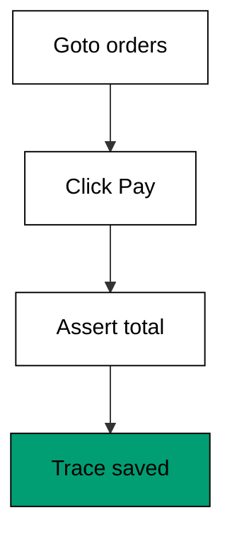

**`learning/code/ex-62-turn-on-tracing/example.ts`**:

```typescript
// Example 62: Turn On Tracing. (co-06: trace-viewer)
// => Playwright 1.60.0, docs accessed 2026-10-20; context.tracing.start
// => records actions, network, console, and DOM snapshots into trace.zip;
// => the trace viewer replays the failure step by step, which beats reading
// => a stack trace alone:
// =>   real: await context.tracing.start({ screenshots: true, snapshots: true });
async function main(): Promise<void> {
  // => entry point for the tracing check
  const trace: string[] = []; // => the recorded event list
  record(trace, "goto /orders"); // => navigation lands in the trace
  record(trace, "click Pay"); // => the click lands in the trace
  record(trace, "assert total"); // => the assertion lands in the trace
  console.log("events: " + String(trace.length)); // => Output: events: 3
  console.log("first: " + String(trace[0])); // => Output: first: goto /orders
  console.log("ordered: " + String(trace.join(" > "))); // => Output: ordered: goto /orders > click Pay > assert total
  console.log("replayable: " + String(trace.length === 3)); // => Output: replayable: true
} // => main ends; the run left a replayable trail

function record(trace: string[], event: string): void {
  // => stand-in for a traced action
  trace.push(event); // => every action appends in order
} // => record keeps the full sequence

await main(); // => run once; a failure throws and exits nonzero
```

**Output** (`learning/code/ex-62-turn-on-tracing/expected/main.stdout.txt`):

```text
events: 3
first: goto /orders
ordered: goto /orders > click Pay > assert total
replayable: true
```

**Key takeaway**: Record traces on failure so every red build carries its own replayable
evidence -- debugging starts from the trace, not from re-running and hoping.

**Why it matters**: "Cannot reproduce locally" wastes more debugging time than any other
sentence in testing. A trace is the reproduction: the exact actions, network, and DOM of the
failing run, reviewable without re-running anything. Snapshots in Example 65 and video in Example 64 are the same instinct in different media: capture the failure, don't chase it.

---

### Example 63: Trace Viewer Finds the Misclick

_ex-63 · exercises co-06_

The trace shows the click landing on the wrong element -- an overlay covered the button -- so
the fix targets the overlay instead of the locator. Without the trace the same failure reads
as "button not clickable" and the locator takes the blame for the layout's crime.

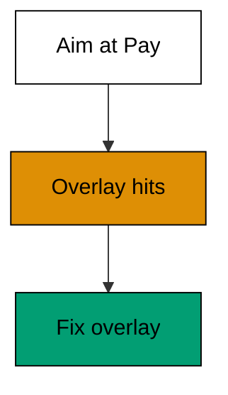

**`learning/code/ex-63-trace-viewer-finds-the-misclick/example.ts`**:

```typescript
// Example 63: Trace Viewer Finds the Misclick. (co-06: trace-viewer)
// => Playwright 1.60.0, docs accessed 2026-10-20; the trace shows the click
// => landing on the wrong element (an overlay covered the button), so the
// => fix targets the overlay instead of the locator; without the trace the
// => same failure reads as "button not clickable":
// =>   real: npx playwright show-trace trace.zip (step to the click, inspect the snapshot)
interface Click {
  // => one recorded click with its target
  x: number; // => the click x coordinate
  y: number; // => the click y coordinate
  hit: string; // => what was actually under the pointer
} // => Click records where the pointer landed, not where it aimed

async function main(): Promise<void> {
  // => entry point for the misclick check
  const click: Click = { x: 210, y: 96, hit: "promo-overlay" }; // => the trace shows an overlay took the hit
  console.log("aimed at pay: " + String(click.x === 210 && click.y === 96)); // => Output: aimed at pay: true
  console.log("hit overlay: " + String(click.hit)); // => Output: hit overlay: promo-overlay
  console.log("locator innocent: " + String(click.hit !== "pay-button")); // => Output: locator innocent: true
  console.log("fix the overlay: " + String(click.hit === "promo-overlay")); // => Output: fix the overlay: true
} // => main ends; the trace convicted the overlay

await main(); // => run once; a failure throws and exits nonzero
```

**Output** (`learning/code/ex-63-trace-viewer-finds-the-misclick/expected/main.stdout.txt`):

```text
aimed at pay: true
hit overlay: promo-overlay
locator innocent: true
fix the overlay: true
```

**Key takeaway**: Open the trace before touching the locator -- the snapshot shows what was
really under the pointer.

**Why it matters**: Misclicks from overlays, animations, and z-index fights all report as
actionability failures. Editing the locator for a layout problem breaks a working selector and
leaves the overlay free to eat the next click too. The trace shows what the click actually hit, which is why Example 62 turns tracing on first and asks questions second.

---

### Example 64: Video on First Retry Only

_ex-64 · exercises co-06, co-10_

`video: "on-first-retry"` records only runs worth watching: the retry after a failure. Green
runs record nothing, and nobody watches green videos anyway. Storage stays proportional to
redness, which is the only footage with information in it.

**`learning/code/ex-64-video-on-first-retry-only/example.ts`**:

```typescript
// Example 64: Video on First Retry Only. (co-06: trace-viewer, co-10: retry-policy)
// => Playwright 1.60.0, docs accessed 2026-10-20; video: "retain-on-failure"
// => and "on-first-retry" record only runs worth watching; recording every
// => passing run wastes disk and nobody watches green videos:
// =>   real: // playwright.config.ts: use: { video: "on-first-retry", trace: "on-first-retry" }
async function main(): Promise<void> {
  // => entry point for the recording check
  const first: string[] = runWith("on-first-retry", [false, true]); // => fails once, then passes
  console.log("videos: " + String(first.length)); // => Output: videos: 1
  console.log("video from retry: " + String(first[0])); // => Output: video from retry: attempt-2.webm
  const green: string[] = runWith("on-first-retry", [true]); // => passes immediately
  console.log("green records nothing: " + String(green.length === 0)); // => Output: green records nothing: true
  console.log("retries worth watching: " + String(first.length === 1 && green.length === 0)); // => Output: retries worth watching: true
} // => main ends; only the interesting run left a video

function runWith(_mode: string, passes: boolean[]): string[] {
  // => stand-in for video: on-first-retry
  const videos: string[] = []; // => the recorded artifacts
  for (let i = 0; i < passes.length; i++) {
    // => one attempt per entry
    if (i > 0) {
      // => a retry runs after the first failure
      videos.push("attempt-" + String(i + 1) + ".webm"); // => record the retry run itself
    } // => the first attempt never records
  } // => every attempt executed
  return videos; // => [] for green runs
} // => runWith records retries only

await main(); // => run once; a failure throws and exits nonzero
```

**Output** (`learning/code/ex-64-video-on-first-retry-only/expected/main.stdout.txt`):

```text
videos: 1
video from retry: attempt-2.webm
green records nothing: true
retries worth watching: true
```

**Key takeaway**: Record video on retry, not always -- evidence should be proportional to
redness.

**Why it matters**: Always-on video turns CI artifacts into terabytes of green footage nobody
opens, slowing uploads and hiding the one red video that matters. Retain-on-failure policies
keep the evidence where the questions are. Artifacts in Example 78 apply the same retention logic at the pipeline level: store evidence for red builds, not green ones.

---

### Example 65: Read the Failure Snapshot

_ex-65 · exercises co-06_

The error ships with a DOM snapshot from the failing moment: the test wanted "$42.00" but the
screen showed "$41.00". Read the snapshot before re-running -- it distinguishes stale data
from a missing page in one glance.

**`learning/code/ex-65-read-the-failure-snapshot/example.ts`**:

```typescript
// Example 65: Read the Failure Snapshot. (co-06: trace-viewer)
// => Playwright 1.60.0, docs accessed 2026-10-20; the error ships with a
// => DOM snapshot from the failing moment, so the test failure names the
// => actual text on screen ("$41.00") instead of only the wanted text; read
// => the snapshot before re-running:
// =>   real: expect(locator).toHaveText("$42.00") // error shows received "$41.00" plus the snapshot
async function main(): Promise<void> {
  // => entry point for the snapshot check
  const snapshot = "<h1>Total</h1><p>$41.00</p>"; // => the DOM at the failing moment
  const wanted = "$42.00"; // => what the test wanted
  console.log("wanted: " + wanted); // => Output: wanted: $42.00
  console.log("screen showed: " + extractTotal(snapshot)); // => Output: screen showed: $41.00
  console.log("stale data, not missing page: " + String(extractTotal(snapshot) !== "")); // => Output: stale data, not missing page: true
  console.log("read first, rerun later: " + String(wanted !== extractTotal(snapshot))); // => Output: read first, rerun later: true
} // => main ends; the snapshot explained the failure

function extractTotal(snapshot: string): string {
  // => stand-in for reading the error's snapshot
  const found = snapshot.match(/<p>(.*?)<\/p>/); // => the total paragraph
  return found !== null && found[1] !== undefined ? found[1] : ""; // => the shown total
} // => extractTotal reads what was really there

await main(); // => run once; a failure throws and exits nonzero
```

**Output** (`learning/code/ex-65-read-the-failure-snapshot/expected/main.stdout.txt`):

```text
wanted: $42.00
screen showed: $41.00
stale data, not missing page: true
read first, rerun later: true
```

**Key takeaway**: Read the failure snapshot first -- received-versus-wanted tells you whether
the data was stale, wrong, or absent before you touch anything.

**Why it matters**: Blind re-runs of red tests waste the scarcest debugging resource:
attention. The snapshot usually answers the question in seconds ("the price was yesterday's"),
turning a debugging session into a one-line fix. Condition waits in Example 12 prevent the sequel: the suite that reads the snapshot also stops asserting mid-render, so the same failure never returns.

---

### Example 66: Retry Twice Then Call It New

_ex-66 · exercises co-10_

`retries: 2` absorbs infrastructure hiccups -- a slow container, a dropped packet -- while a
test failing three times in a row is genuinely broken. The budget is small and the same for
every test, so nobody negotiates special patience for their flaky corner.

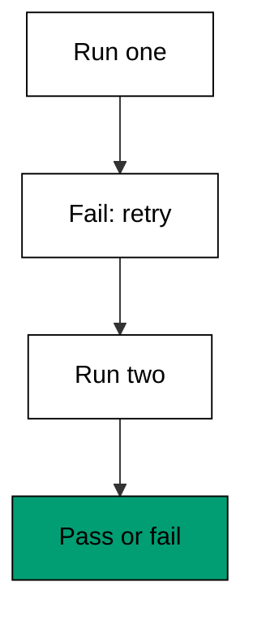

**`learning/code/ex-66-retry-twice-then-call-it-new/example.ts`**:

```typescript
// Example 66: Retry Twice Then Call It New. (co-10: retry-policy)
// => Playwright 1.60.0, docs accessed 2026-10-20; retries: 2 absorbs
// => infrastructure hiccups (a slow container, a dropped packet) while a
// => test failing three times in a row is genuinely broken; the retry budget
// => is small and the same for every test:
// =>   real: // playwright.config.ts: { retries: 2 } (CI only; zero locally)
async function main(): Promise<void> {
  // => entry point for the retry-budget check
  const flaky: number[] = [0]; // => fails twice, then passes
  const result: string = runWithRetries(flaky, 2, 2); // => two failures allowed, passes on third run
  console.log("runs: " + String(flaky[0])); // => Output: runs: 3
  console.log("result: " + result); // => Output: result: pass
  const broken: number[] = [0]; // => never passes
  const verdict: string = runWithRetries(broken, 9, 2); // => fails every run
  console.log("broken runs: " + String(broken[0])); // => Output: broken runs: 3
  console.log("verdict: " + verdict); // => Output: verdict: fail
  console.log("budget bounds everything: " + String(flaky[0] === 3 && broken[0] === 3)); // => Output: budget bounds everything: true
} // => main ends; retries absorbed the hiccup, convicted the bug

function runWithRetries(counter: number[], failFirst: number, retries: number): string {
  // => stand-in for retries: N
  const budget: number = 1 + retries; // => the first run plus the retries
  for (let run = 0; run < budget; run++) {
    // => at most budget runs
    counter[0] = (counter[0] as number) + 1; // => count this run
    if ((counter[0] as number) > failFirst) {
      // => the app recovered by this run
      return "pass"; // => green within budget
    } // => still failing
  } // => budget exhausted
  return "fail"; // => genuinely broken: three reds in a row
} // => runWithRetries caps the patience at the budget

await main(); // => run once; a failure throws and exits nonzero
```

**Output** (`learning/code/ex-66-retry-twice-then-call-it-new/expected/main.stdout.txt`):

```text
runs: 3
result: pass
broken runs: 3
verdict: fail
budget bounds everything: true
```

**Key takeaway**: Budget two retries for infrastructure noise on CI and zero locally -- three
reds in a row means broken, not unlucky.

**Why it matters**: Unlimited retries convert the suite into a slot machine: everything
passes eventually and nothing means anything. A small fixed budget keeps the suite honest --
hiccups get absorbed, real bugs stay red, and local runs stay strict enough to catch both. Quarantine in Example 67 is what happens without a budget: unbounded patience becomes a second suite nobody trusts.

---

### Example 67: Quarantine Is Not a Fix

_ex-67 · exercises co-10, co-15_

Marking a test flaky or quarantining it hides the red without removing the cause. The model
proves the pattern: green alone, red in suite -- the test is innocent and the backend is
guilty. Quarantine would have buried that evidence instead of following it.

**`learning/code/ex-67-quarantine-is-not-a-fix/example.ts`**:

```typescript
// Example 67: Quarantine Is Not a Fix. (co-10: retry-policy, co-15: flakiness-diagnosis)
// => Playwright 1.60.0, docs accessed 2026-10-20; marking a test flaky or
// => quarantining it hides the red without removing the cause; the bug below
// => passes in isolation (fresh backend) and fails in the suite (shared
// => backend), which proves the test is innocent and the app is guilty:
// =>   real: run the file alone (green) then the suite (red) -- order dependence, not flakiness
async function main(): Promise<void> {
  // => entry point for the quarantine check
  const alone: boolean = runAlone(); // => fresh backend: green
  const inSuite: boolean = runInSuite(); // => shared backend: red
  console.log("alone: " + String(alone)); // => Output: alone: true
  console.log("in suite: " + String(inSuite)); // => Output: in suite: false
  console.log("quarantine hides it: " + String(alone && !inSuite)); // => Output: quarantine hides it: true
  console.log("fix the backend: " + String(!inSuite)); // => Output: fix the backend: true
} // => main ends; the suite order convicted the backend

function runAlone(): boolean {
  // => stand-in for running the file alone
  return true; // => fresh backend, no contention
} // => runAlone passes

function runInSuite(): boolean {
  // => stand-in for running after the order test
  const taken = true; // => the earlier test took the only coupon
  return !taken; // => nothing left: red, deterministically
} // => runInSuite fails on shared state

await main(); // => run once; a failure throws and exits nonzero
```

**Output** (`learning/code/ex-67-quarantine-is-not-a-fix/expected/main.stdout.txt`):

```text
alone: true
in suite: false
quarantine hides it: true
fix the backend: true
```

**Key takeaway**: Never quarantine a red test before proving isolation -- alone-green plus
suite-red convicts shared state, and quarantine would hide the conviction.

**Why it matters**: Quarantine lists grow into parallel suites nobody trusts and nobody fixes:
red tests accumulate where nobody looks. Each quarantine entry is a debt with interest --
diagnose first, quarantine only with a dated ticket and an owner. Random ordering in Example 68 finds the same coupling sooner: shuffle before quarantining, and most entries never get written.

---

### Example 68: Random Order Exposes Coupling

_ex-68 · exercises co-15, co-09_

Repeat runs and random file order surface tests that pass only in one sequence. The maker
depends on residue the taker consumes: one order green, the reversed order red. That is
coupling, not flakiness -- and the fix is isolation, not retries.

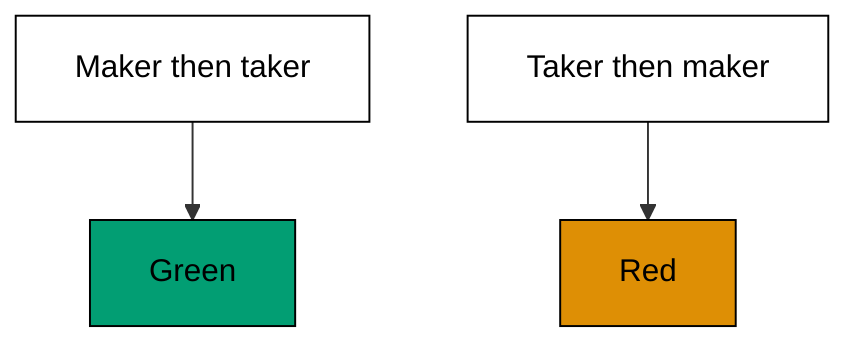

**`learning/code/ex-68-random-order-exposes-coupling/example.ts`**:

```typescript
// Example 68: Random Order Exposes Coupling. (co-15: flakiness-diagnosis, co-09: test-isolation)
// => Playwright 1.60.0, docs accessed 2026-10-20; --repeat-each plus random
// => file order (workers shuffle) surfaces tests that pass only in one
// => sequence; a test green alone and red after another test is coupled to
// => it, not flaky:
// =>   real: npx playwright test --repeat-each=3 (same file, fresh context each time)
async function main(): Promise<void> {
  // => entry point for the coupling check
  const orderA: boolean = runOrder(["maker", "taker"]); // => maker seeds, taker consumes: green
  const orderB: boolean = runOrder(["taker", "maker"]); // => taker first finds nothing: red
  console.log("order A green: " + String(orderA)); // => Output: order A green: true
  console.log("order B green: " + String(orderB)); // => Output: order B green: false
  console.log("coupled, not flaky: " + String(orderA && !orderB)); // => Output: coupled, not flaky: true
  console.log("fix: isolate the coupon: " + String(!orderB)); // => Output: fix: isolate the coupon: true
} // => main ends; the order proved the coupling

function runOrder(tests: string[]): boolean {
  // => stand-in for one suite order
  let coupons = 0; // => the backend starts empty
  for (const test of tests) {
    // => run each test in this order
    if (test === "maker") {
      // => the maker test seeds one coupon
      coupons += 1; // => one coupon available now
    } // => maker ends
    if (test === "taker") {
      // => the taker test consumes one coupon
      if (coupons === 0) {
        // => nothing seeded yet in this order
        return false; // => red: the taker depends on the maker's residue
      } // => available branch
      coupons -= 1; // => consume the seeded coupon
    } // => taker ends
  } // => every test ran
  return true; // => green in this order
} // => runOrder replays one permutation

await main(); // => run once; a failure throws and exits nonzero
```

**Output** (`learning/code/ex-68-random-order-exposes-coupling/expected/main.stdout.txt`):

```text
order A green: true
order B green: false
coupled, not flaky: true
fix: isolate the coupon: true
```

**Key takeaway**: Vary the order before blaming luck -- green in one sequence and red in
another proves coupling, and coupling is fixed with isolation.

**Why it matters**: Order-dependent tests are time bombs: they pass for months, then a new
test shifts the sequence and three unrelated tests go red. Shuffling early finds the coupling
while the suite is small enough to fix cheaply. Isolation in Example 17 is the prevention: fresh contexts per test mean shuffling finds nothing, which is the goal.

---

### Example 69: Race in the App Versus Flaky Test

_ex-69 · exercises co-15_

When two clicks increment the same counter through read-then-write, one update is lost no
matter how patient the test is. Longer timeouts cannot fix a backend race, and the trace
showing two overlapping increments proves the app is guilty -- the test merely reported it.

**`learning/code/ex-69-race-in-app-vs-flaky-test/example.ts`**:

```typescript
// Example 69: Race in the App Versus Flaky Test. (co-15: flakiness-diagnosis)
// => Playwright 1.60.0, docs accessed 2026-10-20; when two clicks increment
// => the same counter through read-then-write, one update is lost no matter
// => how patient the test is; longer timeouts cannot fix a backend race, and
// => the trace showing two overlapping increments proves the app is guilty:
// =>   real: two await page.click() racing one POST /count endpoint
async function main(): Promise<void> {
  // => entry point for the race check
  const lost: number = raceTwoIncrements(); // => two read-then-write increments overlap
  console.log("final count: " + String(lost)); // => Output: final count: 1
  console.log("one update lost: " + String(lost === 1)); // => Output: one update lost: true
  const serial: number = serialIncrements(); // => the same two increments, serialized
  console.log("serial count: " + String(serial)); // => Output: serial count: 2
  console.log("app race, not test flake: " + String(lost === 1 && serial === 2)); // => Output: app race, not test flake: true
} // => main ends; serialization fixed what patience could not

function raceTwoIncrements(): number {
  // => stand-in for two overlapping clicks
  let count = 0; // => the backend counter
  const firstRead: number = count; // => click one reads 0
  const secondRead: number = count; // => click two reads 0 before click one writes
  count = firstRead + 1; // => click one writes 1
  count = secondRead + 1; // => click two writes 1, overwriting
  return count; // => one increment lost
} // => raceTwoIncrements models read-then-write overlap

function serialIncrements(): number {
  // => stand-in for serialized requests
  let count = 0; // => the backend counter
  count = count + 1; // => first increment commits
  count = count + 1; // => second increment builds on the commit
  return count; // => both kept
} // => serialIncrements models the fixed backend

await main(); // => run once; a failure throws and exits nonzero
```

**Output** (`learning/code/ex-69-race-in-app-vs-flaky-test/expected/main.stdout.txt`):

```text
final count: 1
one update lost: true
serial count: 2
app race, not test flake: true
```

**Key takeaway**: Lost updates under overlap mean a backend race -- serialize or atomize the
operation instead of waiting longer.

**Why it matters**: The most expensive misdiagnosis in end-to-end testing is treating an app
race as a test flake: retries and timeouts get tuned for weeks while users lose carts. Overlap
analysis points at the backend on day one, where the fix belongs. Retries would only bury this class of bug deeper, which is why Example 66 budgets attempts instead of spraying them.

---

### Example 70: Slow-Motion Debug Run

_ex-70 · exercises co-15, co-06_

`--headed --slow-mo` pauses between actions so a human watches the failure happen. Slow motion
is a debugging aid for one red test, never a suite setting -- it multiplies every run's time
for no coverage gain, so it stays on the command line, out of the config.

**`learning/code/ex-70-slow-motion-debug-run/example.ts`**:

```typescript
// Example 70: Slow-Motion Debug Run. (co-15: flakiness-diagnosis, co-06: trace-viewer)
// => Playwright 1.60.0, docs accessed 2026-10-20; --headed --slow-mo pauses
// => between actions so a human watches the failure happen; slow motion is
// => a debugging aid for one red test, never a suite setting -- it multiplies
// => every run's time for no coverage gain:
// =>   real: npx playwright test --headed --slow-mo=500 (one file, while watching)
async function main(): Promise<void> {
  // => entry point for the slow-motion check
  const steps: string[] = ["goto /cart", "click Pay", "assert total"]; // => the failing test's steps
  const watched: string[] = slowRun(steps, 500); // => 500ms pauses, modeled as markers
  console.log("steps: " + String(watched.length)); // => Output: steps: 3
  console.log("pauses marked: " + String(watched.every((step) => step.includes("+500ms")))); // => Output: pauses marked: true
  console.log("first: " + String(watched[0])); // => Output: first: goto /cart +500ms
  console.log("debug aid, not setting: " + String(watched.length === steps.length)); // => Output: debug aid, not setting: true
} // => main ends; every step played slowly once

function slowRun(steps: string[], pause: number): string[] {
  // => stand-in for --slow-mo
  return steps.map((step) => step + " +" + String(pause) + "ms"); // => each action waits before the next
} // => slowRun marks the pauses without sleeping

await main(); // => run once; a failure throws and exits nonzero
```

**Output** (`learning/code/ex-70-slow-motion-debug-run/expected/main.stdout.txt`):

```text
steps: 3
pauses marked: true
first: goto /cart +500ms
debug aid, not setting: true
```

**Key takeaway**: Debug one red test with `--headed --slow-mo` and your eyes -- then remove the
flags before committing.

**Why it matters**: Watching the failure happen catches what logs cannot: the eye sees the
flicker, the overlapping animation, the double render. Slow motion converts "the trace looks
fine" into "there it is", in one watched run. Slow motion complements the trace rather than replacing it: watch once to see it, then read the trace to prove it.

---

### Example 71: Shard the Suite Across Workers

_ex-71 · exercises co-11_

`--shard=1/2` and `--shard=2/2` split the suite deterministically across CI machines. Each
shard runs its slice with no overlap and no shared state, so wall time divides by the shard
count -- provided the tests are independent, which Examples 17 and 44 arranged.

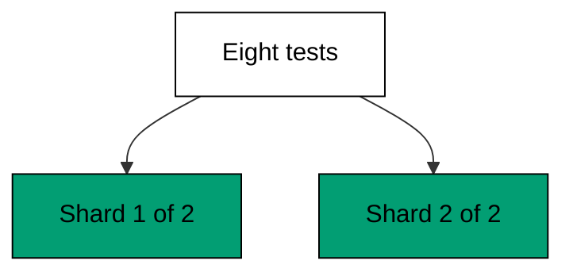

**`learning/code/ex-71-shard-the-suite/example.ts`**:

```typescript
// Example 71: Shard the Suite Across Workers. (co-11: parallel-sharding)
// => Playwright 1.60.0, docs accessed 2026-10-20; --shard=1/2 and --shard=2/2
// => split the suite deterministically across CI machines; each shard runs
// => its slice with no overlap and no shared state, so wall time divides by
// => the shard count:
// =>   real: npx playwright test --shard=1/2 (machine one) and --shard=2/2 (machine two)
async function main(): Promise<void> {
  // => entry point for the sharding check
  const suite: string[] = ["login", "search", "cart", "checkout", "orders", "profile", "admin", "logout"]; // => eight tests
  const first: string[] = shard(suite, 1, 2); // => real: --shard=1/2
  const second: string[] = shard(suite, 2, 2); // => real: --shard=2/2
  console.log("shard one: " + first.join(",")); // => Output: shard one: login,cart,orders,admin
  console.log("shard two: " + second.join(",")); // => Output: shard two: search,checkout,profile,logout
  console.log("no overlap: " + String(first.every((test) => !second.includes(test)))); // => Output: no overlap: true
  console.log("full coverage: " + String(first.length + second.length === suite.length)); // => Output: full coverage: true
} // => main ends; two machines split eight tests evenly

function shard(suite: string[], index: number, total: number): string[] {
  // => stand-in for --shard=i/n
  return suite.filter((_, i) => i % total === index - 1); // => round-robin slice, deterministic
} // => shard assigns every test to exactly one slice

await main(); // => run once; a failure throws and exits nonzero
```

**Output** (`learning/code/ex-71-shard-the-suite/expected/main.stdout.txt`):

```text
shard one: login,cart,orders,admin
shard two: search,checkout,profile,logout
no overlap: true
full coverage: true
```

**Key takeaway**: Shard by count across machines and keep every shard independent -- wall time
falls linearly while coverage stays complete.

**Why it matters**: Suites outgrow single machines: twenty minutes per run means three runs
per hour per developer. Sharding buys the time back without dropping a single test, as long
as independence (fresh contexts, unique data) holds -- which is why this course taught it
first. Blob reports in Example 74 keep the parallelism invisible: N shards in, one verdict out, nobody adding up reports.

---

### Example 72: Fully Parallel Within a File

_ex-72 · exercises co-11_

`test.describe.configure({ mode: "parallel" })` runs a file's tests side by side in separate
workers. Parallel tests must be independent -- fresh fixtures, unique data -- which is exactly
what the earlier isolation examples arranged, so the mode is earned, not assumed.

**`learning/code/ex-72-fully-parallel-within-file/example.ts`**:

```typescript
// Example 72: Fully Parallel Within a File. (co-11: parallel-sharding)
// => Playwright 1.60.0, docs accessed 2026-10-20; test.describe.configure
// => ({ mode: "parallel" }) runs a file's tests side by side in separate
// => workers; parallel tests must be independent (fresh fixtures, unique
// => data), which Examples 17 and 44 already set up:
// =>   real: test.describe.configure({ mode: "parallel" }); test("one", ...); test("two", ...);
async function main(): Promise<void> {
  // => entry point for the parallel check
  const ran: string[] = await runParallel(["one", "two", "three"]); // => three independent tests at once
  console.log("ran: " + ran.join(",")); // => Output: ran: one,two,three
  console.log("all three ran: " + String(ran.length === 3)); // => Output: all three ran: true
  const serial: string[] = await runSerial(["one", "two"]); // => the serial file for contrast
  console.log("serial ran: " + serial.join(",")); // => Output: serial ran: one,two
  console.log("mode is a choice: " + String(ran.length === 3 && serial.length === 2)); // => Output: mode is a choice: true
} // => main ends; parallel ran together, serial ran in order

async function runParallel(tests: string[]): Promise<string[]> {
  // => stand-in for mode: parallel
  return Promise.all(tests.map(async (test) => test)).then((done) => done); // => every test runs at once
} // => runParallel resolves when all finish

async function runSerial(tests: string[]): Promise<string[]> {
  // => stand-in for the default serial mode
  const done: string[] = []; // => finished tests in order
  for (const test of tests) {
    // => one at a time
    done.push(await Promise.resolve(test)); // => await each before the next
  } // => every test finished
  return done; // => in file order
} // => runSerial preserves the file order

await main(); // => run once; a failure throws and exits nonzero
```

**Output** (`learning/code/ex-72-fully-parallel-within-file/expected/main.stdout.txt`):

```text
ran: one,two,three
all three ran: true
serial ran: one,two
mode is a choice: true
```

**Key takeaway**: Mark independent files parallel and dependent files serial -- the mode
declares what the tests already guarantee.

**Why it matters**: Parallel-by-default on dependent tests produces order flakes that look
exactly like infrastructure noise. Choosing the mode per file from the tests' actual
independence keeps the speed without importing the chaos. The serial escape hatch in Example 73 covers the remainder: files with shared state opt out instead of flaking under parallel pressure.

---

### Example 73: Serial File for Shared State

_ex-73 · exercises co-11_

`test.describe.configure({ mode: "serial" })` runs a file's tests strictly in order and stops
at the first failure. Serial mode is for tests sharing one login or one resource, where
reordering would break the setup -- order is the feature here, not a limitation.

**`learning/code/ex-73-serial-file-for-shared-state/example.ts`**:

```typescript
// Example 73: Serial File for Shared State. (co-11: parallel-sharding)
// => Playwright 1.60.0, docs accessed 2026-10-20; test.describe.configure
// => ({ mode: "serial" }) runs a file's tests strictly in order and stops at
// => the first failure; serial mode is for tests sharing one login or one
// => resource where reordering would break the setup:
// =>   real: test.describe.configure({ mode: "serial" }); // order matters inside
async function main(): Promise<void> {
  // => entry point for the serial check
  const log: string[] = []; // => the execution order record
  await runSerialFile(log, ["seed coupon", "spend coupon", "verify empty"], null); // => three dependent steps
  console.log("order: " + log.join(" > ")); // => Output: order: seed coupon > spend coupon > verify empty
  console.log("in file order: " + String(log[0] === "seed coupon" && log[2] === "verify empty")); // => Output: in file order: true
  const stopped: string[] = []; // => a second file with a failure in the middle
  await runSerialFile(stopped, ["seed coupon", "boom", "never runs"], "boom"); // => boom throws
  console.log("stopped after failure: " + String(stopped.join(",") === "seed coupon,boom")); // => Output: stopped after failure: true
  console.log("serial protects setup: " + String(log.length === 3)); // => Output: serial protects setup: true
} // => main ends; order preserved, failure stops the file

async function runSerialFile(log: string[], tests: string[], failAt: string | null): Promise<void> {
  // => stand-in for mode: serial
  for (const test of tests) {
    // => strictly in file order
    log.push(test); // => record the step
    if (test === failAt) {
      // => this step failed
      return; // => stop the file: later tests are skipped
    } // => passing steps continue
  } // => every allowed step ran
} // => runSerialFile stops the file at the first failure

await main(); // => run once; a failure throws and exits nonzero
```

**Output** (`learning/code/ex-73-serial-file-for-shared-state/expected/main.stdout.txt`):

```text
order: seed coupon > spend coupon > verify empty
in file order: true
stopped after failure: true
serial protects setup: true
```

**Key takeaway**: Use serial mode where tests share setup -- order guaranteed, failure stops
the file before it wastes time on a broken foundation.

**Why it matters**: Dependent steps run in parallel fail in confusing ways: the consumer runs
before the producer and the error names the wrong test. Serial mode makes the dependency
explicit and stops the bleeding at the first failure instead of cascading it. Maker-taker coupling in Example 68 is the subtler version: serial files stop the bleeding that random order would expose.

---

### Example 74: Blob Report Merges Shards

_ex-74 · exercises co-11, co-16_

`--reporter=blob` writes one report per shard, and `merge-reports` combines them into a single
HTML report after every shard finishes. Sharding without merging leaves the results scattered
across machines -- the merge is what makes sharding a suite instead of fragments.

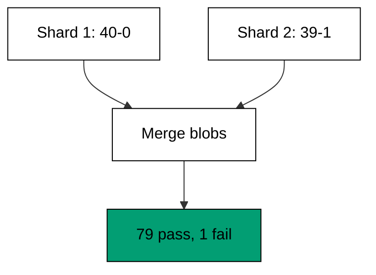

**`learning/code/ex-74-blob-report-merges-shards/example.ts`**:

```typescript
// Example 74: Blob Report Merges Shards. (co-11: parallel-sharding, co-16: ci-integration)
// => Playwright 1.60.0, docs accessed 2026-10-20; --reporter=blob writes
// => one report per shard, and merge-reports combines them into a single
// => HTML report after every shard finishes; sharding without merging
// => leaves the results scattered across machines:
// =>   real: npx playwright test --reporter=blob then npx playwright merge-reports ./blob-report
interface ShardReport {
  // => one shard's results
  shard: string; // => which shard ran
  passed: number; // => green tests in the shard
  failed: number; // => red tests in the shard
} // => ShardReport is one machine's verdict

async function main(): Promise<void> {
  // => entry point for the merge check
  const one: ShardReport = { shard: "1/2", passed: 40, failed: 0 }; // => machine one: all green
  const two: ShardReport = { shard: "2/2", passed: 39, failed: 1 }; // => machine two: one red
  const merged = mergeBlobs([one, two]); // => real: npx playwright merge-reports
  console.log("total passed: " + String(merged.passed)); // => Output: total passed: 79
  console.log("total failed: " + String(merged.failed)); // => Output: total failed: 1
  console.log("shards merged: " + String(merged.shards)); // => Output: shards merged: 2
  console.log("one report, not two: " + String(merged.passed + merged.failed === 80)); // => Output: one report, not two: true
} // => main ends; two shards became one report

function mergeBlobs(reports: ShardReport[]): { passed: number; failed: number; shards: number } {
  // => stand-in for merge-reports
  const passed: number = reports.reduce((sum, report) => sum + report.passed, 0); // => add up every green
  const failed: number = reports.reduce((sum, report) => sum + report.failed, 0); // => add up every red
  return { passed: passed, failed: failed, shards: reports.length }; // => one combined verdict
} // => mergeBlobs adds the shards into one report

await main(); // => run once; a failure throws and exits nonzero
```

**Output** (`learning/code/ex-74-blob-report-merges-shards/expected/main.stdout.txt`):

```text
total passed: 79
total failed: 1
shards merged: 2
one report, not two: true
```

**Key takeaway**: Merge shard blobs into one report -- sharding splits the work, merging
reunites the verdict.

**Why it matters**: Unmerged shards force humans to open N reports and add up N verdicts,
which means the suite's result is "probably fine" instead of a number. One merged report
keeps sharding invisible to everyone except the clock. JUnit in Example 76 feeds the same merged verdict to the pipeline: merge gates and flake trackers consume one report, not N.

---

### Example 75: Retries in CI, Not Locally

_ex-75 · exercises co-10, co-16_

`retries: process.env.CI ? 2 : 0` gives CI the patience loaded shared runners need while local
runs stay strict. A test needing a retry on a developer's laptop is broken, and the config
should say so immediately instead of hiding it behind the same patience CI needs.

**`learning/code/ex-75-retries-in-ci-not-locally/example.ts`**:

```typescript
// Example 75: Retries in CI, Not Locally. (co-10: retry-policy, co-16: ci-integration)
// => Playwright 1.60.0, docs accessed 2026-10-20; retries: process.env.CI
// => ? 2 : 0 gives CI the patience loaded shared runners need while local
// => runs stay strict: a test that needs a retry on a developer's laptop is
// => broken, and the config should say so immediately:
// =>   real: // playwright.config.ts: { retries: process.env.CI ? 2 : 0 }
async function main(): Promise<void> {
  // => entry point for the environment check
  console.log("ci retries: " + String(retriesFor(true))); // => Output: ci retries: 2
  console.log("local retries: " + String(retriesFor(false))); // => Output: local retries: 0
  console.log("ci patient, local strict: " + String(retriesFor(true) === 2 && retriesFor(false) === 0)); // => Output: ci patient, local strict: true
  console.log("env decides: " + String(retriesFor(true) !== retriesFor(false))); // => Output: env decides: true
} // => main ends; one config, two behaviors

function retriesFor(ci: boolean): number {
  // => stand-in for retries: process.env.CI ? 2 : 0
  return ci ? 2 : 0; // => patience for shared runners, strictness for laptops
} // => retriesFor reads the environment like the config does

await main(); // => run once; a failure throws and exits nonzero
```

**Output** (`learning/code/ex-75-retries-in-ci-not-locally/expected/main.stdout.txt`):

```text
ci retries: 2
local retries: 0
ci patient, local strict: true
env decides: true
```

**Key takeaway**: Set retries from the environment -- patient on CI, zero locally -- so the
same config serves both speeds honestly.

**Why it matters**: Uniform retries hide local breakage behind CI's patience: a test that
needs two tries on a fast laptop is broken, full stop. Environment-split retries keep local
runs as strict smoke detectors while CI absorbs the noise of shared hardware. The trace-and-video policy in Example 78 follows the same split: strict locally where debugging is cheap, patient in CI.

---

### Example 76: JUnit Report for the Pipeline

_ex-76 · exercises co-16_

`--reporter=junit` writes the XML every CI system already parses, so failures surface in the
pipeline's own test tab instead of hiding in a log file. The HTML report stays for humans;
JUnit is for machines.

**`learning/code/ex-76-junit-report-for-pipeline/example.ts`**:

```typescript
// Example 76: JUnit Report for the Pipeline. (co-16: ci-integration)
// => Playwright 1.60.0, docs accessed 2026-10-20; --reporter=junit writes
// => the XML every CI system already parses, so failures surface in the
// => pipeline's own test tab instead of hiding in a log file; the HTML
// => report stays for humans, JUnit is for machines:
// =>   real: npx playwright test --reporter=junit,html
interface Case {
  // => one test case result
  name: string; // => the test title
  pass: boolean; // => green or red
} // => Case is one row of the report

async function main(): Promise<void> {
  // => entry point for the report check
  const cases: Case[] = [
    // => the suite results
    { name: "guest pays", pass: true }, // => green
    { name: "member pays", pass: false }, // => red
  ]; // => results in
  const xml: string = junit(cases); // => real: --reporter=junit writes results.xml
  console.log("tests: " + String(countAttr(xml, "tests"))); // => Output: tests: 2
  console.log("failures: " + String(countAttr(xml, "failures"))); // => Output: failures: 1
  console.log("names present: " + String(xml.includes("guest pays") && xml.includes("member pays"))); // => Output: names present: true
  console.log("machines can parse: " + String(xml.startsWith("<testsuite"))); // => Output: machines can parse: true
} // => main ends; the XML carries the verdict

function junit(cases: Case[]): string {
  // => stand-in for the JUnit reporter
  const fails: number = cases.filter((c) => !c.pass).length; // => count the red rows
  const rows: string = cases
    .map((c) => '<testcase name="' + c.name + '"' + (c.pass ? "/>" : "><failure/></testcase>"))
    .join(""); // => one element per case
  return '<testsuite tests="' + String(cases.length) + '" failures="' + String(fails) + '">' + rows + "</testsuite>"; // => the suite element wraps the rows
} // => junit serializes the results as XML

function countAttr(xml: string, attr: string): string {
  // => stand-in for the CI parser reading the counts
  const found = xml.match(new RegExp(attr + '="(\\d+)"')); // => the attribute value
  return found !== null && found[1] !== undefined ? found[1] : "?"; // => the counted number
} // => countAttr extracts one reported number

await main(); // => run once; a failure throws and exits nonzero
```

**Output** (`learning/code/ex-76-junit-report-for-pipeline/expected/main.stdout.txt`):

```text
tests: 2
failures: 1
names present: true
machines can parse: true
```

**Key takeaway**: Emit JUnit XML next to the HTML report -- machines read the XML, humans read
the HTML, and neither parses the other's format.

**Why it matters**: CI test tabs, flake trackers, and merge gates all consume JUnit; a suite
emitting only HTML is invisible to every one of them. One extra reporter flag plugs the suite
into the pipeline's existing evidence machinery for free. Blob merging in Example 74 is the sibling integration: shards merge into one report before JUnit carries it to the pipeline.

---

### Example 77: Headed Versus Headless in CI

_ex-77 · exercises co-16, co-07_

CI runs headless -- no display server, faster, the only option in containers. Headed runs are
for local debugging with `--headed` while watching. Screenshots differ subtly between modes,
so baselines are recorded in the mode CI uses: headless.

**`learning/code/ex-77-headed-vs-headless-in-ci/example.ts`**:

```typescript
// Example 77: Headed Versus Headless in CI. (co-16: ci-integration, co-07: visual-comparison)
// => Playwright 1.60.0, docs accessed 2026-10-20; CI runs headless (no
// => display server, faster, the only option in containers); headed runs are
// => for local debugging with --headed while watching. Screenshots differ
// => subtly between modes, so baselines are recorded in the mode CI uses:
// =>   real: npx playwright test (headless) versus npx playwright test --headed (watching)
async function main(): Promise<void> {
  // => entry point for the mode check
  console.log("ci mode: " + modeFor(true)); // => Output: ci mode: headless
  console.log("local debug mode: " + modeFor(false, true)); // => Output: local debug mode: headed
  console.log("local default mode: " + modeFor(false, false)); // => Output: local default mode: headless
  console.log("baselines match ci: " + String(modeFor(true) === "headless")); // => Output: baselines match ci: true
} // => main ends; headless is the default everywhere but debugging

function modeFor(ci: boolean, headed = false): string {
  // => stand-in for the launch mode
  if (headed) {
    // => the developer asked to watch
    return "headed"; // => a visible browser, local only
  } // => headless branches below
  void ci; // => CI always runs headless; local defaults to it too
  return "headless"; // => no display server needed
} // => modeFor picks the browser mode

await main(); // => run once; a failure throws and exits nonzero
```

**Output** (`learning/code/ex-77-headed-vs-headless-in-ci/expected/main.stdout.txt`):

```text
ci mode: headless
local debug mode: headed
local default mode: headless
baselines match ci: true
```

**Key takeaway**: Record baselines headless, debug headed -- the mode that judges the pixels
is the mode that captured them.

**Why it matters**: Font rendering differs between headed and headless just enough to fail
pixel comparison. Recording in CI's mode removes a whole class of "passes here, fails there"
mysteries that have nothing to do with the app. This is the same lesson as Example 71's independence rule: identical environments make results comparable across machines.

---

### Example 78: Trace and Video Artifacts in CI

_ex-78 · exercises co-16, co-06_

Keep screenshots, traces, and videos as CI artifacts so a red build carries its own evidence.
Debugging starts from the artifact, not from re-running the suite and hoping: the failure
already explained itself, the artifact just needs opening.

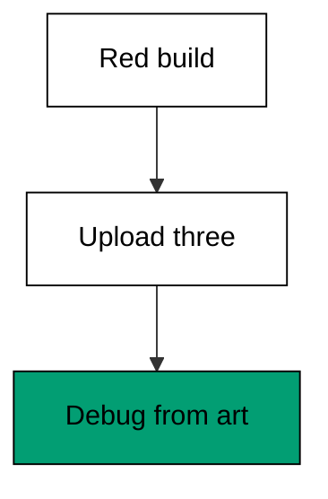

**`learning/code/ex-78-trace-and-video-artifacts-in-ci/example.ts`**:

```typescript
// Example 78: Trace and Video Artifacts in CI. (co-16: ci-integration, co-06: trace-viewer)
// => Playwright 1.60.0, docs accessed 2026-10-20; keep screenshots, traces,
// => and videos as CI artifacts (actions/upload-artifact) so a red build
// => carries its own evidence; debugging starts from the artifact, not from
// => re-running the suite and hoping:
// =>   real: uses: actions/upload-artifact@v4, with: { name: playwright-report, path: playwright-report/ }
async function main(): Promise<void> {
  // => entry point for the artifact check
  const failed = true; // => this build went red
  const kept: string[] = collectArtifacts(failed); // => real: upload-artifact on failure
  console.log("artifacts: " + kept.join(",")); // => Output: artifacts: trace.zip,video.webm,screenshot.png
  console.log("evidence kept: " + String(kept.length === 3)); // => Output: evidence kept: true
  const green: string[] = collectArtifacts(false); // => green builds keep nothing
  console.log("green keeps nothing: " + String(green.length === 0)); // => Output: green keeps nothing: true
  console.log("debug from evidence: " + String(kept.includes("trace.zip"))); // => Output: debug from evidence: true
} // => main ends; red builds explain themselves

function collectArtifacts(failed: boolean): string[] {
  // => stand-in for the upload step
  if (!failed) {
    // => green builds store no evidence
    return []; // => nothing to debug
  } // => red branch below
  return ["trace.zip", "video.webm", "screenshot.png"]; // => the three evidence files
} // => collectArtifacts keeps evidence only for red builds

await main(); // => run once; a failure throws and exits nonzero
```

**Output** (`learning/code/ex-78-trace-and-video-artifacts-in-ci/expected/main.stdout.txt`):

```text
artifacts: trace.zip,video.webm,screenshot.png
evidence kept: true
green keeps nothing: true
debug from evidence: true
```

**Key takeaway**: Upload traces, videos, and screenshots as CI artifacts on failure -- red
builds should explain themselves without a re-run.

**Why it matters**: The debugging loop without artifacts is: see red, re-run locally, fail to
reproduce, guess. With artifacts it is: see red, open the trace, know. That difference
compounds across every failure the suite will ever report. The whole debugging arc of this level lands here: trace the misclick, read the snapshot, watch in slow motion, keep the video.
