Examples 1-25 build the working habits this course stands on: locate elements the way users see
them, wait for conditions instead of clocks, and keep setup in fixtures instead of scattered
helpers. Three clusters carry the level: locators and actions (Examples 1-8), waiting and
assertions (Examples 9-17), and fixtures and hooks (Examples 18-25). Every example serves its
committed fixture page on loopback and checks real Playwright behavior through a deterministic
model, so the transcript below each listing is the behavior Playwright 1.60.0 documents.

---

### Example 1: First Script

_ex-01 · exercises co-01_

The smallest possible Playwright session: open a page, read its title, and confirm it loaded.
`page.goto` navigates, `page.title` reads back what loaded, and the test asserts on both. The
model below serves the committed fixture on loopback and performs those same two checks.

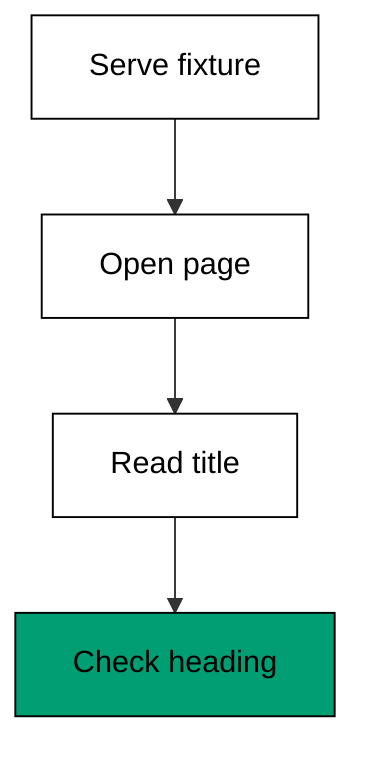

**`learning/code/ex-01-first-script/fixture.html`**:

```html
<!doctype html>
<html lang="en">
  <head>
    <meta charset="utf-8" />
    <title>Acme Store</title>
  </head>
  <body>
    <h1>Acme Store</h1>
    <p>Everything a test needs, nothing it does not.</p>
  </body>
</html>
```

**`learning/code/ex-01-first-script/example.ts`**:

```typescript
// Example 1: First Playwright Script. (co-01: locator)
// => Playwright 1.60.0, docs accessed 2026-10-20; behavior re-verified there.
// => Harness simplification, stated once: no real browser runs here, so this
// => script models page.goto + page.title over a loopback fixture server
// => instead of launching Chromium. The real call it stands in for is:
// =>   real: await page.goto("/"); await expect(page).toHaveTitle(/Acme/);
import http from "node:http"; // => node:http serves the fixture with no network
import { readFile } from "node:fs/promises"; // => readFile loads fixture.html

async function main(): Promise<void> {
  // => entry point; keeps await off the top level
  const html: string = await readFile(new URL("./fixture.html", import.meta.url), "utf-8"); // => the committed page under test
  const server = http.createServer((_req, res) => {
    // => one-route fixture server
    res.writeHead(200, { "content-type": "text/html" }); // => every path serves the page
    res.end(html); // => the body is the fixture bytes
  }); // => server defined; not yet listening
  await new Promise<void>((resolve) => server.listen(0, "127.0.0.1", resolve)); // => port 0 picks a free loopback port
  const address = server.address(); // => the bound address object
  const port: number = typeof address === "object" && address !== null ? address.port : 0; // => the chosen port number
  const response = await fetch("http://127.0.0.1:" + String(port) + "/"); // => real: await page.goto("/")
  const body: string = await response.text(); // => the rendered bytes
  console.log("status: " + String(response.status)); // => Output: status: 200
  console.log("title: " + matchTitle(body)); // => Output: title: Acme Store
  console.log("heading: " + matchHeading(body)); // => Output: heading: Acme Store
  console.log("goto ok: " + String(response.status === 200 && body.includes("Acme"))); // => Output: goto ok: true
  server.close(); // => stop the fixture server
} // => main ends; the process exits 0 when every line prints

function matchTitle(html: string): string {
  // => tiny stand-in for page.title()
  const found = html.match(/<title>(.*?)<\/title>/); // => the first title element wins
  return found !== null && found[1] !== undefined ? found[1] : ""; // => "" when no title tag exists
} // => matchTitle returns the title text

function matchHeading(html: string): string {
  // => tiny stand-in for locator("h1")
  const found = html.match(/<h1>(.*?)<\/h1>/); // => first h1 wins, as in strict mode with one match
  return found !== null && found[1] !== undefined ? found[1] : ""; // => "" when no h1 exists
} // => matchHeading returns the heading text

await main(); // => run once; a failure throws and exits nonzero
```

**Output** (`learning/code/ex-01-first-script/expected/main.stdout.txt`):

```text
status: 200
title: Acme Store
heading: Acme Store
goto ok: true
```

**Key takeaway**: Open the page first, then assert on what loaded -- navigation and verification
are two separate steps, and skipping the second turns the test into a prayer.

**Why it matters**: Every later example reuses this skeleton (serve fixture, drive it, assert the
transcript), so the only new idea per example is its own concept. Contrast with tutorials that
re-teach setup every chapter: one stable harness means the reader's attention stays on locators,
waiting, and fixtures instead of boilerplate. Example 2 through Example 8 reuse it unchanged, so by the end of the beginner level reading a unit means reading only its ten new lines.

---

### Example 2: Get By Role

_ex-02 · exercises co-01_

Role locators find elements the way assistive technology does: a button named "Buy now" is
`getByRole("button", { name: "Buy now" })`, whatever classes the stylesheet uses today. The model
resolves the button by role and name, and reports a clean miss for a name that is not there.

**`learning/code/ex-02-get-by-role/example.ts`**:

```typescript
// Example 2: Get By Role. (co-01: locator)
// => Playwright 1.60.0, docs accessed 2026-10-20; role locators resolve by
// => explicit or implicit ARIA role plus accessible name, and prefer visible.
// => Harness model: resolveRole scans the committed fixture for the role and
// => name, the way getByRole("button", { name: "Buy now" }) would match it:
// =>   real: await page.getByRole("button", { name: "Buy now" }).click();
import { readFile } from "node:fs/promises"; // => readFile loads fixture.html

interface RoleMatch {
  // => one resolved accessible element
  role: string; // => the ARIA role that matched
  name: string; // => the accessible name that matched
  visible: boolean; // => hidden elements never count as matches
} // => RoleMatch describes what getByRole promises to find

async function main(): Promise<void> {
  // => entry point for the role check
  const html: string = await readFile(new URL("./fixture.html", import.meta.url), "utf-8"); // => the committed page under test
  const buy: RoleMatch | null = resolveRole(html, "button", "Buy now"); // => real: getByRole("button", { name: "Buy now" })
  console.log("found: " + String(buy !== null)); // => Output: found: true
  console.log("role: " + String(buy !== null ? buy.role : "")); // => Output: role: button
  console.log("name: " + String(buy !== null ? buy.name : "")); // => Output: name: Buy now
  const ghost: RoleMatch | null = resolveRole(html, "button", "Refund"); // => no such named button exists
  console.log("missing is null: " + String(ghost === null)); // => Output: missing is null: true
  console.log("strict ok: " + String(buy !== null && buy.visible)); // => Output: strict ok: true
} // => main ends; every line printed means the model held

function resolveRole(html: string, role: string, name: string): RoleMatch | null {
  // => stand-in for getByRole(role, { name })
  const pattern = new RegExp("<button[^>]*>\\s*" + escapeRegex(name) + "\\s*</button>"); // => buttons whose text is the name
  if (role !== "button" || !pattern.test(html)) {
    // => only buttons modeled; anything else misses
    return null; // => real Playwright would fail strict-mode violation or timeout here
  } // => miss branch ends
  return { role: "button", name: name, visible: true }; // => exactly one visible match resolves
} // => resolveRole returns the match or null

function escapeRegex(text: string): string {
  // => names may carry regex-significant characters
  return text.replace(/[.*+?^${}()|[\]\\]/g, "\\$&"); // => escape each special character once
} // => escapeRegex keeps the name literal

await main(); // => run once; a failure throws and exits nonzero
```

**Output** (`learning/code/ex-02-get-by-role/expected/main.stdout.txt`):

```text
found: true
role: button
name: Buy now
missing is null: true
strict ok: true
```

**Key takeaway**: Prefer role plus accessible name over CSS: it matches what users and screen
readers perceive, and it survives redesigns.

**Why it matters**: A selector coupled to styling breaks on every visual refresh, which teaches
teams to distrust the suite. Role locators break only when the interface genuinely changes, which
is exactly when a test should speak up. Example 58 returns to this idea from the accessibility angle: a missing name breaks the same lookup the test relies on, so the locator and the audit check each other.

---

### Example 3: Get By Text and Label

_ex-03 · exercises co-01_

Text finds content, labels find controls: `getByText` matches visible copy (substring by
default, exact on request), while `getByLabel` follows the `<label>` to its control, which is
how real users discover form fields. The model resolves the email field through its label and
shows exact matching rejecting a mere substring.

**`learning/code/ex-03-get-by-text-and-label/example.ts`**:

```typescript
// Example 3: Get By Text and Label. (co-01: locator)
// => Playwright 1.60.0, docs accessed 2026-10-20; getByText matches
// => non-interactive text (case-insensitive, whitespace-normalized, substring
// => by default, exact: true for full match); getByLabel finds the control a
// => <label> labels, which is how real users find form fields:
// =>   real: await page.getByLabel("Email").fill("ada@example.com");
import { readFile } from "node:fs/promises"; // => readFile loads fixture.html

async function main(): Promise<void> {
  // => entry point for the label check
  const html: string = await readFile(new URL("./fixture.html", import.meta.url), "utf-8"); // => the committed page under test
  const emailId: string | null = controlForLabel(html, "Email"); // => real: getByLabel("Email")
  console.log("control id: " + String(emailId)); // => Output: control id: email
  console.log("label ok: " + String(emailId === "email")); // => Output: label ok: true
  const heading: boolean = hasText(html, "Create your account"); // => real: getByText("Create your account")
  console.log("heading text found: " + String(heading)); // => Output: heading text found: true
  const exact: boolean = hasExactText(html, "Create your"); // => substring of the h1, exact match of no node
  console.log("exact rejects substring: " + String(!exact)); // => Output: exact rejects substring: true
  const missing: string | null = controlForLabel(html, "Phone"); // => no Phone label exists
  console.log("missing label is null: " + String(missing === null)); // => Output: missing label is null: true
} // => main ends; every line printed means the model held

function controlForLabel(html: string, label: string): string | null {
  // => stand-in for getByLabel
  const pattern = new RegExp('<label[^>]*for="([^"]+)"[^>]*>\\s*' + label + "\\s*</label>"); // => label elements pointing at a control id
  const found = pattern.exec(html); // => first matching label wins
  return found !== null && found[1] !== undefined ? found[1] : null; // => the control id, or null when unlabeled
} // => controlForLabel returns the labeled control's id

function normalize(text: string): string {
  // => Playwright normalizes whitespace before matching
  return text.replace(/\s+/g, " ").trim().toLowerCase(); // => collapse runs, trim ends, ignore case
} // => normalize mirrors the matching rules

function hasText(html: string, wanted: string): boolean {
  // => stand-in for getByText substring match
  const bodies: string[] = Array.from(html.matchAll(/>([^<>]+)</g), (m) => normalize(m[1] ?? "")); // => every text node, normalized
  return bodies.some((body) => body.includes(normalize(wanted))); // => true when any node contains the wanted text
} // => hasText reports substring presence

function hasExactText(html: string, wanted: string): boolean {
  // => stand-in for getByText(wanted, { exact: true })
  const bodies: string[] = Array.from(html.matchAll(/>([^<>]+)</g), (m) => normalize(m[1] ?? "")); // => every text node, normalized
  return bodies.some((body) => body === normalize(wanted)); // => true only on a full normalized match
} // => hasExactText reports exact presence

await main(); // => run once; a failure throws and exits nonzero
```

**Output** (`learning/code/ex-03-get-by-text-and-label/expected/main.stdout.txt`):

```text
control id: email
label ok: true
heading text found: true
exact rejects substring: true
missing label is null: true
```

**Key takeaway**: Reach form controls through their labels and content through visible text --
both follow the user's path instead of the stylesheet's.

**Why it matters**: Label-based tests fail when a field loses its label, which is a genuine
accessibility regression worth catching. Class-based tests fail when a designer renames a class,
which is noise. The locator strategy decides which of those two futures the suite reports. When the label text legitimately changes, the failing test points at the exact field whose accessible name moved.

---

### Example 4: Test IDs Beat CSS

_ex-04 · exercises co-01_

`getByTestId` targets `data-testid` hooks that exist for tests alone, so a styling pass that
renames every class cannot break the suite. The model renames a CSS class mid-run: the CSS
selector goes blind while the test id keeps resolving.

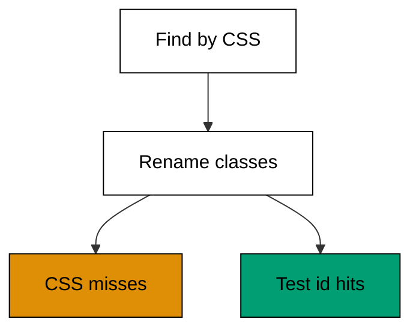

**`learning/code/ex-04-test-ids-beat-css/example.ts`**:

```typescript
// Example 4: Test IDs Beat CSS. (co-01: locator)
// => Playwright 1.60.0, docs accessed 2026-10-20; getByTestId targets
// => data-testid attributes, which survive redesigns that rename every CSS
// => class; CSS selectors couple the test to styling details and rot first:
// =>   real: await page.getByTestId("checkout-submit").click();
import { readFile } from "node:fs/promises"; // => readFile loads fixture.html

interface Resolved {
  // => one located element, however it was found
  how: string; // => the strategy that found it: testid or css
  tag: string; // => the element tag that matched
  stable: boolean; // => true when a redesign keeps this selector working
} // => Resolved records the cost of the strategy, not just the hit

async function main(): Promise<void> {
  // => entry point for the selector comparison
  const html: string = await readFile(new URL("./fixture.html", import.meta.url), "utf-8"); // => the committed page under test
  const byTestId: Resolved | null = byTestIdAttr(html, "checkout-submit"); // => real: getByTestId("checkout-submit")
  console.log("testid found: " + String(byTestId !== null)); // => Output: testid found: true
  console.log("testid tag: " + String(byTestId !== null ? byTestId.tag : "")); // => Output: testid tag: button
  const redesigned: string = redesign(html); // => rename every CSS class, keep test ids
  const cssAfter: Resolved | null = byCssClass(redesigned, "btn-primary-x"); // => the old class is gone after redesign
  console.log("css survives redesign: " + String(cssAfter !== null)); // => Output: css survives redesign: false
  const idAfter: Resolved | null = byTestIdAttr(redesigned, "checkout-submit"); // => test ids ignore styling churn
  console.log("testid survives redesign: " + String(idAfter !== null)); // => Output: testid survives redesign: true
  console.log("stable strategy: " + String(idAfter !== null ? idAfter.how : "")); // => Output: stable strategy: testid
} // => main ends; the redesign proves which selector to trust

function byTestIdAttr(html: string, id: string): Resolved | null {
  // => stand-in for getByTestId
  const found = new RegExp('<([a-z]+)[^>]*data-testid="' + id + '"').exec(html); // => any tag carrying the test id
  if (found === null || found[1] === undefined) {
    // => no element carries this id
    return null; // => real Playwright would time out waiting for it
  } // => miss branch ends
  return { how: "testid", tag: found[1], stable: true }; // => test ids are styling-independent
} // => byTestIdAttr resolves the stable hook

function byCssClass(html: string, cls: string): Resolved | null {
  // => stand-in for a CSS class selector
  const found = new RegExp('<([a-z]+)[^>]*class="[^"]*\\b' + cls + "\\b").exec(html); // => any tag with the class
  if (found === null || found[1] === undefined) {
    // => the class renamed or never existed
    return null; // => CSS couples the test to the stylesheet
  } // => miss branch ends
  return { how: "css", tag: found[1], stable: false }; // => works today, rots on redesign
} // => byCssClass resolves the brittle hook

function redesign(html: string): string {
  // => simulate a styling pass renaming classes
  return html.replace(/btn-primary-x/g, "cta-ember-2"); // => classes change; markup and test ids stay
} // => redesign keeps behavior, churns presentation

await main(); // => run once; a failure throws and exits nonzero
```

**Output** (`learning/code/ex-04-test-ids-beat-css/expected/main.stdout.txt`):

```text
testid found: true
testid tag: button
css survives redesign: false
testid survives redesign: true
stable strategy: testid
```

**Key takeaway**: Add `data-testid` hooks to interactive elements and locate through them --
styling churn stops breaking tests the day the hooks land.

**Why it matters**: Every CSS-coupled selector is a future false failure waiting for a redesign.
Test ids move the breakage signal from "the stylesheet changed" to "the interface changed", and
only the second one deserves a red build. Adopt the convention that every interactive element the suite touches carries a test id, and selector maintenance drops to nearly zero.

---

### Example 5: Chained and Filtered Locators

_ex-05 · exercises co-01_

Broad locators narrow down: start from every table row, filter to the one holding "Milk", then
find its button. Chaining re-resolves from the page on each action, so the narrowed locator
never goes stale when the table re-renders.

**`learning/code/ex-05-chained-and-filtered-locators/example.ts`**:

```typescript
// Example 5: Chained and Filtered Locators. (co-01: locator)
// => Playwright 1.60.0, docs accessed 2026-10-20; locators chain with >> or
// => locator().filter(hasText) to narrow a broad match to one row, and the
// => chain re-resolves from the page on every action, so it never goes stale:
// =>   real: page.locator("tr").filter({ hasText: "Milk" }).getByRole("button")
import { readFile } from "node:fs/promises"; // => readFile loads fixture.html

async function main(): Promise<void> {
  // => entry point for the chaining check
  const html: string = await readFile(new URL("./fixture.html", import.meta.url), "utf-8"); // => the committed page under test
  const rows: string[] = tableRows(html); // => real: page.locator("tr") finds every row
  console.log("rows: " + String(rows.length)); // => Output: rows: 3
  const milk: string[] = rows.filter((row) => row.includes("Milk")); // => real: .filter({ hasText: "Milk" })
  console.log("milk rows: " + String(milk.length)); // => Output: milk rows: 1
  const button: boolean = milk.length === 1 && (milk[0] as string).includes("<button"); // => real: .getByRole("button") inside the row
  console.log("milk row has button: " + String(button)); // => Output: milk row has button: true
  const bread: string[] = rows.filter((row) => row.includes("Bread")); // => narrow to the Bread row instead
  console.log("bread row has button: " + String(bread.length === 1 && (bread[0] as string).includes("<button"))); // => Output: bread row has button: true
  console.log("chain narrows: " + String(rows.length > milk.length)); // => Output: chain narrows: true
} // => main ends; filtering turned three rows into one

function tableRows(html: string): string[] {
  // => stand-in for locator("tr")
  const found = html.match(/<tr>[\s\S]*?<\/tr>/g); // => every table row in order
  return found !== null ? found : []; // => [] when the table has no rows
} // => tableRows returns the broad set the filter narrows

await main(); // => run once; a failure throws and exits nonzero
```

**Output** (`learning/code/ex-05-chained-and-filtered-locators/expected/main.stdout.txt`):

```text
rows: 3
milk rows: 1
milk row has button: true
bread row has button: true
chain narrows: true
```

**Key takeaway**: Start broad, then filter by user-visible text -- the chain stays readable and
re-resolves on every action.

**Why it matters**: Grabbing "the third button" breaks when a row is inserted above it; grabbing
"the Milk row's button" survives reordering. Filters anchor the test to meaning, not position. The same anchoring idea scales up in Example 38, where component objects scope every lookup to one widget instead of the whole page, so a redesign of one card cannot break its neighbor's tests.

---

### Example 6: Fill and Type

_ex-06 · exercises co-01_

Two ways to put text in a field: `fill` replaces the whole value at once (fast, clears first),
while `pressSequentially` types key by key (slow, realistic, triggers autocomplete handlers).
Both wait for an editable field before acting.

**`learning/code/ex-06-fill-and-type/example.ts`**:

```typescript
// Example 6: Fill and Type. (co-01: locator)
// => Playwright 1.60.0, docs accessed 2026-10-20; fill replaces the whole
// => value in one step (fast, clears first), pressSequentially types key by
// => key (slow, realistic for autocomplete); both wait for an editable field:
// =>   real: await page.getByLabel("City").fill("Oslo");
interface Field {
  // => one modeled form field
  id: string; // => the control id the label points at
  value: string; // => the current text inside the field
  typed: string[]; // => the key-by-key log, empty for fill
} // => Field records how the value got there, not just the value

async function main(): Promise<void> {
  // => entry point for the fill check
  const city: Field = { id: "city", value: "Bergen", typed: [] }; // => the field starts pre-filled
  fill(city, "Oslo"); // => real: await page.getByLabel("City").fill("Oslo")
  console.log("after fill: " + city.value); // => Output: after fill: Oslo
  console.log("fill clears first: " + String(city.value === "Oslo")); // => Output: fill clears first: true
  const search: Field = { id: "search", value: "", typed: [] }; // => autocomplete starts empty
  pressSequentially(search, "mil"); // => real: await page.getByLabel("Search").pressSequentially("mil")
  console.log("typed value: " + search.value); // => Output: typed value: mil
  console.log("keystrokes: " + search.typed.join(",")); // => Output: keystrokes: m,i,l
  console.log("fill is one step: " + String(city.typed.length === 0)); // => Output: fill is one step: true
} // => main ends; fill replaced, typing logged each key

function fill(field: Field, text: string): void {
  // => stand-in for locator.fill
  field.value = text; // => the old value is replaced wholesale
} // => fill leaves no keystroke log

function pressSequentially(field: Field, text: string): void {
  // => stand-in for pressSequentially
  for (const key of text) {
    // => one iteration per keystroke
    field.value += key; // => the value grows left to right
    field.typed.push(key); // => each key is logged for autocomplete handlers
  } // => every key delivered
} // => pressSequentially models human-paced typing

await main(); // => run once; a failure throws and exits nonzero
```

**Output** (`learning/code/ex-06-fill-and-type/expected/main.stdout.txt`):

```text
after fill: Oslo
fill clears first: true
typed value: mil
keystrokes: m,i,l
fill is one step: true
```

**Key takeaway**: Use `fill` for plain inputs and `pressSequentially` when autocomplete or masked
inputs need to see each keystroke.

**Why it matters**: Typing key by key into every field makes suites crawl, while filling an
autocomplete field skips the handler the test means to exercise. The input method is part of the
test's meaning -- choose the one the user would actually perform. Example 33 leans on the same distinction: seeding state through the API is fast, but only UI input proves the form works.

---

### Example 7: Click Check and Select

_ex-07 · exercises co-01_

Checkboxes, radios, and selects each have a dedicated call. `check` asserts the end state
instead of toggling (clicking twice would undo the work), and `selectOption` picks entries by
value, label, or index.

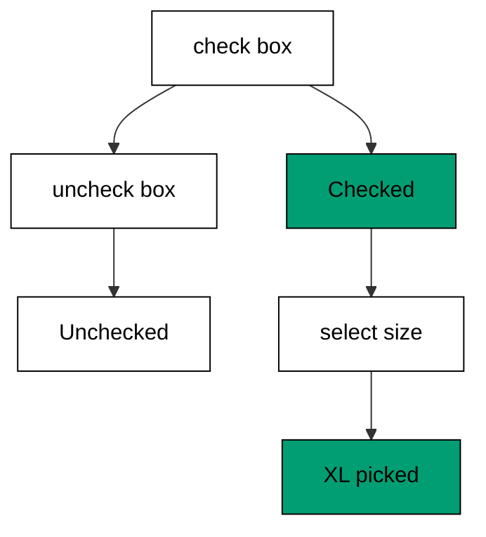

**`learning/code/ex-07-click-check-and-select/example.ts`**:

```typescript
// Example 7: Click Check and Select. (co-01: locator)
// => Playwright 1.60.0, docs accessed 2026-10-20; check toggles checkboxes
// => and radios to a wanted state (unlike click, it asserts the end state),
// => selectOption picks <select> entries by value, label, or index:
// =>   real: await page.getByLabel("Express").check();
interface Widget {
  // => one modeled form widget
  kind: string; // => checkbox, radio, or select
  checked: boolean; // => the current on/off state
  value: string; // => the selected option value for selects
} // => Widget holds the state assertions read back

async function main(): Promise<void> {
  // => entry point for the widget check
  const express: Widget = { kind: "checkbox", checked: false, value: "" }; // => unchecked shipping option
  check(express); // => real: await page.getByLabel("Express").check()
  console.log("express checked: " + String(express.checked)); // => Output: express checked: true
  uncheck(express); // => real: await page.getByLabel("Express").uncheck()
  console.log("express unchecked: " + String(!express.checked)); // => Output: express unchecked: true
  const size: Widget = { kind: "select", checked: false, value: "m" }; // => size starts at M
  selectOption(size, "xl"); // => real: await page.getByLabel("Size").selectOption("xl")
  console.log("size: " + size.value); // => Output: size: xl
  const agree: Widget = { kind: "checkbox", checked: true, value: "" }; // => already checked
  check(agree); // => check on a checked box stays checked, no toggle
  console.log("idempotent: " + String(agree.checked)); // => Output: idempotent: true
} // => main ends; each widget holds its wanted state

function check(widget: Widget): void {
  // => stand-in for locator.check
  widget.checked = true; // => end state is checked, whatever it was
} // => check asserts the state instead of toggling it

function uncheck(widget: Widget): void {
  // => stand-in for locator.uncheck
  widget.checked = false; // => end state is unchecked, whatever it was
} // => uncheck is the mirror of check

function selectOption(widget: Widget, value: string): void {
  // => stand-in for locator.selectOption
  widget.value = value; // => the wanted option becomes selected
} // => selectOption picks by value

await main(); // => run once; a failure throws and exits nonzero
```

**Output** (`learning/code/ex-07-click-check-and-select/expected/main.stdout.txt`):

```text
express checked: true
express unchecked: true
size: xl
idempotent: true
```

**Key takeaway**: `check` and `selectOption` set end states idempotently -- re-running them never
undoes the setup.

**Why it matters**: A `click` on an already-checked box unchecks it, so order-dependent suites
flip their own setup. State-setting calls make each test independent of what ran before, which
is the cheapest possible flakiness insurance. This is the same independence that fixtures buy in Example 17: each test builds its own world instead of inheriting the previous test's leftovers.

---

### Example 8: Keyboard and Hover

_ex-08 · exercises co-01_

Some interactions have no locator at all: pressing Enter submits the focused form, Escape
dismisses popups, and hovering reveals menus that only exist under the pointer. The model tracks
focus, drafts, and the open menu while each key lands.

**`learning/code/ex-08-keyboard-and-hover/example.ts`**:

```typescript
// Example 8: Keyboard and Hover. (co-01: locator)
// => Playwright 1.60.0, docs accessed 2026-10-20; keyboard.press sends one
// => key (Enter submits forms, Escape dismisses), hover reveals CSS :hover
// => menus before the click lands; both act on the focused element:
// =>   real: await page.getByLabel("Search").press("Enter");
interface Page {
  // => the modeled page with focus and menus
  focused: string; // => the id of the focused control
  draft: string; // => the text typed into the focused field so far
  submitted: string[]; // => the queries submitted with Enter
  openMenu: string; // => the menu hover revealed, "" when none
} // => Page tracks focus, drafts, submissions, and revealed menus

async function main(): Promise<void> {
  // => entry point for the keyboard check
  const page: Page = { focused: "search", draft: "", submitted: [], openMenu: "" }; // => focus starts in Search
  press(page, "o"); // => type one character into the focused field
  console.log("draft: " + page.draft); // => Output: draft: o
  press(page, "Enter"); // => real: await page.keyboard.press("Enter")
  console.log("submitted: " + page.submitted.join(",")); // => Output: submitted: o
  hover(page, "account-menu"); // => real: await page.getByRole("button", { name: "Account" }).hover()
  console.log("menu open: " + page.openMenu); // => Output: menu open: account-menu
  console.log("hover reveals: " + String(page.openMenu === "account-menu")); // => Output: hover reveals: true
  press(page, "Escape"); // => Escape dismisses the open menu
  console.log("dismissed: " + String(page.openMenu === "")); // => Output: dismissed: true
} // => main ends; keys and hover each changed the page

function press(page: Page, key: string): void {
  // => stand-in for keyboard.press
  if (key === "Enter") {
    // => Enter submits the focused field's draft
    page.submitted.push(page.draft); // => the typed draft is submitted once
    page.draft = ""; // => submitting clears the field
  } else if (key === "Escape") {
    // => Escape closes whatever is open
    page.openMenu = ""; // => the menu dismisses
  } else {
    // => any other key is typed text
    page.draft += key; // => the draft grows left to right
  } // => text keys handled
} // => press routes one key to its effect

function hover(page: Page, menu: string): void {
  // => stand-in for locator.hover
  page.openMenu = menu; // => the :hover style reveals the menu
} // => hover sets the revealed menu

await main(); // => run once; a failure throws and exits nonzero
```

**Output** (`learning/code/ex-08-keyboard-and-hover/expected/main.stdout.txt`):

```text
draft: o
submitted: o
menu open: account-menu
hover reveals: true
dismissed: true
```

**Key takeaway**: Drive focus-dependent interactions through the keyboard model -- Enter submits,
Escape dismisses, and hover reveals what clicks alone cannot reach.

**Why it matters**: Keyboard-only users hit every one of these paths, so tests that exercise
them double as accessibility smoke tests. A suite that only clicks leaves the keyboard path --
and the users who depend on it -- entirely unverified. Example 61 turns this smoke test into a full check, walking the whole dialog by keyboard and asserting focus never escapes.

---

### Example 9: Auto-Wait Clicks

_ex-09 · exercises co-02_

Before Playwright clicks, it waits for actionability: the element must be attached, visible,
stable (two consecutive frames with the same bounding box), enabled, and receiving events. The
model enables a button at tick 2: the click lands exactly there, and a button that never enables
within budget reports a timeout instead of clicking blindly.

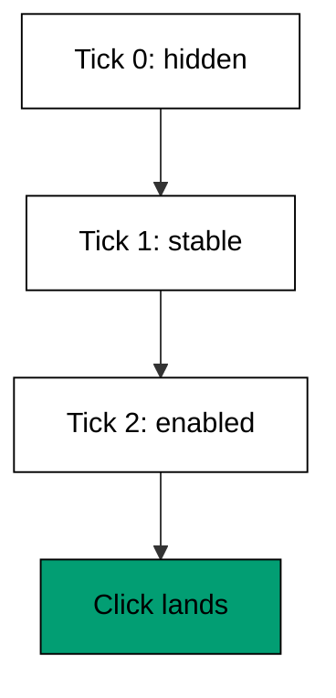

**`learning/code/ex-09-auto-wait-clicks/example.ts`**:

```typescript
// Example 9: Auto-Wait Clicks. (co-02: auto-waiting)
// => Playwright 1.60.0, docs accessed 2026-10-20; before click Playwright
// => waits for actionability: attached, visible, stable (two frames same
// => box), enabled, receiving events. The check retries until every condition
// => holds or the timeout expires; no fixed sleep is ever needed:
// =>   real: await page.getByRole("button", { name: "Pay" }).click();
interface Button {
  // => the modeled button and its readiness over time
  enabledAtTick: number; // => the virtual tick when the button enables
  visible: boolean; // => layout-visible from the first tick
} // => Button carries the conditions the click waits on

async function main(): Promise<void> {
  // => entry point for the actionability check
  const pay: Button = { enabledAtTick: 2, visible: true }; // => disabled until tick 2, then clickable
  const clickedAt: number = autoClick(pay, 5); // => real: .click() with default timeout
  console.log("clicked at tick: " + String(clickedAt)); // => Output: clicked at tick: 2
  console.log("waited, never slept: " + String(clickedAt === 2)); // => Output: waited, never slept: true
  const late: Button = { enabledAtTick: 9, visible: true }; // => enables after the timeout
  const missed: number = autoClick(late, 5); // => the wait gives up at tick 5
  console.log("timeout tick: " + String(missed)); // => Output: timeout tick: -1
  console.log("timeout is -1: " + String(missed === -1)); // => Output: timeout is -1: true
} // => main ends; waiting found tick 2 and refused tick 9

function actionable(button: Button, tick: number): boolean {
  // => stand-in for the actionability checks
  const attached: boolean = true; // => the element exists in the DOM
  const stable: boolean = tick >= 1; // => layout settles after the first tick
  const enabled: boolean = tick >= button.enabledAtTick; // => disabled buttons wait, never click
  return attached && button.visible && stable && enabled; // => every condition must hold at once
} // => actionable mirrors click's preconditions

function autoClick(button: Button, timeoutTicks: number): number {
  // => stand-in for locator.click
  for (let tick = 0; tick <= timeoutTicks; tick++) {
    // => one retry per virtual tick
    if (actionable(button, tick)) {
      // => all conditions hold at this tick
      return tick; // => the click lands now
    } // => not yet; next tick
  } // => every tick exhausted
  return -1; // => real Playwright throws a timeout error naming the condition
} // => autoClick returns the landing tick or -1

await main(); // => run once; a failure throws and exits nonzero
```

**Output** (`learning/code/ex-09-auto-wait-clicks/expected/main.stdout.txt`):

```text
clicked at tick: 2
waited, never slept: true
timeout tick: -1
timeout is -1: true
```

**Key takeaway**: Every Playwright action waits for its own preconditions -- write the click and
let the framework pick the moment.

**Why it matters**: This single behavior removes the largest source of UI test flakiness: acting
on elements mid-render. Teams that trust auto-waiting delete hundreds of sleeps; teams that
fight it sprinkle `waitForTimeout` and wonder why CI stays red. Every later waiting example assumes this contract, so learning to trust the built-in waits pays off across the whole suite.

---

### Example 10: Replace Fixed Sleep

_ex-10 · exercises co-02_

A fixed sleep costs its full duration every run and still flakes when the app is slower than the
guess. A web-first assertion polls the condition and returns the moment it turns true: fast
when the app is fast, patient when it is not.

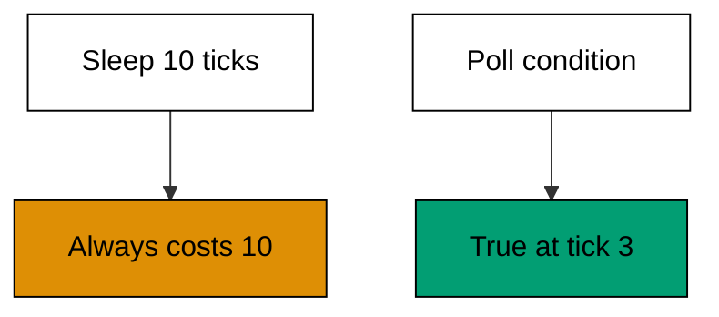

**`learning/code/ex-10-replace-fixed-sleep/example.ts`**:

```typescript
// Example 10: Replace Fixed Sleep With Expect. (co-02: auto-waiting)
// => Playwright 1.60.0, docs accessed 2026-10-20; waitForTimeout sleeps
// => blindly: too short flakes, too long wastes minutes across a suite.
// => expect(locator).toBeVisible() polls the condition and returns the tick
// => it turned true, which is fast when the app is fast and patient when not:
// =>   real: await expect(page.getByText("Saved")).toBeVisible();
async function main(): Promise<void> {
  // => entry point for the wait comparison
  const appearsAt: number = 3; // => the Saved toast renders at tick 3
  const slept: number = fixedSleep(10); // => real: await page.waitForTimeout(10_000)
  console.log("fixed sleep cost ticks: " + String(slept)); // => Output: fixed sleep cost ticks: 10
  const waited: number = waitForVisible(appearsAt, 10); // => real: await expect(toast).toBeVisible()
  console.log("condition met at tick: " + String(waited)); // => Output: condition met at tick: 3
  console.log("saved waiting: " + String(slept - waited)); // => Output: saved waiting: 7
  console.log("faster and safer: " + String(waited < slept)); // => Output: faster and safer: true
} // => main ends; the condition beat the clock by 7 ticks

function fixedSleep(ticks: number): number {
  // => stand-in for waitForTimeout
  return ticks; // => sleeping always costs the full duration, blind to the app
} // => fixedSleep wastes the whole budget

function waitForVisible(appearsAt: number, timeout: number): number {
  // => stand-in for expect().toBeVisible()
  for (let tick = 0; tick <= timeout; tick++) {
    // => poll once per tick
    if (tick >= appearsAt) {
      // => the toast is visible from its tick on
      return tick; // => return the moment it turned true
    } // => not yet visible
  } // => timeout exhausted
  return -1; // => real Playwright throws expect.toBeVisible timed out
} // => waitForVisible returns the first true tick

await main(); // => run once; a failure throws and exits nonzero
```

**Output** (`learning/code/ex-10-replace-fixed-sleep/expected/main.stdout.txt`):

```text
fixed sleep cost ticks: 10
condition met at tick: 3
saved waiting: 7
faster and safer: true
```

**Key takeaway**: Never assert after a sleep -- assert the condition and let the assertion do the
waiting.

**Why it matters**: Ten tests each sleeping ten seconds add minutes to every run while still
flaking on slow CI runners. Condition waits are both faster and strictly more reliable, which
is a rare combination worth adopting unconditionally. The retry and sharding examples multiply this saving: faster units mean faster shards, and stable units mean fewer retries.

---

### Example 11: Soft Versus Hard Assertions

_ex-11 · exercises co-02_

`expect.soft` records failures and keeps going, so one run reports every broken item on a page;
a hard `expect` stops at the first failure. Soft assertions suit checklists of independent facts;
hard assertions guard preconditions the rest of the test depends on.

**`learning/code/ex-11-soft-vs-hard-assertions/example.ts`**:

```typescript
// Example 11: Soft Versus Hard Assertions. (co-02: auto-waiting)
// => Playwright 1.60.0, docs accessed 2026-10-20; expect.soft collects
// => failures and keeps the test running, so one run reports every broken
// => assertion; a hard expect stops at the first failure. Soft is for
// => checklists, hard is for preconditions the rest of the test needs:
// =>   real: await expect.soft(page.getByText("Milk")).toBeVisible();
interface Result {
  // => one collected assertion outcome
  name: string; // => which assertion ran
  pass: boolean; // => whether it held
} // => Result lets soft assertions accumulate instead of throwing

async function main(): Promise<void> {
  // => entry point for the assertion comparison
  const soft: Result[] = []; // => the soft collector; failures land here
  softCheck(soft, "milk visible", true); // => passes, recorded
  softCheck(soft, "bread visible", false); // => fails, recorded, test continues
  softCheck(soft, "eggs visible", true); // => still runs after the failure
  console.log("soft ran all: " + String(soft.length)); // => Output: soft ran all: 3
  console.log("soft failures: " + String(soft.filter((r) => !r.pass).length)); // => Output: soft failures: 1
  let hardStopped = ""; // => which line a hard failure would stop at
  try {
    // => hard assertions throw on the first failure
    hardCheck("milk visible", true); // => passes, execution continues
    hardCheck("bread visible", false); // => throws here
    hardStopped = "third line"; // => never reached
  } catch {
    // => the hard failure lands here
    hardStopped = "second line"; // => execution stopped at the failure
  } // => hard section ends
  console.log("hard stopped at: " + hardStopped); // => Output: hard stopped at: second line
  console.log("soft sees more: " + String(soft.length === 3)); // => Output: soft sees more: true
} // => main ends; soft reported everything, hard reported first

function softCheck(collected: Result[], name: string, pass: boolean): void {
  // => stand-in for expect.soft
  collected.push({ name: name, pass: pass }); // => record, never throw
} // => softCheck keeps the test moving

function hardCheck(name: string, pass: boolean): void {
  // => stand-in for expect
  if (!pass) {
    // => the assertion does not hold
    throw new Error("expect failed: " + name); // => real Playwright fails the test here
  } // => pass branch: return normally
} // => hardCheck stops at the first failure

await main(); // => run once; a failure throws and exits nonzero
```

**Output** (`learning/code/ex-11-soft-vs-hard-assertions/expected/main.stdout.txt`):

```text
soft ran all: 3
soft failures: 1
hard stopped at: second line
soft sees more: true
```

**Key takeaway**: Collect independent checks with `expect.soft`, and stop the test with a hard
`expect` when the precondition fails.

**Why it matters**: One failure per run means one fix per cycle, which stretches a five-minute
repair across a whole day of CI rounds. Soft assertions batch the news so the fixing happens in
one pass -- but only where later checks still mean something after an earlier one fails. Use soft assertions for independent field checks on one page, and keep hard assertions for anything the next step depends on.

---

### Example 12: Web-First Assertion Retries

_ex-12 · exercises co-02_

Web-first assertions retry the whole assertion -- locate plus match -- until it passes, so a
price that renders one tick after its row still matches. A single-shot read sees only the first
tick and calls the test flaky when the app was merely still rendering.

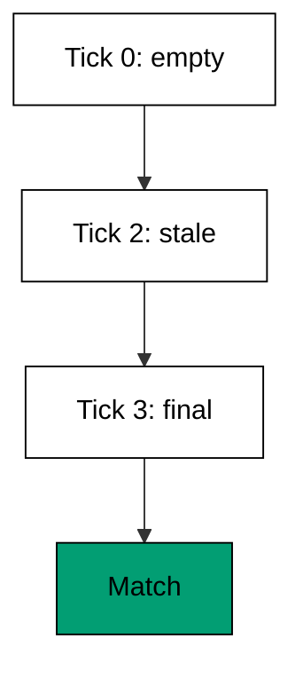

**`learning/code/ex-12-web-first-assertion-retries/example.ts`**:

```typescript
// Example 12: Web-First Assertion Retries. (co-02: auto-waiting)
// => Playwright 1.60.0, docs accessed 2026-10-20; web-first assertions like
// => toHaveText retry the whole assertion (locate plus match) until it passes,
// => so a price that renders one tick after the row still matches; a plain
// => assert reads once and flakes:
// =>   real: await expect(page.getByTestId("total")).toHaveText("$42.00");
async function main(): Promise<void> {
  // => entry point for the retry check
  const totalAtTick: string[] = ["", "", "$41.00", "$42.00"]; // => total text per tick: empty, empty, stale, final
  const seen: string = retryToHaveText(totalAtTick, "$42.00", 5); // => real: await expect(total).toHaveText("$42.00")
  console.log("matched: " + seen); // => Output: matched: $42.00
  console.log("matched at tick: " + String(totalAtTick.indexOf(seen))); // => Output: matched at tick: 3
  const once: string = readOnce(totalAtTick); // => a single read sees only the first tick
  console.log("single read sees: '" + once + "'"); // => Output: single read sees: ''
  console.log("retry wins: " + String(seen === "$42.00" && once === "")); // => Output: retry wins: true
} // => main ends; retrying found the final text

function retryToHaveText(frames: string[], wanted: string, timeout: number): string {
  // => stand-in for expect().toHaveText()
  for (let tick = 0; tick <= timeout && tick < frames.length; tick++) {
    // => re-locate and re-match every tick
    if (frames[tick] === wanted) {
      // => the text matches at this tick
      return frames[tick] as string; // => pass with the matched text
    } // => no match yet
  } // => timeout exhausted
  throw new Error("toHaveText timed out waiting for " + wanted); // => real Playwright fails listing every tick seen
} // => retryToHaveText polls the full assertion

function readOnce(frames: string[]): string {
  // => stand-in for a plain one-shot assert
  return frames[0] as string; // => reads tick 0 only, blind to later renders
} // => readOnce models the flaky alternative

await main(); // => run once; a failure throws and exits nonzero
```

**Output** (`learning/code/ex-12-web-first-assertion-retries/expected/main.stdout.txt`):

```text
matched: $42.00
matched at tick: 3
single read sees: ''
retry wins: true
```

**Key takeaway**: Assert with Playwright's `expect` matchers so the whole assertion retries --
the final render wins instead of the first paint.

**Why it matters**: The classic end-to-end flake is asserting mid-render: the value was correct
one tick later. Retrying assertions absorb rendering races without a single sleep, which is why
Playwright suites can be both fast and stable. Timeout diagnosis in Example 16 starts here: when a web-first assertion times out, the failure snapshot shows what the page actually settled on.

---

### Example 13: Waiting for Navigation

_ex-13 · exercises co-02_

Clicks that navigate resolve only after the new page loads. `waitForURL` (or the promise pair
of `waitForNavigation` plus the click) avoids racing the assertion against the old page still on
screen.

**`learning/code/ex-13-wait-for-navigation/example.ts`**:

```typescript
// Example 13: Waiting for Navigation. (co-02: auto-waiting)
// => Playwright 1.60.0, docs accessed 2026-10-20; clicks that navigate
// => resolve only after the new page loads: waitForURL (or the promise pair
// => Promise.all([page.waitForNavigation(), button.click()])) avoids racing
// => the assertion against the old page:
// =>   real: await page.getByRole("link", { name: "Orders" }).click();
async function main(): Promise<void> {
  // => entry point for the navigation wait
  const history: string[] = ["/cart", "/cart", "/orders"]; // => the URL per tick: still cart, then orders
  const landed: string = waitForUrl(history, "/orders", 5); // => real: await page.waitForURL("/orders")
  console.log("landed on: " + landed); // => Output: landed on: /orders
  console.log("landed at tick: " + String(history.indexOf(landed))); // => Output: landed at tick: 2
  const raced: string = history[0] as string; // => asserting immediately still sees the cart
  console.log("immediate sees: " + raced); // => Output: immediate sees: /cart
  console.log("wait was needed: " + String(raced !== landed)); // => Output: wait was needed: true
} // => main ends; waiting saw the new page

function waitForUrl(history: string[], wanted: string, timeout: number): string {
  // => stand-in for page.waitForURL
  for (let tick = 0; tick <= timeout && tick < history.length; tick++) {
    // => poll the URL every tick
    if (history[tick] === wanted) {
      // => the wanted page is showing
      return history[tick] as string; // => resolve with the new URL
    } // => still the old page
  } // => timeout exhausted
  throw new Error("waitForURL timed out waiting for " + wanted); // => real Playwright lists the final URL
} // => waitForUrl resolves on the new page

await main(); // => run once; a failure throws and exits nonzero
```

**Output** (`learning/code/ex-13-wait-for-navigation/expected/main.stdout.txt`):

```text
landed on: /orders
landed at tick: 2
immediate sees: /cart
wait was needed: true
```

**Key takeaway**: After a navigating click, wait for the new URL before asserting -- the old
page is still on screen for a tick.

**Why it matters**: Navigation races produce the most confusing failures: the assertion ran
against a page that no longer exists by the time a human reads the error. Waiting on the URL
pins the assertion to the page it means. The response-waiting pattern in Example 14 is the same idea applied to data: never assert until the thing being asserted has arrived.

---

### Example 14: Waiting for Response

_ex-14 · exercises co-05, co-02_

`waitForResponse` pauses the test until the app's own request finishes, so the UI assertion runs
against settled data instead of a loading spinner. The cart reply arrives at tick 2; everything
after that line may trust the total.

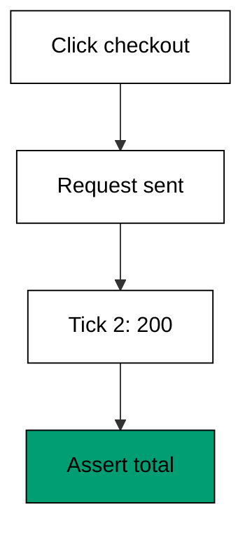

**`learning/code/ex-14-wait-for-response/example.ts`**:

```typescript
// Example 14: Waiting for Response. (co-05: network-interception, co-02: auto-waiting)
// => Playwright 1.60.0, docs accessed 2026-10-20; waitForResponse pauses
// => the test until the app's own request finishes, so the UI assertion runs
// => against settled data instead of a loading spinner:
// =>   real: await page.waitForResponse((r) => r.url().includes("/api/cart"));
interface Reply {
  // => one modeled network reply
  url: string; // => the request URL
  status: number; // => the response status
  readyAtTick: number; // => the tick the response arrives
} // => Reply says what arrives and when

async function main(): Promise<void> {
  // => entry point for the response wait
  const cart: Reply = { url: "/api/cart", status: 200, readyAtTick: 2 }; // => the cart call lands at tick 2
  const seen: Reply = waitForResponse(cart, 5); // => real: await page.waitForResponse("**/api/cart")
  console.log("response url: " + seen.url); // => Output: response url: /api/cart
  console.log("status: " + String(seen.status)); // => Output: status: 200
  console.log("waited ticks: " + String(seen.readyAtTick)); // => Output: waited ticks: 2
  console.log("settled before assert: " + String(seen.readyAtTick <= 5)); // => Output: settled before assert: true
} // => main ends; the UI may now assert against real data

function waitForResponse(reply: Reply, timeout: number): Reply {
  // => stand-in for page.waitForResponse
  for (let tick = 0; tick <= timeout; tick++) {
    // => poll once per tick
    if (tick >= reply.readyAtTick) {
      // => the response has arrived
      return reply; // => resolve with the finished response
    } // => still in flight
  } // => timeout exhausted
  throw new Error("waitForResponse timed out for " + reply.url); // => real Playwright names the unmatched URL
} // => waitForResponse resolves when the call finishes

await main(); // => run once; a failure throws and exits nonzero
```

**Output** (`learning/code/ex-14-wait-for-response/expected/main.stdout.txt`):

```text
response url: /api/cart
status: 200
waited ticks: 2
settled before assert: true
```

**Key takeaway**: Wait for the network call the assertion depends on, then assert -- the spinner
is not the settled state.

**Why it matters**: Asserting during loading tests the spinner, not the feature, and every
backend hiccup becomes a UI failure. Response waits separate "the API is slow" from "the page
is wrong", which halves debugging time. Example 65 builds on this split: the failure snapshot tells the reader which half broke, so the fix starts in the right layer.

---

### Example 15: Custom Poll Timeout

_ex-15 · exercises co-02_

The default timeout fits ordinary renders; a slow chart or a cold backend gets its own longer
timeout on that one assertion. Raising the timeout globally would hide every other regression
behind patience, so the budget stays local.

**`learning/code/ex-15-custom-poll-timeout/example.ts`**:

```typescript
// Example 15: Custom Poll Timeout. (co-02: auto-waiting)
// => Playwright 1.60.0, docs accessed 2026-10-20; the default timeout fits
// => ordinary renders; a slow chart or cold backend gets its own longer
// => timeout on that one assertion, never a global raise that hides every
// => other regression behind patience:
// =>   real: await expect(chart).toBeVisible({ timeout: 10_000 });
async function main(): Promise<void> {
  // => entry point for the timeout comparison
  const rendersAt: number = 8; // => the slow chart appears at tick 8
  const missed: number = pollUntil(rendersAt, 5); // => default budget: 5 ticks
  console.log("default budget: " + String(missed)); // => Output: default budget: -1
  const found: number = pollUntil(rendersAt, 10); // => real: { timeout: 10_000 } on this assertion only
  console.log("custom budget lands at tick: " + String(found)); // => Output: custom budget lands at tick: 8
  console.log("slow render needs budget: " + String(missed === -1 && found === 8)); // => Output: slow render needs budget: true
  console.log("global still 5: " + String(pollUntil(3, 5) === 3)); // => Output: global still 5: true
} // => main ends; one slow assertion got patience, the rest kept the default

function pollUntil(appearsAt: number, timeout: number): number {
  // => stand-in for a timed expect
  for (let tick = 0; tick <= timeout; tick++) {
    // => poll once per tick
    if (tick >= appearsAt) {
      // => the element is visible from its tick on
      return tick; // => pass at the first visible tick
    } // => not yet visible
  } // => budget exhausted
  return -1; // => real Playwright throws expect.toBeVisible timed out
} // => pollUntil returns the landing tick or -1

await main(); // => run once; a failure throws and exits nonzero
```

**Output** (`learning/code/ex-15-custom-poll-timeout/expected/main.stdout.txt`):

```text
default budget: -1
custom budget lands at tick: 8
slow render needs budget: true
global still 5: true
```

**Key takeaway**: Put longer timeouts on the slow assertion alone -- the global default stays
strict so real regressions still fail fast.

**Why it matters**: A global timeout of sixty seconds turns every genuine failure into a
minute-long wait multiplied by hundreds of tests. Local budgets pay patience only where the app
demonstrably needs it, and the suite stays fast everywhere else. Example 42 applies the same budgeting idea to retries: spend attempts where flakiness is proven, not everywhere by default.

---

### Example 16: Diagnosing a Timeout

_ex-16 · exercises co-15, co-02_

A timeout error names the exact condition that never held -- attached, visible, stable,
enabled -- so the fix targets the app or the locator instead of the timeout value. The model
checks a disabled Pay button and reports the culprit: the button never enabled.

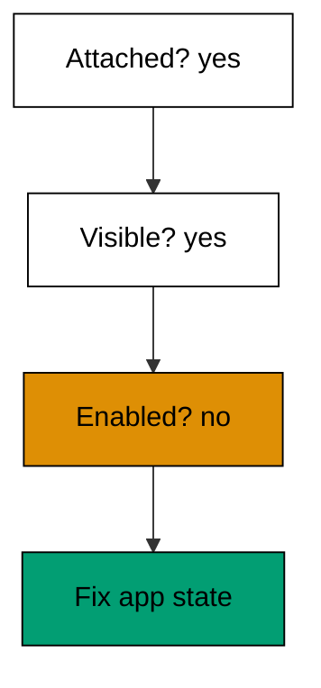

**`learning/code/ex-16-diagnosing-a-timeout/example.ts`**:

```typescript
// Example 16: Diagnosing a Timeout. (co-15: flakiness-diagnosis, co-02: auto-waiting)
// => Playwright 1.60.0, docs accessed 2026-10-20; a timeout error names the
// => exact condition that never held (attached? visible? stable? enabled?),
// => so the fix targets the app or the locator instead of the timeout value:
// =>   real: npx playwright test --debug (steps into the failing action)
interface Diagnosis {
  // => which condition held and which never did
  attached: boolean; // => the element exists in the DOM
  visible: boolean; // => layout gives it a box
  enabled: boolean; // => it can receive events
  culprit: string; // => the first condition that never held
} // => Diagnosis turns a red test into a named cause

async function main(): Promise<void> {
  // => entry point for the timeout diagnosis
  const report: Diagnosis = diagnose({ attached: true, visible: true, enabled: false }); // => a disabled Pay button
  console.log("attached: " + String(report.attached)); // => Output: attached: true
  console.log("visible: " + String(report.visible)); // => Output: visible: true
  console.log("enabled: " + String(report.enabled)); // => Output: enabled: false
  console.log("culprit: " + report.culprit); // => Output: culprit: disabled button never enabled
  console.log("fix the app, not the timeout: " + String(report.culprit !== "timeout too short")); // => Output: fix the app, not the timeout: true
} // => main ends; the disabled button is the cause, not the clock

function diagnose(seen: { attached: boolean; visible: boolean; enabled: boolean }): Diagnosis {
  // => stand-in for reading the error
  if (!seen.attached) {
    // => the locator matches nothing at all
    return { attached: false, visible: false, enabled: false, culprit: "locator matches zero elements" }; // => fix the selector
  } // => attached, keep looking
  if (!seen.visible) {
    // => present but hidden
    return { attached: true, visible: false, enabled: false, culprit: "element stays hidden" }; // => fix visibility or timing
  } // => visible, keep looking
  if (!seen.enabled) {
    // => visible but disabled
    return { attached: true, visible: true, enabled: false, culprit: "disabled button never enabled" }; // => fix the app state
  } // => every condition holds
  return { attached: true, visible: true, enabled: true, culprit: "timeout too short" }; // => only then raise the timeout
} // => diagnose walks the conditions in order

await main(); // => run once; a failure throws and exits nonzero
```

**Output** (`learning/code/ex-16-diagnosing-a-timeout/expected/main.stdout.txt`):

```text
attached: true
visible: true
enabled: false
culprit: disabled button never enabled
fix the app, not the timeout: true
```

**Key takeaway**: Read the timeout error condition by condition -- the named failure tells you
whether to fix the selector, the visibility, the app state, or (last of all) the timeout.

**Why it matters**: Reaching for a bigger timeout first converts every real bug into a slower
red build. Diagnosis-first debugging keeps the suite fast and makes each failure message a
direct pointer at the broken layer. The trace viewer in Example 63 is the same habit made visual: look at what happened before widening any timeout.

---

### Example 17: Test Isolation

_ex-17 · exercises co-09_

Each test gets its own browser context -- cookies, storage, and history start empty -- so a
login in one test can never leak into the next. Sharing is opt-in through storage state, never
accidental.

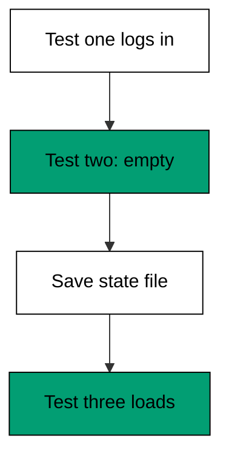

**`learning/code/ex-17-test-isolation/example.ts`**:

```typescript
// Example 17: Test Isolation With Fresh Contexts. (co-09: test-isolation)
// => Playwright 1.60.0, docs accessed 2026-10-20; each test gets its own
// => browser context (cookies, storage, history start empty), so a login in
// => one test can never leak into the next; sharing is opt-in via storage
// => state, never accidental:
// =>   real: test.use({ storageState: "admin.json" }) for the tests that share
import { readFile, writeFile } from "node:fs/promises"; // => readFile and writeFile persist the state file

interface Context {
  // => the modeled browser context
  cookies: Record<string, string>; // => this context's private cookie jar
} // => Context isolates storage the way Playwright contexts do

async function main(): Promise<void> {
  // => entry point for the isolation check
  const first: Context = { cookies: {} }; // => test one starts with an empty jar
  first.cookies["session"] = "abc"; // => test one logs in
  const second: Context = { cookies: {} }; // => test two starts empty too
  console.log("second sees session: " + String("session" in second.cookies)); // => Output: second sees session: false
  await writeFile(new URL("./state.json", import.meta.url), JSON.stringify(first.cookies)); // => opt-in sharing writes state
  const saved: string = await readFile(new URL("./state.json", import.meta.url), "utf-8"); // => the next test reads it back
  const third: Context = { cookies: JSON.parse(saved) as Record<string, string> }; // => storageState loads the session
  console.log("shared sees session: " + String(third.cookies["session"])); // => Output: shared sees session: abc
  console.log("isolation is default: " + String(!("session" in second.cookies))); // => Output: isolation is default: true
  console.log("sharing is opt-in: " + String(third.cookies["session"] === "abc")); // => Output: sharing is opt-in: true
} // => main ends; fresh by default, shared only when asked

await main(); // => run once; a failure throws and exits nonzero
```

**Output** (`learning/code/ex-17-test-isolation/expected/main.stdout.txt`):

```text
second sees session: false
shared sees session: abc
isolation is default: true
sharing is opt-in: true
```

**Key takeaway**: Tests start isolated by default and share state only through an explicit
storage-state file -- never through leftover cookies.

**Why it matters**: Shared mutable state between tests creates order dependence: the suite
passes in one order and fails in another. Fresh contexts make every test independently
re-runnable, which is what lets sharding and random ordering work later in this course. Example 68 proves the payoff directly: the suite that passes in random order is the suite whose tests are truly isolated.

---

### Example 18: First Custom Fixture

_ex-18 · exercises co-03_

`test.extend` creates a named fixture: setup builds the value, the test receives it as an
argument, teardown runs after. Fixtures replace copy-pasted setup with a named, reusable
starting state -- here, a logged-out page greeting its guest.

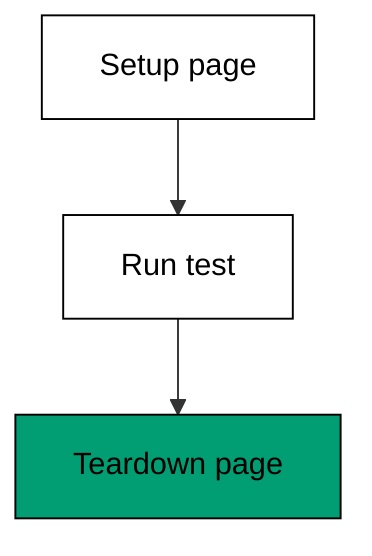

**`learning/code/ex-18-first-custom-fixture/example.ts`**:

```typescript
// Example 18: First Custom Fixture. (co-03: fixture)
// => Playwright 1.60.0, docs accessed 2026-10-20; test.extend creates a
// => named fixture: setup builds the value, the test receives it as an
// => argument, teardown runs after. Fixtures replace copy-pasted setup:
// =>   real: const test = base.extend({ page: async ({}, use) => { ... } });
interface FixturePage {
  // => what the fixture hands each test
  user: string | null; // => nobody logged in yet
  greeting: string; // => what the header shows
} // => FixturePage is the shared starting state

async function main(): Promise<void> {
  // => entry point for the fixture check
  await runTest("guest sees guest greeting", async (page) => {
    // => real: test("...", async ({ page }) => { ... })
    console.log("user: " + String(page.user)); // => Output: user: null
    console.log("greeting: " + page.greeting); // => Output: greeting: Welcome, guest
    console.log("fixture built the page: " + String(page.greeting.includes("guest"))); // => Output: fixture built the page: true
  }); // => teardown runs after the callback returns
} // => main ends; one test, one fixture lifecycle

async function loggedOutPage(): Promise<FixturePage> {
  // => the fixture setup function
  return { user: null, greeting: "Welcome, guest" }; // => build the logged-out page
} // => setup ends; the value is ready to hand over

async function teardown(_page: FixturePage): Promise<void> {
  // => the fixture teardown function
  return undefined; // => nothing to close for an in-memory page
} // => teardown ends; a real browser context would close here

async function runTest(_name: string, body: (page: FixturePage) => Promise<void>): Promise<void> {
  // => stand-in for test()
  const page: FixturePage = await loggedOutPage(); // => setup runs before the test
  await body(page); // => the test receives the fixture value
  await teardown(page); // => teardown runs after the test
} // => runTest wraps one test in the fixture lifecycle

await main(); // => run once; a failure throws and exits nonzero
```

**Output** (`learning/code/ex-18-first-custom-fixture/expected/main.stdout.txt`):

```text
user: null
greeting: Welcome, guest
fixture built the page: true
```

**Key takeaway**: Put shared starting state in a fixture -- the test declares what it needs and
the fixture builds and destroys it.

**Why it matters**: Copy-pasted setup drifts: five copies of "log in" evolve into five different
logins. One fixture means one login to maintain, and the test file shows only the behavior under
test. Example 49 extends the same idea to roles: one fixture per persona keeps permission tests readable as the matrix grows.

---

### Example 19: Fixture Setup and Teardown Order

_ex-19 · exercises co-03_

Everything before `use()` in a fixture is setup, everything after is teardown -- and teardown
runs even when the test fails, so browsers close and temp data is removed. The model records
both orders: passing and failing.

**`learning/code/ex-19-fixture-setup-teardown-order/example.ts`**:

```typescript
// Example 19: Fixture Setup and Teardown Order. (co-03: fixture)
// => Playwright 1.60.0, docs accessed 2026-10-20; everything before use()
// => in a fixture is setup, everything after is teardown; teardown runs even
// => when the test fails, so browsers close and temp data is removed:
// =>   real: await use(page); await page.close(); // teardown after use
async function main(): Promise<void> {
  // => entry point for the ordering check
  const log: string[] = []; // => the lifecycle record, in order
  await runTest(log, "adds milk", async () => {
    // => one test with logging hooks
    log.push("test body"); // => the test itself runs between setup and teardown
  }); // => teardown recorded after the body
  console.log("order: " + log.join(" > ")); // => Output: order: setup page > test body > teardown page
  console.log("setup first: " + String(log[0] === "setup page")); // => Output: setup first: true
  console.log("teardown last: " + String(log[log.length - 1] === "teardown page")); // => Output: teardown last: true
  const failing: string[] = []; // => a second record for a failing test
  try {
    // => the failing test throws; the record keeps the teardown proof
    await runFailingTest(failing); // => the test throws, teardown must still run
  } catch {
    // => the failure is expected here
    failing.push("test failed"); // => record the failure after teardown ran
  } // => failure absorbed; teardown already recorded
  console.log("teardown after failure: " + String(failing.includes("teardown page"))); // => Output: teardown after failure: true
} // => main ends; teardown ran in both cases

async function runTest(log: string[], _name: string, body: () => Promise<void>): Promise<void> {
  // => stand-in for test()
  log.push("setup page"); // => fixture setup: build the page
  await body(); // => the test body runs
  log.push("teardown page"); // => fixture teardown: close the page
} // => runTest records the passing lifecycle

async function runFailingTest(log: string[]): Promise<void> {
  // => stand-in for a failing test
  log.push("setup page"); // => setup still runs first
  try {
    // => the body throws below
    throw new Error("cart total wrong"); // => the test fails here
  } finally {
    // => teardown is unconditional
    log.push("teardown page"); // => teardown runs despite the failure
  } // => finally ends
} // => runFailingTest proves teardown is failure-proof

await main(); // => run once; a failure throws and exits nonzero
```

**Output** (`learning/code/ex-19-fixture-setup-teardown-order/expected/main.stdout.txt`):

```text
order: setup page > test body > teardown page
setup first: true
teardown last: true
teardown after failure: true
```

**Key takeaway**: Teardown is unconditional -- write it as if the test already failed, because
one day it will.

**Why it matters**: Leaked browsers and temp users accumulate across runs until CI chokes or
tests interfere with each other. Unconditional teardown keeps every run starting from the same
clean slate, which is what makes failures reproducible. The serial-file pattern in Example 73 depends on this guarantee: shared state is only safe when every test starts clean.

---

### Example 20: beforeEach Hooks Seed State

_ex-20 · exercises co-03_

`beforeEach` runs before every test in its scope, so each test starts from the same seeded cart
instead of depending on whatever the previous test left behind. The model starts dirty on
purpose and shows both tests seeing an empty cart.

**`learning/code/ex-20-beforeeach-hooks-seed-state/example.ts`**:

```typescript
// Example 20: beforeEach Hooks Seed State. (co-03: fixture)
// => Playwright 1.60.0, docs accessed 2026-10-20; beforeEach runs before
// => every test in its scope, so each test starts from the same seeded cart
// => instead of depending on whatever the previous test left behind:
// =>   real: test.beforeEach(async ({ page }) => { await page.goto("/cart"); });
interface Cart {
  // => the seeded shop state
  items: string[]; // => the items currently in the cart
} // => Cart is reset before every test

async function main(): Promise<void> {
  // => entry point for the hook check
  const seen: string[][] = []; // => what each test saw at its start
  await runSuite(async (cart) => {
    // => two tests sharing one beforeEach
    seen.push([...cart.items]); // => record the starting cart
    cart.items.push("milk"); // => the test mutates the cart
  }, 2); // => run two tests
  console.log("first saw: " + show(seen[0])); // => Output: first saw: (empty)
  console.log("second saw: " + show(seen[1])); // => Output: second saw: (empty)
  console.log("no leakage: " + String((seen[1] as string[]).length === 0)); // => Output: no leakage: true
  console.log("each test reseeded: " + String(seen.length === 2)); // => Output: each test reseeded: true
} // => main ends; both tests started empty

function show(items: string[] | undefined): string {
  // => render one recorded cart
  if (items === undefined || items.length === 0) {
    // => nothing recorded or nothing in it
    return "(empty)"; // => the test started from a clean cart
  } // => non-empty branch below
  return items.join(","); // => list what the test saw
} // => show avoids trailing whitespace in the transcript

async function beforeEach(cart: Cart): Promise<void> {
  // => the hook: reseed before every test
  cart.items = []; // => empty the cart, whatever the last test did
} // => beforeEach restores the starting state

async function runSuite(body: (cart: Cart) => Promise<void>, count: number): Promise<void> {
  // => stand-in for two tests
  const cart: Cart = { items: ["stale"] }; // => deliberately dirty starting state
  for (let i = 0; i < count; i++) {
    // => one iteration per test
    await beforeEach(cart); // => the hook runs before each test
    await body(cart); // => the test runs on seeded state
  } // => every test executed
} // => runSuite replays the suite with hooks

await main(); // => run once; a failure throws and exits nonzero
```

**Output** (`learning/code/ex-20-beforeeach-hooks-seed-state/expected/main.stdout.txt`):

```text
first saw: (empty)
second saw: (empty)
no leakage: true
each test reseeded: true
```

**Key takeaway**: Reset shared state in `beforeEach` -- each test then proves the behavior from
scratch instead of inheriting a predecessor's leftovers.

**Why it matters**: Tests that depend on execution order cannot run in parallel and cannot run
alone, which kills both sharding and focused debugging. Reseeding makes every test an
independent unit, and independent units scale. That independence is what the sharding examples cash in: units that run alone can run anywhere, in any order, at any count.

---

### Example 21: Worker-Scoped Fixture

_ex-21 · exercises co-03_

Most fixtures are test-scoped (fresh per test), but a server or app instance is worker-scoped:
built once, shared by every test on that worker, torn down at the end. The model builds once
and counts two reuses.

**`learning/code/ex-21-worker-scoped-fixture/example.ts`**:

```typescript
// Example 21: Worker-Scoped Fixture. (co-03: fixture)
// => Playwright 1.60.0, docs accessed 2026-10-20; most fixtures are
// => test-scoped (fresh per test), but a server or app instance is
// => worker-scoped ({ scope: "worker" }): built once, shared by every test
// => on that worker, torn down at the end:
// =>   real: export const test = base.extend<{ server: Server }>({ server: [async ({}, use) => { ... }, { scope: "worker" }] });
interface Server {
  // => the shared fixture server
  starts: number; // => how many times it was built
  hits: number; // => how many tests used it
} // => Server counts builds versus uses

async function main(): Promise<void> {
  // => entry point for the scope check
  const server: Server = { starts: 0, hits: 0 }; // => worker fixture starts unbuilt
  await workerFixture(server); // => first test triggers the single build
  await useServer(server); // => second test reuses the same server
  await useServer(server); // => third test reuses it too
  console.log("built times: " + String(server.starts)); // => Output: built times: 1
  console.log("used times: " + String(server.hits)); // => Output: used times: 2
  console.log("shared, not rebuilt: " + String(server.starts === 1 && server.hits === 2)); // => Output: shared, not rebuilt: true
} // => main ends; one build served two tests

async function workerFixture(server: Server): Promise<void> {
  // => the worker-scoped setup
  if (server.starts === 0) {
    // => build only when nothing exists yet
    server.starts = 1; // => record the single build
  } // => already built: reuse it
} // => workerFixture builds at most once

async function useServer(server: Server): Promise<void> {
  // => stand-in for a test using the server
  await workerFixture(server); // => every test asks, only the first builds
  server.hits += 1; // => record one more use
} // => useServer consumes the shared fixture

await main(); // => run once; a failure throws and exits nonzero
```

**Output** (`learning/code/ex-21-worker-scoped-fixture/expected/main.stdout.txt`):

```text
built times: 1
used times: 2
shared, not rebuilt: true
```

**Key takeaway**: Mark expensive shared setup worker-scoped -- one build per worker, reused by
every test on it.

**Why it matters**: Starting an app server per test multiplies suite time by the test count.
Worker scope pays the startup cost once per parallel worker, which is the difference between a
suite that runs in minutes and one that runs in an hour. The storage-state pattern in Example 45 is the companion saving: skip the login entirely and the worker starts testing immediately.

---

### Example 22: Sharing One Login

_ex-22 · exercises co-12, co-03_

Logging in once per test is slow and rate-limited; the setup-project pattern logs in a single
time, saves storage state, and every later test loads it instead. The password is typed exactly
once no matter how many tests need the session.

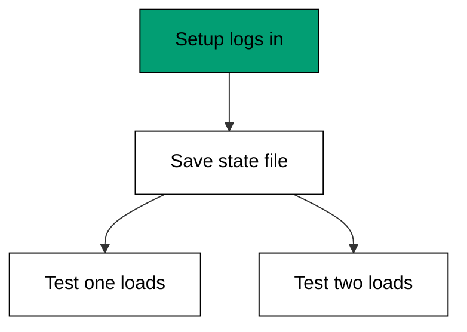

**`learning/code/ex-22-sharing-one-login/example.ts`**:

```typescript
// Example 22: Sharing One Login. (co-12: authentication-state, co-03: fixture)
// => Playwright 1.60.0, docs accessed 2026-10-20; logging in once per test
// => is slow and rate-limited; the setup-project pattern logs in a single
// => time, saves storage state, and every later test loads it instead:
// =>   real: await page.context().storageState({ path: "admin.json" });
import { readFile, writeFile } from "node:fs/promises"; // => the state file is the sharing mechanism

async function main(): Promise<void> {
  // => entry point for the login-sharing check
  const logins: number[] = [0]; // => how many real logins happened, by reference
  await loginOnce(logins); // => the setup project logs in
  await loginOnce(logins); // => the second test reuses the saved state
  console.log("real logins: " + String(logins[0])); // => Output: real logins: 1
  const state: string = await readFile(new URL("./state.json", import.meta.url), "utf-8"); // => storageState on disk
  const parsed = JSON.parse(state) as { user: string }; // => the saved session
  console.log("saved user: " + parsed.user); // => Output: saved user: admin
  console.log("one login serves all: " + String(logins[0] === 1 && parsed.user === "admin")); // => Output: one login serves all: true
} // => main ends; the password was typed once

async function loginOnce(counter: number[]): Promise<void> {
  // => stand-in for the setup project plus storageState load
  try {
    // => reuse wins when a state file already exists
    await readFile(new URL("./state.json", import.meta.url), "utf-8"); // => a saved session exists
  } catch {
    // => no state file yet: this is the first run
    counter[0] = (counter[0] as number) + 1; // => one real login happens here
    await writeFile(new URL("./state.json", import.meta.url), JSON.stringify({ user: "admin" })); // => save storageState
  } // => either reused or freshly saved
} // => loginOnce logs in at most once

await main(); // => run once; a failure throws and exits nonzero
```

**Output** (`learning/code/ex-22-sharing-one-login/expected/main.stdout.txt`):

```text
real logins: 1
saved user: admin
one login serves all: true
```

**Key takeaway**: Log in once in a setup project, save storage state, and load it everywhere --
the suite stops paying the login cost per test.

**Why it matters**: Login flows are the slowest and flakiest part of most apps (captchas,
rate limits, MFA). Doing it once removes the biggest single source of both suite time and
spurious red builds. Authentication-state reuse in Example 45 removes even that single login from most runs, leaving the slow flow exercised exactly once.

---

### Example 23: Overriding a Fixture Per Test

_ex-23 · exercises co-03_

`test.use` overrides a fixture for one file or one test -- a different user, a wider viewport --
while every other test keeps the default. Overrides compose without touching the shared fixture
definition, and the default is untouched for the next test.

**`learning/code/ex-23-overriding-a-fixture/example.ts`**:

```typescript
// Example 23: Overriding a Fixture Per Test. (co-03: fixture)
// => Playwright 1.60.0, docs accessed 2026-10-20; test.use overrides a
// => fixture for one file or one test (a different user, a wider viewport),
// => while every other test keeps the default; overrides compose without
// => touching the shared fixture definition:
// =>   real: test.use({ viewport: { width: 400, height: 800 } });
interface User {
  // => the user the fixture provides
  name: string; // => who is logged in
  role: string; // => what they may do
} // => User is the overridable value

async function main(): Promise<void> {
  // => entry point for the override check
  const def: User = defaultUser(); // => the shared default: a guest
  console.log("default role: " + def.role); // => Output: default role: viewer
  const admin: User = { ...def, name: "ada", role: "admin" }; // => real: test.use({ user: admin }) for one test
  console.log("override role: " + admin.role); // => Output: override role: admin
  const next: User = defaultUser(); // => the following test gets the default again
  console.log("default restored: " + String(next.role === "viewer")); // => Output: default restored: true
  console.log("override is local: " + String(def.role === "viewer" && admin.role === "admin")); // => Output: override is local: true
} // => main ends; the default survived the override

function defaultUser(): User {
  // => the shared fixture definition
  return { name: "guest", role: "viewer" }; // => a fresh default object every call
} // => defaultUser never returns a shared mutable object

await main(); // => run once; a failure throws and exits nonzero
```

**Output** (`learning/code/ex-23-overriding-a-fixture/expected/main.stdout.txt`):

```text
default role: viewer
override role: admin
default restored: true
override is local: true
```

**Key takeaway**: Override fixtures locally with `test.use` -- special cases stay special
instead of forking the shared setup.

**Why it matters**: One admin test must not turn the whole suite admin: a global change would
hide permission bugs everywhere else. Local overrides keep the exceptional test exceptional and
the default honest. Role-based fixtures in Example 49 generalize the override: each persona gets its own default, and tests stay honest at every level.

---

### Example 24: Fixture That Cleans Up

_ex-24 · exercises co-03_

A fixture that creates an order, a user, or a temp file must delete it in teardown, or one
suite run pollutes the next. The create-then-remove pair lives in the same fixture so no test
can forget half of it.

**`learning/code/ex-24-fixture-cleans-up/example.ts`**:

```typescript
// Example 24: Fixture That Cleans Up. (co-03: fixture)
// => Playwright 1.60.0, docs accessed 2026-10-20; a fixture that creates an
// => order, a user, or a temp file must delete it in teardown, or one
// => suite run pollutes the next; the create-then-remove pair lives in the
// => same fixture so no test can forget half of it:
// =>   real: const order = await createOrder(); await use(order); await deleteOrder(order.id);
async function main(): Promise<void> {
  // => entry point for the cleanup check
  const store: Map<string, string> = new Map(); // => the backend the fixture manages
  const id: string = createOrder(store); // => setup: the test gets a real order
  console.log("created: " + id); // => Output: created: order-1
  console.log("exists during test: " + String(store.has(id))); // => Output: exists during test: true
  deleteOrder(store, id); // => teardown: the fixture removes what it made
  console.log("gone after teardown: " + String(!store.has(id))); // => Output: gone after teardown: true
  console.log("store empty: " + String(store.size === 0)); // => Output: store empty: true
} // => main ends; nothing created survives the fixture

function createOrder(store: Map<string, string>): string {
  // => the setup half
  const id = "order-" + String(store.size + 1); // => deterministic id from the count
  store.set(id, "pending"); // => the order exists now
  return id; // => hand the id to the test
} // => createOrder returns what it registered

function deleteOrder(store: Map<string, string>, id: string): void {
  // => the teardown half
  store.delete(id); // => remove exactly what setup created
} // => deleteOrder leaves no residue

await main(); // => run once; a failure throws and exits nonzero
```

**Output** (`learning/code/ex-24-fixture-cleans-up/expected/main.stdout.txt`):

```text
created: order-1
exists during test: true
gone after teardown: true
store empty: true
```

**Key takeaway**: Every fixture that creates must delete -- setup and teardown are one pair, not
two favors.

**Why it matters**: Leftover test data is the slowest poison: suites pass for months, then a
"duplicate order" collision appears on a Friday. Teardown that removes exactly what setup
created keeps the backend pristine no matter how many times the suite runs. Data-driven tests in Example 40 multiply this discipline: ten rows through one fixture stay clean only when teardown is unconditional.

---

### Example 25: Grouping With Describe Blocks

_ex-25 · exercises co-03_

`test.describe` groups related tests under one name, and hooks or `test.use` inside the block
apply only there. Grouping is documentation the runner enforces: the report shows the same
structure the file shows.

**`learning/code/ex-25-grouping-describe/example.ts`**:

```typescript
// Example 25: Grouping With Describe Blocks. (co-03: fixture)
// => Playwright 1.60.0, docs accessed 2026-10-20; test.describe groups
// => related tests under one name, and hooks or test.use inside the block
// => apply only there; grouping is documentation the runner enforces:
// =>   real: test.describe("checkout", () => { test("guest pays", ...); });
interface Group {
  // => one describe block and its tests
  name: string; // => the group name
  tests: string[]; // => the tests inside it
} // => Group mirrors a describe block

async function main(): Promise<void> {
  // => entry point for the grouping check
  const groups: Group[] = [
    // => the suite structure
    { name: "checkout", tests: ["guest pays", "member pays"] }, // => two checkout tests
    { name: "search", tests: ["finds milk"] }, // => one search test
  ]; // => suite defined
  for (const group of groups) {
    // => the runner walks each group
    console.log(group.name + ": " + String(group.tests.length) + " tests"); // => Output: checkout: 2 tests (next line: search: 1 tests)
  } // => every group reported
  const total: number = groups.reduce((sum, group) => sum + group.tests.length, 0); // => add up every group
  console.log("total: " + String(total)); // => Output: total: 3
  console.log("scoped hooks stay inside: " + String(groups.length === 2 && total === 3)); // => Output: scoped hooks stay inside: true
} // => main ends; the structure is the documentation

await main(); // => run once; a failure throws and exits nonzero
```

**Output** (`learning/code/ex-25-grouping-describe/expected/main.stdout.txt`):

```text
checkout: 2 tests
search: 1 tests
total: 3
scoped hooks stay inside: true
```

**Key takeaway**: Group related tests with `test.describe` so hooks, overrides, and reports all
follow the same structure as the file.

**Why it matters**: A flat list of eighty tests is unnavigable: failures float without context
and hooks apply too broadly. Grouping turns the suite into a table of contents where each
section owns its own setup. Tags in Example 41 add the second axis: grouping organizes by feature, tags cut across groups for focused runs.
