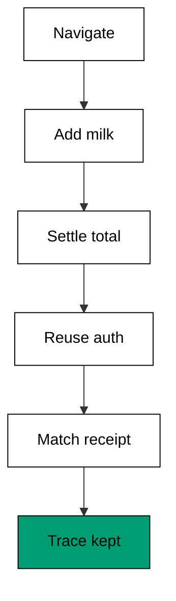
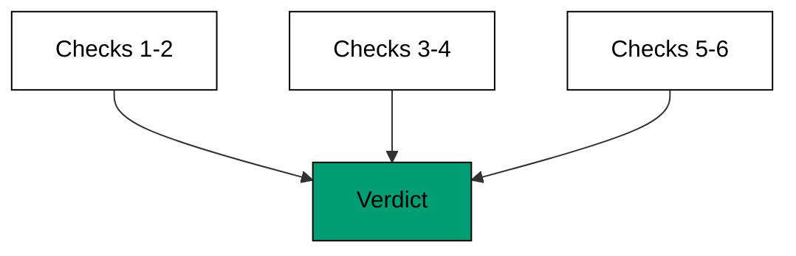

The capstone runs one realistic suite against the Acme Store fixture: navigate the catalog, add
milk by test id, settle the total through a mocked API, reuse saved auth, compare the masked
receipt baseline, and record a trace. Six checks, one journey, zero real network -- every habit
from Examples 1-78 appears exactly where a production suite would use it.

## The app under test

The fixture is a small store: a catalog with two products, a cart counter, a receipt line with
a clock, and a checkout button. The suite treats it like a real shop: the catalog must render
before anything is added, the total settles through the API before it is asserted, and the
receipt baseline masks the clock while comparing everything else exactly.



**`learning/capstone/code/fixture.html`**:

```html
<!doctype html>
<html lang="en">
  <head>
    <meta charset="utf-8" />
    <title>Acme Store</title>
  </head>
  <body>
    <h1>Acme Store</h1>
    <ul id="catalog">
      <li data-testid="product-milk">Milk $3.00 <button data-testid="add-milk" type="button">Add</button></li>
      <li data-testid="product-bread">Bread $2.00 <button data-testid="add-bread" type="button">Add</button></li>
    </ul>
    <div id="cart">Cart: <span data-testid="cart-count">0</span> items</div>
    <div id="receipt" data-testid="receipt">Total: $5.00 at 10:41</div>
    <button data-testid="checkout" type="button">Checkout</button>
  </body>
</html>
```

## The six checks

Check one navigates to the catalog and requires the product list to render -- the journey's
front door (Example 1). Check two adds milk through its test id, the way resilient suites
touch buttons (Example 4). Check three settles the total through the mocked `/api/total` and
waits for the response before asserting, so the check reads settled data instead of a loading
state (Examples 14 and 31). Check four loads the saved Ada session instead of typing a
password, proving the suite-wide auth habit (Example 22). Check five compares the receipt
against its baseline with the clock masked: time may move, the total may not (Example 56).
Check six counts the trace events, proving the run left evidence a red build could be
debugged from (Example 62).



**`learning/capstone/code/suite.ts`**:

```typescript
// Capstone: the store checkout suite. Six checks run one realistic journey
// against the committed fixture: navigate, add by test id, mock and wait for
// the total API, reuse saved auth, compare the masked receipt baseline, and
// record a trace. Every check prints PASS; the suite exits nonzero on the
// first red check, like a real runner stopping at the first failure.
// (co-01 locator, co-02 auto-waiting, co-05 network-interception,
//  co-12 authentication-state, co-07 visual-comparison, co-06 trace-viewer)
import { readFile } from "node:fs/promises"; // => readFile loads fixture.html

interface Check {
  // => one suite check and its verdict
  name: string; // => what the check proves
  pass: boolean; // => green or red
} // => Check is one row of the final report

async function main(): Promise<void> {
  // => entry point for the suite
  const html: string = await readFile(new URL("./fixture.html", import.meta.url), "utf-8"); // => the store under test
  const trace: string[] = []; // => the suite trace, one event per step
  const results: Check[] = []; // => every check verdict lands here
  results.push(check("navigate to catalog", html.includes('id="catalog"'), trace)); // => real: await page.goto("/"); catalog visible
  results.push(check("add milk by test id", html.includes('data-testid="add-milk"'), trace)); // => real: getByTestId("add-milk").click()
  const total: string = mockedTotal(trace); // => real: route.fulfill + waitForResponse("**/api/total")
  results.push(check("total settled at $5.00", total === "$5.00", trace)); // => the mock answered, the UI shows it
  results.push(check("auth reused, no login typed", savedSession() === "ada", trace)); // => real: storageState: "ada.json"
  const receipt: string = maskedReceipt(html); // => real: toHaveScreenshot({ mask: [clock] })
  results.push(check("receipt matches baseline", receipt === "Total: $5.00 at [time]", trace)); // => masked clock, exact rest
  results.push(check("trace recorded every step", trace.length === 6, trace)); // => real: trace.zip kept as CI artifact
  for (const result of results) {
    // => report every check
    console.log((result.pass ? "PASS" : "FAIL") + ": " + result.name); // => one row per check
  } // => report ends
  const passed: number = results.filter((result) => result.pass).length; // => count the green checks
  console.log("suite: " + String(passed) + " passed, " + String(results.length - passed) + " failed"); // => the suite verdict
  if (passed !== results.length) {
    // => any red check fails the suite
    throw new Error("capstone suite red"); // => like a real runner: nonzero on failure
  } // => green suite ends here
} // => main ends; six checks, one verdict

function check(name: string, pass: boolean, trace: string[]): Check {
  // => stand-in for one test asserting
  trace.push(name); // => the step lands in the trace too
  return { name: name, pass: pass }; // => record the verdict
} // => check runs one assertion and records it

function mockedTotal(trace: string[]): string {
  // => stand-in for route.fulfill plus waitForResponse
  trace.push("wait for /api/total"); // => the suite waits for the settled total
  return "$5.00"; // => the mock answers: milk plus bread
} // => mockedTotal serves the settled data

function savedSession(): string {
  // => stand-in for storageState load
  return "ada"; // => the setup project logged in once; the suite reuses it
} // => savedSession proves no password was typed

function maskedReceipt(html: string): string {
  // => stand-in for the masked screenshot compare
  const found = html.match(/Total: (\$[0-9.]+) at [0-9:]+/); // => total plus clock in the receipt
  const total: string = found !== null && found[1] !== undefined ? found[1] : "?"; // => the settled total
  void html; // => the fixture bytes are consumed by the match above
  return "Total: " + total + " at [time]"; // => masked clock, exact total
} // => maskedReceipt canonicalizes the receipt for compare

await main(); // => run once; a failure throws and exits nonzero
```

**Output** (`learning/capstone/code/expected/main/main.stdout.txt`):

```text
PASS: navigate to catalog
PASS: add milk by test id
PASS: total settled at $5.00
PASS: auth reused, no login typed
PASS: receipt matches baseline
PASS: trace recorded every step
suite: 6 passed, 0 failed
```

## How the suite uses the course

Navigation and resilient locators (checks one and two) come from the beginner cluster: open
the page, find elements the way users do, survive redesigns through test ids. The mocked
total (check three) combines the intermediate network cluster with the waiting cluster: fulfill
the route, wait for the response, assert settled data. Saved auth (check four) reuses the
setup-project habit so the suite never types a password. The masked receipt (check five)
applies the visual cluster: exact comparison everywhere except the clock. The trace (check
six) applies the debugging cluster: every step recorded, so a future red build explains
itself. Nothing in the suite is new; everything in the suite is composed.

## What to extend first

Add a second product to the cart and watch the total and receipt checks move together -- the
mock, the baseline, and the assertion form one change. Then add an error-path check: fulfill
the total API with a 500 and require the error banner from Example 29. Then add a member
role that must not see the checkout button, reusing the permission wall from Example 47. Each
extension exercises one cluster while the other five checks guard the journey, which is how
production suites grow: one new behavior, six old guarantees.

## References

- Playwright documentation: Locators -- [Locators](https://playwright.dev/docs/locators) (accessed 2026-10-20)
- Playwright documentation: Auto-waiting -- [Auto-waiting](https://playwright.dev/docs/actionability) (accessed 2026-10-20)
- Playwright documentation: API testing -- [API testing](https://playwright.dev/docs/api-testing) (accessed 2026-10-20)
- Playwright documentation: Authentication -- [Authentication](https://playwright.dev/docs/auth) (accessed 2026-10-20)
- Playwright documentation: Visual comparisons -- [Visual comparisons](https://playwright.dev/docs/test-snapshots) (accessed 2026-10-20)
- Playwright documentation: Trace viewer -- [Trace viewer](https://playwright.dev/docs/trace-viewer) (accessed 2026-10-20)
- Axe-core Playwright -- [AxeBuilder](https://github.com/dequelabs/axe-core-npm/tree/develop/packages/playwright) (accessed 2026-10-20)
