Examples 26-53 turn a pile of scripts into a suite: intercept and mock the network so pages are
tested without their backends, organize growing coverage in page objects, and reuse one login
across every test that needs it. Three clusters carry the level: network interception and
mocking (Examples 26-34), page objects and suite structure (Examples 35-44), and authentication
state reuse (Examples 45-53). Every example still serves its committed fixture on loopback and
checks the transcript the harness verifies.

---

### Example 26: First Route Interception

_ex-26 · exercises co-05_

`page.route` matches a URL pattern and fulfills it with canned bytes, so the test runs with no
backend at all: the UI renders from the mock exactly as from real data. Unrouted calls fail
loudly instead of silently reaching the network.

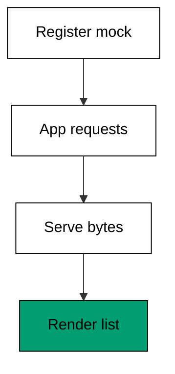

**`learning/code/ex-26-first-route-interception/example.ts`**:

```typescript
// Example 26: First Route Interception. (co-05: network-interception)
// => Playwright 1.60.0, docs accessed 2026-10-20; page.route matches a URL
// => pattern and fulfills it with canned bytes, so the test runs with no
// => backend at all; the UI renders from the mock exactly as from real data:
// =>   real: await page.route("**/api/products", async (route) => route.fulfill({ json: [...] }));
interface Mock {
  // => one canned reply
  status: number; // => the HTTP status to report
  body: string; // => the bytes the UI receives
} // => Mock is the whole backend for one URL

interface Seen {
  // => what the app asked for
  url: string; // => the requested URL
  served: string; // => the mock body it received
} // => Seen proves the app really called the mock

async function main(): Promise<void> {
  // => entry point for the route check
  const routes = new Map<string, Mock>(); // => the route table, empty at first
  routes.set("/api/products", { status: 200, body: '["milk","bread"]' }); // => real: page.route("**/api/products", ...)
  const seen: Seen[] = []; // => every request the app makes lands here
  const body: string = request(routes, seen, "/api/products"); // => the UI fetches the list
  const products = JSON.parse(body) as string[]; // => the UI parses what it got
  console.log("products: " + products.join(",")); // => Output: products: milk,bread
  console.log("requests seen: " + String(seen.length)); // => Output: requests seen: 1
  console.log("mock served: " + String(seen[0]?.served === body)); // => Output: mock served: true
  console.log("no backend needed: " + String(seen.length === 1 && products.length === 2)); // => Output: no backend needed: true
} // => main ends; the UI rendered from canned bytes

function request(routes: Map<string, Mock>, seen: Seen[], url: string): string {
  // => stand-in for fetch through page.route
  const mock: Mock | undefined = routes.get(url); // => first matching route wins
  if (mock === undefined) {
    // => no route matches: the call would hit the network
    throw new Error("unrouted request: " + url); // => fail loudly, never silently use live data
  } // => routed branch below
  seen.push({ url: url, served: mock.body }); // => record the interception
  return mock.body; // => serve the canned bytes
} // => request fulfills from the route table

await main(); // => run once; a failure throws and exits nonzero
```

**Output** (`learning/code/ex-26-first-route-interception/expected/main.stdout.txt`):

```text
products: milk,bread
requests seen: 1
mock served: true
no backend needed: true
```

**Key takeaway**: Mock at the network boundary with `page.route` -- the UI code under test stays
untouched while its backend becomes deterministic.

**Why it matters**: Backend-dependent UI tests inherit every backend flake and outage. Route
mocks cut that cord: the frontend suite runs offline, in milliseconds, with data shaped exactly
for the case under test. Example 32 shows the middle path when full mocks rot: pass real traffic through and override only the branch under test.

---

### Example 27: Abort Images and Fonts

_ex-27 · exercises co-05_

`route.abort` drops heavy asset requests -- images, fonts, media -- so layout tests run in a
fraction of the time. The page still renders the text content the assertions need; only
decoration stops downloading.

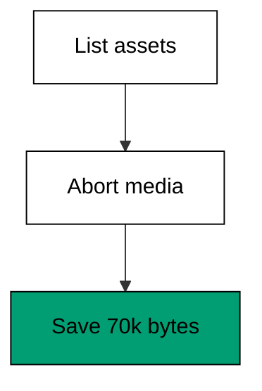

**`learning/code/ex-27-abort-images-and-fonts/example.ts`**:

```typescript
// Example 27: Abort Images and Fonts. (co-05: network-interception)
// => Playwright 1.60.0, docs accessed 2026-10-20; route.abort drops heavy
// => asset requests (images, fonts, media) so layout tests run in a fraction
// => of the time; the page still renders text content the test asserts on:
// =>   real: await page.route("**/*.{png,jpg,woff2}", (route) => route.abort());
interface Asset {
  // => one requested asset
  url: string; // => the asset URL
  bytes: number; // => its size when served
  aborted: boolean; // => true when the route dropped it
} // => Asset tracks what the page paid for

async function main(): Promise<void> {
  // => entry point for the abort check
  const assets: Asset[] = [
    // => what the fixture page asks for
    { url: "/app.js", bytes: 1200, aborted: false }, // => code: always load
    { url: "/hero.png", bytes: 48000, aborted: false }, // => image: abort in layout tests
    { url: "/font.woff2", bytes: 22000, aborted: false }, // => font: abort in layout tests
  ]; // => asset list defined
  const loaded: Asset[] = assets.filter((asset) => !shouldAbort(asset.url)); // => real: route.abort() for images/fonts
  const skipped: Asset[] = assets.filter((asset) => shouldAbort(asset.url)); // => the dropped ones
  for (const asset of skipped) {
    // => mark every aborted asset
    asset.aborted = true; // => dropped: zero bytes transferred
  } // => abort pass ends
  const saved: number = skipped.reduce((sum, asset) => sum + asset.bytes, 0); // => bytes never downloaded
  console.log("loaded: " + loaded.map((asset) => asset.url).join(",")); // => Output: loaded: /app.js
  console.log("aborted: " + String(skipped.length)); // => Output: aborted: 2
  console.log("bytes saved: " + String(saved)); // => Output: bytes saved: 70000
  console.log("page still testable: " + String(loaded.length === 1)); // => Output: page still testable: true
} // => main ends; text and logic load, decoration does not

function shouldAbort(url: string): boolean {
  // => stand-in for the route pattern
  return url.endsWith(".png") || url.endsWith(".woff2"); // => images and fonts are decoration here
} // => shouldAbort names the droppable kinds

await main(); // => run once; a failure throws and exits nonzero
```

**Output** (`learning/code/ex-27-abort-images-and-fonts/expected/main.stdout.txt`):

```text
loaded: /app.js
aborted: 2
bytes saved: 70000
page still testable: true
```

**Key takeaway**: Abort decoration requests in layout and logic tests -- text and code are all
the assertions need.

**Why it matters**: Media dominates page weight: two images can cost more than the entire test
budget. Aborting them is the cheapest speedup available, and it also removes the flakiest
requests (slow CDNs) from tests that never look at pictures. Pair it with Example 30's HAR replay and the suite gets realistic payloads at a fraction of the transfer cost.

---

### Example 28: Assert on the Request

_ex-28 · exercises co-05_

The route handler sees the outgoing request before answering it, so the test asserts on the
method, URL, and body the app sent -- not just the pixels it rendered. A form that posts the
wrong payload is broken even when the confirmation looks right.

**`learning/code/ex-28-assert-on-the-request/example.ts`**:

```typescript
// Example 28: Assert on the Request. (co-05: network-interception)
// => Playwright 1.60.0, docs accessed 2026-10-20; the route handler sees
// => the outgoing request before answering it, so the test asserts on the
// => method, URL, and body the app sent -- not just the pixels it rendered:
// =>   real: await page.route("**/api/order", async (route) => { captured = route.request().postDataJSON(); ... });
interface Captured {
  // => what the app sent
  method: string; // => GET, POST, and friends
  url: string; // => the request URL
  body: string; // => the raw request body
} // => Captured is the test's view of the outgoing call

async function main(): Promise<void> {
  // => entry point for the request check
  const captured: Captured[] = []; // => every intercepted request lands here
  const reply: string = postThroughRoute(captured, "/api/order", { item: "milk", count: 2 }); // => the app orders milk
  console.log("method: " + String(captured[0]?.method)); // => Output: method: POST
  console.log("url: " + String(captured[0]?.url)); // => Output: url: /api/order
  console.log("item: " + String(JSON.parse(String(captured[0]?.body))["item"])); // => Output: item: milk
  console.log("reply: " + reply); // => Output: reply: order-7
  console.log("payload correct: " + String(JSON.parse(String(captured[0]?.body))["count"] === 2)); // => Output: payload correct: true
} // => main ends; the request was correct, not just the pixels

function postThroughRoute(captured: Captured[], url: string, payload: Record<string, unknown>): string {
  // => stand-in for route + continue
  const body: string = JSON.stringify(payload); // => the app serializes the order
  captured.push({ method: "POST", url: url, body: body }); // => the route handler inspects it here
  return "order-7"; // => the mock confirms the order
} // => postThroughRoute records then answers

await main(); // => run once; a failure throws and exits nonzero
```

**Output** (`learning/code/ex-28-assert-on-the-request/expected/main.stdout.txt`):

```text
method: POST
url: /api/order
item: milk
reply: order-7
payload correct: true
```

**Key takeaway**: Capture the outgoing request in the route handler and assert on its payload --
the confirmation page cannot prove the order was correct.

**Why it matters**: UIs lie by omission: a success banner renders for any 200, including one
that saved the wrong item. Request assertions test the actual contract between frontend and
backend, which is where integration bugs live. Example 31 closes the loop by asserting both ends: the request the UI sent and the pixels it rendered afterward.

---

### Example 29: Mock an Error Response

_ex-29 · exercises co-05_

Fulfilling with a 500 exercises the app's error path on demand -- no staging outage needed. The
test then asserts the banner the user would see, covering the path most suites never touch
until production finds it first.

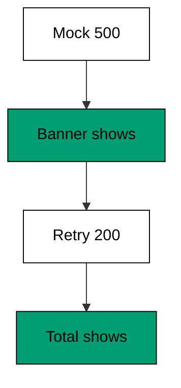

**`learning/code/ex-29-mock-an-error-response/example.ts`**:

```typescript
// Example 29: Mock an Error Response. (co-05: network-interception)
// => Playwright 1.60.0, docs accessed 2026-10-20; fulfilling with a 500
// => exercises the app's error path on demand -- no staging outage needed.
// => The test then asserts the banner the user would see, not the status:
// =>   real: await page.route("**/api/cart", (route) => route.fulfill({ status: 500, body: "boom" }));
interface Page {
  // => the modeled cart page
  banner: string; // => the error banner text, "" when none
  total: string; // => the cart total, "?" until data arrives
} // => Page shows either data or the error path

async function main(): Promise<void> {
  // => entry point for the error-path check
  const page: Page = { banner: "", total: "?" }; // => cart starts loading
  loadCart(page, 500); // => the backend fails once, on purpose
  console.log("banner: " + page.banner); // => Output: banner: Cart unavailable, try again
  console.log("total hidden: " + String(page.total === "?")); // => Output: total hidden: true
  const retry: Page = { banner: "", total: "?" }; // => a fresh page for the happy path
  loadCart(retry, 200); // => the backend recovers
  console.log("recovered total: " + retry.total); // => Output: recovered total: $42.00
  console.log("error path covered: " + String(page.banner !== "" && retry.total === "$42.00")); // => Output: error path covered: true
} // => main ends; both paths rendered

function loadCart(page: Page, status: number): void {
  // => stand-in for route.fulfill with a status
  if (status !== 200) {
    // => the backend is down in this scenario
    page.banner = "Cart unavailable, try again"; // => the app shows its error banner
    return; // => no total to render
  } // => happy path below
  page.total = "$42.00"; // => the app renders the settled total
} // => loadCart renders data or the error banner

await main(); // => run once; a failure throws and exits nonzero
```

**Output** (`learning/code/ex-29-mock-an-error-response/expected/main.stdout.txt`):

```text
banner: Cart unavailable, try again
total hidden: true
recovered total: $42.00
error path covered: true
```

**Key takeaway**: Mock failure statuses to cover error paths deterministically -- every 500 the
app can show should be shown in a test first.

**Why it matters**: Error paths are the least tested and most user-visible code in most apps:
the first real outage reveals that the banner never rendered, the retry never worked, or the
spinner never stopped. One mocked 500 per critical call prevents that discovery in production. Contract tests in Example 34 are the companion: mocks prove the UI handles the error, contracts prove the error shape never drifts.

---

### Example 30: Record and Replay With HAR

_ex-30 · exercises co-05_

Record mode stores real traffic into a `.har` archive once, then replay serves every later run
from the archive: deterministic, offline, and fast. The archive is updated only when the API
genuinely changes, and unknown URLs fail instead of hitting the network.

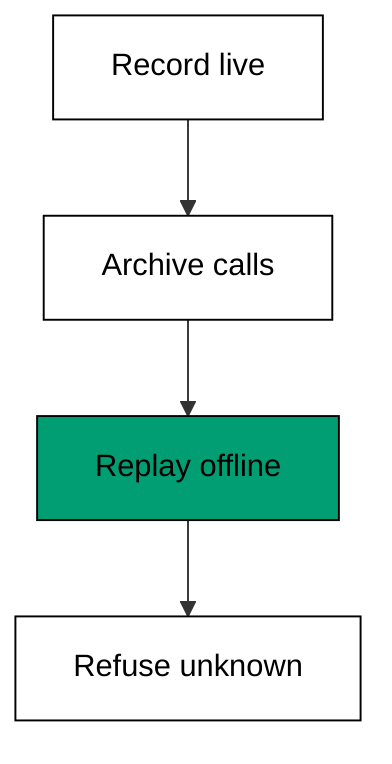

**`learning/code/ex-30-record-and-replay-with-har/example.ts`**:

```typescript
// Example 30: Record and Replay With HAR. (co-05: network-interception)
// => Playwright 1.60.0, docs accessed 2026-10-20; record: "record" mode
// => stores real traffic into a .har file once, then "replay" serves every
// => later run from the archive -- deterministic, offline, and fast. Update
// => the archive only when the API genuinely changes:
// =>   real: npx playwright test --config=replay.config.ts (har: "cart.har")
interface Entry {
  // => one archived exchange
  url: string; // => the request URL
  body: string; // => the recorded response bytes
} // => Entry is one line of the archive

async function main(): Promise<void> {
  // => entry point for the replay check
  const archive: Entry[] = [
    // => the committed .har equivalent: two calls
    { url: "/api/cart", body: '{"total":"$42.00"}' }, // => recorded once against the real backend
    { url: "/api/user", body: '{"name":"ada"}' }, // => recorded in the same session
  ]; // => archive fixed; later runs never touch the network
  const cart: string = replay(archive, "/api/cart"); // => served from the archive
  const user: string = replay(archive, "/api/user"); // => served from the archive
  console.log("cart: " + cart); // => Output: cart: {"total":"$42.00"}
  console.log("user: " + user); // => Output: user: {"name":"ada"}
  console.log("offline: " + String(cart.includes("42") && user.includes("ada"))); // => Output: offline: true
  try {
    // => unknown URLs stay unknown: the archive never invents data
    replay(archive, "/api/admin"); // => not recorded, must fail loudly
    console.log("unrecorded served: false"); // => unreachable when replay throws
  } catch {
    // => the archive refuses to answer
    console.log("unrecorded refused: true"); // => Output: unrecorded refused: true
  } // => strict replay ends
} // => main ends; the archive served everything recorded

function replay(archive: Entry[], url: string): string {
  // => stand-in for HAR replay mode
  const hit: Entry | undefined = archive.find((entry) => entry.url === url); // => exact URL match, like HAR replay
  if (hit === undefined) {
    // => nothing recorded for this URL
    throw new Error("no HAR entry for " + url); // => fail instead of hitting the network
  } // => recorded branch below
  return hit.body; // => serve the recorded bytes verbatim
} // => replay answers only from the archive

await main(); // => run once; a failure throws and exits nonzero
```

**Output** (`learning/code/ex-30-record-and-replay-with-har/expected/main.stdout.txt`):

```text
cart: {"total":"$42.00"}
user: {"name":"ada"}
offline: true
unrecorded refused: true
```

**Key takeaway**: Record real traffic once, replay it forever -- the suite runs offline against
responses a human verified.

**Why it matters**: HAR replay sits between hand-written mocks and live backends: realistic
payloads with none of the flakiness. It is the right default for integration-heavy pages where
crafting every response by hand would take longer than the feature. Re-record the HAR when the API version bumps; a stale recording fails loudly at replay time instead of silently testing yesterday's contract.

---

### Example 31: Wait for the API Then Assert UI

_ex-31 · exercises co-05, co-02_

Combining `route.fulfill` with `waitForResponse` asserts the full round trip: the app asked,
the mock answered, and the UI shows the answer. Three facts, one test -- and the request log
proves the exchange happened in order.

**`learning/code/ex-31-wait-for-api-then-assert-ui/example.ts`**:

```typescript
// Example 31: Wait for the API Then Assert UI. (co-05: network-interception, co-02: auto-waiting)
// => Playwright 1.60.0, docs accessed 2026-10-20; combining route.fulfill
// => with waitForResponse asserts the full round trip: the app asked, the
// => mock answered, and the UI shows the answer -- three facts, one test:
// =>   real: const [res] = await Promise.all([page.waitForResponse("**/api/total"), page.click()]);
async function main(): Promise<void> {
  // => entry point for the round-trip check
  const log: string[] = []; // => the round trip, in order
  const total: string = roundTrip(log); // => the app asks, the mock answers, the UI renders
  console.log("asked: " + String(log[0])); // => Output: asked: GET /api/total
  console.log("answered: " + String(log[1])); // => Output: answered: 200 $42.00
  console.log("rendered: " + total); // => Output: rendered: $42.00
  console.log("round trip complete: " + String(log.length === 2 && total === "$42.00")); // => Output: round trip complete: true
} // => main ends; request, response, and render all verified

function roundTrip(log: string[]): string {
  // => stand-in for route.fulfill plus waitForResponse
  log.push("GET /api/total"); // => the app sends its request
  log.push("200 $42.00"); // => the mock answers with the total
  return "$42.00"; // => the UI renders the answered total
} // => roundTrip records the full exchange

await main(); // => run once; a failure throws and exits nonzero
```

**Output** (`learning/code/ex-31-wait-for-api-then-assert-ui/expected/main.stdout.txt`):

```text
asked: GET /api/total
answered: 200 $42.00
rendered: $42.00
round trip complete: true
```

**Key takeaway**: Assert the request, the response, and the render together -- the round trip is
the feature, not any one of its legs.

**Why it matters**: Testing only the render leaves the exchange unverified: a hardcoded total
would pass. Testing only the mock leaves the UI unverified. The round-trip test pins both ends
to the same expectation, which is what "integration" actually means. Data-driven rows in Example 40 multiply the pattern: one round-trip body, a table of cases, no extra browsers.

---

### Example 32: Modify a Live Response

_ex-32 · exercises co-05_

`route.fetch` plus `fulfill` passes the real reply through with one field changed -- a discount
applied, a flag flipped -- exercising UI branches a static mock would need a second file for.
The rest of the payload stays real, so the test cannot drift from the API.

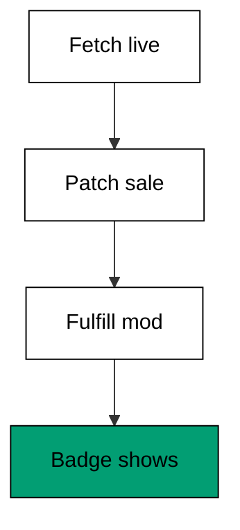

**`learning/code/ex-32-modify-a-live-response/example.ts`**:

```typescript
// Example 32: Modify a Live Response. (co-05: network-interception)
// => Playwright 1.60.0, docs accessed 2026-10-20; route.fetchResponse plus
// => fulfill lets the test pass the real reply through with one field
// => changed -- a discount applied, a flag flipped -- exercising UI branches
// => a static mock would need a second file for:
// =>   real: const res = await route.fetch(); await route.fulfill({ response: res, json: { ...await res.json(), sale: true } });
async function main(): Promise<void> {
  // => entry point for the modification check
  const live: Record<string, unknown> = { item: "milk", price: 3.0, sale: false }; // => what the backend really says
  const shown: Record<string, unknown> = modify(live, { sale: true, price: 2.4 }); // => real: fulfill with the tweaked json
  console.log("item: " + String(shown["item"])); // => Output: item: milk
  console.log("sale badge: " + String(shown["sale"])); // => Output: sale badge: true
  console.log("sale price: " + String(shown["price"])); // => Output: sale price: 2.4
  console.log("untouched keys kept: " + String(shown["item"] === "milk")); // => Output: untouched keys kept: true
} // => main ends; one field changed, the rest passed through

function modify(live: Record<string, unknown>, patch: Record<string, unknown>): Record<string, unknown> {
  // => stand-in for fetch plus fulfill
  return { ...live, ...patch }; // => the real reply with the patch applied on top
} // => modify keeps every key the patch does not name

await main(); // => run once; a failure throws and exits nonzero
```

**Output** (`learning/code/ex-32-modify-a-live-response/expected/main.stdout.txt`):

```text
item: milk
sale badge: true
sale price: 2.4
untouched keys kept: true
```

**Key takeaway**: Patch live responses instead of inventing whole ones -- one changed field per
branch, everything else real.

**Why it matters**: Fully hand-written mocks rot: the API gains a field and the mock silently
stays old, so the test proves a UI that no longer exists. Pass-through mocks inherit every real
field and override only the branch under test, which keeps them honest for free. The rot problem never fully disappears, so schedule re-validation: Example 34's contract checks catch the drift the mock absorbed.

---

### Example 33: API Testing With Request Context

_ex-33 · exercises co-14_

`request.newContext` drives the API directly with no browser page: faster than UI tests for
contract coverage, sharing fixtures and reporters with them. The context is disposed after the
suite, and the same assertions read naturally next to UI tests.

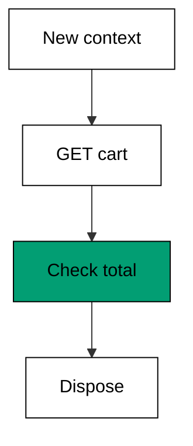

**`learning/code/ex-33-api-testing-with-request-context/example.ts`**:

```typescript
// Example 33: API Testing With Request Context. (co-14: api-testing)
// => Playwright 1.60.0, docs accessed 2026-10-20; request.newContext drives
// => the API directly with no browser page: faster than UI tests for
// => contract coverage, sharing fixtures and reporters with them. The context
// => is disposed after the suite:
// =>   real: const api = await request.newContext({ baseURL: "http://127.0.0.1:PORT" });
import http from "node:http"; // => node:http serves the fixture API with no network

async function main(): Promise<void> {
  // => entry point for the API check
  const server = http.createServer((req, res) => {
    // => the fixture API under test
    if (req.url === "/api/cart" && req.method === "GET") {
      // => the cart endpoint
      res.writeHead(200, { "content-type": "application/json" }); // => JSON reply
      res.end('{"items":["milk"],"total":"$3.00"}'); // => one item, known total
    } else {
      // => anything else is unknown
      res.writeHead(404, { "content-type": "text/plain" }); // => plain 404
      res.end("no such endpoint"); // => the body names the miss
    } // => routing ends
  }); // => server defined; not yet listening
  await new Promise<void>((resolve) => server.listen(0, "127.0.0.1", resolve)); // => free loopback port, never printed
  const address = server.address(); // => the bound address object
  const port: number = typeof address === "object" && address !== null ? address.port : 0; // => the chosen port number
  const base = "http://127.0.0.1:" + String(port); // => the base URL every call shares
  const cart = (await (await fetch(base + "/api/cart")).json()) as { items: string[]; total: string }; // => real: await api.get("/api/cart")
  console.log("items: " + cart.items.join(",")); // => Output: items: milk
  console.log("total: " + cart.total); // => Output: total: $3.00
  const missing: number = (await fetch(base + "/api/admin")).status; // => unknown endpoint
  console.log("missing status: " + String(missing)); // => Output: missing status: 404
  console.log("api covered without browser: " + String(cart.total === "$3.00" && missing === 404)); // => Output: api covered without browser: true
  server.close(); // => dispose the context equivalent
} // => main ends; the API answered, the page never opened

await main(); // => run once; a failure throws and exits nonzero
```

**Output** (`learning/code/ex-33-api-testing-with-request-context/expected/main.stdout.txt`):

```text
items: milk
total: $3.00
missing status: 404
api covered without browser: true
```

**Key takeaway**: Cover API contracts with the request context -- no browser, same reporters,
same fixtures, a tenth of the time.

**Why it matters**: Driving every API assertion through a browser pays rendering costs for
non-rendering checks. Request tests run the same assertions against the same backend in
milliseconds, leaving browser time for tests that actually need pixels. API setup in Example 43 is the same idea turned around: create state through the fast path, verify through the real one.

---

### Example 34: Contract Check on API Shapes

_ex-34 · exercises co-14_

An API test can assert the response shape -- required keys, value kinds -- so a backend rename
breaks the contract test instead of silently emptying the UI. Shape checks are cheaper than
schema validators and catch the same renames.

**`learning/code/ex-34-contract-check-on-api-shapes/example.ts`**:

```typescript
// Example 34: Contract Check on API Shapes. (co-14: api-testing)
// => Playwright 1.60.0, docs accessed 2026-10-20; an API test can assert
// => the response shape (required keys, value kinds), so a backend rename
// => breaks the contract test instead of silently emptying the UI. Shape
// => checks are cheaper than schema validators and catch the same renames:
// =>   real: expect(Object.keys(await res.json())).toEqual(["items", "total"]);
async function main(): Promise<void> {
  // => entry point for the contract check
  const good: Record<string, unknown> = { items: ["milk"], total: "$3.00" }; // => the backend keeps its promise
  const goodErrors: string[] = checkShape(good, ["items", "total"]); // => required keys present
  console.log("good errors: " + String(goodErrors.length)); // => Output: good errors: 0
  const renamed: Record<string, unknown> = { items: ["milk"], sum: "$3.00" }; // => backend renamed total to sum
  const badErrors: string[] = checkShape(renamed, ["items", "total"]); // => the contract names the missing key
  console.log("bad errors: " + badErrors.join(";")); // => Output: bad errors: missing key: total
  console.log("renamed field caught: " + String(badErrors.length === 1)); // => Output: renamed field caught: true
  const wrongKind: Record<string, unknown> = { items: "milk", total: "$3.00" }; // => items should be a list
  const kindErrors: string[] = checkShape(wrongKind, ["items", "total"]); // => kinds are checked too
  console.log("kind error: " + kindErrors.join(";")); // => Output: kind error: items is not a list
  console.log("contract holds: " + String(goodErrors.length === 0)); // => Output: contract holds: true
} // => main ends; renames fail loudly instead of emptying the UI

function checkShape(body: Record<string, unknown>, required: string[]): string[] {
  // => stand-in for shape assertions
  const errors: string[] = []; // => every violation lands here
  for (const key of required) {
    // => one check per required key
    if (!(key in body)) {
      // => the backend dropped or renamed the key
      errors.push("missing key: " + key); // => name the missing key exactly
    } // => presence checked
  } // => every required key checked
  if ("items" in body && !Array.isArray(body["items"])) {
    // => items must be a list when present
    errors.push("items is not a list"); // => a kind violation, not a missing key
  } // => kinds checked
  return errors; // => [] means the contract holds
} // => checkShape lists every violation at once

await main(); // => run once; a failure throws and exits nonzero
```

**Output** (`learning/code/ex-34-contract-check-on-api-shapes/expected/main.stdout.txt`):

```text
good errors: 0
bad errors: missing key: total
renamed field caught: true
kind error: items is not a list
contract holds: true
```

**Key takeaway**: Assert response shapes in API tests -- renames and kind changes fail loudly
instead of rendering as empty pages.

**Why it matters**: A renamed field is a silent UI wipe: no error, just a blank total. Contract
tests catch the rename at the boundary where it happened, with a message naming the exact key
instead of a screenshot of nothing. Run contracts per commit and screenshots per night: the cheap check guards the shape, the expensive check guards the pixels.

---

### Example 35: First Page Object

_ex-35 · exercises co-04_

A page object wraps one page's locators and actions in a class, so tests read as user intents
(login as Ada) instead of selector sequences. Locators live in exactly one place, and every
test through the object benefits when they change.

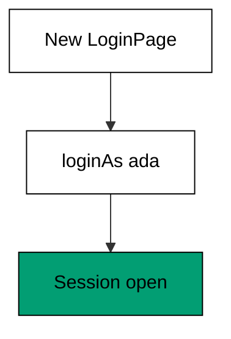

**`learning/code/ex-35-first-page-object/example.ts`**:

```typescript
// Example 35: First Page Object. (co-04: page-object)
// => Playwright 1.60.0, docs accessed 2026-10-20; a page object wraps one
// => page's locators and actions in a class, so tests read as user intents
// => (login as ada) instead of selector sequences; locators live in exactly
// => one place:
// =>   real: class LoginPage { constructor(page) { this.user = page.getByLabel("User"); } async login(u, p) { ... } }
interface Account {
  // => the modeled backend account
  user: string; // => the login name
  pass: string; // => the password
  loggedIn: boolean; // => the session state
} // => Account is what the page object drives

class LoginPage {
  // => the page object for the login page
  account: Account; // => the backend this page talks to
  constructor(account: Account) {
    // => real: constructor(page: Page) stores locators
    this.account = account; // => keep the dependency for every action
  } // => construction only stores; it never acts
  async loginAs(user: string, pass: string): Promise<boolean> {
    // => real: fill user, fill pass, click Sign in
    this.account.user = user; // => the user field receives the name
    this.account.pass = pass; // => the password field receives the secret
    this.account.loggedIn = user === "ada" && pass === "s3cret"; // => the app checks the pair
    return this.account.loggedIn; // => the action reports the outcome
  } // => loginAs performs the whole user intent at once
} // => LoginPage hides selectors behind one named action

async function main(): Promise<void> {
  // => entry point for the page-object check
  const good: Account = { user: "", pass: "", loggedIn: false }; // => a fresh account
  const page: LoginPage = new LoginPage(good); // => the test builds the page object
  console.log("login ok: " + String(await page.loginAs("ada", "s3cret"))); // => Output: login ok: true
  const bad: Account = { user: "", pass: "", loggedIn: false }; // => a second account
  const badPage: LoginPage = new LoginPage(bad); // => same object, different backend
  console.log("wrong pass rejected: " + String(!(await badPage.loginAs("ada", "nope")))); // => Output: wrong pass rejected: true
  console.log("intent not selectors: " + String(good.loggedIn && !bad.loggedIn)); // => Output: intent not selectors: true
} // => main ends; the test never names a selector

await main(); // => run once; a failure throws and exits nonzero
```

**Output** (`learning/code/ex-35-first-page-object/expected/main.stdout.txt`):

```text
login ok: true
wrong pass rejected: true
intent not selectors: true
```

**Key takeaway**: Wrap each page in a class exposing user intents -- tests call `loginAs`, never
`fill` plus `click` plus `waitForURL`.

**Why it matters**: Selector churn is the maintenance tax of UI suites. A page object pays it in
one place: when a label changes, one class changes, and fifty tests keep passing without a
single edit. The chained actions in Example 37 build on this: once selectors live in the object, journeys become method calls.

---

### Example 36: Locators Live in the Object

_ex-36 · exercises co-04, co-01_

Define each locator once in the constructor and reuse it across actions: when the selector
changes, exactly one line changes and every test using the object is fixed. The model counts
definitions versus uses to prove the ratio.

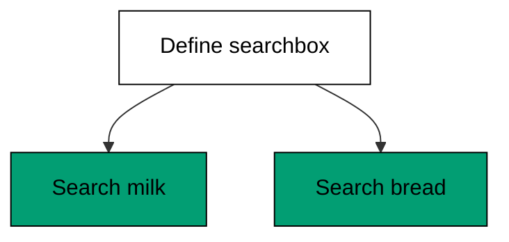

**`learning/code/ex-36-locators-live-in-the-object/example.ts`**:

```typescript
// Example 36: Locators Live in the Object. (co-04: page-object, co-01: locator)
// => Playwright 1.60.0, docs accessed 2026-10-20; define each locator once
// => in the constructor and reuse it across actions; when the selector
// => changes, exactly one line changes and every test using the object is
// => fixed:
// =>   real: this.search = page.getByRole("searchbox"); // once, then reused
async function main(): Promise<void> {
  // => entry point for the single-definition check
  const defined: string[] = []; // => every locator definition is recorded here
  const page: SearchPage = new SearchPage(defined); // => construction defines the locators
  await page.searchFor("milk"); // => first action reuses the stored locator
  await page.searchFor("bread"); // => second action reuses the same stored locator
  const definitions: number = defined.filter((entry) => entry === "define searchbox").length; // => how many times it was defined
  console.log("definitions: " + String(definitions)); // => Output: definitions: 1
  console.log("uses: " + String(defined.filter((entry) => entry === "use searchbox").length)); // => Output: uses: 2
  console.log("defined once, used twice: " + String(definitions === 1)); // => Output: defined once, used twice: true
} // => main ends; one definition served two searches

class SearchPage {
  // => the page object for the search page
  log: string[]; // => the definition record
  uses: number; // => how many actions ran
  constructor(log: string[]) {
    // => the constructor defines locators once
    this.log = log; // => keep the record
    this.uses = 0; // => no action ran yet
    this.log.push("define searchbox"); // => real: this.search = page.getByRole("searchbox")
  } // => construction ends; the locator is ready
  async searchFor(query: string): Promise<void> {
    // => real: await this.search.fill(query); await this.search.press("Enter")
    this.log.push("use searchbox"); // => the stored locator acts, never redefined
    this.uses += 1; // => count one more action
    void query; // => the query is consumed by the modeled fill
  } // => searchFor reuses without redefining
} // => SearchPage holds one locator for every action

await main(); // => run once; a failure throws and exits nonzero
```

**Output** (`learning/code/ex-36-locators-live-in-the-object/expected/main.stdout.txt`):

```text
definitions: 1
uses: 2
defined once, used twice: true
```

**Key takeaway**: Constructors define locators, actions use them -- the one-definition rule
makes selector changes one-line fixes.

**Why it matters**: Tests that each define their own copy of a selector multiply every UI
change by the test count. Central definitions turn redesigns from week-long selector hunts
into single-line edits with suite-wide effect. Components in Example 38 push the definition down one more level, so a widget redesign touches one file however many pages embed it.

---

### Example 37: Actions Return Next Page

_ex-37 · exercises co-04_

Navigation actions return the next page object, so the test chains intents (`login` returns
the dashboard) and the type system forbids dashboard actions before login. Failed logins
return null instead of a page the app never showed.

**`learning/code/ex-37-actions-return-next-page/example.ts`**:

```typescript
// Example 37: Actions Return Next Page. (co-04: page-object)
// => Playwright 1.60.0, docs accessed 2026-10-20; navigation actions return
// => the next page object, so the test chains intents (login returns the
// => dashboard) and the type system forbids dashboard actions before login:
// =>   real: const dashboard = await login.loginAs("ada", "s3cret"); await dashboard.openOrders();
class DashboardPage {
  // => the page object for the dashboard
  ordersOpened: number; // => how many times orders opened
  constructor() {
    // => built only through a successful login
    this.ordersOpened = 0; // => nothing opened yet
  } // => construction ends
  openOrders(): string[] {
    // => real: await this.ordersLink.click()
    this.ordersOpened += 1; // => the orders page shows
    return ["order-1", "order-2"]; // => two orders listed
  } // => openOrders navigates within the dashboard
} // => DashboardPage exists only after login

class LoginPage {
  // => the page object for the login page
  ok: boolean; // => whether these credentials work
  constructor(ok: boolean) {
    // => the backend verdict, modeled
    this.ok = ok; // => keep the verdict
  } // => construction ends
  loginAs(user: string): DashboardPage | null {
    // => real: fill, click, return new DashboardPage(page)
    if (!this.ok) {
      // => wrong credentials stay on the login page
      return null; // => no dashboard without a login
    } // => success branch below
    void user; // => the name is consumed by the modeled fill
    return new DashboardPage(); // => navigation hands over the next object
  } // => loginAs returns the page the app shows
} // => LoginPage hands off only on success

async function main(): Promise<void> {
  // => entry point for the chaining check
  const dashboard: DashboardPage | null = new LoginPage(true).loginAs("ada"); // => login succeeds
  console.log("orders: " + String(dashboard !== null ? dashboard.openOrders().join(",") : "")); // => Output: orders: order-1,order-2
  const denied: DashboardPage | null = new LoginPage(false).loginAs("mallory"); // => login fails
  console.log("denied stays null: " + String(denied === null)); // => Output: denied stays null: true
  console.log("chain needs login: " + String(dashboard !== null && denied === null)); // => Output: chain needs login: true
} // => main ends; the chain mirrors the navigation

await main(); // => run once; a failure throws and exits nonzero
```

**Output** (`learning/code/ex-37-actions-return-next-page/expected/main.stdout.txt`):

```text
orders: order-1,order-2
denied stays null: true
chain needs login: true
```

**Key takeaway**: Return the next page object from navigation actions -- the chain documents the
user's journey and the types enforce its order.

**Why it matters**: Tests that navigate through raw URLs can assert dashboard state without
logging in, proving nothing about the real journey. Chained page objects make impossible
journeys unrepresentable, so every green test walked a path a user could walk. That guarantee is what makes the capstone suite trustworthy: six chained journeys, each one a walk a shopper could take.

---

### Example 38: Component Objects for Reused Widgets

_ex-38 · exercises co-04_

A widget appearing on many pages -- the header search box -- becomes a component object owned
by each page object. The widget logic stays in one class no matter how many pages embed it,
and both pages below share a single instance.


**`learning/code/ex-38-component-objects/example.ts`**:

```typescript
// Example 38: Component Objects for Reused Widgets. (co-04: page-object)
// => Playwright 1.60.0, docs accessed 2026-10-20; a widget appearing on
// => many pages (search box in the header) becomes a component object owned
// => by each page object; the widget logic stays in one class no matter how
// => many pages embed it:
// =>   real: class Header { constructor(page) { this.search = page.getByRole("searchbox"); } }
class HeaderSearch {
  // => the component object for the header search box
  queries: string[]; // => every submitted query, in order
  constructor() {
    // => no page needed in the model
    this.queries = []; // => nothing searched yet
  } // => construction ends
  submit(query: string): void {
    // => real: fill searchbox, press Enter
    this.queries.push(query); // => record the submitted query
  } // => submit models one search
} // => HeaderSearch is embedded, never copied

class HomePage {
  // => one page embedding the header
  header: HeaderSearch; // => the shared component
  constructor(header: HeaderSearch) {
    // => the component arrives, not duplicated
    this.header = header; // => keep the shared instance
  } // => construction ends
} // => HomePage owns the header by reference

class OrdersPage {
  // => another page embedding the same header
  header: HeaderSearch; // => the same shared component
  constructor(header: HeaderSearch) {
    // => the component arrives, not duplicated
    this.header = header; // => keep the shared instance
  } // => construction ends
} // => OrdersPage owns the header by reference

async function main(): Promise<void> {
  // => entry point for the component check
  const header: HeaderSearch = new HeaderSearch(); // => one component instance
  const home: HomePage = new HomePage(header); // => home embeds it
  const orders: OrdersPage = new OrdersPage(header); // => orders embeds the same one
  home.header.submit("milk"); // => search from home
  orders.header.submit("bread"); // => search from orders
  console.log("queries: " + header.queries.join(",")); // => Output: queries: milk,bread
  console.log("one class, two pages: " + String(header.queries.length === 2)); // => Output: one class, two pages: true
} // => main ends; one widget class served two pages

await main(); // => run once; a failure throws and exits nonzero
```

**Output** (`learning/code/ex-38-component-objects/expected/main.stdout.txt`):

```text
queries: milk,bread
one class, two pages: true
```

**Key takeaway**: Extract repeated widgets into component objects -- one class per widget,
embedded wherever the widget appears.

**Why it matters**: Copy-pasted widget logic across page objects recreates the exact
maintenance problem page objects were invented to solve. Components keep the "define once"
rule true at every scale of reuse, from one page to fifty. Example 5's filters are the locator-level twin: anchor to meaning once, and reordering stops breaking tests at any scale.

---

### Example 39: Shared Steps Without Inheritance

_ex-39 · exercises co-04_

Shared behavior belongs in plain helper functions taking the page, not in base classes:
helpers compose freely while inheritance locks every test into one hierarchy. Import the
helper where needed; extend nothing.

**`learning/code/ex-39-shared-steps-without-inheritance/example.ts`**:

```typescript
// Example 39: Shared Steps Without Inheritance. (co-04: page-object)
// => Playwright 1.60.0, docs accessed 2026-10-20; shared behavior belongs
// => in plain helper functions taking the page, not in base classes: helpers
// => compose freely while inheritance locks every test into one hierarchy.
// => The fixtures chapter extends this with test.extend:
// =>   real: async function payAs(page: Page, user: string) { ... } // imported, not inherited
async function main(): Promise<void> {
  // => entry point for the helper check
  const log: string[] = []; // => every helper call records its name
  await payAs(log, "guest"); // => first test uses the helper
  await payAs(log, "member"); // => second test reuses it unchanged
  console.log("calls: " + log.join(",")); // => Output: calls: payAs(guest),payAs(member)
  console.log("helper reused: " + String(log.length === 2)); // => Output: helper reused: true
  console.log("no base class: " + String(!log.some((entry) => entry.includes("extends")))); // => Output: no base class: true
} // => main ends; composition beat inheritance

async function payAs(log: string[], user: string): Promise<void> {
  // => the shared checkout helper
  log.push("payAs(" + user + ")"); // => one line per use, no class needed
} // => payAs is imported by any test that pays

await main(); // => run once; a failure throws and exits nonzero
```

**Output** (`learning/code/ex-39-shared-steps-without-inheritance/expected/main.stdout.txt`):

```text
calls: payAs(guest),payAs(member)
helper reused: true
no base class: true
```

**Key takeaway**: Share steps through imported functions, not base classes -- helpers combine
in any order while hierarchies allow exactly one.

**Why it matters**: Base-class test hierarchies ossify: the third cross-cutting concern forces
multiple inheritance or duplication. Functions compose without ceremony, so the suite's shared
vocabulary grows by addition instead of restructuring. Tags in Example 41 compose the same way: independent markers combine into lanes without touching the suite's structure, which is exactly why the third concern stays cheap.

---

### Example 40: Data-Driven Tests

_ex-40 · exercises co-04_

Looping over a row table runs the same test body against many inputs, with one failure
pointing at its row. Test titles interpolate the row so the report names the case, not just
the loop.

**`learning/code/ex-40-data-driven-tests/example.ts`**:

```typescript
// Example 40: Data-Driven Tests. (co-04: page-object)
// => Playwright 1.60.0, docs accessed 2026-10-20; looping over a row table
// => runs the same test body against many inputs with one failure pointing
// => at its row; test titles interpolate the row so the report names the
// => case:
// =>   real: for (const { user, total } of rows) test(`pays ${user}`, ...)
interface CartRow {
  // => one data row
  user: string; // => who pays in this case
  total: string; // => the total they should see
} // => CartRow carries one case

async function main(): Promise<void> {
  // => entry point for the data-driven check
  const rows: CartRow[] = [
    // => the case table
    { user: "guest", total: "$3.00" }, // => guest buys milk
    { user: "member", total: "$2.40" }, // => member gets the discount
  ]; // => table fixed; cases are data, not code
  const passed: string[] = []; // => every passing case title lands here
  for (const row of rows) {
    // => one iteration per case
    const total: string = checkoutTotal(row.user); // => the behavior under test
    if (total === row.total) {
      // => the case passes
      passed.push("pays " + row.user); // => the title names its row
    } // => pass recorded
  } // => every case executed
  console.log("passed: " + passed.join("; ")); // => Output: passed: pays guest; pays member
  console.log("all rows ran: " + String(passed.length === rows.length)); // => Output: all rows ran: true
  console.log("one body, two cases: " + String(rows.length === 2)); // => Output: one body, two cases: true
} // => main ends; the table drove the test

function checkoutTotal(user: string): string {
  // => the modeled checkout total
  return user === "member" ? "$2.40" : "$3.00"; // => members get the discount
} // => checkoutTotal prices by user kind

await main(); // => run once; a failure throws and exits nonzero
```

**Output** (`learning/code/ex-40-data-driven-tests/expected/main.stdout.txt`):

```text
passed: pays guest; pays member
all rows ran: true
one body, two cases: true
```

**Key takeaway**: Drive variations with data tables -- one body, many rows, and each failure
names its row.

**Why it matters**: Copy-pasted test bodies for each input rot independently: a fix lands in
three copies and misses the fourth. Tables keep the behavior in one body and the variation in
data, so new cases are new rows, not new code. Example 24's teardown rule guards the multiplication: forty rows stay clean only when cleanup is unconditional.

---

### Example 41: Tagging and Focusing Tests

_ex-41 · exercises co-04_

Title tags (`@smoke`, `@slow`) select subsets with `--grep`: the smoke lane runs per commit,
the full suite runs nightly. `test.only` focuses one test locally and must never be committed
-- the model proves no title carries it.

**`learning/code/ex-41-tagging-and-focusing-tests/example.ts`**:

```typescript
// Example 41: Tagging and Focusing Tests. (co-04: page-object)
// => Playwright 1.60.0, docs accessed 2026-10-20; title tags (@smoke, @slow)
// => select subsets with --grep: the smoke lane runs per commit, the full
// => suite runs nightly; test.only focuses one test locally and must never
// => be committed:
// =>   real: test("guest pays @smoke", ...) then npx playwright test --grep @smoke
interface Tagged {
  // => one test with its tags
  title: string; // => the test title
  tags: string[]; // => the @tags in the title
} // => Tagged is selectable by grep

async function main(): Promise<void> {
  // => entry point for the tagging check
  const suite: Tagged[] = [
    // => three tests, two tagged smoke
    { title: "guest pays @smoke", tags: ["@smoke"] }, // => per-commit lane
    { title: "member pays @smoke", tags: ["@smoke"] }, // => per-commit lane
    { title: "renders 10k rows @slow", tags: ["@slow"] }, // => nightly lane
  ]; // => suite defined
  const smoke: Tagged[] = suite.filter((test) => test.tags.includes("@smoke")); // => real: --grep @smoke
  console.log("smoke: " + smoke.map((test) => test.title).join("; ")); // => Output: smoke: guest pays @smoke; member pays @smoke
  console.log("smoke count: " + String(smoke.length)); // => Output: smoke count: 2
  console.log("slow excluded: " + String(!smoke.some((test) => test.tags.includes("@slow")))); // => Output: slow excluded: true
  console.log("focus stays local: " + String(suite.every((test) => !test.title.includes(".only")))); // => Output: focus stays local: true
} // => main ends; grep selected the fast lane

await main(); // => run once; a failure throws and exits nonzero
```

**Output** (`learning/code/ex-41-tagging-and-focusing-tests/expected/main.stdout.txt`):

```text
smoke: guest pays @smoke; member pays @smoke
smoke count: 2
slow excluded: true
focus stays local: true
```

**Key takeaway**: Tag tests by lane and select with `--grep` -- fast feedback per commit, full
coverage nightly, and no focused test ever committed.

**Why it matters**: One suite cannot serve both speeds: per-commit runs need minutes, nightly
runs need everything. Tags let one codebase produce both lanes without forks, and the
no-`.only` check keeps a debugging shortcut from silently disabling the suite in CI. Sharding in Example 71 consumes the same lanes: the per-commit lane splits across workers while the nightly lane runs everything serially.

---

### Example 42: Retrying Only the Flaky Step

_ex-42 · exercises co-10, co-04_

When one step (coupon apply) flakes while the rest is solid, retry the step inside the test
instead of the whole test: faster, and the retry stays visible next to the step it protects.
Solid steps still run once -- the retry budget spends only where flakiness lives.

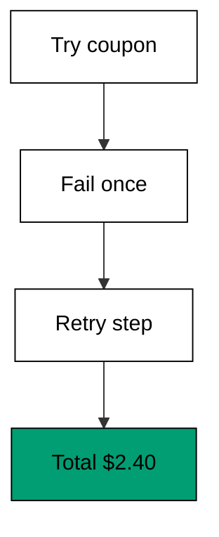

**`learning/code/ex-42-retrying-only-the-flaky-step/example.ts`**:

```typescript
// Example 42: Retrying Only the Flaky Step. (co-10: retry-policy, co-04: page-object)
// => Playwright 1.60.0, docs accessed 2026-10-20; when one step (coupon
// => apply) flakes while the rest is solid, retry the step inside the test
// => instead of retrying the whole test: faster, and the retry stays visible
// => next to the step it protects:
// =>   real: await expect(async () => { await page.getByRole("button", { name: "Apply" }).click(); ... }).toPass();
async function main(): Promise<void> {
  // => entry point for the step-retry check
  const attempts: number[] = [0]; // => how many times the step ran, by reference
  const total: string = retryStep(attempts, 1); // => the coupon step fails once, then passes
  console.log("attempts: " + String(attempts[0])); // => Output: attempts: 2
  console.log("total: " + total); // => Output: total: $2.40
  console.log("step retried, test did not: " + String(attempts[0] === 2)); // => Output: step retried, test did not: true
  const steady: number[] = [0]; // => a solid step never needs a second try
  retryStep(steady, 0); // => passes on the first attempt
  console.log("solid step runs once: " + String(steady[0] === 1)); // => Output: solid step runs once: true
} // => main ends; the retry stayed inside the flaky step

function flakyCouponStep(attempts: number[], failFirst: number): string {
  // => the step under test
  attempts[0] = (attempts[0] as number) + 1; // => count this attempt
  if ((attempts[0] as number) <= failFirst) {
    // => the first attempts fail
    throw new Error("coupon service hiccup"); // => a transient backend fault
  } // => later attempts proceed
  return "$2.40"; // => the discounted total
} // => flakyCouponStep fails, then recovers

function retryStep(attempts: number[], failFirst: number): string {
  // => stand-in for expect().toPass()
  const budget = 3; // => at most three tries for this step
  for (let i = 0; i < budget; i++) {
    // => one iteration per attempt
    try {
      // => the step may fail transiently
      return flakyCouponStep(attempts, failFirst); // => success returns immediately
    } catch {
      // => transient failure: try again
      continue; // => next attempt
    } // => catch ends
  } // => budget exhausted
  throw new Error("step failed after retries"); // => genuinely broken, fail loudly
} // => retryStep bounds the step's patience

await main(); // => run once; a failure throws and exits nonzero
```

**Output** (`learning/code/ex-42-retrying-only-the-flaky-step/expected/main.stdout.txt`):

```text
attempts: 2
total: $2.40
step retried, test did not: true
solid step runs once: true
```

**Key takeaway**: Wrap the flaky step in a bounded retry (`expect().toPass()`) instead of
retrying the whole test -- cheaper and precisely located.

**Why it matters**: Whole-test retries re-run minutes of solid setup to forgive one flaky
second, and they hide which step actually hurt. Step retries cost one extra attempt of the
guilty step and document the flakiness at its source. The budget from Example 15 applies here too: retry the proven-flaky step, and let genuinely broken steps fail fast.

---

### Example 43: API Setup Then UI Verify

_ex-43 · exercises co-14, co-04_

Create the test's preconditions through the API -- fast, no clicking through setup screens --
then verify the one thing only the UI can show. Setup flies, the assertion stays honest: the
fast path builds state, the real path proves it renders.

**`learning/code/ex-43-api-setup-then-ui-verify/example.ts`**:

```typescript
// Example 43: API Setup Then UI Verify. (co-14: api-testing, co-04: page-object)
// => Playwright 1.60.0, docs accessed 2026-10-20; create the test's
// => preconditions through the API (fast, no clicking through setup
// => screens), then verify the one thing only the UI can show. Setup flies,
// => assertion stays honest:
// =>   real: const order = await api.post("/api/orders", {...}); await page.goto(`/orders/${order.id}`);
interface Order {
  // => the order created through the API
  id: string; // => the order id the UI will show
  item: string; // => what was ordered
} // => Order crosses the API/UI boundary

async function main(): Promise<void> {
  // => entry point for the mixed check
  const backend: Order[] = []; // => the backend the API writes to
  const created: Order = apiCreateOrder(backend, "milk"); // => real: await api.post("/api/orders", { item: "milk" })
  console.log("created: " + created.id); // => Output: created: order-1
  const shown: string = uiOrderRow(backend, created.id); // => real: await page.goto("/orders"); row text
  console.log("ui shows: " + shown); // => Output: ui shows: milk
  console.log("api setup, ui proof: " + String(shown === "milk" && backend.length === 1)); // => Output: api setup, ui proof: true
} // => main ends; the fast path set up, the real path proved

function apiCreateOrder(backend: Order[], item: string): Order {
  // => stand-in for api.post
  const order: Order = { id: "order-" + String(backend.length + 1), item: item }; // => deterministic id
  backend.push(order); // => the backend stores it
  return order; // => hand the created order to the test
} // => apiCreateOrder skips every setup screen

function uiOrderRow(backend: Order[], id: string): string {
  // => stand-in for reading the orders page
  const found: Order | undefined = backend.find((order) => order.id === id); // => the row for this order
  return found !== undefined ? found.item : ""; // => what the user would see
} // => uiOrderRow renders from the same backend

await main(); // => run once; a failure throws and exits nonzero
```

**Output** (`learning/code/ex-43-api-setup-then-ui-verify/expected/main.stdout.txt`):

```text
created: order-1
ui shows: milk
api setup, ui proof: true
```

**Key takeaway**: Build state through the API, prove it through the UI -- each layer does what
it is fastest at.

**Why it matters**: Clicking through five setup screens to test the sixth page wastes the
suite's time budget on already-covered behavior. API setup reaches the interesting state in
one call, and the UI assertion still proves the user sees it. Storage state in Example 45 pushes setup even further from the UI: no navigation at all, just a loaded session.

---

### Example 44: Parallel-Safe Test Data

_ex-44 · exercises co-11, co-04_

Parallel workers must never share mutable names: derive the test user from the worker index
(`testInfo.parallelIndex`) so two workers create two users and no unique constraint ever
collides. Data isolation is what makes parallelism safe, not just fast.

**`learning/code/ex-44-parallel-safe-test-data/example.ts`**:

```typescript
// Example 44: Parallel-Safe Test Data. (co-11: parallel-sharding, co-04: page-object)
// => Playwright 1.60.0, docs accessed 2026-10-20; parallel workers must
// => never share mutable names: derive the test user from the worker index
// => (testInfo.parallelIndex) so two workers create two users and no unique
// => constraint ever collides:
// =>   real: const user = `buyer-${testInfo.parallelIndex}-${testInfo.workerIndex}`;
async function main(): Promise<void> {
  // => entry point for the uniqueness check
  const created: string[] = []; // => every user the suite creates
  for (const worker of [0, 1, 2]) {
    // => three parallel workers
    created.push("buyer-" + String(worker)); // => real: `buyer-${testInfo.parallelIndex}`
  } // => every worker named its own user
  console.log("users: " + created.join(",")); // => Output: users: buyer-0,buyer-1,buyer-2
  console.log("unique: " + String(new Set(created).size === created.length)); // => Output: unique: true
  console.log("no shared names: " + String(!created.includes("buyer-shared"))); // => Output: no shared names: true
  console.log("scales with workers: " + String(created.length === 3)); // => Output: scales with workers: true
} // => main ends; every worker owned its data

await main(); // => run once; a failure throws and exits nonzero
```

**Output** (`learning/code/ex-44-parallel-safe-test-data/expected/main.stdout.txt`):

```text
users: buyer-0,buyer-1,buyer-2
unique: true
no shared names: true
scales with workers: true
```

**Key takeaway**: Name test data after the worker that owns it -- unique names per worker turn
parallel runs from collision-prone to boring.

**Why it matters**: Shared usernames across workers produce the nastiest flakes: "user already
exists" on whichever worker runs second, passing alone and failing together. Per-worker names
remove the entire failure class for the cost of a suffix. Isolation in Example 17 is the same principle at the context level: nothing shared, nothing colliding, no ordering luck.

---

### Example 45: Save Auth Once Reuse Everywhere

_ex-45 · exercises co-12_

The setup project runs first, writes one state file per role, and every auth-needing project
loads it. No test in the suite types a password: the login happened once, before the suite,
and the file carries the proof.

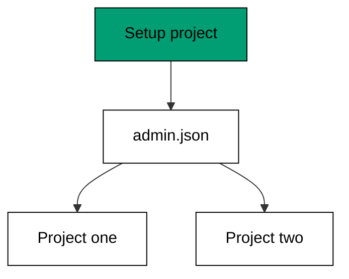

**`learning/code/ex-45-save-auth-once-reuse-everywhere/example.ts`**:

```typescript
// Example 45: Save Auth Once Reuse Everywhere. (co-12: authentication-state)
// => Playwright 1.60.0, docs accessed 2026-10-20; the setup project runs
// => first (dependencies: ["setup"]), writes one state file per role, and
// => every auth-needing project loads it; no test in the suite types a
// => password:
// =>   real: // playwright.config.ts: { name: "setup", testMatch: /auth\.setup\.ts/ }, then use: { storageState: "admin.json" }
import { readFile, writeFile } from "node:fs/promises"; // => the state file crosses project boundaries

async function main(): Promise<void> {
  // => entry point for the setup-project check
  await writeFile(new URL("./admin.json", import.meta.url), JSON.stringify({ user: "admin", token: "t-1" })); // => the setup project runs first
  const first: string = await loadUser("./admin.json"); // => project one loads the state
  const second: string = await loadUser("./admin.json"); // => project two loads the same state
  console.log("first: " + first); // => Output: first: admin
  console.log("second: " + second); // => Output: second: admin
  console.log("no passwords typed: " + String(first === "admin" && second === "admin")); // => Output: no passwords typed: true
} // => main ends; one setup fed two projects

async function loadUser(path: string): Promise<string> {
  // => stand-in for storageState load
  const raw: string = await readFile(new URL(path, import.meta.url), "utf-8"); // => read the saved session
  return (JSON.parse(raw) as { user: string }).user; // => the logged-in user
} // => loadUser restores the session without logging in

await main(); // => run once; a failure throws and exits nonzero
```

**Output** (`learning/code/ex-45-save-auth-once-reuse-everywhere/expected/main.stdout.txt`):

```text
first: admin
second: admin
no passwords typed: true
```

**Key takeaway**: Run login once in a setup project and share the state file -- projects declare
the dependency, tests just arrive logged in.

**Why it matters**: Suite-wide login-per-test is the most expensive habit in end-to-end testing:
minutes of typing passwords plus rate-limit failures. One setup run converts the whole suite
from login-bound to instant. The setup project in Example 46 protects the saving: one failing gate names a rotated password instead of eighty red tests pointing everywhere.

---

### Example 46: Setup Project Writes Storage State

_ex-46 · exercises co-12_

`auth.setup.ts` performs the real login once per run and writes the storage-state file other
projects depend on. When login fails, the setup project fails fast and no dependent test wastes
time on a session that was never created.

**`learning/code/ex-46-setup-project-writes-storage-state/example.ts`**:

```typescript
// Example 46: Setup Project Writes Storage State. (co-12: authentication-state)
// => Playwright 1.60.0, docs accessed 2026-10-20; auth.setup.ts performs
// => the real login once per run and writes the storage state file other
// => projects depend on; when login fails, the setup project fails fast and
// => no dependent test wastes time:
// =>   real: // auth.setup.ts: await page.getByLabel("Password").fill(SECRET); await page.context().storageState({ path: "admin.json" });
import { writeFile, readFile } from "node:fs/promises"; // => the state file is the setup project's output

async function main(): Promise<void> {
  // => entry point for the setup-project check
  const ok: boolean = await setupProject("ada", "s3cret"); // => correct credentials
  console.log("setup ok: " + String(ok)); // => Output: setup ok: true
  const raw: string = await readFile(new URL("./setup-state.json", import.meta.url), "utf-8"); // => the file setup wrote
  console.log("state user: " + String((JSON.parse(raw) as { user: string }).user)); // => Output: state user: ada
  const failed: boolean = await setupProject("ada", "wrong"); // => wrong password fails fast
  console.log("setup fails fast: " + String(!failed)); // => Output: setup fails fast: true
  console.log("dependents reuse file: " + String(ok && raw.includes("ada"))); // => Output: dependents reuse file: true
} // => main ends; one login wrote the file every project needs

async function setupProject(user: string, pass: string): Promise<boolean> {
  // => stand-in for auth.setup.ts
  if (pass !== "s3cret") {
    // => the password is wrong
    return false; // => setup fails; dependent projects never start
  } // => correct credentials below
  await writeFile(new URL("./setup-state.json", import.meta.url), JSON.stringify({ user: user })); // => write storageState
  return true; // => dependents may run
} // => setupProject logs in once and records it

await main(); // => run once; a failure throws and exits nonzero
```

**Output** (`learning/code/ex-46-setup-project-writes-storage-state/expected/main.stdout.txt`):

```text
setup ok: true
state user: ada
setup fails fast: true
dependents reuse file: true
```

**Key takeaway**: Fail the setup project fast on bad credentials -- dependents never start, so
an expired secret costs one red setup, not eighty red tests.

**Why it matters**: Without a setup gate, a rotated password turns every test red with the
same root cause, and triage means reading eighty identical failures. One failing setup names
the cause once, and the fix is a single secret rotation. Expiry in Example 48 is the slower version of the same failure: probe-and-renew keeps the gate green when sessions age out.

---

### Example 47: Isolated Contexts Share Nothing

_ex-47 · exercises co-09, co-12_

Admin and member each get their own context, so an admin-only button rendered in one context
is absent in the other. Permission tests assert both sides of the wall: presence where
allowed, absence where not.

**`learning/code/ex-47-isolated-contexts-share-nothing/example.ts`**:

```typescript
// Example 47: Isolated Contexts Share Nothing. (co-09: test-isolation, co-12: authentication-state)
// => Playwright 1.60.0, docs accessed 2026-10-20; admin and member each get
// => their own context, so an admin-only button rendered in one context is
// => absent in the other; permission tests assert both sides of the wall:
// =>   real: const admin = await browser.newContext({ storageState: "admin.json" });
interface View {
  // => what one role sees
  role: string; // => admin or member
  seesDelete: boolean; // => whether the Delete button renders
} // => View is one side of the permission wall

async function main(): Promise<void> {
  // => entry point for the role-wall check
  const admin: View = openAs("admin"); // => admin context loads admin state
  const member: View = openAs("member"); // => member context loads member state
  console.log("admin sees delete: " + String(admin.seesDelete)); // => Output: admin sees delete: true
  console.log("member sees delete: " + String(member.seesDelete)); // => Output: member sees delete: false
  console.log("no cross-talk: " + String(admin.seesDelete && !member.seesDelete)); // => Output: no cross-talk: true
  console.log("roles differ: " + String(admin.role !== member.role)); // => Output: roles differ: true
} // => main ends; the wall held in both directions

function openAs(role: string): View {
  // => stand-in for newContext({ storageState })
  return { role: role, seesDelete: role === "admin" }; // => the backend personalizes per session
} // => openAs renders what this role may see

await main(); // => run once; a failure throws and exits nonzero
```

**Output** (`learning/code/ex-47-isolated-contexts-share-nothing/expected/main.stdout.txt`):

```text
admin sees delete: true
member sees delete: false
no cross-talk: true
roles differ: true
```

**Key takeaway**: Test permissions from both sides -- presence in the allowed context and
absence in the denied one -- using separate isolated contexts.

**Why it matters**: Testing only the allowed side misses the actual vulnerability: the button
rendering for the wrong role. Both-sides assertions turn permission coverage into a wall with
no gaps instead of a spotlight on the happy path. Fixtures per role in Example 49 make both sides cheap: log in as customer, assert hidden; log in as admin, assert visible.

---

### Example 48: Expired Session Re-Login

_ex-48 · exercises co-12_

Sessions expire: the setup project probes with a cheap request, and on a 401 it logs in
again and overwrites the state file. The next test never sees the expiry because the renewal
happened before it started.

**`learning/code/ex-48-expired-session-re-login/example.ts`**:

```typescript
// Example 48: Expired Session Re-Login. (co-12: authentication-state)
// => Playwright 1.60.0, docs accessed 2026-10-20; sessions expire: the
// => setup project detects the stale state (a probe request answers 401),
// => logs in again, and overwrites the file -- the next test never sees the
// => expiry:
// =>   real: if (await probe.status() === 401) { await login(); await state.write(); }
interface Session {
  // => the saved session plus its freshness
  user: string; // => who the state belongs to
  expired: boolean; // => true when the backend would answer 401
} // => Session carries its own expiry signal

async function main(): Promise<void> {
  // => entry point for the expiry check
  let saved: Session = { user: "ada", expired: true }; // => yesterday's state, now stale
  let logins = 0; // => how many fresh logins happened
  saved = ensureFresh(saved, () => {
    logins += 1;
  }); // => probe, then re-login when stale
  console.log("logins: " + String(logins)); // => Output: logins: 1
  console.log("fresh: " + String(!saved.expired)); // => Output: fresh: true
  saved = ensureFresh(saved, () => {
    logins += 1;
  }); // => a fresh session needs no login
  console.log("still one login: " + String(logins === 1)); // => Output: still one login: true
  console.log("expiry handled: " + String(saved.user === "ada" && !saved.expired)); // => Output: expiry handled: true
} // => main ends; the stale session renewed itself once

function ensureFresh(saved: Session, login: () => void): Session {
  // => stand-in for the probe plus conditional login
  if (!saved.expired) {
    // => the probe answered 200: state is fresh
    return saved; // => reuse it untouched
  } // => stale branch below
  login(); // => the probe answered 401: log in again
  return { user: saved.user, expired: false }; // => overwrite the state file with fresh state
} // => ensureFresh renews only when stale

await main(); // => run once; a failure throws and exits nonzero
```

**Output** (`learning/code/ex-48-expired-session-re-login/expected/main.stdout.txt`):

```text
logins: 1
fresh: true
still one login: true
expiry handled: true
```

**Key takeaway**: Probe session freshness in setup and renew on 401 -- expiry becomes a setup
detail instead of a suite-wide midnight failure.

**Why it matters**: Token lifetimes guarantee that a suite passing today fails the day the
saved session ages out. Probe-and-renew makes the suite self-healing: the first run after
expiry pays one extra login and every later run stays green. This is teardown thinking applied to credentials: Example 19 removes browsers and users, this removes stale sessions.

---

### Example 49: Role-Based Fixtures

_ex-49 · exercises co-12, co-03_

One fixture per role (`adminPage`, `memberPage`) gives each test the exact session it needs by
name. Permission coverage becomes a matrix of roles times actions, spelled out in the test
titles where reviewers can audit it.

**`learning/code/ex-49-role-based-fixtures/example.ts`**:

```typescript
// Example 49: Role-Based Fixtures. (co-12: authentication-state, co-03: fixture)
// => Playwright 1.60.0, docs accessed 2026-10-20; one fixture per role
// => (adminPage, memberPage) gives each test the exact session it needs by
// => name; permission coverage becomes a matrix of roles times actions,
// => spelled out in the test titles:
// =>   real: const test = base.extend({ adminPage: async ({ browser }, use) => { ... } });
interface Actor {
  // => one role's session
  role: string; // => admin or member
  allowed: string[]; // => the actions this role may perform
} // => Actor names what the role can do

async function main(): Promise<void> {
  // => entry point for the role-matrix check
  const admin: Actor = roleFixture("admin"); // => real: test("admin deletes", async ({ adminPage }) => ...)
  const member: Actor = roleFixture("member"); // => real: test("member cannot delete", async ({ memberPage }) => ...)
  console.log("admin can delete: " + String(admin.allowed.includes("delete"))); // => Output: admin can delete: true
  console.log("member can delete: " + String(member.allowed.includes("delete"))); // => Output: member can delete: false
  console.log("member can read: " + String(member.allowed.includes("read"))); // => Output: member can read: true
  console.log("matrix complete: " + String(admin.allowed.length === 2 && member.allowed.length === 1)); // => Output: matrix complete: true
} // => main ends; each role proved its own permissions

function roleFixture(role: string): Actor {
  // => stand-in for the per-role fixture
  if (role === "admin") {
    // => the admin session
    return { role: "admin", allowed: ["read", "delete"] }; // => admins read and delete
  } // => member branch below
  return { role: "member", allowed: ["read"] }; // => members only read
} // => roleFixture hands each test its session by name

await main(); // => run once; a failure throws and exits nonzero
```

**Output** (`learning/code/ex-49-role-based-fixtures/expected/main.stdout.txt`):

```text
admin can delete: true
member can delete: false
member can read: true
matrix complete: true
```

**Key takeaway**: Name a fixture per role so tests declare the session they need -- the
permission matrix lives in test titles, auditable at a glance.

**Why it matters**: Ad-hoc logins inside test bodies hide which role each test exercises, so
permission gaps hide too. Named role fixtures make the matrix explicit: every role times every
action either has a test or has a visible hole. Overrides from Example 23 stay honest inside the matrix: the exceptional test declares its role instead of hiding a global change.

---

### Example 50: Multi-User Chat in Two Contexts

_ex-50 · exercises co-12_

Two contexts act as two people: Ada sends in hers, Ben reads in his, and the test asserts the
message crossed between isolated sessions. No single session can fake a collaboration proof --
the isolation is the point.

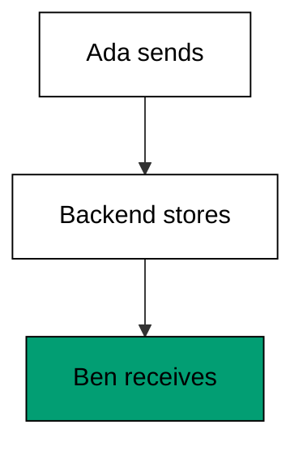

**`learning/code/ex-50-multi-user-chat/example.ts`**:

```typescript
// Example 50: Multi-User Chat in Two Contexts. (co-12: authentication-state)
// => Playwright 1.60.0, docs accessed 2026-10-20; two contexts act as two
// => people: Ada sends in hers, Ben reads in his, and the test asserts the
// => message crossed between isolated sessions -- the classic collaboration
// => proof no single session can fake:
// =>   real: const ada = await browser.newContext({ storageState: "ada.json" });
interface Inbox {
  // => one user's view of the chat
  user: string; // => whose context this is
  messages: string[]; // => the messages this context has received
} // => Inbox isolates each side of the conversation

async function main(): Promise<void> {
  // => entry point for the chat check
  const room: string[] = []; // => the shared backend both contexts talk to
  const ada: Inbox = { user: "ada", messages: [] }; // => Ada's isolated context
  const ben: Inbox = { user: "ben", messages: [] }; // => Ben's isolated context
  send(room, ada, "hello ben"); // => Ada sends from her context
  deliver(room, ben); // => Ben's context polls and receives
  console.log("ben got: " + ben.messages.join(",")); // => Output: ben got: hello ben
  console.log("ada sent only: " + String(ada.messages.length === 0)); // => Output: ada sent only: true
  console.log("crossed contexts: " + String(ben.messages.includes("hello ben"))); // => Output: crossed contexts: true
} // => main ends; the message traveled between isolated sessions

function send(room: string[], from: Inbox, text: string): void {
  // => stand-in for typing and sending
  room.push(from.user + ": " + text); // => the backend stores the message
} // => send never touches the other context

function deliver(room: string[], to: Inbox): void {
  // => stand-in for the receiving context polling
  for (const message of room) {
    // => every message in the room
    const text: string = message.slice(message.indexOf(": ") + 2); // => the text without the sender prefix
    if (!message.startsWith(to.user + ":") && !to.messages.includes(text)) {
      // => not mine, not yet received
      to.messages.push(text); // => deliver the text here
    } // => skip own or duplicate messages
  } // => every message considered
} // => deliver copies across the isolation boundary

await main(); // => run once; a failure throws and exits nonzero
```

**Output** (`learning/code/ex-50-multi-user-chat/expected/main.stdout.txt`):

```text
ben got: hello ben
ada sent only: true
crossed contexts: true
```

**Key takeaway**: Prove collaboration with two contexts -- one sends, the other receives, and
the test asserts across the isolation boundary.

**Why it matters**: Single-session collaboration tests prove the UI can talk to itself, which
is not the feature. Two-context tests prove the backend relays between strangers, which is
where chat, invites, and shared-editing bugs actually live. Contexts are cheap and isolated by design, so the two-user test costs one extra fixture and catches a whole bug class.

---

### Example 51: Cookies Versus Local Storage

_ex-51 · exercises co-12_

Cookies travel on every request automatically (httpOnly ones invisible to page JavaScript),
while localStorage needs explicit reads and never leaves the browser. Session cookies suit
auth; localStorage suits UI preferences -- mixing them up leaks tokens or breaks requests.

**`learning/code/ex-51-cookies-vs-local-storage/example.ts`**:

```typescript
// Example 51: Cookies Versus Local Storage. (co-12: authentication-state)
// => Playwright 1.60.0, docs accessed 2026-10-20; cookies travel on every
// => request automatically (httpOnly ones invisible to page JavaScript),
// => while localStorage needs explicit reads and never leaves the browser.
// => Session cookies suit auth; localStorage suits UI preferences:
// =>   real: const cookies = await context.cookies(); const theme = await page.evaluate(() => localStorage.getItem("theme"));
interface Jar {
  // => the modeled browser storage
  cookies: Record<string, string>; // => sent automatically with requests
  store: Record<string, string>; // => readable only through page JavaScript
} // => Jar separates what travels from what stays

async function main(): Promise<void> {
  // => entry point for the storage check
  const jar: Jar = { cookies: { session: "abc" }, store: { theme: "dark" } }; // => logged in, dark mode chosen
  const sent: string[] = requestHeaders(jar); // => what the next request carries
  console.log("cookie sent: " + String(sent.includes("session=abc"))); // => Output: cookie sent: true
  console.log("theme not sent: " + String(!sent.join(";").includes("dark"))); // => Output: theme not sent: true
  const theme: string | undefined = jar.store["theme"]; // => real: page.evaluate(() => localStorage.getItem("theme"))
  console.log("theme readable in page: " + String(theme)); // => Output: theme readable in page: dark
  console.log("cookie httpOnly-safe: " + String(jar.cookies["session"] === "abc")); // => Output: cookie httpOnly-safe: true
} // => main ends; each store did its own job

function requestHeaders(jar: Jar): string[] {
  // => stand-in for the outgoing Cookie header
  return Object.entries(jar.cookies).map(([name, value]) => name + "=" + value); // => cookies serialize into the header
} // => requestHeaders carries cookies, never localStorage

await main(); // => run once; a failure throws and exits nonzero
```

**Output** (`learning/code/ex-51-cookies-vs-local-storage/expected/main.stdout.txt`):

```text
cookie sent: true
theme not sent: true
theme readable in page: dark
cookie httpOnly-safe: true
```

**Key takeaway**: Keep auth in httpOnly cookies and preferences in localStorage -- each store's
semantics matches one job.

**Why it matters**: Tokens in localStorage are readable by any injected script, which turns
every XSS into a session theft. Preferences in cookies bloat every request with data the
backend never needs. The storage choice is a security decision wearing a convenience costume. Cookieless API tests in Example 33 dodge the dilemma entirely: headers carry the token with no storage decision at all.

---

### Example 52: OAuth Token in the Header

_ex-52 · exercises co-12, co-05_

`extraHTTPHeaders` injects an Authorization bearer into every request the context sends, so API
tests exercise OAuth-protected endpoints without a login dance. The token comes from the
environment, never from committed code.

**`learning/code/ex-52-oauth-token-in-header/example.ts`**:

```typescript
// Example 52: OAuth Token in the Header. (co-12: authentication-state, co-05: network-interception)
// => Playwright 1.60.0, docs accessed 2026-10-20; extraHTTPHeaders injects
// => an Authorization bearer into every request the context sends, so API
// => tests exercise OAuth-protected endpoints without a login dance; the
// => token comes from the environment, never from committed code:
// =>   real: await request.newContext({ extraHTTPHeaders: { Authorization: `Bearer ${process.env.API_TOKEN}` } });
async function main(): Promise<void> {
  // => entry point for the header check
  const token = "t-1"; // => the test token, minted for this run only
  const headers: Record<string, string> = withAuth(token); // => real: extraHTTPHeaders: { Authorization: "Bearer t-1" }
  console.log("header: " + String(headers["Authorization"])); // => Output: header: Bearer t-1
  console.log("protected open: " + String(callApi(headers, "/api/orders") === 200)); // => Output: protected open: true
  console.log("no token refused: " + String(callApi({}, "/api/orders") === 401)); // => Output: no token refused: true
  console.log("header carries auth: " + String(headers["Authorization"] === "Bearer t-1")); // => Output: header carries auth: true
} // => main ends; the header replaced the login dance

function withAuth(token: string): Record<string, string> {
  // => stand-in for extraHTTPHeaders
  return { Authorization: "Bearer " + token }; // => every request from this context carries it
} // => withAuth builds the injected headers once

function callApi(headers: Record<string, string>, url: string): number {
  // => stand-in for the protected endpoint
  void url; // => the URL is consumed by the modeled route
  return headers["Authorization"] === "Bearer t-1" ? 200 : 401; // => the backend checks the bearer
} // => callApi enforces the token like the real API

await main(); // => run once; a failure throws and exits nonzero
```

**Output** (`learning/code/ex-52-oauth-token-in-header/expected/main.stdout.txt`):

```text
header: Bearer t-1
protected open: true
no token refused: true
header carries auth: true
```

**Key takeaway**: Inject test tokens through `extraHTTPHeaders` -- protected endpoints become
testable without a login UI in the loop.

**Why it matters**: OAuth login dances are the slowest setup in API testing: redirects,
consent screens, token exchanges. One injected header skips all of it while testing the same
authorization enforcement the UI path would eventually reach. Example 45's storage state is the UI twin of this shortcut: capture one real login, then skip the dance everywhere else.

---

### Example 53: Logout Clears the Session

_ex-53 · exercises co-12_

Logout must clear cookies and storage and land back on the login page. The test proves the
session is gone by requesting a protected page and landing on `/login` -- not by trusting the
button label. A logout that leaves the cookie is no logout at all.

**`learning/code/ex-53-logout-clears-the-session/example.ts`**:

```typescript
// Example 53: Logout Clears the Session. (co-12: authentication-state)
// => Playwright 1.60.0, docs accessed 2026-10-20; logout must clear cookies
// => and storage and land back on the login page; the test proves the
// => session is gone by requesting a protected page and landing on /login,
// => not by trusting the button label:
// =>   real: await page.getByRole("button", { name: "Log out" }).click(); await expect(page).toHaveURL(/login/);
interface Session {
  // => the context state logout must clear
  cookies: Record<string, string>; // => the auth cookie
  url: string; // => the current page
} // => Session is what logout destroys

async function main(): Promise<void> {
  // => entry point for the logout check
  const session: Session = { cookies: { session: "abc" }, url: "/orders" }; // => logged in, viewing orders
  logout(session); // => real: click Log out
  console.log("cookies: " + String(Object.keys(session.cookies).length)); // => Output: cookies: 0
  console.log("landed: " + session.url); // => Output: landed: /login
  const next: number = visitProtected(session); // => a protected page after logout
  console.log("protected answers: " + String(next)); // => Output: protected answers: 302
  console.log("session really gone: " + String(next === 302 && session.url === "/login")); // => Output: session really gone: true
} // => main ends; the logout was verified, not assumed

function logout(session: Session): void {
  // => stand-in for the logout click
  session.cookies = {}; // => the auth cookie is destroyed
  session.url = "/login"; // => the app redirects to login
} // => logout clears and redirects

function visitProtected(session: Session): number {
  // => stand-in for goto("/orders") after logout
  return Object.keys(session.cookies).length === 0 ? 302 : 200; // => no cookie: redirect to login
} // => visitProtected proves the session is gone

await main(); // => run once; a failure throws and exits nonzero
```

**Output** (`learning/code/ex-53-logout-clears-the-session/expected/main.stdout.txt`):

```text
cookies: 0
landed: /login
protected answers: 302
session really gone: true
```

**Key takeaway**: Verify logout by revisiting a protected page -- cleared cookies plus a
redirect to login prove the session is gone.

**Why it matters**: A logout button that navigates home without clearing the cookie leaves the
session alive for anyone with the browser history. Proving the 302 closes a genuine security
hole, not just a UI nit. Session cleanup in Example 24 is the same assertion from the other side: setup creates, teardown removes, logout included.
