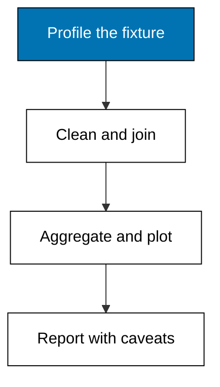

Sinar Abadi is fictional, and so is the September under review: twelve receipts across three months from a shop that sells staples, cooking goods, and drinks. The owner asks one question with money behind it: which categories earn their shelf space for the October restock, and what should stay doubtful. This capstone answers end to end in the order the course teaches: profile the fixture, clean it under stated policies, join sales to the catalog, aggregate by category and month, draw three plots, and write the one-page report with its caveats attached. Every technique comes from Themes A through I; nothing new is introduced, because the point is combination under pressure.

## The decision

Shelf space is fixed and October money is not unlimited: the owner can restock two of three categories fully and the third halfway. The September fixture decides which. Restock means committing cash to inventory that may sit, so the analysis must show not just which category sold most but how sure the numbers are: small piles, Saturday-only sampling, and the payday calendar all qualify the verdict. The recommendation must fit on one page and survive challenge, because the supplier rep will argue for the category this report demotes.



## The fixture and its warts

The sales fixture carries twelve receipts with three planted warts: mixed-case product spellings with trailing spaces, one blank quantity, and one doubled order corrected by re-export with a newer stamp. The catalog fixture carries four products with categories and unit prices, plus one catalog code with no sales to exercise the orphan check. Nothing is hidden: the profile section of the script prints rows, columns, missing cells, duplicates, and the orphan list before any cleaning happens, the same handoff Example 5 taught.

## Cleaning under stated policies

Text is stripped and lowercased per Example 6, the blank quantity is median-filled per Example 9 with the single fill counted aloud, and the doubled order keeps its latest stamp per Example 10. The method section of the printed report names all three policies, so a second analyst can reproduce the input exactly. The raw fixtures stay committed beside the script; cleaning transforms copies in memory, never the files.

## Joining and aggregating

Sales meet the catalog on the product code in an in-memory `sqlite3` database, left join so no receipt vanishes, with the orphan check from Example 30 confirming the unmatched codes before money is totaled. Revenue by category follows Example 31: quantity times unit price, summed inside each category. Units by month follow Example 18's two-key grouping. Category totals decide the restock; monthly totals reveal whether September's winner is a trend or a single good week.

## Three plots that earn their space

The category bar chart encodes revenue as length on one fixed scale, so the ranking needs no arithmetic. The basket histogram bins receipt quantities into small, medium, and large, showing whether the typical basket clusters or splits. The monthly line traces category revenue across the three months at a fixed height, exposing the September surge for what it is. Each plot prints its scale beside the picture, honoring the honesty rules of Themes G and H.

## The one-page report

The script closes by printing the four-section page in argument order: the restock question with its threshold, the five-line method, the findings as center-plus-spread-plus-count, and the labeled caveat register. The verdict restocks staples fully, cooking halfway pending weekday data, and holds drinks until the sampling covers a full week. The assumptions behind the page are September-only scope, one median fill, and the category prices then in force. If any of those breaks, reprice from the method block rather than defending the verdict.

**`learning/capstone/code/capstone.py`**

```python
# Capstone: Sinar Abadi September restock, profile to page.
# => Sinar Abadi, its receipts, and its catalog are fictional and fixed.
# => Twelve receipts with planted warts; one catalog orphan on purpose.
# => Profile, clean by policy, join, aggregate, plot, then report.
import csv
import sqlite3
import statistics

# => Load the committed sales fixture exactly as exported.
with open(
    "sales.csv", newline="", encoding="utf-8"
) as handle:  # => fixed text settings
    raw = list(csv.DictReader(handle))  # => header becomes the keys
# => Load the committed catalog fixture exactly as maintained.
with open(
    "products.csv", newline="", encoding="utf-8"
) as handle:  # => fixed text settings
    products = list(csv.DictReader(handle))  # => header becomes the keys
# => PROFILE: shape, holes, doubles, and extremes, changing nothing.
print("profile_rows:", len(raw))  # => Output counts the exported rows
holes = sum(1 for r in raw if r["qty"].strip() == "")  # => blank quantities
print("profile_missing:", holes)  # => Output counts the one blank
keys = [r["order_id"] for r in raw]  # => order ids, doubled by re-export
print("profile_dupes:", len(keys) - len(set(keys)))  # => Output counts the repeat
# => CLEAN: normalize text, median-fill the hole, newest stamp survives.
clean = {}  # => order id to winning row
qtys = sorted(
    int(r["qty"]) for r in raw if r["qty"].strip() != ""
)  # => known quantities
fill = statistics.median(qtys)  # => median of the survivors
for r in raw:  # => visit each export row once
    code = r["code"].strip().lower()  # => Example 6 policy
    qty = int(r["qty"]) if r["qty"].strip() != "" else int(fill)  # => Example 9 policy
    key, stamp = r["order_id"], r["updated"]  # => identity and correction order
    if key not in clean or stamp > clean[key][4]:  # => Example 10 survivor rule
        clean[key] = (key, r["date"], code, qty, stamp)  # => install the survivor
print("clean_rows:", len(clean), "filled:", holes)  # => Output shows 11 rows, 1 fill
# => JOIN: sales meet the catalog; orphans checked before money moves.
db = sqlite3.connect(":memory:")  # => same SQL as the Postgres toolchain
db.execute(
    "CREATE TABLE sales(oid TEXT, date TEXT, code TEXT, qty INT)"
)  # => receipts schema
db.executemany(
    "INSERT INTO sales VALUES(?,?,?,?)",  # => load survivors
    [(v[0], v[1], v[2], v[3]) for v in clean.values()],
)  # => drop the stamp column
db.execute(
    "CREATE TABLE products(code TEXT, category TEXT, price INT)"
)  # => catalog schema
db.executemany(
    "INSERT INTO products VALUES(:code, :category, :unit_price)", products
)  # => load catalog
sales_orphans = db.execute(
    "SELECT DISTINCT code FROM sales "  # => sales keys unseen
    "WHERE code NOT IN (SELECT code FROM products)"
).fetchall()  # => anti-join
catalog_orphans = db.execute(
    "SELECT DISTINCT code FROM products "  # => catalog keys unsold
    "WHERE code NOT IN (SELECT code FROM sales)"
).fetchall()  # => anti-join back
print("sales_orphans:", [r[0] for r in sales_orphans])  # => Output lists unplaced sales
print("catalog_orphans:", [r[0] for r in catalog_orphans])  # => Output lists dead stock
# => AGGREGATE: revenue by category, units by month, means with n.
cats = db.execute(
    "SELECT p.category, SUM(s.qty * p.price) FROM sales s "  # => revenue per category
    "JOIN products p ON s.code = p.code GROUP BY p.category "  # => join then group
    "ORDER BY 2 DESC"
).fetchall()  # => winner first
print("by_category:", [(c, rev) for c, rev in cats])  # => Output ranks the categories
months = db.execute(
    "SELECT SUBSTR(date, 1, 7), SUM(qty) FROM sales "  # => two-key grouping
    "GROUP BY 1 ORDER BY 1"
).fetchall()  # => calendar order
print("by_month:", [(m, q) for m, q in months])  # => Output traces the quarter
baskets = [q for _, _, _, q, _ in clean.values()]  # => receipt quantities
print(
    f"basket mean {statistics.mean(baskets):.2f} "  # => Output states the center
    f"(stdev {statistics.stdev(baskets):.2f}, n={len(baskets)})."
)  # => Output adds spread, n
# => PLOT 1: category revenue bars on one fixed scale.
for cat, rev in cats:  # => winner first, as ranked
    print(f"{cat:8} {'#' * (rev // 100000)} {rev}")  # => Output draws each bar
# => PLOT 2: basket histogram on stated bins.
for label, lo, hi in [
    ("small 1-2 ", 1, 2),
    ("medium 3-4", 3, 4),
    ("large 5+  ", 5, 99),
]:  # => bin edges
    n = sum(1 for q in baskets if lo <= q <= hi)  # => count this bin
    print(f"{label} {'#' * n} {n}")  # => Output charts the bin
# => REPORT: question, method, finding, caveats, then the verdict.
print(
    "Q: restock two categories fully for October if September revenue tops 500000?"
)  # => the aim
print(
    "M: sales.csv 12 rows; strip+lower, median-fill 1, newest-stamp; sqlite3 left join."
)  # => the path
top = cats[0]  # => the winning category
print(
    f"F: {top[0]} leads at {top[1]}; basket mean {statistics.mean(baskets):.2f} "  # => the numbers
    f"(stdev {statistics.stdev(baskets):.2f}, n={len(baskets)})."
)  # => with uncertainty
print(
    "C: n=11, September-only, payday confound, syrup orphan unpriced."
)  # => the bounds
print(
    "verdict: restock staples fully; cooking halfway; hold drinks."
)  # => Output signs narrowly
```

**Output** (`learning/capstone/code/expected/main/main.stdout.txt`):

```text
profile_rows: 12
profile_missing: 1
profile_dupes: 1
clean_rows: 11 filled: 1
sales_orphans: []
catalog_orphans: ['syrup-1l']
by_category: [('staples', 929500), ('cooking', 144000), ('drinks', 132000)]
by_month: [('2026-07', 8), ('2026-08', 12), ('2026-09', 14)]
basket mean 3.09 (stdev 1.30, n=11).
staples  ######### 929500
cooking  # 144000
drinks   # 132000
small 1-2  #### 4
medium 3-4 ##### 5
large 5+   ## 2
Q: restock two categories fully for October if September revenue tops 500000?
M: sales.csv 12 rows; strip+lower, median-fill 1, newest-stamp; sqlite3 left join.
F: staples leads at 929500; basket mean 3.09 (stdev 1.30, n=11).
C: n=11, September-only, payday confound, syrup orphan unpriced.
verdict: restock staples fully; cooking halfway; hold drinks.
```

## What this proves

The capstone exercises co-01 through co-16 without naming them one by one: profiling moves, missing-value and survivor policies, tidy handling, two-key grouping with small-pile flags, centers with spread, a left join with orphan and fanout checks, three honestly scaled plots, and the question-method-finding-caveats page. The script regenerates the same report from the same input on every run, which is the reproducibility claim of co-12 made concrete. Carry this file's shape into real analyses: profile aloud, clean by policy, join then count, plot with scales, and bound every claim before signing.
