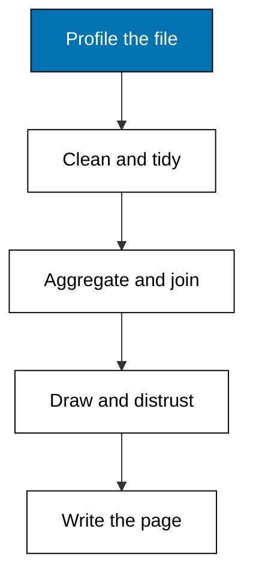

Prerequisites for this course: [just-enough-python](/en/learn/courses/just-enough-python/learning/overview) for the `csv`, `statistics`, and `sqlite3` modules every example runs on, and [sql-essentials](/en/learn/courses/sql-essentials/learning/overview) for the join and grouping clauses of Theme F. Comfort with reading a small table and rearranging one formula is assumed throughout.

## Why this exists -- the big idea

**The problem before the solution**: pipelines move data on a schedule, but the one-off question, is rice worth restocking, does the promo work, which shelf earns its space, arrives before any pipeline exists and deserves an answer from the raw file. **Keep this if you forget everything else**: look at the data's distribution before you trust its summary statistic.

## Tensions and trade-offs -- when NOT to reach for this

- **Exploration versus pipelines**: one-off analysis answers this month's question fast and dies with it; a pipeline answers next month's automatically and costs maintenance forever. Analyze once by hand, automate only the third repeat.
- **Cleaning versus discarding**: every fix removes information, and aggressive cleaning manufactures certainty the raw file never held. Clean what blocks the question, flag the rest, and keep the raw fixture beside the script.
- **When NOT**: streaming data, scheduled refreshes, and cross-database production joins belong in data-engineering; this course reads committed fixtures and answers once. Live market feeds, personal data, and anything requiring credentials are out of scope: every fixture here is synthetic and fixed.

## Lineage -- where this skill sits

Recording came first: ledgers, receipts, and exports tell the shop what happened. Pipelines came second: scheduled movement and validation carry the data to where decisions are made. This course is the step between: the analyst who opens the export, profiles it, cleans it, and answers the question before any pipeline exists. The generic moving side lives in data-engineering; the looking side lives here.

## How this course is organized

[Theme A](/en/learn/courses/practical-data-analytics/learning/theme-a-profiling-a-dataset) (Worked Examples 1-5) profiles the fixture without changing it. [Theme B](/en/learn/courses/practical-data-analytics/learning/theme-b-cleaning-and-type-coercion) (Examples 6-10) cleans text, numbers, dates, holes, and doubles. [Theme C](/en/learn/courses/practical-data-analytics/learning/theme-c-tidy-data-and-reshaping) (Examples 11-15) reshapes wide to long and back. [Theme D](/en/learn/courses/practical-data-analytics/learning/theme-d-group-by-aggregation) (Examples 16-21) piles rows and summarizes piles. [Theme E](/en/learn/courses/practical-data-analytics/learning/theme-e-summary-statistics-and-their-limits) (Examples 22-27) centers, spreads, and distrusts. [Theme F](/en/learn/courses/practical-data-analytics/learning/theme-f-joins-for-analysis) (Examples 28-33) joins sales to catalogs in SQL. [Theme G](/en/learn/courses/practical-data-analytics/learning/theme-g-visual-encoding) (Examples 34-38) draws bars, histograms, lines, and scatters. [Theme H](/en/learn/courses/practical-data-analytics/learning/theme-h-misleading-charts-and-bias) (Examples 39-43) detects rhetoric dressed as charts. [Theme I](/en/learn/courses/practical-data-analytics/learning/theme-i-reporting-and-caveats) (Examples 44-48) writes the one page. The [capstone](/en/learn/courses/practical-data-analytics/learning/capstone/overview) runs all nine themes on one fixture, and [drilling](/en/learn/courses/practical-data-analytics/drilling/overview) turns the concepts into recall, katas, and checklists.

## References

- Python documentation, `csv` module: reader objects, Dialect handling, and newline guidance. Accessed 2026-10-21.
- Python documentation, `statistics` module: mean, median, mode, variance, stdev, quantiles, and correlation definitions. Accessed 2026-10-21.
- Python documentation, `sqlite3` module: in-memory databases, parameter substitution, and aggregate queries. Accessed 2026-10-21.
- SQLite documentation: SELECT, JOIN types, GROUP BY, and HAVING semantics exercised in Theme F. Accessed 2026-10-21.
- Legacy material this course migrates and re-verifies: data analytics legacy pages under `learn/legacy/software-engineering/data/analytics`. Accessed 2026-10-21; every fact mined from those pages was re-checked against the documentation above on the same date rather than copied as already correct.

## Examples by Theme

### Theme A: Profiling a Dataset (Examples 1-5)

- [Worked Example 1: Shape and Size First](/en/learn/courses/practical-data-analytics/learning/theme-a-profiling-a-dataset#worked-example-1-shape-and-size-first)
- [Worked Example 2: Column Types and Missing Cells](/en/learn/courses/practical-data-analytics/learning/theme-a-profiling-a-dataset#worked-example-2-column-types-and-missing-cells)
- [Worked Example 3: Distributions at a Glance](/en/learn/courses/practical-data-analytics/learning/theme-a-profiling-a-dataset#worked-example-3-distributions-at-a-glance)
- [Worked Example 4: Duplicate Rows](/en/learn/courses/practical-data-analytics/learning/theme-a-profiling-a-dataset#worked-example-4-duplicate-rows)
- [Worked Example 5: A Profile Report in Ten Lines](/en/learn/courses/practical-data-analytics/learning/theme-a-profiling-a-dataset#worked-example-5-a-profile-report-in-ten-lines)

### Theme B: Cleaning and Type Coercion (Examples 6-10)

- [Worked Example 6: Whitespace and Case Cleanup](/en/learn/courses/practical-data-analytics/learning/theme-b-cleaning-and-type-coercion#worked-example-6-whitespace-and-case-cleanup)
- [Worked Example 7: Coercing Number-Like Text](/en/learn/courses/practical-data-analytics/learning/theme-b-cleaning-and-type-coercion#worked-example-7-coercing-number-like-text)
- [Worked Example 8: Parsing Mixed Date Formats](/en/learn/courses/practical-data-analytics/learning/theme-b-cleaning-and-type-coercion#worked-example-8-parsing-mixed-date-formats)
- [Worked Example 9: Choosing a Missing-Value Policy](/en/learn/courses/practical-data-analytics/learning/theme-b-cleaning-and-type-coercion#worked-example-9-choosing-a-missing-value-policy)
- [Worked Example 10: Deduplicating and Choosing the Survivor](/en/learn/courses/practical-data-analytics/learning/theme-b-cleaning-and-type-coercion#worked-example-10-deduplicating-and-choosing-the-survivor)

### Theme C: Tidy Data and Reshaping (Examples 11-15)

- [Worked Example 11: Wide to Long: Melting Quarters](/en/learn/courses/practical-data-analytics/learning/theme-c-tidy-data-and-reshaping#worked-example-11-wide-to-long-melting-quarters)
- [Worked Example 12: Long to Wide: Pivoting for People](/en/learn/courses/practical-data-analytics/learning/theme-c-tidy-data-and-reshaping#worked-example-12-long-to-wide-pivoting-for-people)
- [Worked Example 13: Splitting a Combined Column](/en/learn/courses/practical-data-analytics/learning/theme-c-tidy-data-and-reshaping#worked-example-13-splitting-a-combined-column)
- [Worked Example 14: Checking That Data Is Tidy](/en/learn/courses/practical-data-analytics/learning/theme-c-tidy-data-and-reshaping#worked-example-14-checking-that-data-is-tidy)
- [Worked Example 15: Reshape Round-Trip Without Loss](/en/learn/courses/practical-data-analytics/learning/theme-c-tidy-data-and-reshaping#worked-example-15-reshape-round-trip-without-loss)

### Theme D: Group-By Aggregation (Examples 16-21)

- [Worked Example 16: Counting Rows per Group](/en/learn/courses/practical-data-analytics/learning/theme-d-group-by-aggregation#worked-example-16-counting-rows-per-group)
- [Worked Example 17: Sums and Means per Group](/en/learn/courses/practical-data-analytics/learning/theme-d-group-by-aggregation#worked-example-17-sums-and-means-per-group)
- [Worked Example 18: Grouping by Two Keys](/en/learn/courses/practical-data-analytics/learning/theme-d-group-by-aggregation#worked-example-18-grouping-by-two-keys)
- [Worked Example 19: Groups Above a Threshold](/en/learn/courses/practical-data-analytics/learning/theme-d-group-by-aggregation#worked-example-19-groups-above-a-threshold)
- [Worked Example 20: Ordering Groups and Ranking Them](/en/learn/courses/practical-data-analytics/learning/theme-d-group-by-aggregation#worked-example-20-ordering-groups-and-ranking-them)
- [Worked Example 21: Flagging Small Groups](/en/learn/courses/practical-data-analytics/learning/theme-d-group-by-aggregation#worked-example-21-flagging-small-groups)

### Theme E: Summary Statistics and Their Limits (Examples 22-27)

- [Worked Example 22: Mean, Median, and Mode](/en/learn/courses/practical-data-analytics/learning/theme-e-summary-statistics-and-their-limits#worked-example-22-mean-median-and-mode)
- [Worked Example 23: Spread: Range, Variance, Deviation](/en/learn/courses/practical-data-analytics/learning/theme-e-summary-statistics-and-their-limits#worked-example-23-spread-range-variance-deviation)
- [Worked Example 24: Percentiles and Quartiles](/en/learn/courses/practical-data-analytics/learning/theme-e-summary-statistics-and-their-limits#worked-example-24-percentiles-and-quartiles)
- [Worked Example 25: When the Mean Lies: Skew](/en/learn/courses/practical-data-analytics/learning/theme-e-summary-statistics-and-their-limits#worked-example-25-when-the-mean-lies-skew)
- [Worked Example 26: Correlation and Its Limits](/en/learn/courses/practical-data-analytics/learning/theme-e-summary-statistics-and-their-limits#worked-example-26-correlation-and-its-limits)
- [Worked Example 27: Same Mean, Different Shape](/en/learn/courses/practical-data-analytics/learning/theme-e-summary-statistics-and-their-limits#worked-example-27-same-mean-different-shape)

### Theme F: Joins for Analysis (Examples 28-33)

- [Worked Example 28: Inner Join: Sales Meet Products](/en/learn/courses/practical-data-analytics/learning/theme-f-joins-for-analysis#worked-example-28-inner-join-sales-meet-products)
- [Worked Example 29: Left Join: Keeping Every Sale](/en/learn/courses/practical-data-analytics/learning/theme-f-joins-for-analysis#worked-example-29-left-join-keeping-every-sale)
- [Worked Example 30: Finding Orphan Keys](/en/learn/courses/practical-data-analytics/learning/theme-f-joins-for-analysis#worked-example-30-finding-orphan-keys)
- [Worked Example 31: Aggregating After the Join](/en/learn/courses/practical-data-analytics/learning/theme-f-joins-for-analysis#worked-example-31-aggregating-after-the-join)
- [Worked Example 32: Joining With a Filter: Regulars Only](/en/learn/courses/practical-data-analytics/learning/theme-f-joins-for-analysis#worked-example-32-joining-with-a-filter-regulars-only)
- [Worked Example 33: The Fanout Trap: Duplicate Keys](/en/learn/courses/practical-data-analytics/learning/theme-f-joins-for-analysis#worked-example-33-the-fanout-trap-duplicate-keys)

### Theme G: Visual Encoding (Examples 34-38)

- [Worked Example 34: Bar Chart: Top Products by Revenue](/en/learn/courses/practical-data-analytics/learning/theme-g-visual-encoding#worked-example-34-bar-chart-top-products-by-revenue)
- [Worked Example 35: Histogram: Basket Size Shape](/en/learn/courses/practical-data-analytics/learning/theme-g-visual-encoding#worked-example-35-histogram-basket-size-shape)
- [Worked Example 36: Line Chart: Weekly Trend](/en/learn/courses/practical-data-analytics/learning/theme-g-visual-encoding#worked-example-36-line-chart-weekly-trend)
- [Worked Example 37: Scatter: Discount Against Basket](/en/learn/courses/practical-data-analytics/learning/theme-g-visual-encoding#worked-example-37-scatter-discount-against-basket)
- [Worked Example 38: Choosing the Right Chart](/en/learn/courses/practical-data-analytics/learning/theme-g-visual-encoding#worked-example-38-choosing-the-right-chart)

### Theme H: Misleading Charts and Bias (Examples 39-43)

- [Worked Example 39: The Truncated Axis Trick](/en/learn/courses/practical-data-analytics/learning/theme-h-misleading-charts-and-bias#worked-example-39-the-truncated-axis-trick)
- [Worked Example 40: The Cherry-Picked Range](/en/learn/courses/practical-data-analytics/learning/theme-h-misleading-charts-and-bias#worked-example-40-the-cherry-picked-range)
- [Worked Example 41: Survivorship Bias in Returns](/en/learn/courses/practical-data-analytics/learning/theme-h-misleading-charts-and-bias#worked-example-41-survivorship-bias-in-returns)
- [Worked Example 42: Sampling Bias: Who Was Asked](/en/learn/courses/practical-data-analytics/learning/theme-h-misleading-charts-and-bias#worked-example-42-sampling-bias-who-was-asked)
- [Worked Example 43: Redesigning a Misleading Chart](/en/learn/courses/practical-data-analytics/learning/theme-h-misleading-charts-and-bias#worked-example-43-redesigning-a-misleading-chart)

### Theme I: Reporting and Caveats (Examples 44-48)

- [Worked Example 44: Stating the Question First](/en/learn/courses/practical-data-analytics/learning/theme-i-reporting-and-caveats#worked-example-44-stating-the-question-first)
- [Worked Example 45: Writing the Method Section](/en/learn/courses/practical-data-analytics/learning/theme-i-reporting-and-caveats#worked-example-45-writing-the-method-section)
- [Worked Example 46: Findings With Numbers and Uncertainty](/en/learn/courses/practical-data-analytics/learning/theme-i-reporting-and-caveats#worked-example-46-findings-with-numbers-and-uncertainty)
- [Worked Example 47: Listing Caveats and Limits](/en/learn/courses/practical-data-analytics/learning/theme-i-reporting-and-caveats#worked-example-47-listing-caveats-and-limits)
- [Worked Example 48: Assembling the One-Page Report](/en/learn/courses/practical-data-analytics/learning/theme-i-reporting-and-caveats#worked-example-48-assembling-the-one-page-report)
