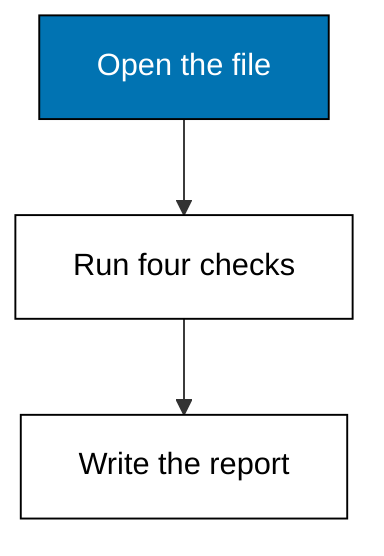
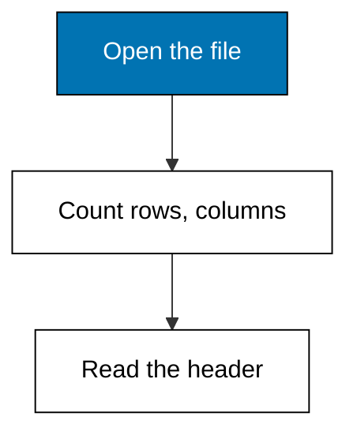
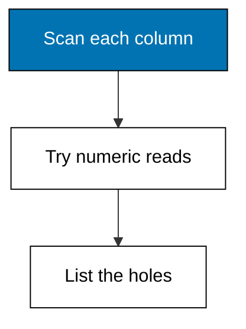
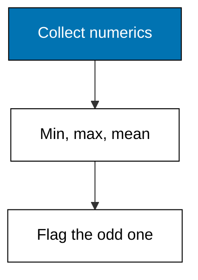
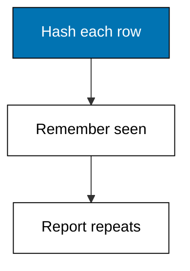
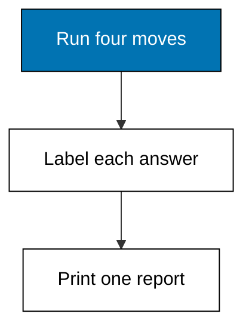

Twelve rows fit on one screen, but the habits in this theme scale to twelve million. Profiling answers the cheapest questions first: how big is the file, what types do the columns claim, where are the holes, are rows doubled, and what do the extremes look like. Nothing here changes the data; everything here decides what the later themes are allowed to assume. Run these five moves on every new fixture before any cleaning, because a profile written after the analysis is a justification, not a measurement.



### Worked Example 1: Shape and Size First

_Exercises co-01, co-13._

Sinar Abadi is fictional, and so is the `sales.csv` file sitting in this example's directory: twelve rows, five columns, one month of one store's receipts. The first thing an analyst does with a new file is not statistics but orientation: how many rows, how many columns, and what each column is called. The `csv` module reads the header and counts the rows without loading anything fancy. **Check**: the file holds 12 data rows and 5 columns named `order_id`, `date`, `product`, `qty`, and `price`.



**`learning/code/ex-01-shape-and-size/main.py`**

```python
# Worked Example 1: Shape and Size First
# => Sinar Abadi and its sales file are fictional; every row is fixed.
# => Orientation comes before statistics: count rows, columns, names.
# => The csv module reads the header and tallies rows with no extras.
import csv

# => Open the committed fixture that ships with this example.
path = "data.csv"  # => the file lives beside this script
# => Read every row into a list so it can be counted twice.
with open(path, newline="", encoding="utf-8") as handle:  # => text mode, fixed encoding
    rows = list(csv.DictReader(handle))  # => first line becomes the keys
# => The header names are the dataset's only built-in documentation.
print("columns:", ", ".join(rows[0].keys()))  # => Output names the five columns
# => Row count tells whether statistics are even worth computing.
print("rows:", len(rows))  # => Output counts the twelve receipts
# => Column count frames every cleaning decision that follows.
print("n_columns:", len(rows[0]))  # => Output counts the five fields
```

**Output** (`learning/code/ex-01-shape-and-size/expected/main.stdout.txt`):

```text
columns: order_id, date, product, qty, price
rows: 12
n_columns: 5
```

**Key takeaway**: counting rows and columns orients every later step, because you cannot clean what you have not measured.

**Why It Matters**: Every profiling session in Themes A through I starts here, and skipping it is how analysts analyze twelve rows while believing they have twelve thousand. Shape tells you whether the file even deserves statistics: a one-row file needs a phone call, not a mean. Practice reading the header aloud before touching a value, because column names are the only documentation most real datasets ship with.

---

### Worked Example 2: Column Types and Missing Cells

_Exercises co-01, co-02._

Twelve rows fit on one screen, but real fixtures do not, so the second profiling move is per-column: what type does each column claim, and where are the holes. This example scans `sales.csv` for empty cells and tries to read each column as a number, reporting which columns stay text. The `qty` column of one row is deliberately blank, the way a cashier's missed keystroke looks in the wild. **Check**: 1 missing cell is found in `qty`, and `product` stays text while the rest read numeric.



**`learning/code/ex-02-column-types-and-missing/main.py`**

```python
# Worked Example 2: Column Types and Missing Cells
# => Sinar Abadi and its sales file are fictional; every row is fixed.
# => One qty cell is blank on purpose, like a missed keystroke.
# => Scan each column for empties, then probe which read as numbers.
import csv

# => Open the committed fixture that ships with this example.
with open("data.csv", newline="", encoding="utf-8") as handle:  # => fixed text settings
    rows = list(csv.DictReader(handle))  # => header becomes the keys
    names = list(rows[0].keys())  # => keep the column order
# => An empty or whitespace-only cell counts as missing, nowhere else.
missing = {name: 0 for name in names}  # => one counter per column
for row in rows:  # => visit every receipt once
    for name in names:  # => check every column of it
        if row[name].strip() == "":  # => blank means missing
            missing[name] += 1  # => tally the hole
# => A column is numeric only if every filled cell converts to float.
numeric = []  # => names that survive the probe
for name in names:  # => probe each column in order
    try:  # => attempt the conversion
        [
            float(row[name]) for row in rows if row[name].strip() != ""
        ]  # => skip the holes
        numeric.append(name)  # => all filled cells converted
    except ValueError:  # => any text cell fails the probe
        pass  # => the column stays text
# => Report holes first, because they decide the cleaning policy.
print("missing:", missing)  # => Output shows the one blank qty
# => Then report which columns behave as numbers.
print("numeric:", ", ".join(numeric))  # => Output lists the numeric columns
```

**Output** (`learning/code/ex-02-column-types-and-missing/expected/main.stdout.txt`):

```text
missing: {'order_id': 0, 'date': 0, 'product': 0, 'qty': 1, 'price': 0}
numeric: order_id, qty, price
```

**Key takeaway**: a column's usable type is discovered by attempting conversion, never by trusting its looks.

**Why It Matters**: Type surprises cause the most embarrassing analysis bugs: a `qty` column that reads as text sorts 10 below 2, and a blank cell silently becomes zero in the wrong tool. Naming the holes now decides the missing-value policy of Example 9 instead of letting it happen by accident. Run this scan on every new file, because the file you skip is the one with the blank cell in the total.

---

### Worked Example 3: Distributions at a Glance

_Exercises co-01, co-03, co-07._

Shape and types tell you the container; the third move looks inside the numbers. For each numeric column this example reports the minimum, maximum, and mean with the `statistics` module, which is the cheapest possible distribution sketch. The `price` column spans 17,500 to 58,500, and the single 480,000 row is a data-entry slip (an extra zero) that the max exposes instantly. **Check**: the max of `price` reads 480000, flagging the slip, while `qty` ranges from 1 to 5.



**`learning/code/ex-03-distributions-at-a-glance/main.py`**

```python
# Worked Example 3: Distributions at a Glance
# => Sinar Abadi and its sales file are fictional; every row is fixed.
# => One price carries an extra zero, the classic entry slip.
# => Min, max, and mean sketch each numeric column in three numbers.
import csv
import statistics

# => Open the committed fixture that ships with this example.
with open("data.csv", newline="", encoding="utf-8") as handle:  # => fixed text settings
    rows = list(csv.DictReader(handle))  # => header becomes the keys
# => The two numeric columns get the sketch; the id column is skipped.
for name in ["qty", "price"]:  # => same three numbers per column
    values = [float(row[name]) for row in rows]  # => convert the column
    low = min(values)  # => the floor of the column
    high = max(values)  # => the ceiling, where slips show
    avg = statistics.mean(values)  # => the balancing point
    print(
        name, "min:", int(low), "max:", int(high), "mean:", round(avg, 2)
    )  # => Output sketches it
```

**Output** (`learning/code/ex-03-distributions-at-a-glance/expected/main.stdout.txt`):

```text
qty min: 1 max: 5 mean: 2.7
price min: 17500 max: 480000 mean: 80000.0
```

**Key takeaway**: min, max, and mean sketch a column's shape cheaply enough to run on every file.

**Why It Matters**: A glance at extremes catches the errors that averages hide: the mean price barely moves when one row gains a zero, but the max screams. This habit pays off in Theme E, where the same extremes decide whether the mean or the median deserves your trust. Never quote a mean you have not flanked with its min and max, because the summary you skip is the error you publish.

---

### Worked Example 4: Duplicate Rows

_Exercises co-01, co-02._

Receipts get scanned twice, files get appended twice, and joins (Theme F) multiply rows on purpose, so the fourth profiling move hunts exact duplicates. This example hashes each row's full content and reports any hash seen before, keeping the first occurrence as the survivor. The fixture hides one doubled receipt for order 402. **Check**: exactly 1 duplicate is reported, order 402, leaving 5 unique rows from 6.



**`learning/code/ex-04-duplicate-rows/main.py`**

```python
# Worked Example 4: Duplicate Rows
# => Sinar Abadi and its sales file are fictional; every row is fixed.
# => Order 402 appears twice, the way a double scan looks.
# => Hash each full row; a repeated hash is a duplicate receipt.
import csv

# => Open the committed fixture that ships with this example.
with open("data.csv", newline="", encoding="utf-8") as handle:  # => fixed text settings
    rows = list(csv.DictReader(handle))  # => header becomes the keys
# => Seen fingerprints live here; the first occurrence always survives.
seen = set()  # => hashes of rows already counted
dupes = []  # => order ids reported as doubled
for row in rows:  # => visit every receipt in file order
    key = (row["order_id"], row["product"], row["qty"])  # => full-row fingerprint
    if key in seen:  # => this exact row appeared before
        dupes.append(row["order_id"])  # => report the repeat
    else:  # => first sighting of this row
        seen.add(key)  # => remember it for later rows
# => Report the doubled orders by id.
print("duplicates:", dupes)  # => Output names order 402
# => Unique rows are the file minus its repeats.
print("unique_rows:", len(seen), "of", len(rows))  # => Output shows 5 of 6
```

**Output** (`learning/code/ex-04-duplicate-rows/expected/main.stdout.txt`):

```text
duplicates: ['402']
unique_rows: 5 of 6
```

**Key takeaway**: hashing full rows finds exact duplicates without eyeballing a single line.

**Why It Matters**: Double-counted rows inflate every total downstream: revenue, counts, and means all shift, and no later statistic can reveal the cause. Deduplicating at profile time, before any aggregation, keeps Theme D honest. Keep the first occurrence and log the removal, because silently dropping rows is its own way of discarding information.

---

### Worked Example 5: A Profile Report in Ten Lines

_Exercises co-01, co-16._

Profiling moves one through four each answer one question; a report answers them together so the next analyst starts informed. This example writes a small plain-text profile: shape, missing cells, numeric ranges, and duplicate count, each on its own labeled line. The fixture combines every earlier wart: a blank cell, a doubled row, and a wide price range. **Check**: the report prints 6 labeled lines covering rows, columns, missing, ranges, and duplicates.



**`learning/code/ex-05-profile-report/main.py`**

```python
# Worked Example 5: A Profile Report in Ten Lines
# => Sinar Abadi and its sales file are fictional; every row is fixed.
# => The fixture mixes every wart: a blank, a double, a wide range.
# => Combine the four moves into one labeled plain-text report.
import csv

# => Open the committed fixture that ships with this example.
with open("data.csv", newline="", encoding="utf-8") as handle:  # => fixed text settings
    rows = list(csv.DictReader(handle))  # => header becomes the keys
    names = list(rows[0].keys())  # => keep the column order
# => Missing cells: blank strings in any column.
holes = sum(
    1 for row in rows for name in names if row[name].strip() == ""
)  # => count every blank
# => Duplicates: full-row fingerprints seen more than once.
keys = [
    (row["order_id"], row["product"], row["qty"]) for row in rows
]  # => one tuple per row
dupes = len(keys) - len(set(keys))  # => repeats beyond first sightings
# => Numeric range over the price column, skipping its blanks.
prices = [
    float(row["price"]) for row in rows if row["price"].strip() != ""
]  # => filled cells only
# => Print the six-line handoff the next analyst will read first.
print("rows:", len(rows))  # => Output counts the receipts
print("columns:", ", ".join(names))  # => Output names the fields
print("missing_cells:", holes)  # => Output totals the blanks
print("duplicate_rows:", dupes)  # => Output totals the repeats
print("price_min:", int(min(prices)))  # => Output floors the column
print("price_max:", int(max(prices)))  # => Output ceilings it
```

**Output** (`learning/code/ex-05-profile-report/expected/main.stdout.txt`):

```text
rows: 6
columns: order_id, product, qty, price
missing_cells: 1
duplicate_rows: 1
price_min: 17500
price_max: 58500
```

**Key takeaway**: a labeled profile report turns four scattered checks into one handoff.

**Why It Matters**: Analysis is a team sport across time: the person who cleans the data is rarely the person who profiled it, and the report is their contract. Example 48's one-page report opens with exactly this block, because a finding without a profile invites doubt about the input. Write the report even when you are both people, because future you has the memory of a stranger.

---
