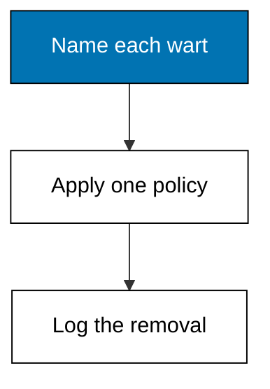
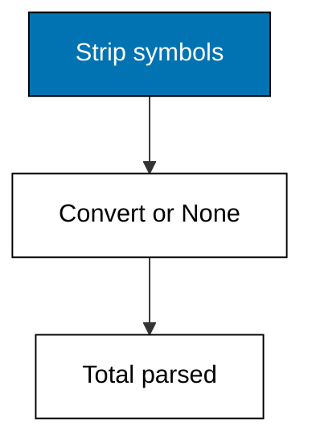
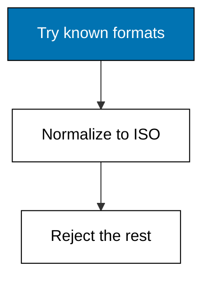
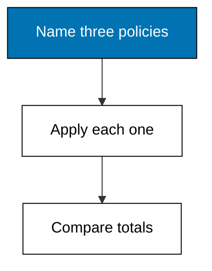
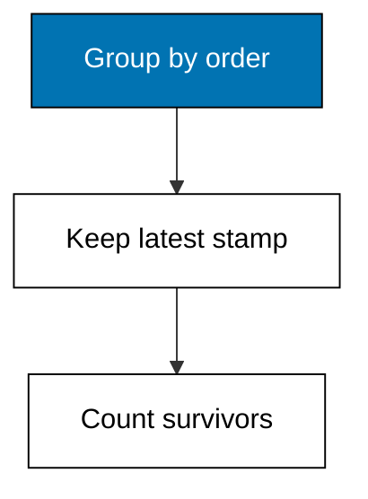

Raw exports are hostile: padded text, mixed case, decorated numbers, three date shapes, blank cells, and doubled rows. This theme turns each wart into a stated policy: normalize text once, coerce numbers strictly with explicit None, parse dates against a written format list, choose a missing-value policy by comparison, and deduplicate under a survivor rule. Cleaning is the only theme that destroys information, which is why every move here logs what it removed and keeps the raw fixture untouched beside the script.



### Worked Example 6: Whitespace and Case Cleanup

_Exercises co-04, co-01._

Cashiers type `Rice-5KG` with a trailing space, the next shift types `rice-5kg`, and the aggregation in Theme D counts them as two different products. The first cleaning move normalizes text: strip surrounding whitespace and fold to one case before any comparison. The fixture holds six spellings of two products. **Check**: after cleanup only 2 distinct product names remain, `rice-5kg` and `sugar-1kg`.


**`learning/code/ex-06-strip-whitespace-and-case/main.py`**

```python
# Worked Example 6: Whitespace and Case Cleanup
# => Sinar Abadi and its sales file are fictional; every row is fixed.
# => Six spellings hide two products behind spaces and capitals.
# => Strip whitespace and fold case before any comparison happens.
import csv

# => Open the committed fixture that ships with this example.
with open("data.csv", newline="", encoding="utf-8") as handle:  # => fixed text settings
    rows = list(csv.DictReader(handle))  # => header becomes the keys
# => Normalize each product name the same single way, every time.
clean = [row["product"].strip().lower() for row in rows]  # => spaces off, case folded
# => Sorted distinct names show what the groups will actually be.
print("distinct:", sorted(set(clean)))  # => Output shows the two survivors
# => Count them: the number Theme D will aggregate over.
print("n_products:", len(set(clean)))  # => Output reads 2, not 6
```

**Output** (`learning/code/ex-06-strip-whitespace-and-case/expected/main.stdout.txt`):

```text
distinct: ['rice-5kg', 'sugar-1kg']
n_products: 2
```

**Key takeaway**: normalize text before comparing it, because trailing spaces are invisible products.

**Why It Matters**: Unclean text is the quietest way to double-count: every downstream group-by inherits the split, and the totals look plausible while being wrong. Cleaning at the gate, once, beats patching six queries later. Lowercase-plus-strip is the default; reach for anything fancier only when the default demonstrably fails. Treat the rule as hygiene, not pedantry: one normalization pass beats ten special cases scattered through later queries.

---

### Worked Example 7: Coercing Number-Like Text

_Exercises co-04, co-02._

Prices arrive as `58,500`, `Rp58500`, or `58.5k` depending on who exported the spreadsheet, and none of that text multiplies. The second cleaning move strips currency symbols and thousand separators, then converts, parking anything unparseable as an explicit `None` instead of a silent zero. The fixture mixes all three spellings plus one hopeless `n/a`. **Check**: 4 of 5 prices parse, the `n/a` becomes `None`, and the total of parsed prices is 193000.



**`learning/code/ex-07-coerce-numbers/main.py`**

```python
# Worked Example 7: Coercing Number-Like Text
# => Sinar Abadi and its sales file are fictional; every row is fixed.
# => Prices wear commas, currency tags, and one hopeless n/a.
# => Strip the decorations, convert strictly, park failures as None.
import csv


# => Turn one raw price cell into a number or an explicit None.
def coerce(raw):  # => single policy for the whole column
    text = raw.strip().lower()  # => trim, then fold for the k-suffix
    text = text.replace("rp", "").replace(",", "")  # => drop currency and separators
    if text.endswith("k"):  # => thousands shorthand stays supported
        text = text[:-1]  # => cut the suffix letter
        try:  # => convert the digits before it
            return float(text) * 1000  # => scale back up
        except ValueError:  # => digits were not digits
            return None  # => park the failure openly
    try:  # => plain-number path
        return float(text)  # => strict judge of what remains
    except ValueError:  # => n/a and friends land here
        return None  # => unknown, never zero


# => Open the committed fixture that ships with this example.
with open("data.csv", newline="", encoding="utf-8") as handle:  # => fixed text settings
    rows = list(csv.DictReader(handle))  # => header becomes the keys
# => Coerce the whole column through the one policy.
parsed = [coerce(row["price"]) for row in rows]  # => numbers and Nones
# => Show the parked failures first so nobody mistakes them for sales.
print("parsed:", parsed)  # => Output shows four numbers and one None
# => Total only the cells that genuinely converted.
print("total:", int(sum(v for v in parsed if v is not None)))  # => Output reads 193000
```

**Output** (`learning/code/ex-07-coerce-numbers/expected/main.stdout.txt`):

```text
parsed: [58500.0, 58500.0, 58500.0, None, 17500.0]
total: 193000
```

**Key takeaway**: unparseable numbers become explicit None, never silent zero.

**Why It Matters**: A zero means sold-for-nothing while None means unknown, and confusing them corrupts every total and average built later. Explicit parking forces the missing-value policy of Example 9 to fire visibly. Strip aggressively but convert strictly: the strip list is yours to extend, while the float call stays the honest judge.

---

### Worked Example 8: Parsing Mixed Date Formats

_Exercises co-04, co-01._

The `date` column holds `2026-09-01`, `01/09/2026`, and `Sep 3, 2026` in the same file, because three stores export three ways. The third cleaning move tries each known format in turn and normalizes every success to ISO `YYYY-MM-DD`, rejecting anything no format matches. **Check**: all 4 rows parse, and the earliest normalized date is 2026-09-01.



**`learning/code/ex-08-parse-dates/main.py`**

```python
# Worked Example 8: Parsing Mixed Date Formats
# => Sinar Abadi and its sales file are fictional; every row is fixed.
# => Three stores export three date shapes in one column.
# => Try each known format, normalize winners to ISO, reject the rest.
import csv
from datetime import datetime

# => The accepted shapes, in the order they are attempted.
FORMATS = ["%Y-%m-%d", "%d/%m/%Y", "%b %d, %Y"]  # => ISO, day-first, short-month


# => Turn one raw cell into ISO text or an explicit None.
def parse(raw):  # => single policy for the whole column
    for fmt in FORMATS:  # => try each accepted shape
        try:  # => attempt this format
            return (
                datetime.strptime(raw.strip(), fmt).date().isoformat()
            )  # => normalize winners
        except ValueError:  # => wrong shape, try the next
            continue  # => keep attempting
    return None  # => no format matched: reject openly


# => Open the committed fixture that ships with this example.
with open("data.csv", newline="", encoding="utf-8") as handle:  # => fixed text settings
    rows = list(csv.DictReader(handle))  # => header becomes the keys
# => Parse the whole column through the one policy.
clean = [parse(row["date"]) for row in rows]  # => ISO strings or Nones
# => Show the normalized column in file order.
print("dates:", clean)  # => Output shows four ISO dates
# => The earliest date anchors every monthly aggregation later.
print("earliest:", min(clean))  # => Output reads 2026-09-01
```

**Output** (`learning/code/ex-08-parse-dates/expected/main.stdout.txt`):

```text
dates: ['2026-09-01', '2026-09-01', '2026-09-03', '2026-09-04']
earliest: 2026-09-01
```

**Key takeaway**: try known formats in order and store ISO, so one column holds one shape.

**Why It Matters**: Dates that do not compare do not sort, do not filter by month, and silently drop out of every time aggregation in Theme D. Normalizing at clean time buys every later query a column it can trust. Keep the format list short and written down: each accepted shape is a promise the next export must keep.

---

### Worked Example 9: Choosing a Missing-Value Policy

_Exercises co-02, co-14._

Example 2 found the hole; this example decides what to do with it. Three honest policies exist for a missing `qty`: drop the row, fill the median of the survivors, or keep the row and flag it. This example runs all three on the same fixture and prints the three resulting totals side by side, so the choice and its cost stay visible. **Check**: dropping gives 14, median-fill gives 17, and flagging keeps 5 rows with 1 flagged.



**`learning/code/ex-09-missing-value-policy/main.py`**

```python
# Worked Example 9: Choosing a Missing-Value Policy
# => Sinar Abadi and its sales file are fictional; every row is fixed.
# => One qty is blank; the policy for it changes the total.
# => Run drop, median-fill, and flag side by side and compare.
import csv
import statistics

# => Open the committed fixture that ships with this example.
with open("data.csv", newline="", encoding="utf-8") as handle:  # => fixed text settings
    rows = list(csv.DictReader(handle))  # => header becomes the keys
# => Split the column into known numbers and explicit holes.
known = [int(row["qty"]) for row in rows if row["qty"].strip() != ""]  # => survivors
holes = sum(1 for row in rows if row["qty"].strip() == "")  # => blanks to decide on
# => Policy one: drop every row with a hole, total the survivors.
print("drop_total:", sum(known))  # => Output totals the five known rows
# => Policy two: fill each hole with the median of the survivors.
mid = statistics.median(known)  # => median resists the extremes
print("fill_total:", int(sum(known) + mid * holes))  # => Output adds one median fill
# => Policy three: keep all rows, flag the holes for later.
print("flagged_rows:", len(rows), "flagged:", holes)  # => Output keeps six, flags one
```

**Output** (`learning/code/ex-09-missing-value-policy/expected/main.stdout.txt`):

```text
drop_total: 14
fill_total: 17
flagged_rows: 6 flagged: 1
```

**Key takeaway**: run every candidate policy and compare, because the policy is part of the result.

**Why It Matters**: Readers cannot judge a total without knowing what the holes became: dropping understates volume, filling invents data, flagging postpones the decision. Stating the policy in the method section (Example 45) turns a hidden judgment into a checkable one. Prefer flagging when the analysis can carry the uncertainty, and filling only when a downstream step needs complete rows.

---

### Worked Example 10: Deduplicating and Choosing the Survivor

_Exercises co-02, co-04._

Example 4 found the duplicate; this one removes it, and removal needs a rule for which copy survives. The policy here keeps the row with the latest `updated` stamp, because a correction re-export carries a newer timestamp than the original mistake. The fixture doubles order 1002 with two different quantities and stamps. **Check**: the survivor for 1002 carries qty 4 with stamp 2026-09-03, and 3 unique orders remain.



**`learning/code/ex-10-dedupe-and-choose-survivor/main.py`**

```python
# Worked Example 10: Deduplicating and Choosing the Survivor
# => Sinar Abadi and its sales file are fictional; every row is fixed.
# => Order 1002 was corrected by re-export; the newer stamp wins.
# => Group by order id and keep the row with the latest stamp.
import csv

# => Open the committed fixture that ships with this example.
with open("data.csv", newline="", encoding="utf-8") as handle:  # => fixed text settings
    rows = list(csv.DictReader(handle))  # => header becomes the keys
# => One survivor slot per order id, filled by newest stamp.
best = {}  # => order id to winning row
for row in rows:  # => visit every export row once
    key = row["order_id"]  # => the identity being deduplicated
    if key not in best or row["updated"] > best[key]["updated"]:  # => newer stamp wins
        best[key] = row  # => install the current survivor
# => Show the survivor chosen for the doubled order.
print("survivor_1002_qty:", best["1002"]["qty"])  # => Output reads the corrected 4
print("survivor_1002_stamp:", best["1002"]["updated"])  # => Output reads 2026-09-03
# => Unique orders are what Theme D will aggregate.
print("unique_orders:", len(best))  # => Output reads 3
```

**Output** (`learning/code/ex-10-dedupe-and-choose-survivor/expected/main.stdout.txt`):

```text
survivor_1002_qty: 4
survivor_1002_stamp: 2026-09-03
unique_orders: 3
```

**Key takeaway**: deduplication needs a survivor rule, and latest-stamp is the honest default.

**Why It Matters**: Keeping the first row, the last row, or a random row are three different analyses wearing one total. The survivor rule belongs in the method section next to the missing-value policy, for the same reason: a reader who cannot reproduce the input cannot trust the output. Newest-stamp wins correction re-exports; when no stamp exists, keep the first and say so.

---
