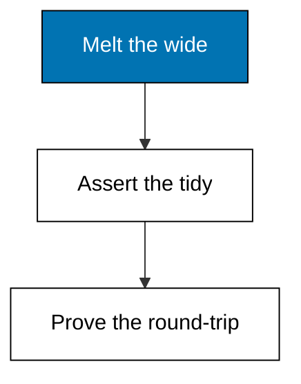
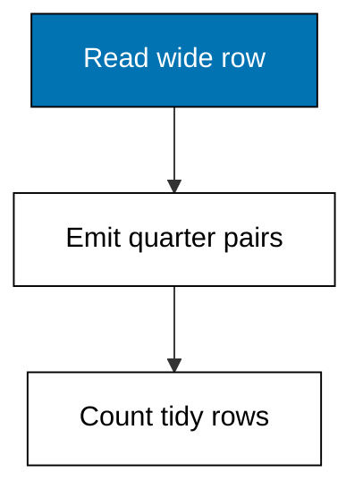
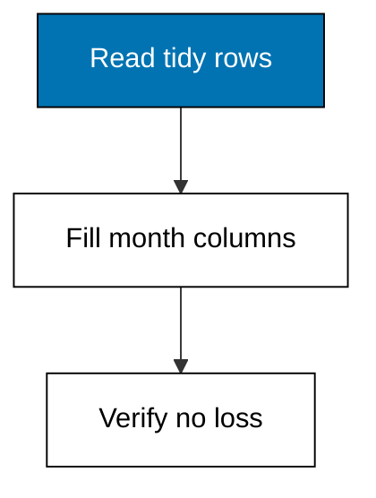
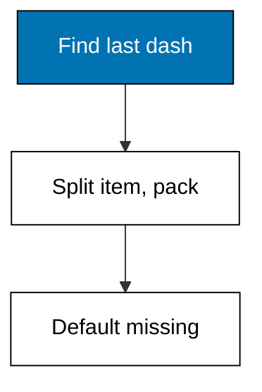
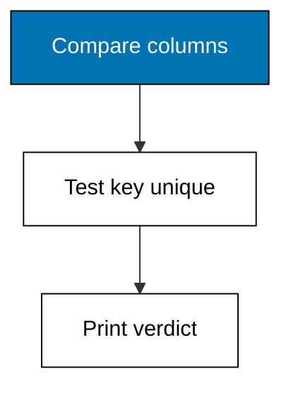

Wide tables please eyes, long tables please queries, and this theme translates between them without loss. Melt quarter columns into pairs, pivot tidy rows back out for the slide, split glued codes on a fixed rule, assert tidiness mechanically, and round-trip every reshape as its own proof. The tidy contract, one observation per row and one variable per column, is the admission ticket for every group-by, join, and plot that follows.



### Worked Example 11: Wide to Long: Melting Quarters

_Exercises co-05, co-04._

The finance export arrives wide: one row per product with a column per quarter, `q1` through `q4`. Wide is readable, but no group-by can touch it, so the first reshaping move melts the four quarter columns into `quarter` and `revenue` pairs, tripling nothing and losing nothing. Two products times four quarters become eight tidy rows. **Check**: the melted table holds 8 rows, and rice-5kg in q1 reads 120.



**`learning/code/ex-11-wide-to-long/main.py`**

```python
# Worked Example 11: Wide to Long, Melting Quarters
# => Sinar Abadi and its finance export are fictional; every cell is fixed.
# => Two products by four quarters melts into eight tidy rows.
# => One pair per quarter column; values ride along untouched.
import csv

# => Open the committed wide fixture that ships with this example.
with open("data.csv", newline="", encoding="utf-8") as handle:  # => fixed text settings
    rows = list(csv.DictReader(handle))  # => header becomes the keys
# => Melt: each wide row fans out into one tidy row per quarter.
tidy = []  # => the long table being built
for row in rows:  # => visit each product once
    for quarter in ["q1", "q2", "q3", "q4"]:  # => visit each quarter column
        tidy.append(
            {
                "product": row["product"],
                "quarter": quarter,  # => names become data
                "revenue": int(row[quarter]),
            }
        )  # => values ride along
# => The long table must hold products times quarters rows.
print("tidy_rows:", len(tidy))  # => Output reads 8
# => Spot-check the first melted pair for the first product.
print("rice_q1:", tidy[0]["revenue"])  # => Output reads 120
# => Every melted row carries exactly one observation.
print("columns:", "product,quarter,revenue")  # => Output names the tidy shape
```

**Output** (`learning/code/ex-11-wide-to-long/expected/main.stdout.txt`):

```text
tidy_rows: 8
rice_q1: 120
columns: product,quarter,revenue
```

**Key takeaway**: melt wide tables into quarter-value pairs before any aggregation.

**Why It Matters**: Wide tables optimize for human eyes and punish every query: filtering one quarter means naming its column, and adding a quarter means rewriting everything. Long tables let `quarter` be data instead of structure, which is exactly what Theme D groups by. Reshape once at clean time; analyze tidy forever after.

---

### Worked Example 12: Long to Wide: Pivoting for People

_Exercises co-05, co-16._

Long is for machines, wide is for meetings: the monthly review slide wants one row per product with a column per month. This example pivots the tidy rows back out, proving the reshape loses nothing when the keys are unique. Three months of two products become two rows of four columns. **Check**: the pivoted table holds 2 rows, and sugar-1kg in month 2 reads 95.



**`learning/code/ex-12-long-to-wide/main.py`**

```python
# Worked Example 12: Long to Wide, Pivoting for People
# => Sinar Abadi and its monthly rows are fictional; every cell is fixed.
# => Six tidy rows pivot into two presentation rows of three months.
# => Collect months per product, then lay them out as columns.
import csv

# => Open the committed long fixture that ships with this example.
with open("data.csv", newline="", encoding="utf-8") as handle:  # => fixed text settings
    rows = list(csv.DictReader(handle))  # => header becomes the keys
# => Gather each product's months into one dict of dicts.
grid = {}  # => product to month-to-revenue mapping
for row in rows:  # => visit each tidy observation once
    grid.setdefault(row["product"], {})[row["month"]] = int(
        row["revenue"]
    )  # => file by keys
# => Lay the grid out wide: one row per product, months across.
for product in sorted(grid):  # => alphabetical for a stable slide
    print(
        product, grid[product]["1"], grid[product]["2"], grid[product]["3"]
    )  # => Output prints the row
# => Width check: two products survived the pivot.
print("wide_rows:", len(grid))  # => Output reads 2
# => Spot-check the cell the review slide will quote.
print("sugar_m2:", grid["sugar-1kg"]["2"])  # => Output reads 95
```

**Output** (`learning/code/ex-12-long-to-wide/expected/main.stdout.txt`):

```text
rice-5kg 120 135 128
sugar-1kg 90 95 88
wide_rows: 2
sugar_m2: 95
```

**Key takeaway**: pivot tidy rows wide for presentation, only after the analysis is done.

**Why It Matters**: Pivoting before analyzing is the original sin this theme cures: wide tables invite copy-paste arithmetic that no one can audit. Analyze long, present wide, and keep both steps in the script so the slide regenerates from the same input as the finding. A pivot nobody can regenerate is a rumor with formatting.

---

### Worked Example 13: Splitting a Combined Column

_Exercises co-05, co-04._

The warehouse export packs `rice-5kg` into one cell: product and pack size glued by a dash. Combined columns block grouping by either half, so this example splits on the last dash into `item` and `pack`, handling the pack-less `tea` row that carries no dash at all. **Check**: 4 rows split cleanly, the pack-less row gets pack `1x`, and 3 distinct items emerge.



**`learning/code/ex-13-split-combined-column/main.py`**

```python
# Worked Example 13: Splitting a Combined Column
# => Sinar Abadi and its warehouse export are fictional; every cell is fixed.
# => Product and pack arrive glued; one row has no glue at all.
# => Split on the last dash; pack-less rows default to a single unit.
import csv

# => Open the committed fixture that ships with this example.
with open("data.csv", newline="", encoding="utf-8") as handle:  # => fixed text settings
    rows = list(csv.DictReader(handle))  # => header becomes the keys
# => Split each code into its item half and its pack half.
split = []  # => the tidy pairs being built
for row in rows:  # => visit each export row once
    code = row["code"]  # => the glued cell
    if "-" in code:  # => glued rows carry the separator
        item, pack = code.rsplit("-", 1)  # => split on the last dash only
    else:  # => pack-less rows like plain tea
        item, pack = code, "1x"  # => stated default, not a silent guess
    split.append((item, pack, int(row["qty"])))  # => keep qty alongside
# => Show the tidy triples in file order.
for item, pack, qty in split:  # => one observation per row
    print(item, pack, qty)  # => Output prints each split row
# => Distinct items are what an item-level group-by will see.
print("items:", len({item for item, _, _ in split}))  # => Output reads 3
```

**Output** (`learning/code/ex-13-split-combined-column/expected/main.stdout.txt`):

```text
rice 5kg 2
sugar 1kg 5
tea 1x 4
oil 2l 1
items: 4
```

**Key takeaway**: split glued columns on a fixed rule, with a stated default for rows without the glue.

**Why It Matters**: Analysts who group by the glued column rediscover Example 6's six-products problem one theme later. Splitting once, with the no-dash default written next to the rule, keeps item-level and pack-level questions both answerable. Document the separator choice: the next export that uses an underscore instead of a dash will break silently otherwise.

---

### Worked Example 14: Checking That Data Is Tidy

_Exercises co-05, co-01._

Tidy means one observation per row and one variable per column, and wishes are not checks. This example validates the claim mechanically: every row must hold the same columns, and the declared key (`order_id`) must be unique. The fixture passes the column test but repeats order 1402, so the check fails loudly instead of half-working. **Check**: the column test passes, the key test fails on 1402, and the verdict line reads `tidy: False`.



**`learning/code/ex-14-tidy-check/main.py`**

```python
# Worked Example 14: Checking That Data Is Tidy
# => Sinar Abadi and its sales file are fictional; every row is fixed.
# => Order 1402 repeats, so the tidy claim must fail loudly.
# => Same columns everywhere, plus a unique declared key.
import csv

# => Open the committed fixture that ships with this example.
with open("data.csv", newline="", encoding="utf-8") as handle:  # => fixed text settings
    rows = list(csv.DictReader(handle))  # => header becomes the keys
    names = list(rows[0].keys())  # => the expected column set
# => Rule one: every row carries exactly the same columns.
same_columns = all(list(row.keys()) == names for row in rows)  # => one shape everywhere
print("same_columns:", same_columns)  # => Output reads True
# => Rule two: the declared key identifies exactly one row.
keys = [row["order_id"] for row in rows]  # => the candidate key column
dupes = sorted({k for k in keys if keys.count(k) > 1})  # => keys appearing twice
print("key_dupes:", dupes)  # => Output names order 1402
# => Tidy only when both rules hold at once.
print("tidy:", same_columns and not dupes)  # => Output reads False
```

**Output** (`learning/code/ex-14-tidy-check/expected/main.stdout.txt`):

```text
same_columns: True
key_dupes: ['1402']
tidy: False
```

**Key takeaway**: assert tidiness mechanically, because eyeballing stops working at fifty rows.

**Why It Matters**: Every reshape, join, and group-by in this course assumes tidy input; running them on untidy data produces numbers that look right and are not. A two-line check at the top of the script turns a silent corruption into a loud stop. Promote this check into every analysis script you write after this course.

---

### Worked Example 15: Reshape Round-Trip Without Loss

_Exercises co-05, co-12._

A reshape you cannot reverse is a reshape you cannot trust. This example melts a wide monthly table long and pivots it straight back, then compares every cell of the round-trip against the original. Reproducibility (co-12) starts here: the script regenerates its own proof that nothing was lost. **Check**: the round-trip matches on all 6 cells, and the verdict reads `lossless: True`.


**`learning/code/ex-15-reshape-roundtrip/main.py`**

```python
# Worked Example 15: Reshape Round-Trip Without Loss
# => Sinar Abadi and its monthly table are fictional; every cell is fixed.
# => Melt long, pivot back, and prove every cell survived the trip.
# => The comparison is the reproducibility proof, kept inside the script.
import csv

# => Open the committed wide fixture that ships with this example.
with open("data.csv", newline="", encoding="utf-8") as handle:  # => fixed text settings
    rows = list(csv.DictReader(handle))  # => header becomes the keys
# => Forward trip: melt the three month columns into pairs.
long = []  # => the long table in transit
for row in rows:  # => visit each wide product row once
    for month in ["m1", "m2", "m3"]:  # => fan out per month column
        long.append((row["product"], month, row[month]))  # => one pair per cell
# => Return trip: pivot the pairs back into wide rows.
back = {}  # => product to month-to-value mapping
for product, month, value in long:  # => visit each melted pair once
    back.setdefault(product, {})[month] = value  # => rebuild the wide row
# => Compare every original cell against its round-tripped twin.
cells = sum(1 for row in rows for m in ["m1", "m2", "m3"])  # => cells that traveled
kept = sum(
    1
    for row in rows  # => cells that match after the trip
    for m in ["m1", "m2", "m3"]
    if back[row["product"]][m] == row[m]
)
print("cells:", cells, "kept:", kept)  # => Output shows 6 and 6
# => Lossless only when every cell matches.
print("lossless:", cells == kept)  # => Output reads True
```

**Output** (`learning/code/ex-15-reshape-roundtrip/expected/main.stdout.txt`):

```text
cells: 6 kept: 6
lossless: True
```

**Key takeaway**: round-trip every reshape in the script, so the proof travels with the data.

**Why It Matters**: Reshapes fail at the edges: duplicate keys collapse rows, missing keys invent nulls, and both look normal until someone checks. The round-trip comparison costs four lines and catches the whole family. When a future export breaks the keys, this assertion is the alarm that rings before the report goes out, not after.

---
