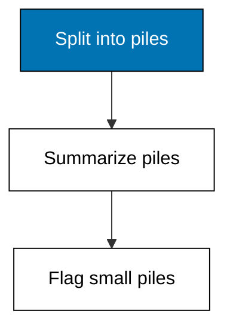
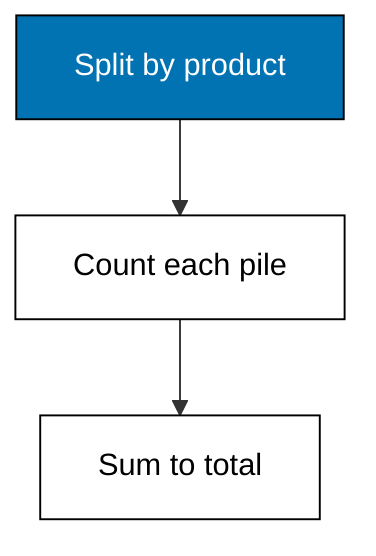
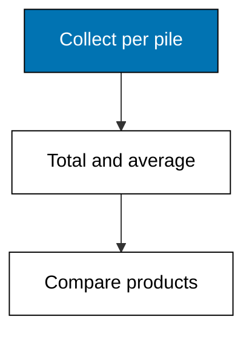
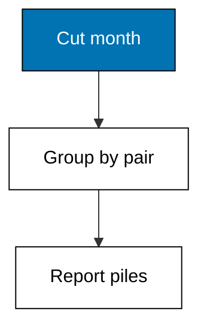
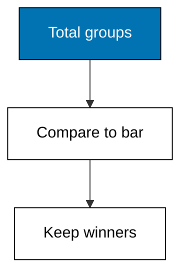
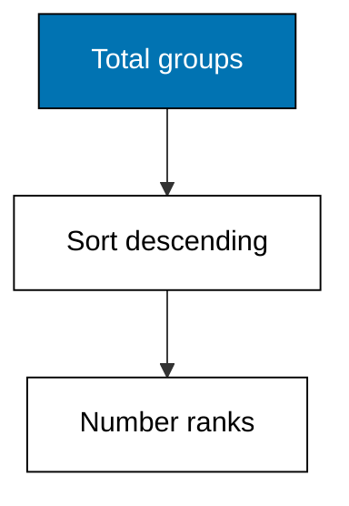
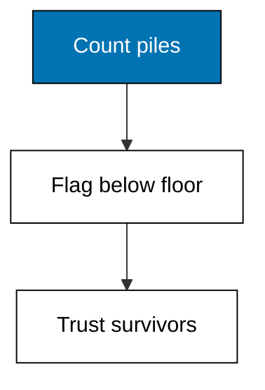

Splitting rows into piles and summarizing each pile is the workhorse of the whole course. This theme builds the motion from counts to sums and means, adds a second key for product-by-month piles, filters groups by a threshold the HAVING way, ranks the survivors, and flags the small piles whose means are rumors. The checksum habit, groups summing back to the input, and the n-beside-every-mean habit both start here and never leave.



### Worked Example 16: Counting Rows per Group

_Exercises co-06, co-01._

How many receipts per product is the simplest group-by there is: split the rows by product, count each pile. This example groups the fixture's ten receipts with a plain dict, no library needed. Rice leads with 4 receipts. **Check**: rice-5kg counts 4, sugar-1kg counts 3, and the three groups sum back to 10 rows.



**`learning/code/ex-16-group-counts/main.py`**

```python
# Worked Example 16: Counting Rows per Group
# => Sinar Abadi and its sales file are fictional; every row is fixed.
# => Ten receipts split into piles by product, each pile counted.
# => A plain dict is the whole engine: split, count, recombine.
import csv

# => Open the committed fixture that ships with this example.
with open("data.csv", newline="", encoding="utf-8") as handle:  # => fixed text settings
    rows = list(csv.DictReader(handle))  # => header becomes the keys
# => One counter per product, built by visiting every receipt once.
counts = {}  # => product to receipt count
for row in rows:  # => split the rows into piles
    counts[row["product"]] = counts.get(row["product"], 0) + 1  # => count this pile
# => Report the piles alphabetically for a stable reading order.
for product in sorted(counts):  # => fixed order, every run
    print(product, counts[product])  # => Output prints each pile size
# => Groups must sum back to the input: the checksum habit starts here.
print("total:", sum(counts.values()), "of", len(rows))  # => Output shows 10 of 10
```

**Output** (`learning/code/ex-16-group-counts/expected/main.stdout.txt`):

```text
oil-2l 2
rice-5kg 4
sugar-1kg 2
tea-100g 2
total: 10 of 10
```

**Key takeaway**: split-count-recombine is the group-by skeleton every later example reuses.

**Why It Matters**: Counts answer the question behind half of all dashboards: where is the volume. They also audit the grouping itself, because groups that do not sum back to the input reveal a leak. Read every count as both a finding and a checksum, and Theme D's fancier aggregations inherit the same discipline.

---

### Worked Example 17: Sums and Means per Group

_Exercises co-06, co-07._

Counts tell you where the volume is; sums and means tell you where the money is. This example extends the piles with quantity totals and average basket quantity per product, still with dicts and `statistics.mean`. Oil-2l sells few units but its mean basket doubles rice's. **Check**: rice-5kg totals 8 units over 4 receipts with mean 2.0.



**`learning/code/ex-17-group-sums-and-means/main.py`**

```python
# Worked Example 17: Sums and Means per Group
# => Sinar Abadi and its sales file are fictional; every row is fixed.
# => Eight receipts in three piles; each pile reports total and mean.
# => Keep the raw lists: every aggregate follows from them for free.
import csv
import statistics

# => Open the committed fixture that ships with this example.
with open("data.csv", newline="", encoding="utf-8") as handle:  # => fixed text settings
    rows = list(csv.DictReader(handle))  # => header becomes the keys
# => One value list per product, gathered in a single pass.
piles = {}  # => product to list of quantities
for row in rows:  # => visit each receipt once
    piles.setdefault(row["product"], []).append(int(row["qty"]))  # => file the quantity
# => Total and average each pile from its kept list.
for product in sorted(piles):  # => fixed order, every run
    vals = piles[product]  # => the raw list for this pile
    print(
        product,
        "n:",
        len(vals),
        "sum:",
        sum(vals),  # => Output prints count and total
        "mean:",
        round(statistics.mean(vals), 2),
    )  # => Output prints the average
```

**Output** (`learning/code/ex-17-group-sums-and-means/expected/main.stdout.txt`):

```text
oil-2l n: 2 sum: 4 mean: 2
rice-5kg n: 4 sum: 8 mean: 2
sugar-1kg n: 2 sum: 8 mean: 4
```

**Key takeaway**: keep the raw list per group, because every aggregate you need follows from it.

**Why It Matters**: Storing each group's values instead of a running total costs little and buys every statistic: today the mean, tomorrow the median without rereading the file. Means across groups invite the oldest fallacy in retail, comparing averages built on wildly different counts, which Example 21 will flag. Quote the count beside every mean so the reader sees the foundation.

---

### Worked Example 18: Grouping by Two Keys

_Exercises co-06, co-05._

One key answers product questions; two keys answer product-by-month questions, the workhorse of every sales review. This example groups by the `(product, month)` pair cut from the date, turning twelve receipts into dated piles. Rice in September totals 5 units across its receipts. **Check**: 8 distinct product-month piles emerge, and rice-5kg in month 9 sums to 5.



**`learning/code/ex-18-multi-key-grouping/main.py`**

```python
# Worked Example 18: Grouping by Two Keys
# => Sinar Abadi and its sales file are fictional; every row is fixed.
# => Twelve receipts become dated piles keyed by product and month.
# => Tuple keys carry any number of dimensions through one loop.
import csv

# => Open the committed fixture that ships with this example.
with open("data.csv", newline="", encoding="utf-8") as handle:  # => fixed text settings
    rows = list(csv.DictReader(handle))  # => header becomes the keys
# => Pile quantities under (product, month) pairs cut from the date.
piles = {}  # => pair to list of quantities
for row in rows:  # => visit each receipt once
    month = row["date"][:7]  # => ISO prefix YYYY-MM is the month
    key = (row["product"], month)  # => the two-dimensional pile label
    piles.setdefault(key, []).append(int(row["qty"]))  # => file the quantity
# => Report each dated pile with its count and total, sorted for stability.
for product, month in sorted(piles):  # => fixed order, every run
    vals = piles[(product, month)]  # => the raw list for this pile
    print(
        product, month, "n:", len(vals), "sum:", sum(vals)
    )  # => Output prints the pile
# => Eight piles from twelve rows: two keys multiply the groups fast.
print("piles:", len(piles))  # => Output reads 8
# => Spot-check the pile the sales review will quote first.
print("rice_2026-09_sum:", sum(piles[("rice-5kg", "2026-09")]))  # => Output reads 5
```

**Output** (`learning/code/ex-18-multi-key-grouping/expected/main.stdout.txt`):

```text
oil-2l 2026-09 n: 1 sum: 1
oil-2l 2026-10 n: 1 sum: 2
rice-5kg 2026-09 n: 2 sum: 5
rice-5kg 2026-10 n: 2 sum: 5
sugar-1kg 2026-09 n: 2 sum: 9
sugar-1kg 2026-10 n: 2 sum: 5
tea-100g 2026-09 n: 1 sum: 2
tea-100g 2026-10 n: 1 sum: 4
piles: 8
rice_2026-09_sum: 5
```

**Key takeaway**: tuple keys generalize group-by to any number of dimensions with no new machinery.

**Why It Matters**: Real questions are rarely one-dimensional: category alone hides seasonality, month alone hides mix, and the pair shows both. Tuples scale this to three or four keys while the loop stays identical. Watch the pile count explode as keys multiply, because ten rows across six piles already stretch thin, the warning Example 21 makes formal.

---

### Worked Example 19: Groups Above a Threshold

_Exercises co-06, co-13._

The review only discusses products selling more than 6 units a month: the rest is noise until next quarter. This example aggregates first, then filters groups by their total, the HAVING step of SQL expressed in plain Python. Only rice and sugar clear the bar. **Check**: 2 of 4 products clear a threshold of 6, and tea-100g with 5 does not.



**`learning/code/ex-19-groups-above-threshold/main.py`**

```python
# Worked Example 19: Groups Above a Threshold
# => Sinar Abadi and its sales file are fictional; every row is fixed.
# => Four products total up; only the ones above 6 make the review.
# => Aggregate first, filter groups second: the HAVING order matters.
import csv

# => The review bar, named so the next analyst can move it deliberately.
BAR = 6  # => minimum monthly units to earn discussion

# => Open the committed fixture that ships with this example.
with open("data.csv", newline="", encoding="utf-8") as handle:  # => fixed text settings
    rows = list(csv.DictReader(handle))  # => header becomes the keys
# => Total quantities per product in one pass.
totals = {}  # => product to unit total
for row in rows:  # => visit each receipt once
    totals[row["product"]] = totals.get(row["product"], 0) + int(
        row["qty"]
    )  # => add to its pile
# => Keep only the groups that clear the bar, sorted for stability.
winners = sorted([p for p, t in totals.items() if t > BAR])  # => the reviewed products
print("winners:", winners)  # => Output names rice and sugar
# => Two of four products survive the cut.
print("kept:", len(winners), "of", len(totals))  # => Output reads 2 of 4
```

**Output** (`learning/code/ex-19-groups-above-threshold/expected/main.stdout.txt`):

```text
winners: ['rice-5kg', 'sugar-1kg']
kept: 2 of 4
```

**Key takeaway**: aggregate before filtering, because the threshold applies to groups, not rows.

**Why It Matters**: Filtering rows before grouping answers a different question: dropping small receipts then totaling inflates every survivor's share. The aggregate-then-filter order is the whole point of HAVING, and getting it backwards is a silent lie. Write the threshold as a named constant, because a magic number in a filter is a decision nobody can revisit.

---

### Worked Example 20: Ordering Groups and Ranking Them

_Exercises co-06, co-10._

The slide reads better ranked: best seller first, rest below. This example totals per product, sorts descending, and numbers the ranks, handling the presentation half of grouping. Rice tops with 9, tea trails with 2. **Check**: rank 1 is rice-5kg with 9 units, and the four ranks cover all 22 units.



**`learning/code/ex-20-ordered-groups-and-ranks/main.py`**

```python
# Worked Example 20: Ordering Groups and Ranking Them
# => Sinar Abadi and its sales file are fictional; every row is fixed.
# => Four products total 19 units; the ranking prints best first.
# => Sort the aggregates descending, then number them from one.
import csv

# => Open the committed fixture that ships with this example.
with open("data.csv", newline="", encoding="utf-8") as handle:  # => fixed text settings
    rows = list(csv.DictReader(handle))  # => header becomes the keys
# => Total quantities per product in one pass.
totals = {}  # => product to unit total
for row in rows:  # => visit each receipt once
    totals[row["product"]] = totals.get(row["product"], 0) + int(
        row["qty"]
    )  # => add to its pile
# => Order the products by total, biggest first; ties break alphabetically.
ranked = sorted(
    totals.items(), key=lambda kv: (-kv[1], kv[0])
)  # => deterministic order
# => Number the ranks starting at one, the way the slide will show them.
for rank, (product, total) in enumerate(ranked, start=1):  # => walk best to worst
    print("rank", rank, product, total)  # => Output prints each ranked line
# => The ranks must account for every unit sold.
print("units:", sum(totals.values()))  # => Output reads 22
```

**Output** (`learning/code/ex-20-ordered-groups-and-ranks/expected/main.stdout.txt`):

```text
rank 1 rice-5kg 9
rank 2 sugar-1kg 8
rank 3 oil-2l 3
rank 4 tea-100g 2
units: 22
```

**Key takeaway**: sort the aggregates, not the rows, because ranks describe groups.

**Why It Matters**: Rankings drive action: shelf space, promos, and purchase orders follow the top of the list. Sorting aggregates keeps the rank attached to the number it summarizes, while sorting raw rows scrambles the story. Always print the total beside the ranks, or a tight race reads as a landslide. Recompute the ranking when the underlying week changes, because a stale leaderboard quietly becomes fiction.

---

### Worked Example 21: Flagging Small Groups

_Exercises co-06, co-14._

Oil-2l averages 4.0 units across its pile, the best mean in the file, built on a single receipt. Small groups produce confident-looking numbers from almost nothing, so this example attaches the pile size to every mean and flags any group below three rows. **Check**: oil-2l is flagged with n=1, and only 2 of 3 groups pass the floor of 3.



**`learning/code/ex-21-small-groups-flagged/main.py`**

```python
# Worked Example 21: Flagging Small Groups
# => Sinar Abadi and its sales file are fictional; every row is fixed.
# => Oil looks best on average, from a single lonely receipt.
# => Attach n to every mean; flag piles below the stated floor.
import csv
import statistics

# => The smallest pile trusted without a warning, stated not hidden.
FLOOR = 3  # => groups below this get flagged

# => Open the committed fixture that ships with this example.
with open("data.csv", newline="", encoding="utf-8") as handle:  # => fixed text settings
    rows = list(csv.DictReader(handle))  # => header becomes the keys
# => One value list per product, gathered in a single pass.
piles = {}  # => product to list of quantities
for row in rows:  # => visit each receipt once
    piles.setdefault(row["product"], []).append(int(row["qty"]))  # => file the quantity
# => Report each pile with its size, its mean, and its trust flag.
trusted = 0  # => piles clearing the floor
for product in sorted(piles):  # => fixed order, every run
    vals = piles[product]  # => the raw list for this pile
    ok = len(vals) >= FLOOR  # => big enough to trust quietly
    trusted += 1 if ok else 0  # => count the survivors
    print(
        product,
        "n:",
        len(vals),
        "mean:",
        round(statistics.mean(vals), 2),  # => Output prints the pile
        "ok:" if ok else "FLAG-SMALL",
    )  # => Output marks the doubtful
# => Two of three piles earn unflagged trust.
print("trusted:", trusted, "of", len(piles))  # => Output reads 2 of 3
```

**Output** (`learning/code/ex-21-small-groups-flagged/expected/main.stdout.txt`):

```text
oil-2l n: 1 mean: 4 FLAG-SMALL
rice-5kg n: 3 mean: 3 ok:
sugar-1kg n: 3 mean: 4 ok:
trusted: 2 of 3
```

**Key takeaway**: never quote a group aggregate without its n, because small piles lie confidently.

**Why It Matters**: A mean of one observation is a rumor with decimal places, yet it prints exactly like a mean of a thousand. The floor of three is arbitrary but stated, which beats an unstated anything: readers can disagree with three, but they cannot miss it. Carry this flag into every report, because Example 47's caveats section is built from exactly these warnings.

---
