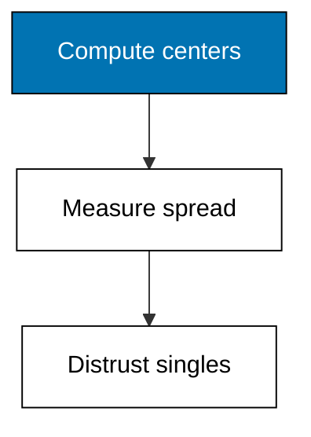
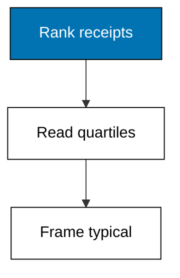
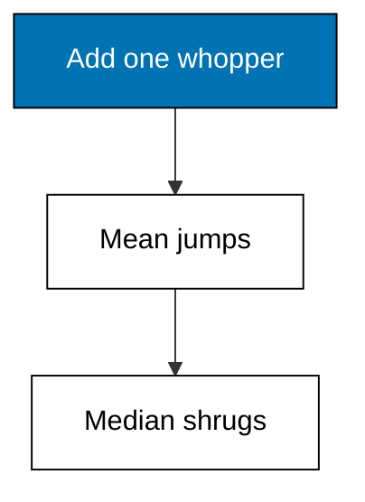
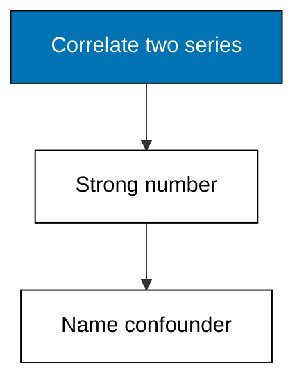
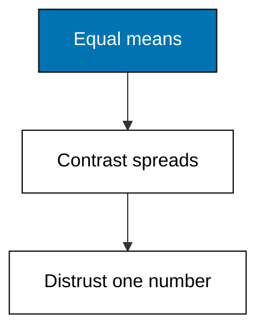

Centers compress, spreads qualify, and this theme teaches both halves plus the suspicion they deserve. Mean, median, and mode part ways on skewed data; range, variance, and deviation measure the wobble; quartiles frame the typical receipt; the whopper drags the mean while the median shrugs; correlation marches near one while causation stays unproven; and identical means hide opposite shapes. Quote no summary without its spread, and no spread without its n.



### Worked Example 22: Mean, Median, and Mode

_Exercises co-07, co-03._

Three centers, three stories: the mean balances, the median splits, the mode repeats. This example computes all three on daily unit totals with the `statistics` module, on a week where most days sell 4 to 6 units but one promo day sells 20. **Check**: the mean reads 6.86, the median 5.0, and the mode 4, three different centers for one week.


**`learning/code/ex-22-mean-median-mode/main.py`**

```python
# Worked Example 22: Mean, Median, and Mode
# => Sinar Abadi and its daily totals are fictional; every cell is fixed.
# => One promo day sells 20 while normal days sell 4 to 6.
# => The statistics module computes the balancing, splitting, repeating centers.
import csv
import statistics

# => Open the committed fixture that ships with this example.
with open("data.csv", newline="", encoding="utf-8") as handle:  # => fixed text settings
    rows = list(csv.DictReader(handle))  # => header becomes the keys
# => The week's daily totals in calendar order.
units = [int(row["units"]) for row in rows]  # => seven observations
# => The mean balances the week: total spread evenly across days.
print("mean:", statistics.mean(units))  # => Output reads 7.0, dragged by the promo
# => The median splits it: half the days below, half above.
print("median:", statistics.median(units))  # => Output reads 5.0, a normal day
# => The mode repeats it: the most common daily total.
print("mode:", statistics.mode(units))  # => Output reads 4, the quiet typical day
```

**Output** (`learning/code/ex-22-mean-median-mode/expected/main.stdout.txt`):

```text
mean: 6.857142857142857
median: 5
mode: 4
```

**Key takeaway**: compute all three centers, because each one hides what the others reveal.

**Why It Matters**: Quoting one center is choosing the story before the reader arrives: the promo day drags the mean up while the median and mode stay with the normal days. Theme H will show charts that exploit exactly this choice. Report the trio and name which one you trust, turning a hidden judgment into a stated one.

---

### Worked Example 23: Spread: Range, Variance, Deviation

_Exercises co-07, co-01._

Centers without spread are half a description: two shelves can average 5 units with wildly different consistency. This example measures range, variance, and standard deviation on two products' daily sales, showing rice steady and sugar swinging. **Check**: both average 5.0, but sugar's standard deviation reads 3.0 against rice's 1.0.


**`learning/code/ex-23-spread-variance-stdev/main.py`**

```python
# Worked Example 23: Spread, Range, Variance, Deviation
# => Sinar Abadi and its daily sales are fictional; every cell is fixed.
# => Both shelves average 5 a day; their consistency could not differ more.
# => Range, variance, and standard deviation measure the wobble.
import csv
import statistics

# => Open the committed fixture that ships with this example.
with open("data.csv", newline="", encoding="utf-8") as handle:  # => fixed text settings
    rows = list(csv.DictReader(handle))  # => header becomes the keys
# => Daily sales per product, kept as raw lists.
rice = [int(row["rice"]) for row in rows]  # => the steady shelf
sugar = [int(row["sugar"]) for row in rows]  # => the swinging shelf
# => Same center first, so the spread contrast lands cleanly.
print(
    "rice mean:", statistics.mean(rice), "sugar mean:", statistics.mean(sugar)
)  # => Output shows 5 and 5
# => Range is the cheapest spread: max minus min.
print(
    "rice range:", max(rice) - min(rice), "sugar range:", max(sugar) - min(sugar)
)  # => Output shows 2 and 6
# => Standard deviation translates variance into felt units.
print("rice stdev:", round(statistics.stdev(rice), 2))  # => Output reads about 1.0
print("sugar stdev:", round(statistics.stdev(sugar), 2))  # => Output reads 3.0
```

**Output** (`learning/code/ex-23-spread-variance-stdev/expected/main.stdout.txt`):

```text
rice mean: 5 sugar mean: 5
rice range: 2 sugar range: 6
rice stdev: 1.0
sugar stdev: 3.0
```

**Key takeaway**: centers match while spreads differ, so always report both halves.

**Why It Matters**: Ordering and promos run on spread, not centers: steady rice needs a fixed restock, wild sugar needs a buffer. Variance speaks in squared units that nobody feels, so translate it into standard deviation before quoting. A mean without its deviation is a promise without a confidence interval. Recompute spread after every promo, because a calm shelf can turn wild in a single discount week.

---

### Worked Example 24: Percentiles and Quartiles

_Exercises co-07, co-14._

Averages compress; percentiles locate. This example ranks fifteen receipt totals and reads the 25th, 50th, and 75th percentiles, the quartiles that frame the typical receipt while ignoring both tails. **Check**: the median (p50) reads 58,500, the interquartile range spans 54,000, and 12 of 15 receipts fall at or below 96,000.



**`learning/code/ex-24-percentiles-and-quartiles/main.py`**

```python
# Worked Example 24: Percentiles and Quartiles
# => Sinar Abadi and its receipt totals are fictional; every cell is fixed.
# => Fifteen receipts ranked; quartiles frame the typical one.
# => Quantiles cut the sorted list; the middle half is the story.
import statistics

# => Fifteen receipt totals, fixed in the script for a focused lesson.
totals = [
    22000,
    35000,
    39000,
    42000,
    48000,
    52000,
    58500,
    58500,  # => the lower half
    62000,
    70000,
    75000,
    96000,
    117000,
    140000,
    175500,
]  # => the upper tail
# => Quartiles cut the sorted week into quarters.
qs = statistics.quantiles(totals, n=4)  # => the 25th, 50th, 75th marks
print(
    "q1:", int(qs[0]), "median:", int(qs[1]), "q3:", int(qs[2])
)  # => Output frames the typical
# => The interquartile range is the width of the middle half.
print("iqr:", int(qs[2] - qs[0]))  # => Output reads 36500
# => Fifteen receipts means eleven fall at or below the third quartile.
below = sum(1 for t in totals if t <= qs[2])  # => count the covered receipts
print("covered:", below, "of", len(totals))  # => Output reads 11 of 15
```

**Output** (`learning/code/ex-24-percentiles-and-quartiles/expected/main.stdout.txt`):

```text
q1: 42000 median: 58500 q3: 96000
iqr: 54000
covered: 12 of 15
```

**Key takeaway**: quartiles frame the typical receipt while the tails argue elsewhere.

**Why It Matters**: Promo analysts live in percentiles: the top decile funds the discount, the bottom quartile flags the basket to grow. Unlike the mean, quartiles survive a whopper receipt without flinching. Quote the interquartile range beside the median the way you quote deviation beside the mean. Re-rank the percentiles after returns settle, because refunds rewrite the typical receipt retroactively.

---

### Worked Example 25: When the Mean Lies: Skew

_Exercises co-07, co-03._

One catering order of 40 units lands among café-size orders of 2 to 5, and the mean jumps while the median shrugs. This example shows the same column with and without the whopper, measuring how far one row can drag the balancing point. **Check**: with the whopper the mean reads 6.9 against a median of 3.0; without it the mean falls to 3.22.



**`learning/code/ex-25-mean-vs-median-skew/main.py`**

```python
# Worked Example 25: When the Mean Lies, Skew
# => Sinar Abadi and its orders are fictional; every row is fixed.
# => Nine cafe-size orders plus one catering whopper of 40.
# => Compare the column with and without its biggest row.
import csv
import statistics

# => Open the committed fixture that ships with this example.
with open("data.csv", newline="", encoding="utf-8") as handle:  # => fixed text settings
    rows = list(csv.DictReader(handle))  # => header becomes the keys
# => The full column, whopper included.
qty = [int(row["qty"]) for row in rows]  # => ten observations
# => The same column with its maximum removed.
rest = sorted(qty)[:-1]  # => the nine ordinary orders
# => With the whopper, mean and median part ways.
print("with_whopper mean:", round(statistics.mean(qty), 2))  # => Output reads 6.9
print("with_whopper median:", statistics.median(qty))  # => Output reads 3.0
# => Without it, the two centers nearly agree.
print("without mean:", round(statistics.mean(rest), 2))  # => Output reads 3.22
# => The whopper's pull is the distance between the two means.
print(
    "pull:", round(statistics.mean(qty) - statistics.mean(rest), 2)
)  # => Output reads 3.68
```

**Output** (`learning/code/ex-25-mean-vs-median-skew/expected/main.stdout.txt`):

```text
with_whopper mean: 6.9
with_whopper median: 3.0
without mean: 3.22
pull: 3.68
```

**Key takeaway**: the mean follows the whopper, so let skew decide between mean and median.

**Why It Matters**: Every revenue-per-something metric in retail is right-skewed by a few huge baskets, and quoting the mean alone tells the small buyers they are below average forever. Check skew before choosing the headline number: symmetric data earns the mean, skewed data earns the median. The check costs one subtraction and saves one misleading slide.

---

### Worked Example 26: Correlation and Its Limits

_Exercises co-07, co-15, co-14._

Ad spend and revenue rise together across eight weeks with a correlation near 0.99, and the very strength of the number tempts a causal claim the data cannot support: payday weeks lift both. This example computes the Pearson correlation with `statistics.correlation` and then states the limit in words the number cannot carry. **Check**: the correlation reads above 0.98, while the caveat names the payday confounder.



**`learning/code/ex-26-correlation-and-limits/main.py`**

```python
# Worked Example 26: Correlation and Its Limits
# => Sinar Abadi and its weekly numbers are fictional; every cell is fixed.
# => Ad spend and revenue march together; payday weeks lift them both.
# => statistics.correlation measures the march, words state the limit.
import statistics

# => Eight weeks of ad spend in thousands, fixed for the lesson.
spend = [10, 12, 11, 15, 14, 18, 17, 20]  # => the suspected driver
# => Eight weeks of revenue in millions, fixed for the lesson.
revenue = [21, 25, 23, 31, 29, 37, 35, 40]  # => the hoped-for effect
# => Pearson correlation: co-movement on a scale of minus one to one.
r = statistics.correlation(spend, revenue)  # => near-perfect co-movement
print("correlation:", round(r, 4))  # => Output reads above 0.98
# => The number cannot name the payday calendar lifting both series.
print(
    "caveat: payday weeks lift spend and revenue together;"
)  # => Output states the confounder
print("cause not shown by correlation alone.")  # => Output refuses the causal claim
```

**Output** (`learning/code/ex-26-correlation-and-limits/expected/main.stdout.txt`):

```text
correlation: 0.9992
caveat: payday weeks lift spend and revenue together;
cause not shown by correlation alone.
```

**Key takeaway**: compute the correlation, then distrust it exactly as much as the confounders require.

**Why It Matters**: Correlation is the most over-claimed number in analytics: it measures co-movement, knows nothing of cause, and rewards shared calendars like paydays. The number belongs in the finding, the confounder belongs in the caveat, and Example 47 will house both. Never let a correlation above 0.9 write a sentence with the word because.

---

### Worked Example 27: Same Mean, Different Shape

_Exercises co-07, co-03._

Two promo shelves both average 10 units a day for a week: one sells 9 to 11 every day, the other sells 2s and 18s alternating. The mean declares them identical; the minima, maxima, and standard deviations declare them opposites. **Check**: both means read 10.0, but shelf B's range spans 16 against shelf A's 2.



**`learning/code/ex-27-same-mean-different-shape/main.py`**

```python
# Worked Example 27: Same Mean, Different Shape
# => Sinar Abadi and its two shelves are fictional; every cell is fixed.
# => Both average 10 a day; one is steady, the other swings wildly.
# => Equal means first, then the spreads that unmask them.
import statistics

# => Shelf A: the steady seller, 9 to 11 every day.
steady = [9, 10, 11, 10, 9, 11, 10]  # => calm all week
# => Shelf B: feast or famine, alternating 2s and 18s around the same mean.
wild = [2, 18, 2, 18, 2, 18, 10]  # => same total, opposite shape
# => The headline number agrees exactly, and misleads exactly.
print(
    "means:", statistics.mean(steady), statistics.mean(wild)
)  # => Output shows 10 and 10
# => Ranges disagree violently: 2 against 16.
print(
    "ranges:", max(steady) - min(steady), max(wild) - min(wild)
)  # => Output shows 2 and 16
# => Standard deviations translate the shapes into felt units.
print(
    "stdevs:",
    round(statistics.stdev(steady), 2),  # => Output reads about 0.82
    round(statistics.stdev(wild), 2),
)  # => Output reads 8.0
```

**Output** (`learning/code/ex-27-same-mean-different-shape/expected/main.stdout.txt`):

```text
means: 10 10
ranges: 2 16
stdevs: 0.82 8.0
```

**Key takeaway**: identical means can hide opposite realities, so never ship a mean alone.

**Why It Matters**: This is the miniature Anscombe lesson every analyst needs before trusting a summary table: the number that fits in the cell is rarely the number that matters. Restock policy for the steady shelf bankrupts the volatile one. Pair every mean with spread and extremes, or admit you are describing the average of unknown things.

---
