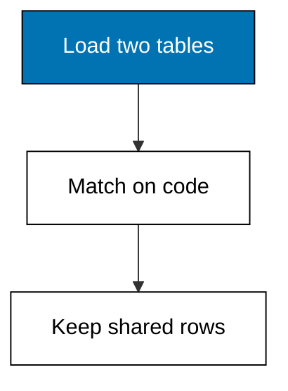
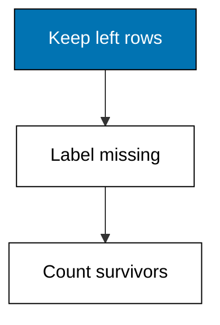
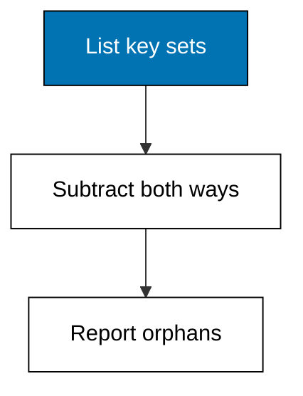
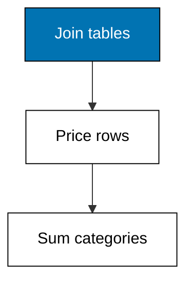
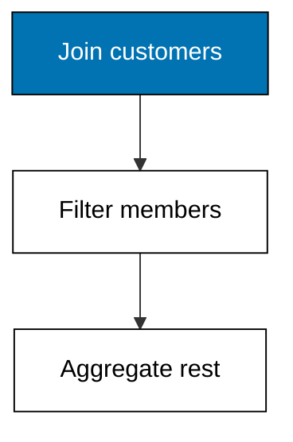
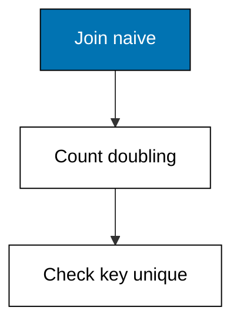

Neither table alone answers the owner's question, so this theme marries them in sqlite3 with the same SQL the Postgres toolchain runs. Inner join keeps shared keys, left join preserves the driving table with labeled gaps, anti-joins hunt orphans in both directions, aggregation follows the join when the grouping key lives across the street, filters live inside the query, and the fanout check guards every lookup key. Count both inputs and the output every time, because a join that shrinks or doubles is reporting a data problem, not a finding.


### Worked Example 28: Inner Join: Sales Meet Products

_Exercises co-09, co-05._

Receipts carry product codes; the catalog carries names, categories, and pack sizes, and neither table answers margin questions alone. This example loads both committed fixtures into `sqlite3` and inner-joins them on the product code, keeping only rows whose keys match on both sides. **Check**: 4 of 5 receipts match the catalog, and the joined rows carry the category column the sales table never had.



**`learning/code/ex-28-inner-join-sales-products/main.py`**

```python
# Worked Example 28: Inner Join, Sales Meet Products
# => Sinar Abadi, its receipts, and its catalog are fictional and fixed.
# => One receipt names a product the catalog never heard of.
# => Inner join keeps only the keys both tables share.
import csv
import sqlite3

# => An in-memory database: same SQL as the Postgres toolchain, zero services.
db = sqlite3.connect(":memory:")  # => throwaway, deterministic, offline
# => Load the committed sales fixture into its table.
with open(
    "sales.csv", newline="", encoding="utf-8"
) as handle:  # => fixed text settings
    sales = list(csv.DictReader(handle))  # => header becomes the keys
db.execute(
    "CREATE TABLE sales(order_id TEXT, code TEXT, qty INT)"
)  # => receipts schema
db.executemany(
    "INSERT INTO sales VALUES(:order_id, :code, :qty)", sales
)  # => load the rows
# => Load the committed catalog fixture into its table.
with open(
    "products.csv", newline="", encoding="utf-8"
) as handle:  # => fixed text settings
    products = list(csv.DictReader(handle))  # => header becomes the keys
db.execute(
    "CREATE TABLE products(code TEXT, category TEXT, pack TEXT)"
)  # => catalog schema
db.executemany(
    "INSERT INTO products VALUES(:code, :category, :pack)", products
)  # => load the rows
# => Inner join: matched keys only, category rides along with each receipt.
joined = db.execute(
    "SELECT s.order_id, s.code, p.category, s.qty "  # => pick the useful columns
    "FROM sales s JOIN products p ON s.code = p.code "  # => match on the code
    "ORDER BY s.order_id"
).fetchall()  # => stable order for the report
# => Show the joined rows: receipts enriched with their categories.
for row in joined:  # => one line per matched receipt
    print(row)  # => Output prints four enriched rows
# => Four of five receipts survive: the mystery box has no catalog entry.
print("matched:", len(joined), "of", len(sales))  # => Output reads 4 of 5
```

**Output** (`learning/code/ex-28-inner-join-sales-products/expected/main.stdout.txt`):

```text
('2801', 'rice-5kg', 'staples', 2)
('2802', 'sugar-1kg', 'staples', 5)
('2803', 'oil-2l', 'cooking', 1)
('2804', 'rice-5kg', 'staples', 3)
matched: 4 of 5
```

**Key takeaway**: inner join keeps only keys present on both sides, so unmatched rows vanish by design.

**Why It Matters**: The vanishing is the feature and the hazard: inner join answers questions about well-formed data while silently dropping the orphans Example 30 will hunt. Count both inputs and the output every time, because a join that shrinks unexpectedly is reporting a data problem, not a finding. Match-then-count is the join habit for the rest of the theme.

---

### Worked Example 29: Left Join: Keeping Every Sale

_Exercises co-09, co-02._

Dropping the mystery-box receipt hid revenue the store really collected. This example re-runs the match as a left join from sales, keeping every receipt and filling the missing category with an explicit `UNMATCHED` label instead of a silent disappearance. **Check**: all 5 receipts survive, and exactly 1 carries the `UNMATCHED` label.



**`learning/code/ex-29-left-join-keeps-sales/main.py`**

```python
# Worked Example 29: Left Join, Keeping Every Sale
# => Sinar Abadi, its receipts, and its catalog are fictional and fixed.
# => The mystery-box sale is real money with no catalog entry.
# => Left join keeps every receipt; gaps get a label, never silence.
import csv
import sqlite3

# => An in-memory database: same SQL as the Postgres toolchain, zero services.
db = sqlite3.connect(":memory:")  # => throwaway, deterministic, offline
# => Load the committed sales fixture into its table.
with open(
    "sales.csv", newline="", encoding="utf-8"
) as handle:  # => fixed text settings
    sales = list(csv.DictReader(handle))  # => header becomes the keys
db.execute(
    "CREATE TABLE sales(order_id TEXT, code TEXT, qty INT)"
)  # => receipts schema
db.executemany(
    "INSERT INTO sales VALUES(:order_id, :code, :qty)", sales
)  # => load the rows
# => Load the committed catalog fixture into its table.
with open(
    "products.csv", newline="", encoding="utf-8"
) as handle:  # => fixed text settings
    products = list(csv.DictReader(handle))  # => header becomes the keys
db.execute(
    "CREATE TABLE products(code TEXT, category TEXT, pack TEXT)"
)  # => catalog schema
db.executemany(
    "INSERT INTO products VALUES(:code, :category, :pack)", products
)  # => load the rows
# => Left join: every sale survives, missing categories get labeled.
joined = db.execute(
    "SELECT s.order_id, s.code, COALESCE(p.category, 'UNMATCHED') "  # => label the gaps
    "FROM sales s LEFT JOIN products p ON s.code = p.code "  # => sales drive the join
    "ORDER BY s.order_id"
).fetchall()  # => stable order for the report
# => Show every surviving receipt with its category or its label.
for row in joined:  # => one line per sale, all five
    print(row)  # => Output prints five rows, one labeled
# => Exactly one receipt needs catalog attention.
unlabeled = sum(
    1 for row in joined if row[2] == "UNMATCHED"
)  # => count the labeled gaps
print(
    "rows:", len(joined), "unmatched:", unlabeled
)  # => Output reads 5 rows, 1 unmatched
```

**Output** (`learning/code/ex-29-left-join-keeps-sales/expected/main.stdout.txt`):

```text
('2901', 'rice-5kg', 'staples')
('2902', 'sugar-1kg', 'staples')
('2903', 'oil-2l', 'cooking')
('2904', 'rice-5kg', 'staples')
('2905', 'mystery-box', 'UNMATCHED')
rows: 5 unmatched: 1
```

**Key takeaway**: left join preserves the driving table, turning vanished rows into labeled ones.

**Why It Matters**: Totals must reconcile: revenue counted at the till cannot shrink because a catalog is incomplete. Left join keeps the money while flagging the gap, which is the missing-value policy of Example 9 wearing SQL clothes. Default to left when the driving table is the truth, and inner only when both tables are.

---

### Worked Example 30: Finding Orphan Keys

_Exercises co-09, co-01._

The `UNMATCHED` label from Example 29 is a symptom; this example diagnoses it. An anti-join lists the sales codes with no catalog entry and the catalog codes with no sales, the two orphan lists that keep master data honest. **Check**: 1 sales orphan (`mystery-box`) and 1 catalog orphan (`tea-100g`) are reported.



**`learning/code/ex-30-orphans-in-the-join/main.py`**

```python
# Worked Example 30: Finding Orphan Keys
# => Sinar Abadi, its receipts, and its catalog are fictional and fixed.
# => One sale has no product; one product has no sale.
# => Anti-joins list the keys each side cannot place.
import csv
import sqlite3

# => An in-memory database: same SQL as the Postgres toolchain, zero services.
db = sqlite3.connect(":memory:")  # => throwaway, deterministic, offline
# => Load the committed sales fixture into its table.
with open(
    "sales.csv", newline="", encoding="utf-8"
) as handle:  # => fixed text settings
    sales = list(csv.DictReader(handle))  # => header becomes the keys
db.execute("CREATE TABLE sales(code TEXT)")  # => keys are all this check needs
db.executemany("INSERT INTO sales VALUES(:code)", sales)  # => load the keys
# => Load the committed catalog fixture into its table.
with open(
    "products.csv", newline="", encoding="utf-8"
) as handle:  # => fixed text settings
    products = list(csv.DictReader(handle))  # => header becomes the keys
db.execute("CREATE TABLE products(code TEXT)")  # => keys are all this check needs
db.executemany("INSERT INTO products VALUES(:code)", products)  # => load the keys
# => Sales codes the catalog cannot place: till errors or new products.
sales_orphans = db.execute(
    "SELECT DISTINCT s.code FROM sales s "  # => distinct unknown codes
    "WHERE s.code NOT IN (SELECT code FROM products)"
).fetchall()  # => anti-join one way
print("sales_orphans:", [r[0] for r in sales_orphans])  # => Output names mystery-box
# => Catalog codes with no sales: dead stock or seasonal gaps.
catalog_orphans = db.execute(
    "SELECT DISTINCT p.code FROM products p "  # => distinct unsold codes
    "WHERE p.code NOT IN (SELECT code FROM sales)"
).fetchall()  # => anti-join the other
print("catalog_orphans:", [r[0] for r in catalog_orphans])  # => Output names tea-100g
```

**Output** (`learning/code/ex-30-orphans-in-the-join/expected/main.stdout.txt`):

```text
sales_orphans: ['mystery-box']
catalog_orphans: ['tea-100g']
```

**Key takeaway**: orphan lists in both directions turn a vague mismatch into two work tickets.

**Why It Matters**: Every unmatched key is either a catalog gap to fill or a till error to fix, and only the direction tells you which. Running this check before the monthly aggregation prevents the slow drift where unmatched rows grow from one to one hundred unnoticed. Orphan-hunting belongs in the pipeline's profile step, next to Example 5's report.

---

### Worked Example 31: Aggregating After the Join

_Exercises co-09, co-06, co-14._

The question the owner actually asks is revenue by category, which neither table holds alone: quantities live in sales, categories live in the catalog. This example joins first, multiplies quantity by unit price, then sums per category. **Check**: staples total 380,000 and cooking totals 96,000, with the joined row count printed beside them.



**`learning/code/ex-31-aggregate-after-join/main.py`**

```python
# Worked Example 31: Aggregating After the Join
# => Sinar Abadi, its receipts, and its catalog are fictional and fixed.
# => Quantities meet prices in the join; categories group the revenue.
# => Join first, price each row, then sum per category.
import csv
import sqlite3

# => An in-memory database: same SQL as the Postgres toolchain, zero services.
db = sqlite3.connect(":memory:")  # => throwaway, deterministic, offline
# => Load the committed sales fixture into its table.
with open(
    "sales.csv", newline="", encoding="utf-8"
) as handle:  # => fixed text settings
    sales = list(csv.DictReader(handle))  # => header becomes the keys
db.execute(
    "CREATE TABLE sales(order_id TEXT, code TEXT, qty INT)"
)  # => receipts schema
db.executemany(
    "INSERT INTO sales VALUES(:order_id, :code, :qty)", sales
)  # => load the rows
# => Load the committed catalog fixture into its table.
with open(
    "products.csv", newline="", encoding="utf-8"
) as handle:  # => fixed text settings
    products = list(csv.DictReader(handle))  # => header becomes the keys
db.execute(
    "CREATE TABLE products(code TEXT, category TEXT, unit_price INT)"
)  # => price lives here
db.executemany(
    "INSERT INTO products VALUES(:code, :category, :unit_price)", products
)  # => load the rows
# => Join, price each receipt, then sum inside each category.
rows = db.execute(
    "SELECT p.category, SUM(s.qty * p.unit_price) "  # => revenue per category
    "FROM sales s JOIN products p ON s.code = p.code "  # => match on the code
    "GROUP BY p.category ORDER BY p.category"
).fetchall()  # => stable category order
# => Show each category with its revenue total.
for category, revenue in rows:  # => one line per category
    print(category, revenue)  # => Output prints staples 585000, cooking 96000
# => Joined rows reconcile the money back to four receipts.
print(
    "joined_rows:",
    db.execute(
        "SELECT COUNT(*) FROM sales s "  # => count the matches
        "JOIN products p ON s.code = p.code"
    ).fetchone()[0],
)  # => Output reads 4
```

**Output** (`learning/code/ex-31-aggregate-after-join/expected/main.stdout.txt`):

```text
cooking 96000
staples 380000
joined_rows: 4
```

**Key takeaway**: join before aggregating when the grouping key lives in the other table.

**Why It Matters**: Aggregating before the join silently multiplies or drops rows: sums computed on one side fan out or vanish when the keys meet. The join-then-aggregate order keeps every row accountable from match to total. Print the joined row count with the result, so a future analyst can reconcile the money back to the receipts.

---

### Worked Example 32: Joining With a Filter: Regulars Only

_Exercises co-09, co-06._

Not every join wants every row: the loyalty review counts only members' purchases. This example joins sales to a customers table and filters to member rows before aggregating, keeping the filter inside the query where it cannot be forgotten. **Check**: members contribute 3 of 5 receipts and 6 of 12 units.



**`learning/code/ex-32-filtered-join-customers/main.py`**

```python
# Worked Example 32: Joining With a Filter, Regulars Only
# => Sinar Abadi, its receipts, and its members list are fictional and fixed.
# => Two of four customers are members; the review counts their rows.
# => Join sales to customers, filter to members, then aggregate.
import csv
import sqlite3

# => An in-memory database: same SQL as the Postgres toolchain, zero services.
db = sqlite3.connect(":memory:")  # => throwaway, deterministic, offline
# => Load the committed sales fixture into its table.
with open(
    "sales.csv", newline="", encoding="utf-8"
) as handle:  # => fixed text settings
    sales = list(csv.DictReader(handle))  # => header becomes the keys
db.execute(
    "CREATE TABLE sales(order_id TEXT, customer TEXT, qty INT)"
)  # => receipts schema
db.executemany(
    "INSERT INTO sales VALUES(:order_id, :customer, :qty)", sales
)  # => load the rows
# => Load the committed customers fixture into its table.
with open(
    "customers.csv", newline="", encoding="utf-8"
) as handle:  # => fixed text settings
    customers = list(csv.DictReader(handle))  # => header becomes the keys
db.execute("CREATE TABLE customers(name TEXT, member INT)")  # => membership schema
db.executemany(
    "INSERT INTO customers VALUES(:name, :member)", customers
)  # => load the rows
# => Members only: the filter lives inside the query, not in a spreadsheet.
result = db.execute(
    "SELECT COUNT(*), SUM(s.qty) FROM sales s "  # => receipts and units
    "JOIN customers c ON s.customer = c.name "  # => match the buyer
    "WHERE c.member = 1"
).fetchone()  # => members drive the review
# => Show the member share of receipts and units side by side.
print("member_receipts:", result[0], "of", len(sales))  # => Output reads 3 of 5
print(
    "member_units:",
    result[1],
    "of",  # => Output reads 8 of 12
    sum(int(r["qty"]) for r in sales),
)  # => total units across all buyers
```

**Output** (`learning/code/ex-32-filtered-join-customers/expected/main.stdout.txt`):

```text
member_receipts: 3 of 5
member_units: 6 of 12
```

**Key takeaway**: filter inside the join query so the subset rule travels with the numbers.

**Why It Matters**: Filtering in a spreadsheet and joining in a script splits one decision across two tools, and the next analyst inherits numbers without the rule that made them. A WHERE clause next to the JOIN keeps the population definition auditable. State the population in the method section too, because SQL is read less often than the report.

---

### Worked Example 33: The Fanout Trap: Duplicate Keys

_Exercises co-09, co-14._

The catalog accidentally lists sugar-1kg twice with two pack sizes, and the join doubles its receipts: 2 sales rows become 4 joined rows and revenue doubles with them. This example demonstrates the fanout, then adds the uniqueness check on the join key that prevents it. **Check**: the naive join returns 4 rows from 2 sales, and the key check reports sugar-1kg as duplicated.



**`learning/code/ex-33-fanout-check/main.py`**

```python
# Worked Example 33: The Fanout Trap, Duplicate Keys
# => Sinar Abadi, its receipts, and its catalog are fictional and fixed.
# => Sugar appears twice in the catalog; its two sales double to four.
# => Show the fanout, then assert lookup-key uniqueness to catch it.
import csv
import sqlite3

# => An in-memory database: same SQL as the Postgres toolchain, zero services.
db = sqlite3.connect(":memory:")  # => throwaway, deterministic, offline
# => Load the committed sales fixture into its table.
with open(
    "sales.csv", newline="", encoding="utf-8"
) as handle:  # => fixed text settings
    sales = list(csv.DictReader(handle))  # => header becomes the keys
db.execute(
    "CREATE TABLE sales(order_id TEXT, code TEXT, qty INT)"
)  # => receipts schema
db.executemany(
    "INSERT INTO sales VALUES(:order_id, :code, :qty)", sales
)  # => load the rows
# => Load the committed catalog fixture into its table.
with open(
    "products.csv", newline="", encoding="utf-8"
) as handle:  # => fixed text settings
    products = list(csv.DictReader(handle))  # => header becomes the keys
db.execute("CREATE TABLE products(code TEXT, pack TEXT)")  # => catalog schema
db.executemany(
    "INSERT INTO products VALUES(:code, :pack)", products
)  # => load the rows
# => The naive join multiplies: each sale meets every matching catalog row.
naive = db.execute(
    "SELECT COUNT(*) FROM sales s "  # => count the joined rows
    "JOIN products p ON s.code = p.code"
).fetchone()[0]  # => fanout happens here
print(
    "sales_rows:", len(sales), "joined_rows:", naive
)  # => Output shows 2 sales, 4 joined
# => The guard: every lookup key must appear exactly once.
dupes = db.execute(
    "SELECT code FROM products GROUP BY code "  # => group the lookup side
    "HAVING COUNT(*) > 1"
).fetchall()  # => keys that fan out
print("dupe_keys:", [r[0] for r in dupes])  # => Output names sugar-1kg
print("fanout:", naive != len(sales))  # => Output reads True: the trap fired
```

**Output** (`learning/code/ex-33-fanout-check/expected/main.stdout.txt`):

```text
sales_rows: 2 joined_rows: 4
dupe_keys: ['sugar-1kg']
fanout: True
```

**Key takeaway**: check join-key uniqueness on the lookup side before trusting any joined total.

**Why It Matters**: Fanout is the most expensive silent bug in join analytics: totals inflate by integer multiples while every row looks legitimate. The uniqueness assertion costs one query and belongs above every aggregation-after-join. When the check fails, fix the lookup table first; no downstream number built on a doubled join can be rescued.

---
