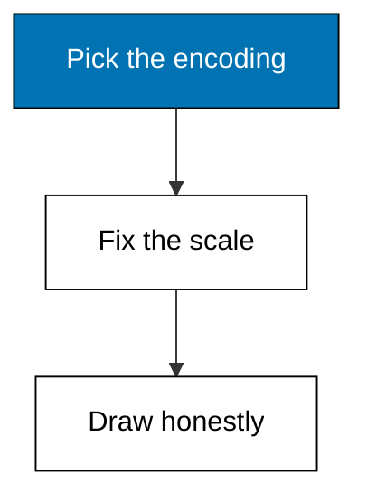
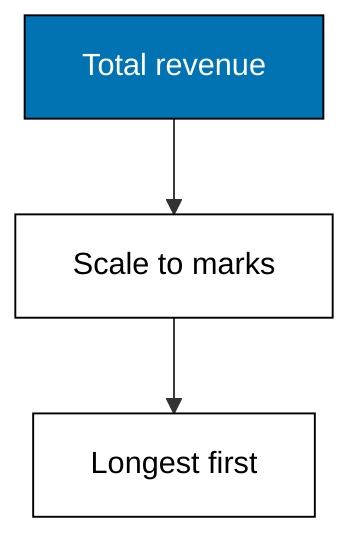
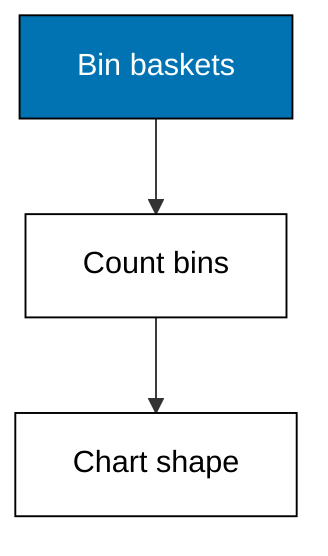
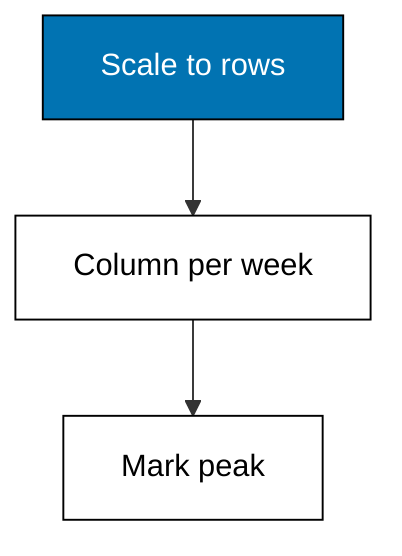
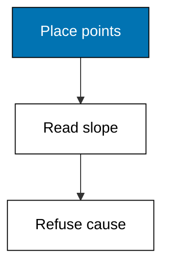
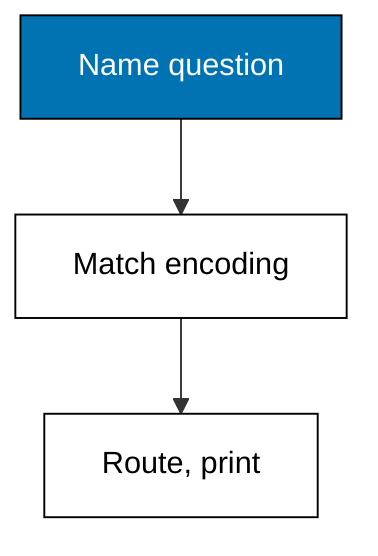

Tables answer precisely, charts answer instantly, and this theme encodes answers as text pictures a terminal can draw. Bars rank products by length on a fixed scale, histograms show basket shape on stated bins, lines trace twelve weeks at a fixed height, scatters slope upward while refusing causation, and the decision table routes each question to its encoding. Every chart prints its scale, bins, or peak beside the picture, because an unscaled picture is decoration with ambitions.



### Worked Example 34: Bar Chart: Top Products by Revenue

_Exercises co-10, co-06._

Rankings read faster as lengths than as numbers. This example totals revenue per product and prints a plain-text bar chart where each `#` stands for 25,000, sorted best first, the same ranking as Example 20 wearing its visual encoding. Rice's bar runs longest at 292,500. **Check**: rice-5kg prints 11 marks for 292,500 and the four bars appear in descending order.



**`learning/code/ex-34-bar-chart-top-products/main.py`**

```python
# Worked Example 34: Bar Chart, Top Products by Revenue
# => Sinar Abadi and its receipts are fictional; every row is fixed.
# => Revenue per product drawn as bars of hash marks, longest first.
# => One mark per 25,000 keeps the encoding fixed and honest.
import csv

# => Revenue in rupiah per hash mark on the chart.
UNIT = 25000  # => the fixed scale of the encoding

# => Open the committed fixture that ships with this example.
with open("data.csv", newline="", encoding="utf-8") as handle:  # => fixed text settings
    rows = list(csv.DictReader(handle))  # => header becomes the keys
# => Revenue per product: quantity times unit price, summed.
revenue = {}  # => product to revenue total
for row in rows:  # => visit each receipt once
    revenue[row["product"]] = revenue.get(row["product"], 0)  # => keep the pile
    revenue[row["product"]] += int(row["qty"]) * int(
        row["price"]
    )  # => price this receipt
# => Draw best first: length now carries the ranking.
for product, total in sorted(revenue.items(), key=lambda kv: -kv[1]):  # => descending
    bars = "#" * (total // UNIT)  # => fixed scale to marks
    print(f"{product:10} {bars} {total}")  # => Output prints each bar and number
```

**Output** (`learning/code/ex-34-bar-chart-top-products/expected/main.stdout.txt`):

```text
rice-5kg   ########### 292500
tea-100g   ### 88000
sugar-1kg  ### 87500
oil-2l     # 48000
```

**Key takeaway**: bar length encodes one quantity per category, sorted so comparisons need no arithmetic.

**Why It Matters**: Bars turn table lookup into visual comparison: the eye settles the ranking before reading a digit. Fixed scale per mark keeps the encoding honest, because rescaling mid-chart is Theme H's first trick. Sort descending unless the categories have a natural order the reader already knows, like months. Print the unit value with the chart, because a bar without its scale is decoration with ambitions.

---

### Worked Example 35: Histogram: Basket Size Shape

_Exercises co-10, co-07._

A mean basket of 3 hides whether baskets cluster at 3 or split between 1s and 6s. This example bins twelve basket quantities into small (1-2), medium (3-4), and large (5+) buckets and charts the counts, the histogram habit that shows shape where summaries show dots. **Check**: the medium bin counts 5, the largest share, and the three bins sum to 12 baskets.



**`learning/code/ex-35-histogram-basket-sizes/main.py`**

```python
# Worked Example 35: Histogram, Basket Size Shape
# => Sinar Abadi and its baskets are fictional; every cell is fixed.
# => Twelve baskets binned small, medium, large; shape on three lines.
# => Bin edges print with the chart: edges are a judgment call.
import csv

# => The bin edges, stated beside the chart they produce.
BINS = [
    ("small 1-2 ", 1, 2),
    ("medium 3-4", 3, 4),
    ("large 5+  ", 5, 99),
]  # => label, low, high

# => Open the committed fixture that ships with this example.
with open("data.csv", newline="", encoding="utf-8") as handle:  # => fixed text settings
    rows = list(csv.DictReader(handle))  # => header becomes the keys
# => Twelve basket quantities in the order they were rung up.
qty = [int(row["qty"]) for row in rows]  # => raw observations
# => Drop each basket into its bin and count the bins.
counts = []  # => one count per bin edge triple
for _, low, high in BINS:  # => visit each bin once
    counts.append(sum(1 for q in qty if low <= q <= high))  # => count its baskets
# => Chart the shape: label, marks, and count per bin.
for (label, _, _), count in zip(BINS, counts):  # => bins in size order
    print(f"{label} {'#' * count} {count}")  # => Output charts each bin
# => Bins must account for every basket observed.
print("baskets:", sum(counts), "of", len(qty))  # => Output reads 12 of 12
```

**Output** (`learning/code/ex-35-histogram-basket-sizes/expected/main.stdout.txt`):

```text
small 1-2  #### 4
medium 3-4 ##### 5
large 5+   ### 3
baskets: 12 of 12
```

**Key takeaway**: histograms show the shape a single mean hides, one bin per line.

**Why It Matters**: Promos target shapes, not means: a store of medium baskets grows by nudging 4s to 5s, while a split store needs two different offers. Bin edges are a judgment call, so print them with the chart; a histogram whose bins hide the story is a table with extra steps. Revisit the edges when the assortment changes.

---

### Worked Example 36: Line Chart: Weekly Trend

_Exercises co-10, co-01._

Twelve weeks of revenue as numbers blur; as a line, the Ramadan ramp jumps out. This example prints a vertical line chart of weekly revenue in millions, one column per week, scaled to a fixed height of 8 rows so weeks compare fairly. **Check**: week 12 peaks at 41 and the chart prints 8 rows plus its week axis.



**`learning/code/ex-36-line-chart-weekly-trend/main.py`**

```python
# Worked Example 36: Line Chart, Weekly Trend
# => Sinar Abadi and its weekly revenue are fictional; every cell is fixed.
# => Twelve weeks drawn as columns of stars, eight rows tall, peak marked.
# => Fixed height keeps every week on the same scale: the honesty rule.
import csv

# => Chart height in rows; every week shares this one scale.
HEIGHT = 8  # => fixed for the whole chart

# => Open the committed fixture that ships with this example.
with open("data.csv", newline="", encoding="utf-8") as handle:  # => fixed text settings
    rows = list(csv.DictReader(handle))  # => header becomes the keys
# => Weekly revenue in millions, in calendar order.
rev = [int(row["revenue"]) for row in rows]  # => twelve observations
# => Scale the tallest week to the full height.
top = max(rev)  # => the peak everything measures against
levels = [round(v / top * HEIGHT) for v in rev]  # => each week in rows
# => Print top row first down to row one.
for band in range(HEIGHT, 0, -1):  # => walk the rows downward
    row = "".join("* " if lv >= band else "  " for lv in levels)  # => build the row
    print(row.rstrip())  # => Output draws the row, no trailing spaces
# => The week axis and the peak label anchor the picture.
print(" ".join(f"{i + 1:2}" for i in range(len(rev))))  # => Output numbers the weeks
print("peak_week_12:", top)  # => Output reads the peak value 41
```

**Output** (`learning/code/ex-36-line-chart-weekly-trend/expected/main.stdout.txt`):

```text
                      *
                  * * *
          * * * * * * *
  *   * * * * * * * * *
* * * * * * * * * * * *
* * * * * * * * * * * *
* * * * * * * * * * * *
* * * * * * * * * * * *
 1  2  3  4  5  6  7  8  9 10 11 12
peak_week_12: 41
```

**Key takeaway**: fixed-height line charts make trends visible while keeping every week comparable.

**Why It Matters**: Trends justify inventory and staffing: the ramp says order early, the dip says investigate. Fixed height is the honesty rule here, the same fight as bar scales; a chart that rescales per week turns noise into drama. Label the peak week in words, because the next analyst should check the calendar, not admire the slope.

---

### Worked Example 37: Scatter: Discount Against Basket

_Exercises co-10, co-15._

Do bigger discounts actually grow baskets, or do they just move Saturday's shoppers to Friday? This example plots discount percent against basket size as a coarse text scatter, ten receipts on a 5-by-5 grid, and the cloud slopes upward without proving anything. **Check**: the grid shows 10 plotted points, and the printed correlation reads above 0.85 with its no-causation label.



**`learning/code/ex-37-scatter-discount-vs-basket/main.py`**

```python
# Worked Example 37: Scatter, Discount Against Basket
# => Sinar Abadi and its promo receipts are fictional; every cell is fixed.
# => Ten receipts on a 5-by-5 grid; the cloud slopes up, proving nothing.
# => Grid shows togetherness; words refuse the causal leap.
import statistics

# => Discount percent per receipt, fixed for the lesson.
discount = [0, 5, 5, 10, 10, 15, 15, 20, 20, 25]  # => the suspected lever
# => Basket size in units for the same ten receipts.
basket = [2, 3, 4, 4, 5, 5, 6, 7, 6, 8]  # => the hoped-for response
# => A 5-by-5 grid: rows are basket bands, columns discount bands.
for brow in range(4, -1, -1):  # => tall baskets at the top
    line = ""  # => one grid row being built
    for bcol in range(5):  # => small discounts on the left
        hits = sum(
            1
            for d, b in zip(discount, basket)  # => count points in this cell
            if d // 5 == bcol and (b - 1) // 2 == brow
        )  # => cell membership test
        line += "* " if hits else ". "  # => star for occupied, dot for empty
    print(line.rstrip())  # => Output draws the grid row, no trailing spaces
# => The number behind the cloud, with its limit attached.
print(
    "correlation:", round(statistics.correlation(discount, basket), 4)
)  # => Output reads high
print("caveat: slope shows togetherness, not cause.")  # => Output refuses the leap
```

**Output** (`learning/code/ex-37-scatter-discount-vs-basket/expected/main.stdout.txt`):

```text
. . . . .
. . . . *
. . * * *
. * * . .
* . . . .
correlation: 0.9623
caveat: slope shows togetherness, not cause.
```

**Key takeaway**: scatters show co-movement at a glance, then hand the causal question back unanswered.

**Why It Matters**: A scatter is Example 26's correlation made visible: the eye weighs the cloud before reading the number. Coarse grids suit print; fine ones suit screens, but both only ever show togetherness. Pair the plot with the confounder sentence every time, because a slope without a caveat becomes a policy by Monday.

---

### Worked Example 38: Choosing the Right Chart

_Exercises co-10, co-11, co-13._

Three questions, three encodings: parts of a whole want bars per category, change over time wants a line, and distribution wants a histogram. This example states the decision table as data, then routes three owner questions to their charts and prints the routing. **Check**: all 3 questions route correctly, and the whole-to-parts question never routes to a line.



**`learning/code/ex-38-choose-the-chart/main.py`**

```python
# Worked Example 38: Choosing the Right Chart
# => Sinar Abadi and its owner questions are fictional; every cell is fixed.
# => Three questions meet the decision table; each leaves with a chart.
# => Routing as data: the table is checkable, taste is not required.
import csv

# => The decision table: question kind to encoding, stated as data.
TABLE = {
    "compare categories": "bar",
    "change over time": "line",  # => two question kinds
    "distribution shape": "histogram",
}  # => and the third kind

# => Open the committed fixture of owner questions.
with open(
    "questions.csv", newline="", encoding="utf-8"
) as handle:  # => fixed text settings
    rows = list(csv.DictReader(handle))  # => header becomes the keys
# => Route each question through the table and print the assignment.
for row in rows:  # => visit each owner question once
    chart = TABLE[row["kind"]]  # => the table decides, not taste
    print(row["qid"], "->", chart)  # => Output prints the routing
# => The parts-of-a-whole question must never leave with a line.
whole = [r for r in rows if r["kind"] == "compare categories"]  # => category questions
print("category_routes:", {TABLE[r["kind"]] for r in whole})  # => Output shows bar only
```

**Output** (`learning/code/ex-38-choose-the-chart/expected/main.stdout.txt`):

```text
q1 -> bar
q2 -> line
q3 -> histogram
category_routes: {'bar'}
```

**Key takeaway**: the question picks the chart: compare bars, trend lines, shape histograms.

**Why It Matters**: Wrong-chart errors outnumber wrong-number errors in board packs: lines of categories imply trends that do not exist, pies with twelve slices compare nothing. The decision table turns taste into procedure a junior can follow. When no row fits, the question is probably two questions stapled together; split it before charting.

---
