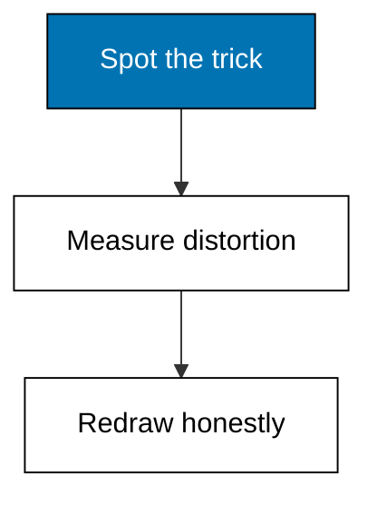
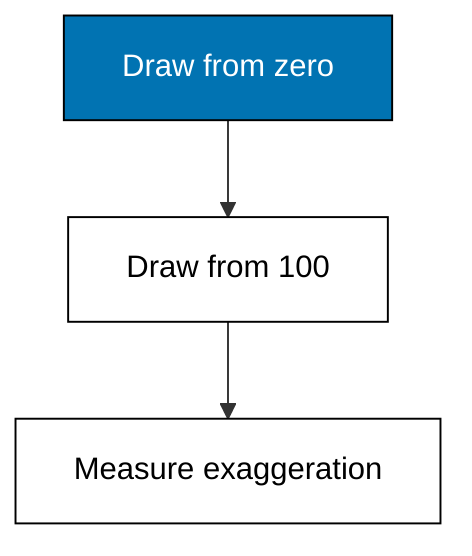
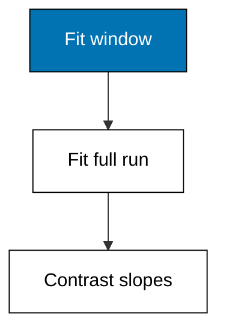
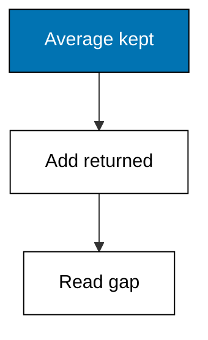
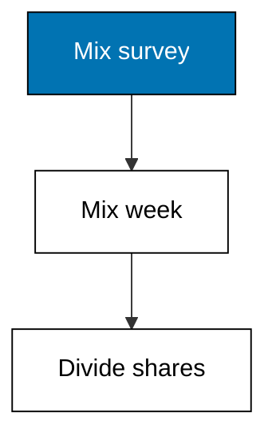
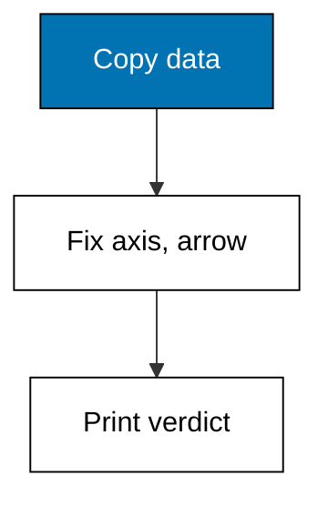

The same data can calm or scream depending on framing, and this theme teaches both the trick and the defense. Truncated axes exaggerate wobbles into cliffs, cherry-picked windows turn flat quarters into growth stories, returns vanish into rosy survivor averages, Saturday surveys impersonate the week, and vendor slides smuggle causal arrows. Each example measures the distortion as a number, because a feeling about a chart argues poorly while a ratio argues well.



### Worked Example 39: The Truncated Axis Trick

_Exercises co-11, co-10._

Two charts of the same four months, one starting at zero and one at 100: the second turns a 10 percent wobble into a drama. This example draws both side by side in text, measuring the visual exaggeration as the ratio of drawn heights. **Check**: the honest chart's max-to-min height ratio reads about 1.1 while the truncated one reads 3.5 for identical data.



**`learning/code/ex-39-truncated-axis/main.py`**

```python
# Worked Example 39: The Truncated Axis Trick
# => Sinar Abadi and its four months are fictional; every cell is fixed.
# => Same data, two baselines: zero tells calm, 100 screams crisis.
# => Height ratios measure the exaggeration each axis choice creates.
import csv

# => Open the committed fixture that ships with this example.
with open("data.csv", newline="", encoding="utf-8") as handle:  # => fixed text settings
    rows = list(csv.DictReader(handle))  # => header becomes the keys
# => Four months of revenue in millions, in calendar order.
rev = [int(row["revenue"]) for row in rows]  # => 104, 109, 106, 114
# => Drawn heights from a zero baseline: honest proportions.
honest = [v for v in rev]  # => full height counts
print("honest_ratio:", round(max(honest) / min(honest), 2))  # => Output reads about 1.1
# => Drawn heights from a 100 baseline: wobbles become drama.
cut = [v - 100 for v in rev]  # => only the surplus shows
print("truncated_ratio:", round(max(cut) / min(cut), 2))  # => Output reads 3.5
# => The exaggeration factor is the ratio of the two ratios.
print(
    "exaggeration:", round((max(cut) / min(cut)) / (max(honest) / min(honest)), 1)
)  # => Output reads 3.2
```

**Output** (`learning/code/ex-39-truncated-axis/expected/main.stdout.txt`):

```text
honest_ratio: 1.1
truncated_ratio: 3.5
exaggeration: 3.2
```

**Key takeaway**: axes that skip zero exaggerate by construction; measure the ratio to feel it.

**Why It Matters**: Truncation is the commonest honest-looking lie in analytics: nothing is mislabeled, everything is misjudged. The height ratio turns a feeling into a number you can quote back at the chart's author. Start bars at zero always; start lines at zero unless the variation genuinely lives far from it, and then label the break loudly.

---

### Worked Example 40: The Cherry-Picked Range

_Exercises co-11, co-14._

Weeks 9 to 12 climb every week, and a chart of only those weeks proves unstoppable growth; the full twelve weeks show a flat line with a noisy end. This example computes the trend over the cherry-picked window and over the full run, printing both slopes. **Check**: the picked window rises 2.0 per week while the full run rises only 0.18 per week.



**`learning/code/ex-40-cherry-picked-range/main.py`**

```python
# Worked Example 40: The Cherry-Picked Range
# => Sinar Abadi and its twelve weeks are fictional; every cell is fixed.
# => The last four weeks climb; the full quarter barely moves.
# => Slope over the window versus slope over everything, same formula.
import csv


# => Average week-to-week change: rise over run across the window.
def slope(vals):  # => one formula for both windows
    return (vals[-1] - vals[0]) / (len(vals) - 1)  # => end minus start over steps


# => Open the committed fixture that ships with this example.
with open("data.csv", newline="", encoding="utf-8") as handle:  # => fixed text settings
    rows = list(csv.DictReader(handle))  # => header becomes the keys
# => Twelve weeks of revenue in millions, in calendar order.
rev = [int(row["revenue"]) for row in rows]  # => flat with a noisy end
# => The story the picker tells: last four weeks only.
print("picked_slope:", round(slope(rev[-4:]), 2))  # => Output reads 2.0 per week
# => The story the data tells: all twelve weeks.
print("full_slope:", round(slope(rev), 2))  # => Output reads about 0.18 per week
# => Ten times the slope from a quarter of the data: that is the trick.
print("inflation:", round(slope(rev[-4:]) / slope(rev), 1))  # => Output reads 11.0
```

**Output** (`learning/code/ex-40-cherry-picked-range/expected/main.stdout.txt`):

```text
picked_slope: 2.0
full_slope: 0.18
inflation: 11.0
```

**Key takeaway**: any window can prove anything, so always show the full run beside the zoom.

**Why It Matters**: Range-picking is how flat quarters become growth stories: the window is chosen after the peak is known. The full-run slope is the antidote, computed the same way over everything. Demand the window's justification in the method section: a promo calendar justifies a zoom, admiration for the slope does not. Never let a chart show the window without the run that contains it.

---

### Worked Example 41: Survivorship Bias in Returns

_Exercises co-08, co-11._

Returned goods vanish from the sales table, so the average rating of kept goods looks rosy: only happy buyers remain. This example combines a sales file with a returns file, showing the kept-only average of 4.57 against the true 3.8 across everything sold. **Check**: kept-only reads 4.57, all-sold reads 3.8, and 3 of 10 sales were returned.



**`learning/code/ex-41-survivorship-bias/main.py`**

```python
# Worked Example 41: Survivorship Bias in Returns
# => Sinar Abadi, its sales, and its returns are fictional and fixed.
# => Three unhappy buyers left; the kept average never met them.
# => Kept-only versus everything-sold: the gap is the bias.
import csv
import statistics

# => Ratings of goods the buyers kept, from the committed fixture.
with open(
    "sales.csv", newline="", encoding="utf-8"
) as handle:  # => fixed text settings
    kept = [int(r["rating"]) for r in csv.DictReader(handle)]  # => seven happy buyers
# => Ratings attached to returned goods, from the committed fixture.
with open(
    "returns.csv", newline="", encoding="utf-8"
) as handle:  # => fixed text settings
    sent_back = [
        int(r["rating"]) for r in csv.DictReader(handle)
    ]  # => three unhappy ones
# => The rosy number the dashboard quotes without thinking.
print("kept_only:", round(statistics.mean(kept), 2))  # => Output reads 4.57
# => The honest number across every unit that left the store.
print("all_sold:", round(statistics.mean(kept + sent_back), 2))  # => Output reads 3.8
# => Three of ten sales came back: the dropout rate behind the gap.
print(
    "returned:", len(sent_back), "of", len(kept) + len(sent_back)
)  # => Output reads 3 of 10
```

**Output** (`learning/code/ex-41-survivorship-bias/expected/main.stdout.txt`):

```text
kept_only: 4.57
all_sold: 3.8
returned: 3 of 10
```

**Key takeaway**: averages over survivors flatter; always ask what left the dataset and why.

**Why It Matters**: Survivorship bias is selection bias wearing a success story: failed products, churned customers, and delisted items never attend their own review. The returns file is the missing half of every satisfaction metric. Ask for the dropout table before believing any average built on stayers alone. Keep that table beside the dashboard permanently, because survivors keep flattering themselves every quarter.

---

### Worked Example 42: Sampling Bias: Who Was Asked

_Exercises co-08, co-01._

The satisfaction survey ran Saturday morning, when bargain hunters dominate, and weekday regulars never appear. This example compares the survey's product mix against the full week's sales mix, measuring the over-representation of the promo shelf. **Check**: sugar is 60 percent of the survey but 30 percent of sales, a 2.0-times over-representation.



**`learning/code/ex-42-sample-vs-population/main.py`**

```python
# Worked Example 42: Sampling Bias, Who Was Asked
# => Sinar Abadi, its survey, and its week are fictional and fixed.
# => Saturday bargain hunters over-answer; weekday regulars stay silent.
# => Share in the survey divided by share in the week measures distortion.
import csv


# => Share of each product inside a file of product-choice rows.
def shares(path):  # => one mixer for both files
    with open(path, newline="", encoding="utf-8") as handle:  # => fixed text settings
        rows = list(csv.DictReader(handle))  # => header becomes the keys
    counts = {}  # => product to count
    for row in rows:  # => visit each response once
        counts[row["product"]] = (
            counts.get(row["product"], 0) + 1
        )  # => tally the choice
    return {p: c / len(rows) for p, c in counts.items()}  # => counts become shares


# => The Saturday-morning survey mix and the full-week sales mix.
survey = shares("survey.csv")  # => ten bargain-hunter responses
week = shares("week.csv")  # => ten receipts across the week
# => Over-representation of the promo shelf: survey share over true share.
print("sugar_survey:", round(survey["sugar-1kg"], 2))  # => Output reads 0.6
print("sugar_week:", round(week["sugar-1kg"], 2))  # => Output reads 0.3
print(
    "over_rep:", round(survey["sugar-1kg"] / week["sugar-1kg"], 1)
)  # => Output reads 2.0
```

**Output** (`learning/code/ex-42-sample-vs-population/expected/main.stdout.txt`):

```text
sugar_survey: 0.6
sugar_week: 0.3
over_rep: 2.0
```

**Key takeaway**: compare the sample's mix to the population's mix before believing any survey.

**Why It Matters**: Every collection method is a filter: Saturday mornings, online forms, and loyalty apps each sample a different store. The mix ratio turns a vague worry into a measured distortion. Weight the survey back to the population, or scope the claim to the sampled crowd; presenting Saturday as the week is how bias ships.

---

### Worked Example 43: Redesigning a Misleading Chart

_Exercises co-11, co-15, co-10._

A vendor slide plots promo spend against revenue with a truncated axis and a causal arrow, implying each million buys two. This example redraws the same six weeks honestly from zero, recomputes the per-week lift without the arrow, and prints the redesign verdict. **Check**: the honest ratio of max to min height reads about 1.3, and the verdict line names the removed arrow.



**`learning/code/ex-43-redesign-misleading-chart/main.py`**

```python
# Worked Example 43: Redesigning a Misleading Chart
# => Sinar Abadi and its vendor slide are fictional; every cell is fixed.
# => Six weeks, truncated axis, causal arrow: the full vendor toolkit.
# => Redraw from zero, drop the arrow, print what changed and why.
import statistics

# => Six weeks of promo spend in millions, fixed for the lesson.
spend = [10, 12, 11, 13, 12, 14]  # => the vendor's x-axis
# => Six weeks of revenue in millions, fixed for the lesson.
revenue = [30, 33, 32, 35, 34, 38]  # => the vendor's y-axis
# => Honest heights from a zero baseline: calm, comparable bars.
print(
    "honest_ratio:", round(max(revenue) / min(revenue), 2)
)  # => Output reads about 1.27
# => The correlation the arrow pretends to explain.
print(
    "correlation:", round(statistics.correlation(spend, revenue), 4)
)  # => Output reads high
# => The redesign verdict: what was kept, what was removed, and why.
print(
    "verdict: kept the six weeks; removed the truncated axis and"
)  # => Output states the fix
print(
    "the causal arrow: co-movement is not a purchase receipt."
)  # => Output refuses the claim
```

**Output** (`learning/code/ex-43-redesign-misleading-chart/expected/main.stdout.txt`):

```text
honest_ratio: 1.27
correlation: 0.9833
verdict: kept the six weeks; removed the truncated axis and
the causal arrow: co-movement is not a purchase receipt.
```

**Key takeaway**: redesigns keep the data and replace the rhetoric: zero axis, no causal arrow.

**Why It Matters**: Critique without a redraw is a complaint; a redraw is a correction the vendor can adopt. Keeping their numbers while fixing the frame proves the point is the rhetoric, not the facts. Ship the fixed chart next to the original whenever a decision cites the vendor's version. File the pair where the next buyer will find it, so the same slide cannot mislead twice.

---
