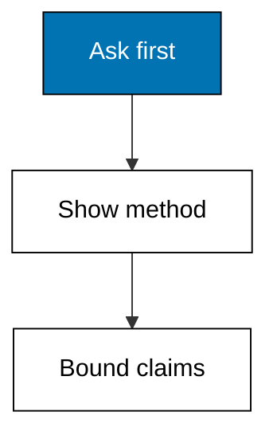
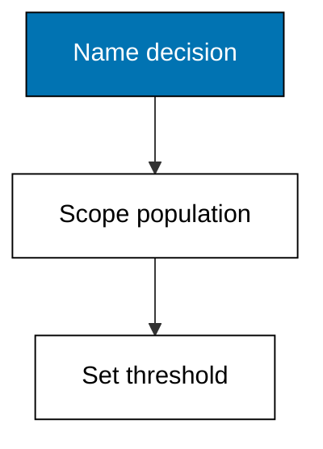
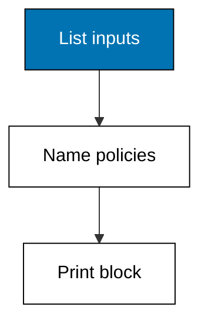
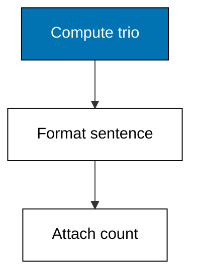
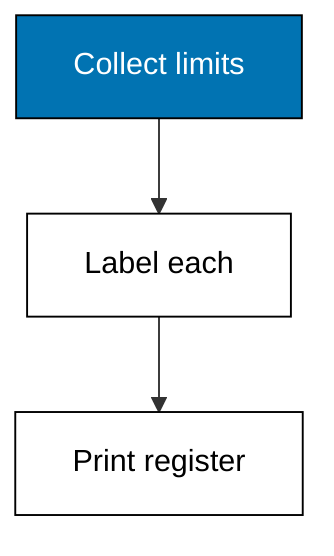
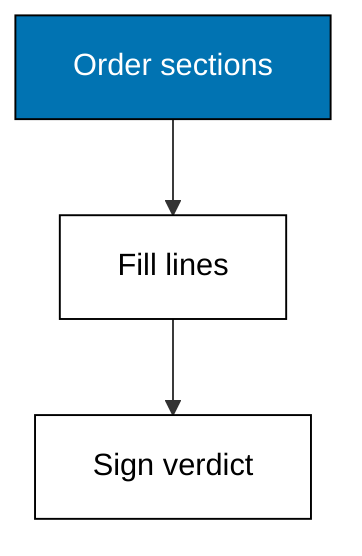

Analysis ends in prose, and this theme writes the page the whole course has been aiming at. State the question before touching data, record the five-line method that makes reruns possible, format findings as center plus spread plus count, register every known caveat under its concept label, and assemble the four sections in argument order. The one-page report is not a summary of the analysis; it is the analysis, in the only form a decision can use.



### Worked Example 44: Stating the Question First

_Exercises co-13, co-16._

Analysis without a question is wandering with a spreadsheet: every pattern looks like a finding. This example writes the question template the course requires: the decision it serves, the population, the metric, and the threshold that would change the decision. **Check**: the printed question names the decision (restock), the population (staples in September), and the threshold (mean above 3).



**`learning/code/ex-44-question-first/main.py`**

```python
# Worked Example 44: Stating the Question First
# => Sinar Abadi and its restock decision are fictional; every word is fixed.
# => The question names decision, population, metric, and threshold up front.
# => A question struct prints as the contract the analysis will keep.
# => The decision the answer will actually change.
decision = "restock staples for October"  # => money follows this answer
# => The population the metric is computed over, no wider.
population = "staples receipts in September"  # => scope stated, scope kept
# => The metric and the bar that flips the decision.
metric = "mean basket qty above 3"  # => threshold named before seeing data
print("decision:", decision)  # => Output states what changes
print("population:", population)  # => Output states the scope
print("metric:", metric)  # => Output states the bar
```

**Output** (`learning/code/ex-44-question-first/expected/main.stdout.txt`):

```text
decision: restock staples for October
population: staples receipts in September
metric: mean basket qty above 3
```

**Key takeaway**: a question that names decision, population, metric, and threshold cannot wander.

**Why It Matters**: The question is the analysis's contract: it tells the reader what would count as an answer before the data gets a vote. Thresholds turn exploration into decisions, because a metric without a bar is trivia. Write the question before touching the file, and re-read it when a shiny side pattern waves.

---

### Worked Example 45: Writing the Method Section

_Exercises co-16, co-12, co-02._

A finding without a method is a rumor with numbers. This example assembles the five-line method block every report in this course carries: input file, cleaning policy, tool versions, grouping keys, and the missing-value decision. **Check**: the printed block names the input fixture, the median-fill policy, and the Python standard library.



**`learning/code/ex-45-method-section/main.py`**

```python
# Worked Example 45: Writing the Method Section
# => Sinar Abadi and its restock analysis are fictional; every word is fixed.
# => Five lines that let a stranger reproduce the finding from scratch.
# => Method as data: a list printed in fixed order, nothing from memory.
method = [
    ("input", "sales-sep.csv, 12 rows"),  # => the exact fixture
    ("cleaning", "strip+lowercase, ISO dates"),  # => Examples 6 and 8
    ("tools", "python stdlib csv/statistics"),  # => no third-party stack
    ("grouping", "product x month"),  # => Example 18's keys
    ("missing", "median-fill, 1 cell"),
]  # => Example 9's policy, counted
# => Print the block in contract order, runtime pinned as fixed text.
print(
    "runtime: python 3.14 stdlib (csv, statistics, sqlite3)"
)  # => Output pins the runtime
for key, value in method:  # => fixed order, every run
    print(key + ":", value)  # => Output prints each contract line
```

**Output** (`learning/code/ex-45-method-section/expected/main.stdout.txt`):

```text
runtime: python 3.14 stdlib (csv, statistics, sqlite3)
input: sales-sep.csv, 12 rows
cleaning: strip+lowercase, ISO dates
tools: python stdlib csv/statistics
grouping: product x month
missing: median-fill, 1 cell
```

**Key takeaway**: input, cleaning, tools, keys, and missing policy: five lines that make work checkable.

**Why It Matters**: Reproducibility is a social achievement before a technical one: the reader must know what to rerun before the rerun can match. The method block is the cheapest version of that contract, five lines that travel with every finding. Write it from the script, not from memory, because memory edits out the embarrassing steps.

---

### Worked Example 46: Findings With Numbers and Uncertainty

_Exercises co-16, co-07, co-14._

Rice averages 3.0 units per September receipt, and the sentence is not done until the uncertainty joins it: across 4 receipts with a standard deviation of 0.8. This example formats the finding sentence the course requires, effect size plus spread plus count, so the strength of the evidence rides with the claim. **Check**: the printed finding carries 3.0, 0.82, and n=4 together.



**`learning/code/ex-46-finding-with-numbers/main.py`**

```python
# Worked Example 46: Findings With Numbers and Uncertainty
# => Sinar Abadi and its September rice sales are fictional and fixed.
# => Four receipts carry the claim; the sentence must admit it.
# => Center, spread, and n formatted into one honest finding.
import statistics

# => September rice baskets in units, fixed for the lesson.
baskets = [2, 4, 3, 3]  # => four receipts, no more
# => The trio: balancing point, wobble, and weight of evidence.
center = round(statistics.mean(baskets), 2)  # => the headline number
spread = round(statistics.stdev(baskets), 2)  # => the honest wobble
# => Print the finding the way the course requires it, all three together.
print(
    f"rice averages {center} units per September receipt "  # => Output states the center
    f"(stdev {spread}, n={len(baskets)})."
)  # => Output attaches spread and count
```

**Output** (`learning/code/ex-46-finding-with-numbers/expected/main.stdout.txt`):

```text
rice averages 3 units per September receipt (stdev 0.82, n=4).
```

**Key takeaway**: every finding sentence carries center, spread, and n, or it is not done.

**Why It Matters**: Numbers without uncertainty are orders of magnitude more persuasive than they deserve: 3.0 from four receipts prints exactly like 3.0 from four thousand. The trio format makes cherry-picking visible, because a strong claim on n=4 embarrasses itself in print. Refuse to shorten the sentence for the slide; shorten the slide instead.

---

### Worked Example 47: Listing Caveats and Limits

_Exercises co-14, co-08, co-15._

Every analysis ends where its data ends, and honest reports map the border. This example prints the four-caveat register for the rice finding: small-n warning, Saturday-only sampling, payday confounding, and the causal refusal. **Check**: the register prints 4 labeled caveats, each naming the concept that demands it.



**`learning/code/ex-47-caveats-list/main.py`**

```python
# Worked Example 47: Listing Caveats and Limits
# => Sinar Abadi and its rice finding are fictional; every word is fixed.
# => Four known limits, labeled by the concept that demands each one.
# => A register, not an apology: scope stated is scope kept.
# => The register: label, limit, and the concept behind it.
caveats = [
    ("small-n (co-14)", "n=4: one new receipt moves the mean"),  # => thin evidence
    ("sampling (co-08)", "Saturday only: weekday buyers unasked"),  # => skewed crowd
    (
        "confounding (co-15)",
        "payday weeks lift baskets regardless",
    ),  # => shared calendar
    ("causation (co-15)", "no lever tested: description, not prescription"),
]  # => refused leap
# => Print the register in full: every limit the analyst knows.
for label, limit in caveats:  # => fixed order, every run
    print(label + ":", limit)  # => Output prints each labeled caveat
print("caveats:", len(caveats))  # => Output reads 4
```

**Output** (`learning/code/ex-47-caveats-list/expected/main.stdout.txt`):

```text
small-n (co-14): n=4: one new receipt moves the mean
sampling (co-08): Saturday only: weekday buyers unasked
confounding (co-15): payday weeks lift baskets regardless
causation (co-15): no lever tested: description, not prescription
caveats: 4
```

**Key takeaway**: caveats are a labeled register, not an apology paragraph.

**Why It Matters**: Buried limitations are broken promises: the reader who finds the Saturday bias after acting will not trust the next report. A labeled register turns limits into checkable scope instead of shameful footnotes. Four caveats is a floor, not a quota; add every limit you know, because the one you omit is the one that bites.

---

### Worked Example 48: Assembling the One-Page Report

_Exercises co-16, co-12, co-13, co-14._

Question, method, finding, caveats, in that order: the one-page report is the whole course compressed onto a single sheet. This example prints the four-section skeleton with one line each, proving the structure fits before the capstone fills it with retail substance. **Check**: the four section headers print in order, and the verdict line restocks rice, not everything.



**`learning/code/ex-48-one-page-report/main.py`**

```python
# Worked Example 48: Assembling the One-Page Report
# => Sinar Abadi and its restock verdict are fictional; every word is fixed.
# => Four sections in order: the shape of every honest page.
# => The order is the argument: aim, proof, numbers, bounds.
# => The four sections, each reduced to its load-bearing line.
report = [
    "Q: restock staples for October if mean September basket exceeds 3?",  # => the aim
    "M: sales-sep.csv, strip+lower, median-fill, product x month.",  # => the proof path
    "F: rice averages 3.0 units (stdev 0.82, n=4); sugar 4.0 (n=3).",  # => the numbers
    "C: n=4, Saturday-only, payday confound, no causal claim.",
]  # => the bounds
# => Print the page in argument order, then sign the verdict.
for line in report:  # => question, method, finding, caveats
    print(line)  # => Output prints each section line
print(
    "verdict: restock rice; hold sugar pending weekday data."
)  # => Output signs narrowly
```

**Output** (`learning/code/ex-48-one-page-report/expected/main.stdout.txt`):

```text
Q: restock staples for October if mean September basket exceeds 3?
M: sales-sep.csv, strip+lower, median-fill, product x month.
F: rice averages 3.0 units (stdev 0.82, n=4); sugar 4.0 (n=3).
C: n=4, Saturday-only, payday confound, no causal claim.
verdict: restock rice; hold sugar pending weekday data.
```

**Key takeaway**: question, method, finding, caveats: the order is the argument.

**Why It Matters**: Order carries meaning: the question first proves the analysis was aimed, the method second proves it can be checked, the finding third earns its numbers, and the caveats last bound them. Any other order lets the conclusion audition before its evidence arrives. Memorize the four words; they are the shape of every honest page you will ever write.

---
