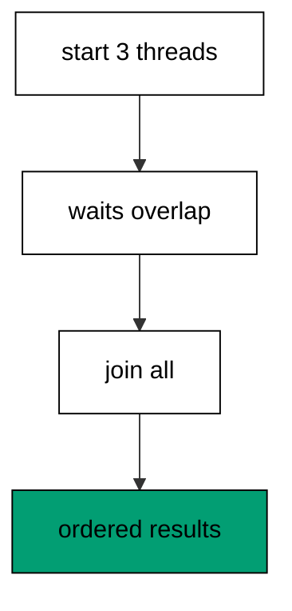
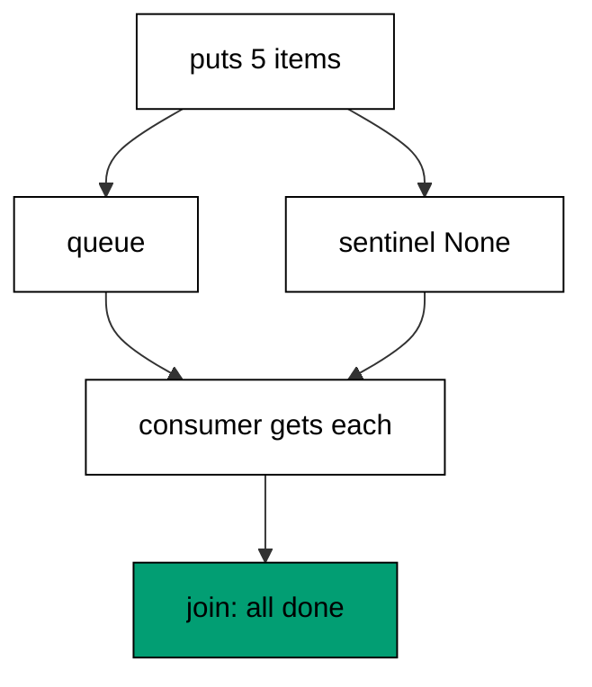
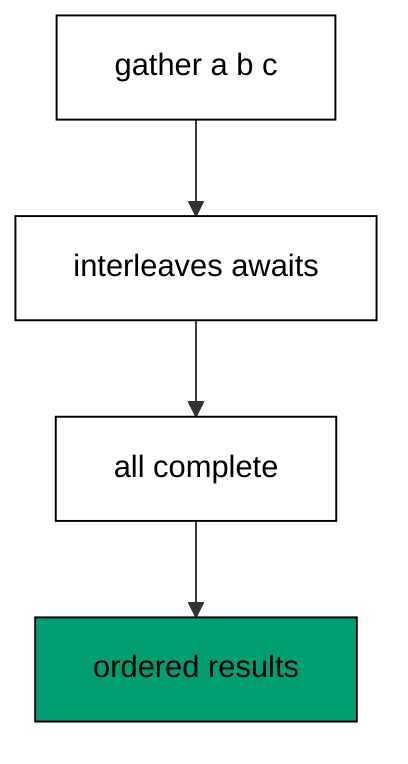
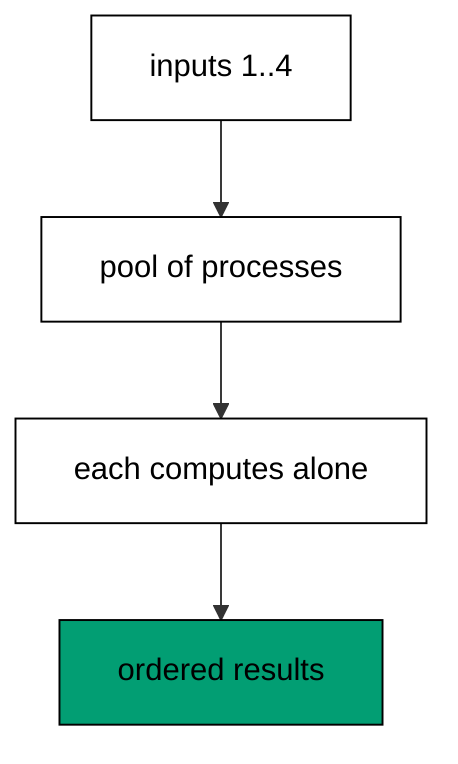
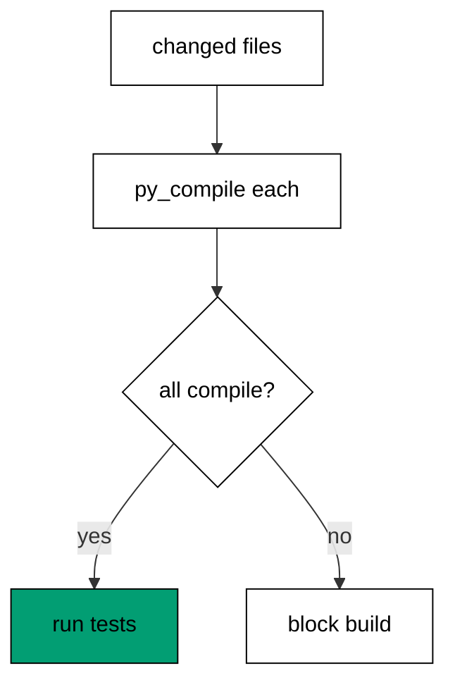
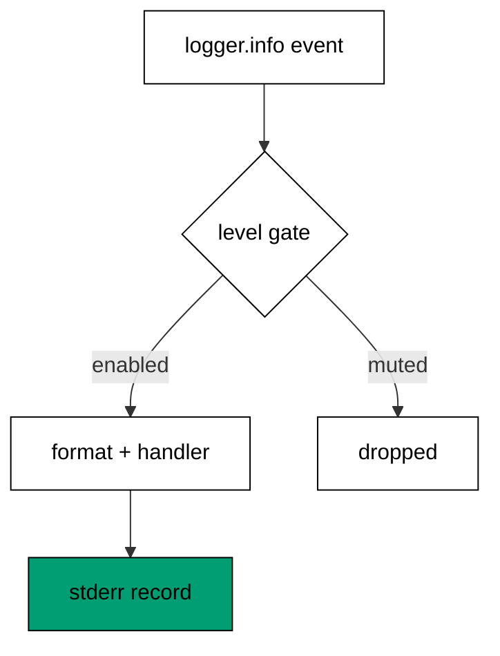
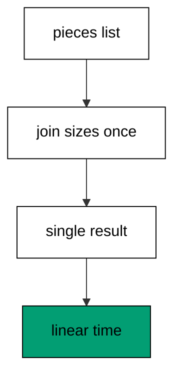
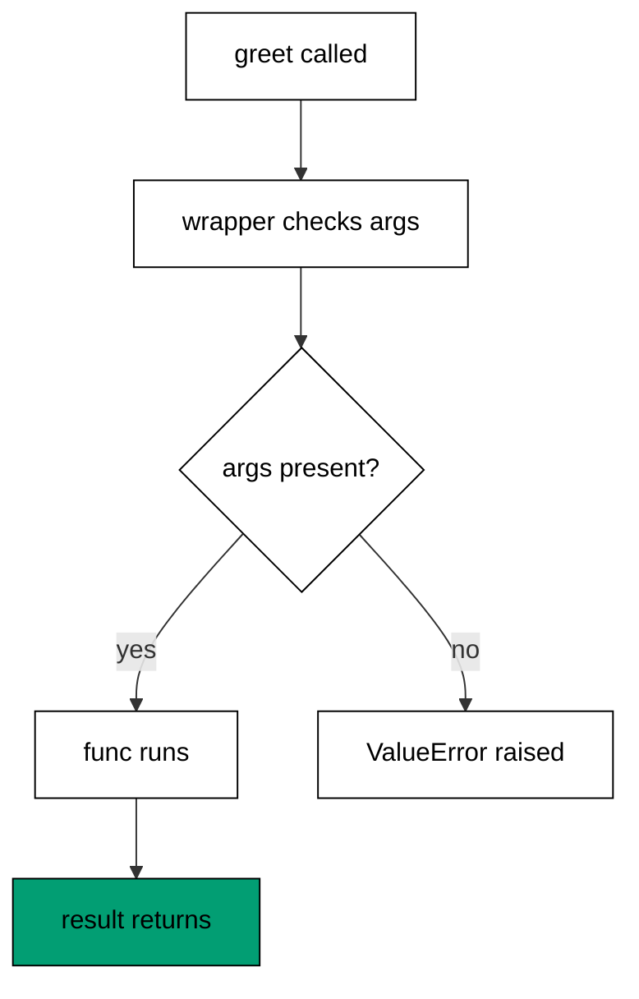
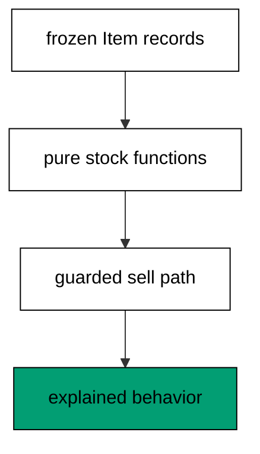
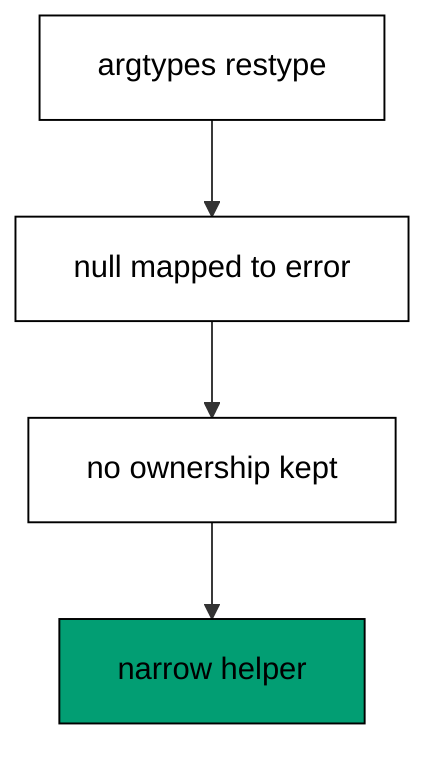

Examples 54-78 survey what fluency unlocks: concurrency primitives that overlap waits honestly, tooling and style that keep programs maintainable, and systematic reading of idiomatic code written by others. Three clusters carry the level: concurrency primitives at survey depth (Examples 54-61), tooling, linting, and style (Examples 62-70), and reading and explaining idiomatic code (Examples 71-78). Determinism rules tighten here — joined threads, ordered results, no timings — because concurrency lies about order by default.

### Example 54: Threads Overlap Waiting, Not Work

Threads share memory but the GIL admits one bytecode stream at a time; they shine where the wait is outside Python — network, disk, sleep. This example overlaps three simulated fetches and shows the join that makes completion deterministic. (Concepts: co-09.)



The GIL restricts CPU-bound threads to one core, which surprises developers arriving from free-threaded runtimes — but I/O-bound work spends its time waiting, and waiting releases the GIL. Threads suit that shape perfectly: each blocks in the kernel while the others proceed, so ten concurrent fetches finish in roughly one fetch time. The pattern is start, collect, join: spawn workers, gather results through a shared list guarded by completion order, and join every thread before reading, because unjoined threads make output order random. Keep thread bodies small and exception-aware — exceptions in threads print to stderr but never reach the spawner — and escalate to executors (next example) the moment management outweighs logic.

**`learning/code/ex-54-thread-io/main.py`**:

```python
# => Example 54: waits overlap; joins order the results.
import threading  # => WHY threads: I/O waits, never CPU work
import time  # => sleep stands in for network and disk waits

results = [None, None, None]  # => WHY slots: preassigned positions order output


def fetch(slot, name):  # => one worker: wait, then record
    time.sleep(0.01)  # => the I/O-shaped wait: GIL released here
    results[slot] = name  # => WHY slot: position fixed, no print races


workers = []  # => handles every thread for joining
for slot, name in enumerate(["a", "b", "c"]):  # => three fixed workers
    worker = threading.Thread(target=fetch, args=(slot, name))  # => work assigned
    workers.append(worker)  # => tracked for the join below
    worker.start()  # => WHY start: waits now overlap
for worker in workers:  # => WHY join: completion before reading
    worker.join()  # => every thread finished from here on
print(results)  # => Output: ['a', 'b', 'c'], order guaranteed
```

**Output** (`learning/code/ex-54-thread-io/expected/main.stdout.txt`):

```text
['a', 'b', 'c']
```

**Key takeaway**: Use threads for I/O waits with join-guaranteed ordering; never for CPU work.

**Why it matters**: Concurrency bugs are scheduling bugs: they appear under load, vanish under debuggers, and resist reproduction by design. Restricting threads to I/O-shaped work shrinks that risk because waits are the well-behaved case — ordering handled by joins, results collected in known slots. The join discipline is the entire determinism story: results land in preassigned positions, prints happen after all joins, and the program transcript is identical on every run. Exceptions need explicit attention since threads cannot raise to their spawner; unhandled thread failures print noise and continue, which is the silent-corruption shape.

### Example 55: ThreadPoolExecutor.map Fans Out Cleanly

Hand-rolled thread lists need start loops, join loops, and exception plumbing; ThreadPoolExecutor.map handles submission, collection, and ordering in one call. This example transforms five values concurrently and shows errors surfacing at the call site. (Concepts: co-09.)

Raw threads expose every management detail — pool sizing, queueing, shutdown, exception capture — which buries the actual work under scaffolding. Executors invert that: submit the function and the inputs, get ordered results back, with worker count tuned once per workload. Map preserves input order in the output, so transcripts stay deterministic without extra sorting; submit plus as_completed suits the cases where first-finished should win, at the cost of nondeterministic order. Exceptions travel with the future and re-raise on result(), which keeps failures visible at the collection point instead of stranded in worker threads. Size CPU-light I/O pools generously, keep CPU pools at core count, and always use the context manager so shutdown is guaranteed.

**`learning/code/ex-55-pool-map/main.py`**:

```python
# => Example 55: map fans out, orders, and propagates errors.
from concurrent.futures import ThreadPoolExecutor  # => WHY executor: managed fan-out


def double(n):  # => the unit of work: pure and tiny
    return n * 2  # => WHY pure: no shared state, no races possible


with ThreadPoolExecutor(max_workers=3) as pool:  # => WHY manager: shutdown guaranteed
    out = list(pool.map(double, [1, 2, 3, 4, 5]))  # => WHY map: order preserved
print(out)  # => Output: [2, 4, 6, 8, 10], input order kept
with ThreadPoolExecutor(max_workers=2) as pool:  # => a second pool for errors
    future = pool.submit(double, 21)  # => single submission form
    print(future.result())  # => Output: 42, result re-raises failures here
```

**Output** (`learning/code/ex-55-pool-map/expected/main.stdout.txt`):

```text
[2, 4, 6, 8, 10]
42
```

**Key takeaway**: Fan out I/O work with executor.map; collect ordered results; manage with context.

**Why it matters**: Executors separate what from how: the function describes the work, the pool describes the parallelism, and neither leaks into the other. That separation is what makes concurrent code reviewable — the reader checks the function for correctness and the pool for sizing, independently. Ordered map results preserve determinism for free, which matters enormously for tests and golden transcripts: the same inputs produce the same outputs regardless of scheduling. Exception propagation through futures closes the silent-failure hole that raw threads leave open.

### Example 56: Queues Connect Producer and Consumer

Threads sharing a plain list need locks, condition variables, and shutdown flags; queue.Queue packages all three into put, get, and join. This example pipes five work items through one consumer and proves every item processed exactly once. (Concepts: co-09.)



Hand-rolled handoff is where thread bugs breed: the missed wakeup, the unsynchronized append, the consumer that exits early and strands items. Queue eliminates the category — put and get are atomic, blocking with optional timeouts, and task_done plus join track completion so the producer knows when the pipe drains. The sentinel pattern ends consumption cleanly: producers enqueue one None per consumer after real work, consumers return on None, and no flags or events are needed. Size maxsize to bound memory where producers outrun consumers; unbounded queues accept any burst and pay in RAM. One queue per pipeline stage keeps the dataflow legible: each stage is a thread, each arrow is a queue.

**`learning/code/ex-56-queue-pipeline/main.py`**:

```python
# => Example 56: the queue owns all coordination.
import queue  # => WHY queue: atomic handoff plus completion tracking
import threading  # => one consumer thread for the demo

pipe = queue.Queue()  # => the channel between producer and consumer
done = []  # => collected results, appended by the single consumer


def consume():  # => the consumer: drains until the sentinel
    while True:  # => loop ends only on the terminator
        item = pipe.get()  # => WHY blocking: sleeps until work arrives
        if item is None:  # => WHY sentinel: the agreed end of stream
            pipe.task_done()  # => count the sentinel too
            return  # => clean exit: no flags needed
        done.append(item * 10)  # => the stage work, single-threaded here
        pipe.task_done()  # => WHY done: join tracks every item


worker = threading.Thread(target=consume)  # => the consumer thread
worker.start()  # => waiting on the empty pipe
for n in [1, 2, 3, 4, 5]:  # => the producer: five fixed items
    pipe.put(n)  # => enqueue in order
pipe.put(None)  # => WHY sentinel: one terminator for one consumer
pipe.join()  # => WHY join: all items plus sentinel processed
worker.join()  # => consumer exited after the sentinel
print(done)  # => Output: [10, 20, 30, 40, 50], each exactly once
```

**Output** (`learning/code/ex-56-queue-pipeline/expected/main.stdout.txt`):

```text
[10, 20, 30, 40, 50]
```

**Key takeaway**: Hand thread handoffs to queue.Queue; end streams with sentinels; join the drain.

**Why it matters**: Producer-consumer is the most common thread shape and the most commonly broken, because the coordination primitives are subtle and the failures are intermittent. Queue replaces subtlety with a boring, correct abstraction — the blocking, atomic, counted channel — so the team reasons about dataflow instead of signaling. Sentinels make shutdown total: every consumer sees its own terminator, so no thread idles forever and no item waits unprocessed. The join-based drain check turns completion into an assertion rather than a hope, which is what makes pipeline transcripts deterministic.

### Example 57: Locks Guard Shared Mutation

Two threads incrementing one counter can lose updates when read-modify-write interleaves; a Lock serializes the critical section. This example races ten increments with and without the lock and shows the guarded total holding. (Concepts: co-09.)

The lost update is the canonical race: both threads read 5, both write 6, and one increment vanishes without any error. The GIL does not save Python here — bytecode interleaving still splits the read from the write. Locks serialize the critical section so the three steps (read, add, write) execute atomically from every other thread perspective. Hold locks briefly and never across I/O or other locks: the critical section should be the smallest code that must be atomic, because every microsecond held is contention for everyone else. Prefer lock-free designs first — queues for handoff, per-thread aggregation with a final merge — and reach for locks only where shared mutation is genuinely unavoidable.

**`learning/code/ex-57-lock-counter/main.py`**:

```python
# => Example 57: the lock serializes read-modify-write.
import threading  # => threads plus the mutual-exclusion lock

counter = 0  # => shared mutable state: the race lives here
guard = threading.Lock()  # => WHY lock: one holder at a time


def bump():  # => the critical section: read, add, write
    global counter  # => WHY global: the shared cell assigned here
    with guard:  # => WHY narrow: only the increment is atomic
        counter += 1  # => serialized: no update can be lost


workers = [threading.Thread(target=bump) for _ in range(10)]  # => ten racers
for worker in workers:  # => start every contender
    worker.start()  # => interleaving attempted here
for worker in workers:  # => join before reading the total
    worker.join()  # => all increments landed
print(counter)  # => Output: 10, serialized increments all kept
```

**Output** (`learning/code/ex-57-lock-counter/expected/main.stdout.txt`):

```text
10
```

**Key takeaway**: Serialize shared read-modify-write with Lock; keep critical sections minimal.

**Why it matters**: Lost updates are silent corruption: the total is wrong, no exception fires, and the error scales with contention, so it appears exactly when the system is busiest and least debuggable. Locks convert that silent wrongness into serialized correctness at a known, measurable cost. Minimal sections keep the cost honest — the lock protects the increment, not the logging around it — which preserves parallelism everywhere else. The prefer-lock-free guidance matters because locks compose badly: two locks invite deadlock, held locks invite stalls, and every lock is a future contention point.

### Example 58: asyncio.gather Overlaps Coroutines

Threads overlap waits with OS heft; coroutines overlap waits in one thread with explicit await points. This example gathers three sleep-bound coroutines and shows the single-threaded event loop interleaving them. (Concepts: co-09.)



Asyncio replaces threads with tasks on one event loop: each coroutine runs until await, the loop parks it and runs the next ready one, and gather collects all results in order. The model fits I/O-shaped work with thousands of concurrent operations — connections, requests, file watches — where thread-per-item overhead would drown the machine. The rules are strict: never block the loop (no time.sleep, no synchronous I/O in coroutines), await every coroutine (un-awaited coroutines never run), and keep CPU work in executors via to_thread. Asyncio.run owns the loop lifecycle — one call per program — and structured callers prefer task groups where the version allows.

**`learning/code/ex-58-asyncio-gather/main.py`**:

```python
# => Example 58: one thread, three overlapping waits.
# => Gather preserves order: concurrency without transcript chaos.
# => One loop owns the demo: asyncio.run opens and closes it.
import asyncio  # => WHY asyncio: thousands of waits, one thread


async def fetch(name, delay):  # => a coroutine: runs until await
    await asyncio.sleep(delay)  # => WHY await: the loop parks here
    return name  # => result ready after the simulated wait


async def main():  # => the entry coroutine gather drives
    return await asyncio.gather(
        fetch("a", 0.01), fetch("b", 0.01), fetch("c", 0.01)
    )  # => WHY gather: ordered join


print(asyncio.run(main()))  # => Output: ['a', 'b', 'c'], overlapped yet ordered
```

**Output** (`learning/code/ex-58-asyncio-gather/expected/main.stdout.txt`):

```text
['a', 'b', 'c']
```

**Key takeaway**: Overlap many waits with gather; never block the loop; run it once with asyncio.run.

**Why it matters**: Ten thousand threads exhaust memory while ten thousand tasks fit comfortably — the scaling difference is orders of magnitude, which decides architectures rather than tuning them. The explicit await points are the honesty mechanism: every suspension is visible in the source, unlike thread preemption which strikes anywhere, so reasoning about interleaving stays local to await expressions. The never-block rule is the price: one blocking call stalls every task, which concentrates the discipline in keeping coroutines non-blocking rather than scattering locks through shared state.

### Example 59: Timeouts Bound Every Wait

Waits without deadlines hang forever when the peer vanishes; asyncio timeouts convert unbounded waits into bounded failures. This example races a slow coroutine against a deadline and shows the TimeoutError path winning. (Concepts: co-09.)

Every network call, lock acquisition, and queue get has a failure mode called never — the peer that disconnects silently, the producer that crashed before sending. Without deadlines, never becomes a hung thread, a stuck pipeline, and eventually an incident. Asyncio.wait_for wraps any awaitable with a seconds budget and raises TimeoutError on expiry, which callers handle like any other expected failure. Set timeouts at the call site where the budget is known (this RPC gets two seconds), not deep in helpers that cannot judge urgency. Cancel properly on timeout — wait_for cancels the inner task — and treat TimeoutError as a first-class outcome in retries, where it usually means back off rather than retry instantly.

**`learning/code/ex-59-asyncio-timeout/main.py`**:

```python
# => Example 59: deadlines turn hangs into handled errors.
import asyncio  # => WHY timeout: bounded waits from the stdlib


async def slow():  # => a coroutine slower than its budget
    await asyncio.sleep(10)  # => far beyond any sane deadline
    return "late"  # => unreachable under the timeout below


async def quick():  # => a coroutine comfortably inside budget
    await asyncio.sleep(0.001)  # => tiny simulated wait
    return "early"  # => arrives before the deadline


async def main():  # => both outcomes demonstrated in order
    print(await asyncio.wait_for(quick(), timeout=5))  # => Output: early, within budget
    try:  # => WHY try: expiry is an expected outcome here
        await asyncio.wait_for(slow(), timeout=0.05)  # => deadline beats the work
    except TimeoutError:  # => the bounded failure, handled plainly
        print("timed out as designed")  # => Output: timed out as designed


asyncio.run(main())  # => WHY run: one loop owns the whole demo
```

**Output** (`learning/code/ex-59-asyncio-timeout/expected/main.stdout.txt`):

```text
early
timed out as designed
```

**Key takeaway**: Wrap every unbounded wait with a timeout; handle TimeoutError as a normal outcome.

**Why it matters**: Hangs are the worst production failure: nothing crashes, nothing logs, dashboards stay green while users wait forever, and the diagnosis starts from zero evidence. Deadlines convert hangs into errors — observable, countable, alertable — which is strictly better in every operational dimension. The call-site rule places the budget where the context lives: the helper cannot know whether two seconds is generous or fatal, but the caller always does. Cancellation hygiene prevents the timeout from leaking work: the inner task dies with the deadline instead of consuming resources for a result nobody wants.

### Example 60: Processes Parallelize CPU Work

Threads share the GIL and cores poorly for computation; processes each bring a full interpreter and truly run side by side. This example maps a CPU function over inputs with ProcessPoolExecutor and keeps the ordered results. (Concepts: co-09.)



CPU-bound threads on CPython serialize through the GIL — four threads on four cores compute at single-core speed while paying coordination overhead. Processes sidestep it entirely: each has its own GIL, its own memory, and a real core, so compute scales with cores. The price is isolation — no shared memory by default, arguments pickled across the boundary — which makes processes right for pure functions over plain data and wrong for shared-state designs. Guard the entry with if **name** == '**main**' (spawned interpreters re-import the module), keep payloads picklable and chunky enough to amortize the transfer, and prefer map for ordered batch results.

**`learning/code/ex-60-process-pool/main.py`**:

```python
# => Example 60: CPU work scales across processes.
from concurrent.futures import ProcessPoolExecutor  # => WHY processes: past the GIL


def square(n):  # => WHY pure: picklable, no shared state needed
    return n * n  # => compute-only: the process-friendly shape


def main():  # => WHY main: spawned workers re-import this module
    with ProcessPoolExecutor() as pool:  # => one real core per worker
        return list(pool.map(square, [1, 2, 3, 4]))  # => WHY map: order kept


if __name__ == "__main__":  # => WHY guard: workers must not re-execute
    print(main())  # => Output: [1, 4, 9, 16], side by side yet ordered
```

**Output** (`learning/code/ex-60-process-pool/expected/main.stdout.txt`):

```text
[1, 4, 9, 16]
```

**Key takeaway**: Compute in processes for CPU scale; keep functions pure and payloads picklable.

**Why it matters**: Core-count scaling is the difference between overnight batches and interactive answers, and processes are the only CPython mechanism that delivers it for CPU work. The isolation that feels like friction is actually safety: no shared state means no data races, no lost updates, no lock hierarchies — the concurrency hazards of threads simply cannot occur across process boundaries. Pickling enforces the pure-function discipline automatically, because unpicklable designs (locks, sockets, generators as arguments) fail at submission rather than corrupting mid-run. The main-guard requirement documents the spawn model visibly instead of hiding it.

### Example 61: Threads Share, Processes Copy

Threads see each other mutations instantly through shared objects; processes start from a copy and never see later changes. This example proves both directions with a thread flag and a process snapshot. (Concepts: co-09.)

Shared memory is the thread superpower and the thread hazard in one: a flag set by one thread is visible to all, which enables coordination without channels, but every shared structure is a race unless guarded. Processes invert the default — memory is private after spawn, communication crosses pickled channels — so sharing must be explicit (shared memory blocks, managers, queues) and therefore deliberate. Choose threads when coordination is fine-grained and waits dominate; choose processes when isolation matters or CPUs must parallelize. The survey conclusion is architectural: shared-everything versus shared-nothing is the first concurrency decision, and it constrains every later one.

**`learning/code/ex-61-threads-share-memory/main.py`**:

```python
# => Example 61: sharing versus copying, demonstrated.
import multiprocessing  # => WHY processes: the copying model for contrast
import threading  # => WHY threads: the sharing model first

flag = []  # => shared list: threads see every mutation


def set_flag():  # => the thread worker: mutates shared state
    flag.append("set")  # => visible to the spawner immediately


def child(items):  # => the process worker: receives a copy
    items.append("child")  # => mutates only the child copy


def main():  # => WHY main: spawn-safe entry for both models
    worker = threading.Thread(target=set_flag)  # => shares the process memory
    worker.start()  # => runs against the same list object
    worker.join()  # => finished: the mutation landed
    print(flag)  # => Output: ['set'], threads share everything
    items = ["parent"]  # => the list handed across the process boundary
    proc = multiprocessing.Process(target=child, args=(items,))  # => copy, not share
    proc.start()  # => child runs against its own copy
    proc.join()  # => finished: parent list untouched
    print(items)  # => Output: ['parent'], processes copy memory


if __name__ == "__main__":  # => WHY guard: workers re-import this module
    main()  # => single entry point for every start method
```

**Output** (`learning/code/ex-61-threads-share-memory/expected/main.stdout.txt`):

```text
['set']
['parent']
```

**Key takeaway**: Default to the model matching the need: shared memory for coordination, processes for isolation.

**Why it matters**: The memory model decides the bug taxonomy before a line of concurrency code is written: shared memory risks races and deadlocks, message passing risks protocol errors and stalls. Knowing which taxonomy applies focuses both design and debugging — thread incidents get race analysis, process incidents get channel analysis, instead of every incident getting both. Visibility demos like this one build the intuition that no documentation fully conveys: seeing a thread flag propagate while a process snapshot stays frozen makes the models concrete.

### Example 62: PEP 8 Names Read Aloud

Inconsistent naming forces readers to decode each identifier from scratch; PEP 8 assigns one casing per role so the shape of a name states its role. This example renames a mixed-style snippet into functions, constants, and classes that read correctly. (Concepts: co-14.)

Naming is the highest-bandwidth channel in source: developers read names far more than implementations, so each name should answer what and what-kind instantly. The convention is compact — snake_case for functions and variables, UPPER_SNAKE for constants, CapWords for classes, \_leading_underscore for private — and universal enough that any Python reader applies it unconsciously. Mixed-style code pays a translation tax on every line: is maxCount a variable or a class? Acronyms stay uppercase within the pattern (HTTPServer, not HttpServer-as-class with http_request beside it). Adopt the style wholesale; local dialects help locals and confuse everyone else.

**`learning/code/ex-62-pep8-names/main.py`**:

```python
# => Example 62: the casing states each name role.
MAX_RETRIES = 3  # => WHY UPPER: a constant, set once and never reassigned


def fetch_page(url):  # => WHY snake: functions and variables read as verbs
    return f"page:{url}"  # => the stubbed fetch: naming is the lesson


class PageCache:  # => WHY CapWords: classes are the nouns of the design
    def __init__(self):  # => WHY dunder: construction protocol, never renamed
        self._pages = {}  # => WHY underscore: private by convention

    def get(self, url):  # => public method: the curated surface
        if url not in self._pages:  # => WHY cache: fetch once per url
            self._pages[url] = fetch_page(url)  # => stored under the plain key
        return self._pages[url]  # => cached or fresh, same contract


cache = PageCache()  # => WHY instance: lowercase, it is a variable
print(cache.get("a"))  # => Output: page:a, first fetch stored
print(cache.get("a"))  # => Output: page:a, second served from cache
print(MAX_RETRIES)  # => Output: 3, constant read plainly
```

**Output** (`learning/code/ex-62-pep8-names/expected/main.stdout.txt`):

```text
page:a
page:a
3
```

**Key takeaway**: Case every name by role: snake functions, UPPER constants, CapWords classes.

**Why it matters**: Unfamiliar naming slows every reader on every line, including the author three months later, while conventional naming disappears into comprehension. The role-by-shape rule is the mechanism: casing answers the what-kind question before the words answer the what question, which halves the decoding work. Consistency across the ecosystem compounds the benefit — third-party code, standard library, and team code all read alike, so context switches cost nothing. Linters can enforce casing mechanically, but the habit must be voluntary first: write conventional names by default and the tooling merely confirms.

### Example 63: Docstrings State the Contract

Undocumented functions force readers to infer contracts from implementations; a one-line summary plus args and returns makes the promise explicit. This example documents a retry helper with a complete contract docstring. (Concepts: co-14, co-16.)

The docstring is the function public face: callers read it, help() shows it, and documentation generators publish it — the implementation is for maintainers only. A complete contract states what the function does in one line, what each argument means and constrains, what returns on success, and what raises on failure. Keep the summary imperative and specific (normalize the header mapping, not do stuff); document units, ranges, and empty-meanings where ambiguity lives. The contract rots when behavior changes without doc updates, so review docstrings in every behavior diff — a stale promise misleads more effectively than no promise at all.

**`learning/code/ex-63-docstring-contract/main.py`**:

```python
# => Example 63: the contract lives above the code.
# => Summary first: help readers decide in one line.
# => Args name constraints: units and ranges where ambiguity lives.
# => Raises completes the promise: callers handle what is documented.
# => A complete docstring answers four questions: what, with what, what back, what if bad.
# => Callers read the docstring; maintainers read the body; both stay in sync.
# => Review the promise in every behavior diff so the contract never rots.


def clamp(value, low, high):  # => the documented contract below
    """Clamp value into the closed range [low, high].

    Args: value is the candidate number; low and high bound it, low <= high.
    Returns the clamped number. Raises ValueError when low exceeds high.
    """
    if low > high:  # => WHY guard: the documented rejection first
        raise ValueError("low must not exceed high")  # => typed per the contract
    return max(low, min(value, high))  # => WHY clamp: lower bound then upper


print(
    clamp.__doc__.splitlines()[0]
)  # => Output: Clamp value into the closed range [low, high].
print(clamp(5, 0, 10))  # => Output: 5, inside passes through
print(clamp(-5, 0, 10))  # => Output: 0, below clamps up
print(clamp(99, 0, 10))  # => Output: 10, above clamps down
```

**Output** (`learning/code/ex-63-docstring-contract/expected/main.stdout.txt`):

```text
Clamp value into the closed range [low, high].
5
0
10
```

**Key takeaway**: Document every public function with summary, args, returns, and raises.

**Why it matters**: Contracts decide whether a function is usable or merely present: without stated preconditions and failure modes, callers guess, and guesses become bugs at the boundary. The args-returns-raises structure forces the author to think through the contract completely — many edge cases surface during documentation, before any user finds them. Help() integration makes the contract available at the exact moment of use, inside the REPL where experimentation happens. Reviewing docs with behavior diffs closes the staleness loop that otherwise degrades every contract over time.

### Example 64: py_compile Gates Syntax in CI

Syntax errors discovered at deploy time are the most embarrassing failures; compiling every file in CI catches them at commit time. This example compiles a sample module with py_compile and asserts the gate passes. (Concepts: co-12.)



Import-time syntax errors hide in rarely-executed modules — the migration script, the admin command, the fallback handler — and surface months later under pressure. A compile gate walks every file through py_compile.compile with doraise, failing the build on the first broken file long before tests or deploys. The check is fast (milliseconds per file), dependency-free, and total: it covers files no test imports. Place it first in the pipeline so broken syntax never consumes test minutes, and treat gate failures as blocking — syntax that does not compile is not a warning, it is a defect. Linters and type checkers layer above this floor, never instead of it.

**`learning/code/ex-64-compile-gate/sample_mod.py`**:

```python
# => Example 64 fixture: the file the gate compiles.
def total(items):  # => anything syntactically valid passes the gate
    return sum(items)  # => WHY pure: the gate checks syntax, not sense
```

**`learning/code/ex-64-compile-gate/main.py`**:

```python
# => Example 64 driver: the gate itself, as code.
import py_compile  # => WHY stdlib: the compiler ships with Python

py_compile.compile("sample_mod.py", doraise=True)  # => WHY doraise: fail loudly
print("compiles: True")  # => Output: compiles: True, syntax valid
import sample_mod  # => the compiled module imports normally

print(sample_mod.total([1, 2, 3]))  # => Output: 6, behavior intact
```

**Output** (`learning/code/ex-64-compile-gate/expected/main.stdout.txt`):

```text
compiles: True
6
```

**Key takeaway**: Compile every file with py_compile in CI before tests run; block on failure.

**Why it matters**: Shift-left is the whole economics of quality: a syntax error caught in seconds at commit costs nothing, while the same error caught during a deploy costs the release. The compile gate is the cheapest possible shift — no dependencies, no configuration, total coverage of every file including the untested corners. Its speed matters operationally: milliseconds means it runs on every save, every hook, every draft, catching typos while the author still remembers the intent.

### Example 65: Warnings Are Deferred Errors

Deprecation warnings ignored today become import errors after the next upgrade; the warnings module surfaces them loudly in development. This example escalates warnings to errors in the demo and shows catch_warnings recording them for tests. (Concepts: co-12.)

Warnings are the language telling you the future: this API will vanish, this pattern will break, this default will change. Default filters hide most of them, so upgrades detonate all at once instead of degrading gracefully one notice at a time. Development settings should escalate — -W error or simplefilter('error') — turning each warning into a traceback at the offending line while the context is fresh. Tests use catch_warnings(record=True) to assert the code under test emits (or avoids) specific warnings, pinning deprecation hygiene. Libraries emit with stacklevel=2 so the warning points at the caller, not at the warnings call itself — the difference between actionable and noise.

**`learning/code/ex-65-warnings-filter/main.py`**:

```python
# => Example 65: warnings escalated, recorded, and asserted.
# => Record mode turns warnings into data tests can assert.
# => Error mode turns warnings into tracebacks at the offending line.
import warnings  # => WHY warnings: the future speaks through this module

with warnings.catch_warnings(
    record=True
) as caught:  # => WHY record: assert on warnings
    warnings.simplefilter("always")  # => show every warning inside this block
    warnings.warn("old api", DeprecationWarning, stacklevel=2)  # => the notice itself
print(len(caught))  # => Output: 1, exactly one warning recorded
print(caught[0].category.__name__)  # => Output: DeprecationWarning, typed
print(str(caught[0].message))  # => Output: old api, content pinned
with warnings.catch_warnings():  # => a second block for the error mode
    warnings.simplefilter("error")  # => WHY error: warnings become raisers
    try:  # => the escalation demonstrated safely
        warnings.warn("loud", UserWarning)  # => raises under the error filter
    except UserWarning:  # => caught: escalation proven without crashing
        print("escalated")  # => Output: escalated
```

**Output** (`learning/code/ex-65-warnings-filter/expected/main.stdout.txt`):

```text
1
DeprecationWarning
old api
escalated
```

**Key takeaway**: Escalate warnings to errors in development; assert warning behavior in tests.

**Why it matters**: Upgrade pain is proportional to warnings ignored: every suppressed deprecation is a future breakage scheduled for the worst possible moment. Escalation converts the schedule into immediate, local feedback — the traceback names the line, the fix takes minutes, and the upgrade later is uneventful. The library-side discipline (stacklevel=2) respects the same principle from the other direction: warnings must point at code the user can change, or they train users to ignore all warnings. Record-and-assert in tests closes the loop by making warning hygiene executable rather than aspirational.

### Example 66: logging Replaces Print in Production

Print debugging ships no levels, no timestamps, and no off switch; the logging module adds all three with one configuration. This example configures a fixed-format logger and emits one record per level to show the routing. (Concepts: co-12.)



Print output mixes diagnostics with results on the same stream, so consumers cannot separate data from noise — the harness itself relies on stdout purity, which stray prints destroy. Logging routes records by level (DEBUG through CRITICAL) to chosen handlers with uniform formatting, and the level gate silences verbosity without code changes. Configure once at program start with dictConfig or basicConfig: format with timestamp, name, level, and message; handlers for console and file; levels per logger for noisy libraries. Log events, not dumps — logger.info('retrying', extra=...) beats print(vars()) — because events aggregate in operations tooling while dumps do not.

**`learning/code/ex-66-logging-config/main.py`**:

```python
# => Example 66: leveled events with one configuration.
# => Names route records: deploy events stay separable from libraries.
# => Gates silence verbosity: one level change, no code edits.
# => Stderr carries diagnostics: stdout stays pure for results.
import io  # => WHY capture: the transcript pins the record bytes
import logging  # => WHY logging: levels, routing, and formatting

stream = io.StringIO()  # => in-memory handler target for the demo
handler = logging.StreamHandler(stream)  # => records flow here, not stdout
handler.setFormatter(
    logging.Formatter("%(levelname)s %(name)s %(message)s")
)  # => WHY fixed: stable shape
logger = logging.getLogger("deploy")  # => WHY named: records carry origin
logger.addHandler(handler)  # => the single configured route
logger.setLevel(logging.INFO)  # => WHY gate: debug muted without code edits
logger.debug("chatty detail")  # => muted: below the INFO gate
logger.info("gate passed")  # => the event that survives
logger.warning("disk filling")  # => higher level always passes
print(
    repr(stream.getvalue())
)  # => Output: 'INFO deploy gate passed\nWARNING deploy disk filling\n'
print(logger.level == logging.INFO)  # => Output: True, gate set
```

**Output** (`learning/code/ex-66-logging-config/expected/main.stdout.txt`):

```text
'INFO deploy gate passed\nWARNING deploy disk filling\n'
True
```

**Key takeaway**: Configure logging once at startup; log leveled events, never print diagnostics.

**Why it matters**: Operability is the difference between software that runs and software that runs maintainably, and structured logs are its foundation. Levels let operators dial verbosity during incidents without redeploying; timestamps order events across services; logger names attribute records to components. The stdout-purity benefit matters immediately: programs whose results flow through stdout must keep diagnostics on stderr or in files, which logging does by default with StreamHandler. Investment compounds through aggregation — leveled, formatted records feed every log platform, while prints feed nothing. The one-configuration rule prevents the handler-duplication bug where N configs emit N copies of every record.

### Example 67: ctypes Calls C Without Extensions

Some capabilities live only in C libraries; ctypes calls them without writing or compiling extension code. This example measures byte strings with the C strlen through CDLL and checks the counts against Python lengths. (Concepts: co-13.)

Extension modules are the full-power answer — fast, typed, integrated — but they need compilers, build backends, and per-platform wheels. Ctypes skips all of that for simple signatures: load the library (None means the process itself, where libc already lives), declare argtypes and restype, and call. The declarations are the safety: without argtypes, integers pass but pointers corrupt, so every function gets explicit types before its first call. Restrict ctypes to stable C ABIs (libc, system calls, small vendor libraries) where the signature is contractual; anything complex, callback-heavy, or performance-critical graduates to a real extension. Errors surface as segfaults when types lie, which is why the declarations deserve review parity with code.

**`learning/code/ex-67-ctypes-strlen/main.py`**:

```python
# => Example 67: C strlen called with no compiler involved.
import ctypes  # => WHY ctypes: foreign calls without extensions

libc = ctypes.CDLL(None)  # => WHY None: libc already lives in the process
libc.strlen.argtypes = [ctypes.c_char_p]  # => WHY declare: pointers need types
libc.strlen.restype = ctypes.c_size_t  # => WHY restype: the count comes back whole
print(libc.strlen(b"ada"))  # => Output: 3, C counts the bytes
print(libc.strlen(b""))  # => Output: 0, empty is zero, not an error
print(libc.strlen(b"hello") == len(b"hello"))  # => Output: True, C agrees with Python
```

**Output** (`learning/code/ex-67-ctypes-strlen/expected/main.stdout.txt`):

```text
3
0
True
```

**Key takeaway**: Call simple C ABIs via ctypes with declared argtypes and restype; extend properly beyond that.

**Why it matters**: Rewriting C capabilities in Python wastes both effort and performance: the strlen, the checksum, the system call already exist, tested and fast, one declaration away. Ctypes removes the build toolchain from that equation entirely — no compiler on the machine, no wheel matrix, no build backend — which matters enormously for utilities and containers that must stay lean. The explicit-types rule converts the footgun (silent pointer corruption) into a reviewable contract: argtypes and restype state the ABI assumption in code, where drift fails loudly.

### Example 68: Join Strings, Do Not Plus Them

Plus in a loop copies the growing string on every iteration — quadratic time for linear work; str.join sizes once and fills. This example builds a report both ways and proves identical output with linear scaling. (Concepts: co-15, co-03.)



String immutability makes each concatenation allocate a fresh string and copy both halves, so N appends copy roughly N-squared characters — invisible at ten rows, crippling at a million. Join collects the pieces (a list, a generator) and assembles once: one allocation sized exactly, one pass to fill. The separator travels with the call, which also fixes delimiter bugs — no trailing comma, no missing newline — that plus-loops handle with special cases. Accumulate-then-join is the default shape for building text: lines into documents, fields into rows, fragments into messages. Reserve plus for the two-or-three-operand case, where readability wins and the cost is constant.

**`learning/code/ex-68-join-not-plus/main.py`**:

```python
# => Example 68: one assembly pass beats N growing copies.
words = ["deploy", "passed", "staging"]  # => the pieces to assemble
joined = ",".join(words)  # => WHY join: sized once, filled once
print(repr(joined))  # => Output: 'deploy,passed,staging', separator placed
built = ""  # => the quadratic form: kept for the comparison
for word in words:  # => every iteration copies the whole growth so far
    built = built + "," + word if built else word  # => plus edge cases inline
print(built == joined)  # => Output: True, same text, different cost
lines = ["a", "b", "c"]  # => document lines for the newline case
print(repr("\n".join(lines)))  # => Output: 'a\nb\nc', no trailing newline
```

**Output** (`learning/code/ex-68-join-not-plus/expected/main.stdout.txt`):

```text
'deploy,passed,staging'
True
'a\nb\nc'
```

**Key takeaway**: Build text with join over collected pieces; reserve plus for few-operand cases.

**Why it matters**: Quadratic string building is the classic hidden performance cliff: the code looks linear, profiles fine on samples, and collapses on production volumes. Join removes the cliff structurally rather than by careful counting — the algorithm is linear by construction, so no reviewer must verify append counts. The delimiter handling is the quiet second win: separators declared once cannot drift out of sync the way loop-edge special cases do. Generator inputs extend the pattern to streams, where pieces arrive lazily and memory stays flat.

### Example 69: Comprehensions Beat Append Loops

Append loops pay a method call per item in bytecode; comprehensions run the loop in C and read as the transformation. This example filters and maps a range both ways and asserts the identical result. (Concepts: co-15.)

The performance gap is structural: list.append inside a Python loop dispatches a method call per element, while the comprehension executes its iteration in C with no per-item dispatch — typically twice as fast for simple expressions. Readability compounds the win: the comprehension states input, condition, and mapping in one left-to-right line, while the accumulator spreads the same idea across initialization, loop, condition, and append. The rule has a limit: side effects, complex branching, and debuggability favor explicit loops, because comprehensions that need print-debugging have already outgrown the form. Write the comprehension by default, expand to a loop when the body does more than transform and filter.

**`learning/code/ex-69-comprehension-not-append/main.py`**:

```python
# => Example 69: the C loop beats per-item method calls.
source = range(20)  # => fixed input both forms transform
comp = [n * n for n in source if n % 2 == 0]  # => WHY comprehension: C-speed loop
print(comp)  # => Output: [0, 4, 16, 36, 64, 100, 144, 196, 256, 324]
acc = []  # => the accumulator form for comparison
for n in source:  # => bytecode loop with per-item dispatch
    if n % 2 == 0:  # => same condition, separate line
        acc.append(n * n)  # => WHY slower: method call per item
print(acc == comp)  # => Output: True, same result, different cost
print(len(comp))  # => Output: 10, half of twenty kept
```

**Output** (`learning/code/ex-69-comprehension-not-append/expected/main.stdout.txt`):

```text
[0, 4, 16, 36, 64, 100, 144, 196, 256, 324]
True
10
```

**Key takeaway**: Default to comprehensions for map-filter work; expand to loops for side effects.

**Why it matters**: Twice-as-fast with half the lines is the rare optimization that also improves readability, which means it should be the default rather than a tuning pass. The C-loop mechanism explains why the gap persists across versions: interpreter overhead per element is structural, not incidental, so the comprehension advantage survives every release. The form limit keeps the habit honest — comprehensions are expressions, and expressions should not sprawl — which prevents the unreadable one-liners that give the idiom a bad name.

### Example 70: Sets Make Membership O(1)

Membership tests against lists scan every element; sets hash straight to the answer. This example gates deploys against an allowlist and shows the scaling difference in algorithmic terms. (Concepts: co-15.)

The `in` operator hides its cost: O(n) for lists and tuples, O(1) for sets and dict keys, identical syntax with thousand-fold different scaling. Hot membership checks — allowlists, seen-sets, vocabularies — belong in sets from the start, because converting at the check site on every call costs more than the scan it replaces. Build the set once at the boundary (frozenset for constants that must never mutate), then test freely inside. Dict keys serve where values travel with membership; lists remain right for small, ordered, or duplicate-bearing collections where scans are short and order matters. The habit is choosing the container by its operations, not by its literal convenience.

**`learning/code/ex-70-set-lookup/main.py`**:

```python
# => Example 70: hash lookup keeps membership constant-time.
ALLOWED = frozenset(["web", "api", "worker"])  # => WHY frozenset: policy immutable


def can_deploy(service):  # => the gate every deploy passes
    return service in ALLOWED  # => WHY set: O(1) regardless of policy size


print(can_deploy("web"))  # => Output: True, listed service passes
print(can_deploy("legacy"))  # => Output: False, unlisted service refused
print(len(ALLOWED))  # => Output: 3, policy size fixed
print("api" in ["web", "api", "worker"])  # => Output: True, lists scan fine small
```

**Output** (`learning/code/ex-70-set-lookup/expected/main.stdout.txt`):

```text
True
False
3
True
```

**Key takeaway**: Test hot membership against sets built once; keep lists for order and small scans.

**Why it matters**: Algorithmic cliffs hide behind innocent syntax, and `in` on a list inside a loop is the most common one: linear scan times linear iterations equals quadratic behavior that profiles blame on everything except the operator. Sets remove the cliff by construction — hash lookup is constant regardless of size — so the code stays fast as data grows without any tuning pass. Building once at the boundary amortizes the conversion cost to zero across all checks, which is the detail that makes the pattern free rather than merely better.

### Example 71: Read a Comprehension Pipeline

Dense idiomatic code rewards a systematic reading: name the stages, track the types, predict the output, then run. This example walks a two-stage pipeline — parse, filter, format — and verifies the prediction. (Concepts: co-16.)

Expert readers do not parse character by character; they recognize shapes — this is a filter, that is a mapping, the whole is a pipeline — and verify the details against the shape. The method is deliberate: read inside-out (innermost expression first), name each intermediate type aloud, predict the printed output before running, and account for every difference when the run disagrees. Predictions that fail are the valuable ones, because the gap between expected and actual names the exact misunderstanding. Practice on small pipelines like this one until the shapes are vocabulary; larger codebases are the same shapes nested, and the reading method scales unchanged.

**`learning/code/ex-71-read-pipeline/main.py`**:

```python
# => Example 71: a pipeline read in evaluation order.
# => Inside-out reading follows evaluation: innermost first.
# => Stage outputs are checkpoints: predict each before running.
# => Dirty rows drop at the filter: validation precedes conversion.
# => Lists here are small: generators take over at volume.
raw = ["ada:98", "grace:xx", "margaret:100"]  # => name:score rows, one dirty

parsed = [row.split(":") for row in raw]  # => WHY stage one: each row to a pair
print(parsed[1])  # => Output: ['grace', 'xx'], shape before filtering
clean = [
    (name, int(score)) for name, score in parsed if score.isdigit()
]  # => WHY stage two: validate plus convert
print(clean)  # => Output: [('ada', 98), ('margaret', 100)], dirty row gone
report = [
    f"{name}={score}" for name, score in clean
]  # => WHY stage three: format pairs
print(report)  # => Output: ['ada=98', 'margaret=100'], predict then verify
```

**Output** (`learning/code/ex-71-read-pipeline/expected/main.stdout.txt`):

```text
['grace', 'xx']
[('ada', 98), ('margaret', 100)]
['ada=98', 'margaret=100']
```

**Key takeaway**: Read inside-out, name intermediate types, predict output before running.

**Why it matters**: Reading dominates programming time — studies consistently show comprehension outweighing writing — yet it is rarely taught as a skill with a method. Inside-out reading works because expressions evaluate inside-out; following the evaluation order means following the machine, which is the only order that cannot mislead. Type-naming makes the implicit explicit: most reading errors are type errors in the head, assuming a list where a generator flows. Prediction-before-running closes the loop honestly — agreement confirms understanding, disagreement locates it precisely.

### Example 72: Read a Validation Decorator

Decorators wrap functions with cross-cutting behavior; reading one means separating the wrapper machinery from the wrapped logic. This example traces a non-empty-argument validator through decoration, call, and rejection. (Concepts: co-16.)



The @ syntax hides a call: decorate(f) returns the wrapper, and the name f rebinds to it, so every later call runs wrapper logic first. Reading therefore starts at the wrapper — what does it check, what does it pass through, what does functools.wraps preserve — and only then descends into the wrapped function. Wraps matters because undecorated metadata (name, docstring) otherwise reports the wrapper, confusing tools and tracebacks. Validators like this one are the canonical decorator use: the check (non-empty arguments) is orthogonal to every function it guards, so the cross-cutting concern lives once instead of scattering through bodies.

**`learning/code/ex-72-read-decorator/main.py`**:

```python
# => Example 72: wrapper first, wrapped function second.
import functools  # => WHY wraps: decorated functions keep their names


def require_args(func):  # => the decorator: checks, then delegates
    @functools.wraps(func)  # => WHY wraps: name and docs survive wrapping
    def wrapper(*args):  # => accepts any call shape, checks one rule
        if not args:  # => WHY check: the orthogonal concern, stated once
            raise ValueError("needs arguments")  # => rejection before delegating
        return func(*args)  # => WHY delegate: the wrapped logic runs here

    return wrapper  # => WHY rebind: the name now means the wrapper


@require_args  # => greet = require_args(greet): the hidden call
def greet(name):  # => the wrapped logic: trivial on purpose
    return f"hello, {name}"  # => runs only after the check passes


print(greet("ada"))  # => Output: hello, ada, check passed, logic ran
print(greet.__name__)  # => Output: greet, wraps preserved the name
try:  # => the rejection path demonstrated safely
    greet()  # => no arguments: the wrapper refuses
except ValueError:  # => typed per the decorator contract
    print("refused empty call")  # => Output: refused empty call
```

**Output** (`learning/code/ex-72-read-decorator/expected/main.stdout.txt`):

```text
hello, ada
greet
refused empty call
```

**Key takeaway**: Read decorators wrapper-first with functools.wraps; trace the rebinding explicitly.

**Why it matters**: Decorator confusion is the most common intermediate reading block: the syntax is one line, the mechanism is three nested scopes, and the gap between them breeds magical thinking. Wrapper-first reading closes the gap by following the actual call path — wrapper runs, checks, delegates — instead of staring at the @ line. The wraps habit preserves the introspection chain that tools, docs, and debuggers depend on; without it, every decorated function lies about its name.

### Example 73: Read a contextmanager Generator

The contextmanager decorator turns setup-yield-teardown generators into with blocks; reading one means tracking the yield as the dividing line. This example traces a timer block through entry, body, and exit accounting. (Concepts: co-16, co-02.)

Generator-based managers compress the class protocol (**enter**, **exit**) into one function with a single yield: everything before is entry, the yielded value binds to as, and everything after — including exception paths — is exit. The yield is therefore the whole reading key: statements above run at block entry, statements below run at block exit, and try-finally around the yield decides whether exit work survives body exceptions. Without the finally, an exception in the body skips the teardown — the most common contextmanager bug, and the first thing to check when reading one. Prefer the decorator for linear setup-teardown; write the class when the protocol needs state, reuse, or conditional entry.

**`learning/code/ex-73-read-contextmanager/main.py`**:

```python
# => Example 73: the yield divides entry from exit.
from contextlib import contextmanager  # => WHY decorator: protocol in one function


@contextmanager  # => setup-yield-teardown becomes a with block
def section(name):  # => the manager: names its bracketed region
    print(f"enter {name}")  # => WHY entry: runs before the body
    try:  # => WHY finally: exit guaranteed past body exceptions
        yield name  # => WHY yield: the body runs here, value binds to as
    finally:  # => exit work survives whatever the body raised
        print(f"exit {name}")  # => runs on success and on failure alike


with section("demo") as label:  # => WHY with: entry and exit bracket this
    print("inside", label)  # => the body between entry and exit
print("after")  # => Output: after, the block completed
```

**Output** (`learning/code/ex-73-read-contextmanager/expected/main.stdout.txt`):

```text
enter demo
inside demo
exit demo
after
```

**Key takeaway**: Read contextmanagers around the yield; demand try-finally for exit guarantees.

**Why it matters**: Compression is the decorator value and its reading hazard: five protocol lines become one function, which is wonderful to write and subtle to read until the yield-key clicks. Once it does, every contextmanager reads identically — entry above, exit below, finally deciding the guarantee — and reviews reduce to checking that single structural question. The finally rule is the load-bearing detail because exit code without it is best-effort, and best-effort cleanup is how resources leak under exactly the exceptional conditions that need cleanup most.

### Example 74: Read a Lazy Generator Pipeline

Generators produce values on demand, so pipelines over large inputs run in constant memory; reading one means following the yields without expecting a list. This example chains two generator stages and materializes only the final sum. (Concepts: co-16, co-03.)

List pipelines materialize every stage — a million rows becomes three million-row lists alive simultaneously — while generator pipelines hold one item per stage at a time. The yield keyword marks production points: each next() resumes after the last yield, computes to the next one, and suspends, which makes the pipeline a coroutine chain rather than nested loops. Reading follows the data pull: the consumer requests, each stage requests upstream, values flow down one at a time. Materialize only at the end (sum, list, join) and only when the result must be reused; intermediate lists defeat the purpose. Infinite generators (counts, streams, retries) are expressible precisely because nothing materializes until asked.

**`learning/code/ex-74-read-generator/main.py`**:

```python
# => Example 74: one live item per stage, whatever the volume.
def numbers(limit):  # => stage one: produce the raw sequence lazily
    for n in range(limit):  # => range itself is lazy: no list built
        yield n  # => WHY yield: one value per request, then suspend


def evens(stream):  # => stage two: filter without materializing
    for n in stream:  # => pulls upstream one item at a time
        if n % 2 == 0:  # => the filter predicate for this stage
            yield n * n  # => WHY yield: squares flow downstream singly


total = sum(evens(numbers(10)))  # => WHY once: materialize only at the consumer
print(total)  # => Output: 120, 0+4+16+36+64 summed
print(sum(evens(numbers(0))))  # => Output: 0, empty streams sum cleanly
```

**Output** (`learning/code/ex-74-read-generator/expected/main.stdout.txt`):

```text
120
0
```

**Key takeaway**: Chain generators for constant-memory pipelines; materialize once at the consumer.

**Why it matters**: Memory cliffs decide what data sizes a program can touch: list pipelines cap at RAM, generator pipelines cap at patience. The constant-memory property is structural — one live item per stage regardless of input size — so it holds without tuning, monitoring, or chunking logic. Lazy evaluation adds composition: stages snap together as functions, testable independently with list() around small inputs, then chained for production volumes. The infinite-sequence capability extends the model to streams and retries that have no end, which list thinking cannot express at all.

### Example 75: Read a Service Built from Records

Real modules compose the small idioms — frozen records for data, pure functions for logic, guards for validation; reading one means checking each piece against its idiom. This example presents an inventory service and maps every construct to its course lesson. (Concepts: co-16, co-11.)



Production code never announces its idioms; the reader must recognize the frozen dataclass as Example 48, the guard clauses as Example 16, the get-with-default as Example 6, and verify each is used correctly. The reading method scales: skim for structure (records, functions, boundaries), then verify each piece against the known-good shape, then trace one end-to-end flow to confirm composition. Deviations from the idiom are the signal — a mutable record where values belong, a bare except where chaining belongs — and each deviation earns a question, not automatic condemnation. Composition without new machinery is the capstone lesson in miniature: the whole service is course idioms wired together, which is exactly what fluency means.

**`learning/code/ex-75-read-dataclass-service/main.py`**:

```python
# => Example 75: course idioms composed into a service.
from dataclasses import dataclass  # => WHY record: Example 48 values


@dataclass(frozen=True)  # => items are values: hashable, comparable
class Item:  # => the domain record: sku plus stock
    sku: str  # => identifier: strings compare plainly
    stock: int  # => units held: integers dodge float drift


def sell(item, qty):  # => pure logic over records: Example 45 thinking
    if qty <= 0:  # => WHY guard: Example 16 rejects nonsense first
        raise ValueError("qty must be positive")  # => typed per Example 36
    if item.stock < qty:  # => WHY guard: availability before mutation
        raise ValueError("insufficient stock")  # => distinct failure, same type
    return Item(item.sku, item.stock - qty)  # => WHY new: records evolve by replace


lamp = Item("lamp", 4)  # => four units on hand
print(sell(lamp, 1))  # => Output: Item(sku='lamp', stock=3), evolved record
print(lamp)  # => Output: Item(sku='lamp', stock=4), original frozen
```

**Output** (`learning/code/ex-75-read-dataclass-service/expected/main.stdout.txt`):

```text
Item(sku='lamp', stock=3)
Item(sku='lamp', stock=4)
```

**Key takeaway**: Map each construct to its known idiom; question deviations, verify composition.

**Why it matters**: Idiom recognition is fluency made visible: the reader who sees Example 48 in a dataclass and Example 16 in guards reads the service in minutes, while the reader without the vocabulary parses every line from scratch. The deviation-focus makes reviews efficient — known-good shapes pass quickly, anomalies get the attention — which scales review quality with codebase size instead of against it. End-to-end tracing validates what piece-wise reading cannot: the wiring, where most integration bugs live.

### Example 76: Read an Interop Boundary Wrapper

Foreign-function wrappers hide C sharp edges behind Pythonic signatures; reading one means checking the type declarations, the error mapping, and the resource ownership. This example wraps strlen in a validated helper and reads like a boundary review. (Concepts: co-16, co-13.)



Every interop wrapper answers three questions: are the foreign types declared (argtypes, restype, or the equivalent), are foreign failures mapped to host exceptions (null returns, error codes, errno), and who owns resources that cross the boundary (who frees, who closes, in what order). The reading order follows the risk: declarations first, because lying types corrupt silently; error mapping second, because unmapped failures crash instead of raising; ownership last, because leaks surface late. Good wrappers also narrow the surface — one Pythonic function per foreign operation, with Pythonic names and keyword arguments — so callers never touch raw handles. Review foreign code with extra suspicion proportionality: the further the semantics from Python, the more carefully each line earns trust.

**`learning/code/ex-76-read-ctypes-wrapper/main.py`**:

```python
# => Example 76: the boundary reviewed in three questions.
import ctypes  # => WHY ctypes: the foreign side needs declaring

libc = ctypes.CDLL(None)  # => the loaded C library for this review
libc.strlen.argtypes = [ctypes.c_char_p]  # => WHY types first: lying types corrupt
libc.strlen.restype = ctypes.c_size_t  # => the count returns whole


def byte_len(data):  # => WHY narrow: one Pythonic helper per operation
    if not isinstance(data, bytes):  # => WHY guard: the boundary validates input
        raise TypeError("bytes required")  # => host exception, not a crash
    if b"\x00" in data:  # => WHY check: C stops at the first NUL
        raise ValueError("NUL byte truncates")  # => mapped before calling out
    return libc.strlen(data)  # => the single foreign call, fully guarded


print(byte_len(b"ada"))  # => Output: 3, declared and validated
try:  # => the NUL guard demonstrated safely
    byte_len(b"a\x00b")  # => would truncate in C: refused here
except ValueError:  # => mapped to a host exception
    print("NUL refused")  # => Output: NUL refused
```

**Output** (`learning/code/ex-76-read-ctypes-wrapper/expected/main.stdout.txt`):

```text
3
NUL refused
```

**Key takeaway**: Review wrappers by types, then errors, then ownership; narrow the surface per operation.

**Why it matters**: Interop boundaries concentrate risk: memory unsafety, silent truncation, and leaked handles all live where two runtimes meet, and failures there crash processes instead of raising exceptions. The three-question method (types, errors, ownership) covers the complete hazard set in priority order, which turns an intimidating review into a checklist. Narrow surfaces limit the blast radius — one wrapper per operation means one place to fix when the foreign side changes — and Pythonic signatures keep the foreignness quarantined behind the wrapper.

### Example 77: Read a Small argparse CLI

Command-line tools parse, validate, and dispatch; reading one means following argv from parser definition to function call. This example traces a two-verb tool from its parser table to its counted result. (Concepts: co-16, co-06.)

Argparse programs read in three acts: the parser declares verbs and options (names, types, defaults, help), parsing converts argv strings into a namespace, and dispatch calls the mapped function with namespace values. Type= callables validate during parsing, so bad input fails with usage before logic runs — the earlier the rejection, the better the message. Defaults keep common invocations short while remaining visible in --help, which is the executable documentation users actually read. Subparsers scale one tool into a suite without new entry points, each verb mapping to its function through the same dispatch table pattern the course has used since Example 33.

**`learning/code/ex-77-read-argparse-cli/main.py`**:

```python
# => Example 77: parser declares, namespace carries, dispatch calls.
# => Limits slice results: parsing plus presentation compose.
# => Bare runs demonstrate defaults: the transcript shows both paths.
# => Explicit argv overrides cleanly: flags replace defaults per run.
# => Prog names the tool: usage reads as documentation.
# => Defaults keep bare runs working: common case needs no flags.
# => Type callables validate at parse: bad input fails with usage.
# => Namespaces carry parsed state: dispatch reads attributes.
# => Testable parsers: builders return tables tests can inspect.
import argparse  # => WHY argparse: the standard CLI shape


def build_parser():  # => WHY function: parsers are testable units
    parser = argparse.ArgumentParser(
        prog="counter", description="Count lines."
    )  # => the declaration
    parser.add_argument(
        "words", nargs="*", default=["a", "b", "c"]
    )  # => WHY default: bare runs work
    parser.add_argument(
        "--limit", type=int, default=10
    )  # => WHY type: validated at parse
    return parser  # => the table, ready for any argv


namespace = build_parser().parse_args([])  # => WHY empty: defaults demonstrated
print(namespace.words)  # => Output: ['a', 'b', 'c'], defaults filled in
print(namespace.limit)  # => Output: 10, option default applied
chosen = build_parser().parse_args(
    ["x", "y", "--limit", "2"]
)  # => explicit argv parsed
print(chosen.words[: chosen.limit])  # => Output: ['x', 'y'], limit slices
```

**Output** (`learning/code/ex-77-read-argparse-cli/expected/main.stdout.txt`):

```text
['a', 'b', 'c']
10
['x', 'y']
```

**Key takeaway**: Trace CLIs parser-to-namespace-to-dispatch; validate with type=, default visibly.

**Why it matters**: Command-line interfaces are user interfaces with the strictest usability constraint: no discoverability beyond --help and no forgiveness for cryptic failures. Parser-declared validation meets that constraint by rejecting bad input with usage text instead of tracebacks, at the moment the user can still fix the command. Visible defaults document the common case inside the help, which reduces support load more than any tutorial. The three-act structure makes CLIs reviewable: declarations checked for completeness, parsing checked for types, dispatch checked for mapping — each act independently.

### Example 78: Know When the Idiom Costs

Every idiom has a price — comprehensions resist debugging, generators resist reuse, slots resist extension; fluency means knowing the cost, not just the form. This example summarizes the course tradeoffs as decision rules with concrete triggers. (Concepts: co-16, co-15.)

The comprehension that cannot be debugged wants print statements its expression form forbids — expand it to a loop for the debugging session, then decide whether the loop stays. The generator consumed twice silently yields nothing the second time — materialize to a list when reuse matters, and name the variable to signal the choice. Slots that block a new attribute want the attribute more than the memory — remove the slots when the shape genuinely grows. Frozen records that need one mutation want evolution by replace, not thawing. None of these are idiom failures; they are the boundaries where the context changed and the form should follow. Experts switch forms fluidly; beginners defend the idiom past its context.

**`learning/code/ex-78-tradeoff-memo/main.py`**:

```python
# => Example 78: the switching rules as executable reminders.
# => Debug sessions expand comprehensions: statements beat expressions for prints.
# => Reused streams materialize: lists replay, generators run once.
loop = []  # => the expanded form: debuggable line by line
for n in range(5):  # => a loop that welcomes prints mid-body
    if n % 2 == 0:  # => the condition, inspectable here
        loop.append(n * n)  # => WHY append: clarity wins during debugging
print(loop)  # => Output: [0, 4, 16], expanded without shame
stream = (n for n in range(3))  # => single-use by nature
print(list(stream))  # => Output: [0, 1, 2], first pass consumes
print(list(stream))  # => Output: [], second pass empty: materialize to reuse
kept = list(n for n in range(3))  # => WHY list: reuse needs materializing
print(kept + kept)  # => Output: [0, 1, 2, 0, 1, 2], replays freely
```

**Output** (`learning/code/ex-78-tradeoff-memo/expected/main.stdout.txt`):

```text
[0, 4, 16]
[0, 1, 2]
[]
[0, 1, 2, 0, 1, 2]
```

**Key takeaway**: Switch forms when context changes: debug loops, reuse lists, growing shapes lose slots.

**Why it matters**: Idiom fundamentalism produces contorted code: the unreadable triple-nested comprehension defended because comprehensions are good, the consumed-generator bug defended because generators are efficient. Cost-awareness is what separates fluency from mimicry — knowing not only how each form works but what it charges and when the charge exceeds the benefit. The switching rules are cheap to apply and save hours: expand to debug, materialize to reuse, unslot to grow, replace to evolve. Each rule preserves the idiom default (still comprehensions, still generators) while licensing the exception without guilt.
