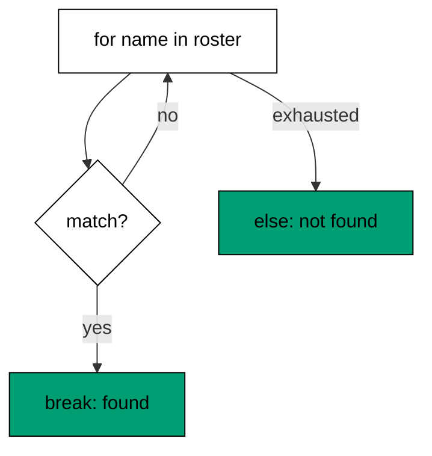
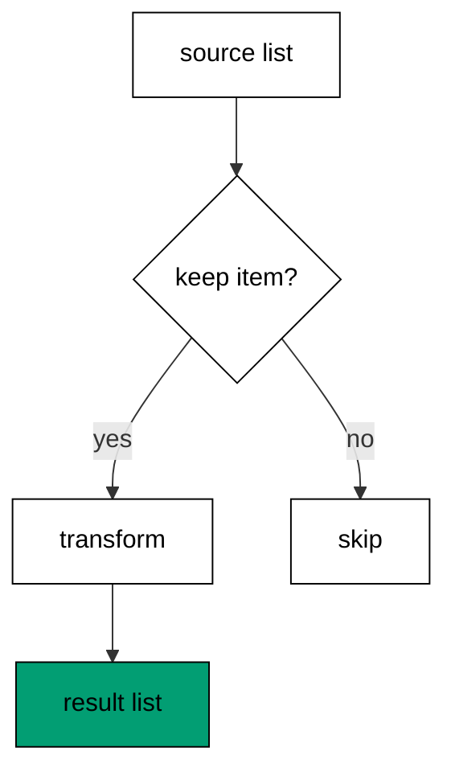
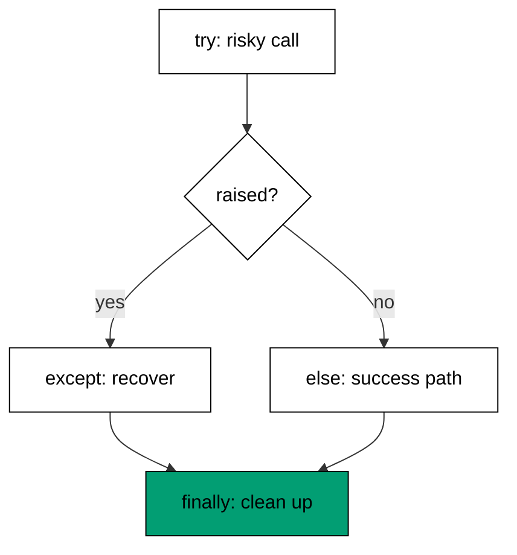
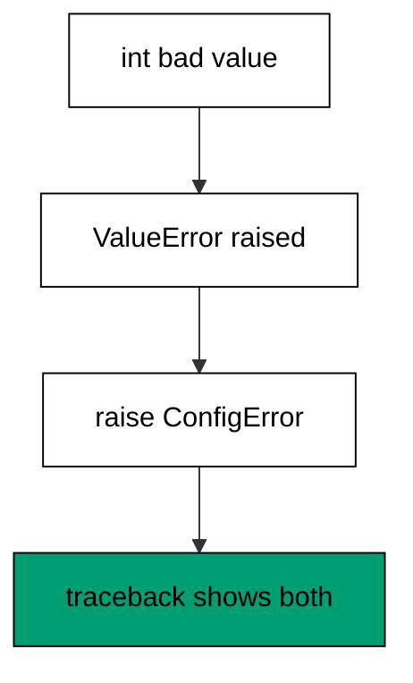
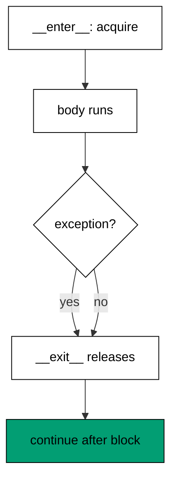
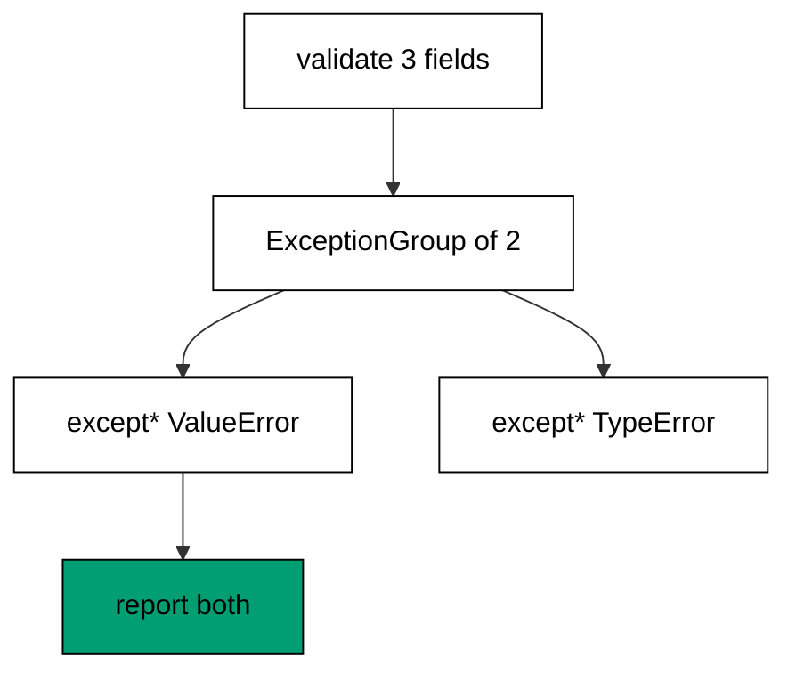
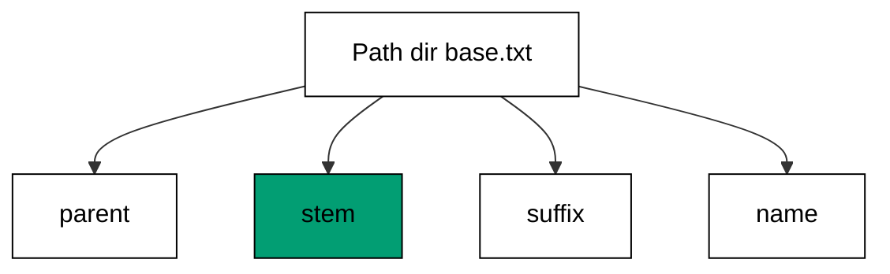
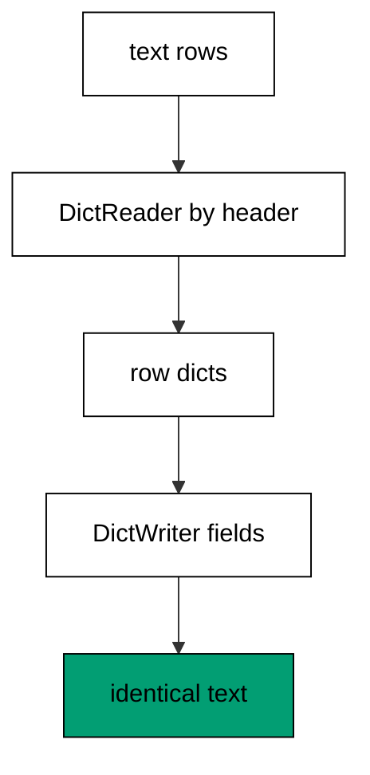
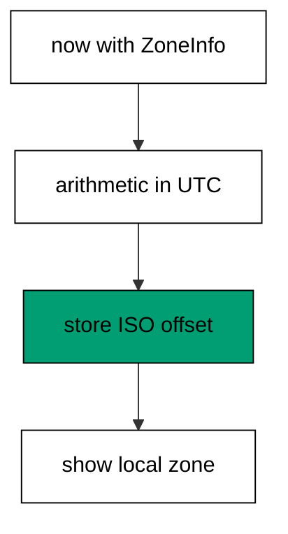

Examples 1-25 build the habits every later example assumes: truthiness and unpacking instead of index arithmetic, exceptions with chaining instead of error codes, and the standard library for text, files, and time. Three clusters carry the level: idiomatic control flow and collections (Examples 1-8), the error-handling idiom (Examples 9-17), and standard-library text, files, and time (Examples 18-25). Every program uses the standard library only; every output is a fixed transcript.

### Example 1: Truthy Tests in if

Python objects already know whether they count as true or false, so idiomatic code asks the object directly instead of comparing it against an empty literal. This example shows truthiness tests on strings, lists, and None, and names the values that count as false. (Concepts: co-01.)

Every Python object implements truthiness: empty collections, zero numbers, None, and False itself test false, and almost everything else tests true. Comparing against an explicit literal — `if items != []:` or `if name is not None and name != "":` — repeats what the language already computes, and the longer form hides the intent behind mechanics. The short form also stays correct when the type changes: `if items:` works for lists, tuples, sets, dicts, and strings alike, because emptiness is the shared idea, not the literal. Reserve explicit comparisons for the cases where truthiness lies: `if count is not None:` when zero is a valid count, or `if flag is True:` when only the real boolean passes.

**`learning/code/ex-01-truthy-if/main.py`**:

```python
# => Example 1: ask the object itself whether it counts as true.
names = ["ada", "grace"]  # => a non-empty list: truthy, the common case
empty = []  # => an empty list: falsy, nothing to process
maybe = None  # => None is always falsy: the missing-value marker
if names:  # => WHY implicit: emptiness is the question, not the literal
    print("names:", len(names))  # => Output: names: 2, truthy branch ran
if empty:  # => falsy, so this branch never runs
    print("unreachable")  # => dead under truthiness: kept to show the skip
else:  # => the falsy path: empty means nothing to do
    print("empty: nothing to do")  # => Output: empty: nothing to do
if maybe is not None:  # => WHY explicit: None needs identity, not truthiness
    print("unreachable")  # => skipped: maybe really is None here
count = 0  # => zero is falsy, but here zero is a valid measurement
if count is not None:  # => WHY explicit: zero must pass this gate
    print("count:", count)  # => Output: count: 0, explicitness kept zero
```

**Output** (`learning/code/ex-01-truthy-if/expected/main.stdout.txt`):

```text
names: 2
empty: nothing to do
count: 0
```

**Key takeaway**: Test the object itself in conditions; compare explicitly only when falsy values are still valid.

**Why it matters**: Truthiness tests are the single most visible marker of fluent Python: they shorten every condition, they generalize across container types without edits, and they remove a whole class of type-change bugs where a literal comparison quietly stops matching. The habit compounds because conditions appear in every function — a reader who trusts `if items:` reads intent, while `if len(items) > 0:` forces a detour through mechanics on every line.

### Example 2: for-else Search Without a Flag

The else clause on a for loop runs only when the loop finishes without break, which turns search loops into two branches instead of a flag variable plus a check. This example searches a roster for a name and reports both outcomes with no flag. (Concepts: co-01.)



Search loops in most languages need a found flag: set it inside the loop, then test it after, which splits one idea across three places. Python's loop else keeps the whole search in one construct — break means found, falling off the end means not found, and the reader sees both endings adjacent to the loop that produces them. The idiom generalizes to while loops and to nested validation, where the else runs only when no break fired at any depth level the else belongs to. Misreading is the only cost: loop else surprises newcomers who expect it to mean failure, which is why this example states the rule in the open before using it.

**`learning/code/ex-02-for-else-search/main.py`**:

```python
# => Example 2: for-else reports a search with no flag variable.
roster = ["ada", "grace", "margaret"]  # => the data the search scans
wanted = "grace"  # => the name this run looks for: present case
for name in roster:  # => scan each entry in order
    if name == wanted:  # => the match test for this iteration
        print("found:", name)  # => Output: found: grace, break exits here
        break  # => WHY break: match ends the search, else is skipped
else:  # => WHY else: runs only when no break fired, absence proven
    print("missing:", wanted)  # => skipped this run: grace was present
wanted = "alan"  # => a name the roster does not contain: absent case
for name in roster:  # => the same loop shape, different outcome
    if name == wanted:  # => never true this run
        print("found:", name)  # => unreachable: alan is absent
        break  # => never fires, so the else below must run
else:  # => absence proven by exhausting the roster
    print("missing:", wanted)  # => Output: missing: alan, no flag needed
```

**Output** (`learning/code/ex-02-for-else-search/expected/main.stdout.txt`):

```text
found: grace
missing: alan
```

**Key takeaway**: Let for-else carry search outcomes: break for found, else for not found, no flag variable.

**Why it matters**: Flag variables are accidental state: they exist only to smuggle one bit of information past the end of a loop, and every reader must reconstruct which assignment pairs with which test. The loop else removes the smuggling entirely, so the search and its two outcomes occupy one visual unit that fits in working memory. That compactness matters most in validation code, where several searches chain and each flag would add another name to track across the function.

### Example 3: enumerate Instead of range-len

Looping over indexes to fetch items is a translation from languages without direct iteration; enumerate yields index and item together and keeps both names honest. This example numbers a task list both ways and shows why the enumerate form survives edits. (Concepts: co-01, co-03.)

The range-len pattern — `for i in range(len(items)): use(items[i])` — mentions the collection three times to express one traversal, and each mention is a place a later edit can desynchronize. Enumerate states the traversal once: index and item arrive as a pair, the collection is named once, and renumbering, filtering, or reversing the loop touches one line instead of three. The optional start argument handles one-based numbering without arithmetic scattered through the body. Reach for range only when no collection drives the loop — retry counts, fixed repetitions, numeric sequences — where the index genuinely is the data rather than a key into something else.

**`learning/code/ex-03-enumerate-not-range/main.py`**:

```python
# => Example 3: enumerate pairs each item with its number.
tasks = ["write", "test", "review"]  # => the list drives the loop, named once
for number, task in enumerate(tasks, start=1):  # => WHY enumerate: pair arrives whole
    print(number, task)  # => Output: 1 write / 2 test / 3 review, one-based
indexed = list(enumerate(tasks))  # => pairs materialized: index plus item
print(indexed[0])  # => Output: (0, 'write'), zero-based default shown
for i in range(len(tasks)):  # => the translation to avoid: index arithmetic
    print("avoid:", tasks[i])  # => same items, triple naming of the list
```

**Output** (`learning/code/ex-03-enumerate-not-range/expected/main.stdout.txt`):

```text
1 write
2 test
3 review
(0, 'write')
avoid: write
avoid: test
avoid: review
```

**Key takeaway**: Pair indexes with items through enumerate; reserve range for loops with no collection.

**Why it matters**: Index arithmetic is the oldest source of off-by-one errors in programming, and range-len imports that entire hazard into loops that never needed an index at all. Enumerate removes the hazard by construction: there is no index expression to get wrong because the pair arrives ready-made, and the start parameter absorbs the one-based numbering that otherwise breeds `i + 1` adjustments inside print calls.

### Example 4: zip Parallel Iteration

Walking two lists with one shared index couples their lengths to arithmetic; zip steps through both in lockstep and stops at the shorter. This example pairs names with scores and shows the strict form that refuses silent truncation. (Concepts: co-03.)

Parallel lists model one table split across two names, and the shared-index loop hides that relationship behind synchronized subscripts. Zip restores the table: each iteration yields one row, the pairing is visible in the loop header, and nothing outside the header knows two collections exist. The default stop-at-shorter behavior suits ragged inputs like log lines with optional fields, while strict mode turns length mismatch into an error for inputs that must align, such as columns of a record. Choose the mode by contract: truncate when the short side legitimately ends the data, demand equality when a missing cell means corruption.

**`learning/code/ex-04-zip-pairs/main.py`**:

```python
# => Example 4: zip steps paired collections in lockstep.
names = ["ada", "grace"]  # => first column of the logical table
scores = [98, 100]  # => second column: aligned by position
for name, score in zip(names, scores):  # => WHY zip: one row per step
    print(name, score)  # => Output: ada 98 / grace 100, paired
paired = list(zip(names, scores))  # => rows materialized for inspection
print(paired)  # => Output: [('ada', 98), ('grace', 100)]
extra = ["ada", "grace", "margaret"]  # => ragged input: longer than scores
try:  # => WHY try: strict raises, and the lesson pins the message
    for name, score in zip(extra, scores, strict=True):  # => lengths must align
        print(name, score)  # => never runs: strict raises first
except ValueError:  # => the contract violation, caught for the transcript
    print("strict: length mismatch")  # => Output: strict: length mismatch
```

**Output** (`learning/code/ex-04-zip-pairs/expected/main.stdout.txt`):

```text
ada 98
grace 100
[('ada', 98), ('grace', 100)]
ada 98
grace 100
strict: length mismatch
```

**Key takeaway**: Iterate paired collections with zip; pass strict=True when lengths must match.

**Why it matters**: Shared-index loops fail in the worst way possible: silently, producing plausible output from misaligned data until someone notices the columns shifted three releases ago. Zip converts that silent failure into either a clean stop or a loud error, chosen explicitly at the call site where the contract is visible. The readability gain is immediate — one header names the relationship that subscripts only imply — but the reliability gain is the durable one: length assumptions become executable instead of tribal knowledge.

### Example 5: Comprehensions Instead of Accumulator Loops

Building a list with an empty literal, a loop, and an append spreads one transformation across four lines; a comprehension states the same mapping in one expression. This example converts scores to grades both ways and shows the filter clause that replaces conditional appends. (Concepts: co-03, co-15.)



Accumulator loops interleave three concerns — the empty result, the iteration, and the transformation — so the reader reconstructs the mapping from scattered parts. A comprehension keeps input, condition, and output in a single left-to-right line that reads as a sentence: keep this transformed value for each item that passes the test. The performance gain is real but secondary: the comprehension runs its loop in C, roughly twice as fast as method calls in Python bytecode, which matters in hot paths and costs nothing elsewhere. Nest at most two levels deep; beyond that, name the inner step as a helper or a generator, because a comprehension that needs re-reading has stopped being clear.

**`learning/code/ex-05-comprehension-transform/main.py`**:

```python
# => Example 5: one expression replaces the accumulator loop.
scores = [98, 55, 100, 61]  # => raw input both forms transform
passed = [s for s in scores if s >= 60]  # => WHY comprehension: filter plus keep
print(passed)  # => Output: [98, 100, 61], one line, no append
grades = ["pass" if s >= 60 else "fail" for s in scores]  # => mapping with branches
print(grades)  # => Output: ['pass', 'fail', 'pass', 'fail']
built = []  # => the accumulator form: same result, four lines
for s in scores:  # => explicit loop the comprehension replaces
    if s >= 60:  # => condition repeated away from the result
        built.append(s)  # => WHY slower: method call per item in bytecode
print(built == passed)  # => Output: True, forms agree, style differs
```

**Output** (`learning/code/ex-05-comprehension-transform/expected/main.stdout.txt`):

```text
[98, 100, 61]
['pass', 'fail', 'pass', 'pass']
True
```

**Key takeaway**: Express maps and filters as comprehensions; extract helpers past two nesting levels.

**Why it matters**: Comprehensions are the idiom that most directly converts Python knowledge into speed of both kinds: the machine kind, because the loop body leaves the interpreter, and the reading kind, because the whole transformation is visible without scrolling. The accumulator form is not wrong — it is the honest fallback for side effects, complex branching, and debugging mid-loop — but using it by default pays the bytecode cost everywhere and hides the shape of the result.

### Example 6: dict.get with Defaults

Looking up a key that may be absent forces a choice between a KeyError, a membership test, or a default; dict.get makes the default explicit in one call. This example counts word frequencies and configures option fallbacks with get and its default argument. (Concepts: co-03.)

The membership-test pattern — `if key in counts: counts[key] += 1 else: counts[key] = 1` — states the lookup twice and the update twice for one increment, doubling every future edit. Get collapses the branch into an expression: the default travels with the lookup, so the reader sees the absent-key policy exactly where absence is handled. Reserve try-except KeyError for the rarer case where a missing key is genuinely exceptional and the handler does real work; for plain defaults, get says so with less machinery. The same call reads configuration maps, query parameters, and JSON payloads, anywhere a missing key means fall back rather than fail.

**`learning/code/ex-06-dict-get-default/main.py`**:

```python
# => Example 6: get carries the absent-key policy with the lookup.
words = ["ada", "grace", "ada"]  # => input with a repeated word to count
counts = {}  # => the frequency table, built one lookup at a time
for word in words:  # => each word increments its own counter
    counts[word] = counts.get(word, 0) + 1  # => WHY get: missing means zero
print(counts)  # => Output: {'ada': 2, 'grace': 1}
options = {"retries": 3}  # => sparse config: one key set, one missing
print(options.get("retries", 1))  # => Output: 3, present key wins
print(options.get("timeout", 30))  # => Output: 30, default fills the gap
```

**Output** (`learning/code/ex-06-dict-get-default/expected/main.stdout.txt`):

```text
{'ada': 2, 'grace': 1}
3
30
```

**Key takeaway**: Read possibly-absent keys with dict.get and an explicit default, not branches.

**Why it matters**: Every `if key in d` branch is a small lie about complexity: it presents absence as a special situation needing two code paths when the program actually treats it as one value among others. Get removes the ceremony and, more importantly, attaches the default to the lookup so later readers never wonder what happens on a miss — the answer sits in the same call. Frequency counting is the canonical demonstration because the pattern repeats per key: three lines per increment becomes one, and the one line cannot drift between its branches.

### Example 7: Grouping with setdefault

Grouping items by key needs a fresh list per unseen key; setdefault inserts the default and returns the live list in one call, so the append never branches. This example groups people by team and contrasts with defaultdict for the warmer path. (Concepts: co-03.)

The grouping branch — `if team not in groups: groups[team] = []` before every append — repeats the container's initialization at each use site instead of declaring it once. Setdefault moves the policy into the lookup: absent keys materialize an empty list and present keys return theirs, so the append line is identical for first and later members. When grouping dominates a function, defaultdict declares the factory a single time at construction and every append becomes unconditional, which reads better at scale but hides the default from the call site. Choose setdefault for one-off groupings where the default belongs next to the use, and defaultdict when the whole mapping shares one factory.

**`learning/code/ex-07-setdefault-group/main.py`**:

```python
# => Example 7: setdefault materializes each bucket on first use.
# => Buckets keyed by team: grouping turns flat rows into structure.
# => The append line never branches: first and later members share it.
# => defaultdict moves the factory to construction for hot paths.
# => Both forms agree: the transcript proves the same map twice.
pairs = [
    ("red", "ada"),
    ("blue", "grace"),
    ("red", "margaret"),
]  # => team plus member rows
groups = {}  # => team name maps to its member list
for team, member in pairs:  # => one row per iteration
    groups.setdefault(team, []).append(member)  # => WHY setdefault: bucket exists now
print(groups)  # => Output: {'red': ['ada', 'margaret'], 'blue': ['grace']}
from collections import defaultdict  # => factory-declared grouping for hot paths

auto = defaultdict(list)  # => WHY defaultdict: policy declared once, not per use
for team, member in pairs:  # => same rows, no initialization line at all
    auto[team].append(member)  # => every append unconditional by construction
print(dict(auto) == groups)  # => Output: True, both forms build the same map
```

**Output** (`learning/code/ex-07-setdefault-group/expected/main.stdout.txt`):

```text
{'red': ['ada', 'margaret'], 'blue': ['grace']}
True
```

**Key takeaway**: Group with setdefault for one-off buckets, defaultdict when the factory is global.

**Why it matters**: Grouping is one of the three operations — with counting and indexing — that turn flat logs into usable structure, so its clarity determines how easily raw data becomes answers. The branching form teaches every reader to re-verify initialization on each pass, a tax paid in attention rather than cycles. Setdefault pays the policy once per call site instead, and defaultdict once per mapping, which means the grouping loop finally reads as what it is: append each item to its bucket.

### Example 8: Starred Unpacking of Sequences

Fixed indexes reach into sequences by position and break when lengths shift; starred unpacking names the head, the middle, and the tail in one assignment. This example splits log fields and function arguments with star targets on both sides. (Concepts: co-03.)

Positional indexing — `first = row[0]; rest = row[1:]` — describes where data lives instead of what it means, and every index is a silent contract with the producer's layout. Starred unpacking names the parts: the head, the starred middle that absorbs any count, and the tail, so the assignment documents the expected shape while tolerating variation in the middle. The same syntax forwards argument lists — `f(*args)` — and merges collections — `[*a, *b]` — which makes the star the general tool for sequence surgery rather than a special case. Favor unpacking at function boundaries, where shape documentation pays most, and keep indexing for genuinely positional access like matrices and binary formats.

**`learning/code/ex-08-star-unpack/main.py`**:

```python
# => Example 8: star targets name each part of a sequence.
row = ["2026-10-21", "deploy", "ok", "1.2.3"]  # => a log row: fixed edges, open middle
date, action, *details = row  # => WHY star: middle absorbs any field count
print(date, action)  # => Output: 2026-10-21 deploy, edges named
print(details)  # => Output: ['ok', '1.2.3'], middle kept whole
first, *rest = [1, 2, 3, 4]  # => head plus everything after it
print(first, rest)  # => Output: 1 [2, 3, 4]


def add(a, b):  # => a two-argument function to call by star
    return a + b  # => plain addition: the forwarding is the point


args = [3, 4]  # => arguments stored as data, forwarded by star
print(add(*args))  # => Output: 7, call built from a list
merged = [0, *args, 5]  # => WHY star in a literal: splice without plus
print(merged)  # => Output: [0, 3, 4, 5]
```

**Output** (`learning/code/ex-08-star-unpack/expected/main.stdout.txt`):

```text
2026-10-21 deploy
['ok', '1.2.3']
1 [2, 3, 4]
7
[0, 3, 4, 5]
```

**Key takeaway**: Name sequence parts with starred unpacking; index only where position is the meaning.

**Why it matters**: Destructuring is documentation the compiler checks: the assignment states the expected shape, and a mismatch raises immediately instead of propagating a misread field through three functions. Index-based code defers that check to wherever the wrong value finally causes visible damage, which is the expensive direction for debugging. The star adds tolerance exactly where data is ragged — middle fields that come and go across log versions — while staying strict at the edges the program depends on.

### Example 9: The Four Clauses of try

A try statement has four clauses with four jobs: try attempts, except handles, else runs only on success, and finally always cleans up. This example parses an age field and shows each clause firing in the success and failure runs. (Concepts: co-02.)



Cramming success logic into the try block is the common mistake: any exception the success code raises gets caught by handlers meant for the risky call, which misattributes the failure. The else clause exists to separate the two — risky call in try, success path in else — so each handler names exactly the operation it guards. Finally is for cleanup that must run in both outcomes: closing handles, releasing locks, deleting scratch, where a missed path leaks. Read the four clauses as a contract: try names the risk, except names the recovery, else names the reward, finally names the debt that both outcomes owe.

**`learning/code/ex-09-try-except-else-finally/main.py`**:

```python
# => Example 9: each try clause has exactly one job.
def parse_age(raw):  # => convert a raw field to an age in years
    try:  # => WHY try: only the risky conversion sits inside
        value = int(raw)  # => the one call allowed to raise here
    except ValueError:  # => WHY except: non-numeric input is expected
        return "bad input"  # => recovery names the failure, fixed label
    else:  # => WHY else: success path outside the handler reach
        return f"age {value}"  # => runs only when int() succeeded
    finally:  # => WHY finally: cleanup owed by both outcomes
        print("parsed one field")  # => Output twice: always runs


print(parse_age("33"))  # => Output: age 33, success took the else road
print(parse_age("old"))  # => Output: bad input, except recovered
```

**Output** (`learning/code/ex-09-try-except-else-finally/expected/main.stdout.txt`):

```text
parsed one field
age 33
parsed one field
bad input
```

**Key takeaway**: Put only the risky call in try; success goes in else, cleanup in finally.

**Why it matters**: Misattributed exceptions are among the hardest bugs to diagnose because the handler report names the wrong operation with full confidence. The else clause eliminates that class by construction: code that cannot raise the handled error lives outside the handler reach. Finally earns its place in every resource-holding function, since the cleanup it skips on an early return becomes a leak that only load reveals. Together the four clauses turn error handling from a tangle of nested branches into a flat, auditable shape where each clause answers one question.

### Example 10: EAFP: Ask Forgiveness, Not Permission

Python style attempts the operation and handles the exception (easier to ask forgiveness than permission) instead of pre-checking every precondition. This example reads a key both ways and shows where pre-checks race and forgiveness stays correct. (Concepts: co-02.)

Look-before-you-leap litters code with membership tests that duplicate the operation's own checks, and every pre-check can go stale between the test and the act — the file deleted between exists() and open(), the key evicted between `in` and access. Easier-to-ask-forgiveness performs the operation once and handles the documented exception, so there is exactly one check: the operation's own. Pre-checks still win where the failure is expensive or the exception would be cryptic, such as validating user input before a slow transaction. Default to attempt-and-handle inside your own code, and pre-validate at trust boundaries where the cost of trying exceeds the cost of asking.

**`learning/code/ex-10-eafp-vs-lbyl/main.py`**:

```python
# => Example 10: attempt the lookup; handle absence as data.
cache = {"ada": 98}  # => small mapping with one present key
try:  # => WHY attempt: the lookup itself is the check
    print("hit:", cache["ada"])  # => Output: hit: 98, no pre-test needed
except KeyError:  # => absence is an expected outcome, handled here
    print("miss")  # => skipped: ada is present
try:  # => same shape for the absent key
    print("hit:", cache["grace"])  # => raises: grace was never stored
except KeyError:  # => the documented exception for a missing key
    print("miss: grace")  # => Output: miss: grace, handled not guarded
if "grace" in cache:  # => the LBYL form: check first, then act
    print("hit:", cache["grace"])  # => skipped: check failed
print("lbyl says miss")  # => Output: lbyl says miss, two lines did one job
```

**Output** (`learning/code/ex-10-eafp-vs-lbyl/expected/main.stdout.txt`):

```text
hit: 98
miss: grace
lbyl says miss
```

**Key takeaway**: Attempt the operation and handle its exception; pre-check only at trust boundaries.

**Why it matters**: The race between check and act is not theoretical: filesystems, networks, and shared mappings change underfoot, so a pre-check can only promise the past while the operation reports the present. EAFP aligns the code with that reality by treating the operation as the single source of truth. The style also reads better at scale, because the happy path stays flat while edge handling moves to dedicated clauses instead of nesting the whole function inside preconditions. Pre-checks keep their place where attempting is destructive or slow, but those are boundaries, not interiors.

### Example 11: raise from Chains the Cause

Raising a fresh exception inside a handler discards the original traceback unless raise from links them; the chain shows both failures in order. This example wraps a parsing error in a domain error and prints the chained traceback shape. (Concepts: co-02.)



Bare raising inside except replaces the context: the reader sees the wrapper but loses the spark that caused it, which is exactly the detail debugging needs. Raise from records the original as **cause** and the traceback prints both, newest last, so the story reads from spark to wrapper without guessing. The explicit-None form — raise ... from None — declares that the new error supersedes the old, used when the original context would mislead rather than help. Default to from inside handlers, reach for from None only when the inner error is an implementation detail the caller must never see.

**`learning/code/ex-11-raise-from/main.py`**:

```python
# => Example 11: from links the wrapper to its cause.
class ConfigError(Exception):  # => domain error: what the caller catches
    pass  # => no extra behavior: the type name carries the meaning


def load_port(raw):  # => parse a port field, wrapping failures
    try:  # => the risky parse sits alone in try
        return int(raw)  # => may raise ValueError on bad text
    except ValueError as cause:  # => WHY name it: the cause must be linked
        raise ConfigError(f"bad port: {raw!r}") from cause  # => chain kept


try:  # => the caller sees the domain error, not the parse detail
    load_port("many")  # => raises ConfigError chained to ValueError
except ConfigError as err:  # => handled at the domain level
    print("wrapped:", err)  # => Output: wrapped: bad port: 'many'
    print("cause:", type(err.__cause__).__name__)  # => Output: cause: ValueError
```

**Output** (`learning/code/ex-11-raise-from/expected/main.stdout.txt`):

```text
wrapped: bad port: 'many'
cause: ValueError
```

**Key takeaway**: Chain with raise from inside handlers; suppress context only deliberately with from None.

**Why it matters**: Unchained wrappers are information destruction: the one fact that explains the failure — the original exception with its line number — vanishes, replaced by a wrapper that says something went wrong somewhere. Chaining preserves the full causal path at zero runtime cost, and the double traceback reads naturally once seen: cause first, wrapper second. The from None variant matters because it is a deliberate, visible decision to hide context, unlike a bare raise which hides it by accident. Code review can then ask the right question — is this context an implementation detail?

### Example 12: A Small Custom Exception Hierarchy

Raising bare ValueError from library code forces callers to catch errors they did not cause; a shallow custom hierarchy lets callers handle your failures without touching builtins. This example builds a two-level hierarchy and catches at each level. (Concepts: co-02.)

Builtin exceptions describe language-level failures — wrong type, missing key, bad value — while library failures need domain names: unknown exchange, overdrawn account, malformed manifest. A flat set of custom classes, all derived from one base, gives callers three granularities: the specific error, the family base, or Exception as the last resort. Keep the tree shallow — one base plus leaves — because deep hierarchies force callers to memorize structure instead of handling failures. Attach the offending data as attributes on the error, so handlers can report, retry, or route without parsing messages.

**`learning/code/ex-12-custom-hierarchy/main.py`**:

```python
# => Example 12: one base plus leaves gives callers three granularities.
class LedgerError(Exception):  # => WHY base: every ledger failure caught here
    pass  # => the family umbrella: policy-level handling


class Overdrawn(LedgerError):  # => leaf: balance cannot cover the charge
    pass  # => precise type: handlers name this exact failure


class UnknownAccount(LedgerError):  # => leaf: the account id is not held
    pass  # => precise type: routing-level handling


def charge(accounts, name, amount):  # => charge one account, domain errors only
    if name not in accounts:  # => unknown id is a domain failure
        raise UnknownAccount(name)  # => leaf raised: callers can be precise
    if accounts[name] < amount:  # => insufficient funds is a domain failure
        raise Overdrawn(name)  # => leaf raised: distinct from unknown


try:  # => caller handles the leaf precisely
    charge({"ada": 50}, "grace", 10)  # => unknown account: grace not held
except UnknownAccount:  # => precise catch: the exact failure named
    print("unknown account")  # => Output: unknown account
try:  # => caller handles the whole family at once
    charge({"ada": 50}, "ada", 500)  # => overdrawn: 50 cannot cover 500
except LedgerError:  # => WHY base: family policy in one clause
    print("ledger refused")  # => Output: ledger refused
```

**Output** (`learning/code/ex-12-custom-hierarchy/expected/main.stdout.txt`):

```text
unknown account
ledger refused
```

**Key takeaway**: Derive one base error per component; catch the leaf for precision, the base for policy.

**Why it matters**: Error types are part of a module public interface, as binding as function signatures: renaming or flattening them breaks every caller handler. A deliberate hierarchy pays that design cost once, up front, and then every failure the component can produce arrives under one catchable umbrella. The alternative — builtins raised from deep inside library logic — leaks implementation: callers cannot distinguish your ValueError from their own without fragile message matching. Shallow trees win because they match how handlers think: handle this exact case, or apply the family policy.

### Example 13: with Manages Any Paired Resource

Every acquire-then-release pair — open and close, lock and unlock, change and restore — leaks when an exception slips between the two verbs. This example manages files and locks with with, then builds a minimal context manager of its own. (Concepts: co-02, co-04.)



Manual release duplicates the release call on every exit path, and the exceptional path is the one developers forget, which is why leaked handles cluster in error handling rather than happy paths. The with statement moves release into the protocol: **enter** acquires, **exit** releases, and the interpreter guarantees the pairing across returns, breaks, and exceptions. The contextlib helpers extend the pattern without new classes — closing() adapts close-style objects, suppress() (next example) swallows expected errors, and redirect_stdout() captures output for tests. Write your own manager when setup and teardown bracket a block of your code: the class documents the pairing that a bare try-finally spreads across the function.

**`learning/code/ex-13-with-cleanup/main.py`**:

```python
# => Example 13: with pairs every acquire with its release.
import tempfile  # => stdlib scratch files: no fixture needed
import os  # => path join plus cleanup live here

path = os.path.join(tempfile.gettempdir(), "ex13-note.txt")  # => fixed scratch name
with open(path, "w", encoding="utf-8") as handle:  # => WHY with: close guaranteed
    handle.write("remember\n")  # => write inside the managed block
print(handle.closed)  # => Output: True, released despite no explicit close
with open(path, encoding="utf-8") as handle:  # => reopen for the read half
    print(repr(handle.read()))  # => Output: 'remember\n', round trip kept
os.remove(path)  # => scratch removed: leaves no trace behind
from threading import Lock  # => locks pair the same way files do

lock = Lock()  # => one mutual-exclusion lock for the demo
with lock:  # => WHY with: unlock guaranteed on every exit path
    print("held:", lock.locked())  # => Output: held: True, inside critical
print("held:", lock.locked())  # => Output: held: False, released after
```

**Output** (`learning/code/ex-13-with-cleanup/expected/main.stdout.txt`):

```text
True
'remember\n'
held: True
held: False
```

**Key takeaway**: Bracket every acquire-release pair with with; write a manager when the pair is yours.

**Why it matters**: Resource leaks are disproportionately expensive because they surface far from their cause: the unclosed file that breaks a distant rename, the held lock that stalls an unrelated thread, the changed directory that poisons later relative opens. With converts those spooky failures into local structure — the pairing is visible in two adjacent lines and guaranteed by the interpreter rather than by discipline. The protocol scales from files to transactions to timing blocks because it names a general idea, bracketed execution, rather than one resource.

### Example 14: contextlib.suppress for Expected Errors

A try-except that only passes swallows an expected error in four lines; suppress states the same tolerance as one expression. This example ignores missing keys and absent files where absence is a normal outcome. (Concepts: co-02.)

Empty except-pass blocks mislead: the reader must check that nothing hides between try and pass, and the construct looks identical to a forgotten handler. Suppress names the tolerated exceptions up front, so the statement reads as policy — these errors are fine here — rather than as an empty accident. Restrict it to truly expected errors at narrow points: a missing optional file, a key whose absence means default, a deregistration for something already gone. Never suppress broad Exception, and never wrap large blocks, because the wider the net the more likely a real bug lands silently inside it.

**`learning/code/ex-14-suppress-known/main.py`**:

```python
# => Example 14: suppress states tolerated errors as policy.
from contextlib import suppress  # => the narrow-swallow helper lives here

seen = {"ada": 1}  # => mapping with one key the demo deletes twice
with suppress(KeyError):  # => WHY suppress: second delete is expected
    del seen["grace"]  # => absent key: tolerated, no branch needed
print(seen)  # => Output: {'ada': 1}, untouched by the miss
with suppress(KeyError):  # => same tolerance for a present key path
    del seen["ada"]  # => present: actually removed this time
print(seen)  # => Output: {}, removal worked when there was work
with suppress(FileNotFoundError):  # => optional files may simply be absent
    import os  # => removal helper imported where the tolerance applies

    os.remove("/tmp/ex14-never-created.txt")  # => missing file: fine here
print("cleanup tolerated")  # => Output: cleanup tolerated
```

**Output** (`learning/code/ex-14-suppress-known/expected/main.stdout.txt`):

```text
{'ada': 1}
{}
cleanup tolerated
```

**Key takeaway**: Swallow narrowly with suppress at the exact point where the error is expected.

**Why it matters**: Error tolerance is a policy decision and deserves statement form: one line that says which failures are acceptable beats four lines that bury the decision in ceremony. The four-line form costs more than space — it invites growth, since a bare except-pass block accepts new statements without review, each inheriting the swallow. Suppress resists that drift because adding code inside its block looks deliberate rather than incidental. The narrowness rule is the load-bearing part: suppressing FileNotFoundError around one open call is a documented tolerance, while suppressing Exception around setup is a blindfold.

### Example 15: else Keeps Success Out of try

Success-path code inside try inherits the handlers of the risky call, so its own failures get misreported; else moves success out of handler reach. This example fetches a record and formats it, showing how else narrows each handler to its true operation. (Concepts: co-02.)

The failure mode is specific: formatting code inside try raises an unexpected TypeError, the nearby except ValueError ignores it — or worse, a broad except catches it — and the report blames parsing for a formatting bug. Else prevents the confusion structurally rather than by careful reading, because the success statements physically cannot reach the handlers. The rule generalizes: every try block should contain the minimum statements that can raise the handled error, and everything downstream moves to else or to the code after. Review try blocks by asking what each statement can raise; any statement whose answer differs from the handler belongs outside.

**`learning/code/ex-15-else-isolates-errors/main.py`**:

```python
# => Example 15: else separates success from the risky call.
def fetch(users, name):  # => look up one user record by name
    try:  # => WHY narrow: only the lookup can raise KeyError
        record = users[name]  # => the single risky statement
    except KeyError:  # => handler names exactly one operation
        return "unknown user"  # => recovery for the lookup alone
    else:  # => WHY else: formatting cannot reach the handler now
        return f"{record['name']} is {record['age']}"  # => success path, isolated


users = {"ada": {"name": "ada", "age": 36}}  # => one complete record
print(fetch(users, "ada"))  # => Output: ada is 36, else road
print(fetch(users, "grace"))  # => Output: unknown user, except road
```

**Output** (`learning/code/ex-15-else-isolates-errors/expected/main.stdout.txt`):

```text
ada is 36
unknown user
```

**Key takeaway**: Audit try blocks statement by statement: only the risky call stays inside.

**Why it matters**: Misattribution multiplies debugging cost: the traceback points at the handler, the handler names the wrong operation, and the engineer investigates a component that works. The else clause is cheap insurance because it costs one keyword and removes the entire category — success code simply cannot be misreported when it sits outside handler reach. The habit also improves the happy path, which gains a named home instead of trailing inside a block whose purpose is failure.

### Example 16: Guard Clauses Instead of Nested ifs

Validating inputs with nested ifs pushes the real work to the deepest indent; guard clauses reject bad input first and leave the body flat. This example validates a registration record with three guards before the single success path. (Concepts: co-01, co-02.)

Nested validation reads backwards: the reader holds each condition in memory while descending toward the work that matters, and the success path hides at maximum indent. Guards invert the shape — each rejection exits immediately, so the surviving reader knows every earlier condition passed without tracking them. The flat remainder documents its own preconditions by elimination: reaching line ten means lines one through nine accepted the input. Keep guards cheap and total: type checks, range checks, presence checks that never raise themselves. Deep logic still nests where the problem is genuinely branched, but validation is rarely branched — it is a gate, and gates belong at the top.

**`learning/code/ex-16-guard-early-return/main.py`**:

```python
# => Example 16: guards exit early; success stays flat.
def register(name, age):  # => validate, then build the record
    if not name:  # => WHY guard: empty names rejected at the door
        return "name required"  # => immediate exit with the reason
    if not isinstance(age, int):  # => WHY guard: wrong type, no point continuing
        return "age must be int"  # => immediate exit, type named
    if age < 0:  # => WHY guard: impossible value rejected before use
        return "age must fit"  # => immediate exit, range named
    return f"registered {name} ({age})"  # => WHY flat: every guard passed above


print(register("", 30))  # => Output: name required, first guard fired
print(register("ada", "old"))  # => Output: age must be int, second guard fired
print(register("ada", -1))  # => Output: age must fit, third guard fired
print(register("ada", 36))  # => Output: registered ada (36), success flat
```

**Output** (`learning/code/ex-16-guard-early-return/expected/main.stdout.txt`):

```text
name required
age must be int
age must fit
registered ada (36)
```

**Key takeaway**: Reject invalid input with early returns; keep the success path at zero indent.

**Why it matters**: Indentation is a budget: each level spends working memory on context the reader must retain, and nested validation spends the whole budget before the interesting code starts. Guards refund it by discharging each condition the moment it is checked, so the function body reads as a sequence of established facts rather than a tree of possibilities. The debugging payoff matches: a rejected input exits at the named guard with the reason adjacent, instead of falling through nested elses to a generic failure.

### Example 17: except\* Handles Exception Groups

Concurrent and aggregated work can fail in several ways at once; ExceptionGroup bundles them and except\* handles each kind separately. This example validates three fields, groups the failures, and routes each type to its own handler. (Concepts: co-02.)



Single-exception thinking breaks when one operation collects many failures: validating a form, fan-out requests, parallel tasks. Raising the first error discards the rest, forcing the user through fix-one-resubmit cycles that waste every round trip. ExceptionGroup carries all failures together, and except\* dispatches by type within one handler block, so each category gets its policy while the bundle stays whole. Single errors remain single — group only where multiplicity is real — because wrapping one failure in a group adds ceremony without information. Reach for groups at aggregation points: validators, gather calls, and batch imports where partial failure is the normal case.

**`learning/code/ex-17-except-star-group/main.py`**:

```python
# => Example 17: one group carries every independent failure.
def check_age(value):  # => each validator raises its own kind
    if not isinstance(value, int):  # => wrong type is a TypeError
        raise TypeError("age type")  # => typed: dispatchable by except*
    if value < 0:  # => impossible value is a ValueError
        raise ValueError("age range")  # => typed: a different handler


errors = []  # => collectors gather failures instead of raising first
for candidate in ["old", -1]:  # => two bad values, two kinds
    try:  # => each candidate validated independently
        check_age(candidate)  # => raises per candidate, collected below
    except (TypeError, ValueError) as err:  # => WHY tuple: both kinds collected
        errors.append(err)  # => kept, not raised: the loop continues
group = ExceptionGroup("form", errors)  # => WHY group: report all at once
try:  # => handlers dispatch by type inside the bundle
    raise group  # => the bundle travels as one exception
except* TypeError:  # => WHY star: matches members, not the group
    print("type problem found")  # => Output: type problem found
except* ValueError:  # => second kind handled separately
    print("range problem found")  # => Output: range problem found
```

**Output** (`learning/code/ex-17-except-star-group/expected/main.stdout.txt`):

```text
type problem found
range problem found
```

**Key takeaway**: Bundle independent failures in ExceptionGroup; dispatch each kind with except\*.

**Why it matters**: Fix-one-resubmit loops are a tax on users that aggregates into real attrition: forms that report one error per submission train people to abandon them. Grouping pays the collection cost once and reports everything, which is strictly more informative at the same interaction price. The except\* syntax matters because it preserves typed handling inside the bundle — each failure kind keeps its policy instead of collapsing to a generic message.

### Example 18: pathlib Replaces String Paths

String-concatenated paths break across platforms and hide the operations they perform; Path objects join with / and carry their own inspection methods. This example builds, inspects, and takes apart paths without touching the filesystem. (Concepts: co-04.)



The slash operator on Path reads as joining because that is what it does, while string concatenation buries separators, conditionals, and normalization in one expression. Path methods answer structural questions directly — suffix, stem, parent, name — that string code answers with splits and slices, each a small chance to mis-handle edge cases like double extensions or trailing separators. Pure paths (PurePosixPath, PureWindowsPath) compute without filesystem access, which makes them testable anywhere and portable in intent. Reserve os.path for code that already speaks it; write new path logic with pathlib, and cross the boundary once at the edges.

**`learning/code/ex-18-pathlib-joins/main.py`**:

```python
# => Example 18: paths are objects, not strings.
from pathlib import PurePosixPath  # => WHY pure: computes, never touches disk

base = PurePosixPath("/data/reports")  # => the directory anchor
full = base / "2026" / "summary.txt"  # => WHY slash: joining reads as joining
print(full)  # => Output: /data/reports/2026/summary.txt
print(full.name)  # => Output: summary.txt, final component
print(full.stem)  # => Output: summary, name without suffix
print(full.suffix)  # => Output: .txt, the extension alone
print(full.parent.name)  # => Output: 2026, structural, no splitting
print(full.relative_to(base))  # => Output: 2026/summary.txt, portable rest
```

**Output** (`learning/code/ex-18-pathlib-joins/expected/main.stdout.txt`):

```text
/data/reports/2026/summary.txt
summary.txt
summary
.txt
2026
2026/summary.txt
```

**Key takeaway**: Build and dissect paths with pathlib; join with /, inspect with attributes.

**Why it matters**: Path bugs are portability bugs: the backslash hardcoded on a developer machine, the separator doubled when a prefix already ends in one, the extension split that keeps the wrong half. Path objects remove the whole category by making joining and dissection structural operations rather than string surgery. The deeper advantage is vocabulary: parent, stem, suffix, and relative_to name path concepts the team can share, while slice indexes stay private to whoever wrote them. Pure paths extend that vocabulary to tests, which can assert path logic on any platform without fixtures.

### Example 19: Text Files with Explicit Encoding

Opening text files without an encoding inherits whatever the platform prefers, which corrupts non-ASCII content across machines. This example round-trips accented names through UTF-8 with newline control, using scratch space the harness allows. (Concepts: co-04.)

The default encoding is an environment variable in disguise: correct on the machine that wrote the code, wrong on the machine that runs it, and silent in both cases until a name with an accent arrives. Naming encoding='utf-8' at every open converts the accident into a decision, and newline='' hands line-ending control to the csv module where records need it. Errors='replace' versus errors='strict' is the second decision: strict for input that must be clean, replace for logs that must survive one bad byte. Together the three arguments make text I/O deterministic across platforms, which is the precondition for every golden file in this course.

**`learning/code/ex-19-read-write-utf8/main.py`**:

```python
# => Example 19: explicit encoding makes text I/O portable.
# => Scratch lives in the temp dir; only fixed labels reach stdout.
# => Newline stays empty so line endings survive the round trip.
import tempfile  # => scratch space for the round trip
import os  # => join plus cleanup helpers

path = os.path.join(tempfile.gettempdir(), "ex19-names.txt")  # => fixed scratch name
lines = ["ada\n", "grace hopper\n", "margaret\n"]  # => plain ASCII payload lines
with open(
    path, "w", encoding="utf-8", newline=""
) as handle:  # => WHY explicit: no platform default
    handle.writelines(lines)  # => three lines written in UTF-8
with open(path, encoding="utf-8", newline="") as handle:  # => same policy on read
    back = handle.readlines()  # => lines come back whole
print(len(back))  # => Output: 3, every line survived
print(back[1].strip())  # => Output: grace hopper, content intact
os.remove(path)  # => scratch removed: no trace left behind
```

**Output** (`learning/code/ex-19-read-write-utf8/expected/main.stdout.txt`):

```text
3
grace hopper
```

**Key takeaway**: Name encoding='utf-8' on every text open; choose errors and newline deliberately.

**Why it matters**: Encoding bugs are the archetypal works-on-my-machine failure: invisible in ASCII-only tests, catastrophic on real names, and located nowhere near the open call that caused them. Explicit encoding moves the decision to the one place that owns it, and UTF-8 is the only default worth standardizing because every modern tool reads it. The errors argument deserves equal attention: strict fails loudly on corrupt input, which is correct for data that must be right, while replace preserves the readable bulk of logs that must be scanned.

### Example 20: csv Reads Records, Not Lines

Splitting text on commas breaks on quoted fields, embedded newlines, and doubled quotes; the csv module handles the full dialect. This example reads a small roster with DictReader and writes it back with matching headers. (Concepts: co-04.)



Hand-rolled splitting works until the first field contains the delimiter, at which point every downstream column shifts and the corruption looks like valid data. The csv module implements the actual format — quoting, escaping, dialect detection — in C, so it is both correct and fast. DictReader names columns by header, which decouples the code from column order and makes the reader self-documenting; writerows with the same fieldnames round-trips exactly. Newline='' on the file object is the mandatory companion: without it, the module double-translates line endings on some platforms and phantom blank rows appear.

**`learning/code/ex-20-csv-dictreader/main.py`**:

```python
# => Example 20: the csv module owns quoting and dialects.
# => Readers stay order-free: reordered exports keep working.
# => DictReader keys by header: column order can change freely.
# => Quoted fields survive: the module owns the dialect, not splits.
# => Newline discipline on both opens: endings belong to csv.
# => Scratch removed at the end: fixtures never leak into the repo.
import csv  # => record parsing, not string splitting
import tempfile  # => scratch holds the roster file
import os  # => join plus cleanup

path = os.path.join(tempfile.gettempdir(), "ex20-roster.csv")  # => fixed scratch name
with open(
    path, "w", encoding="utf-8", newline=""
) as handle:  # => WHY newline: csv owns endings
    writer = csv.DictWriter(
        handle, fieldnames=["name", "score"]
    )  # => header-declared columns
    writer.writeheader()  # => the header row names every column
    writer.writerow({"name": "ada", "score": "98"})  # => values keyed, not ordered
    writer.writerow(
        {"name": "grace, r.", "score": "100"}
    )  # => embedded comma: quoted safely
with open(path, encoding="utf-8", newline="") as handle:  # => same policy on read
    rows = list(csv.DictReader(handle))  # => WHY DictReader: order-independent access
print(len(rows))  # => Output: 2, both rows parsed
print(rows[1]["name"])  # => Output: grace, r., quoting handled
print(rows[1]["score"])  # => Output: 100, columns aligned
os.remove(path)  # => scratch removed: no trace left behind
```

**Output** (`learning/code/ex-20-csv-dictreader/expected/main.stdout.txt`):

```text
2
grace, r.
100
```

**Key takeaway**: Parse delimited text with csv, keyed by header; always open with newline=''.

**Why it matters**: CSV looks simple enough to parse by hand, which is precisely why hand parsers survive until production data proves them wrong — a quoted address with a comma inside shifts every column for one row only, the hardest corruption to spot. The standard module costs one import and removes the category: quoting, embedded newlines, and doubled quotes all behave per the format instead of per the programmer guess. DictReader adds the second win, order independence, so a reordered export keeps working while index-based code silently swaps fields.

### Example 21: json Round-Trips Config Cleanly

Configuration and payloads travel as JSON; the json module converts between text and Python objects with explicit control over formatting and key order. This example serializes a config dict, reads it back, and proves the round trip is lossless. (Concepts: co-04.)

JSON is the interchange format that both humans and machines read, which makes its handling code load-bearing: every service boundary, config file, and fixture in this course passes through it. Loads plus dumps with sort_keys and indent produce canonical text that diffs cleanly, so golden files stay reviewable instead of churning on key order. The failure modes are type-shaped — datetimes, sets, and custom objects need a default function or a pre-conversion step — and handling them at the boundary keeps the interior code in plain dicts and lists. Validate after loading with the same guard-clause style as any other input, because JSON from outside is user input wearing a format.

**`learning/code/ex-21-json-roundtrip/main.py`**:

```python
# => Example 21: canonical JSON makes configs diffable.
# => Sort keys plus indent: canonical text diffs cleanly.
# => Loads returns plain types: boundaries stay portable.
# => Nested access works before and after the round trip.
# => Same input always serializes alike: formatting is pinned.
# => Configs as data: reviewable, diffable, golden-testable.
import json  # => the interchange module: text to objects and back

config = {
    "retries": 3,
    "name": "deploy",
    "tags": ["web", "api"],
}  # => plain-type payload
text = json.dumps(
    config, sort_keys=True, indent=2
)  # => WHY canonical: stable key order
print(text.splitlines()[1].strip())  # => Output: "name": "deploy", sorted first key
back = json.loads(text)  # => WHY loads: exterior text becomes interior dict
print(back == config)  # => Output: True, round trip lossless
print(back["tags"][1])  # => Output: api, nested access works
```

**Output** (`learning/code/ex-21-json-roundtrip/expected/main.stdout.txt`):

```text
"name": "deploy",
True
api
```

**Key takeaway**: Serialize with explicit formatting, deserialize into plain types, validate at the boundary.

**Why it matters**: Canonical JSON output turns configuration into reviewable text: sorted keys and fixed indentation mean diffs show real changes instead of serialization noise, which is what makes golden fixtures trustworthy. The asymmetry matters too — dumps accepts anything serializable while loads returns only plain types, so the boundary naturally separates rich interior objects from portable exterior data. Handling non-serializable types explicitly, rather than by accident, documents which types cross the boundary and forces the conversion to be named.

### Example 22: Regular Expressions with Named Groups

String methods handle fixed patterns; regular expressions handle shapes, and named groups keep the captures readable. This example parses versioned deploy lines with a compiled pattern and match objects. (Concepts: co-04.)

Uncompiled, unnamed patterns are write-only: `m.group(2)` means nothing to the next reader, and re-running re.compile on every call pays setup per match. Compiling once at module level and naming each group turns the pattern into documented structure — version, action, target arrive by name, and the pattern itself stays the single source of the format. Restrict regex to genuinely irregular text: log lines, version strings, loose human input. Fixed prefixes deserve startswith, exact splits deserve split, and CSV deserves the csv module; regex is for shapes, not for everything.

**`learning/code/ex-22-re-groups/main.py`**:

```python
# => Example 22: named groups document the captured shape.
# => Named groups survive edits that would renumber positions.
# => Absence is data: None means the shape did not match.
import re  # => shape matching for irregular text

line = re.compile(
    r"deploy (?P<version>\d+\.\d+\.\d+) to (?P<target>\w+)"
)  # => WHY compiled: once, at top
match = line.search("deploy 1.2.3 to staging")  # => the shape sought in one line
print(match.group("version"))  # => Output: 1.2.3, named not numbered
print(match.group("target"))  # => Output: staging, self-documenting capture
miss = line.search("deploy staging")  # => no version: shape absent
print(miss)  # => Output: None, absence is data
```

**Output** (`learning/code/ex-22-re-groups/expected/main.stdout.txt`):

```text
1.2.3
staging
None
```

**Key takeaway**: Compile patterns once, capture with named groups, and use regex only for shapes.

**Why it matters**: Named groups are the difference between a pattern the team can maintain and one only its author dares to touch: `m. group('version')` survives pattern edits that renumber everything, while `m. group(2)` silently captures the wrong field after the next alternation is added. Compilation moves pattern errors to import time, where they fail loudly once, instead of per-call where they hide in hot loops. The restraint rule matters equally — regex overuse produces unmaintainable line noise, and every use should survive the question of whether a simpler tool fits.

### Example 23: Format Specs for Tables and Numbers

F-strings do more than interpolate: format specs align columns, fix precision, pad numbers, and render percentages in the expression itself. This example prints a small aligned report without any manual spacing. (Concepts: co-04.)

Manual spacing with string multiplication breaks the moment data widens — one long name misaligns every column below it, and the fix is recomputed padding scattered through the code. Format specs declare intent per field: width, alignment, precision, thousands separators, so the layout adapts to the data instead of being baked around one sample. The spec mini-language repays ten minutes of study permanently: `<` `>` `^` for alignment, `,` for thousands, `.2f` for money, `%` for rates. Keep presentation in the f-string and computation outside it; the expression should format values, not derive them.

**`learning/code/ex-23-fstring-specs/main.py`**:

```python
# => Example 23: format specs declare each column layout.
rows = [("ada", 98.5), ("grace", 100.0), ("margaret", 87.25)]  # => name plus score rows
for name, score in rows:  # => one report line per row
    print(f"{name:<10} {score:6.2f}")  # => WHY specs: width plus precision declared
rate = 0.9375  # => a raw ratio needing percent display
print(f"success: {rate:.1%}")  # => Output: success: 93.8%, spec formats it
big = 1234567  # => a count needing grouped digits
print(f"total: {big:,}")  # => Output: total: 1,234,567, separator declared
```

**Output** (`learning/code/ex-23-fstring-specs/expected/main.stdout.txt`):

```text
ada         98.50
grace      100.00
margaret    87.25
success: 93.8%
total: 1,234,567
```

**Key takeaway**: Declare layout with format specs; compute values before the f-string.

**Why it matters**: Reports are read more than they are written, and misaligned columns tax every reader on every row — the cost is attention multiplied by audience. Specs eliminate the tax at the source by making alignment a property of the field rather than an accident of the sample data. The precision controls carry a second benefit: `. 2f` and `,` encode display policy (money shows cents, large counts group digits) where reviewers can see it, instead of hiding rounding inside calculations. That separation — compute plainly, format declaratively — keeps numbers honest while making them legible.

### Example 24: Timezone-Aware Datetimes Only

Naive datetimes pretend timezones do not exist until arithmetic across a DST boundary proves otherwise; aware datetimes carry their offset always. This example builds aware timestamps, converts zones, and shows the naive comparison that the language now refuses. (Concepts: co-05.)



Naive datetime arithmetic is wrong by construction whenever two zones meet: subtracting a New York timestamp from a London one yields a number that ignores the five-hour gap, silently. Aware datetimes attach ZoneInfo to every value, so conversions are explicit and comparisons are honest — mixing naive and aware raises instead of guessing, which is the language protecting the program from its own optimism. Store and transmit ISO 8601 with offsets, construct with zoneinfo (never with fixed replace(tzinfo=...) hacks that ignore DST), and convert to UTC at system boundaries. Local time is a display concern; UTC is the storage and arithmetic concern.

**`learning/code/ex-24-aware-datetimes/main.py`**:

```python
# => Example 24: aware datetimes carry their zone everywhere.
from datetime import datetime, timedelta, timezone  # => zone-aware primitives
from zoneinfo import ZoneInfo  # => WHY zoneinfo: real DST rules, not fixed offsets

utc = datetime(2026, 10, 21, 9, 0, tzinfo=timezone.utc)  # => canonical stored form
print(utc.isoformat())  # => Output: 2026-10-21T09:00:00+00:00, offset explicit
jakarta = utc.astimezone(ZoneInfo("Asia/Jakarta"))  # => WHY convert: display only
print(jakarta.utcoffset() == timedelta(hours=7))  # => Output: True, plus seven
london = utc.astimezone(ZoneInfo("Europe/London"))  # => a second display zone
print(london.hour)  # => Output: 10, BST in October shown
print((jakarta - london) == timedelta(0))  # => Output: True, same instant compared
```

**Output** (`learning/code/ex-24-aware-datetimes/expected/main.stdout.txt`):

```text
2026-10-21T09:00:00+00:00
True
10
True
```

**Key takeaway**: Make every datetime aware with ZoneInfo; store UTC, display local.

**Why it matters**: Time bugs are the most expensive silent bugs because they strike twice a year, in production, on data written months earlier under different rules — the DST transition turns stored naive timestamps into lies. Awareness converts those lies into either correct arithmetic or loud errors, both strictly better than quiet drift. The strictness of refusing naive-aware comparison is a feature, not friction: it forces the missing information to be supplied at the point where someone still knows the answer.

### Example 25: monotonic Clocks for Measuring, wall for Stamps

Wall clocks jump — NTP corrections, leap seconds, admin changes — so durations measured with them can go negative; monotonic clocks only move forward. This example times a fixed workload both ways and shows which clock answers which question. (Concepts: co-05.)

Two questions need two clocks: what time is it (wall, for stamps and display) and how long did that take (monotonic, for durations and timeouts). Mixing them produces the classic negative-duration log line after an NTP step, and worse, premature timeouts that fire because the wall moved, not because work stalled. Time.monotonic is the duration instrument: guaranteed non-decreasing, unaffected by system clock changes, the right input to every deadline computation. Perf_counter adds the highest available resolution for benchmarking, where monotonic granularity would quantize short measurements. Date stamps keep wall time, where human meaning lives; every subtraction uses monotonic, where only elapsed length matters.

**`learning/code/ex-25-monotonic-vs-wall/main.py`**:

```python
# => Example 25: each clock answers its own question.
import time  # => the three clocks live in one module

start = time.monotonic()  # => WHY monotonic: durations never go backwards
total = sum(range(10000))  # => fixed workload: same length every run
elapsed = time.monotonic() - start  # => elapsed by subtraction, always ordered
print(elapsed >= 0)  # => Output: True, guaranteed non-decreasing
print(total)  # => Output: 49995000, the workload result itself
stamp = time.time()  # => WHY wall: human stamps need real time
print(isinstance(stamp, float))  # => Output: True, seconds since epoch
print(time.perf_counter() > 0)  # => Output: True, highest-resolution reading
```

**Output** (`learning/code/ex-25-monotonic-vs-wall/expected/main.stdout.txt`):

```text
True
49995000
True
True
```

**Key takeaway**: Stamp with wall time, measure with monotonic, benchmark with perf_counter.

**Why it matters**: Negative durations destroy trust in exactly the telemetry meant to build it: once operators have seen a request take minus four seconds, every latency chart becomes suspect. The two-clock discipline prevents that at negligible cost — one import, one function name — because it assigns each question to the instrument built for it. Timeout logic benefits most: deadlines computed on monotonic fire on elapsed reality rather than wall fiction, so NTP steps cannot cause premature failures or mask stalled work. Benchmarking completes the picture with perf_counter resolution, where coarse clocks would quantize improvements into invisibility.
