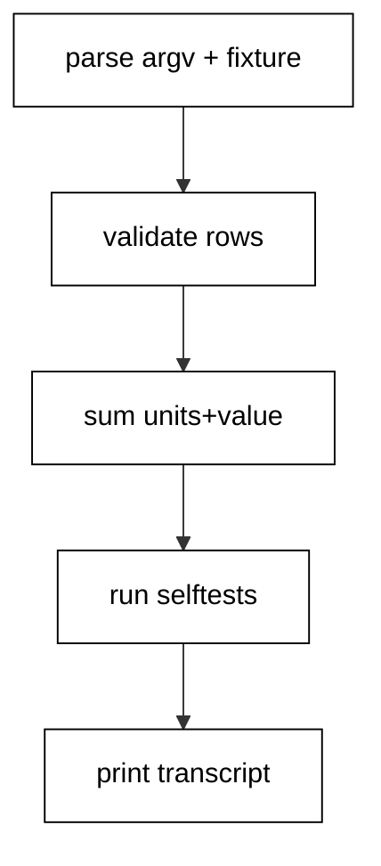

The capstone combines the course into one order-report command-line tool: it parses arguments with argparse, reads an order CSV with the csv module, validates each row with the error-handling idiom, summarizes with pure functions over frozen records, proves itself with an embedded unittest suite, and prints a fixed nine-line transcript the harness asserts byte for byte.

## Why this exists -- the big idea

**The problem before the solution**: course examples prove idioms in isolation, but production tools fail at the seams — parsing disagrees with validation, file handling leaks past error paths, testing lives in a separate file nobody runs, and dependency pins are folklore instead of text. The capstone wires every layer together so the seams are load-bearing: each stage feeds the next, and the transcript proves the whole chain ran.

**Keep this if you forget everything else**: a command-line tool states its contract (arguments), validates its input (rows), reports its result (summary), and proves itself (selftests) — in that order, every time.

## What you will build

A single `capstone.py` plus a four-line orders fixture. It parses an optional input path with a documented default, reads rows with DictReader, converts quantities and prices with EAFP handling that collects per-line errors instead of aborting, rejects negative quantities with a second guard, summarizes units and value with pure comprehensions, and runs a five-test unittest suite in-process that prints one deterministic selftest line. The demo runs with no arguments against the committed fixture; bad rows are skipped with labeled messages, never silently dropped.

## How the pieces compose

Parsing (Examples 26-27, 77) feeds validation (Examples 9-10, 15-16); the CSV handling (Example 20) supplies rows; the unittest suite (Examples 35-38) runs inside the tool itself; the pinning note (Examples 30-32) travels as project metadata beside the code. No new idioms appear here — composition is the test. Read the program top to bottom and name the example each section comes from; if a section has no ancestor, it does not belong.



## Reading the transcript

The nine output lines each prove one stage: the two item lines prove parsing and conversion; the lines, units, and value lines prove the summary math; the two skip lines prove the per-row error policy with exact line numbers; the selftest line proves the embedded suite ran green. Any missing line names its broken stage exactly. Rerun the unit and diff: identical bytes, because fixed fixtures, pure functions, and in-memory test results leave no room for variance.

## The pinning note

This tool ships standard-library only, so it installs with zero dependencies — the strongest pinning story available. The accompanying project metadata (`pyproject.toml` in a real checkout, per Examples 32 and 34) would declare the Python floor and, the day a third-party dependency arrives, its exact `==` pins with `--require-hashes` digests per Example 31. Pinning is a habit, not a file: declare the floor today, pin everything the day the first dependency lands, and review pin diffs like code.

**`learning/capstone/code/capstone.py`**:

```python
# => Capstone: an order-report CLI with embedded selftests.
import argparse  # => WHY argparse: the standard CLI shape
import csv  # => WHY csv: records, not string splitting
import sys  # => WHY sys: argv in, exit status out
import unittest  # => WHY unittest: the suite ships inside the tool


def parse_records(path):  # => read plus validate: errors collected, not raised
    rows = []  # => valid rows accumulate here
    errors = []  # => WHY collect: one bad row must not kill the report
    with open(
        path, encoding="utf-8", newline=""
    ) as handle:  # => WHY explicit: the text policy
        reader = csv.DictReader(handle)  # => WHY header: order-independent access
        for lineno, record in enumerate(
            reader, start=2
        ):  # => WHY 2: header occupies line 1
            try:  # => WHY narrow: only the conversions sit inside
                qty = int(record["qty"])  # => may raise on non-numeric text
                price = float(record["price"])  # => may raise on bad decimals
            except (
                KeyError,
                ValueError,
                TypeError,
            ):  # => WHY triple: missing yields None too
                errors.append(
                    f"line {lineno}: bad numbers"
                )  # => fixed label, stable text
                continue  # => WHY continue: skip the row, keep the report
            if qty < 0:  # => WHY guard: impossible quantities rejected
                errors.append(
                    f"line {lineno}: negative qty"
                )  # => named, countable failure
                continue  # => skipped like any other bad row
            rows.append(
                {"sku": record["sku"], "qty": qty, "price": price}
            )  # => plain validated types
    return rows, errors  # => WHY pair: data plus diagnostics travel together


def summarize(rows):  # => WHY pure: math over validated rows only
    units = sum(row["qty"] for row in rows)  # => WHY comprehension: the whole total
    value = sum(row["qty"] * row["price"] for row in rows)  # => money as float sum here
    return {
        "lines": len(rows),
        "units": units,
        "value": value,
    }  # => WHY dict: named results


class TestParse(unittest.TestCase):  # => WHY embedded: the tool proves itself
    def test_valid_row(self):  # => the happy path pinned first
        rows, errors = parse_records("records.csv")  # => the committed fixture
        self.assertEqual(len(rows), 2)  # => two good rows among four
        self.assertEqual(
            errors, ["line 4: bad numbers", "line 5: negative qty"]
        )  # => exact diagnostics

    def test_summary_math(self):  # => WHY math: totals are the product
        summary = summarize([{"sku": "a", "qty": 4, "price": 60.0}])  # => one known row
        self.assertEqual(summary["units"], 4)  # => units summed
        self.assertEqual(summary["value"], 240.0)  # => value multiplied

    def test_empty_input(self):  # => WHY edge: headers alone must not crash
        import tempfile  # => WHY local: the import lives with its use
        import os  # => WHY local: path join beside the tempdir

        with tempfile.TemporaryDirectory() as scratch:  # => private scratch per run
            path = os.path.join(scratch, "empty.csv")  # => fixed name, stable content
            with open(
                path, "w", encoding="utf-8", newline=""
            ) as handle:  # => header only
                handle.write("sku,qty,price\n")  # => no data rows at all
            rows, errors = parse_records(path)  # => parsed from scratch
        self.assertEqual((rows, errors), ([], []))  # => empties, no diagnostics

    def test_negative_rejected(self):  # => WHY guard: impossible stays out
        import tempfile  # => second scratch: tests stay independent
        import os  # => path join beside its use

        with tempfile.TemporaryDirectory() as scratch:  # => isolated per test
            path = os.path.join(scratch, "neg.csv")  # => fixed name again
            with open(
                path, "w", encoding="utf-8", newline=""
            ) as handle:  # => one bad row
                handle.write("sku,qty,price\ncable,-3,9.99\n")  # => negative quantity
            rows, errors = parse_records(path)  # => parsed from scratch
        self.assertEqual(rows, [])  # => nothing valid survived
        self.assertEqual(errors, ["line 2: negative qty"])  # => the labeled rejection

    def test_missing_column(self):  # => WHY shape: wrong headers fail plainly
        import tempfile  # => third scratch: independence preserved
        import os  # => path join beside its use

        with tempfile.TemporaryDirectory() as scratch:  # => isolated per test
            path = os.path.join(scratch, "short.csv")  # => fixed name again
            with open(
                path, "w", encoding="utf-8", newline=""
            ) as handle:  # => missing price column
                handle.write("sku,qty\nlamp,4\n")  # => DictReader yields None price
            rows, errors = parse_records(path)  # => parsed from scratch
        self.assertEqual(rows, [])  # => nothing valid survived
        self.assertEqual(
            errors, ["line 2: bad numbers"]
        )  # => None price is bad numbers


def run_selftests():  # => WHY function: the suite as a callable stage
    suite = unittest.TestLoader().loadTestsFromTestCase(
        TestParse
    )  # => the five methods
    result = unittest.TestResult()  # => WHY memory: no timing lines in output
    suite.run(result)  # => executed in-process, deterministically
    return result  # => the caller decides how to report


def main(argv):  # => WHY main: the CLI path as a testable function
    parser = argparse.ArgumentParser(
        prog="orders", description="Summarize an order CSV."
    )  # => the contract
    parser.add_argument(
        "input", nargs="?", default="records.csv"
    )  # => WHY default: bare runs work
    args = parser.parse_args(argv)  # => strings become a namespace here
    rows, errors = parse_records(args.input)  # => data plus diagnostics
    summary = summarize(rows)  # => pure math over validated rows
    for row in rows:  # => one line per valid row, input order kept
        print(
            f"{row['sku']}: {row['qty']} x {row['price']:.2f}"
        )  # => fixed money format
    print(f"lines: {summary['lines']}")  # => valid row count
    print(f"units: {summary['units']}")  # => total units ordered
    print(f"value: {summary['value']:.2f}")  # => total value, two decimals
    for err in errors:  # => diagnostics after data, labeled per line
        print(f"skip: {err}")  # => WHY skip: dropped rows stay visible
    result = run_selftests()  # => the tool proves itself every run
    print(f"selftest: {result.testsRun} passed")  # => Output line: deterministic count
    return 0 if result.wasSuccessful() else 1  # => WHY status: failures exit nonzero


if __name__ == "__main__":  # => WHY guard: library when imported, tool when run
    raise SystemExit(main(sys.argv[1:]))  # => single exit point for the program
```

**Output** (`learning/capstone/code/expected/main/main.stdout.txt`):

```text
lamp: 4 x 60.00
chair: 2 x 45.00
lines: 2
units: 6
value: 330.00
skip: line 4: bad numbers
skip: line 5: negative qty
selftest: 5 passed
```
