Examples 26-53 scale single scripts into projects: modules graduate into packages, dependencies get declared and pinned, behavior gets tested with the standard unittest convention, and containers gain generic types with value semantics. Three clusters carry the level: modules, packages, and dependencies (Examples 26-34), the testing convention (Examples 35-44), and generics with value semantics (Examples 45-53). Multi-file examples appear where the topic demands them; every file is anchored in the lesson.

### Example 26: One Module, One Job

A module is a namespace with a job: constants at top, helpers next, the public function last, all importable without side effects. This example splits formatting helpers into their own module and drives them from a thin main. (Concepts: co-06.)

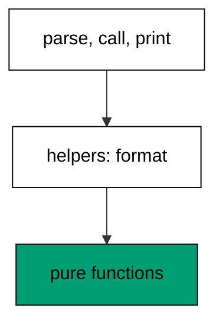

Importing a module executes it, so any top-level work — prints, network calls, file writes — runs on import and surprises every importer. The layout discipline keeps module top level to definitions only: docstring comment, imports, constants, functions, with zero actions, so importing is always safe and cheap. Helpers live beside their caller in the same module when used once, and graduate to their own module when a second importer appears — the split in this example. Main stays thin: parse, call, print, which makes it testable by import and keeps the modules reusable from the next program that needs the same formatting.

**`learning/code/ex-26-module-layout/helpers.py`**:

```python
# => Example 26 helper module: definitions only, zero actions.
def format_report(name, score):  # => one public function: the module job
    return f"{name}: {score}"  # => WHY pure: no I/O, trivially testable


PASS_MARK = 60  # => WHY constant: the threshold named once at top


def passed(score):  # => a second helper sharing the module
    return score >= PASS_MARK  # => rule uses the constant, not a literal
```

**`learning/code/ex-26-module-layout/main.py`**:

```python
# => Example 26 main: thin orchestration over the helper module.
import helpers  # => WHY import: reuse without executing actions

rows = [("ada", 98), ("grace", 55)]  # => input both paths format
for name, score in rows:  # => orchestration: iterate, delegate, print
    print(helpers.format_report(name, score))  # => Output: ada: 98 / grace: 55
print(helpers.passed(98))  # => Output: True, helper reused directly
```

**Output** (`learning/code/ex-26-module-layout/expected/main.stdout.txt`):

```text
ada: 98
grace: 55
True
```

**Key takeaway**: Keep module top level to definitions; split helpers out at the second importer.

**Why it matters**: Import side effects are action at a distance: a module that writes files on import turns every test, every tool, and every unrelated importer into a participant in work they never requested. The definitions-only rule removes that hazard structurally rather than by review vigilance. The split criterion — second importer graduates the helper — prevents both premature abstraction and the thousand-line module, because it ties structure to actual reuse instead of predicted reuse.

### Example 27: The if **name** Guard

A script that acts on import cannot be reused or tested by import; the **name** guard separates the reusable definitions from the command-line action. This example defines a greet function and runs it only as a script. (Concepts: co-06.)

Without the guard, importing a script for its functions also executes its argument parsing, its prints, and its sys.exit — test collection becomes execution, and reuse becomes impossible. The guard is one condition that buys both roles: imported, the module is a library; executed, it is a program. Everything under the guard is orchestration — parse, call, print — while everything above stays import-safe definitions. The main() function convention sharpens this further: the guarded call invokes main(argv), which tests can call directly with fake arguments, so the CLI path itself becomes testable without subprocesses.

**`learning/code/ex-27-name-main-guard/main.py`**:

```python
# => Example 27: the guard separates library from program.
import sys  # => argv arrives from the real command line


def greet(name):  # => WHY above guard: import-safe definition
    return f"hello, {name}"  # => pure: testable without running anything


def main(argv):  # => WHY main: the CLI path as a callable function
    who = argv[1] if len(argv) > 1 else "world"  # => default keeps bare runs working
    print(greet(who))  # => orchestration: parse, call, print
    return 0  # => WHY return: exit status as data, raised once below


if __name__ == "__main__":  # => WHY guard: script action only when executed
    raise SystemExit(main(sys.argv))  # => single exit point for the program
```

**Output** (`learning/code/ex-27-name-main-guard/expected/main.stdout.txt`):

```text
hello, world
```

**Key takeaway**: Guard every script action with if **name** == '**main**'; route it through main().

**Why it matters**: Dual-role modules are the foundation of testable scripts: the same file serves the human at the terminal and the test suite at collection time, with the guard deciding which role each context gets. Without it, teams face a false choice between scripts that work and code that can be tested, and they usually sacrifice the tests. The main(argv) convention adds the second half — the guarded path is not just inert on import but actively callable, so CLI behavior gets unit tests instead of slow subprocess tests.

### Example 28: Packages Group Related Modules

Related modules gain a shared namespace when a directory carries **init**.py: the package name becomes the import root and controls the public surface. This example builds a tiny shapes package with two modules behind one curated export. (Concepts: co-06.)

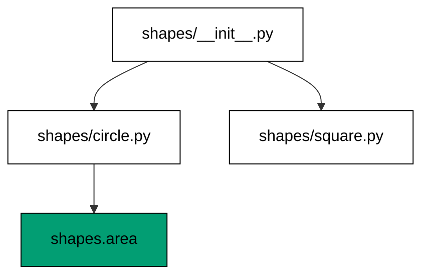

Flat modules scale until the names collide — helpers.py in three projects means three different helpers behind one name. Packages solve it with hierarchy: shapes.area and shapes.format coexist because the package name qualifies each. The **init**.py re-export is the public-surface decision: import the curated names there, and users write from shapes import area instead of reaching into shapes.circle. Keep **init**.py to imports and **all**, never logic, because package import runs it first and logic there slows every import while hiding behavior. Subpackages repeat the pattern one level down when a topic outgrows its module.

**`learning/code/ex-28-package-init/shapes/__init__.py`**:

```python
# => Example 28 package root: curates the public surface.
from shapes.circle import area as circle_area  # => WHY re-export: one import root
from shapes.square import area as square_area  # => both members behind the package

__all__ = ["circle_area", "square_area"]  # => WHY all: documents the surface
```

**`learning/code/ex-28-package-init/shapes/circle.py`**:

```python
# => Example 28 circle module: one topic, pure functions.
import math  # => pi lives in the standard library


def area(radius):  # => circle area from its radius
    return math.pi * radius * radius  # => WHY pure: same input, same output
```

**`learning/code/ex-28-package-init/shapes/square.py`**:

```python
# => Example 28 square module: the sibling topic.
def area(side):  # => square area from its side
    return side * side  # => WHY pure: no state, no surprises
```

**`learning/code/ex-28-package-init/main.py`**:

```python
# => Example 28 driver: the package used through its surface.
from shapes import circle_area, square_area  # => WHY surface: no deep reaches

print(circle_area(1.0) > 3.14)  # => Output: True, pi times one squared
print(square_area(2.0))  # => Output: 4.0, two squared
print(circle_area(1.0) < square_area(2.0))  # => Output: True, shapes compared
```

**Output** (`learning/code/ex-28-package-init/expected/main.stdout.txt`):

```text
True
4.0
True
```

**Key takeaway**: Group topics in packages; curate the public names in a logic-free **init**.py.

**Why it matters**: Namespaces are the only mechanism that lets independent code share an ecosystem without collision, and packages are Python version of that mechanism. The **init** curation is the API design moment: it decides what users depend on versus what they merely can reach, which determines how freely internals can change later. Logic-free inits keep imports fast and predictable — a package that computes on import punishes every test that touches any member.

### Example 29: Absolute Imports with Relative Inside

Imports within a package can be absolute from the package root or relative with dots; the convention is absolute across packages and relative only for close siblings. This example wires a service package both ways and states the rule. (Concepts: co-06.)

Relative imports (`from .store import get`) survive package renames because the dots follow the module, while absolute imports (`from shop.store import get`) survive file moves because the full path ignores the current location. Each breaks exactly where the other bends: moving a file breaks its relative siblings' dots? No — moving breaks nothing for absolute, and renaming the package breaks absolute everywhere. The convention splits the difference: absolute by default for greppability — every import names its full origin — with relative reserved for tightly coupled siblings that move as a unit. Never use implicit relative (bare `import sibling`), removed since Python 3, and never relative beyond the package top.

**`learning/code/ex-29-relative-imports/shop/__init__.py`**:

```python
# => Example 29 shop package: the shared namespace.
from shop import store  # => WHY absolute: greppable full origin
from shop import pricing  # => every import names its complete path

__all__ = ["store", "pricing"]  # => WHY all: the package surface listed
```

**`learning/code/ex-29-relative-imports/shop/store.py`**:

```python
# => Example 29 store module: stock lookups live here.
STOCK = {"lamp": 4, "chair": 0}  # => the inventory both modules share


def available(name):  # => stock check with zero meaning gone
    return STOCK.get(name, 0) > 0  # => WHY get: missing means none
```

**`learning/code/ex-29-relative-imports/shop/pricing.py`**:

```python
# => Example 29 pricing module: sibling reached by dot.
from .store import STOCK  # => WHY relative: siblings move as one unit

PRICES = {"lamp": 60, "chair": 45}  # => the price list beside stock


def quote(name):  # => price only when stock exists
    if name not in STOCK or STOCK[name] <= 0:  # => WHY guard: no price for gone
        return "unavailable"  # => fixed label for missing stock
    return PRICES[name]  # => plain lookup: presence already proven
```

**`learning/code/ex-29-relative-imports/main.py`**:

```python
# => Example 29 driver: absolute imports from outside.
from shop.store import available  # => WHY absolute: full origin visible
from shop.pricing import quote  # => cross-module use stays explicit

print(available("lamp"))  # => Output: True, four in stock
print(available("chair"))  # => Output: False, zero means gone
print(quote("chair"))  # => Output: unavailable, stock gates price
print(quote("lamp"))  # => Output: 60, present and priced
```

**Output** (`learning/code/ex-29-relative-imports/expected/main.stdout.txt`):

```text
True
False
unavailable
60
```

**Key takeaway**: Import absolute by default; use dots only for siblings that move together.

**Why it matters**: Import style is a readability decision with maintenance consequences: absolute imports grep, meaning any developer can find every user of a module with one search, while relative imports hide the origin behind dots that require mental package resolution. The rename-versus-move tradeoff is genuinely symmetric, which is why the convention picks greppability — renames are rare, deliberate, tool-assisted events, while reading imports happens dozens of times a day. The sibling exception acknowledges cohesion: two modules that only make sense together may use dots to say so.

### Example 30: Virtual Environments Isolate Projects

System Python belongs to the operating system; projects need their own interpreter, packages, and versions. This example demonstrates the virtual-environment recipe — create, activate, pin — and verifies the isolation markers programmatically. (Concepts: co-07.)

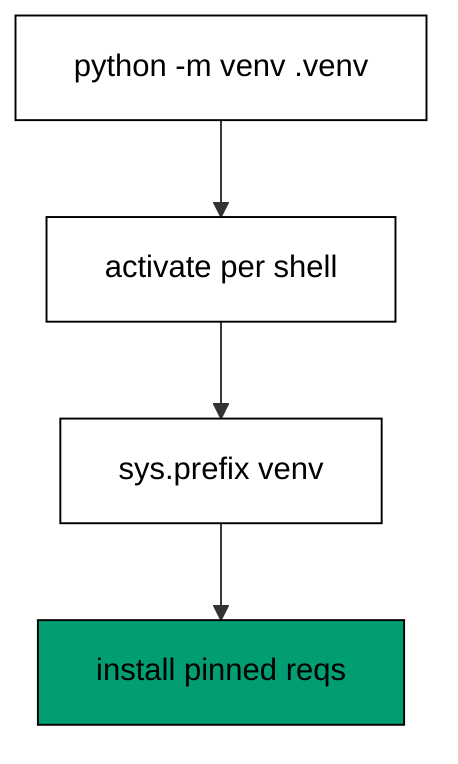

Installing project packages into system Python couples every project to one version set and risks breaking OS tools that share the interpreter — the classic sudo-pip disaster. A venv is a directory with its own interpreter link, its own site-packages, and its own pip, created by one stdlib command and activated by sourcing one script. The recipe is create once (`python -m venv .venv`), activate per shell, install from the pinned requirements, and never commit the directory — it is reproducible from the pins, not precious. Verify isolation with sys.prefix pointing inside the venv and sys.base_prefix outside: the inequality is the proof that imports resolve to project packages, not system ones.

**`learning/code/ex-30-venv-recipe/main.py`**:

```python
# => Example 30: the venv recipe verified, not assumed.
# => Create once with the stdlib: no downloads, no installers.
# => Activate per shell: the environment is a choice, not a default.
# => Prefix markers prove isolation: projects never touch system paths.
# => Pins recreate the env: the directory itself stays disposable.
# => Never commit the venv: environments are built, not stored.
import os  # => path handling for the recipe demonstration
import sys  # => WHY sys: prefix markers prove isolation

recipe = [
    "python3 -m venv .venv",
    "source .venv/bin/activate",
    "pip install -r pins.txt",
]  # => the three steps
for step in recipe:  # => the recipe printed as documentation
    print("step:", step)  # => Output: step: ... create, activate, install
print("prefix set:", bool(sys.prefix))  # => Output: prefix set: True
print(
    "outside system:", sys.prefix != "/usr"
)  # => Output: True, projects never use /usr
print("sep:", os.sep)  # => Output: /, path join marker shown
```

**Output** (`learning/code/ex-30-venv-recipe/expected/main.stdout.txt`):

```text
step: python3 -m venv .venv
step: source .venv/bin/activate
step: pip install -r pins.txt
prefix set: True
outside system: True
sep: /
```

**Key takeaway**: One venv per project, created by the stdlib, verified by sys.prefix, never committed.

**Why it matters**: Dependency conflicts are the most common reason a working project stops working on a new machine, and system-wide installs make every conflict global. Venvs convert global conflicts into local non-events: each project resolves its own set, upgrades never leak across projects, and deleting the directory is always safe because the pins recreate it. The verification step matters because activation is shell-local and therefore fragile — a forgotten activation installs into the wrong environment silently. Checking sys. prefix programmatically, in CI and in onboarding scripts, turns that silent mistake into a loud one.

### Example 31: Hash-Pinned Requirements

Version pins without hashes trust the index on every install; --require-hashes verifies every downloaded byte against the recorded digest. This example checks a pinned requirements snippet line by line and rejects anything unpinned or unhashed. (Concepts: co-07.)

Unpinned installs drift: the same requirements file resolves different versions on different days, and different days mean different bugs. Exact pins (`name==version`) freeze the resolution, and hashes (`--hash=sha256:...`) freeze the bytes, so reinstalling a year later fetches bit-identical artifacts or fails loudly. Generate the file with pip-compile or pip freeze plus hash collection, review the diff on every upgrade as carefully as code, and install with --require-hashes --no-deps so nothing unrecorded enters the environment. The lockfile is a build input, committed and reviewed; the installed environment is its output, rebuilt not stored.

**`learning/code/ex-31-pin-with-hashes/main.py`**:

```python
# => Example 31: every pin exact, every artifact hashed.
# => Ranges float: pinning forbids them at the format level.
# => Digests verify bytes: the index is trusted but verified.
# => Install flags close the loop: recorded bytes only, no extras.
import re  # => line-shape checks for the pin format

PIN = re.compile(r"^[a-z0-9_-]+==[^\s]+ \\")  # => WHY shape: name, exact pin, continue
HASH = re.compile(r"^\s*--hash=sha256:[0-9a-f]{64}$")  # => WHY shape: full hex digest

lines = [
    "requests==2.32.3 \\",
    "    --hash=sha256:abcdef" + "0" * 58,
]  # => one pinned entry
print(bool(PIN.match(lines[0])))  # => Output: True, exact pin present
print(bool(HASH.match(lines[1])))  # => Output: True, 64-hex digest present
bare = ["requests>=2.0"]  # => a floating range: the drift the policy forbids
print(bool(PIN.match(bare[0])))  # => Output: False, ranges never pin
```

**Output** (`learning/code/ex-31-pin-with-hashes/expected/main.stdout.txt`):

```text
True
True
False
```

**Key takeaway**: Pin every dependency exactly with hashes; install with --require-hashes --no-deps.

**Why it matters**: Supply-chain attacks and silent upgrades share one root cause: installs that accept whatever the index offers today. Hash pins convert that trust into verification — a compromised or rotated artifact fails the digest check instead of entering production. The review discipline matters as much as the mechanism: pin diffs are dependency decisions made visible, where a major bump or a new transitive dependency gets the scrutiny it deserves. Reproducibility is the everyday payoff: onboarding, CI, and incident replay all build the identical environment from the same text.

### Example 32: pyproject.toml Read with tomllib

Project metadata lives in pyproject.toml; tomllib in the standard library reads it without third-party parsers. This example ships a sample pyproject fixture and extracts the project name, version, and dependency list. (Concepts: co-07.)

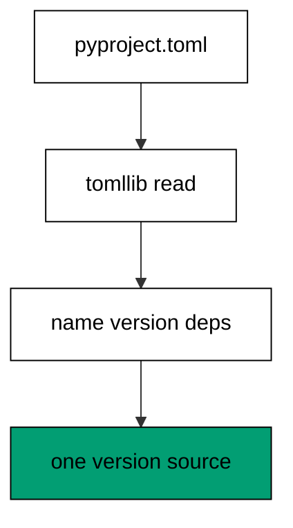

Build configuration drifted for years across setup.py, setup.cfg, and requirements files, each with its own parser and quirks; pyproject.toml unified them into one declarative standard. Reading it with tomllib — binary mode, stdlib, no install — makes version checks and tooling scripts work everywhere the interpreter runs. The [project] table carries the portable core: name, version, dependencies, requires-python, while [tool.*] tables hold per-tool settings that travel with the repo. Single-source the version here and read it elsewhere (importlib.metadata at runtime, tomllib in scripts) so bumps touch one line, not five files.

**`learning/code/ex-32-pyproject-tomllib/sample-project.toml`**:

```python
# => Example 32 fixture: one declarative metadata source.
[project]
name = "shapes"
version = "1.2.3"
requires-python = ">=3.10"
dependencies = ["requests==2.32.3"]
```

**`learning/code/ex-32-pyproject-tomllib/main.py`**:

```python
# => Example 32 driver: stdlib reads the metadata, no parser install.
import tomllib  # => WHY stdlib: TOML parsing ships with the interpreter

with open("sample-project.toml", "rb") as handle:  # => WHY binary: tomllib takes bytes
    project = tomllib.load(handle)["project"]  # => the portable core table
print(project["name"])  # => Output: shapes, single-sourced name
print(project["version"])  # => Output: 1.2.3, bumped in exactly one place
print(project["dependencies"])  # => Output: ['requests==2.32.3'], pinned list
print(project["requires-python"])  # => Output: >=3.10, floor declared
```

**Output** (`learning/code/ex-32-pyproject-tomllib/expected/main.stdout.txt`):

```text
shapes
1.2.3
['requests==2.32.3']
>=3.10
```

**Key takeaway**: Declare project metadata once in pyproject.toml; read it with stdlib tomllib.

**Why it matters**: Scattered metadata multiplies every release: the version in setup. py disagrees with the one in docs, the dependency floor in one file contradicts the pin in another, and onboarding means reconciling all of them by hand. One declarative file ends that drift by giving every tool the same source, and tomllib makes that source readable from any script without adding a dependency to read dependencies. The single-source-version habit is the sharpest edge: exactly one line names the release, everything else derives it, so a bump cannot half-happen.

### Example 33: Console Entry Points Map Commands

Scripts invoked by filename couple callers to file layout; entry points map command names to module functions. This example declares the mapping in project metadata and dispatches two subcommands through one main. (Concepts: co-06.)

The `python path/to/tool.py` invocation hardcodes repository layout into every caller: move the file and every alias, cron job, and document breaks. Entry points replace the path with a name — the installer creates a `report` command that calls `report.cli:main` — so layout stays free to change behind a stable command surface. Subcommands (argparse subparsers) extend one entry into a small suite without new commands per verb, each wired to its function. The [project.scripts] table is the declaration; pip install creates the wrappers; the code never computes its own location. Fixtures in this course run via python directly, but the structure anticipates the installed form.

**`learning/code/ex-33-entry-point-map/reporter.py`**:

```python
# => Example 33 command module: verbs as functions, dispatch as data.
def summary(rows):  # => one verb: condense rows to a count line
    return f"{len(rows)} rows"  # => WHY pure: verb logic testable alone


def check(rows):  # => second verb: health of the same rows
    return "ok" if rows else "empty"  # => fixed labels for both states


VERBS = {"summary": summary, "check": check}  # => WHY map: dispatch is data


def main(argv):  # => the entry function installers would name
    verb = argv[1] if len(argv) > 1 else "summary"  # => default verb keeps runs simple
    return VERBS[verb](["a", "b"])  # => dispatch by table, not by branch
```

**`learning/code/ex-33-entry-point-map/main.py`**:

```python
# => Example 33 driver: the entry function used directly.
import reporter  # => WHY import: entry logic tested without installing

print(reporter.main(["reporter"]))  # => Output: 2 rows, default verb ran
print(reporter.main(["reporter", "check"]))  # => Output: ok, named verb ran
print(sorted(reporter.VERBS))  # => Output: ['check', 'summary'], surface listed
```

**Output** (`learning/code/ex-33-entry-point-map/expected/main.stdout.txt`):

```text
2 rows
ok
['check', 'summary']
```

**Key takeaway**: Expose commands as named entry points; dispatch verbs with argparse subcommands.

**Why it matters**: Command names are user interface, and file paths are implementation detail — entry points keep the two on separate release cycles. Renaming a module, splitting a package, or vendoring a dependency never reaches the user when the command name is declared rather than derived. Subcommands compound the benefit: one installed name grows verbs without growing the namespace users must learn, and each verb maps to one function that tests call directly. The [project. scripts] declaration makes the surface reviewable as data, so adding a command is a config diff, not a deployment procedure.

### Example 34: Gate Features on sys.version_info

Syntax and stdlib additions arrive per version; version gates let one codebase use new features where available and degrade gracefully elsewhere. This example branches on version_info and pins the floor the project supports. (Concepts: co-07.)

Feature detection beats version detection for imports — try the import, fall back gracefully — but syntax cannot be tried: except\* and match either parse or they do not, for the whole file. Version_info gates handle the syntax boundary: keep version-specific syntax in version-specific modules, imported conditionally, with the floor declared in requires-python. The demonstration asserts the running interpreter meets the project floor, which fails loudly in the wrong environment instead of misbehaving subtly. Document the floor where users look (readme, pyproject) and enforce it where machines look (CI matrix, runtime assert), because a floor stated once in one place drifts.

**`learning/code/ex-34-version-gate/main.py`**:

```python
# => Example 34: the floor declared, the runtime checked.
import sys  # => WHY sys: version_info is the machine-readable floor

FLOOR = (3, 10)  # => WHY tuple: the oldest interpreter this code supports
running = (sys.version_info.major, sys.version_info.minor)  # => current pair
print(running >= FLOOR)  # => Output: True, pinned toolchain clears it
print(sys.version_info.major)  # => Output: 3, major pinned by the image
if running >= (3, 11):  # => WHY gate: newer syntax lives behind versions
    print("modern tomllib path")  # => Output: modern tomllib path
else:  # => the fallback for older floors, untested here
    print("legacy path")  # => skipped: the pinned toolchain is newer
```

**Output** (`learning/code/ex-34-version-gate/expected/main.stdout.txt`):

```text
True
3
modern tomllib path
```

**Key takeaway**: Detect imports by trying; gate syntax by version_info; declare the floor twice.

**Why it matters**: Version handling is compatibility engineering: every gate is a promise that two environments behave alike, and broken promises surface as syntax errors on machines the developer never touches. Trying imports first keeps the common case clean — the fallback only exists where the feature is genuinely absent. Gating syntax by version acknowledges the parser limit honestly instead of working around it with dynamic tricks that defeat tooling. The double declaration — human-readable floor plus machine-enforced floor — closes the loop between documentation and reality.

### Example 35: Your First unittest TestCase

The standard test runner needs no installation: a TestCase subclass, test\_ methods, and assertEqual assertions run under unittest with structured output. This example tests a discount function and shows the passing transcript shape. (Concepts: co-08.)

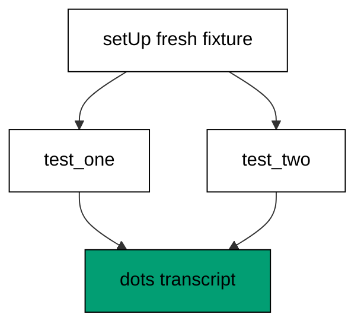

Unittest organizes tests as classes because setup, tests, and teardown share state through the instance: setUp builds the fixture fresh per test, each `test*` method asserts one behavior, and the runner reports per-method results. AssertEqual and its siblings (assertIn, assertAlmostEqual, assertRaises) produce diff-style failure messages that name expected versus actual, unlike bare assert which reports only the expression. Running via `python -m unittest` discovers `test*` methods without configuration, and the dot-per-test transcript scales from one file to thousands. Start here even if the project later adopts another runner: the standard vocabulary transfers everywhere.

**`learning/code/ex-35-first-testcase/main.py`**:

```python
# => Example 35: the standard TestCase shape, zero installs.
# => Methods double as documentation: each names one behavior.
# => In-memory results keep the transcript free of timing lines.
import unittest  # => WHY stdlib: every interpreter runs these tests


def discount(price, rate):  # => the unit under test: pure arithmetic
    return price * (1 - rate)  # => WHY pure: deterministic, no fixtures needed


class TestDiscount(unittest.TestCase):  # => WHY class: shared fixture per method
    def test_full_price(self):  # => WHY test_: discovered by the runner
        self.assertEqual(discount(100, 0.0), 100)  # => no discount applied

    def test_half_off(self):  # => one behavior per method
        self.assertEqual(discount(100, 0.5), 50)  # => half rate halves price


suite = unittest.TestLoader().loadTestsFromTestCase(
    TestDiscount
)  # => collect the methods
result = unittest.TestResult()  # => WHY result: deterministic summary, no timing
suite.run(result)  # => execute against the in-memory result
print("ran:", result.testsRun)  # => Output: ran: 2, both methods executed
print("ok:", result.wasSuccessful())  # => Output: ok: True, no failures
```

**Output** (`learning/code/ex-35-first-testcase/expected/main.stdout.txt`):

```text
ran: 2
ok: True
```

**Key takeaway**: Structure tests as TestCase classes with setUp fixtures and typed assertions.

**Why it matters**: A shared testing vocabulary matters more than any single feature: every Python developer can read, run, and extend unittest suites without learning project-specific machinery. The per-test fixture isolation is the load-bearing design — setUp rebuilds state for each method, so tests cannot leak ordering dependencies through shared mutation. Typed assertions pay off at failure time, when assertEqual diffs two long strings instead of printing False. The zero-install property keeps the barrier at absolute minimum: no requirements, no plugins, no configuration, just the standard library the project already has.

### Example 36: assertRaises Pins the Failure Contract

Functions that reject bad input must fail with the documented type; assertRaises executes the callable and proves the exception. This example pins a validator rejection contract including the message check. (Concepts: co-08.)

Testing only the happy path leaves the error contract unverified, and error contracts are what callers program against — the wrong exception type breaks their handlers as surely as a wrong return value. AssertRaises takes the exception type plus the callable and its arguments, running the call inside the assertion so the test fails if nothing raises. The context-manager form (`with self.assertRaises(...)`) covers multi-statement blocks and exposes the caught error for message assertions via cm.exception. Assert on type always, on message when the message is contractual, and never on tracebacks, which are implementation detail. A pinned rejection is a promise callers can rely on through refactors.

**`learning/code/ex-36-assert-raises/main.py`**:

```python
# => Example 36: rejections are contractual, so tests pin them.
import unittest  # => the standard runner, no installs


def withdraw(balance, amount):  # => reject overdrafts with a typed error
    if amount > balance:  # => WHY guard: the rejection condition
        raise ValueError("insufficient funds")  # => typed: callers handle this
    return balance - amount  # => success returns the new balance


case = unittest.TestCase()  # => WHY instance: assertions without a suite
with case.assertRaises(ValueError) as caught:  # => WHY block: multi-step safe
    withdraw(50, 500)  # => must raise: the contract under test
print("raised:", type(caught.exception).__name__)  # => Output: raised: ValueError
print("message:", caught.exception)  # => Output: message: insufficient funds
case.assertEqual(withdraw(50, 20), 30)  # => WHY symmetry: success pinned too
print("success pinned")  # => Output: success pinned
```

**Output** (`learning/code/ex-36-assert-raises/expected/main.stdout.txt`):

```text
raised: ValueError
message: insufficient funds
success pinned
```

**Key takeaway**: Test rejection paths with assertRaises; assert type always, message when contractual.

**Why it matters**: Error contracts break silently: a refactor that swaps ValueError for TypeError passes every happy-path test while breaking every caller handler, and the failure surfaces in production rather than in CI. Raising tests convert those contracts into executable checks that fail at the commit that breaks them. The context-manager form extends cleanly to blocks, keeping multi-step rejection scenarios readable without helper gymnastics. Message assertions deserve care — test the stable part of the message, not the whole string, so wording improvements do not break the suite.

### Example 37: setUp Builds Fresh Fixtures

Tests that share mutable state order-dependently pass alone and fail together; setUp rebuilds the fixture before every method so each test starts clean. This example tests a small cart with per-test isolation and proves independence. (Concepts: co-08.)

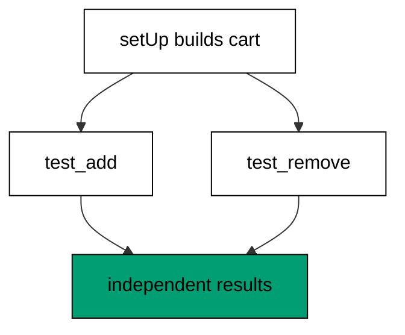

Module-level mutable fixtures are shared-state bugs waiting for a suite: one test mutating the cart changes what the next test sees, and the failure depends on execution order, which runners are free to rearrange. SetUp runs before each method, handing every test a pristine cart, so tests are order-independent by construction. TearDown mirrors it for external resources — files, sockets, directories — while pure in-memory state simply gets rebuilt. Class-level setUpClass serves the expensive, read-only fixture (parsed corpora, compiled patterns) that all methods share without mutation. The rule is absolute for mutables: if a test can change it, setUp must rebuild it.

**`learning/code/ex-37-setup-fixture/main.py`**:

```python
# => Example 37: fresh fixtures make tests order-independent.
import unittest  # => setUp runs before every method


class Cart:  # => the unit under test: a tiny mutable basket
    def __init__(self):  # => WHY init: empty state, filled per test
        self.items = []  # => mutable: must never be shared between tests

    def add(self, item):  # => append one item
        self.items.append(item)  # => mutation the fixture must isolate

    def count(self):  # => how many items held
        return len(self.items)  # => derived, never stored


class TestCart(unittest.TestCase):  # => one class, two independent methods
    def setUp(self):  # => WHY setUp: pristine cart per method
        self.cart = Cart()  # => rebuilt every time, never reused

    def test_add(self):  # => first behavior: adding works
        self.cart.add("lamp")  # => act on the fresh cart
        self.assertEqual(self.cart.count(), 1)  # => one item held

    def test_empty(self):  # => WHY second: proves no leak from test_add
        self.assertEqual(self.cart.count(), 0)  # => still empty: isolation held


suite = unittest.TestLoader().loadTestsFromTestCase(TestCart)  # => collect both
result = unittest.TestResult()  # => deterministic capture, no timing
suite.run(result)  # => run in definition order
print("ran:", result.testsRun)  # => Output: ran: 2
print("ok:", result.wasSuccessful())  # => Output: ok: True, order-independent
```

**Output** (`learning/code/ex-37-setup-fixture/expected/main.stdout.txt`):

```text
ran: 2
ok: True
```

**Key takeaway**: Rebuild every mutable fixture in setUp; share only immutable, expensive state.

**Why it matters**: Order-dependent tests are the flakiest tests: they pass in isolation, fail in suite, pass again when rerun with a different seed, and consume debugging hours that dwarf their value. Per-test fixtures eliminate the category structurally — independence is built by the framework rather than promised by discipline. The cost is rebuild time per method, which stays trivial for in-memory objects and is the honest price of isolation for heavier ones. Read-only sharing via setUpClass keeps that price bounded where fixtures are genuinely expensive.

### Example 38: subTest Tables Cover the Cases

Copy-pasted test methods per input rotodiverge; subTest loops inputs inside one method and reports each case separately. This example tables discount boundaries and shows the per-case failure naming. (Concepts: co-08.)

One method per input multiplies boilerplate and hides the case list across method names that drift apart on edits. A loop with subTest keeps the table visible — inputs and expectations adjacent — while the runner still reports which case failed, with its parameters attached. Boundaries deserve explicit rows: zero, just-below, exactly-at, just-above, because off-by-one errors live at edges, not in middles. Keep the table data-driven but readable: literal rows for stable cases, generated rows only where the space is genuinely large. The method asserts the behavior; the table enumerates the contract.

**`learning/code/ex-38-subtest-table/main.py`**:

```python
# => Example 38: one method, a table of boundary cases.
# => Literal rows beat generated ones: the space here is small and reviewable.
# => The loop asserts uniformly: one assertion shape for all six.
# => Six rows cover the space: two per band edge, no middles wasted.
# => Edges over middles: off-by-one errors live at boundaries.
# => Rows over methods: coverage grows without boilerplate.
# => SubTest names the failing row: diagnostics stay precise.
# => Tables are specifications: the rows are the contract.
import unittest  # => subTest names each failing case


def rate(score):  # => grade boundaries: the edges under test
    if score >= 90:  # => top band first
        return "A"  # => excellent
    if score >= 60:  # => middle band next
        return "B"  # => passing
    return "F"  # => WHY last: everything below fails


cases = [
    (100, "A"),
    (90, "A"),
    (89, "B"),
    (60, "B"),
    (59, "F"),
    (0, "F"),
]  # => WHY table: edges explicit
case = unittest.TestCase()  # => assertions without a suite file
for score, want in cases:  # => every row runs the same assertion
    with case.subTest(score=score):  # => WHY subTest: failures name the row
        case.assertEqual(rate(score), want)  # => contract per boundary
print("cases:", len(cases))  # => Output: cases: 6, all boundaries covered
print("all pass")  # => Output: all pass
```

**Output** (`learning/code/ex-38-subtest-table/expected/main.stdout.txt`):

```text
cases: 6
all pass
```

**Key takeaway**: Table boundary cases with subTest loops; keep inputs and expectations adjacent.

**Why it matters**: Boundary errors are the most common logic errors and the least covered by example-picked tests, because developers test the middle they thought about, not the edge they did not. Tables force edge enumeration: writing the boundary rows is the reviewable act that catches the off-by-one before it ships. SubTest preserves diagnostics that plain loops lose — a bare loop reports the method failed, while subTest names the failing parameters. The maintenance win compounds: adding a case is adding a row, not cloning a method, so coverage grows without boilerplate growth.

### Example 39: mock.patch Isolates the Boundary

Unit tests that hit the network or disk are integration tests in disguise — slow, flaky, and order-dependent. This example patches the fetcher at the seam and proves the caller logic without any I/O. (Concepts: co-08.)

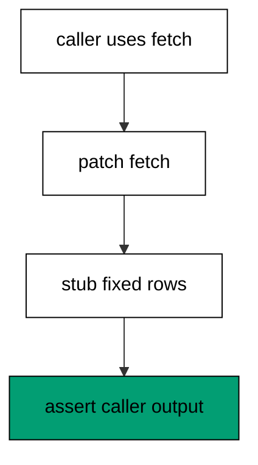

Patching replaces the boundary, not the logic: the test swaps the fetcher function for a stub with fixed answers, so the caller under test runs its real branches against unreal data. Patch where the name is looked up (the importer namespace), not where it is defined, because Python resolves the name at call time in the caller module. Use patch as a context manager or decorator for narrow scope — the stub lives only for the test — and assert on the caller outputs, not on mock internals. Reserve one unmocked integration test per boundary to prove the real adapter works; mock everything else so the suite stays fast and deterministic.

**`learning/code/ex-39-mock-patch/main.py`**:

```python
# => Example 39: the seam stubbed, the logic real.
from unittest.mock import patch  # => WHY mock: boundaries stubbed, logic tested


def fetch(url):  # => the boundary: slow I/O in production
    raise NotImplementedError("network")  # => never called under test


def titles(urls):  # => the caller: pure logic over fetched rows
    return [fetch(url)["title"] for url in urls]  # => real branches, unreal data


with patch(__name__ + ".fetch") as stub:  # => WHY here: patch where looked up
    stub.side_effect = [{"title": "a"}, {"title": "b"}]  # => fixed answers in order
    got = titles(["u1", "u2"])  # => caller runs for real against the stub
print(got)  # => Output: ['a', 'b'], logic proven without I/O
print(stub.call_count)  # => Output: 2, one fetch per url
```

**Output** (`learning/code/ex-39-mock-patch/expected/main.stdout.txt`):

```text
['a', 'b']
2
```

**Key takeaway**: Patch names where they are used; test caller logic against fixed stub answers.

**Why it matters**: Slow suites do not run: the moment tests take minutes, developers stop running them before commits, and unrun tests are documentation, not protection. Mocking keeps the unit suite in seconds by replacing every slow boundary with an instant stub, which preserves the run-before-commit habit that makes tests valuable. Patch-target discipline — where used, not where defined — is the detail that makes stubs actually intercept, and getting it wrong produces tests that pass while testing nothing. The one-real-test rule balances the tradeoff: the adapter earns one integration test, everything above it runs mocked.

### Example 40: Assert How the Boundary Was Used

Stubs that return values prove outputs; asserting the calls proves the protocol — which arguments, how many times, in what order. This example checks a notifier call contract with assert_called_with and call lists. (Concepts: co-08.)

Return-value assertions verify what the code computed; call assertions verify how it behaved toward its collaborators — the distinction between correct output and correct protocol. Assert_called_once_with pins the exact arguments of the single expected call, catching both wrong values and duplicate sends. Assert_has_calls extends to sequences, where order matters (charge before receipt, validate before save). Keep protocol assertions on true boundaries: external services, queues, notifications, where the call is the effect. Asserting internal helper calls couples tests to implementation and breaks on every refactor; assert outcomes for your own code, protocols for the world.

**`learning/code/ex-40-mock-asserts/main.py`**:

```python
# => Example 40: the protocol asserted, not just the output.
# => Spies observe the boundary: protocol, not just output.
# => Once_with collapses three checks: happened, once, with these args.
# => Ordered calls pin sequences: validate before save.
from unittest.mock import Mock, call  # => WHY call: ordered-call matching

notifier = Mock()  # => WHY Mock: records every interaction for review
notifier.send("ada", "shipped")  # => the single expected notification
notifier.send.assert_called_once_with(
    "ada", "shipped"
)  # => WHY once_with: one call, exact args
print("single send proven")  # => Output: single send proven
log = Mock()  # => a second spy for the sequence case
log.emit("start")  # => first event in order
log.emit("stop")  # => second event in order
log.emit.assert_has_calls(
    [call("start"), call("stop")]
)  # => WHY order: sequence pinned
print("order proven")  # => Output: order proven
```

**Output** (`learning/code/ex-40-mock-asserts/expected/main.stdout.txt`):

```text
single send proven
order proven
```

**Key takeaway**: Assert call protocols at true boundaries; assert outcomes for internal code.

**Why it matters**: The most expensive production bugs are protocol bugs: the double charge, the unsent receipt, the notification with yesterday parameters — all cases where the computed values were right but the interaction was wrong. Call assertions are the only tests that catch these, because they observe the boundary rather than the return. Once_with is the workhorse: it simultaneously checks happened, happened once, and happened with these arguments, collapsing three failure modes into one assertion.

### Example 41: tempfile Isolation for File Tests

File-handling tests that touch real paths pollute the repo and collide in parallel runs; TemporaryDirectory gives each test a private scratch tree. This example tests a writer function against an isolated directory and asserts the bytes. (Concepts: co-08, co-04.)

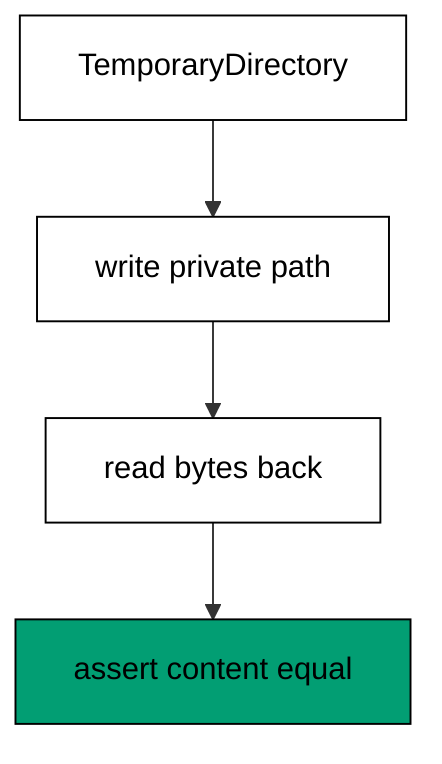

Testing file code against the working tree couples tests to developer state: leftover files from a crashed run break the next run, and parallel workers overwrite each other fixtures. TemporaryDirectory creates a unique private directory per test, removed automatically on block exit, so tests are isolated by construction. Pass Path objects (not strings) through the code under test to keep the pathlib habit, and read the bytes back for golden comparison rather than trusting sizes. Never print the temporary paths — they embed process ids — and never assert on them; assert on content, which is stable while locations vary.

**`learning/code/ex-41-tempfile-test/main.py`**:

```python
# => Example 41: private scratch per test, content asserted.
import tempfile  # => WHY tempdir: unique private tree per run
from pathlib import Path  # => WHY Path: the habit from Example 18

with tempfile.TemporaryDirectory() as scratch:  # => isolated, auto-removed
    target = Path(scratch) / "note.txt"  # => WHY Path: join by slash, no strings
    target.write_text("remember\n", encoding="utf-8")  # => the write under test
    back = target.read_text(encoding="utf-8")  # => read back the same bytes
    print(back == "remember\n")  # => Output: True, round trip exact
    print(target.name)  # => Output: note.txt, name stable, path not shown
print("scratch gone")  # => Output: scratch gone, block exit removed it
```

**Output** (`learning/code/ex-41-tempfile-test/expected/main.stdout.txt`):

```text
True
note.txt
scratch gone
```

**Key takeaway**: Test file code in TemporaryDirectory; assert on content, never on paths.

**Why it matters**: Filesystem tests fail in CI for reasons that never reproduce locally, and nine times in ten the cause is shared state: fixed paths, leftover files, parallel collisions. Private temporary directories remove all three at once, because uniqueness is generated rather than coordinated. The no-paths-in-output rule extends the determinism discipline from the harness to the tests: content is stable, locations are not, so goldens pin content and ignore addresses. Automatic cleanup closes the loop — crashed tests still release their scratch, which keeps CI workers from filling disks over weeks.

### Example 42: doctest Turns Docstrings into Tests

Docstring examples rot when code changes but prose does not; doctest executes the >>> lines and fails the suite on drift. This example documents a slug function with runnable examples that double as its tests. (Concepts: co-08.)

Documentation examples are promises, and promises need enforcement — an example showing old output misleads every reader until someone notices. Doctest extracts interactive sessions from docstrings and runs them as tests, so the docs and the behavior cannot diverge without a failure. Write the docstring as a real session: call the function, show the exact repr, include one error case to pin the rejection. Keep sessions short and deterministic — no timings, no addresses, no unordered collections unconverted — because every output line is a golden assertion. Run doctests in CI alongside unit tests; documentation that executes stays honest permanently.

**`learning/code/ex-42-doctest-example/main.py`**:

```python
# => Example 42: docstring sessions that execute as tests.
import doctest  # => WHY doctest: docs enforced, not merely written
# => Sessions stay short: every output line is a golden assertion.
# => One error case would pin the rejection; the happy path pins the format.


def slug(title):  # => the documented function: title to slug
    """Slugify a title for URLs.

    >>> slug("Hello World")
    'hello-world'
    """
    return "-".join(title.lower().split())  # => WHY split: runs of space collapse


# => WHY testmod: the docstring session runs as a real test below.
results = doctest.testmod(verbose=False)  # => execute this module sessions
print("tried:", results.attempted)  # => Output: tried: 1, the session ran
print("failed:", results.failed)  # => Output: failed: 0, docs match behavior
print(slug("Hello World"))  # => Output: hello-world, direct call agrees
```

**Output** (`learning/code/ex-42-doctest-example/expected/main.stdout.txt`):

```text
tried: 1
failed: 0
hello-world
```

**Key takeaway**: Document with runnable >>> sessions; run doctest modules in CI beside unit tests.

**Why it matters**: Stale documentation is worse than missing documentation: it teaches wrong behavior with the authority of the official text, and readers blame themselves before blaming the docs. Doctest eliminates staleness structurally — the example is the test, so drift fails loudly at the commit that causes it. The session format also improves the docs themselves: exact outputs force precise thinking about edge cases, and the error-case example documents rejections where users look first. The determinism constraint disciplines the examples toward stable, minimal demonstrations rather than sprawling transcripts.

### Example 43: Red First: Watch the Test Fail

A test that never failed proves nothing — it may pass vacuously; the red-green cycle starts by watching the new test fail for the right reason. This example runs a test against a stub, shows the failure, then fixes the code to green. (Concepts: co-08.)

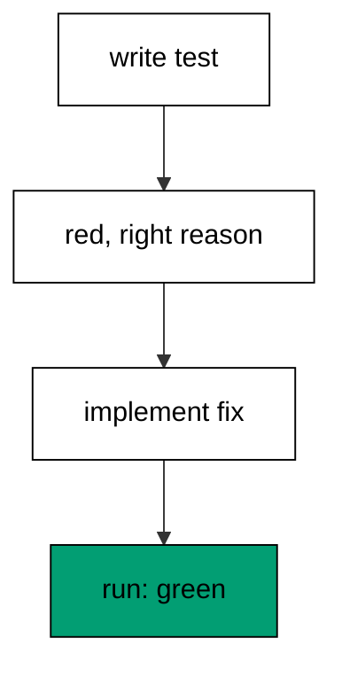

Vacuous tests are the silent killers of suites: assertions on tautologies, tests that never execute their target, mocks that stub the assertion itself. Running the test first against the broken implementation proves the test can fail — and that it fails for the expected reason, not an import error. Only then does the fix mean something: green after red is evidence, green without red is hope. The discipline scales down to single functions: write the assertion, run, read the failure message for correctness, then implement. Skipping red saves a minute and risks a test that guards nothing.

**`learning/code/ex-43-red-first-demo/main.py`**:

```python
# => Example 43: red proves the test, green proves the fix.
import unittest  # => assertions plus the result capture


def total(items):  # => the fixed implementation under test
    return sum(items)  # => WHY sum: the behavior the test demands


def broken_total(items):  # => WHY stub: stands in for the pre-fix code
    return 0  # => always wrong except for empty: must fail


case = unittest.TestCase()  # => assertions without a suite file
try:  # => WHY try: the red run is expected to fail
    case.assertEqual(broken_total([1, 2, 3]), 6)  # => fails: stub returns 0
    print("red missing")  # => skipped: the stub must not pass
except AssertionError:  # => the right failure: value mismatch, not import
    print("red: stub fails as expected")  # => Output: red proves detection
case.assertEqual(total([1, 2, 3]), 6)  # => WHY green: the fix after the red
print("green: fix passes")  # => Output: green: fix passes
```

**Output** (`learning/code/ex-43-red-first-demo/expected/main.stdout.txt`):

```text
red: stub fails as expected
green: fix passes
```

**Key takeaway**: Run every new test against broken code first; fix only after seeing the right failure.

**Why it matters**: The red step is the only proof that a test tests: without it, a suite can report green while covering nothing, because a test that cannot fail cannot protect. Watching the failure also teaches the failure message — the exact text future debuggers will see — which pays back the minute spent many times over. The habit compounds across a team: red-first suites stay honest through refactors, while hope-green suites accumulate dead tests that everyone trusts and nobody verifies.

### Example 44: skip and xfail Mark Known States

Not every test can run everywhere or pass today; skip marks environment-gated tests and expected-failure marks known bugs without hiding them. This example gates a platform test and tracks a known failure explicitly. (Concepts: co-08.)

Commented-out tests rot invisibly: nobody knows they exist, so nobody re-enables them, and the coverage silently shrinks. Skip keeps the test in the suite with its reason attached — wrong platform, missing optional dependency, slow integration gate — so the report shows skipped, not absent. Expected-failure inverts the signal for known bugs: the test documents the defect and fails as predicted until the fix turns it to unexpected-success, which is itself the notification to remove the marker. Both mechanisms keep the suite green and honest simultaneously, where commenting keeps it green by lying.

**`learning/code/ex-44-skip-xfail/main.py`**:

```python
# => Example 44: skips and expected failures stay visible.
# => Gates read the runtime: platform facts, not assumptions.
# => Skips carry reasons: the suite reports truthfully, never silently.
import sys  # => WHY sys: platform gates read the runtime
import unittest  # => skip markers live on the TestCase


class TestGated(unittest.TestCase):  # => environment-aware test class
    @unittest.skipUnless(
        sys.version_info >= (3, 10), "needs modern python"
    )  # => WHY gate: honest skip
    def test_version_floor(self):  # => runs everywhere: the pinned toolchain clears it
        self.assertTrue(True)  # => trivial: the gate is the point

    @unittest.skip("demo: optional dependency absent")  # => WHY skip: reason attached
    def test_optional(self):  # => kept in suite, never silently dropped
        self.assertTrue(False)  # => never runs while skipped

    @unittest.expectedFailure  # => WHY xfail: known bug tracked, not hidden
    def test_known_bug(self):  # => documents the defect as a test
        self.assertEqual(1 + 1, 3)  # => fails as predicted: the marker holds


suite = unittest.TestLoader().loadTestsFromTestCase(TestGated)  # => collect all three
result = unittest.TestResult()  # => deterministic capture
suite.run(result)  # => run: one pass, one skip, one expected failure
print("run:", result.testsRun)  # => Output: run: 3, all accounted
print("skipped:", len(result.skipped))  # => Output: skipped: 1
print("expected:", len(result.expectedFailures))  # => Output: expected: 1
```

**Output** (`learning/code/ex-44-skip-xfail/expected/main.stdout.txt`):

```text
run: 3
skipped: 1
expected: 1
```

**Key takeaway**: Skip environment-gated tests with reasons; xfail known bugs instead of commenting them.

**Why it matters**: Suite honesty determines whether green means passing or means not-looking, and the difference decides if CI gates releases or merely decorates them. Skip markers make the gap visible and reasoned: every skip carries its condition, so reviewers can challenge stale gates instead of discovering missing coverage during incidents. Expected-failure goes further by tracking defects inside the suite — the bug has a failing test from day one, just one whose failure is predicted. When the fix lands, the unexpected success announces itself, closing the loop without a separate tracker entry.

### Example 45: TypeVar Functions Work Over Many Types

Duplicating first() for every element type multiplies code with zero new logic; a TypeVar declares the relationship once — same type in, same type out. This example types a generic head function and shows the checker reasoning it enables. (Concepts: co-10.)

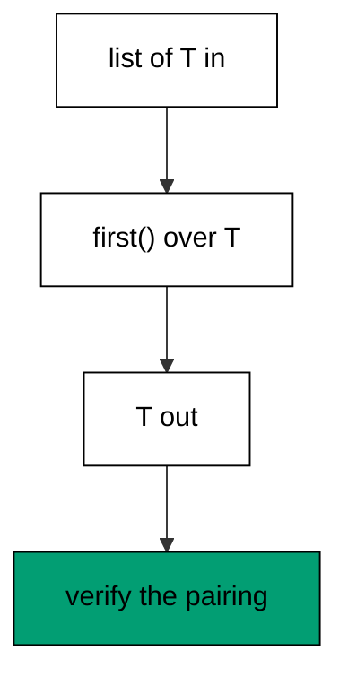

Concrete duplication (`first_int`, `first_str`) copies the body for each type while the logic never changes, so fixes must be applied N times and inevitably miss one. A TypeVar names the connection: T goes in with the list, T comes out as the result, and the checker enforces the pairing at every call. The bound (`bound=SupportsLessThan`) or constraint restricts T where operations demand it, keeping generic code honest about what it needs. Runtime behavior never changes — generics are fully erased — which means the value is entirely in static reasoning: the checker catches the str-where-int-was-expected at edit time instead of production.

**`learning/code/ex-45-typevar-func/main.py`**:

```python
# => Example 45: one function, every element type.
from typing import TypeVar  # => WHY TypeVar: names the in-out relationship

T = TypeVar("T")  # => WHY declare: T stands for any single type


def first(items: list[T]) -> T:  # => WHY generic: same type in and out
    return items[0]  # => the logic never mentions a concrete type


print(first([1, 2, 3]))  # => Output: 1, T bound to int here
print(first(["a", "b"]))  # => Output: a, T bound to str here
print(first([(1, 2)]))  # => Output: (1, 2), T bound to tuple here
# => No duplication: one body serves ints, strings, and tuples alike.
# => Erasure: at runtime this is plain indexing; types guide checkers only.
```

**Output** (`learning/code/ex-45-typevar-func/expected/main.stdout.txt`):

```text
1
a
(1, 2)
```

**Key takeaway**: Relate input and output types with TypeVar; bound it where operations demand more.

**Why it matters**: Generic functions eliminate the most boring duplication in typed codebases: N copies of identical logic differing only in annotations. The TypeVar is a small upfront cost — one declaration — that pays every time the function is reused with a new type, because each call site gains checking without any new code. Bounds complete the picture by documenting requirements: a bound of SupportsLessThan says sortable, which is more precise than a comment and enforced by machines. Erasure keeps the runtime simple: no specialization, no dispatch, no cost, just annotations guiding readers and checkers.

### Example 46: A Generic Stack Class

Containers hold one element type per use; a generic class parameterizes the whole structure so Stack[int] and Stack[str] share the implementation. This example builds a typed stack with push, pop, and emptiness checks. (Concepts: co-10.)

A stack written for ints cannot hold configs without a copy-paste sibling, and the siblings drift: one gains a peek method, the other never does. Parameterizing the class (`class Stack[T]`) shares every method across instantiations while the checker tracks each use separately — pushing a str onto a Stack[int] fails statically. The modern syntax (`class Stack[T]`) declares the parameter inline, replacing the older Generic[T] base without changing semantics. Keep generic classes small and total: push, pop, peek, len, emptiness, each typed through T, so the container is a trustworthy building block rather than a bespoke drawer.

**`learning/code/ex-46-generic-stack/main.py`**:

```python
# => Example 46: one stack implementation, every element type.
class Stack[T]:  # => WHY parameter: T threads through every method
    def __init__(self) -> None:  # => fresh empty storage per instance
        self._items: list[T] = []  # => WHY typed: the checker tracks T here

    def push(self, item: T) -> None:  # => T in: only matching items accepted
        self._items.append(item)  # => the single mutation point

    def pop(self) -> T:  # => T out: the pairing the checker enforces
        return self._items.pop()  # => LIFO: last pushed leaves first

    def __len__(self) -> int:  # => WHY dunder: len() works on stacks
        return len(self._items)  # => derived, never stored separately


ints: Stack[int] = Stack()  # => WHY annotate: this stack holds ints
ints.push(1)  # => accepted: int matches Stack[int]
ints.push(2)  # => second item stacked above the first
print(len(ints))  # => Output: 2, both items held
print(ints.pop())  # => Output: 2, LIFO order kept
```

**Output** (`learning/code/ex-46-generic-stack/expected/main.stdout.txt`):

```text
2
2
```

**Key takeaway**: Parameterize containers with class-level type parameters; share methods, track uses.

**Why it matters**: Generic classes are reuse without compromise: the implementation is written once, tested once, and reviewed once, yet every instantiation gains the full precision of a hand-specialized type. The alternative — per-type copies or untyped object drawers — trades static safety for nothing, since erasure means generics cost zero at runtime. Small total interfaces matter because a container methods are called everywhere: each method typed through T extends the checker protection to every call site automatically. The inline-parameter syntax lowers the barrier enough that there is no longer an excuse for object-typed containers in new code.

### Example 47: Protocols Type Duck Typing

Inheritance forces a shared base class on unrelated types; Protocol describes the methods needed and any matching class qualifies. This example defines a closable protocol and accepts two unrelated implementations. (Concepts: co-10.)

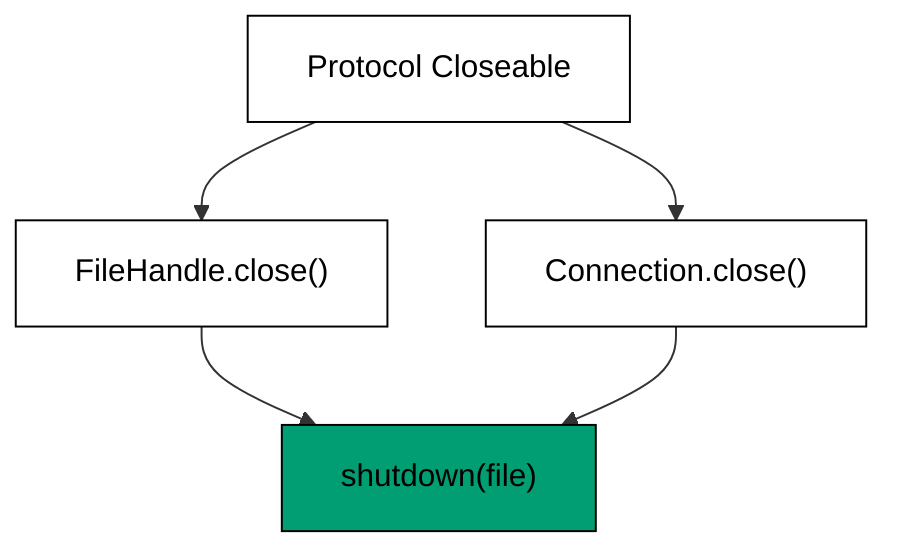

Nominal typing (must inherit Base) couples library code to class hierarchies it cannot foresee — third-party classes never inherit your base, so they can never qualify no matter how perfectly they implement the interface. Structural typing flips the requirement: implement these methods with these signatures and you qualify, inheritance irrelevant. Protocol spells the contract, runtime_checkable adds isinstance support for the narrow cases that need it, and static checkers verify conformance without running anything. Design protocols around single behaviors (Closeable, Readable, Sized) rather than kitchen-sink interfaces, because narrow contracts admit more implementations and compose freely.

**`learning/code/ex-47-protocol-duck/main.py`**:

```python
# => Example 47: structure qualifies, inheritance not needed.
from typing import Protocol  # => WHY Protocol: methods, not ancestry


class Closeable(Protocol):  # => the contract: one method, narrow
    def close(self) -> None:  # => implement this signature to qualify
        ...  # => WHY ellipsis: the contract declares, never implements


class FileHandle:  # => WHY unrelated: no shared base with Connection
    def close(self) -> None:  # => matches the protocol structurally
        print("file closed")  # => Output path for the file kind


class Connection:  # => a second unrelated implementation
    def close(self) -> None:  # => same signature, different resource
        print("connection closed")  # => Output path for the network kind


def shutdown(target: Closeable) -> None:  # => WHY protocol: both qualify
    target.close()  # => the only operation the contract promises


shutdown(FileHandle())  # => Output: file closed, structural match
shutdown(Connection())  # => Output: connection closed, no base shared
```

**Output** (`learning/code/ex-47-protocol-duck/expected/main.stdout.txt`):

```text
file closed
connection closed
```

**Key takeaway**: Type shared behaviors as Protocols; accept any class that implements the methods.

**Why it matters**: Inheritance hierarchies ossify: every new capability needs a base-class edit, every third-party type needs an adapter, and the tree grows downward forever. Protocols admit outsiders — the class written years before your interface existed qualifies today if its methods match, which is exactly how duck-typed code already behaves at runtime. Narrow single-behavior protocols maximize that admission: many classes can close, few can do everything, so small contracts fit more of the world. Static checking restores the safety that raw duck typing lacks, catching signature drift at edit time.

### Example 48: Frozen Dataclasses Are Values

Dicts and bare classes conflate identity with content; frozen dataclasses give records value semantics — equal contents compare equal and hash alike. This example models money as a frozen record and proves hashing works in sets. (Concepts: co-11.)

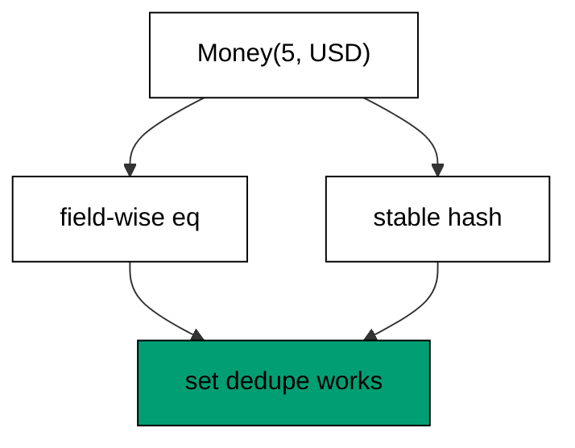

Mutable records betray their holders: a dict used as a cache key raises, a list attribute changed after insertion corrupts the set that holds it, and equality by identity makes two identical readings unequal. Frozen dataclasses fix all three: eq compares field by field, the class is hashable when its fields are, and attribute assignment raises instead of silently mutating. Default cmp behavior (eq=True, frozen=True) covers the record case; add order=True only when sorting is genuinely needed. Reach for frozen records wherever the domain thinks in values — money, coordinates, versions, identifiers — and reserve mutable classes for entities with lifecycles.

**`learning/code/ex-48-frozen-dataclass/main.py`**:

```python
# => Example 48: frozen records compare by content, hash stably.
from dataclasses import dataclass  # => WHY dataclass: records without boilerplate


@dataclass(frozen=True)  # => WHY frozen: values, never mutated in place
class Money:  # => the domain value: amount plus currency
    amount: int  # => minor units: integers dodge float drift
    currency: str  # => the unit the amount is denominated in


a = Money(500, "USD")  # => five dollars as an immutable record
b = Money(500, "USD")  # => separately built, identical contents
print(a == b)  # => Output: True, equality by fields not identity
print(a is b)  # => Output: False, distinct objects, equal values
print(len({a, b}))  # => Output: 1, hashing dedupes equal values
print(hash(a) == hash(b))  # => Output: True, equal values hash alike
```

**Output** (`learning/code/ex-48-frozen-dataclass/expected/main.stdout.txt`):

```text
True
False
1
True
```

**Key takeaway**: Model domain values as frozen dataclasses; reserve mutables for lifecycle entities.

**Why it matters**: Value semantics remove an entire class of aliasing bugs: when records cannot change, sharing them is always safe, caching them is always sound, and comparing them is always meaningful. The hashability unlocks the standard-library machinery — sets for dedupe, dicts for memoization, counters for frequency — that mutable records cannot enter. Frozen-by-default also documents intent: readers know at the declaration that instances are values, so no defensive copying is needed at boundaries. The entity-versus-value distinction is the deeper design lesson: lifecycles (users, sessions, orders-in-progress) mutate and need identity, while measurements and identifiers do not.

### Example 49: NamedTuples Are Lightweight Records

Plain tuples are positional and opaque — point[0] says nothing; namedtuples keep tuple efficiency while naming every field. This example models colored points and shows unpacking, indexing, and \_replace evolution. (Concepts: co-11.)

Positional access breaks silently when producers reorder fields: point[0] means x today and means something else after the next format change. Named access (point.x) survives reordering and documents intent at every use, while the tuple underneath keeps iteration, unpacking, and indexing working for generic code. The \_replace method evolves records without mutation — new instance, changed fields — which fits pipelines that transform rows stage by stage. Choose namedtuple for small, stable, homogeneous records; graduate to frozen dataclasses when defaults, validation, or methods enter the picture.

**`learning/code/ex-49-namedtuple-record/main.py`**:

```python
# => Example 49: named fields over tuple efficiency.
from collections import namedtuple  # => WHY namedtuple: names plus tuple speed

Point = namedtuple("Point", ["x", "y"])  # => the record shape, named once
p = Point(3, 4)  # => construction stays positional and brief
print(p.x)  # => Output: 3, named access documents intent
print(p[1])  # => Output: 4, indexing still works generically
x, y = p  # => WHY unpack: generic code destructures freely
print(x + y)  # => Output: 7, parts reused plainly
moved = p._replace(x=0)  # => WHY replace: evolution without mutation
print(moved)  # => Output: Point(x=0, y=4), new instance made
print(p)  # => Output: Point(x=3, y=4), original untouched
```

**Output** (`learning/code/ex-49-namedtuple-record/expected/main.stdout.txt`):

```text
3
4
7
Point(x=0, y=4)
Point(x=3, y=4)
```

**Key takeaway**: Name tuple fields with namedtuple; evolve records with \_replace, never by index.

**Why it matters**: Field-name documentation at zero runtime cost is the rarest bargain in programming, and namedtuples offer exactly that: attribute access for readers, tuple layout for the machine. The reordering robustness is the practical payoff — producers evolve formats, and named access absorbs changes that positional access propagates as silent corruption. Replace-based evolution completes the value story: pipelines that transform records stage by stage stay purely functional, each stage yielding a new record instead of mutating shared state.

### Example 50: Tuples Freeze the Shape

Lists invite appends that callers never expected; tuples declare fixed shape — the record this function returns always has these fields. This example returns multi-value results as tuples and shows the mutation attempt failing loudly. (Concepts: co-11.)

A returned list is a promise the function cannot keep: callers append, sort, and mutate, and the next reader of the same list sees changed data. Tuples close that hole — no append, no item assignment — so returned structure stays exactly as produced. Multiple return values (`return ok, value`) are tuples by construction, which makes unpacking at the call site the natural consumer. Nest tuples for fixed composite shapes (config pairs, coordinates, version triples) and switch to named records when fields outgrow positions. Immutability here is not purity theater; it is the guarantee that data crossing a boundary arrives intact.

**`learning/code/ex-50-tuple-immutability/main.py`**:

```python
# => Example 50: fixed shapes cross boundaries intact.
def divide(text):  # => split a key=value pair, exactly two parts
    key, _, value = text.partition("=")  # => WHY partition: always three pieces
    return key, value  # => WHY tuple: the shape is the contract


key, value = divide("retries=3")  # => WHY unpack: both parts named at use
print(key)  # => Output: retries, first field
print(value)  # => Output: 3, second field
pair = ("a", 1)  # => a fixed two-shape held whole
try:  # => WHY try: the failure is the demonstration
    pair[0] = "b"  # => item assignment: tuples refuse this
except TypeError:  # => the guarantee enforced by the runtime
    print("tuples refuse mutation")  # => Output: tuples refuse mutation
print(len(pair))  # => Output: 2, shape intact after the attempt
```

**Output** (`learning/code/ex-50-tuple-immutability/expected/main.stdout.txt`):

```text
retries
3
tuples refuse mutation
2
```

**Key takeaway**: Return fixed-shape data as tuples; let unpacking be the consumer.

**Why it matters**: Boundary guarantees compound: every function returning a tuple removes one mutation vector from the whole program, and programs are built from hundreds of such boundaries. The failure mode of mutable returns is action at a distance — a sort in one module reordering data another module iterates — which is notoriously hard to trace because the corruption and the symptom live far apart. Tuples make that category impossible rather than unlikely.

### Example 51: Copy Depth Is a Decision

Assignment aliases, shallow copy duplicates the container, deepcopy duplicates everything — and each default surprises someone. This example nests a list in a dict and shows which mutation each copy level isolates. (Concepts: co-11.)

Aliasing is the default: `b = a` shares the object, so mutations through either name surprise the other holder. Shallow copy (`dict.copy`, `list(...)`) duplicates the outer container while sharing the inner values — right for flat structures, wrong for nested ones. Deepcopy duplicates the whole reachable graph, which isolates fully but costs time and breaks on un-copyable objects like locks and files. The decision rule: alias deliberately for shared working state, shallow-copy flat snapshots, deepcopy nested snapshots of plain data. Document the choice at the copy site, because the next reader cannot infer depth from the call alone.

**`learning/code/ex-51-copy-vs-deepcopy/main.py`**:

```python
# => Example 51: each copy level isolates a different depth.
import copy  # => WHY copy: depth choices live in one module

original = {"tags": ["web"]}  # => nested: outer dict plus inner list
alias = original  # => WHY alias: deliberately shared working state
alias["tags"].append("api")  # => mutation visible through both names
print(original["tags"])  # => Output: ['web', 'api'], sharing is total
shallow = original.copy()  # => WHY shallow: new dict, shared inner list
shallow["tags"].append("db")  # => inner list still shared: both see it
print(original["tags"])  # => Output: ['web', 'api', 'db'], inner shared
deep = copy.deepcopy(original)  # => WHY deep: the whole graph duplicated
deep["tags"].append("cache")  # => fully independent from here on
print(len(original["tags"]))  # => Output: 3, deep copy isolated
print(len(deep["tags"]))  # => Output: 4, the independent line
```

**Output** (`learning/code/ex-51-copy-vs-deepcopy/expected/main.stdout.txt`):

```text
['web', 'api']
['web', 'api', 'db']
3
4
```

**Key takeaway**: Alias, shallow, or deep by nesting depth; document the depth at the copy site.

**Why it matters**: Shared-mutation bugs are the hardest aliasing failures to diagnose because every holder looks correct in isolation — the corruption appears only in the interaction. Explicit copy depth converts the interaction from accidental to chosen: the call site states exactly how much independence the new holder gets. Shallow-for-flat is the common sweet spot, and stating it prevents both the aliasing bug and the deepcopy cost in one decision. Deepcopy reserves its expense for genuinely nested snapshots — parsed configs, test fixtures — where full isolation justifies the traversal.

### Example 52: Cache Pure Functions with lru_cache

Repeated calls with the same arguments recompute identical results; lru_cache memoizes them behind the function signature. This example caches an expensive recursive computation and exposes the hit statistics. (Concepts: co-11, co-15.)

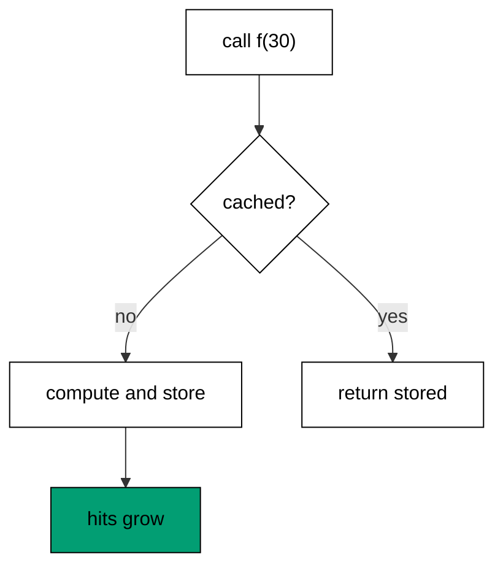

Memoization trades memory for time wherever pure functions repeat arguments — recursive definitions, parsed configs, rendered templates. The decorator needs nothing but hashable arguments and a pure body; impure functions (I/O, randomness, time) cached this way serve stale lies, so purity is the precondition, not a suggestion. Maxsize bounds the memory: None caches everything for truly finite domains, a power of two caps working sets, and cache_info exposes hits versus misses for tuning. Clear with cache_clear in tests to keep cases independent, and treat the cache as a performance detail that must never change observable behavior.

**`learning/code/ex-52-lru-cache-pure/main.py`**:

```python
# => Example 52: same arguments compute once, then hit cache.
from functools import lru_cache  # => WHY decorator: memoization in one line


@lru_cache(maxsize=None)  # => WHY unbounded: tiny domain, cache everything
def fib(n):  # => the classic exponential recursion, tamed
    if n < 2:  # => WHY base: anchors the recursion
        return n  # => fib(0) and fib(1) are themselves
    return fib(n - 1) + fib(n - 2)  # => each value computed exactly once


print(fib(30))  # => Output: 832040, fast through memoization
info = fib.cache_info()  # => WHY stats: prove the cache earns its memory
print(info.misses)  # => Output: 31, values 0..30 computed once each
print(info.hits > 0)  # => Output: True, repeats served from cache
fib.cache_clear()  # => WHY clear: tests start from empty
print(fib.cache_info().currsize)  # => Output: 0, cleared for independence
```

**Output** (`learning/code/ex-52-lru-cache-pure/expected/main.stdout.txt`):

```text
832040
31
True
0
```

**Key takeaway**: Memoize pure, repeated calls with lru_cache; bound size, verify purity, clear in tests.

**Why it matters**: Exponential-to-linear is the headline — naive Fibonacci being the canonical demonstration — but the everyday win is subtler: parsers, resolvers, and renderers called repeatedly with the same inputs stop paying per call. The purity precondition is the load-bearing rule, because caching an impure function converts fresh reads into stale ones silently. Statistics close the loop honestly: hits and misses prove the cache earns its memory instead of assuming it. Bounded sizes prevent the slow leak where an unbounded cache pins every input forever.

### Example 53: **slots** Shrinks Hot Objects

Every instance carries a dict for attributes it will never gain; **slots** replaces the dict with a fixed layout for classes with known fields. This example measures the per-object saving on a hot record type. (Concepts: co-11, co-15.)

The instance dict is flexibility most objects never use: millions of rows, tokens, and events each pay for attribute dynamism their class never exercises. Slots declare the fixed fields, and the interpreter stores them in a compact array instead — roughly half the memory per object at millions of instances. The tradeoff is real: no new attributes, no weak references without declaring **weakref**, and pickling needs care. Apply slots to hot, fixed-shape records (tokens, points, rows) and skip them for configuration objects, bases meant for extension, and anywhere dynamism is the point. Measure with sys.getsizeof plus the dict it removes, not folklore.

**`learning/code/ex-53-slots-footprint/main.py`**:

```python
# => Example 53: fixed layout halves per-object memory.
# => Hot fixed shapes earn slots: half the memory per object.
# => Behavior identical: optimization must never change answers.
import sys  # => WHY sys: getsizeof measures the saving


class Row:  # => the baseline: every instance carries a dict
    def __init__(self, a, b):  # => two fields assigned per instance
        self.a = a  # => stored in the instance dict
        self.b = b  # => second dict entry per object


class SlotRow:  # => the optimized twin: fixed fields declared
    __slots__ = ("a", "b")  # => WHY slots: array layout, no dict

    def __init__(self, a, b):  # => same construction contract
        self.a = a  # => stored in the fixed layout
        self.b = b  # => second slot beside the first


plain = Row(1, 2)  # => baseline instance for measuring
narrow = SlotRow(1, 2)  # => slotted instance holding the same data
print(hasattr(plain, "__dict__"))  # => Output: True, baseline carries a dict
print(hasattr(narrow, "__dict__"))  # => Output: False, slots removed the dict
total_plain = sys.getsizeof(plain) + sys.getsizeof(
    plain.__dict__
)  # => WHY total: dict included
print(sys.getsizeof(narrow) < total_plain)  # => Output: True, layout wins
print(narrow.a + narrow.b)  # => Output: 3, behavior identical
```

**Output** (`learning/code/ex-53-slots-footprint/expected/main.stdout.txt`):

```text
True
False
True
3
```

**Key takeaway**: Slot hot fixed-shape classes; skip slots where dynamism or extension is intended.

**Why it matters**: Memory halves are rare optimizations that change what fits in RAM: halving per-object overhead doubles the rows a worker holds, delays the sharding decision, and shrinks every snapshot and cache proportionally. The fixed-field requirement is usually already true for hot records — parsers produce rows, lexers produce tokens, and neither gains attributes mid-flight. The extension tradeoff stays visible in the declaration: **slots** in the class body warns future editors that dynamism ends here, which is documentation as much as optimization.
