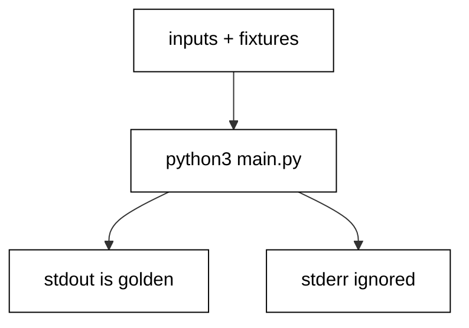

Prerequisites for this course: [just-enough-python](/en/learn/courses/just-enough-python/learning/overview) for basic syntax, functions, modules, and file handling. Comfort editing and running Python scripts from a terminal is assumed throughout, and every example builds only on the primer plus earlier examples in this course.

## Why this exists -- the big idea

**The problem before the solution**: developers who learn Python as a second language write it with their first language accent — index loops from C, null checks from Java, string paths from shell, error codes from Go. The programs work, but they resist the ecosystem: standard tools, reviewers, and future maintainers all expect the idiomatic forms. This course replaces each accent with the native habit, one small runnable program at a time, until the idiomatic form is the first one you reach for.

**Keep this if you forget everything else**: Write Python the way its own standard library does — total functions with visible edge policies, values over mutation, explicitness at boundaries.

## Tensions and trade-offs -- when NOT to reach for this

- **Idiom versus clarity**: comprehensions beat loops until they need debugging; generators beat lists until they need reuse; slots beat dicts until the shape grows. Each example names its cost alongside its form, and Example 78 collects the switching rules.
- **Standard library versus dependency**: the course reaches for the standard library first, which keeps every example runnable with zero installs. Real projects still adopt dependencies for genuinely hard problems — date arithmetic at scale, data frames, web frameworks — where the standard library ends and the ecosystem begins.
- **When NOT**: one-off exploration in a REPL needs no packaging, no tests, and no linting. The engineering in this course earns its place when the program runs twice — on a schedule, on someone else machine, or a year from now with you unavailable.

## Lineage -- where this language sits

Python is the shared implementation language across much of this catalog: data courses parse with it, agent courses drive fixtures with it, tooling courses script with it. This course is the depth behind that ubiquity — the reason the same language serves scripts and systems alike. The primer teaches reading and writing; this course teaches fluency; later courses assume both and build domain systems on top.

## How this course is organized

[Beginner](/en/learn/courses/python-in-depth/learning/beginner) (Examples 1-25) installs idiomatic control flow and collections, the error-handling idiom, and standard-library text, files, and time. [Intermediate](/en/learn/courses/python-in-depth/learning/intermediate) (Examples 26-53) organizes modules and packages, declares and pins dependencies, tests with the standard unittest convention, and types generic, value-shaped code. [Advanced](/en/learn/courses/python-in-depth/learning/advanced) (Examples 54-78) surveys concurrency primitives, configures tooling and style, and trains systematic reading of idiomatic code. The [capstone](/en/learn/courses/python-in-depth/learning/capstone/overview) ships an order-report CLI with embedded selftests and a golden transcript, and [drilling](/en/learn/courses/python-in-depth/drilling/overview) turns the sixteen concepts into recall, katas, and checklists.

## About the runtime

Every example runs as `python3 main.py` in the pinned Python container with no network and a read-only course tree: only the scratch directory is writable, so fixtures ship beside each program. Multi-file examples state their extra files explicitly; every file the lesson shows is embedded byte-identically. Standard output is the asserted golden transcript; standard error is ignored where the lesson says so. Programs print booleans, counts, and fixed labels — never paths, timings, addresses, or versions — so reruns are byte-stable.

## Examples by Level

### Beginner (Examples 1-25)

- [Example 1: Truthy Tests in if](/en/learn/courses/python-in-depth/learning/beginner#example-1-truthy-tests-in-if)
- [Example 2: for-else Search Without a Flag](/en/learn/courses/python-in-depth/learning/beginner#example-2-for-else-search-without-a-flag)
- [Example 3: enumerate Instead of range-len](/en/learn/courses/python-in-depth/learning/beginner#example-3-enumerate-instead-of-range-len)
- [Example 4: zip Parallel Iteration](/en/learn/courses/python-in-depth/learning/beginner#example-4-zip-parallel-iteration)
- [Example 5: Comprehensions Instead of Accumulator Loops](/en/learn/courses/python-in-depth/learning/beginner#example-5-comprehensions-instead-of-accumulator-loops)
- [Example 6: dict.get with Defaults](/en/learn/courses/python-in-depth/learning/beginner#example-6-dictget-with-defaults)
- [Example 7: Grouping with setdefault](/en/learn/courses/python-in-depth/learning/beginner#example-7-grouping-with-setdefault)
- [Example 8: Starred Unpacking of Sequences](/en/learn/courses/python-in-depth/learning/beginner#example-8-starred-unpacking-of-sequences)
- [Example 9: The Four Clauses of try](/en/learn/courses/python-in-depth/learning/beginner#example-9-the-four-clauses-of-try)
- [Example 10: EAFP: Ask Forgiveness, Not Permission](/en/learn/courses/python-in-depth/learning/beginner#example-10-eafp-ask-forgiveness-not-permission)
- [Example 11: raise from Chains the Cause](/en/learn/courses/python-in-depth/learning/beginner#example-11-raise-from-chains-the-cause)
- [Example 12: A Small Custom Exception Hierarchy](/en/learn/courses/python-in-depth/learning/beginner#example-12-a-small-custom-exception-hierarchy)
- [Example 13: with Manages Any Paired Resource](/en/learn/courses/python-in-depth/learning/beginner#example-13-with-manages-any-paired-resource)
- [Example 14: contextlib.suppress for Expected Errors](/en/learn/courses/python-in-depth/learning/beginner#example-14-contextlibsuppress-for-expected-errors)
- [Example 15: else Keeps Success Out of try](/en/learn/courses/python-in-depth/learning/beginner#example-15-else-keeps-success-out-of-try)
- [Example 16: Guard Clauses Instead of Nested ifs](/en/learn/courses/python-in-depth/learning/beginner#example-16-guard-clauses-instead-of-nested-ifs)
- [Example 17: except\* Handles Exception Groups](/en/learn/courses/python-in-depth/learning/beginner#example-17-except-handles-exception-groups)
- [Example 18: pathlib Replaces String Paths](/en/learn/courses/python-in-depth/learning/beginner#example-18-pathlib-replaces-string-paths)
- [Example 19: Text Files with Explicit Encoding](/en/learn/courses/python-in-depth/learning/beginner#example-19-text-files-with-explicit-encoding)
- [Example 20: csv Reads Records, Not Lines](/en/learn/courses/python-in-depth/learning/beginner#example-20-csv-reads-records-not-lines)
- [Example 21: json Round-Trips Config Cleanly](/en/learn/courses/python-in-depth/learning/beginner#example-21-json-round-trips-config-cleanly)
- [Example 22: Regular Expressions with Named Groups](/en/learn/courses/python-in-depth/learning/beginner#example-22-regular-expressions-with-named-groups)
- [Example 23: Format Specs for Tables and Numbers](/en/learn/courses/python-in-depth/learning/beginner#example-23-format-specs-for-tables-and-numbers)
- [Example 24: Timezone-Aware Datetimes Only](/en/learn/courses/python-in-depth/learning/beginner#example-24-timezone-aware-datetimes-only)
- [Example 25: monotonic Clocks for Measuring, wall for Stamps](/en/learn/courses/python-in-depth/learning/beginner#example-25-monotonic-clocks-for-measuring-wall-for-stamps)

### Intermediate (Examples 26-53)

- [Example 26: One Module, One Job](/en/learn/courses/python-in-depth/learning/intermediate#example-26-one-module-one-job)
- [Example 27: The if **name** Guard](/en/learn/courses/python-in-depth/learning/intermediate#example-27-the-if-__name__-guard)
- [Example 28: Packages Group Related Modules](/en/learn/courses/python-in-depth/learning/intermediate#example-28-packages-group-related-modules)
- [Example 29: Absolute Imports with Relative Inside](/en/learn/courses/python-in-depth/learning/intermediate#example-29-absolute-imports-with-relative-inside)
- [Example 30: Virtual Environments Isolate Projects](/en/learn/courses/python-in-depth/learning/intermediate#example-30-virtual-environments-isolate-projects)
- [Example 31: Hash-Pinned Requirements](/en/learn/courses/python-in-depth/learning/intermediate#example-31-hash-pinned-requirements)
- [Example 32: pyproject.toml Read with tomllib](/en/learn/courses/python-in-depth/learning/intermediate#example-32-pyprojecttoml-read-with-tomllib)
- [Example 33: Console Entry Points Map Commands](/en/learn/courses/python-in-depth/learning/intermediate#example-33-console-entry-points-map-commands)
- [Example 34: Gate Features on sys.version_info](/en/learn/courses/python-in-depth/learning/intermediate#example-34-gate-features-on-sysversion_info)
- [Example 35: Your First unittest TestCase](/en/learn/courses/python-in-depth/learning/intermediate#example-35-your-first-unittest-testcase)
- [Example 36: assertRaises Pins the Failure Contract](/en/learn/courses/python-in-depth/learning/intermediate#example-36-assertraises-pins-the-failure-contract)
- [Example 37: setUp Builds Fresh Fixtures](/en/learn/courses/python-in-depth/learning/intermediate#example-37-setup-builds-fresh-fixtures)
- [Example 38: subTest Tables Cover the Cases](/en/learn/courses/python-in-depth/learning/intermediate#example-38-subtest-tables-cover-the-cases)
- [Example 39: mock.patch Isolates the Boundary](/en/learn/courses/python-in-depth/learning/intermediate#example-39-mockpatch-isolates-the-boundary)
- [Example 40: Assert How the Boundary Was Used](/en/learn/courses/python-in-depth/learning/intermediate#example-40-assert-how-the-boundary-was-used)
- [Example 41: tempfile Isolation for File Tests](/en/learn/courses/python-in-depth/learning/intermediate#example-41-tempfile-isolation-for-file-tests)
- [Example 42: doctest Turns Docstrings into Tests](/en/learn/courses/python-in-depth/learning/intermediate#example-42-doctest-turns-docstrings-into-tests)
- [Example 43: Red First: Watch the Test Fail](/en/learn/courses/python-in-depth/learning/intermediate#example-43-red-first-watch-the-test-fail)
- [Example 44: skip and xfail Mark Known States](/en/learn/courses/python-in-depth/learning/intermediate#example-44-skip-and-xfail-mark-known-states)
- [Example 45: TypeVar Functions Work Over Many Types](/en/learn/courses/python-in-depth/learning/intermediate#example-45-typevar-functions-work-over-many-types)
- [Example 46: A Generic Stack Class](/en/learn/courses/python-in-depth/learning/intermediate#example-46-a-generic-stack-class)
- [Example 47: Protocols Type Duck Typing](/en/learn/courses/python-in-depth/learning/intermediate#example-47-protocols-type-duck-typing)
- [Example 48: Frozen Dataclasses Are Values](/en/learn/courses/python-in-depth/learning/intermediate#example-48-frozen-dataclasses-are-values)
- [Example 49: NamedTuples Are Lightweight Records](/en/learn/courses/python-in-depth/learning/intermediate#example-49-namedtuples-are-lightweight-records)
- [Example 50: Tuples Freeze the Shape](/en/learn/courses/python-in-depth/learning/intermediate#example-50-tuples-freeze-the-shape)
- [Example 51: Copy Depth Is a Decision](/en/learn/courses/python-in-depth/learning/intermediate#example-51-copy-depth-is-a-decision)
- [Example 52: Cache Pure Functions with lru_cache](/en/learn/courses/python-in-depth/learning/intermediate#example-52-cache-pure-functions-with-lru_cache)
- [Example 53: **slots** Shrinks Hot Objects](/en/learn/courses/python-in-depth/learning/intermediate#example-53-__slots__-shrinks-hot-objects)

### Advanced (Examples 54-78)

- [Example 54: Threads Overlap Waiting, Not Work](/en/learn/courses/python-in-depth/learning/advanced#example-54-threads-overlap-waiting-not-work)
- [Example 55: ThreadPoolExecutor.map Fans Out Cleanly](/en/learn/courses/python-in-depth/learning/advanced#example-55-threadpoolexecutormap-fans-out-cleanly)
- [Example 56: Queues Connect Producer and Consumer](/en/learn/courses/python-in-depth/learning/advanced#example-56-queues-connect-producer-and-consumer)
- [Example 57: Locks Guard Shared Mutation](/en/learn/courses/python-in-depth/learning/advanced#example-57-locks-guard-shared-mutation)
- [Example 58: asyncio.gather Overlaps Coroutines](/en/learn/courses/python-in-depth/learning/advanced#example-58-asynciogather-overlaps-coroutines)
- [Example 59: Timeouts Bound Every Wait](/en/learn/courses/python-in-depth/learning/advanced#example-59-timeouts-bound-every-wait)
- [Example 60: Processes Parallelize CPU Work](/en/learn/courses/python-in-depth/learning/advanced#example-60-processes-parallelize-cpu-work)
- [Example 61: Threads Share, Processes Copy](/en/learn/courses/python-in-depth/learning/advanced#example-61-threads-share-processes-copy)
- [Example 62: PEP 8 Names Read Aloud](/en/learn/courses/python-in-depth/learning/advanced#example-62-pep-8-names-read-aloud)
- [Example 63: Docstrings State the Contract](/en/learn/courses/python-in-depth/learning/advanced#example-63-docstrings-state-the-contract)
- [Example 64: py_compile Gates Syntax in CI](/en/learn/courses/python-in-depth/learning/advanced#example-64-py_compile-gates-syntax-in-ci)
- [Example 65: Warnings Are Deferred Errors](/en/learn/courses/python-in-depth/learning/advanced#example-65-warnings-are-deferred-errors)
- [Example 66: logging Replaces Print in Production](/en/learn/courses/python-in-depth/learning/advanced#example-66-logging-replaces-print-in-production)
- [Example 67: ctypes Calls C Without Extensions](/en/learn/courses/python-in-depth/learning/advanced#example-67-ctypes-calls-c-without-extensions)
- [Example 68: Join Strings, Do Not Plus Them](/en/learn/courses/python-in-depth/learning/advanced#example-68-join-strings-do-not-plus-them)
- [Example 69: Comprehensions Beat Append Loops](/en/learn/courses/python-in-depth/learning/advanced#example-69-comprehensions-beat-append-loops)
- [Example 70: Sets Make Membership O(1)](/en/learn/courses/python-in-depth/learning/advanced#example-70-sets-make-membership-o1)
- [Example 71: Read a Comprehension Pipeline](/en/learn/courses/python-in-depth/learning/advanced#example-71-read-a-comprehension-pipeline)
- [Example 72: Read a Validation Decorator](/en/learn/courses/python-in-depth/learning/advanced#example-72-read-a-validation-decorator)
- [Example 73: Read a contextmanager Generator](/en/learn/courses/python-in-depth/learning/advanced#example-73-read-a-contextmanager-generator)
- [Example 74: Read a Lazy Generator Pipeline](/en/learn/courses/python-in-depth/learning/advanced#example-74-read-a-lazy-generator-pipeline)
- [Example 75: Read a Service Built from Records](/en/learn/courses/python-in-depth/learning/advanced#example-75-read-a-service-built-from-records)
- [Example 76: Read an Interop Boundary Wrapper](/en/learn/courses/python-in-depth/learning/advanced#example-76-read-an-interop-boundary-wrapper)
- [Example 77: Read a Small argparse CLI](/en/learn/courses/python-in-depth/learning/advanced#example-77-read-a-small-argparse-cli)
- [Example 78: Know When the Idiom Costs](/en/learn/courses/python-in-depth/learning/advanced#example-78-know-when-the-idiom-costs)
