Examples 54–78 survey Rust at professional depth and teach reading it: concurrency primitives first (Examples 54–61), showing spawn-and-join, channels with pinned transcripts, scoped borrowing, mutex sharing, read-write locks, lock-free atomics, poison recovery, and `Send` bounds; then tooling, linting, and style (Examples 62–70), covering `rustfmt` checks, Clippy idioms, build context, doc examples, naming law, compiler-error reading, loud boundaries, tested docs, and the project map; finally reading idiomatic code in layers (Examples 71–78), from fold pipelines and trait objects through closures, process boundaries, builders, recursive types, C calls, and whole module trees. Every example is a complete, runnable Rust program under `learning/code/`; run each with the command in its own `run.yaml`.

---

### Example 54: Spawn and Join Returns a Value

Threads run closures and `join` returns their value, turning concurrency into a function call with a handle. This example squares three dues on three threads and joins them in order, so the transcript never varies. (Concepts: co-09.)

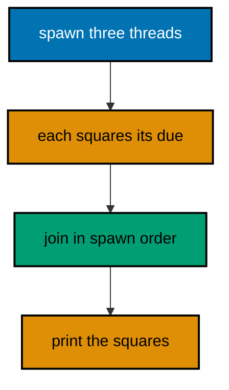

**`learning/code/ex-54-spawn-join-returns-value/main.rs`**:

```rust
// Example 54: Spawn and Join Returns a Value.
// => `spawn` runs the closure elsewhere; the handle owns the result.
// => `join` blocks until done and returns `Ok(value)` on success.
// => Joining in spawn order pins the transcript: order is chosen, not raced.
// => `move` gives each thread its own copy of the due: no sharing yet.
use std::thread; // => `spawn` and the thread handles live here
fn main() {
    // => three fixed dues: the same squares on every run, in this order.
    let dues = [3, 4, 5]; // => squares are 9, 16, and 25
                          // => one handle per due: spawning borrows nothing, owns everything.
    let mut handles = Vec::new(); // => handles join in this same order
    for due in dues {
        // => `due` is `Copy`: the loop owns each value
        handles.push(thread::spawn(move || due * due)); // => `move` carries the copy
    }
    // => joining in order turns three races into one fixed transcript.
    let mut squares = Vec::new(); // => results land here in spawn order
    for handle in handles {
        // => first spawned joins first, always
        squares.push(handle.join().expect("workers never panic")); // => `Ok` unwrapped
    }
    println!("{:?}", squares); // => Output: [9, 16, 25]
}
```

**Output** (`learning/code/ex-54-spawn-join-returns-value/expected/main.stdout.txt`):

```text
[9, 16, 25]
```

**Key takeaway**: `spawn` a `move` closure per job; `join` handles in order for deterministic results.

**Why it matters**: Joining in a fixed order separates the concurrency from the reporting: threads may finish whenever they like, but the transcript follows the join sequence. That single discipline removes the most common source of flaky concurrency demos while keeping the parallelism real. Task pools, request handlers, and parallel test runners all spawn this way, making join-in-order the default transcript discipline.

### Example 55: Channel Collects, Sort Pins Order

Channels move values between threads, and arrival order is never promised — so receivers collect and sort. This example doubles six dues across two workers and prints the sorted results. (Concepts: co-09.)

**`learning/code/ex-55-channel-collect-then-sort/main.rs`**:

```rust
// Example 55: Channel Collects, Sort Pins Order.
// => `mpsc::channel` moves values from senders to one receiver.
// => Cloned senders let many workers share the same channel.
// => Arrival order races: collect everything, then sort for the transcript.
// => Moving every sender into a worker ends the stream when workers end.
use std::sync::mpsc; // => the channel ends live here
use std::thread; // => two workers run below
fn main() {
    // => six fixed dues split across two workers: evens and odds.
    let (send, recv) = mpsc::channel(); // => the shared results channel
    let second = send.clone(); // => worker two gets its own sender
                               // => worker one doubles the first three dues, then its sender drops.
    thread::spawn(move || {
        // => owns `send`: sends 2, 4, 6
        for due in [1, 2, 3] {
            // => fixed inputs, fixed outputs
            send.send(due * 2).expect("receiver outlives workers"); // => never fails here
        }
    });
    // => worker two doubles the last three dues, then its sender drops.
    thread::spawn(move || {
        // => owns `second`: sends 8, 10, 12
        for due in [4, 5, 6] {
            // => fixed inputs, fixed outputs
            second.send(due * 2).expect("receiver outlives workers"); // => never fails here
        }
    });
    // => both senders moved into workers: the channel closes when they finish.
    // => No handle remains in `main`: the end of work needs no sentinel value.
    // => the loop ends when both workers finish: no sentinel needed.
    let mut doubled: Vec<i32> = recv.iter().collect(); // => all six, arrival order
    doubled.sort(); // => sorting pins the transcript: 2 through 12 even
    println!("{:?}", doubled); // => Output: [2, 4, 6, 8, 10, 12]
}
```

**Output** (`learning/code/ex-55-channel-collect-then-sort/expected/main.stdout.txt`):

```text
[2, 4, 6, 8, 10, 12]
```

**Key takeaway**: Send results through channels; collect, sort, then print so arrival races cannot leak.

**Why it matters**: Channel arrival order depends on scheduling, which means any transcript printed in arrival order is a flaky test waiting for a loaded machine. Collect-then-sort keeps the concurrency honest while making the observation deterministic, separating what raced from what the program decided. Fan-out aggregators, parallel crawlers, and sharded counters all share this shape, making collect-then-sort the standard rendezvous.

### Example 56: Scoped Threads Borrow Locals

Scoped threads may borrow the stack because the scope guarantees they finish before it ends. This example sums two ledger halves on two threads that borrow the same vector, with no cloning and no channels. (Concepts: co-09.)

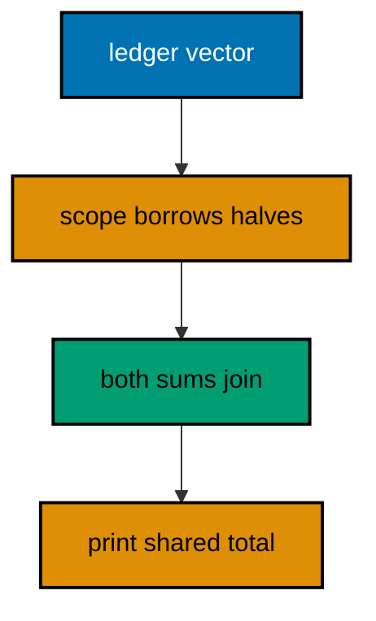

**`learning/code/ex-56-scoped-threads-borrow/main.rs`**:

```rust
// Example 56: Scoped Threads Borrow Locals.
// => `thread::scope` runs threads that borrow the current stack frame.
// => The scope joins everything before returning: borrows stay valid.
// => No `Arc`, no clone, no channel: borrowing is the whole point.
// => Split the work, sum the halves, add the parts: the classic fork-join.
use std::thread; // => `scope` lives beside `spawn` here
fn main() {
    // => six fixed dues: two halves of three, same total every run.
    let dues = vec![50, 75, 25, 100, 10, 40]; // => total is 300
                                              // => the scope owns the threads: all joins happen before it exits.
    let total = thread::scope(|scope| {
        // => threads may borrow `dues`
        // => each half borrows its slice: no copies, no moves, no clones.
        let left = scope.spawn(|| dues[..3].iter().sum::<i32>()); // => 50 + 75 + 25
        let right = scope.spawn(|| dues[3..].iter().sum::<i32>()); // => 100 + 10 + 40
                                                                   // => joining inside the scope: both halves done before the sum.
        left.join().expect("halves never panic") + right.join().expect("halves never panic")
        // => 150 + 150
    });
    // => the scope exited, so the total below is complete and fixed.
    println!("total: {}", total); // => Output: total: 300
}
```

**Output** (`learning/code/ex-56-scoped-threads-borrow/expected/main.stdout.txt`):

```text
total: 300
```

**Key takeaway**: Borrow stack data in `thread::scope`; the scope joins before any borrow can dangle.

**Why it matters**: Plain `spawn` demands `'static` data because threads may outlive their spawner, which forces cloning or channels even for straight fork-join work. Scoped threads prove at compile time that all workers finish inside the scope, so borrowing — the cheapest sharing — is also the safe one here. Parallel sums, image filters, and search partitions all fork and join this way, making scoped borrowing the default parallel pattern.

### Example 57: Mutex Guards the Shared Counter

`Mutex` lets many threads mutate one value by taking turns, and `Arc` shares the mutex itself. This example settles a thousand dues through four workers that each add their share under the lock. (Concepts: co-09.)

**`learning/code/ex-57-mutex-shared-counter/main.rs`**:

```rust
// Example 57: Mutex Guards the Shared Counter.
// => `Arc` shares ownership across threads: every worker holds the mutex.
// => `lock` blocks until the turn arrives: exactly one writer at a time.
// => Short critical sections keep the lock moving: add, then release.
// => Four workers times 250 dues each always totals exactly 1000.
// => The transcript prints only the final total: lock order never leaks.
use std::sync::{Arc, Mutex}; // => shared ownership plus mutual exclusion
use std::thread; // => four workers run below
fn main() {
    // => one counter shared by four workers through the atomic handle.
    let settled = Arc::new(Mutex::new(0)); // => the guarded total starts at zero
    let mut handles = Vec::new(); // => join every worker before reading
    for _ in 0..4 {
        // => four identical workers, fixed share each
        let worker = Arc::clone(&settled); // => each worker owns a handle
        handles.push(thread::spawn(move || {
            // => `move` carries the handle
            for _ in 0..250 {
                // => 250 dues per worker, no more
                // => the guard lives for one statement: add, then release.
                *worker.lock().expect("no worker panics") += 1; // => turn taken, total grows
            }
        }));
    }
    for handle in handles {
        // => all four workers finish before the read
        handle.join().expect("workers never panic"); // => join in spawn order
    }
    // => the lock below reads the final total: 4 times 250 is 1000.
    println!("settled: {}", settled.lock().expect("no worker panics")); // => Output: settled: 1000
}
```

**Output** (`learning/code/ex-57-mutex-shared-counter/expected/main.stdout.txt`):

```text
settled: 1000
```

**Key takeaway**: `Arc<Mutex<_>>` shares one mutable value; keep critical sections to a single statement.

**Why it matters**: Locks serialize the exact region they guard, so a long critical section turns four threads back into one slow thread while a short one keeps them moving. Counting only the final total keeps lock acquisition order — which legitimately varies — out of the transcript and out of the test.

### Example 58: RwLock Serves Many Readers

`RwLock` lets any number of readers in together but admits a writer only alone. This example publishes the settlement rate through three reader threads, then updates it once the readers join. (Concepts: co-09.)

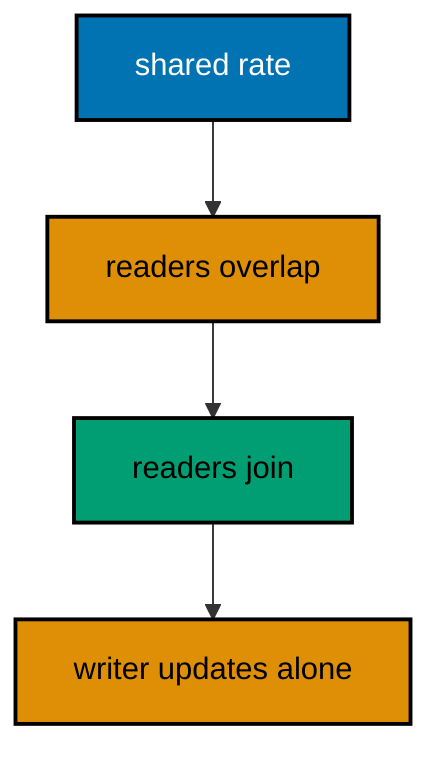

**`learning/code/ex-58-rwlock-many-readers/main.rs`**:

```rust
// Example 58: RwLock Serves Many Readers.
// => Many `read` guards coexist: readers never block each other.
// => `write` waits for solitude: the update sees a stable world.
// => Sequencing joins before the write pins the transcript: read, then update.
// => The rate below moves once, after the readers finish: fixed story, fixed output.
use std::sync::{Arc, RwLock}; // => the shared rate lives behind this lock
use std::thread; // => three readers run below
fn main() {
    // => the published settlement rate starts at two percent, shared widely.
    let rate = Arc::new(RwLock::new(2)); // => one rate, many future readers
    let mut handles = Vec::new(); // => join all readers before the update
    for id in 0..3 {
        // => three identical readers, numbered for the transcript
        let reader = Arc::clone(&rate); // => each reader owns a handle
        handles.push(thread::spawn(move || {
            // => `move` carries handle and id
            // => the read guard lives for the copy: shared, never exclusive.
            let seen = *reader.read().expect("no writer yet"); // => all three see 2
            (id, seen) // => the thread returns its numbered observation
        }));
    }
    // => collect and sort: reader finish order races, observation order does not.
    let mut seen: Vec<(i32, i32)> = handles // => move the handles into the pipeline
        .into_iter() // => consume the vector in spawn order
        .map(|h| h.join().expect("readers never panic")) // => each returns its pair
        .collect(); // => three pairs, arrival order
    seen.sort(); // => sort by id: the transcript reads 0, 1, 2 always
    for (id, value) in seen {
        // => the pinned observation order
        println!("reader {} saw {}", id, value); // => all three saw 2
    }
    // => the writer moves only after every reader joined: solitude guaranteed.
    *rate.write().expect("readers all joined") = 3; // => the single update
    println!("rate now {}", rate.read().expect("writer finished")); // => Output: rate now 3
}
```

**Output** (`learning/code/ex-58-rwlock-many-readers/expected/main.stdout.txt`):

```text
reader 0 saw 2
reader 1 saw 2
reader 2 saw 2
rate now 3
```

**Key takeaway**: Read together with `RwLock::read`; sequence the `write` after readers join.

**Why it matters**: Read-mostly data should not pay mutex prices for every read, and read-write locks encode exactly that asymmetry. Sequencing the write after the joins keeps the story fixed — every reader saw the old rate — which is both the correct publication pattern and the deterministic test shape. Configuration reloads, feature flags, and routing tables all publish this way, making read-mostly sharing the scalable default.

### Example 59: Atomics Count Without a Lock

Atomics update integers without locking by delegating to hardware instructions, trading ordering guarantees for speed. This example counts a thousand settlements through relaxed fetch-adds and reads the exact total once at the end. (Concepts: co-09, co-15.)

**`learning/code/ex-59-atomics-count-without-lock/main.rs`**:

```rust
// Example 59: Atomics Count Without a Lock.
// => `AtomicI64` updates without a mutex: hardware does the serializing.
// => `Relaxed` ordering fits counters: only the final total is observed.
// => `fetch_add` returns the previous value: useful for ticket numbering.
// => Four workers times 250 fetch-adds always reads back exactly 1000.
// => Only the final read prints: intermediate races stay out of the transcript.
use std::sync::atomic::{AtomicI64, Ordering}; // => the counter and its ordering
use std::sync::Arc; // => shares the counter across the workers
use std::thread; // => four workers run below
fn main() {
    // => one atomic counter shared by four workers, no mutex anywhere.
    let settled = Arc::new(AtomicI64::new(0)); // => starts at zero, ends at 1000
    let mut handles = Vec::new(); // => join every worker before the read
    for _ in 0..4 {
        // => four identical workers, fixed share each
        let worker = Arc::clone(&settled); // => each worker owns a handle
        handles.push(thread::spawn(move || {
            // => `move` carries the handle
            for _ in 0..250 {
                // => 250 fetch-adds per worker
                // => relaxed: no ordering promise, just the atomic update.
                worker.fetch_add(1, Ordering::Relaxed); // => hardware serializes
            }
        }));
    }
    for handle in handles {
        // => all four workers finish before the read
        handle.join().expect("workers never panic"); // => join in spawn order
    }
    // => the single ordered read after all joins: the exact deterministic total.
    println!("settled: {}", settled.load(Ordering::SeqCst)); // => Output: settled: 1000
}
```

**Output** (`learning/code/ex-59-atomics-count-without-lock/expected/main.stdout.txt`):

```text
settled: 1000
```

**Key takeaway**: Count with `fetch_add` under `Relaxed` when only the final total is observed.

**Why it matters**: A mutex around a counter serializes in software what the hardware already serializes in one instruction, paying lock overhead for zero extra safety. Relaxed ordering is honest about what the program needs — a correct final count — while the single sequentially-consistent read at the end restores full determinism for the observation.

### Example 60: Recover a Poisoned Lock

A lock poisons when its holder panics, protecting the possibly-broken data behind an explicit recovery step. This example survives a panicking worker, reports the failure, and recovers the last good total. (Concepts: co-09, co-02.)

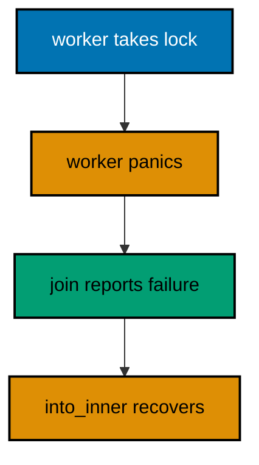

**`learning/code/ex-60-poison-tolerant-lock/main.rs`**:

```rust
// Example 60: Recover a Poisoned Lock.
// => Panicking while holding a lock poisons it: the data may be half-written.
// => `join` reports worker failure as `Err`: the panic never crosses threads.
// => `into_inner` recovers the guarded value: explicit, never accidental.
// => The panic message goes to stderr, which the harness ignores by design.
// => Only the recovery story prints: failure reported, last good total kept.
use std::sync::{Arc, Mutex}; // => the shared total and its guard
use std::thread; // => one failing worker runs below
fn main() {
    // => the ledger total starts at 125: the last known good value.
    let shared = Arc::new(Mutex::new(125)); // => guarded, shared, poisonable
    let worker = Arc::clone(&shared); // => the worker owns a handle
    let handle = thread::spawn(move || {
        // => `move` carries the handle
        // => the guard below poisons when the panic unwinds through it.
        let mut guard = worker.lock().expect("lock starts healthy"); // => healthy at first
        *guard += 25; // => the half-written update: 150, then panic
        panic!("worker hit bad input"); // => poisons the lock, stderr only
    });
    // => `join` turns the worker's panic into data: match it, do not unwrap.
    match handle.join() {
        // => `Err` carries the panic, `Ok` would carry success
        Ok(_) => println!("worker finished"), // => not taken: the worker panicked
        Err(_) => println!("worker failed"),  // => Output: worker failed
    }
    // => recovery is explicit: `into_inner` says the old total is still good.
    let recovered = shared
        .lock()
        .unwrap_or_else(|poisoned| poisoned.into_inner()); // => 150 survives
    println!("recovered: {}", recovered); // => Output: recovered: 150
}
```

**Output** (`learning/code/ex-60-poison-tolerant-lock/expected/main.stdout.txt`):

```text
worker failed
recovered: 150
```

**Key takeaway**: Match `join` results; recover poisoned locks explicitly with `into_inner`.

**Why it matters**: A panicking thread leaves shared data in an unknown state, and silently reusing it would spread the corruption to every later reader. Poisoning forces the recovery decision into the open — keep the last good value, rebuild, or abort — so partial writes can never masquerade as complete ones. Connection pools, worker registries, and graceful shutdowns all recover this way, making poisoning a managed event rather than a crash.

### Example 61: Send and Sync Bound the Spawn

`Send` marks values safe to move across threads and `Sync` marks values safe to share, and generic bounds enforce both at compile time. This example runs two closures through one spawning helper that requires `Send` results and a `Sync`-shared config. (Concepts: co-09, co-10.)

**`learning/code/ex-61-send-sync-bound-spawn/main.rs`**:

```rust
// Example 61: Send and Sync Bound the Spawn.
// => `Send` allows moving to another thread: the closure must own its inputs.
// => `Sync` allows sharing between threads: the config borrows safely.
// => Bounds on the helper reject non-conforming closures at compile time.
// => `'static` on the closure means no borrowed stack: owned data only.
use std::thread; // => `spawn` enforces the bounds below
                 // => `job` runs any closure on a thread: the bounds are the whole contract.
fn job<F>(work: F) -> i32
// => generic over the closure type
where
    F: FnOnce() -> i32 + Send + 'static, // => own inputs, return a number, live long enough
{
    // => the bounds above are what let this `spawn` compile at all.
    thread::spawn(work).join().expect("jobs never panic") // => run and collect
}
fn main() {
    // => two fixed jobs take the same helper: doubling and summing.
    println!("doubled: {}", job(|| 21 * 2)); // => Output: doubled: 42
    println!("summed: {}", job(|| [50, 75, 25].iter().sum())); // => Output: summed: 150
}
```

**Output** (`learning/code/ex-61-send-sync-bound-spawn/expected/main.stdout.txt`):

```text
doubled: 42
summed: 150
```

**Key takeaway**: Bound thread helpers with `FnOnce() + Send + 'static`; the compiler rejects sharing bugs.

**Why it matters**: Thread-safety bugs are the hardest to reproduce and the easiest to ship, so Rust moves them into the type system where every spawn is checked before it runs. Explicit `Send` and `'static` bounds document the sharing contract in the signature, which means misuses fail at the call site with a line number instead of in production with a race.

### Example 62: Rustfmt Owns the Shape

`rustfmt --check` verdicts formatting in CI: clean code prints nothing and exits zero. This example holds canonically formatted source — the shape `rustfmt` leaves untouched — and the harness compiles it directly, because the pinned unit image ships only the compiler; the check-then-build workflow above is how CI runs it. (Concepts: co-12.)

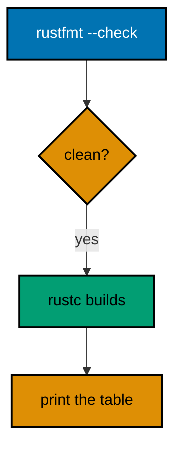

**`learning/code/ex-62-rustfmt-owns-shape/main.rs`**:

```rust
// Example 62: Rustfmt Owns the Shape.
// => This file holds the canonical shape: what `rustfmt` leaves untouched.
// => In CI the run starts with `rustfmt --check main.rs` (illustration in
// => the lesson): silence is the pass, and the pinned unit image ships only
// => the compiler, so the harness compiles the canonical shape directly.
// => Four-space indents, one blank line between items, operators spaced.
// => Never debate shape in review: the formatter already decided.
// => the function under test, plainly shaped below.
fn total(dues: &[i32]) -> i32 {
    dues.iter().sum() // => one fused pass, indented four spaces
}

fn main() {
    // => fixed dues again: the lesson is the shape, not the arithmetic.
    let dues = [50, 75, 25]; // => spaces inside brackets, commas followed
    println!("total: {}", total(&dues)); // => Output: total: 150
}
```

**Output** (`learning/code/ex-62-rustfmt-owns-shape/expected/main.stdout.txt`):

```text
total: 150
```

**Key takeaway**: Run `rustfmt --check` in CI; keep sources canonical so the check is silent.

**Why it matters**: Formatting debates waste review attention on spacing that a tool settles deterministically, and inconsistent shape slows every reader by a fraction on every line. Owning the shape mechanically means humans review decisions while the formatter owns whitespace, which is the correct division of labor. Newcomers format on save and never think about it again, making style automatic from the first commit rather than a review topic.

### Example 63: Clippy Flags the Range Loop

Clippy reads the intent behind working code and suggests the idiom that states it directly. This example sums dues with `enumerate` where a hand-rolled index loop would draw the `needless_range_loop` lint, shown as an illustration below the runnable fix. (Concepts: co-12.)

Running Clippy over the index-loop shape reports the lint below (illustration — the harness never executes it); the unit above holds the fixed shape that stays warning-free:

<!-- harness: illustration -->

```text
warning: the loop variable `i` is used to index `dues`
 --> before.rs:4:14
  |
  = help: consider using an iterator and `enumerate()`
  = note: `#[warn(clippy::needless_range_loop)]` on by default
```

**`learning/code/ex-63-clippy-flags-range-loop/main.rs`**:

```rust
// Example 63: Clippy Flags the Range Loop.
// => `iter().enumerate()` pairs each item with its index: no arithmetic.
// => A `for i in 0..len` loop that only indexes draws `needless_range_loop`.
// => The illustration after the code shows the lint on the before shape.
// => This file holds the after shape: it compiles warning-free everywhere.
// => The sum below is fixed: positions and values never change.
fn main() {
    // => fixed dues: positions 0, 1, 2 with values 50, 75, 25.
    let dues = [50, 75, 25]; // => the array under iteration
    let mut total = 0; // => the running total, same as always
                       // => `enumerate` carries the index: the range bound cannot drift.
    for (i, due) in dues.iter().enumerate() {
        // => i is 0, 1, 2 in order
        println!("{}: {}", i + 1, due); // => numbered lines, one per due
        total += due; // => the value, not an indexing expression
    }
    println!("total: {}", total); // => Output: total: 150
}
```

**Output** (`learning/code/ex-63-clippy-flags-range-loop/expected/main.stdout.txt`):

```text
1: 50
2: 75
3: 25
total: 150
```

**Key takeaway**: Iterate with `enumerate` instead of indexing a range; let Clippy confirm the habit.

**Why it matters**: Range-index loops restate the traversal three times — start, bound, and step — while `enumerate` states it once, so every range loop is a standing invitation to an off-by-one. Clippy automates the senior reviewer's first pass, catching the mechanical idioms so human reviewers spend their attention on the logic only people can judge.

### Example 64: Option Env Proves the Cargo Context

`option_env!` reads a compile-time variable without failing when it is absent, which cleanly separates cargo builds from direct `rustc` runs. This example prints the build profile when cargo provides it and names the direct compiler otherwise. (Concepts: co-12, co-07.)

**`learning/code/ex-64-option-env-proves-cargo-context/main.rs`**:

```rust
// Example 64: Option Env Proves the Cargo Context.
// => `option_env!` returns `Some` when cargo sets the variable, `None` otherwise.
// => Cargo sets `CARGO_PKG_NAME` and `PROFILE`; bare `rustc` sets neither.
// => The harness compiles with `rustc` directly: this unit always sees `None`.
// => Branching on `None` keeps one source working in both build contexts.
fn main() {
    // => `PROFILE` is "debug" or "release" under cargo, absent under rustc.
    match option_env!("PROFILE") {
        // => compile-time lookup, no runtime cost
        Some(profile) => println!("cargo profile: {}", profile), // => cargo builds land here
        None => println!("direct rustc build"),                  // => Output: direct rustc build
    }
    // => unset variables are ordinary `None`: no panic, no build failure.
    println!("custom: {:?}", option_env!("LESSON_BUILD_TAG")); // => Output: custom: None
}
```

**Output** (`learning/code/ex-64-option-env-proves-cargo-context/expected/main.stdout.txt`):

```text
direct rustc build
custom: None
```

**Key takeaway**: `option_env!` reads build context that may be absent; cargo sets it, bare `rustc` does not.

**Why it matters**: Build scripts and manifests inject context that direct compiler runs lack, and code that assumes the context fails mysteriously outside cargo. Reading it as an option keeps one source compiling in every context while still using the richer metadata wherever the build provides it. Build scripts, cross-compilation, and feature flags all read the same context, making option-env the portable configuration habit.

### Example 65: Doc Comments Are the Help Text

`///` documents the item below it, and the best documentation states the contract with an example the tests also run. This example documents a settlement helper with a runnable example that `main` executes as an assertion. (Concepts: co-12.)

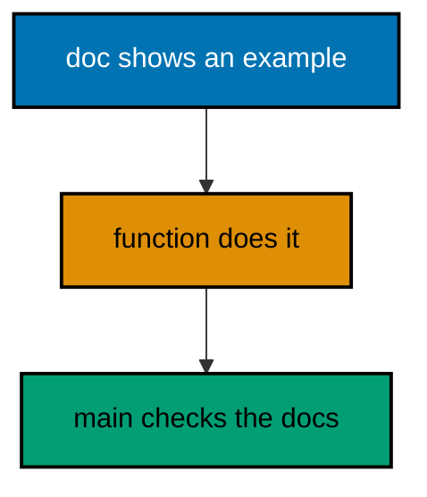

**`learning/code/ex-65-doc-comments-are-help/main.rs`**:

````rust
// Example 65: Doc Comments Are the Help Text.
// => `///` documents the item below: contract first, example second.
// => `/// # Examples` holds a snippet readers can paste and run.
// => `main` below executes the documented example as a real assertion.
// => Docs that run cannot rot: the example fails the moment it lies.
// => `cargo doc` renders these comments; the habit works before that too.
/// Halves every due above the waiver line, rounding down.
///
/// Dues at or below 100 settle whole; larger dues settle at half value.
/// Small ledgers stay readable while large ones stay affordable.
///
/// # Examples
///
/// ```text
/// half_over(150) == 75 and half_over(50) == 50
/// ```
fn half_over(amount: i32) -> i32 {
    // => the documented contract, implemented
    if amount > 100 {
        // => the waiver line: larger dues halve
        amount / 2 // => integer division rounds down, stated above
    } else {
        amount // => small dues settle whole, stated above
    }
}
fn main() {
    // => the documented example runs here as two executable assertions.
    assert_eq!(half_over(150), 75); // => the doc's first claim, checked
    assert_eq!(half_over(50), 50); // => the doc's second claim, checked
                                   // => both claims held silently: only the confirmed figures print.
    println!("150 -> {}", half_over(150)); // => Output: 150 -> 75
    println!("50 -> {}", half_over(50)); // => Output: 50 -> 50
}
````

**Output** (`learning/code/ex-65-doc-comments-are-help/expected/main.stdout.txt`):

```text
150 -> 75
50 -> 50
```

**Key takeaway**: Document each function with its contract plus an example; execute the example in tests.

**Why it matters**: Undocumented functions force every caller to reverse-engineer the contract from the body, while examples in prose rot the moment behavior changes. Executable doc examples stay honest because the suite runs them, turning documentation from a claim into a continuously verified fact. API documentation, onboarding guides, and code reviews all improve when every example in the docs is guaranteed to run.

### Example 66: Names Follow Community Style

Rust names signal their kind by shape alone: functions and variables read `snake_case`, types read `CamelCase`, and constants read `UPPER_SNAKE_CASE`. This example settles one ledger using all three shapes exactly where each belongs. (Concepts: co-14.)

**`learning/code/ex-66-names-follow-community-style/main.rs`**:

```rust
// Example 66: Names Follow Community Style.
// => `snake_case` for functions, variables, and modules: the working vocabulary.
// => `CamelCase` for types, traits, and enums: the nouns of the design.
// => `UPPER_SNAKE_CASE` for constants and statics: fixed values shout once.
// => The compiler's `non_snake_case` warnings enforce this: style is law.
// => Every name below follows its shape: the file reads as one dialect.
const WAIVER_LINE: i32 = 100; // => constant: fixed value, upper snake
struct LedgerDue {
    // => type: CamelCase noun of the design
    member_name: String, // => field: snake like any variable
    amount_due: i32,     // => field: snake like any variable
}
// => functions are snake: the verb phrase of the module.
fn settle_over_waiver(due: &LedgerDue) -> i32 {
    // => reads as a sentence
    if due.amount_due > WAIVER_LINE {
        // => constant compares, fields read
        due.amount_due / 2 // => large dues halve, as the docs promise
    } else {
        due.amount_due // => small dues settle whole
    }
}
fn main() {
    // => two fixed dues exercise both sides of the waiver line.
    let first_due = LedgerDue {
        member_name: "sari".to_string(),
        amount_due: 150,
    }; // => above the line
    let second_due = LedgerDue {
        member_name: "budi".to_string(),
        amount_due: 50,
    }; // => below the line
    println!(
        "{}: {}",
        first_due.member_name,
        settle_over_waiver(&first_due)
    ); // => Output: sari: 75
    println!(
        "{}: {}",
        second_due.member_name,
        settle_over_waiver(&second_due)
    ); // => Output: budi: 50
}
```

**Output** (`learning/code/ex-66-names-follow-community-style/expected/main.stdout.txt`):

```text
sari: 75
budi: 50
```

**Key takeaway**: Functions and variables in `snake_case`, types in `CamelCase`, constants in `UPPER_SNAKE_CASE`.

**Why it matters**: Shape-coded names let readers classify every identifier before reading its definition, which compounds across thousands of lines into dramatically faster comprehension. The compiler enforces the convention with warnings, so style here is not taste but law — and following it makes every Rust codebase feel like one familiar project. Cross-team code reads faster when every project shares the dialect, making naming the cheapest possible coordination mechanism.

### Example 67: Read the Compiler Error

Compiler errors point at the exact line with the exact conflict, and reading them bottom-up finds the fix fastest. This example shows the classic moved-value error as an illustration, then the two-line fix that compiles: clone before moving. (Concepts: co-12.)

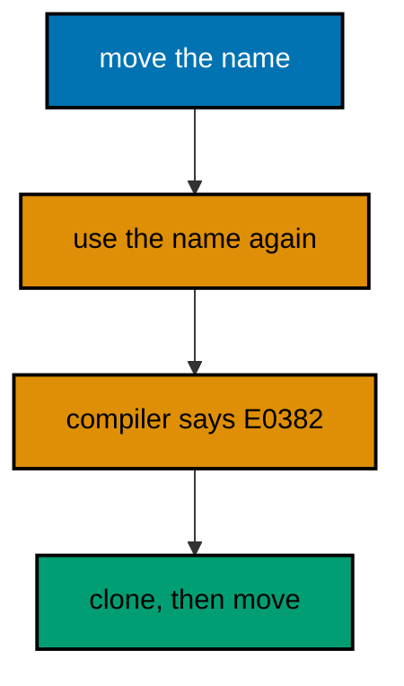

Compiling the move-then-use shape fails with the error below (illustration — the harness never executes it); the unit above holds the two-line fix that compiles:

<!-- harness: illustration -->

```text
error[E0382]: borrow of moved value: `member`
 --> before.rs:5:20
  |
3 |     let label = member;
  |                 ------ value moved here
5 |     println!("{}", member);
  |                    ^^^^^^ value borrowed here after move
```

**`learning/code/ex-67-read-the-compiler-error/main.rs`**:

```rust
// Example 67: Read the Compiler Error.
// => Moved values cannot be used again: ownership left with the move.
// => The error names both sites: the move first, the failed use second.
// => The illustration after the code shows E0382 on the before shape.
// => This file holds the after shape: clone first, then move, then use.
// => Both prints below are fixed: the clone keeps the original alive.
fn main() {
    // => one owned name needed in two places: the classic E0382 setup.
    let member = "sari".to_string(); // => owned text, single owner
                                     // => clone before moving: the duplicate travels, the original stays.
    let receipt = member.clone(); // => explicit cost, visible fix
    let label = format!("member: {}", member); // => the original still lives
                                               // => both names print: the fix kept every use legal.
    println!("{}", label); // => Output: member: sari
    println!("receipt for {}", receipt); // => Output: receipt for sari
}
```

**Output** (`learning/code/ex-67-read-the-compiler-error/expected/main.stdout.txt`):

```text
member: sari
receipt for sari
```

**Key takeaway**: Read errors bottom-up: the use site first, then the move the compiler cites.

**Why it matters**: Ownership errors feel hostile until readers learn they contain the whole diagnosis: what moved, where, and where the reuse was attempted. Treating the compiler as the strictest reviewer — one that always cites line numbers — turns fights with the borrow checker into guided fixes. The error index and explanations reward the same habit, turning each compiler rejection into a focused lesson rather than a setback.

### Example 68: Eprintln Marks the Loud Boundary

Boundary failures belong on stderr with a nonzero exit, while reports belong on stdout with a zero exit. This example settles fixed dues on the happy path and documents the loud shape in prose, since the harness asserts stdout and ignores stderr by design. (Concepts: co-12, co-02.)

**`learning/code/ex-68-eprintln-loud-boundary/main.rs`**:

```rust
// Example 68: Eprintln Marks the Loud Boundary.
// => `eprintln!` writes diagnostics: operators read stderr, pipes read stdout.
// => Fix stdout as the report contract: stderr stays human, never parsed.
// => Missing inputs exit nonzero: silence would masquerade as an empty report.
// => This unit runs the happy path: stdout carries the fixed settlement.
// => The loud shape lives in the capstone: missing fixture, stderr, exit 1.
use std::fmt::Write; // => `write!` builds the report string in memory
                     // => `settle_report` renders fixed dues: pure rendering, no I/O inside.
fn settle_report(dues: &[(&str, i32)]) -> String {
    // => borrows the fixed pairs
    let mut out = String::new(); // => the report grows line by line
    let mut total = 0; // => the running total across all pairs
    for (member, amount) in dues {
        // => each pair renders one line
        writeln!(out, "{}: {}", member, amount).expect("string never fails"); // => infallible write
        total += amount; // => the total grows with the report
    }
    writeln!(out, "total: {}", total).expect("string never fails"); // => the closing line
    out // => the whole report as one owned string
}
fn main() {
    // => fixed dues settle into a fixed three-line report on stdout.
    let report = settle_report(&[("sari", 50), ("budi", 75)]); // => the happy path
    print!("{}", report); // => the three-line report: two dues plus total 125
}
```

**Output** (`learning/code/ex-68-eprintln-loud-boundary/expected/main.stdout.txt`):

```text
sari: 50
budi: 75
total: 125
```

**Key takeaway**: Report on stdout, diagnose on stderr, exit nonzero on missing input; never print silence as success.

**Why it matters**: Pipelines consume stdout mechanically, so a diagnostic on stdout corrupts the next tool while the same line on stderr informs the operator. Separating the streams by audience — machines read stdout, humans read stderr — keeps automation trustworthy and failures loud instead of silently empty. Alerting pipelines, audit trails, and support playbooks all depend on this split, making stream discipline an operational requirement.

### Example 69: Examples Double as Tests

Public behavior deserves a test shaped exactly like the documentation example, so docs and suite verify each other. This example ships a waiver calculator whose three documented cases run as assertions in the same file. (Concepts: co-12, co-08.)

**`learning/code/ex-69-doc-example-runs-in-main/main.rs`**:

```rust
// Example 69: Examples Double as Tests.
// => One table of cases serves the docs and the assertions together.
// => `main` runs every documented case: the transcript proves the docs.
// => Adding a documented case means adding a row: docs and tests stay one.
// => Silent asserts plus printed confirmations: failures panic, success shows.
// => Three fixed dues cover above, below, and exactly on the waiver line.
const WAIVER_LINE: i32 = 100; // => the documented threshold, one place
                              // => `waive` halves dues above the line: the single documented rule.
fn waive(amount: i32) -> i32 {
    // => pure: same input, same output
    if amount > WAIVER_LINE {
        // => strictly above halves
        amount / 2 // => integer division, rounds down
    } else {
        amount // => on or below settles whole
    }
}
fn main() {
    // => the documented table: input, expected, one row per case.
    let cases = [(150, 75), (50, 50), (100, 100)]; // => above, below, on the line
    for (input, want) in cases {
        // => the doc table drives the checks
        assert_eq!(waive(input), want); // => the suite half: silent on green
        println!("{} -> {}", input, waive(input)); // => the doc half: visible always
    }
}
```

**Output** (`learning/code/ex-69-doc-example-runs-in-main/expected/main.stdout.txt`):

```text
150 -> 75
50 -> 50
100 -> 100
```

**Key takeaway**: Write the doc table once; run it as assertions so documentation and tests cannot disagree.

**Why it matters**: Documentation examples written separately from tests drift until the docs describe a function that no longer exists, and users follow the fiction. Running the documented table as the test suite fuses the two artifacts: every doc edit is tested and every test documents, by construction. Changelog examples, migration guides, and runbooks all stay honest through the same fusion, making docs-as-tests the maintainability habit.

### Example 70: Project Map: Where Everything Lives

A Rust project announces its shape through file names: the manifest at the root, the binary beside it, tests at the edge. This example prints the canonical layout for a small settled-dues tool and checks the three load-bearing files exist in the map. (Concepts: co-06, co-07.)

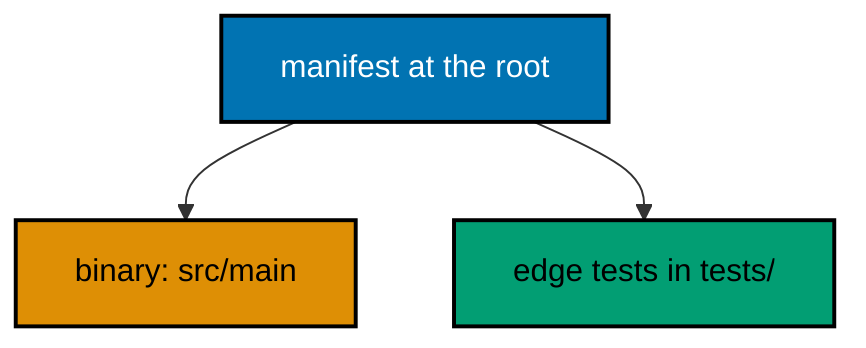

**`learning/code/ex-70-project-map-layout/main.rs`**:

```rust
// Example 70: Project Map, Where Everything Lives.
// => `Cargo.toml` at the root: identity, dependencies, and pins.
// => `src/main.rs` the binary: the thin wiring around the library.
// => `src/lib.rs` the library: the testable logic cargo tests own.
// => `tests/` the edge checks: integration tests use only the public API.
// => The map below is fixed text: it teaches the shape without touching disk.
// => Every path below is canonical: cargo creates exactly this layout.
const LAYOUT: &[&str] = &[
    // => the five load-bearing paths, in build order
    "Cargo.toml",      // => first: the manifest the build reads before anything
    "Cargo.lock",      // => second: the pins every checkout resolves identically
    "src/main.rs",     // => third: thin wiring, reads input, prints the report
    "src/lib.rs",      // => fourth: the logic `cargo test` owns and pins
    "tests/settle.rs", // => fifth: edge checks through the public API only
];
fn main() {
    // => the map prints in build order: manifest first, edge tests last.
    for (i, path) in LAYOUT.iter().enumerate() {
        // => numbered for reference
        println!("{}: {}", i + 1, path); // => five fixed lines, always
    }
}
```

**Output** (`learning/code/ex-70-project-map-layout/expected/main.stdout.txt`):

```text
1: Cargo.toml
2: Cargo.lock
3: src/main.rs
4: src/lib.rs
5: tests/settle.rs
```

**Key takeaway**: Root manifest, `src/` code, `tests/` edges: put every file where cargo already looks.

**Why it matters**: Canonical layouts let every Rust developer navigate a new project on sight, because the file names answer where things live before any search. Deviating buys nothing and taxes every future contributor with a private geography lesson, which is why the standard layout is worth following exactly. Scaffolding tools, editors, and onboarding checklists all assume this map, making standard layout the fastest way to orient newcomers.

### Example 71: Read a Fold Pipeline in Layers

Reading idiomatic code works in layers: signatures first, then types, then control flow, then data flow. This example folds three ledger lines into a validated total, and the annotations mark each layer so you can see the method working. (Concepts: co-16, co-03.)

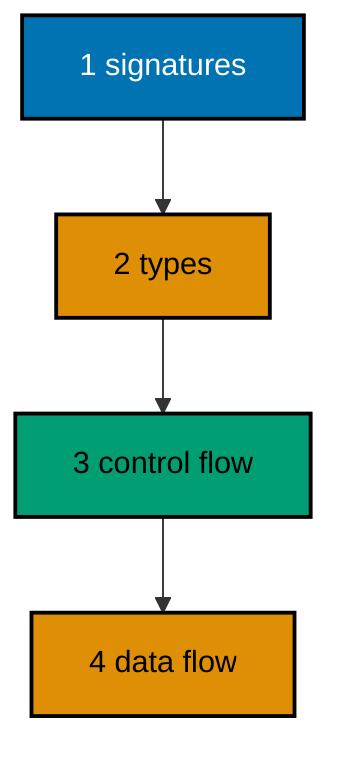

**`learning/code/ex-71-read-fold-pipeline-layers/main.rs`**:

```rust
// Example 71: Read a Fold Pipeline in Layers.
// => LAYER 1, signatures: `total_of` takes lines and returns a `Result`.
// => LAYER 2, types: `i32` dues, `String` failures, slices borrowed throughout.
// => LAYER 3, control flow: one `filter_map` skips bad lines, `sum` finishes.
// => LAYER 4, data flow: text in, numbers out, skipped lines counted aside.
// => Read in that order and the pipeline explains itself top to bottom.
fn total_of(lines: &[&str]) -> (i32, usize) {
    // => signature: borrowed lines in, pair out
    let mut skipped = 0; // => the side count: bad lines tallied, not lost
    let mut total = 0; // => the running total of valid dues
    for line in lines {
        // => control flow: one pass, no nesting
        match line.split_once(':') {
            // => data flow: split first
            Some((_, raw)) => match raw.trim().parse::<i32>() {
                // => then parse
                Ok(amount) => total += amount, // => good values join the total
                Err(_) => skipped += 1,        // => bad amounts counted, loop continues
            },
            None => skipped += 1, // => shapeless lines counted too
        }
    }
    (total, skipped) // => both answers travel together
}
fn main() {
    // => three fixed lines: two dues and one malformed, totals 125 plus 1 skip.
    let (total, skipped) = total_of(&["sari:50", "oops", "budi:75"]); // => the whole pipeline
    println!("total: {}", total); // => Output: total: 125
    println!("skipped: {}", skipped); // => Output: skipped: 1
}
```

**Output** (`learning/code/ex-71-read-fold-pipeline-layers/expected/main.stdout.txt`):

```text
total: 125
skipped: 1
```

**Key takeaway**: Read signatures, then types, then control flow, then data flow — in that order, every time.

**Why it matters**: Unfamiliar code overwhelms because readers try to absorb all four layers at once, holding signatures, types, branches, and values in memory simultaneously. The layered method gives each pass one question, so a fifty-line function surrenders in four short reads instead of one exhausting stare. Debuggers, profilers, and unfamiliar codebases all yield to the same four passes, making layered reading the universal comprehension skill.

### Example 72: Read a Trait-Object Dispatcher

Trait objects trade compile-time knowledge for runtime flexibility: one vector holds many types behind one behavior. This example dispatches three due kinds through `Box<dyn Settle>` and reads the dynamic call the same layered way. (Concepts: co-16, co-10.)

**`learning/code/ex-72-read-trait-object-dispatcher/main.rs`**:

```rust
// Example 72: Read a Trait-Object Dispatcher.
// => LAYER 1, signatures: `settle_all` takes boxed settlers, returns the total.
// => LAYER 2, types: `Box<dyn Settle>` erases the concrete due kinds.
// => LAYER 3, control flow: one loop, one dynamic call per item, no branches.
// => LAYER 4, data flow: behaviors in, one summed total out.
// => `dyn` marks the dynamic call: the method resolves at runtime below.
trait Settle {
    // => the shared behavior every due kind implements
    fn settle(&self) -> i32; // => one method: the whole dispatch contract
}
struct Cash(i32); // => settles at face value
struct Transfer(i32); // => adds the two-unit fee
struct Waived(i32); // => halves above the waiver line
impl Settle for Cash {
    // => face value, the simplest rule
    fn settle(&self) -> i32 {
        // => borrows, never consumes
        self.0 // => the amount straight through
    }
}
impl Settle for Transfer {
    // => the fee rule
    fn settle(&self) -> i32 {
        // => same signature, different arithmetic
        self.0 + 2 // => face plus the two-unit fee
    }
}
impl Settle for Waived {
    // => the waiver rule
    fn settle(&self) -> i32 {
        // => halves unconditionally here
        self.0 / 2 // => the waived settlement
    }
}
// => `settle_all` reads the same for any mix: the loop never names a type.
// => The slice borrows the vector: dispatch needs no ownership of the dues.
fn settle_all(dues: &[Box<dyn Settle>]) -> i32 {
    // => signature: boxed behaviors in
    dues.iter().map(|due| due.settle()).sum() // => dynamic call per item, then sum
}
fn main() {
    // => three kinds in one vector: the mix dynamic dispatch exists to serve.
    // => Each `Box::new` pins its kind behind the shared `Settle` behavior.
    // => The total below is fixed: 50 cash plus 52 transfer plus 75 waived.
    let dues: Vec<Box<dyn Settle>> = vec![
        Box::new(Cash(50)),
        Box::new(Transfer(50)),
        Box::new(Waived(150)),
    ]; // => 50 + 52 + 75
    println!("total: {}", settle_all(&dues)); // => Output: total: 177
}
```

**Output** (`learning/code/ex-72-read-trait-object-dispatcher/expected/main.stdout.txt`):

```text
total: 177
```

**Key takeaway**: `Box<dyn Trait>` holds mixed types behind one behavior; read the loop, not the kinds.

**Why it matters**: Dynamic dispatch concentrates the variation in the type list while the processing loop stays blissfully ignorant, which inverts the usual complexity: adding a kind touches one line, not every branch. Reading the loop once therefore covers all current and future kinds, a leverage static branches can never offer. Plugin systems, command dispatchers, and format registries all share this runtime flexibility, making trait objects the standard extension point.

### Example 73: Read Closure Captures

Closures capture their environment, and the capture mode — borrow, mutable borrow, or move — is visible in how the closure is used. This example builds a counting settlement checker whose `FnMut` closure mutates its captured tally. (Concepts: co-16, co-01.)

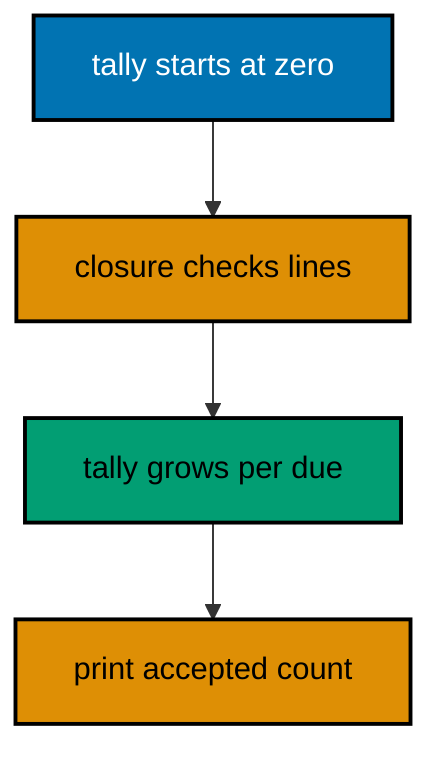

**`learning/code/ex-73-read-closure-captures/main.rs`**:

```rust
// Example 73: Read Closure Captures.
// => LAYER 1, signatures: `check` borrows a line, mutates tally, returns bool.
// => LAYER 2, types: `FnMut(&str) -> bool` borrows mutably, returns verdicts.
// => LAYER 3, control flow: each call parses once and decides once.
// => LAYER 4, data flow: lines in, verdicts out, tally grows on the side.
// => `mut check` is required: calling an `FnMut` closure mutates its capture.
fn main() {
    // => the tally lives outside the closure: captures are the whole lesson.
    let mut tally = 0; // => counts accepted dues across all calls
                       // => the closure borrows `tally` mutably: writes through the capture.
    let mut check = |line: &str| -> bool {
        // => `FnMut`: mutates its environment
        match line.split_once(':') {
            // => the familiar line grammar
            Some((_, raw)) => match raw.trim().parse::<i32>() {
                // => value stage
                Ok(amount) if amount > 0 => {
                    // => positive dues pass
                    tally += amount; // => capture write: visible after the calls
                    true // => accepted: the line settled
                }
                _ => false, // => junk or non-positive: rejected, tally untouched
            },
            None => false, // => shapeless: rejected, tally untouched
        }
    };
    // => three fixed lines: two accepted, one rejected, tally 125.
    println!("sari: {}", check("sari:50")); // => Output: sari: true
    println!("oops: {}", check("oops")); // => Output: oops: false
    println!("budi: {}", check("budi:75")); // => Output: budi: true
    println!("tally: {}", tally); // => Output: tally: 125
}
```

**Output** (`learning/code/ex-73-read-closure-captures/expected/main.stdout.txt`):

```text
sari: true
oops: false
budi: true
tally: 125
```

**Key takeaway**: Read closures by capture: `Fn` borrows, `FnMut` mutates, `FnOnce` consumes.

**Why it matters**: Closure bugs always trace to a misunderstood capture — a borrow that should have been a move, a mutation through a shared reference — so naming the capture mode first resolves most confusion before it starts. The `mut` on the binding is the tell: it advertises exactly which closures carry mutable state.

### Example 74: Read the Process Boundary

Spawning another program is a runtime boundary: arguments go out, exit codes and bytes come back. This example runs the system `echo` with a fixed settlement line and reads its output back as data. (Concepts: co-16, co-13.)

**`learning/code/ex-74-process-boundary-command/main.rs`**:

```rust
// Example 74: Read the Process Boundary.
// => LAYER 1, signatures: `Command` builds the argv, `output` runs it.
// => LAYER 2, types: `Output` carries status plus captured stdout and stderr.
// => LAYER 3, control flow: `status.success()` decides pass or fail.
// => LAYER 4, data flow: fixed argument out, echoed bytes back, verdict printed.
// => `echo` ships with every unix base image: the boundary needs no setup.
// => Bytes back are UTF-8 here: `from_utf8` plus `trim_end` recover the line.
use std::process::Command; // => spawning and waiting live here
fn main() {
    // => one fixed argument: the same settlement line every run.
    let spawned = Command::new("echo") // => the program at the boundary
        .arg("sari:50") // => the single fixed argument
        .output() // => run to completion, capture both streams
        .expect("echo ships with the base image"); // => missing echo is environmental
                                                   // => the exit status decides the verdict: success continues, failure reports.
    println!("ok: {}", spawned.status.success()); // => Output: ok: true
                                                  // => stdout returns the echoed bytes: decode and trim the trailing newline.
    let echoed = String::from_utf8(spawned.stdout).expect("echo writes utf8"); // => always utf8 here
    println!("echoed: {}", echoed.trim_end()); // => Output: echoed: sari:50
}
```

**Output** (`learning/code/ex-74-process-boundary-command/expected/main.stdout.txt`):

```text
ok: true
echoed: sari:50
```

**Key takeaway**: Treat subprocesses as a typed boundary: fixed argv in, status plus bytes back, verdict printed.

**Why it matters**: Every external call crosses from Rust's guarantees into a world of missing binaries and changed flags, so the boundary code must convert exit codes and raw bytes into checked values immediately. Reading boundaries as conversions — argv out, `Output` back, verified data forward — keeps the untrusted outside from leaking into the trusted inside.

### Example 75: Read a Builder Chain

Builders stage configuration across chained calls that each return `Self`, so invalid combinations become unrepresentable. This example assembles a settlement report through a builder whose every method returns the in-progress report. (Concepts: co-16, co-14.)

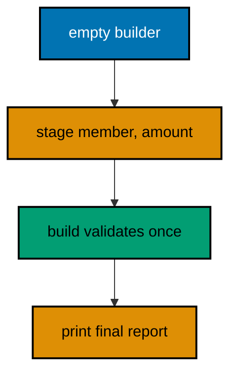

**`learning/code/ex-75-read-builder-chain/main.rs`**:

```rust
// Example 75: Read a Builder Chain.
// => LAYER 1, signatures: each stage takes `self` and returns `Self`.
// => LAYER 2, types: `Report` accumulates lines; `Built` is the finished value.
// => LAYER 3, control flow: the chain reads top to bottom, no branches.
// => LAYER 4, data flow: empty builder in, lines appended, report out.
// => `mut self` stages mutate in place: the chain owns the value throughout.
#[derive(Debug)] // => the finished report prints for the transcript
struct Built {
    // => the validated, printable settlement report
    lines: Vec<String>, // => one string per settled line
    total: i32,         // => the summed total across all lines
}
struct Report {
    // => the in-progress builder: lines accumulate here
    lines: Vec<String>, // => settled lines so far
    total: i32,         // => running total so far
}
impl Report {
    // => the staging methods, one per configuration step
    // => `new` starts empty: every chain begins from the same place.
    fn new() -> Report {
        // => no arguments: nothing to configure yet
        Report {
            lines: Vec::new(),
            total: 0,
        } // => empty lines, zero total
    }
    // => each stage consumes `self` and returns it: chaining never breaks.
    fn due(mut self, member: &str, amount: i32) -> Report {
        // => one settled line
        self.lines.push(format!("{}: {}", member, amount)); // => the line joins
        self.total += amount; // => the total grows with the lines
        self // => hand the builder to the next stage
    }
    // => `build` freezes the accumulation into the printable report.
    fn build(self) -> Built {
        // => consumes the builder: no reuse after
        Built {
            lines: self.lines,
            total: self.total,
        } // => move the parts over
    }
}
fn main() {
    // => the chain reads as the report: two dues, then the finished value.
    let report = Report::new().due("sari", 50).due("budi", 75).build(); // => staged, then frozen
                                                                        // => the finished value is read field by field: no dead data.
    assert_eq!(report.lines, ["sari: 50", "budi: 75"]); // => the staged lines, in order
    assert_eq!(report.total, 125); // => the summed total
    println!("{:?}", report); // => Output: Built { lines: ["sari: 50", "budi: 75"], total: 125 }
}
```

**Output** (`learning/code/ex-75-read-builder-chain/expected/main.stdout.txt`):

```text
Built { lines: ["sari: 50", "budi: 75"], total: 125 }
```

**Key takeaway**: Stage configuration in `self`-returning methods; `build` freezes the accumulation once.

**Why it matters**: Telescoping constructors force callers to remember argument order across a dozen parameters, while builders name every stage and default the rest. Consuming `self` at each step makes half-built values impossible to reuse, so the type system enforces the staging the docs merely suggest. Connection strings, query builders, and client configurations all stage this way, making builders the ergonomic API standard.

### Example 76: Read a Recursive Box List

Recursive types need indirection because values cannot contain themselves, and `Box` provides exactly one heap pointer of it. This example builds a three-dues list as nested boxes and sums it with a borrowing walk. (Concepts: co-16, co-11.)

**`learning/code/ex-76-read-recursive-box-list/main.rs`**:

```rust
// Example 76: Read a Recursive Box List.
// => LAYER 1, signatures: `sum` borrows the list, `len` counts its links.
// => LAYER 2, types: `Box<List>` breaks the infinite size with one pointer.
// => LAYER 3, control flow: match the node, recurse into the boxed tail.
// => LAYER 4, data flow: values add up while borrows walk down the spine.
// => `&*tail` reborrows through the box: walking never takes ownership.
enum List {
    // => a dues list: empty or one due plus the rest
    Nil,                  // => the end of every list: zero links beyond here
    Cons(i32, Box<List>), // => one due plus the boxed remainder
}
use List::{Cons, Nil}; // => short names for the two shapes below
                       // => `sum` walks by shared borrow: the list outlives every call.
fn sum(list: &List) -> i32 {
    // => borrows the whole spine
    match list {
        // => every node is one of the two shapes
        Nil => 0,                                   // => empty tail contributes nothing
        Cons(amount, tail) => amount + sum(&*tail), // => head plus the rest
    }
}
// => `len` walks the same spine: same borrow, different accumulation.
fn len(list: &List) -> usize {
    // => counts links, not dues
    match list {
        // => the same two shapes as above
        Nil => 0,                         // => empty tail holds no links
        Cons(_, tail) => 1 + len(&*tail), // => one link plus the rest
    }
}
fn main() {
    // => three fixed dues nested as boxes: 50, then 75, then 25, then Nil.
    let dues = Cons(50, Box::new(Cons(75, Box::new(Cons(25, Box::new(Nil)))))); // => the whole list
    println!("len: {}", len(&dues)); // => Output: len: 3
    println!("sum: {}", sum(&dues)); // => Output: sum: 150
}
```

**Output** (`learning/code/ex-76-read-recursive-box-list/expected/main.stdout.txt`):

```text
len: 3
sum: 150
```

**Key takeaway**: Break recursion with `Box`; walk recursive types with borrowing matches that never take ownership.

**Why it matters**: Recursive structures defeat value semantics because the type would be infinitely large, and `Box` resolves the paradox with exactly one pointer of indirection. Borrowing walks keep the whole structure alive for later passes, which matters the moment a second traversal — printing, validating, freeing — must follow the first. File trees, expression evaluators, and navigation histories all recurse this way, making boxed spines the standard ownership answer.

### Example 77: Extern C Calls into C

Foreign functions cross the language boundary through `extern` declarations, with `unsafe` marking the caller's responsibility. This example prints through C's `puts` and reports its success, reading the boundary declaration the layered way. (Concepts: co-16, co-13.)

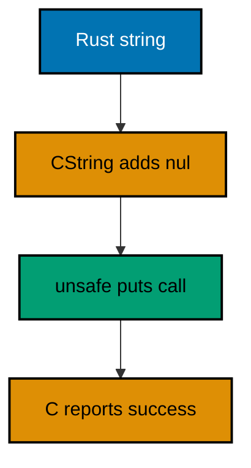

**`learning/code/ex-77-extern-c-calls-puts/main.rs`**:

```rust
// Example 77: Extern C Calls into C.
// => LAYER 1, signatures: `puts` takes a C string pointer, returns an int.
// => LAYER 2, types: `CString` owns the nul-terminated bytes C requires.
// => LAYER 3, control flow: no branches, one unsafe call, one verdict.
// => LAYER 4, data flow: Rust text in, C return code out, boolean printed.
// => `unsafe` marks caller responsibility: the pointer must be valid, and it is.
// => `puts` adds its own newline: the transcript shows it before the verdict.
use std::ffi::CString; // => the nul-terminated string C functions expect
use std::os::raw::{c_char, c_int}; // => the C types in Rust spelling
                                   // => The declaration promises what C provides: the linker resolves it.
extern "C" {
    // => C calling convention: the boundary contract
    fn puts(text: *const c_char) -> c_int; // => prints plus newline, non-negative on success
}
fn main() {
    // => one fixed line crosses the boundary: Rust owns it, C prints it.
    let line = CString::new("laporan: sari 50").expect("no interior nul bytes"); // => C-ready text
                                                                                 // => the unsafe block holds exactly the foreign call: nothing else.
    let printed = unsafe { puts(line.as_ptr()) }; // => C prints, returns its verdict
                                                  // => non-negative means success: the boolean below is fixed at true.
    println!("ok: {}", printed >= 0); // => Output: ok: true
}
```

**Output** (`learning/code/ex-77-extern-c-calls-puts/expected/main.stdout.txt`):

```text
ok: true
laporan: sari 50
```

**Key takeaway**: Declare foreign functions in `extern` blocks; wrap the `unsafe` call tightly and convert its verdict.

**Why it matters**: Every language boundary suspends Rust's guarantees — lifetimes, types, and panics stop applying — so the unsafe block must be as small as the call itself with conversion back to safe values immediately. Declaring the boundary explicitly also documents which foreign dependency the build carries, turning an invisible libc reliance into a reviewed line.

### Example 78: Read a Module Tree Whole

The final reading exercise puts the method to work on a whole program: two modules, one re-export, and a thin `main`. Read it in the four layers and every line lands in exactly one of them. (Concepts: co-16, co-06.)

**`learning/code/ex-78-read-module-tree-whole/main.rs`**:

```rust
// Example 78: Read a Module Tree Whole.
// => LAYER 1, signatures: `parse::line` parses, `report` renders, `main` wires.
// => LAYER 2, types: `Due` crosses the module boundary by re-export.
// => LAYER 3, control flow: filter-map collects, report formats, main prints.
// => LAYER 4, data flow: raw lines in, parsed dues through, report string out.
// => The re-export is the map legend: public paths, hidden nests.
mod parse {
    // => the parsing team: one type, one function
    // => `Due` escapes through the re-export below: owned, printable, testable.
    #[derive(Debug)] // => `Debug` lets the report show its work
    pub struct Due {
        // => crate-visible through `super` re-export
        pub member: String, // => owned name outlives the input line
        pub amount: i32,    // => validated whole-number due
    }
    // => the line grammar in one place: colon splits, trim cleans, parse decides.
    pub fn line(text: &str) -> Option<Due> {
        // => `None` skips bad lines
        let (member, raw) = text.split_once(':')?; // => shape check first
        let amount = raw.trim().parse::<i32>().ok()?; // => value check second
        Some(Due {
            member: member.trim().to_string(),
            amount,
        }) // => owned pair out
    }
}
mod render {
    // => the reporting team: pure string building
    use super::parse::Due; // => `super` climbs to the sibling module
                           // => one rendering for any due list: count plus total, fixed shape.
    pub fn report(dues: &[Due]) -> String {
        // => borrows the parsed ledger
        let total: i32 = dues.iter().map(|due| due.amount).sum(); // => the fused total
        format!("lines: {} total: {}", dues.len(), total) // => the fixed report shape
    }
}
// => the legend: two public names, zero visible nests.
pub use parse::{line, Due}; // => `line` and `Due` escape; `parse` stays hidden
fn main() {
    // => three fixed lines wire the whole tree: parse, collect, render, print.
    let dues: Vec<Due> = ["sari:50", "oops", "budi:75"]
        .iter()
        .filter_map(|t| line(t))
        .collect(); // => two survive
    println!("{}", render::report(&dues)); // => Output: lines: 2 total: 125
}
```

**Output** (`learning/code/ex-78-read-module-tree-whole/expected/main.stdout.txt`):

```text
lines: 2 total: 125
```

**Key takeaway**: Read module trees from the re-export legend: public names first, then each team's internals.

**Why it matters**: The re-export list is the author's own map of what matters, drawn before any implementation detail can distract. Starting there bounds every later question — which module owns this, who else sees that — so even an unfamiliar tree of thousands of lines yields its structure in the same four passes as a fifty-line file.
