Examples 1–25 build Rust fluency from the ground up: idiomatic control flow and collections first (Examples 1–8), showing `if let`, value-carrying loops, draining while-lets, match priority, capacity doubling, the entry API, and fused iterator pipelines; then the error-handling idiom in full (Examples 9–17), from `Result` returns through `?` propagation, defaults, context wrapping, custom enums, combinators, boxed errors, asserts, and fail-fast collection; finally the standard library for daily text, file, and time work (Examples 18–25), covering string building, line pipelines, format verbs, temp-file I/O, buffered streaming, portable paths, fixed-instant arithmetic, and human duration rendering. Every example is a complete, runnable single-file Rust program under `learning/code/`; run each with the command in its own `run.yaml`.

---

### Example 1: If Let Replaces a Nested Match

Rust programs read a value's shape before they use it, and `if let` is the lightest way to do that for one interesting case. This example looks up a nickname that may be missing and greets only when it is there. The table is a plain `match` on static strings, so no lifetimes distract from the lesson. (Concepts: co-01, co-02.)

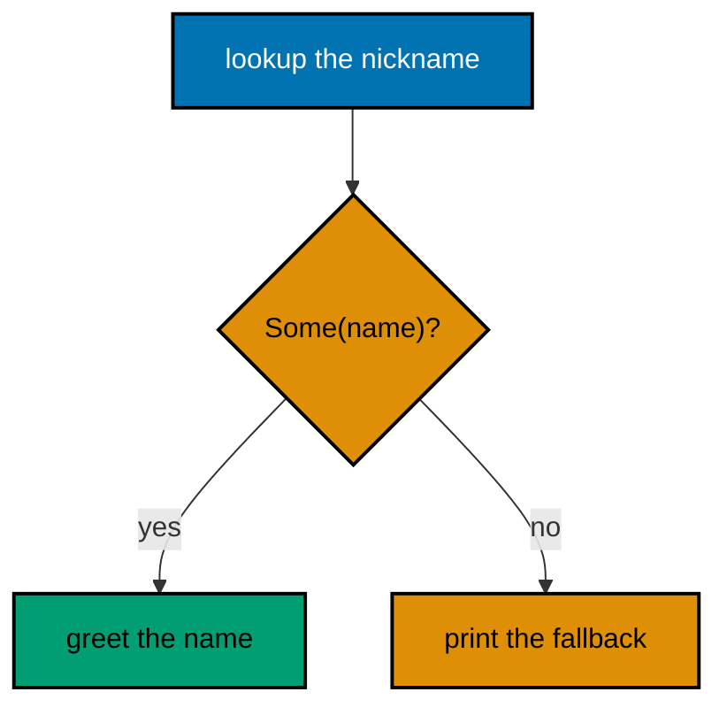

**`learning/code/ex-01-if-let-replaces-nested-match/main.rs`**:

```rust
// Example 1: If Let Replaces a Nested Match.
// => `if let` handles the one case you care about and skips the rest.
// => A full `match` here would push the greeting one level deeper.
// => `Option<&str>`: the nickname may or may not be there.
// => `'static` says the strings live for the whole program run.
fn nickname(of: &str) -> Option<&'static str> {
    // => static strings, no lifetimes needed
    match of {
        // => the tiny table lives in the match arms
        "Budi" => Some("Bud"),  // => first known nickname
        "Citra" => Some("Cit"), // => second known nickname
        _ => None,              // => Sari and the rest are intentionally absent
    }
}
fn main() {
    // => Two lookups below: one hit and one miss, both fully determined.
    // => `if let` runs the greeting only when the lookup finds something.
    if let Some(nick) = nickname("Budi") {
        // => Budi is present
        println!("halo, {}!", nick); // => Output: halo, Bud!
    }
    // => the missing key falls through to the `else`, flat and readable.
    if let Some(nick) = nickname("Sari") {
        // => Sari is absent
        println!("halo, {}!", nick); // => skipped: the option is `None`
    } else {
        println!("no nickname"); // => Output: no nickname
    }
}
```

**Output** (`learning/code/ex-01-if-let-replaces-nested-match/expected/main.stdout.txt`):

```text
halo, Bud!
no nickname
```

**Key takeaway**: Use `if let` for the one `Some` or `Ok` case you care about; save `match` for exhaustive decisions.

**Why it matters**: One-armed checks stay at the margin while full matches indent everything below them, so readers see the condition and the consequence on adjacent lines. Matching one case with `if let` is the first idiom that makes Rust read like Rust instead of like a translated switch statement. Teams that adopt it stop translating match pyramids from other languages and start writing branches a reviewer can verify at a glance.

### Example 2: Loop Returns Its Value

`loop` is Rust's unconditional repetition, and a `break` with a value turns the whole loop into an expression. This example doubles a number until it passes a limit and keeps the answer the `break` carried out. (Concepts: co-01.)

**`learning/code/ex-02-loop-returns-its-value/main.rs`**:

```rust
// Example 2: Loop Returns Its Value.
// => `loop` repeats forever; the exit carries the answer out.
// => No flag variable is needed when the loop itself is the expression.
fn main() {
    // => start below the limit so the loop must run at least twice.
    let mut n = 3; // => the value being doubled toward the limit
                   // => the loop expression evaluates to whatever `break` hands it.
    let answer = loop {
        // => `answer` binds the break value directly
        n *= 2; // => double first, ask about stopping after
                // => the exit test lives inside, next to the work it guards.
        if n > 20 {
            // => 24 is the first double past the limit
            break n; // => carry 24 out as the value of the loop
        }
    };
    // => both prints below are fixed: the doubling is fully determined.
    println!("answer: {}", answer); // => Output: answer: 24
    println!("steps end at: {}", n); // => Output: steps end at: 24
}
```

**Output** (`learning/code/ex-02-loop-returns-its-value/expected/main.stdout.txt`):

```text
answer: 24
steps end at: 24
```

**Key takeaway**: `break value` makes `loop` an expression; bind the answer instead of flagging it.

**Why it matters**: Value-carrying breaks remove the done-flag variable and the post-loop read of a mutated cell, which are the two places infinite loops usually hide their intent. Readers see the exit and the result in one line instead of reconstructing them from state. The value-carrying break also composes: a loop that finds, computes, and returns needs no temporary outside itself.

### Example 3: While Let Drains a Stack

`while let` repeats exactly as long as a pattern keeps matching, which makes it the idiom for draining a collection. This example pops a work stack until it is empty and numbers each job in the order it ran. (Concepts: co-01, co-03.)

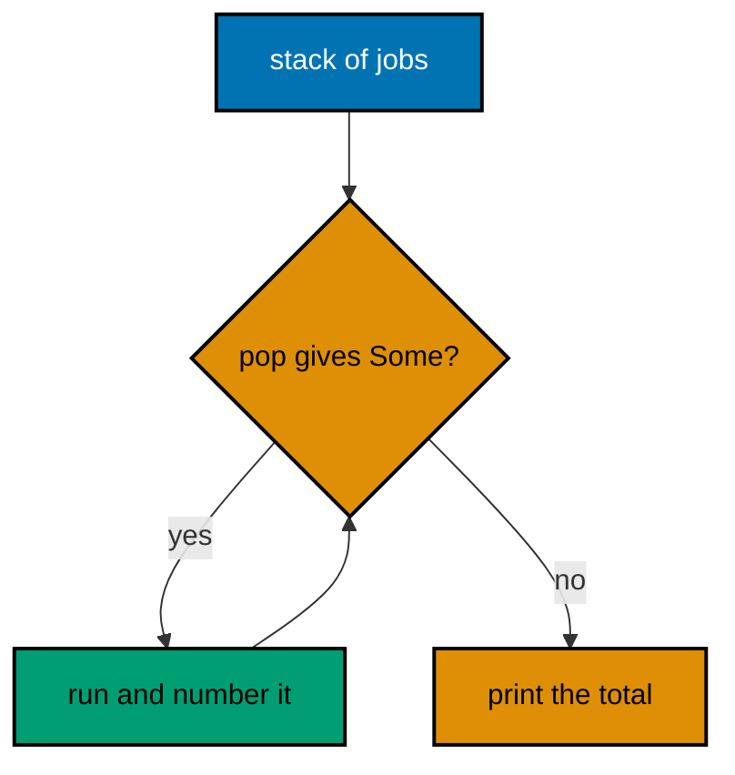

**`learning/code/ex-03-while-let-drains-a-stack/main.rs`**:

```rust
// Example 3: While Let Drains a Stack.
// => `while let` loops while the pattern matches and stops when it will not.
// => Popping in the condition keeps the drain to three lines, no index needed.
fn main() {
    // => a stack is a `Vec` used from the back; jobs run last-in first-out.
    let mut stack = vec!["audit", "settle", "report"]; // => three jobs queued
                                                       // => `pop` returns `Some` until the stack is empty, then `None` ends it.
    let mut done = 0; // => counts how many jobs actually ran
    while let Some(job) = stack.pop() {
        // => `None` stops the loop by itself
        done += 1; // => one more job finished
        println!("{}: {}", done, job); // => prints 1: report, then 2, then 3
    }
    // => the total below is fixed: three pushes always drain to three runs.
    println!("drained: {}", done); // => Output: drained: 3
}
```

**Output** (`learning/code/ex-03-while-let-drains-a-stack/expected/main.stdout.txt`):

```text
1: report
2: settle
3: audit
drained: 3
```

**Key takeaway**: `while let Some(x) = stack.pop()` drains a stack; emptiness ends the loop by itself.

**Why it matters**: Draining through the pop condition removes the length check and the index variable that drift out of sync in hand-rolled loops. The loop's shape then states its own termination instead of burying it in a body branch. Collection-draining code written this way cannot loop forever on a forgotten index update, because no index exists.

### Example 4: For with Enumerate and Take

`for` walks any iterator, and adapters like `enumerate` and `take` shape the walk without index bookkeeping. This example prints the first two ledger lines with their positions, showing how the adapter carries the counting. (Concepts: co-01, co-03.)

**`learning/code/ex-04-for-enumerate-take/main.rs`**:

```rust
// Example 4: For with Enumerate and Take.
// => Adapters shape the walk; the loop body only handles one item.
// => No index variable exists to initialize, bound, or increment.
fn main() {
    // => fixed ledger lines: the same input every run, the same output.
    let lines = ["sari:50", "budi:75", "citra:25"]; // => three ledger lines
                                                    // => `enumerate` adds the position; `take(2)` stops after two items.
    for (i, line) in lines.iter().enumerate().take(2) {
        // => i is 0, then 1
        println!("{}: {}", i + 1, line); // => prints numbered lines one by one
    }
    // => the count below is fixed: `take(2)` always yields exactly two.
    println!("shown: {}", lines.iter().take(2).count()); // => Output: shown: 2
}
```

**Output** (`learning/code/ex-04-for-enumerate-take/expected/main.stdout.txt`):

```text
1: sari:50
2: budi:75
shown: 2
```

**Key takeaway**: Adapt the iterator with `enumerate` and `take`; keep the loop body to one item.

**Why it matters**: Adapter chains name the traversal once at the top instead of spreading counting logic through the body. Off-by-one mistakes live in manual bounds, and adapters remove the manual bounds entirely. The same adapters work on files, network streams, and channels, so the traversal vocabulary transfers directly across every data source you will meet.

### Example 5: Match Guards Order the Cases

Match arms try top to bottom, and guards add conditions to patterns so the order expresses priority. This example classifies a settlement amount where the zero case must win over the positive range. (Concepts: co-01.)

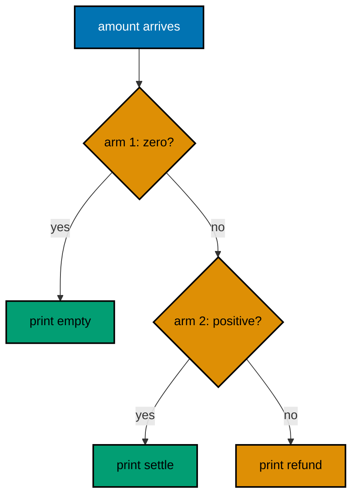

**`learning/code/ex-05-match-guards-order-cases/main.rs`**:

```rust
// Example 5: Match Guards Order the Cases.
// => Arms are tried top to bottom; put the most specific case first.
// => A guard adds a condition to a pattern without nesting another `if`.
fn settle(amount: i32) -> &'static str {
    // => classification, no I/O inside
    // => The first matching arm wins: order is the business rule here.
    match amount {
        // => every arm below returns the same string type
        0 => "empty",           // => the specific case wins because it comes first
        n if n > 0 => "settle", // => guard: positive amounts settle
        _ => "refund",          // => the only remaining shape is negative
    }
}
// => Each call below is fixed, so every classification is fixed too.
fn main() {
    println!("0 -> {}", settle(0)); // => Output: 0 -> empty
    println!("50 -> {}", settle(50)); // => Output: 50 -> settle
    println!("-5 -> {}", settle(-5)); // => Output: -5 -> refund
}
```

**Output** (`learning/code/ex-05-match-guards-order-cases/expected/main.stdout.txt`):

```text
0 -> empty
50 -> settle
-5 -> refund
```

**Key takeaway**: Order match arms from most specific to most general; guards refine patterns in place.

**Why it matters**: Arm order is executable priority, so reviewers read the business rule directly from the listing instead of reconstructing it from nested conditions. A misplaced general arm swallows specific cases silently, which is why the compiler warns on unreachable arms. New team members learn the priority by reading the arm order, which turns code review of business rules into reading, not archaeology.

### Example 6: Vec Capacity Doubling

`Vec` doubles its backing buffer as it grows, so pushes are cheap on average but each reallocation copies everything. This example pushes ten dues and prints length with capacity, making the doubling visible. (Concepts: co-03.)

**`learning/code/ex-06-vec-capacity-doubling/main.rs`**:

```rust
// Example 6: Vec Capacity Doubling.
// => `len` counts elements; `capacity` counts room before reallocating.
// => Pushing past capacity reallocates and copies: doubling keeps it rare.
fn main() {
    // => start empty: the first push must allocate before it can store.
    let mut dues: Vec<i32> = Vec::new(); // => no room yet, capacity zero
    for due in 1..=10 {
        // => ten fixed dues, identical every run
        dues.push(due * 10); // => append; reallocation happens on its own
                             // => only the length prints: exact capacities are allocator detail.
        println!("len {}", dues.len()); // => 1 through 10, one per push
    }
    // => reserve up front when the size is known: no copying at all.
    let mut known: Vec<i32> = Vec::with_capacity(10); // => room for ten now
    for due in 1..=10 {
        // => the same ten dues as above
        known.push(due * 10); // => no reallocation needed on this path
    }
    // => `with_capacity` guarantees at least the requested room, every run.
    println!("reserved: {}", known.capacity() >= 10); // => Output: reserved: true
                                                      // => the total below is fixed: 10 + 20 + ... + 100 always sums to 550.
    println!("sum: {}", dues.iter().sum::<i32>()); // => Output: sum: 550
}
```

**Output** (`learning/code/ex-06-vec-capacity-doubling/expected/main.stdout.txt`):

```text
len 1
len 2
len 3
len 4
len 5
len 6
len 7
len 8
len 9
len 10
reserved: true
sum: 550
```

**Key takeaway**: `with_capacity` skips the doubling when you know the size; otherwise pushes amortize.

**Why it matters**: Capacity doubling is the reason pushes stay fast without manual resizing, and the trace shows exactly when copies happen. Knowing the size up front with `with_capacity` removes even those copies, which is the standard fix for hot allocation loops. Reserve-then-fill is the habit to carry into every language with dynamic arrays, since amortized growth is only free on average.

### Example 7: HashMap Entry or Insert

The `entry` API looks a key up exactly once and hands back a slot to fill or update. This example counts dues per member, defaulting missing members to zero before adding. (Concepts: co-03.)

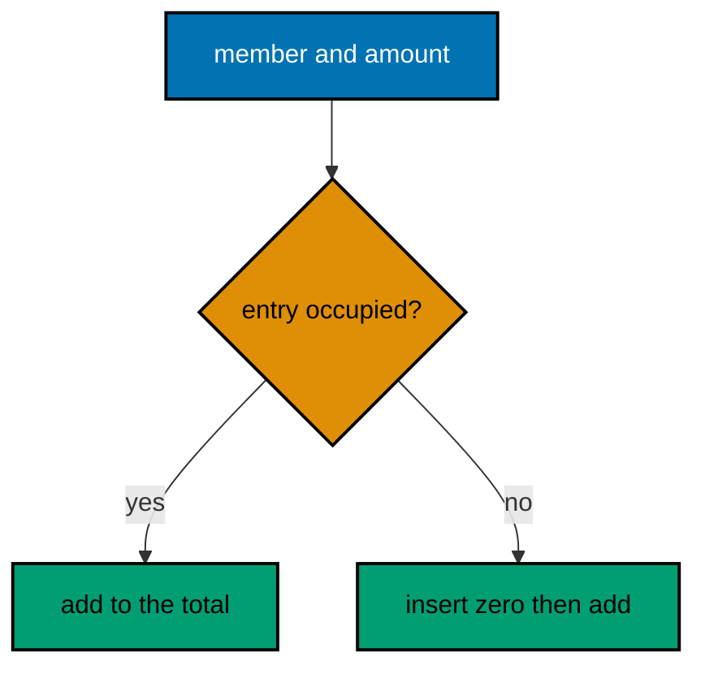

**`learning/code/ex-07-hashmap-entry-or-insert/main.rs`**:

```rust
// Example 7: HashMap Entry or Insert.
// => `entry` hashes once and returns a slot: occupied or vacant.
// => `or_insert` fills vacant slots so the update below is unconditional.
use std::collections::HashMap; // => the per-member totals table
fn main() {
    // => fixed dues: the same members and amounts on every run.
    let dues = [("sari", 50), ("budi", 75), ("sari", 25)]; // => sari pays twice
                                                           // => totals start empty; the entry API grows them key by key.
    let mut totals: HashMap<&str, i32> = HashMap::new(); // => member to sum
    for (member, amount) in dues {
        // => each pair updates one slot
        // => vacant members start at zero; occupied ones keep their total.
        *totals.entry(member).or_insert(0) += amount; // => one lookup total
    }
    // => sorted names keep the print order fixed: maps do not promise order.
    let mut names: Vec<&str> = totals.keys().copied().collect(); // => names
    names.sort(); // => alphabetical: budi before sari, every run
    for name in names {
        // => totals[name] is safe: the key came from the map
        println!("{}: {}", name, totals[name]); // => budi: 75, then sari: 75
    }
}
```

**Output** (`learning/code/ex-07-hashmap-entry-or-insert/expected/main.stdout.txt`):

```text
budi: 75
sari: 75
```

**Key takeaway**: Update maps through `entry(...).or_insert(...)` so each key hashes exactly once.

**Why it matters**: Two-step get-then-insert hashes twice and races itself in concurrent code, while the entry slot does the whole update atomically from the caller's view. Defaulting vacant slots with `or_insert` also removes the missing-key branch most map code would otherwise repeat. Counting word frequencies, histogramming latencies, and grouping errors all reduce to this exact entry pattern.

### Example 8: Iterator Adapters Beat Indexing

Adapters compose the whole collection pipeline in one expression that the compiler fuses into a single pass. This example totals the valid dues by chaining filter, map, and sum instead of indexing a loop. (Concepts: co-03, co-15.)

**`learning/code/ex-08-iterator-adapters-beat-indexing/main.rs`**:

```rust
// Example 8: Iterator Adapters Beat Indexing.
// => Adapters compose: each stage transforms the stream for the next.
// => No index, no accumulator variable, no bounds to get wrong.
fn main() {
    // => raw ledger lines: two valid dues and one malformed line to skip.
    let lines = ["sari:50", "oops", "budi:75"]; // => fixed input, fixed output
                                                // => the pipeline reads as the plan: split, parse, keep, total.
    let total: i32 = lines // => borrow the array; nothing is copied yet
        .iter() // => stream the three lines in order
        .filter_map(|line| line.split(':').nth(1)) // => keep lines with amounts
        .filter_map(|num| num.parse::<i32>().ok()) // => keep amounts that parse
        .sum(); // => add the survivors: 50 + 75
                // => the total below is fixed: the same lines always total 125.
    println!("total: {}", total); // => Output: total: 125
}
```

**Output** (`learning/code/ex-08-iterator-adapters-beat-indexing/expected/main.stdout.txt`):

```text
total: 125
```

**Key takeaway**: Chain `filter_map` and `sum` for parse-and-total pipelines; the compiler fuses the pass.

**Why it matters**: One fused pass touches each element once with no index arithmetic, which removes both bounds bugs and a second traversal. The chain also reads as the data plan itself, so the next change edits one stage instead of rewiring a loop body. The fused pass also vectorizes better, since the compiler sees one traversal with one purpose instead of scattered mutations.

### Example 9: Result Instead of Exceptions

Fallible functions return `Result`, so the failure rides home in the return value instead of unwinding the stack. This example parses dues amounts and matches on the outcome, keeping both paths visible at the call site. (Concepts: co-02.)

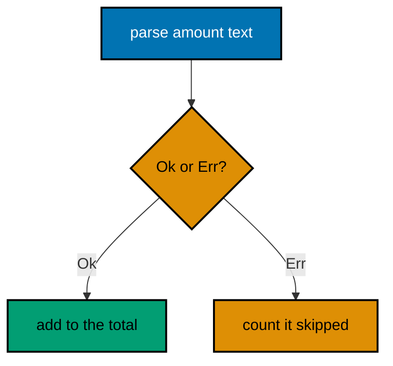

**`learning/code/ex-09-result-instead-of-exceptions/main.rs`**:

```rust
// Example 9: Result Instead of Exceptions.
// => `Result<T, E>` is a value: `Ok` carries success, `Err` carries failure.
// => Matching at the call site forces both paths to be handled, not hoped for.
fn parse_due(text: &str) -> Result<i32, String> {
    // => failure is data here
    // => `parse` already returns a `Result`; map its error into our string.
    text.parse::<i32>()
        .map_err(|_| format!("bad amount: {}", text)) // => Err names the input
}
fn main() {
    // => fixed inputs: one amount that parses and one that cannot.
    // => `mut` marks the accumulators: mutation is explicit, never hidden.
    let mut total = 0; // => the running total of valid dues
    let mut skipped = 0; // => counts failures without stopping the run
    for text in ["50", "xyz"] {
        // => first parses, second fails, every run
        match parse_due(text) {
            // => both outcomes handled right here
            Ok(amount) => total += amount, // => valid dues join the total
            Err(why) => {
                // => the failure value arrives with context
                println!("skip: {}", why); // => Output: skip: bad amount: xyz
                skipped += 1; // => counted, then the loop continues
            }
        }
    }
    // => the figures below are fixed: 50 parses, xyz is skipped once.
    println!("total: {}", total); // => Output: total: 50
    println!("skipped: {}", skipped); // => Output: skipped: 1
}
```

**Output** (`learning/code/ex-09-result-instead-of-exceptions/expected/main.stdout.txt`):

```text
skip: bad amount: xyz
total: 50
skipped: 1
```

**Key takeaway**: Return `Result` for recoverable failures and `match` both arms where the call happens.

**Why it matters**: Failure as a return value cannot be forgotten the way an uncaught exception can, because the compiler makes the `Err` arm part of the type. Handling both outcomes at the call site keeps the recovery next to the risk instead of in a distant handler. Libraries built this way compose with `?` at every layer, so a whole program becomes one chain of explicit, typed failure handling.

### Example 10: Question Mark Propagates

The `?` operator returns the `Err` to the caller on failure and unwraps the `Ok` on success, collapsing four lines of match into one. This example reads two dues through one helper where any bad amount aborts with its reason. (Concepts: co-02.)

**`learning/code/ex-10-question-mark-propagates/main.rs`**:

```rust
// Example 10: Question Mark Propagates.
// => `?` unwraps `Ok` and returns `Err` early: match in one character.
// => The function must return a `Result` itself for `?` to have somewhere to go.
fn parse_due(text: &str) -> Result<i32, String> {
    // => same parser as before
    // => `map_err` keeps our string-error convention for every caller.
    text.parse::<i32>()
        .map_err(|_| format!("bad amount: {}", text)) // => Err names the input
}
// => `total_two` succeeds only when both dues parse: `?` enforces that.
// => Each `?` is a documented early exit: readers see the failure path inline.
fn total_two(a: &str, b: &str) -> Result<i32, String> {
    // => composes two parses
    let first = parse_due(a)?; // => Err here returns from `total_two` at once
    let second = parse_due(b)?; // => reached only when the first parsed
    Ok(first + second) // => both good: wrap the sum as success
}
fn main() {
    // => the good pair totals; the bad pair reports the first failure.
    match total_two("50", "25") {
        // => both parse: 75
        Ok(sum) => println!("sum: {}", sum), // => Output: sum: 75
        Err(why) => println!("fail: {}", why), // => not taken on this input
    }
    match total_two("50", "xyz") {
        // => the second parse fails
        Ok(sum) => println!("sum: {}", sum), // => not taken on this input
        Err(why) => println!("fail: {}", why), // => Output: fail: bad amount: xyz
    }
}
```

**Output** (`learning/code/ex-10-question-mark-propagates/expected/main.stdout.txt`):

```text
sum: 75
fail: bad amount: xyz
```

**Key takeaway**: Use `?` to propagate: success unwraps, failure returns, and the happy path stays flat.

**Why it matters**: Propagation without `?` nests a match per fallible call, so three calls indent three levels and bury the actual work. One `?` per call keeps the sequence linear while preserving the exact error each step produced. Long `?` chains stay readable precisely because each step names its own function, making the sequence self-documenting.

### Example 11: Unwrap Or Defaults

Not every `None` or `Err` deserves handling: sometimes a default is the whole recovery. This example reads an optional discount and a parseable fee, defaulting both when they are absent or broken. (Concepts: co-02.)

**`learning/code/ex-11-unwrap-or-defaults/main.rs`**:

```rust
// Example 11: Unwrap Or Defaults.
// => `unwrap_or` trades the failure for a default: no match, no branch.
// => `unwrap_or_else` computes the default lazily, only when it is needed.
fn main() {
    // => an absent discount and a broken fee: both must default, not crash.
    let discount: Option<i32> = None; // => no discount was configured
    let fee: Result<i32, String> = "xyz"
        .parse::<i32>() // => broken input
        .map_err(|_| "bad fee".to_string()); // => Err, like a failed read
                                             // => `unwrap_or` picks the fallback without touching the failure value.
    println!("discount: {}", discount.unwrap_or(0)); // => Output: discount: 0
                                                     // => `unwrap_or_else` builds the fallback only on the failure path.
    println!("fee: {}", fee.unwrap_or_else(|_| 25)); // => Output: fee: 25
                                                     // => `is_none` and `is_err` still let callers ask about the shape first.
    println!("has discount: {}", discount.is_some()); // => Output: has discount: false
}
```

**Output** (`learning/code/ex-11-unwrap-or-defaults/expected/main.stdout.txt`):

```text
discount: 0
fee: 25
has discount: false
```

**Key takeaway**: `unwrap_or` for cheap defaults, `unwrap_or_else` when the default costs work.

**Why it matters**: Defaults at the use site remove whole branches of missing-value handling that would otherwise wrap the real computation. The lazy variant keeps expensive fallbacks free on the success path, so the common case pays nothing for the rare one. Reserve full error handling for failures callers can act on; default everything that has a sane fallback.

### Example 12: Map Err Adds Context

Low-level errors name the operation, not the job: `map_err` wraps them with what the program was trying to do. This example parses a ledger line and rewrites the bare parse failure into a message naming the line. (Concepts: co-02.)

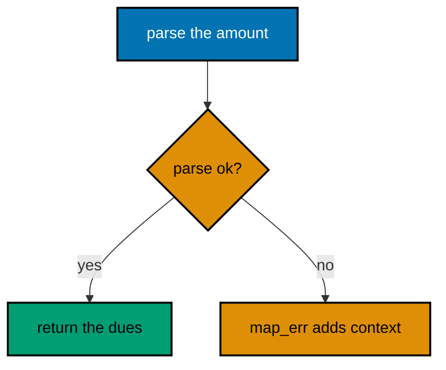

**`learning/code/ex-12-map-err-adds-context/main.rs`**:

```rust
// Example 12: Map Err Adds Context.
// => `map_err` transforms only the failure, leaving success untouched.
// => Wrap at the boundary where you know what the program was attempting.
fn parse_line(line: &str) -> Result<(&str, i32), String> {
    // => member and amount
    // => split the line first: a missing colon is a shape failure, not a parse one.
    let (member, raw) = line // => borrow the line; both halves borrow it too
        .split_once(':') // => `None` when the colon is missing entirely
        .ok_or_else(|| format!("no colon: {}", line))?; // => `?` lifts it early
                                                        // => the amount parse below is where the low-level error gets its context.
    let amount = raw // => the text after the colon
        .parse::<i32>() // => `ParseIntError` says little about our ledger
        .map_err(|_| format!("line {:?} has a bad amount", line))?; // => now it names the line
    Ok((member, amount)) // => both halves survived: hand them back
}
fn main() {
    // => one good line and one bad amount: fixed inputs, fixed verdicts.
    println!("{:?}", parse_line("sari:50")); // => Output: Ok(("sari", 50))
    println!("{:?}", parse_line("sari:xyz")); // => Output: Err("line \"sari:xyz\" has a bad amount")
}
```

**Output** (`learning/code/ex-12-map-err-adds-context/expected/main.stdout.txt`):

```text
Ok(("sari", 50))
Err("line \"sari:xyz\" has a bad amount")
```

**Key takeaway**: `map_err` where you have context; the message should name the job, not just the operation.

**Why it matters**: A bare `invalid digit` tells the operator nothing about which of ten thousand lines broke, while one `map_err` at the parsing boundary attaches the line for free. Context added late is archaeology; context added at the boundary is a complete incident report. Operators paged at night will bless the engineer whose errors name the exact line, file, and job instead of a bare conversion failure.

### Example 13: Custom Error Enum

One enum with a variant per failure mode lets callers match on what went wrong instead of parsing strings. This example settles dues with distinct variants for bad lines, bad amounts, and refused negatives, each with its own message. (Concepts: co-02.)

**`learning/code/ex-13-custom-error-enum/main.rs`**:

```rust
// Example 13: Custom Error Enum.
// => An enum names every failure mode: callers match variants, not strings.
// => `Display` renders the message; `Error` plugs the type into `?` chains.
use std::fmt; // => `Display` and `Formatter` live here
#[derive(Debug)] // => `Debug` for the test-style `{:?}` print below
enum LedgerError {
    // => every way settling can fail, in one type
    BadLine(String),   // => the line has no colon at all
    BadAmount(String), // => the amount after the colon will not parse
    Negative(String),  // => dues only grow: a minus sign is refused
}
// => `Display` decides what operators read; keep each arm to one line.
impl fmt::Display for LedgerError {
    // => the human message per variant
    fn fmt(&self, out: &mut fmt::Formatter<'_>) -> fmt::Result {
        // => standard shape
        match self {
            // => every variant needs its own message
            LedgerError::BadLine(l) => write!(out, "bad line: {}", l), // => names the line
            LedgerError::BadAmount(l) => write!(out, "bad amount: {}", l), // => names the line
            LedgerError::Negative(l) => write!(out, "negative refused: {}", l), // => names the line
        }
    }
}
// => `Error` needs `Debug` plus `Display`: both exist, so this is one line.
// => The empty body is complete: the trait has no required methods left.
impl std::error::Error for LedgerError {} // => plugs into `?` and `Box<dyn Error>`
                                          // => The parser now returns the enum: callers learn the mode, not just text.
fn parse_line(line: &str) -> Result<(&str, i32), LedgerError> {
    // => typed failures
    let (member, raw) = line // => same split as the wrapping example
        .split_once(':') // => `None` when the colon is missing
        .ok_or_else(|| LedgerError::BadLine(line.to_string()))?; // => variant one
    let amount = raw // => the text after the colon
        .parse::<i32>() // => still the stdlib parser underneath
        .map_err(|_| LedgerError::BadAmount(line.to_string()))?; // => variant two
    if amount < 0 {
        // => the domain rule: dues never go negative
        return Err(LedgerError::Negative(line.to_string())); // => variant three
    }
    Ok((member, amount)) // => a clean line survives all three checks
}
fn main() {
    // => three fixed lines exercise all three variants plus success.
    // => `unwrap_err` is test-only shorthand: it would panic in production code.
    println!("{:?}", parse_line("sari:50").unwrap()); // => Output: ("sari", 50)
    println!("{}", parse_line("oops").unwrap_err()); // => Output: bad line: oops
    println!("{}", parse_line("sari:xyz").unwrap_err()); // => Output: bad amount: sari:xyz
    println!("{}", parse_line("sari:-5").unwrap_err()); // => Output: negative refused: sari:-5
}
```

**Output** (`learning/code/ex-13-custom-error-enum/expected/main.stdout.txt`):

```text
("sari", 50)
bad line: oops
bad amount: sari:xyz
negative refused: sari:-5
```

**Key takeaway**: Model each failure mode as an enum variant with `Display`; match on variants, not strings.

**Why it matters**: String errors force every caller to re-parse prose to decide what happened, which breaks the moment anyone rewords a message. Variants keep the decision machine-readable while `Display` keeps the operator message human, so both audiences get exactly what they need. Callers that match variants keep compiling when messages improve, while string-matching callers break on every rewording.

### Example 14: Option Combinators

`map`, `and_then`, and `filter` transform the value inside an `Option` without unwrapping it by hand. This example normalizes an optional nickname through three stages, short-circuiting on the first missing piece. (Concepts: co-02, co-01.)

**`learning/code/ex-14-option-combinators/main.rs`**:

```rust
// Example 14: Option Combinators.
// => Combinators transform inside the `Option`: no `match`, no unwrap.
// => `map` changes the value; `and_then` chains a fallible step; both skip `None`.
fn main() {
    // => a present nickname flows through all three stages below.
    let nick: Option<&str> = Some("  Bud  "); // => padded, mixed case
    let clean = nick // => the pipeline starts from the option itself
        .map(|s| s.trim()) // => stage one: trim the padding
        .filter(|s| !s.is_empty()) // => stage two: reject empties
        .map(|s| s.to_uppercase()); // => stage three: normalize the case
    println!("{:?}", clean); // => Output: Some("BUD")
                             // => a missing nickname skips every stage: nothing runs, nothing panics.
    let missing: Option<&str> = None; // => absent from the start
    let still_missing = missing // => the same three stages, all skipped
        .map(|s| s.trim()) // => never runs: the input is already `None`
        .filter(|s| !s.is_empty()) // => never runs either
        .map(|s| s.to_uppercase()); // => `None` flows straight through
    println!("{:?}", still_missing); // => Output: None
}
```

**Output** (`learning/code/ex-14-option-combinators/expected/main.stdout.txt`):

```text
Some("BUD")
None
```

**Key takeaway**: Transform optional values with `map`/`filter` chains; `None` skips every stage safely.

**Why it matters**: Combinator chains state the transformation once instead of guarding each step with its own presence check, which is where hand-rolled optional code grows its nesting. Short-circuiting is then structural rather than remembered, so a new stage cannot forget the check. Every combinator added later slots into the same chain shape, so pipelines grow by extension rather than by re-indentation.

### Example 15: Boxed Errors Across Functions

`Box<dyn Error>` erases the concrete failure type so helpers with different errors compose through `?`. This example parses dues from text and from numbers in one pipeline, unifying an I/O-shaped error and a parse error behind one return type. (Concepts: co-02, co-10.)

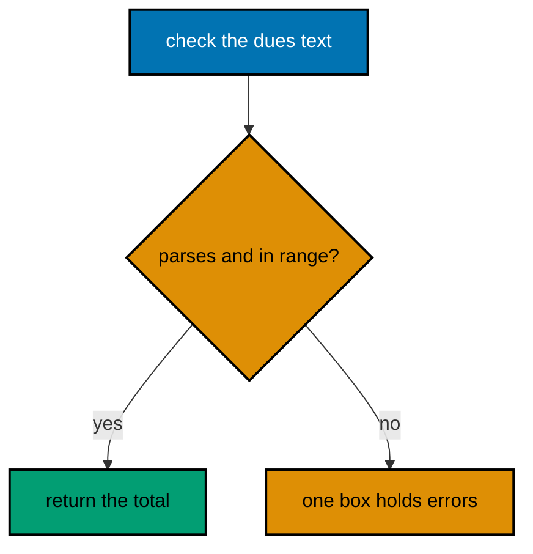

**`learning/code/ex-15-boxed-errors-across-functions/main.rs`**:

```rust
// Example 15: Boxed Errors Across Functions.
// => `Box<dyn Error>` erases the concrete type: different errors, one signature.
// => `?` converts automatically through `From`, so each helper keeps its own error.
// => The caller below matches on the message; real code matches before boxing.
use std::error::Error; // => the `Error` trait the box carries
use std::num::ParseIntError; // => the parse helper's concrete error
                             // => This helper fails with the stdlib parse error, unboxed and precise.
fn parse_amount(raw: &str) -> Result<i32, ParseIntError> {
    // => concrete error
    raw.parse::<i32>() // => `ParseIntError` on bad digits
}
// => This helper fails with a plain message for out-of-range dues.
fn check_range(amount: i32) -> Result<i32, String> {
    // => a different error type
    if (1..=1000).contains(&amount) {
        // => dues live between 1 and 1000
        Ok(amount) // => in range: pass it along
    } else {
        Err(format!("out of range: {}", amount)) // => message error instead
    }
}
// => The box unifies both helpers: `?` converts each error on the way out.
fn settle(raw: &str) -> Result<i32, Box<dyn Error>> {
    // => one type for both
    let amount = parse_amount(raw)?; // => `ParseIntError` boxes here
    Ok(check_range(amount)?) // => `String` boxes here instead
}
fn main() {
    // => three fixed inputs: success, a parse failure, and a range failure.
    println!("{:?}", settle("50")); // => Output: Ok(50)
    println!("{:?}", settle("xyz").map_err(|e| e.to_string())); // => Err with the parse message
    println!("{:?}", settle("5000").map_err(|e| e.to_string())); // => Err("out of range: 5000")
}
```

**Output** (`learning/code/ex-15-boxed-errors-across-functions/expected/main.stdout.txt`):

```text
Ok(50)
Err("invalid digit found in string")
Err("out of range: 5000")
```

**Key takeaway**: `Box<dyn Error>` unifies heterogeneous failures where the caller only needs the message.

**Why it matters**: Small tools and examples rarely benefit from a full error enum, yet still compose helpers that fail differently. Boxing keeps each helper's precise error at its own level while the pipeline above speaks one type, with the enum refactor waiting until callers need to match. When callers eventually need to match on failures, the box unwraps back into an enum without disturbing the pipeline above it.

### Example 16: Assert Documents Invariants

`assert!` states a condition the program refuses to continue without, and passing asserts print nothing. This example settles a fixed ledger and asserts every intermediate fact, printing only the final report. (Concepts: co-02.)

**`learning/code/ex-16-assert-documents-invariants/main.rs`**:

```rust
// Example 16: Assert Documents Invariants.
// => `assert!` and `assert_eq!` state facts the run must satisfy to continue.
// => Passing asserts are silent: the transcript shows only the real output.
fn total(dues: &[i32]) -> i32 {
    // => sums a slice of dues
    dues.iter().sum() // => the whole total in one fused pass
}
fn main() {
    // => fixed dues: every fact below is checkable by hand in advance.
    let dues = [50, 75, 25]; // => three dues, total 150
    assert_eq!(dues.len(), 3); // => the ledger shape: exactly three lines
    let sum = total(&dues); // => the value under test
    assert_eq!(sum, 150); // => hand total: 50 + 75 + 25
    assert!(sum > 0); // => the domain rule: settlements stay positive
                      // => every assert passed silently, so only the report below prints.
    println!("settled: {}", sum); // => Output: settled: 150
    println!("lines: {}", dues.len()); // => Output: lines: 3
}
```

**Output** (`learning/code/ex-16-assert-documents-invariants/expected/main.stdout.txt`):

```text
settled: 150
lines: 3
```

**Key takeaway**: Assert the facts you already checked by hand; passing asserts stay silent.

**Why it matters**: An assert turns a comment claiming an invariant into a check enforcing it, so the next edit that breaks the assumption fails loudly at the exact line. Silent success keeps transcripts clean while the assertions guard every refactoring the code will ever undergo. Test suites love asserts for the same reason: each one pins a fact the next refactor must preserve or consciously update.

### Example 17: Collect Short-Circuits on First Err

Collecting an iterator of `Result` into `Result<Vec<_>, _>` stops at the first failure and reports it. This example parses three amounts where the middle one is broken, showing the short-circuit and the all-good path side by side. (Concepts: co-02, co-03.)

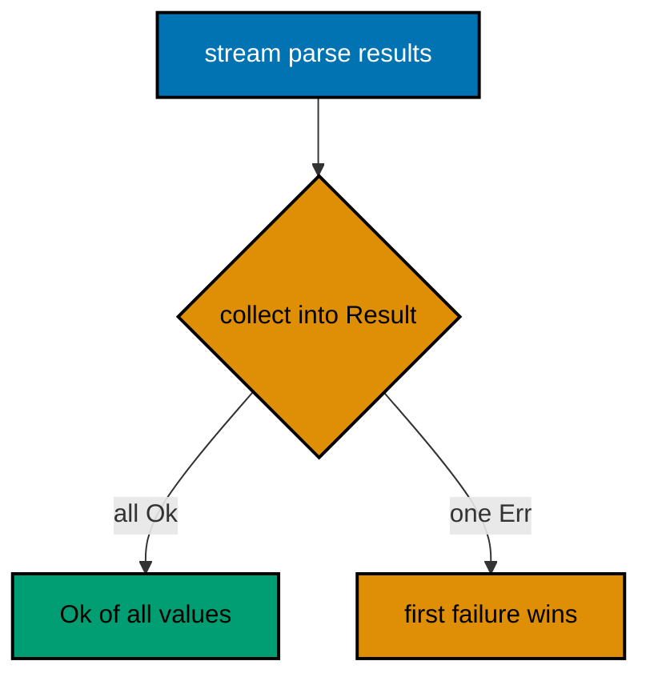

**`learning/code/ex-17-collect-short-circuits-first-err/main.rs`**:

```rust
// Example 17: Collect Short-Circuits on First Err.
// => `collect::<Result<Vec<_>, _>>()` turns many results into one result.
// => The first `Err` stops the collection: later items never even run.
// => This is the batch counterpart to `?`, which stops single call chains.
fn parse_due(text: &str) -> Result<i32, String> {
    // => the same string error
    text.parse::<i32>()
        .map_err(|_| format!("bad amount: {}", text)) // => Err names the input
}
fn main() {
    // => the middle amount is broken: collection must stop there.
    let mixed = ["50", "xyz", "25"]; // => good, bad, then never reached
    let first: Result<Vec<i32>, String> = mixed // => borrow the three texts
        .iter() // => stream them in order
        .map(|t| parse_due(t)) // => parse each into its own result
        .collect(); // => fuse into one result: Err wins immediately
    println!("{:?}", first); // => Output: Err("bad amount: xyz")
                             // => the clean batch collects every value with no failure to report.
    let clean = ["50", "75", "25"]; // => all three parse
    let second: Result<Vec<i32>, String> = clean // => same pipeline, clean input
        .iter() // => stream them in order
        .map(|t| parse_due(t)) // => every parse succeeds here
        .collect(); // => Ok of all three values
    println!("{:?}", second); // => Output: Ok([50, 75, 25])
}
```

**Output** (`learning/code/ex-17-collect-short-circuits-first-err/expected/main.stdout.txt`):

```text
Err("bad amount: xyz")
Ok([50, 75, 25])
```

**Key takeaway**: Collect iterators of `Result` into `Result<Vec<_>>` to fail the batch on the first error.

**Why it matters**: Batch validation without collect needs a manual loop with an early return that every reader must verify, while the collect form states fail-fast as its type. The first failure is also the most actionable one, so stopping there reports the root problem instead of a cascade. Streaming validators, batch importers, and multi-file loaders all share this shape: fail the batch on the first bad row.

### Example 18: Build Strings with Push and Join

`String` owns its bytes and grows with `push_str`, while `join` fuses a whole collection with a separator. This example builds a settlement report line by line and then the same lines in one `join`. (Concepts: co-04.)

**`learning/code/ex-18-string-builder-push/main.rs`**:

```rust
// Example 18: Build Strings with Push and Join.
// => `String` owns growable text; `push_str` appends without reallocating each time.
// => `join` fuses a slice with a separator: one allocation for the whole result.
fn main() {
    // => fixed member names: the same report on every run.
    let members = ["sari", "budi", "citra"]; // => three members to report
                                             // => grow one report line by line: push each piece in order.
    let mut report = String::new(); // => empty owned string, ready to grow
    for member in members {
        // => each member gets its own line
        report.push_str(member); // => the name first
        report.push_str(" settled\n"); // => then the verdict and newline
    }
    print!("{}", report); // => three lines: sari/budi/citra settled
                          // => the same three lines in one call: separator between, none trailing.
    let one_line = members.join(", "); // => single allocation, fixed result
    println!("members: {}", one_line); // => Output: members: sari, budi, citra
}
```

**Output** (`learning/code/ex-18-string-builder-push/expected/main.stdout.txt`):

```text
sari settled
budi settled
citra settled
members: sari, budi, citra
```

**Key takeaway**: Grow reports with `push_str` in a loop; fuse lists with `join` in one call.

**Why it matters**: Pushing into one `String` avoids the quadratic copying of `+` in a loop, where each step copies everything built so far. `join` goes further by sizing the result once, which is why idiomatic Rust never concatenates collections with repeated addition. Report builders, log formatters, and SQL string assembly all benefit, since each avoids the quadratic trap the same way.

### Example 19: Split, Trim, Parse Pipeline

Line-oriented input parses through the same three stages every time: split the shape, trim the noise, parse the value. This example turns fixed ledger lines into member-amount pairs, skipping the malformed one. (Concepts: co-04.)

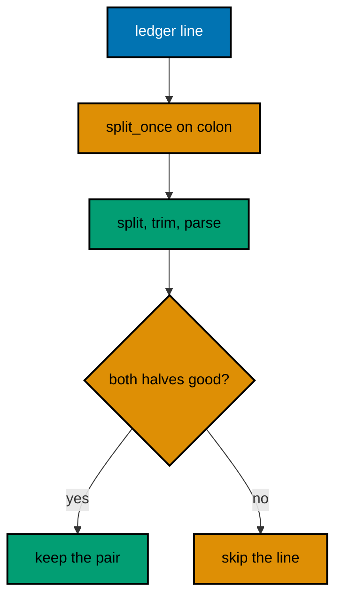

**`learning/code/ex-19-split-trim-parse-pipeline/main.rs`**:

```rust
// Example 19: Split, Trim, Parse Pipeline.
// => `split_once` divides a line at the first separator, no regex needed.
// => `trim` removes surrounding whitespace before the value is parsed.
// => The pipeline shape matches the line grammar: name, colon, amount.
fn parse_pair(line: &str) -> Option<(&str, i32)> {
    // => `None` skips bad lines
    // => `?` on `Option` returns `None` early: the error-handling habit reused.
    let (member, raw) = line.split_once(':')?; // => shape check first
    let amount = raw.trim().parse::<i32>().ok()?; // => noise off, then parse
    Some((member.trim(), amount)) // => clean pair for the caller
}
fn main() {
    // => fixed lines: two parse, one has a broken amount, one lacks a colon.
    let lines = ["sari: 50", "oops", "budi: xyz", "citra: 25"]; // => four shapes
    for line in lines {
        // => each line takes the same three stages
        match parse_pair(line) {
            // => `Some` prints, `None` reports the skip
            Some((member, amount)) => println!("{} owes {}", member, amount), // => two hits
            None => println!("skip: {}", line), // => oops and budi: xyz
        }
    }
}
```

**Output** (`learning/code/ex-19-split-trim-parse-pipeline/expected/main.stdout.txt`):

```text
sari owes 50
skip: oops
skip: budi: xyz
citra owes 25
```

**Key takeaway**: Split the shape, trim the noise, parse the value; return `None` for lines that fail any stage.

**Why it matters**: Three explicit stages make each rejection reason obvious, while a single clever expression hides which stage failed. Returning `Option` turns malformed input into an ordinary skip the caller handles with the same combinators as any other absence. The same three stages parse configuration files, CSV rows, and protocol lines, making the pipeline a reusable reading skill.

### Example 20: Format with Width and Precision

`format!` and `println!` share verbs where width pads, precision cuts, and `{:?}` shows the programmer's view. This example renders a fixed settlement table so every verb's effect is visible in the transcript. (Concepts: co-04.)

**`learning/code/ex-20-format-verbs-width-precision/main.rs`**:

```rust
// Example 20: Format with Width and Precision.
// => `{:<10}` left-pads to width; `{:.2}` rounds floats to two places.
// => `{:?}` prints the Debug view: quotes and escapes included, always.
// => Verbs compose: `{:<10.2}` would pad a rounded number in one step.
fn main() {
    // => fixed figures: the same table on every run.
    let member = "sari"; // => the name column, padded below
    let share = 33.3333; // => the share column, rounded below
    let dues = [50, 75]; // => the debug column shows the raw shape
                         // => width pads names into a column; precision rounds the share.
    println!("{:<10} {:.2}", member, share); // => Output: sari       33.33
                                             // => `{:?}` shows structure: brackets, commas, and exact values.
    println!("{:?}", dues); // => Output: [50, 75]
                            // => `format!` builds the same verbs into an owned string for later.
    let cell = format!("{:>6}", 150); // => right-align the total in six
    println!("[{}]", cell); // => Output: [   150]
}
```

**Output** (`learning/code/ex-20-format-verbs-width-precision/expected/main.stdout.txt`):

```text
sari       33.33
[50, 75]
[   150]
```

**Key takeaway**: Pad with width, round with precision, inspect with `{:?}`; `format!` builds strings with the same verbs.

**Why it matters**: Aligned columns turn a wall of numbers into a table an operator can scan, and precision verbs stop floating-point noise from implying false accuracy. The Debug view alongside keeps the human rendering honest about the underlying value. Receipt printers, ledger exports, and audit tables all depend on these verbs, so learning them once pays off in every report.

### Example 21: Read and Write Temp Files

Whole-file helpers read and write small files in one call each, and the temp directory keeps runs from littering the repository. This example writes a fixed note, reads it back, and prints the content with its byte count. (Concepts: co-04.)

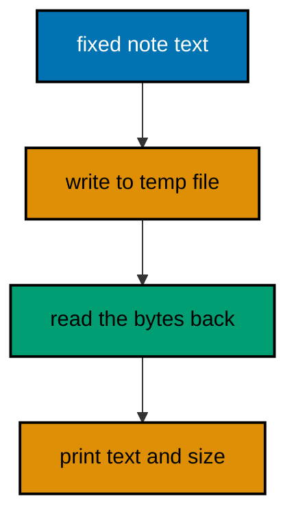

**`learning/code/ex-21-read-write-temp-files/main.rs`**:

```rust
// Example 21: Read and Write Temp Files.
// => `write` stores whole bytes at once; `read_to_string` loads them back.
// => The temp directory holds scratch: fixed name, fixed content, removed after.
// => Only content and length print: the temp path itself never appears.
use std::fs; // => the whole-file read and write helpers
use std::path::PathBuf; // => joins directory and file name portably
fn main() {
    // => fixed note: identical bytes on every run, in any directory.
    let note = "catat: bayar zakat sebelum haul tiba\n"; // => one line, newline kept
                                                         // => a fixed name under the temp dir: no repo litter, no cleanup surprises.
    let mut path = PathBuf::from(std::env::temp_dir()); // => OS temp directory
    path.push("rust-in-depth-ex21.txt"); // => fixed scratch name
                                         // => write the whole note in one call: small files need no streaming.
    fs::write(&path, note).expect("temp dir is writable"); // => fails loudly otherwise
                                                           // => read the whole file back: the round trip proves the write.
    let back = fs::read_to_string(&path).expect("just-written file reads back"); // => same bytes
    assert_eq!(back, note); // => the round trip is exact, checked not hoped
    print!("{}", back); // => Output: catat: bayar zakat sebelum haul tiba
    println!("bytes: {}", back.len()); // => Output: bytes: 37
                                       // => remove the scratch: deterministic runs leave no trace behind.
    fs::remove_file(&path).expect("scratch file removes cleanly"); // => tidy temp dir
}
```

**Output** (`learning/code/ex-21-read-write-temp-files/expected/main.stdout.txt`):

```text
catat: bayar zakat sebelum haul tiba
bytes: 37
```

**Key takeaway**: `fs::write` and `fs::read_to_string` move whole small files; temp paths keep runs clean.

**Why it matters**: Whole-file helpers reduce small-file I/O to two calls with no open-handle bookkeeping, which removes the leak and flush bugs streaming code grows. A fixed temp path with content-only assertions keeps the run deterministic while still touching a real filesystem. Log rotation, checkpoint files, and export drops all use these two calls, making small-file I/O a single transferable habit.

### Example 22: Buffered Lines with Results

Big files stream line by line through `BufReader`, where each line arrives as its own `Result`. This example writes a fixed three-line fixture, streams it back, and totals the valid dues while counting the broken line. (Concepts: co-04.)

**`learning/code/ex-22-buffered-lines-with-results/main.rs`**:

```rust
// Example 22: Buffered Lines with Results.
// => `BufReader` streams lines without loading the whole file at once.
// => `lines()` yields one `Result` per line: I/O failure stays per-line.
// => Temp fixture, fixed content, content-only output: deterministic again.
use std::fs::File; // => opens the fixture for streaming
use std::io::{BufRead, BufReader, Write}; // => lines, buffering, and writing
use std::path::PathBuf; // => portable temp path join
fn main() {
    // => fixed fixture: two dues and one broken line, same bytes every run.
    let mut path = PathBuf::from(std::env::temp_dir()); // => OS temp directory
    path.push("rust-in-depth-ex22.txt"); // => fixed scratch name
                                         // => write the three lines now so the stream below has something to read.
    let mut out = File::create(&path).expect("temp dir is writable"); // => fresh fixture
    writeln!(out, "sari:50").expect("fixture line writes"); // => valid due one
    writeln!(out, "oops").expect("fixture line writes"); // => broken line
    writeln!(out, "budi:75").expect("fixture line writes"); // => valid due two
    drop(out); // => close the writer before the reader opens the path
               // => stream the fixture: each line parses on arrival, nothing held whole.
    let file = File::open(&path).expect("just-written fixture opens"); // => read it back
    let mut total = 0; // => sums only the valid dues
    let mut broken = 0; // => counts lines the grammar rejects
    for line in BufReader::new(file).lines() {
        // => one `Result` per line
        let text = line.expect("fixture lines read cleanly"); // => I/O is trusted here
        match text.split_once(':') {
            // => the same line grammar as before
            Some((_, raw)) => match raw.trim().parse::<i32>() {
                // => value stage
                Ok(amount) => total += amount, // => valid dues join the total
                Err(_) => broken += 1,         // => bad amount: counted, not fatal
            },
            None => broken += 1, // => no colon: counted, not fatal
        }
    }
    // => fixed figures: 50 + 75 totals 125 with exactly one broken line.
    println!("total: {}", total); // => Output: total: 125
    println!("broken: {}", broken); // => Output: broken: 1
                                    // => remove the fixture: the run leaves nothing behind.
    std::fs::remove_file(&path).expect("scratch file removes cleanly"); // => tidy temp dir
}
```

**Output** (`learning/code/ex-22-buffered-lines-with-results/expected/main.stdout.txt`):

```text
total: 125
broken: 1
```

**Key takeaway**: Stream big files with `BufReader::lines()`; handle each line's `Result` where it arrives.

**Why it matters**: Line streaming holds one line in memory however large the file grows, which is the difference between a tool that scales and one that falls over on real data. Per-line results keep one broken line from aborting ten million good ones, turning corruption into a count instead of a crash.

### Example 23: PathBuf Builds Portable Paths

`PathBuf` joins path segments with the platform's separator and reads back the file name and extension. This example builds a report path piece by piece and inspects its parts without touching the filesystem. (Concepts: co-04.)

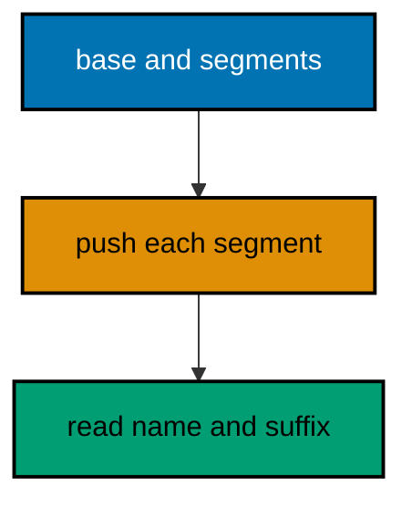

**`learning/code/ex-23-pathbuf-builds-portable-paths/main.rs`**:

```rust
// Example 23: PathBuf Builds Portable Paths.
// => `PathBuf` joins with the platform separator: no hardcoded slashes.
// => `file_name` and `extension` read the parts back without string surgery.
// => Nothing below touches the disk: paths are data until used.
use std::path::PathBuf; // => the owned, joinable path type
fn main() {
    // => build the report path segment by segment, portably.
    let mut report = PathBuf::from("laporan"); // => base directory first
    report.push("2026"); // => year segment, separator added for us
    report.push("settle.txt"); // => file segment completes the path
                               // => the joined path prints with the platform separator, fixed segments.
    println!("path: {}", report.display()); // => Output: laporan/2026/settle.txt
                                            // => `file_name` returns the last segment as an `OsStr`, if there is one.
    println!("file: {:?}", report.file_name()); // => Output: Some("settle.txt")
                                                // => `extension` returns the part after the final dot, if there is one.
    println!("ext: {:?}", report.extension()); // => Output: Some("txt")
                                               // => `parent` walks one segment up: useful for creating directories first.
    println!("dir: {:?}", report.parent()); // => Output: Some("laporan/2026")
}
```

**Output** (`learning/code/ex-23-pathbuf-builds-portable-paths/expected/main.stdout.txt`):

```text
path: laporan/2026/settle.txt
file: Some("settle.txt")
ext: Some("txt")
dir: Some("laporan/2026")
```

**Key takeaway**: Build paths with `PathBuf::push`; read parts with `file_name`, `extension`, and `parent`.

**Why it matters**: String-concatenated paths break on the first platform with a different separator and invite double-slash bugs no test catches on the author's machine. Path-aware joins and part readers keep path logic correct everywhere the binary runs, which for Rust is everywhere. Asset pipelines, configuration loaders, and export writers all share this path logic, so the skill transfers across every tool.

### Example 24: SystemTime and Duration Arithmetic

`SystemTime` marks instants and `Duration` spans them, with `checked_add` refusing overflow instead of wrapping. This example settles a fixed invoice instant plus a payment window, all from the epoch so no clock is ever read. (Concepts: co-05.)

**`learning/code/ex-24-systemtime-duration-arithmetic/main.rs`**:

```rust
// Example 24: SystemTime and Duration Arithmetic.
// => Fixed instants from `UNIX_EPOCH`: no clock reads, fully deterministic.
// => `checked_add` returns `None` on overflow instead of wrapping silently.
// => `duration_since` orders two instants and reports the span between them.
use std::time::{Duration, UNIX_EPOCH}; // => the epoch anchor and time spans
fn main() {
    // => the invoice lands exactly one day after the epoch, by construction.
    let invoice = UNIX_EPOCH + Duration::from_secs(86_400); // => day one, fixed
                                                            // => the payment window is thirty days: dues settle within a month.
    let window = Duration::from_secs(30 * 86_400); // => thirty days as seconds
                                                   // => the deadline adds the window; overflow would be `None`, not garbage.
    let deadline = invoice.checked_add(window).expect("far from overflow"); // => day thirty-one
                                                                            // => the span between deadline and invoice is the window itself.
    let span = deadline.duration_since(invoice).expect("deadline is later"); // => ordered pair
                                                                             // => fixed figures: thirty days is 2,592,000 seconds, printed three ways.
    println!("days: {}", span.as_secs() / 86_400); // => Output: days: 30
    println!("secs: {}", span.as_secs()); // => Output: secs: 2592000
    println!(
        "deadline after epoch: {}",
        deadline
            .duration_since(UNIX_EPOCH)
            .expect("later")
            .as_secs()
    ); // => Output: deadline after epoch: 2678400
}
```

**Output** (`learning/code/ex-24-systemtime-duration-arithmetic/expected/main.stdout.txt`):

```text
days: 30
secs: 2592000
deadline after epoch: 2678400
```

**Key takeaway**: Build fixed instants from `UNIX_EPOCH`; add with `checked_add` and compare with `duration_since`.

**Why it matters**: Clock reads make tests flaky at midnight, on leap seconds, and in three time zones at once, while epoch-anchored fixtures run identically everywhere. Checked arithmetic turns distant-future overflow from silent corruption into an explicit `None` the code must handle. Expiry checks, retry backoffs, and schedule windows all build on these two operations, making time math a solved problem.

### Example 25: Human Duration Formatting

The standard library reports durations as seconds and nanos, so human rendering is one small function over division and remainder. This example formats fixed spans as days, hours, minutes, and seconds the way a settlement notice would. (Concepts: co-05.)

**`learning/code/ex-25-human-duration-formatting/main.rs`**:

```rust
// Example 25: Human Duration Formatting.
// => `as_secs` is the whole span in seconds: divide and take remainders.
// => One pure function renders any fixed span; the table below proves it.
// => No clock, no locale, no now: rendering stays a pure computation.
use std::time::Duration; // => the span type being rendered
                         // => Break a span into day, hour, minute, second parts for display.
fn human(span: Duration) -> String {
    // => pure: same input, same string
    let total = span.as_secs(); // => whole seconds: sub-second parts ignored
    let days = total / 86_400; // => full days first
    let hours = (total % 86_400) / 3_600; // => leftover hours next
    let minutes = (total % 3_600) / 60; // => leftover minutes next
    let seconds = total % 60; // => the final remainder
                              // => one fixed shape: always four parts, always the same order.
    format!("{}d {}h {}m {}s", days, hours, minutes, seconds) // => e.g. 1d 2h 3m 4s
}
fn main() {
    // => three fixed spans exercise days, hours, and the zero corner.
    println!("{}", human(Duration::from_secs(90_061))); // => Output: 1d 1h 1m 1s
    println!("{}", human(Duration::from_secs(3_600))); // => Output: 0d 1h 0m 0s
    println!("{}", human(Duration::ZERO)); // => Output: 0d 0h 0m 0s
}
```

**Output** (`learning/code/ex-25-human-duration-formatting/expected/main.stdout.txt`):

```text
1d 1h 1m 1s
0d 1h 0m 0s
0d 0h 0m 0s
```

**Key takeaway**: Render durations with division and remainder over `as_secs`; keep rendering pure and clock-free.

**Why it matters**: Human time strings built from live clocks cannot be asserted, so the formatting logic and the instant source must stay separate functions. A pure renderer over fixed spans is testable to the second, and the live instant plugs in at exactly one call site the tests never touch. Countdown displays, uptime reporters, and settlement notices all render through this function, keeping time human everywhere.
