Examples 26-53 organize Rust into professional shape: modules, packages, and dependencies first (Examples 26-34), showing inline modules, re-exports, crate paths, `pub(crate)` boundaries, manifest reading, requirement operators, lockfiles, graph order, and `cfg` shapes; then the testing convention in full (Examples 35-44), from first unit tests through failing-first workflow, table tests, shared fixtures, assertion messages, work-not-time benchmarks, seeded generators, ignored slow tests, panic contracts, and name filters; finally generics with value semantics (Examples 45-53), covering bounded type parameters, traits, derives, `Copy` versus `Clone`, borrow rules, lifetimes, `Cow`, shared ownership, and conversion traits. Every example is a complete, runnable Rust program under `learning/code/`; test units compile with `rustc --test` and run through the command in their own `run.yaml`.

---

### Example 26: Inline Modules Organize Code

A `mod` block groups related items under one name, and `pub` opens exactly the pieces callers may use. This example splits settlement into a parsing module and a totals module, with `main` wiring the two. (Concepts: co-06.)

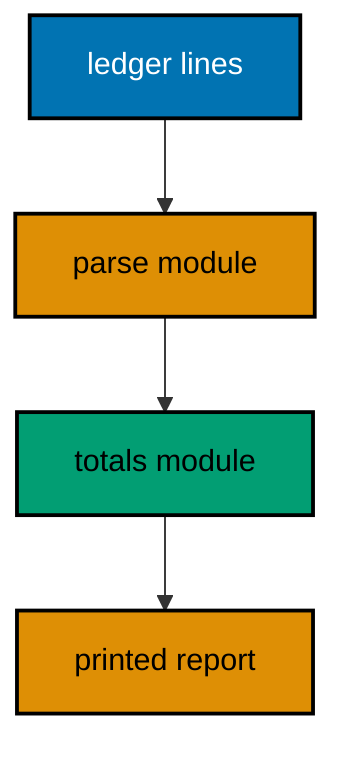

**`learning/code/ex-26-inline-modules-organize-code/main.rs`**:

```rust
// Example 26: Inline Modules Organize Code.
// => `mod` groups related items: parsing lives apart from totaling.
// => `pub` opens an item to the parent; private items stay hidden.
// => `main` below reads as the wiring: parse, then total, then print.
mod parse {
    // => the line-grammar module owns splitting and parsing
    // => `pub` exposes the pair type: callers name it in signatures.
    #[derive(Debug, PartialEq)] // => `Debug` prints, `PartialEq` compares
    pub struct Due {
        // => one parsed ledger line
        pub member: String, // => `pub` fields: the totals module reads them
        pub amount: i32,    // => dues stay whole numbers in this ledger
    }
    // => `pub` opens the parser: `main` calls it, nobody else needs to.
    pub fn line(text: &str) -> Option<Due> {
        // => `None` skips bad lines
        let (member, raw) = text.split_once(':')?; // => shape check first
        let amount = raw.trim().parse::<i32>().ok()?; // => value check second
        Some(Due {
            // => both halves survived: build the pair
            member: member.trim().to_string(), // => owned name for the totals
            amount,                            // => shorthand: field and variable share the name
        })
    }
}
mod totals {
    // => the arithmetic module owns summing, nothing else
    use super::parse::Due; // => `super` climbs one level to the sibling
                           // => `pub` opens the total: `main` prints it, the module computes it.
    pub fn sum(dues: &[Due]) -> i32 {
        // => borrows the parsed lines
        dues.iter().map(|due| due.amount).sum() // => amounts in, total out
    }
}
fn main() {
    // => fixed lines: two parse and one is skipped, every run.
    let lines = ["sari:50", "oops", "budi:75"]; // => the raw ledger text
                                                // => parse first, skipping failures: the modules enforce the order.
    let dues: Vec<parse::Due> = lines // => paths name the owning module
        .iter() // => stream the raw lines
        .filter_map(|text| parse::line(text)) // => keep only what parses
        .collect(); // => the clean ledger both modules share
    println!("parsed: {}", dues.len()); // => Output: parsed: 2
    println!("total: {}", totals::sum(&dues)); // => Output: total: 125
}
```

**Output** (`learning/code/ex-26-inline-modules-organize-code/expected/main.stdout.txt`):

```text
parsed: 2
total: 125
```

**Key takeaway**: Group by job in `mod` blocks; open only the API with `pub` and wire modules in `main`.

**Why it matters**: Module boundaries turn a flat file into named layers where each layer's job is visible from its path, so a bug in totals never requires reading the parser. Private-by-default keeps the public surface small on purpose, which means refactors inside a module cannot break callers that never saw the internals.

### Example 27: Use Brings Names Close, Pub Use Re-Exports

`use` shortens a deep path at the point of use, and `pub use` re-exports an inner item as part of an outer API. This example builds a two-level ledger module where the top level re-exports exactly what readers need. (Concepts: co-06.)

**`learning/code/ex-27-use-and-reexport-shape-api/main.rs`**:

```rust
// Example 27: Use Brings Names Close, Pub Use Re-Exports.
// => `use` shortens paths where they are used: no behavior change.
// => `pub use` re-exports: the outer module publishes an inner name.
// => Readers learn one path; the nesting stays an implementation detail.
mod ledger {
    // => the outer API module readers will import from
    // => the parser submodule stays private: only its product escapes.
    mod parse {
        // => hidden: callers never name this path
        // => `pub(crate)` opens within the crate but not beyond it.
        pub struct Due {
            // => visible to `ledger`, invisible outside
            pub member: String, // => public so the caller below can read each name
            pub amount: i32,    // => amounts stay whole numbers
        }
        // => the parser itself is crate-visible for the re-export below.
        pub fn line(text: &str) -> Option<Due> {
            // => `None` skips bad lines
            let (member, raw) = text.split_once(':')?; // => shape first
            let amount = raw.trim().parse::<i32>().ok()?; // => value second
            Some(Due {
                // => owned name plus amount
                member: member.trim().to_string(), // => caller owns the name
                amount,                            // => shorthand again
            })
        }
    }
    // => the re-export: `ledger::Due` and `ledger::line` are the whole API.
    pub use self::parse::{line, Due}; // => two names escape; the module stays hidden
                                      // => the report helper lives beside the re-export: one home for output.
    pub fn report(dues: &[Due]) -> String {
        // => pure: string in, string out
        let total: i32 = dues.iter().map(|due| due.amount).sum(); // => the total
        format!("lines: {} total: {}", dues.len(), total) // => fixed shape
    }
}
// => `use` shortens the two re-exported names for the whole file below.
use ledger::{line, report}; // => one import line, two short names
fn main() {
    // => fixed lines again: callers use the short re-exported names.
    let lines = ["sari:50", "oops", "budi:75"]; // => raw text, same as before
    let dues: Vec<ledger::Due> = lines // => the type keeps its module path
        .iter() // => stream the raw lines
        .filter_map(|text| line(text)) // => short name from the `use` above
        .collect(); // => two parsed dues
                    // => the names travel with the amounts: read them back in order.
    let names: Vec<&str> = dues.iter().map(|due| due.member.as_str()).collect(); // => both members read
    assert_eq!(names, ["sari", "budi"]); // => the parsed names, in order
    println!("{}", report(&dues)); // => Output: lines: 2 total: 125
}
```

**Output** (`learning/code/ex-27-use-and-reexport-shape-api/expected/main.stdout.txt`):

```text
lines: 2 total: 125
```

**Key takeaway**: `use` shortens paths locally; `pub use` publishes inner names as the outer API.

**Why it matters**: Re-exports let a library reorganize its internals without rewriting every caller's imports, because the public path and the implementation path are no longer the same thing. Callers memorize one stable surface while maintainers keep splitting modules behind it, which is exactly how the standard library itself stays navigable at its size.

### Example 28: Crate Tree in One File

A crate is a tree of modules with the crate root at the top, and paths spell the route from the root. This example nests three levels and reaches each one with absolute `crate::` and relative `super::` paths. (Concepts: co-06.)

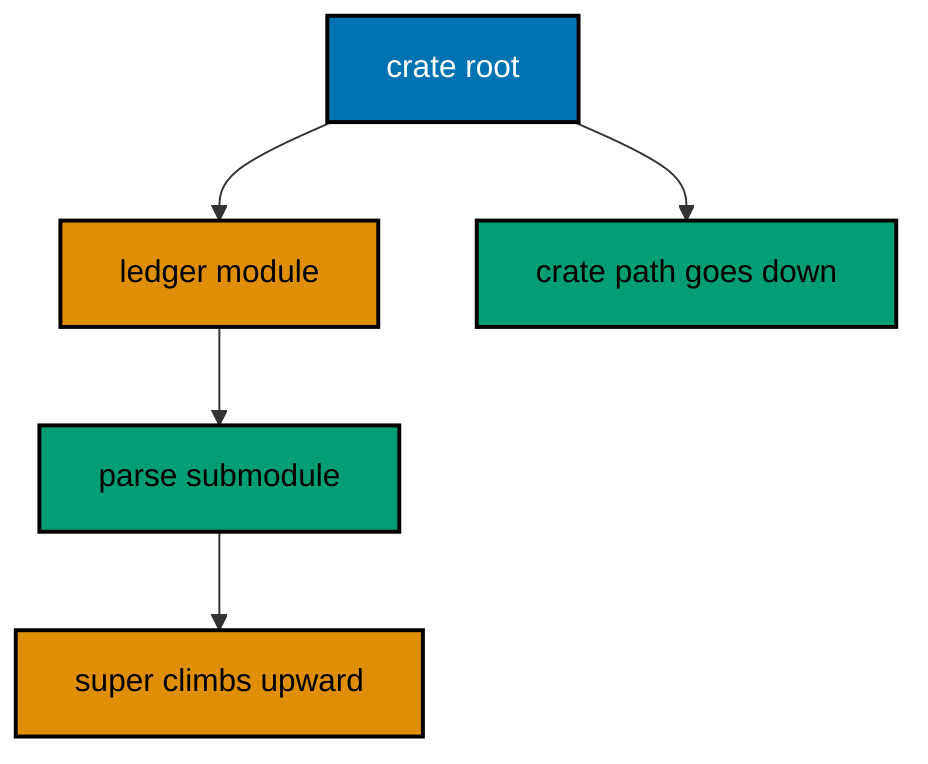

**`learning/code/ex-28-crate-tree-in-one-file/main.rs`**:

```rust
// Example 28: Crate Tree in One File.
// => `crate::` starts at the root: absolute paths never depend on position.
// => `super::` climbs one level: siblings reach each other without the root.
// => `self::` stays put: it names the current module explicitly when needed.
mod ledger {
    // => first level under the crate root
    // => second level: the parser nested inside the ledger module.
    pub mod parse {
        // => `pub` all the way: the root test reaches down here
        // => the deepest item: a constant both paths below will read.
        pub const SEP: char = ':'; // => the ledger separator, defined once
    }
    // => `super` is unused here; the sibling route below shows `self` instead.
    pub fn describe() -> String {
        // => names its own separator explicitly
        format!("sep is {:?}", self::parse::SEP) // => `self` stays in `ledger`
    }
}
fn main() {
    // => the absolute path from the root reaches straight down two levels.
    println!("root path: {:?}", crate::ledger::parse::SEP); // => Output: root path: ':'
                                                            // => the relative read goes through the sibling's own explicit path.
    println!("{}", ledger::describe()); // => Output: sep is ':'
}
```

**Output** (`learning/code/ex-28-crate-tree-in-one-file/expected/main.stdout.txt`):

```text
root path: ':'
sep is ':'
```

**Key takeaway**: Reach down with `crate::`, climb with `super::`, stay explicit with `self::`.

**Why it matters**: Absolute paths keep working when items move sideways, while relative paths keep sibling code readable without restating the root on every line. Mixing them deliberately — root paths at boundaries, short relative paths inside — is what keeps large trees navigable instead of a maze of inconsistent spellings. Large codebases navigate by these paths daily, so consistent absolute-at-boundary and relative-inside conventions compound across every file.

### Example 29: Pub Crate Marks the Team Boundary

`pub(crate)` shares an item with the whole crate but with nobody outside it. This example parses lines through a crate-visible helper that the binary's `main` uses, a shape external users of a library could never touch. (Concepts: co-06.)

**`learning/code/ex-29-pub-crate-boundary/main.rs`**:

```rust
// Example 29: Pub Crate Marks the Team Boundary.
// => `pub` opens to everyone; `pub(crate)` opens to the crate team only.
// => Helpers shared between modules stay crate-visible: no wider promise.
// => `main` here plays the teammate: it uses the helper like a sibling module would.
mod parse {
    // => the parsing team: one helper, one precise visibility
    // => crate-visible: every module in this binary may call it.
    pub(crate) fn amount(raw: &str) -> Option<i32> {
        // => `None` rejects junk
        raw.trim().parse::<i32>().ok() // => trim first, parse second
    }
    // => fully private: even sibling modules cannot name this function.
    fn is_blank(text: &str) -> bool {
        // => the helper's own helper
        text.trim().is_empty() // => whitespace-only counts as blank
    }
    // => crate-visible check built on the private helper above.
    pub(crate) fn usable(text: &str) -> bool {
        // => blank lines are skipped
        !is_blank(text) // => negation of the private rule
    }
}
fn main() {
    // => fixed raws: a number, a padded number, and two rejections.
    // => Blank lines fail the `usable` gate; junk fails the parse itself.
    let raws = ["50", " 75 ", "", "xyz"]; // => two good, two bad
                                          // => Each raw prints its verdict: `Some` for dues, `blank` for empties.
    for raw in raws {
        // => every raw takes the same two gates
        if parse::usable(raw) {
            // => crate-visible gate one: not blank
            println!("{:?}", parse::amount(raw)); // => Some(50), Some(75), None
        } else {
            println!("blank"); // => Output: blank
        }
    }
}
```

**Output** (`learning/code/ex-29-pub-crate-boundary/expected/main.stdout.txt`):

```text
Some(50)
Some(75)
blank
None
```

**Key takeaway**: `pub(crate)` shares helpers across modules without promising them to the world.

**Why it matters**: Library evolution depends on a small public surface: everything wider than the crate is a promise every future version must keep. Crate-visible helpers give teammates full reuse with zero external commitment, so internals keep improving without breaking downstream code that never depended on them. Refactors that widen visibility deliberately touch exactly these annotations, making API growth reviewable line by line.

### Example 30: Cargo Manifest as Data

`Cargo.toml` declares the package name, version, and edition that every Rust build reads. This example embeds a small manifest as text and extracts its three identity lines the way tooling does, without needing a network or a build. (Concepts: co-07.)

**`learning/code/ex-30-cargo-manifest-as-data/main.rs`**:

```rust
// Example 30: Cargo Manifest as Data.
// => `Cargo.toml` is the package identity: name, version, edition.
// => Reading it as data teaches the fields without running a build.
// => The manifest below is fixed text, so every extraction is fixed too.
// => Real manifests carry dependencies; this identity-only one has none.
const MANIFEST: &str =
    "[package]\nname = \"dues-ledger\"\nversion = \"0.2.0\"\nedition = \"2021\"\n"; // => the whole manifest as text
                                                                                    // => `value_of` finds `key = "value"` lines and returns the bare value.
fn value_of(text: &str, key: &str) -> Option<String> {
    // => `None` when absent
    for line in text.lines() {
        // => one pass over the manifest lines
        // => header lines like `[package]` carry no `=`: skip, do not bail.
        let Some((name, raw)) = line.split_once('=') else {
            continue;
        }; // => split on the first equals
        if name.trim() == key {
            // => the wanted key, whitespace-tolerant
            return Some(raw.trim().trim_matches('"').to_string()); // => strip quotes
        }
    }
    None // => the key never appeared: callers decide what that means
}
fn main() {
    // => the three identity fields every manifest carries, extracted in order.
    println!("name: {}", value_of(MANIFEST, "name").unwrap()); // => Output: name: dues-ledger
    println!("version: {}", value_of(MANIFEST, "version").unwrap()); // => Output: version: 0.2.0
    println!("edition: {}", value_of(MANIFEST, "edition").unwrap()); // => Output: edition: 2021
    println!("missing: {:?}", value_of(MANIFEST, "license")); // => Output: missing: None
}
```

**Output** (`learning/code/ex-30-cargo-manifest-as-data/expected/main.stdout.txt`):

```text
name: dues-ledger
version: 0.2.0
edition: 2021
missing: None
```

**Key takeaway**: Read `Cargo.toml` as the package identity: name, version, and edition first, dependencies after.

**Why it matters**: The manifest is the one place the package name, its version promise, and its language edition all live together, so every tool question starts by reading it. Parsing it as plain data demystifies the build: there is no magic, only key-value lines that tools and humans read the same way.

### Example 31: Version Requirements Match

Dependency requirements use `^`, `~`, and `=` to say which versions are acceptable, and the resolver picks the highest match. This example implements the three operators over fixed version triples and prints the whole decision table. (Concepts: co-07.)

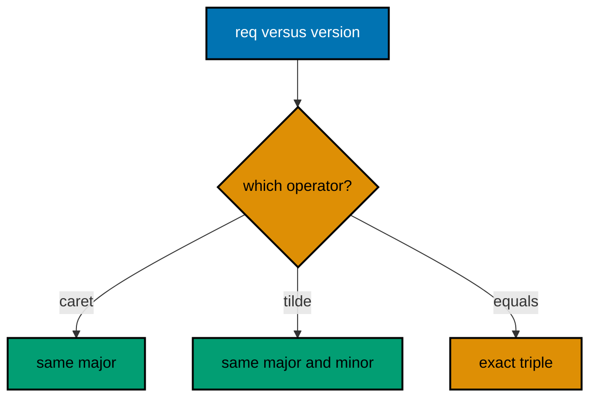

**`learning/code/ex-31-version-requirements-match/main.rs`**:

```rust
// Example 31: Version Requirements Match.
// => `^1.2.3` allows 1.x growth; `~1.2.3` allows 1.2.x; `=1.2.3` pins exact.
// => Versions compare as triples: major, then minor, then patch, in order.
// => The table below is fixed: the same requirements always decide alike.
// => Real resolvers read these from `Cargo.toml`; the logic is identical.
fn triple(text: &str) -> (u32, u32, u32) {
    // => split "M.m.p" into numbers
    let mut parts = text.split('.').map(|p| p.parse::<u32>().unwrap_or(0)); // => bad parts read as zero
    let major = parts.next().unwrap_or(0); // => first number
    let minor = parts.next().unwrap_or(0); // => second number
    let patch = parts.next().unwrap_or(0); // => third number
    (major, minor, patch) // => the comparable triple
}
// => `allows` decides one requirement against one version, operator by operator.
fn allows(req: &str, ver: &str) -> bool {
    // => the resolver's core question
    // => strip the operator first: the remainder is always a plain triple.
    let (op, want) = if let Some(rest) = req.strip_prefix('^') {
        // => caret: minor growth
        ("^", rest) // => keep the operator for the match below
    } else if let Some(rest) = req.strip_prefix('~') {
        // => tilde: patch growth
        ("~", rest) // => keep the operator for the match below
    } else if let Some(rest) = req.strip_prefix('=') {
        // => equals: exact pin
        ("=", rest) // => keep the operator for the match below
    } else {
        ("^", req) // => bare "1.2.3" means caret: the Cargo default
    };
    let (wmaj, wmin, wpatch) = triple(want); // => the wanted triple
    let (vmaj, vmin, vpatch) = triple(ver); // => the candidate triple
    match op {
        // => each operator draws a different acceptance range
        "^" => vmaj == wmaj && (vmaj, vmin, vpatch) >= (wmaj, wmin, wpatch), // => same major, no older
        "~" => (vmaj, vmin) == (wmaj, wmin) && vpatch >= wpatch, // => same minor, no older
        _ => (vmaj, vmin, vpatch) == (wmaj, wmin, wpatch),       // => exact triple only
    }
}
fn main() {
    // => six fixed decisions cover growth, tightening, and the bare default.
    let cases = [
        ("^1.2.3", "1.9.0"),
        ("^1.2.3", "2.0.0"),
        ("~1.2.3", "1.2.9"),
        ("~1.2.3", "1.3.0"),
        ("=1.2.3", "1.2.3"),
        ("1.2.3", "1.4.0"),
    ]; // => requirement, candidate
    for (req, ver) in cases {
        // => each pair takes the same decision function
        // => Six rows: growth allowed, growth refused, tightening, and the default.
        println!("{} vs {}: {}", req, ver, allows(req, ver)); // => true false true false true true
    }
}
```

**Output** (`learning/code/ex-31-version-requirements-match/expected/main.stdout.txt`):

```text
^1.2.3 vs 1.9.0: true
^1.2.3 vs 2.0.0: false
~1.2.3 vs 1.2.9: true
~1.2.3 vs 1.3.0: false
=1.2.3 vs 1.2.3: true
1.2.3 vs 1.4.0: true
```

**Key takeaway**: Bare versions mean caret; `~` tightens to patches; `=` pins the exact triple.

**Why it matters**: Requirement operators are the project's compatibility policy written down, and misreading them either freezes updates or admits breaking ones. Knowing that bare means caret explains why most Rust projects float safely within a major, while `=` marks the few dependencies whose behavior must never shift under a build. Lockfile updates then become deliberate version bumps rather than surprises, since every accepted range was a conscious policy choice.

### Example 32: Lockfile Pins Exact Versions

`Cargo.lock` records the exact version chosen for every dependency so the next build resolves identically. This example embeds a tiny lock excerpt and lists its pinned packages in sorted order. (Concepts: co-07.)

**`learning/code/ex-32-lockfile-pins-exact-versions/main.rs`**:

```rust
// Example 32: Lockfile Pins Exact Versions.
// => `Cargo.lock` is the resolved answer: one exact version per package.
// => Committed locks make every checkout build the same tree, everywhere.
// => The excerpt below is fixed text, so the pin table never changes.
// => Each `[[package]]` block names one package plus its chosen version.
const LOCK: &str = "[[package]]\nname = \"dues-ledger\"\nversion = \"0.2.0\"\n\n[[package]]\nname = \"ledger-kit\"\nversion = \"1.4.0\"\n\n[[package]]\nname = \"audit-trail\"\nversion = \"0.9.1\"\n"; // => three pinned packages
                                                                                                                                                                                                        // => `pins` walks the blocks and collects each name with its version.
fn pins(text: &str) -> Vec<(String, String)> {
    // => sorted by the caller
    let mut out = Vec::new(); // => the collected pins
    let mut name = String::new(); // => the current block's name
    for line in text.lines() {
        // => one pass over the lock lines
        if let Some((key, raw)) = line.split_once('=') {
            // => only key lines matter
            let value = raw.trim().trim_matches('"').to_string(); // => bare value
            if key.trim() == "name" {
                // => a new block starts here
                name = value; // => remember it for the version line
            } else if key.trim() == "version" && !name.is_empty() {
                // => the block's pin
                out.push((name.clone(), value)); // => one pin recorded
            }
        }
    }
    out.sort(); // => alphabetical: audit-trail, dues-ledger, ledger-kit
    out // => the sorted pin table
}
fn main() {
    // => the three pins print in sorted order, identical on every run.
    // => Sorting pins the transcript: hash maps never promise an order.
    for (name, version) in pins(LOCK) {
        // => the sorted table drives the print
        println!("{} {}", name, version); // => audit-trail 0.9.1, then the rest
    }
}
```

**Output** (`learning/code/ex-32-lockfile-pins-exact-versions/expected/main.stdout.txt`):

```text
audit-trail 0.9.1
dues-ledger 0.2.0
ledger-kit 1.4.0
```

**Key takeaway**: Commit the lockfile: the manifest states policy, the lock records the exact resolved tree.

**Why it matters**: Without a committed lock, two checkouts of the same commit can resolve different dependency versions and fail differently, which makes bugs unreproducible by construction. The lock turns resolution from a fresh decision into a recorded fact, so builds vary only when someone deliberately updates the pins. Reproducible builds, binary audits, and supply-chain reviews all start from this file, making it the foundation of release trust.

### Example 33: Dependency Graph in BFS Order

Dependencies form a graph, and builds walk it: a package builds only after everything it needs. This example holds a tiny fixed graph and prints its breadth-first build order from the root package. (Concepts: co-07, co-03.)

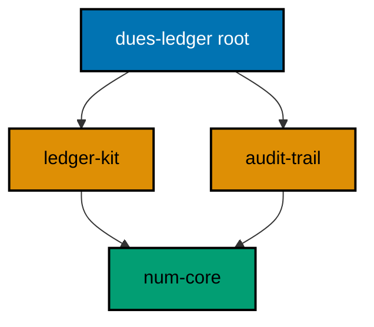

**`learning/code/ex-33-dependency-graph-bfs-order/main.rs`**:

```rust
// Example 33: Dependency Graph in BFS Order.
// => The graph is data: each package names the packages it needs.
// => Breadth-first order builds neighbors before their dependents.
// => The fixed graph below always walks the same order, every run.
// => Real build tools walk this same order over the real resolved tree.
use std::collections::{HashMap, VecDeque}; // => adjacency plus a work queue
                                           // => `order` walks from the root and returns each package exactly once.
fn order(graph: &HashMap<&str, Vec<&str>>, root: &str) -> Vec<String> {
    // => build sequence
    let mut seen = Vec::new(); // => the finished order, each package once
                               // => The queue holds the frontier: pop the front, push neighbors at the back.
    let mut queue = VecDeque::from([root]); // => start with the root package
    while let Some(name) = queue.pop_front() {
        // => oldest queued first
        if seen.iter().any(|s: &String| s == name) {
            // => skip already ordered
            continue; // => `num-core` is needed twice but builds once
        }
        seen.push(name.to_string()); // => record before queueing neighbors
        if let Some(next) = graph.get(name) {
            // => the package's own needs
            for dep in next {
                // => neighbors join the back of the queue
                queue.push_back(dep); // => breadth-first: level by level
            }
        }
    }
    seen // => root first here; builds run this list in reverse
}
fn main() {
    // => the fixed graph: root needs two kits, both need one shared core.
    let graph: HashMap<&str, Vec<&str>> = HashMap::from([
        // => adjacency data
        ("dues-ledger", vec!["ledger-kit", "audit-trail"]), // => root needs two
        ("ledger-kit", vec!["num-core"]),                   // => kit needs the core
        ("audit-trail", vec!["num-core"]),                  // => trail needs the same core
        ("num-core", vec![]),                               // => the core needs nothing
    ]);
    // => the walk order below is fixed: root, kits, then the shared core.
    // => `num-core` appears twice as a need but prints once: `seen` dedupes.
    for name in order(&graph, "dues-ledger") {
        // => each package exactly once
        println!("{}", name); // => dues-ledger, ledger-kit, audit-trail, num-core
    }
}
```

**Output** (`learning/code/ex-33-dependency-graph-bfs-order/expected/main.stdout.txt`):

```text
dues-ledger
ledger-kit
audit-trail
num-core
```

**Key takeaway**: Builds walk dependencies before dependents; breadth-first order makes the sequence explicit.

**Why it matters**: Build order bugs — a package compiling against a stale dependency — vanish once the order is a computed property of the graph instead of a maintained list. Seeing the walk on a tiny graph teaches why real tools rebuild exactly the affected subtree and nothing more. Workspace builds, feature unification, and parallel compilation all walk this graph, so understanding it explains build performance too.

### Example 34: Cfg Selects the Build Shape

`#[cfg]` compiles different code for different builds, so one source serves lessons, tests, and targets. This example prints the lesson build tag when compiled with `--cfg lesson` and the default tag otherwise. (Concepts: co-07.)

**`learning/code/ex-34-cfg-selects-build-shape/main.rs`**:

```rust
// Example 34: Cfg Selects the Build Shape.
// => `#[cfg(flag)]` keeps an item only when the flag is passed to rustc.
// => `#[cfg(not(flag))]` keeps the fallback: exactly one arm survives.
// => The run for this unit passes `--cfg lesson`, so the lesson arm wins.
// => Real builds use this for targets and features; the mechanism is the same.
// => Only the surviving arm prints: the choice happens at compile time.
#[cfg(lesson)] // => kept because the run passes `--cfg lesson`
fn shape() -> &'static str {
    // => the lesson build of this function
    "lesson build" // => proves the flag reached the compiler
}
#[cfg(not(lesson))] // => dropped: the flag above is present
fn shape() -> &'static str {
    // => the default build of this function
    "default build" // => would print without the flag
}
fn main() {
    // => the flag decides at compile time, so the output below is fixed.
    println!("shape: {}", shape()); // => Output: shape: lesson build
}
```

**Output** (`learning/code/ex-34-cfg-selects-build-shape/expected/main.stdout.txt`):

```text
shape: lesson build
```

**Key takeaway**: `#[cfg]` keeps build-specific code in one source; the compiler drops every arm but one.

**Why it matters**: Conditional compilation keeps platform and feature variants beside the code they vary instead of in forked files that drift apart. Because the choice happens at compile time, unselected arms cost nothing at runtime — no flag checks, no dead code shipped, and the binary proves which shape it is by construction.

### Example 35: First Unit Test Passes

Unit tests live in a `#[cfg(test)]` module beside the code, so tests compile only during testing and ship zero test code. This example pins a dues total with two tests: the exact sum and the empty-ledger corner. (Concepts: co-08.)

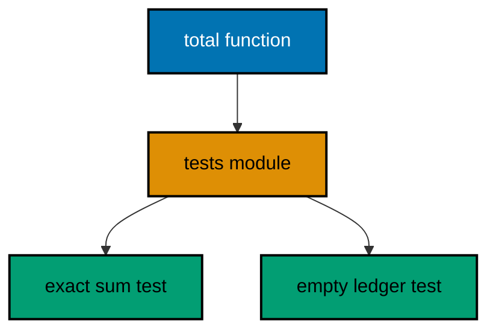

**`learning/code/ex-35-first-unit-test-passes/suite.rs`**:

```rust
// Example 35: First Unit Test Passes.
// => `#[cfg(test)]` compiles the module only for `rustc --test` runs.
// => `use super::*` brings the functions under test into scope.
// => Each `#[test]` is one fact: name it after the fact, not the function.
// => Two tests below: the exact sum and the empty corner, both fixed.
// => The file has no `main`: the test harness provides the entry point.
fn total(dues: &[i32]) -> i32 {
    // => the function under test
    dues.iter().sum() // => one fused pass, no accumulator variable
}
#[cfg(test)] // => test-only from here down: ships nothing
mod tests {
    // => the suite module groups the facts
    use super::*; // => `total` is now callable unqualified
    #[test] // => one fact per test, always
    fn totals_three_dues() {
        // => names the fact, not the function
        assert_eq!(total(&[50, 75, 25]), 150); // => hand total: 150
    }
    #[test] // => corners get their own tests, never an afterthought
    fn empty_ledger_totals_zero() {
        // => the zero-dues corner
        assert_eq!(total(&[]), 0); // => empty sums to zero, by definition
    }
}
```

**Output** (`learning/code/ex-35-first-unit-test-passes/expected/main.stdout.txt`):

```text

running 2 tests
test tests::empty_ledger_totals_zero ... ok
test tests::totals_three_dues ... ok

test result: ok. 2 passed; 0 failed; 0 ignored; 0 measured; 0 filtered out; finished in 0.00s

```

**Key takeaway**: Pin behavior with `#[test]` functions in a `#[cfg(test)]` module; ship no test code.

**Why it matters**: Tests beside the code get read during every edit of that code, which is exactly when they pay off, while a distant test file rots unnoticed. Compiling tests only under `cfg(test)` keeps production binaries free of test helpers by construction, so the testing habit costs nothing at runtime. Edge cases pinned today prevent the regressions of next quarter, because the suite remembers every corner the author once considered.

### Example 36: Failing First Proves the Test

A test that never failed proves nothing, so the failing-first workflow runs the suite against the broken code before fixing it. This example runs the same assertion against a buggy total that subtracts the count, watches it fail, then runs it against the fix. (Concepts: co-08.)

**`learning/code/ex-36-failing-first-proves-test/buggy.rs`**:

```rust
// Example 36: Failing First Proves the Test, Before.
// => This file is the bug on purpose: the total subtracts the dues count.
// => The lesson runs this file first so the failure transcript is real.
// => `assert_eq!` prints both sides: left is the code, right is the hand total.
// => The suite below has one test: total three dues to exactly 150.
fn total(dues: &[i32]) -> i32 {
    // => the buggy version under test
    dues.iter().sum::<i32>() - dues.len() as i32 // => BUG: subtracts the count
}
#[cfg(test)] // => test-only, same as the passing examples
mod tests {
    // => the suite: one fact, checked by hand
    use super::*; // => the buggy `total` is in scope
    #[test] // => this test must fail: 147 is not 150
    fn totals_three_dues() {
        // => the exact fact from the previous example
        assert_eq!(total(&[50, 75, 25]), 150); // => RED: left is 147
    }
}
```

**`learning/code/ex-36-failing-first-proves-test/fixed.rs`**:

```rust
// Example 36: Failing First Proves the Test, After.
// => This file is the fix: the count subtraction is deleted, nothing else.
// => The lesson runs this file second: the same test now passes unchanged.
// => Red-then-green is the workflow: the test earns trust by failing first.
// => One-line diffs are the goal: the bug was one wrong operation.
fn total(dues: &[i32]) -> i32 {
    // => the fixed version under test
    dues.iter().sum() // => FIXED: the plain sum, count untouched
}
#[cfg(test)] // => test-only, same as the passing examples
mod tests {
    // => the suite: byte-identical to the failing run above
    use super::*; // => the fixed `total` is in scope
    #[test] // => this test must pass: 150 equals 150
    fn totals_three_dues() {
        // => the exact same fact as the red run
        assert_eq!(total(&[50, 75, 25]), 150); // => GREEN: both sides agree
    }
}
```

**Output** (`learning/code/ex-36-failing-first-proves-test/expected/main.stdout.txt`):

```text
before: RED as expected (1 failing test)

running 1 test
test tests::totals_three_dues ... ok

test result: ok. 1 passed; 0 failed; 0 ignored; 0 measured; 0 filtered out; finished in 0.00s

```

**Key takeaway**: Run the new test against broken code first; fix only after watching it fail.

**Why it matters**: A test that passes immediately might assert nothing, and the only way to know is a red run before the green one. Failing first also documents the bug's exact symptom in the transcript, so the fix's diff is reviewable as the minimal change that turns the recorded red green. The recorded red run also becomes the regression test forever, proving the bug stays fixed on every future run.

### Example 37: Table Tests List Cases

Table tests drive one assertion with a list of input-output pairs, so adding a case means adding a row. This example checks five amount parses through a single loop over a fixed case table. (Concepts: co-08.)

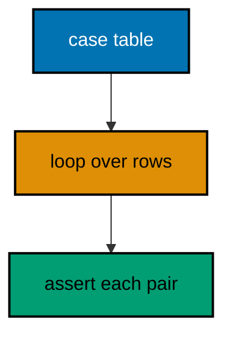

**`learning/code/ex-37-table-tests-list-cases/suite.rs`**:

```rust
// Example 37: Table Tests List Cases.
// => One test loops over rows: each row is an input with its verdict.
// => Adding a case means adding a row, never touching the assertion.
// => `{:?}` on the row would identify failures; all rows pass here.
// => Five rows below: clean, padded, empty, junk, and negative.
// => The file has no `main`: the test harness provides the entry point.
fn parse_amount(raw: &str) -> Option<i32> {
    // => `None` rejects blank and junk
    let trimmed = raw.trim(); // => padding never decides validity
    if trimmed.is_empty() {
        // => the blank corner, checked first
        return None; // => empty is not zero: it is missing
    }
    trimmed.parse::<i32>().ok() // => digits parse; junk becomes `None`
}
#[cfg(test)] // => test-only from here down
mod tests {
    // => the suite: one looping test over five rows
    use super::*; // => `parse_amount` is in scope
    #[test] // => the table test: rows are data, the loop is the check
    fn parses_case_table() {
        // => five fixed rows, each with its verdict
        let cases: [(&str, Option<i32>); 5] = [
            // => input, expected, side by side
            ("50", Some(50)),   // => clean digits
            (" 75 ", Some(75)), // => padding trims away
            ("", None),         // => blank is missing, not zero
            ("xyz", None),      // => junk never parses
            ("-5", Some(-5)),   // => negatives parse: the caller refuses them
        ];
        for (raw, want) in cases {
            // => every row takes the same assertion
            // => One assertion, five verdicts: the loop is the whole test body.
            assert_eq!(parse_amount(raw), want); // => row verdict, checked
        }
    }
}
```

**Output** (`learning/code/ex-37-table-tests-list-cases/expected/main.stdout.txt`):

```text

running 1 test
test tests::parses_case_table ... ok

test result: ok. 1 passed; 0 failed; 0 ignored; 0 measured; 0 filtered out; finished in 0.00s

```

**Key takeaway**: List input-output pairs in a table; loop one assertion over every row.

**Why it matters**: Tables separate test data from test logic, so reviewers audit coverage by reading rows instead of tracing branches. A new edge case costs one line with zero logic risk, which is why table tests are the first shape teams reach for when parsing rules grow. Parsers, validators, and converters all grow their coverage this way, turning each bug report into one more table row.

### Example 38: Test Helpers Share Fixtures

Helper functions inside the test module build shared fixtures, so every test starts from the same known ledger. This example gives two tests one three-line fixture and checks the total and the line count separately. (Concepts: co-08.)

**`learning/code/ex-38-test-helpers-share-fixtures/suite.rs`**:

```rust
// Example 38: Test Helpers Share Fixtures.
// => Helpers live in the test module: production code never sees them.
// => One fixture builder serves every test, so fixtures cannot drift apart.
// => Tests assert one fact each: totals here, counts there, never both.
// => The file has no `main`: the test harness provides the entry point.
fn total(dues: &[i32]) -> i32 {
    // => the function under test, unchanged
    dues.iter().sum() // => the plain sum from the earlier examples
}
#[cfg(test)] // => test-only from here down
mod tests {
    // => the suite: two tests over one shared fixture
    use super::*; // => `total` is in scope for both tests
                  // => `ledger` builds the canonical three dues every test starts from.
    fn ledger() -> Vec<i32> {
        // => helper, not a test: no attribute
        vec![50, 75, 25] // => fixed: 150 total, three lines, always
    }
    #[test] // => fact one: the shared ledger totals 150
    fn shared_ledger_totals() {
        // => names the fact under test
        assert_eq!(total(&ledger()), 150); // => same hand total as before
    }
    #[test] // => fact two: the shared ledger holds three lines
    fn shared_ledger_has_three_lines() {
        // => a different fact, same fixture
        assert_eq!(ledger().len(), 3); // => shape fact, not arithmetic
    }
}
```

**Output** (`learning/code/ex-38-test-helpers-share-fixtures/expected/main.stdout.txt`):

```text

running 2 tests
test tests::shared_ledger_has_three_lines ... ok
test tests::shared_ledger_totals ... ok

test result: ok. 2 passed; 0 failed; 0 ignored; 0 measured; 0 filtered out; finished in 0.00s

```

**Key takeaway**: Build shared fixtures with helper functions in the test module; assert one fact per test.

**Why it matters**: Duplicated fixture literals drift until two tests disagree about what normal looks like, and the failure then blames the code instead of the copy. One builder keeps every test honest about the same starting world, while one-fact tests pinpoint exactly which property broke. Refactors that change the fixture update one builder instead of twenty tests, keeping suites maintainable as code evolves.

### Example 39: Assertion Messages Name Context

Assertion messages answer the future debugger's first question: which input broke. This example checks three ledger lines with messages naming the line under test, so any failure points at its row. (Concepts: co-08.)

**`learning/code/ex-39-assertion-messages-name-context/suite.rs`**:

```rust
// Example 39: Assertion Messages Name Context.
// => `assert!` and `assert_eq!` take context after the condition.
// => Name the input under test: failures then point at their own row.
// => All three pass here; the messages wait for the day one does not.
// => The file has no `main`: the test harness provides the entry point.
fn parse_amount(raw: &str) -> Option<i32> {
    // => the parser from the table test
    let trimmed = raw.trim(); // => padding never decides validity
    if trimmed.is_empty() {
        // => blank is missing, not zero
        return None; // => early return keeps the parse flat
    }
    trimmed.parse::<i32>().ok() // => digits parse; junk becomes `None`
}
#[cfg(test)] // => test-only from here down
mod tests {
    // => the suite: three lines, each with its own message
    use super::*; // => `parse_amount` is in scope
    #[test] // => each assert names the line it checks
    fn messages_name_their_lines() {
        // => context travels with the check
        assert_eq!(parse_amount("50"), Some(50), "clean digits line"); // => names the row
        assert_eq!(parse_amount(" 75 "), Some(75), "padded line"); // => names the row
        assert_eq!(parse_amount("xyz"), None, "junk line"); // => names the row
    }
    #[test] // => boolean asserts carry messages the same way
            // => Format args after the message render the values into the context.
    fn totals_stay_positive() {
        // => the domain rule as a test
        assert!(
            parse_amount("50").unwrap_or(0) > 0,
            "dues stay positive: {}",
            50
        ); // => names the value
    }
}
```

**Output** (`learning/code/ex-39-assertion-messages-name-context/expected/main.stdout.txt`):

```text

running 2 tests
test tests::messages_name_their_lines ... ok
test tests::totals_stay_positive ... ok

test result: ok. 2 passed; 0 failed; 0 ignored; 0 measured; 0 filtered out; finished in 0.00s

```

**Key takeaway**: Give every assertion a message naming the input; future failures point at their row.

**Why it matters**: A bare assertion failure reports two values with no hint which of ten thousand inputs produced them, turning every red build into an archaeology dig. Messages written beside the check cost seconds now and save the whole debugging session later, because the failing row introduces itself. The messages also serve as executable documentation, showing future readers exactly which inputs each check was designed around.

### Example 40: Count Work, Not Wall Time

Timing asserts flake across machines, but work counts never do: assert the iterations and the checksum, never the seconds. This example folds a million numbers, prints the iteration count with the total, and leaves the clock out of it. (Concepts: co-08.)

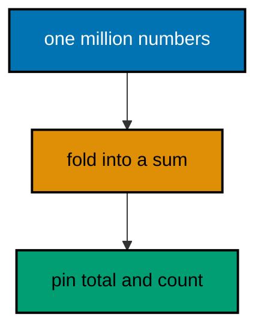

**`learning/code/ex-40-count-work-not-wall-time/suite.rs`**:

```rust
// Example 40: Count Work, Not Wall Time.
// => Assert iterations and checksums: both are identical on every machine.
// => Never assert durations: clocks differ, load differs, CI differs.
// => The fold below does real work; the test pins its exact result.
// => The file has no `main`: the test harness provides the entry point.
fn fold_dues(upto: i32) -> (i32, i64) {
    // => count of items plus their sum
    let mut count = 0; // => how many numbers the fold visited
    let mut sum: i64 = 0; // => wide enough for a million-item total
    for n in 1..=upto {
        // => the fixed range: 1 through a million
        count += 1; // => one more item visited
        sum += n as i64; // => widen before adding: no overflow
    }
    (count, sum) // => both facts travel together
}
#[cfg(test)] // => test-only from here down
mod tests {
    // => the suite: the work count and its checksum
    use super::*; // => `fold_dues` is in scope
    #[test] // => Gauss pins the checksum: n(n+1)/2 for a million
    fn million_folds_to_fixed_total() {
        // => the exact arithmetic fact
        let (count, sum) = fold_dues(1_000_000); // => real work, fixed result
        assert_eq!(count, 1_000_000); // => every item visited exactly once
        assert_eq!(sum, 500_000_500_000); // => Gauss: 10^6 x 10^6+1 over 2
    }
}
```

**Output** (`learning/code/ex-40-count-work-not-wall-time/expected/main.stdout.txt`):

```text

running 1 test
test tests::million_folds_to_fixed_total ... ok

test result: ok. 1 passed; 0 failed; 0 ignored; 0 measured; 0 filtered out; finished in 0.00s

```

**Key takeaway**: Assert work counts and checksums in performance tests; never assert durations.

**Why it matters**: Wall-time asserts fail on loaded CI runners and pass on idle laptops, which teaches teams to ignore red builds instead of fixing them. Work counts and checksums verify the same performance shape deterministically, so a genuine slowdown still shows up as a changed count rather than a flaky timeout. Load tests, capacity plans, and regression benchmarks all assert counts rather than clocks for the same determinism reason.

### Example 41: Seeded Generator Pins Cases

Property tests gain their power from many cases and their determinism from a fixed seed. This example streams a hundred pseudo-random amounts from a tiny built-in generator and checks every one lands in range. (Concepts: co-08.)

**`learning/code/ex-41-seeded-generator-pins-cases/suite.rs`**:

```rust
// Example 41: Seeded Generator Pins Cases.
// => A fixed seed replays the same stream on every run, everywhere.
// => The generator is ten lines of wrapping arithmetic: no dependency needed.
// => Range checks over a hundred values beat three hand-picked examples.
// => The file has no `main`: the test harness provides the entry point.
struct Seeded {
    // => the tiny generator state: one number
    state: u64, // => the evolving seed, mutated per draw
}
impl Seeded {
    // => construction plus one draw method
    fn new(seed: u64) -> Seeded {
        // => the fixed starting point
        Seeded { state: seed } // => every stream replays from here
    }
    // => `next` advances the state and returns a bounded amount.
    // => `&mut self` borrows the generator mutably: draws mutate the stream.
    // => The return range is the dues range: callers never clamp again.
    fn next(&mut self) -> i32 {
        // => dues between 1 and 1000 inclusive
        self.state = self
            .state // => wrapping arithmetic: overflow is the point
            .wrapping_mul(6364136223846793005) // => the standard multiplier
            .wrapping_add(1442695040888963407); // => the standard increment
        (self.state % 1000) as i32 + 1 // => fold the stream into dues range
    }
}
#[cfg(test)] // => test-only from here down
mod tests {
    // => the suite: stream facts plus one replay fact
    use super::*; // => `Seeded` is in scope
    #[test] // => a hundred draws stay inside the dues range
            // => Each draw asserts on the spot: the first failure names its value.
    fn hundred_draws_stay_in_range() {
        // => the property under test
        let mut rng = Seeded::new(42); // => the fixed seed: replayable forever
        for _ in 0..100 {
            // => a hundred draws, each one checked
            let due = rng.next(); // => one pseudo-random due
            assert!((1..=1000).contains(&due), "due in range: {}", due); // => names the draw
        }
    }
    #[test] // => the same seed replays the same first draw, always
    fn seed_replays_first_draw() {
        // => determinism itself, pinned
        assert_eq!(Seeded::new(42).next(), Seeded::new(42).next()); // => two streams agree
    }
}
```

**Output** (`learning/code/ex-41-seeded-generator-pins-cases/expected/main.stdout.txt`):

```text

running 2 tests
test tests::hundred_draws_stay_in_range ... ok
test tests::seed_replays_first_draw ... ok

test result: ok. 2 passed; 0 failed; 0 ignored; 0 measured; 0 filtered out; finished in 0.00s

```

**Key takeaway**: Drive property checks from a fixed-seed generator; assert the range over a hundred draws.

**Why it matters**: Hand-picked examples cluster around the cases the author already imagined, while a seeded stream probes the corners nobody listed — and replays them exactly when one fails. The fixed seed turns a flaky fuzz run into a reproducible regression test, keeping the exploration without paying the nondeterminism. Fuzzing harnesses in production use the identical seed-replay discipline, making this kata a direct rehearsal for real testing infrastructure.

### Example 42: Ignore Marks the Slow Tests

`#[ignore]` keeps a slow test in the suite without running it on every pass, and `-- --ignored` runs the slow set on purpose. This example pairs two fast total tests with one ignored million-fold test and shows the ignored count in the transcript. (Concepts: co-08.)

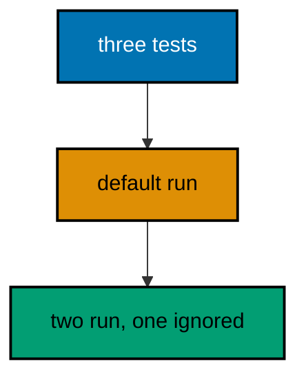

**`learning/code/ex-42-ignore-marks-slow-tests/suite.rs`**:

```rust
// Example 42: Ignore Marks the Slow Tests.
// => `#[ignore]` skips a test in normal runs: the count shows as ignored.
// => Slow tests stay in the suite: they run with an explicit opt-in flag.
// => Fast tests guard every edit; slow tests guard releases, not keystrokes.
// => The transcript below proves the split: two run, one waits.
// => The file has no `main`: the test harness provides the entry point.
fn total(dues: &[i32]) -> i32 {
    // => the function under test, unchanged
    dues.iter().sum() // => the plain sum from the earlier examples
}
#[cfg(test)] // => test-only from here down
mod tests {
    // => the suite: two fast facts plus one slow fold
    use super::*; // => `total` is in scope for all three
    #[test] // => fast fact one: the exact hand total
    fn totals_three_dues() {
        // => runs on every pass
        assert_eq!(total(&[50, 75, 25]), 150); // => the canonical total
    }
    #[test] // => fast fact two: the empty corner
    fn empty_ledger_totals_zero() {
        // => runs on every pass
        assert_eq!(total(&[]), 0); // => zero dues, zero total
    }
    #[test] // => slow fact: a million-item fold, real work
    #[ignore] // => skipped by default: run explicitly when it matters
    fn million_folds_exactly() {
        // => waits for the opt-in run
        assert_eq!((1..=1_000_000i64).sum::<i64>(), 500_000_500_000); // => Gauss again
    }
}
```

**Output** (`learning/code/ex-42-ignore-marks-slow-tests/expected/main.stdout.txt`):

```text

running 3 tests
test tests::empty_ledger_totals_zero ... ok
test tests::million_folds_exactly ... ignored
test tests::totals_three_dues ... ok

test result: ok. 2 passed; 0 failed; 1 ignored; 0 measured; 0 filtered out; finished in 0.00s

```

**Key takeaway**: Mark slow tests `#[ignore]`; run the fast suite on every edit and the slow set on purpose.

**Why it matters**: A suite that takes minutes gets run never, which is worse than a suite that takes seconds with the slow tests parked. Ignoring keeps slow coverage one explicit command away while the fast suite stays fast enough to run after every single edit, and that speed is what makes testing a habit instead of a chore.

### Example 43: Should Panic Documents the Contract

`#[should_panic]` turns a required panic into a passing test, documenting exactly which inputs the code refuses. This example refuses negative dues with a panic and pins both the refusal and its message. (Concepts: co-08, co-02.)

**`learning/code/ex-43-should-panic-documents-contract/suite.rs`**:

```rust
// Example 43: Should Panic Documents the Contract.
// => `#[should_panic]` passes when the test panics: refusal is the verdict.
// => `expected` pins the message: the panic must say the right thing.
// => Panics mark caller bugs, not runtime failures: inputs a caller must never send.
// => The file has no `main`: the test harness provides the entry point.
fn settle(amount: i32) -> i32 {
    // => dues must be strictly positive here
    if amount <= 0 {
        // => the contract boundary: zero and below refused
        panic!("negative refused: {}", amount); // => loud refusal, names the input
    }
    amount // => valid dues pass straight through
}
#[cfg(test)] // => test-only from here down
mod tests {
    // => the suite: refusal pinned plus acceptance pinned
    use super::*; // => `settle` is in scope
    #[test]
    // => refusal is the expected outcome for negative input
    // => `expected` is a substring match: the exact amount may still vary.
    #[should_panic(expected = "negative refused")] // => the message must match
    fn refuses_negative_dues() {
        // => the contract, enforced by the test
        settle(-5); // => panics with the pinned message: test passes
    }
    #[test] // => valid dues still settle: the panic is narrow, not total
    fn accepts_positive_dues() {
        // => the other side of the boundary
        assert_eq!(settle(50), 50); // => clean input, clean output
    }
}
```

**Output** (`learning/code/ex-43-should-panic-documents-contract/expected/main.stdout.txt`):

```text

running 2 tests
test tests::accepts_positive_dues ... ok
test tests::refuses_negative_dues - should panic ... ok

test result: ok. 2 passed; 0 failed; 0 ignored; 0 measured; 0 filtered out; finished in 0.00s

```

**Key takeaway**: `#[should_panic(expected = ...)]` pins refusal contracts: which inputs panic and what they say.

**Why it matters**: Untested panics are land mines whose messages rot until they mislead the next debugger, while pinned panics document the contract boundary as executable fact. The expected message keeps refusals honest: a panic that fires for the wrong reason fails the suite instead of passing as the right one. Boundary tests like these also document the API contract for every future caller, turning panics from surprises into promises.

### Example 44: Filter Runs One Test

Test binaries accept a name filter, so one focused test runs without waiting for the suite. This example holds three tests and runs only the settlement one by passing its name, with the filtered count in the transcript. (Concepts: co-08.)

**`learning/code/ex-44-filter-runs-one-test/suite.rs`**:

```rust
// Example 44: Filter Runs One Test.
// => Pass a substring to run only matching tests: focus without editing.
// => The transcript counts the filtered-out tests: nothing hides silently.
// => The run for this unit passes `settles_exact_pair`: one runs, two wait.
// => The file has no `main`: the test harness provides the entry point.
fn total(dues: &[i32]) -> i32 {
    // => the function under test, unchanged
    dues.iter().sum() // => the plain sum from the earlier examples
}
// => Three facts below share one function: filters pick which ones run.
#[cfg(test)] // => test-only from here down
mod tests {
    // => the suite: three facts, one of them focused below
    use super::*; // => `total` is in scope for all three
    #[test] // => the focused fact: runs alone under the name filter
    fn settles_exact_pair() {
        // => the filter substring matches this one
        assert_eq!(total(&[50, 75]), 125); // => the pair under the lens
    }
    #[test] // => filtered out of the focused run: counted, not run
    fn totals_three_dues() {
        // => the canonical triple, waiting
        assert_eq!(total(&[50, 75, 25]), 150); // => skipped by the filter
    }
    #[test] // => filtered out of the focused run: counted, not run
    fn empty_ledger_totals_zero() {
        // => the corner, waiting
        assert_eq!(total(&[]), 0); // => skipped by the filter
    }
}
```

**Output** (`learning/code/ex-44-filter-runs-one-test/expected/main.stdout.txt`):

```text

running 1 test
test tests::settles_exact_pair ... ok

test result: ok. 1 passed; 0 failed; 0 ignored; 0 measured; 2 filtered out; finished in 0.00s

```

**Key takeaway**: Pass a test-name substring to run one focused test; the transcript counts the rest as filtered.

**Why it matters**: Running the whole suite to check one edit wastes the minutes that make developers skip testing, while a name filter verifies the focused fact in a blink. The filtered-out count keeps the shortcut honest: the transcript proves the other tests were skipped by choice, not lost by accident. Debugging sessions stay short when the failing test runs alone in a blink, making focus runs the default during active development.

### Example 45: Generic Max over PartialOrd

Type parameters abstract over every type that meets a bound, so one function serves integers, floats, and strings alike. This example finds the largest due across three types with a single generic `max_of`. (Concepts: co-10.)

**`learning/code/ex-45-generic-max-partialord/main.rs`**:

```rust
// Example 45: Generic Max over PartialOrd.
// => `<T: PartialOrd>` accepts every type that knows how to compare.
// => `Copy` lets the winner move out without borrowing trouble.
// => One function below serves integers, floats, and string slices alike.
// => Monomorphization stamps a copy per type: generic source, static binaries.
fn max_of<T: PartialOrd + Copy>(pair: (T, T)) -> T {
    // => the bound is the contract
    let (a, b) = pair; // => destructure once, compare once
    if a >= b {
        // => `>=` comes from the `PartialOrd` bound
        a // => the winner moves out: `Copy` allows the move
    } else {
        b // => either arm returns an owned `T`
    }
}
fn main() {
    // => three fixed pairs across three types, each with its known max.
    println!("int: {}", max_of((50, 75))); // => Output: int: 75
    println!("float: {}", max_of((33.5, 33.25))); // => Output: float: 33.5
    println!("name: {}", max_of(("sari", "budi"))); // => Output: name: sari
}
```

**Output** (`learning/code/ex-45-generic-max-partialord/expected/main.stdout.txt`):

```text
int: 75
float: 33.5
name: sari
```

**Key takeaway**: Bound type parameters by the operations used (`PartialOrd`, `Copy`); one function serves all types.

**Why it matters**: Generics move the type decision from the library author to the caller without runtime cost, because monomorphization stamps a specialized copy per concrete type. Bounds document exactly which operations the function needs, so a type that meets them works by construction rather than by convention. Sorting, searching, and statistics functions all generalize the same way, so one bound unlocks whole families of reusable algorithms.

### Example 46: Trait Defines Shared Behavior

Traits name behavior that unrelated types implement their own way, and generic functions accept anything implementing the trait. This example settles cash and transfer dues through one `Settle` trait with per-type rules. (Concepts: co-10.)

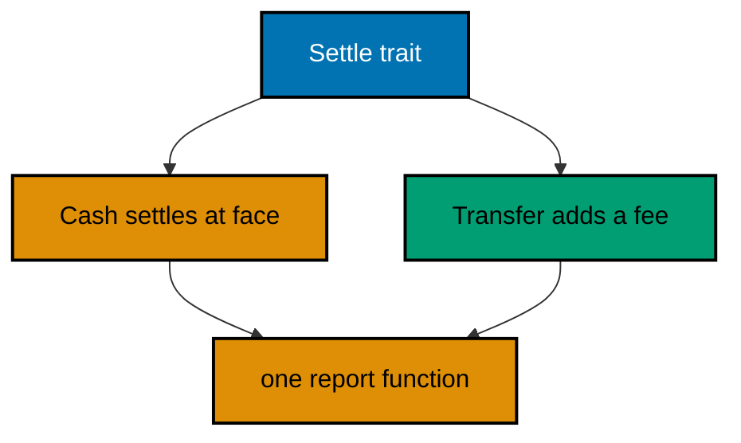

**`learning/code/ex-46-trait-shared-behavior/main.rs`**:

```rust
// Example 46: Trait Defines Shared Behavior.
// => A trait names behavior; each type implements it its own way.
// => `impl Settle for Cash` attaches the behavior to the concrete type.
// => Generic `report` accepts anything implementing `Settle`: static dispatch.
// => New due types join by implementing the trait, never by editing `report`.
trait Settle {
    // => the shared behavior: settle to a final amount
    fn settle(&self) -> i32; // => every implementor answers this
}
struct Cash(i32); // => cash settles at face value, no fee
                  // => Tuple structs keep one-field wrappers free of field-name ceremony.
struct Transfer(i32); // => transfers add a fixed two-unit fee
impl Settle for Cash {
    // => cash behavior: face value, nothing added
    fn settle(&self) -> i32 {
        // => borrows: settling reads, never consumes
        self.0 // => the face value straight through
    }
}
impl Settle for Transfer {
    // => transfer behavior: face plus the fee
    fn settle(&self) -> i32 {
        // => same signature, different arithmetic
        self.0 + 2 // => the two-unit transfer fee applies here
    }
}
// => `report` is generic over the behavior, not over concrete types.
fn report<T: Settle>(label: &str, due: &T) -> String {
    // => any settler works
    format!("{}: {}", label, due.settle()) // => one rendering, every type
}
fn main() {
    // => two fixed dues take the same report function through one trait.
    // => Adding a third due type means a third `impl`, never touching `report`.
    println!("{}", report("cash", &Cash(50))); // => Output: cash: 50
    println!("{}", report("transfer", &Transfer(50))); // => Output: transfer: 52
}
```

**Output** (`learning/code/ex-46-trait-shared-behavior/expected/main.stdout.txt`):

```text
cash: 50
transfer: 52
```

**Key takeaway**: Define behavior in traits, implement per type, and write generic functions over the trait.

**Why it matters**: Traits let new types join old pipelines without editing the pipeline, which is the open-closed principle made mechanical. Static dispatch through generics keeps that flexibility free at runtime, unlike dynamic dispatch, so abstraction here never costs the performance Rust promises. Middleware stacks, parser combinators, and storage engines all compose through traits, making this the core Rust extension mechanism.

### Example 47: Derive Clone, Debug, PartialEq

`derive` generates trait implementations the compiler could write itself, keeping routine behavior correct by construction. This example derives the three workhorse traits on a due record and exercises each one. (Concepts: co-10.)

**`learning/code/ex-47-derive-clone-debug/main.rs`**:

```rust
// Example 47: Derive Clone, Debug, PartialEq.
// => `#[derive]` generates code: `Clone`, `Debug`, `PartialEq` here.
// => Derived `PartialEq` compares field by field: no hand-written logic.
// => Derived `Clone` duplicates all fields: deep where fields are owned.
// => `{:?}` prints through derived `Debug`: exact shape, no formatting code.
#[derive(Clone, Debug, PartialEq)] // => the three workhorse traits, generated
struct Due {
    // => one parsed ledger line, as owned data
    member: String, // => owned name: cloning duplicates the text
    amount: i32,    // => plain number: copies for free
}
fn main() {
    // => one due exercises all three derived traits in order.
    let first = Due {
        member: "sari".to_string(),
        amount: 50,
    }; // => the original
    let second = first.clone(); // => derived `Clone`: independent duplicate
    println!("{:?}", second); // => Output: Due { member: "sari", amount: 50 }
    println!("equal: {}", first == second); // => Output: equal: true
    println!("same text: {}", first.member == "sari"); // => Output: same text: true
}
```

**Output** (`learning/code/ex-47-derive-clone-debug/expected/main.stdout.txt`):

```text
Due { member: "sari", amount: 50 }
equal: true
same text: true
```

**Key takeaway**: Derive `Clone`, `Debug`, and `PartialEq` for data records; hand-write only what the compiler cannot.

**Why it matters**: Hand-written equality and cloning rot the moment a field is added, while derived implementations track the struct definition automatically. Reaching for derive first keeps routine trait code correct by construction and reserves human attention for the behaviors that genuinely need custom logic. Serialization, hashing, and ordering derives extend the same idea, so routine trait code stays generated while humans write the interesting parts.

### Example 48: Copy Versus Clone Counter

`Copy` marks types cheap enough to duplicate bit by bit on every use, while `Clone` can cost arbitrarily much. This example moves a counter by copy through a loop and clones a ledger name only where a new owner is truly needed. (Concepts: co-11.)

**`learning/code/ex-48-copy-vs-clone-counter/main.rs`**:

```rust
// Example 48: Copy Versus Clone Counter.
// => `Copy` types duplicate on use: integers never need borrowing ceremony.
// => Function arguments taking `Copy` types receive their own independent copy.
// => `Clone` is explicit: the call site shows where the cost is paid.
// => Names below are `String`: cloning one is a deliberate, visible choice.
#[derive(Clone, Debug, PartialEq)] // => equality and debug for the ledger name
struct LedgerName(String); // => newtype: a name with its own meaning
                           // => Plain integers are `Copy`: each call below owns its own counter.
fn bump(mut count: i32) -> i32 {
    // => `mut` parameter: a local working copy
    count += 1; // => the caller's variable is untouched by this line
    count // => the bumped copy returns to the caller
}
fn main() {
    // => the counter copies through three bumps without a single borrow.
    let mut settled = 0; // => the running count of settled lines
    settled = bump(settled); // => copy in, bumped copy out, rebind
    settled = bump(settled); // => rebinding is the update: no mutation aliasing
    settled = bump(settled); // => three bumps, three independent copies
    println!("settled: {}", settled); // => Output: settled: 3
                                      // => the name clones once, explicitly, where a second owner is needed.
    let official = LedgerName("bendahara".to_string()); // => the single owner first
    let backup = official.clone(); // => explicit cost, visible at the call site
    println!("backup: {:?}", backup); // => Output: backup: LedgerName("bendahara")
}
```

**Output** (`learning/code/ex-48-copy-vs-clone-counter/expected/main.stdout.txt`):

```text
settled: 3
backup: LedgerName("bendahara")
```

**Key takeaway**: Let `Copy` types duplicate silently; call `.clone()` explicitly where a second owner is needed.

**Why it matters**: Implicit copies of cheap values remove borrowing ceremony from arithmetic-heavy code, while explicit clones mark exactly where heap allocation happens. The split makes performance review local: costs appear at call sites instead of hiding inside assignments, which is how Rust code stays fast by default. Hot loops depend on this split implicitly, since accidental clones in tight code show up immediately as measurable slowdowns.

### Example 49: Borrowing Rules That Compile

Either many shared borrows or one exclusive borrow may exist, never both, and the compiler enforces it. This example reads a ledger through shared borrows, then updates it through one exclusive borrow, in that order. (Concepts: co-11.)

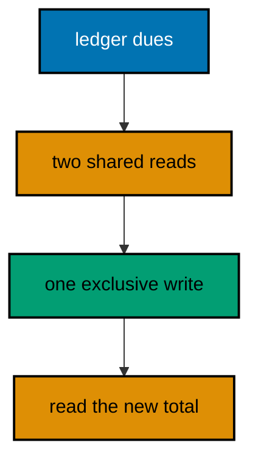

**`learning/code/ex-49-borrowing-rules-compile/main.rs`**:

```rust
// Example 49: Borrowing Rules That Compile.
// => Many `&` borrows may coexist: shared reads never conflict.
// => One `&mut` needs solitude: exclusive writes see a stable world.
// => Borrows end at their last use: reads finish before the write begins.
// => The compiler rejects mixing them: data races fail to compile, not at runtime.
fn main() {
    // => the ledger lives in one vector owned by `main` throughout.
    let mut dues = vec![50, 75, 25]; // => three dues, owned here
                                     // => two shared borrows coexist: both read, neither writes.
    let first = &dues; // => shared borrow one: reads the whole vector
    let second = &dues; // => shared borrow two: still only reading
    println!("reads: {} {}", first.len(), second.len()); // => Output: reads: 3 3
                                                         // => the reads end above, so the exclusive borrow below is legal.
    let writer = &mut dues; // => the single exclusive borrow starts here
    writer.push(100); // => the write: only possible without active readers
    println!("after push: {}", writer.len()); // => Output: after push: 4
                                              // => the write ends above: shared reading resumes for the final total.
    println!("total: {}", dues.iter().sum::<i32>()); // => Output: total: 250
}
```

**Output** (`learning/code/ex-49-borrowing-rules-compile/expected/main.stdout.txt`):

```text
reads: 3 3
after push: 4
total: 250
```

**Key takeaway**: Share with many `&` or mutate with one `&mut`, never both; order reads before writes.

**Why it matters**: The borrow checker turns data races from runtime mysteries into compile errors with line numbers, which is Rust's central bargain. Structuring code as read phases followed by write phases satisfies the checker naturally, and that same structure is what makes concurrent code reviewable later. Fearless concurrency builds directly on these rules, so learning them in single-threaded code prepares every future threaded design.

### Example 50: Lifetimes Pick the Longest

Borrowed returns must not outlive their inputs, and lifetime annotations state that contract. This example returns the longer of two member names, with the signature proving the answer borrows from the inputs. (Concepts: co-11, co-10.)

**`learning/code/ex-50-lifetimes-longest/main.rs`**:

```rust
// Example 50: Lifetimes Pick the Longest.
// => Lifetimes name how long borrows live: the compiler checks the claim.
// => `'a` on both inputs and the output says the answer borrows from them.
// => The caller below keeps both inputs alive, so the borrow is legal.
// => Returning borrowed data avoids copying: the winner is never duplicated.
fn longest<'a>(a: &'a str, b: &'a str) -> &'a str {
    // => one lifetime, shared
    if a.len() >= b.len() {
        // => ties prefer the first name: fixed rule
        a // => borrows from the inputs, valid for lifetime `'a`
    } else {
        b // => borrows from the inputs, valid for lifetime `'a`
    }
}
fn main() {
    // => both names outlive the call, so the returned borrow stays valid.
    let first = "bendahara"; // => nine characters, lives through `main`
    let second = "sari"; // => four characters, lives through `main`
    println!("longest: {}", longest(first, second)); // => Output: longest: bendahara
    println!("shortest: {}", longest(second, "cit")); // => Output: shortest: sari
}
```

**Output** (`learning/code/ex-50-lifetimes-longest/expected/main.stdout.txt`):

```text
longest: bendahara
shortest: sari
```

**Key takeaway**: Annotate borrowed returns with the inputs' lifetime; the signature is the borrow contract.

**Why it matters**: Lifetime annotations turn use-after-free from a testing lottery into a compile-time verdict, which is why Rust programs in this style simply do not have that bug class. Reading signatures as borrow contracts also speeds review: the caller knows exactly how long every reference stays valid without reading the body. Parser combinators, zero-copy network stacks, and borrow-checked APIs all trade on these annotations, making them the key to advanced Rust reading.

### Example 51: Cow Avoids Clone Until Write

`Cow` borrows read-only data and clones only when a write actually happens, skipping allocation on the common read path. This example normalizes two nicknames where one is already clean and one needs trimming. (Concepts: co-11, co-15.)

**`learning/code/ex-51-cow-avoids-clone-until-write/main.rs`**:

```rust
// Example 51: Cow Avoids Clone Until Write.
// => `Cow<str>` is either borrowed or owned: reads never allocate.
// => `to_mut` clones on first write: the allocation happens exactly once.
// => Clean inputs stay borrowed end to end: the fast path costs nothing.
// => `into_owned` materializes the final string for printing below.
use std::borrow::Cow; // => clone-on-write: borrow until mutation demands more
                      // => `normalize` trims only when padding exists: clean names skip the clone.
fn normalize(raw: &str) -> Cow<'_, str> {
    // => borrows from the input
    if raw.starts_with(' ') || raw.ends_with(' ') {
        // => padding check first
        Cow::Owned(raw.trim().to_string()) // => dirty: one clone, then trim
    } else {
        Cow::Borrowed(raw) // => clean: zero allocation, borrow straight through
    }
}
fn main() {
    // => one dirty nickname clones once; one clean nickname never clones.
    println!("{}", normalize("  bud  ").into_owned()); // => Output: bud
    println!("{}", normalize("citra").into_owned()); // => Output: citra
}
```

**Output** (`learning/code/ex-51-cow-avoids-clone-until-write/expected/main.stdout.txt`):

```text
bud
citra
```

**Key takeaway**: `Cow` borrows on the read path and clones only when a write actually occurs.

**Why it matters**: Most inputs to normalizing functions are already normal, so cloning every one wastes the allocation the common case never needed. Clone-on-write pays the copy exactly when mutation demands it, which keeps hot parsing loops allocation-free without complicating the clean-input path. Serialization buffers, template engines, and path normalizers all exploit this optimization, making it a standard performance tool.

### Example 52: Rc and RefCell Share Ownership

`Rc` shares ownership of one value among many holders, and `RefCell` moves the borrow check to runtime for single-threaded sharing. This example tracks one dues total through two handles, updating it through either one. (Concepts: co-11.)

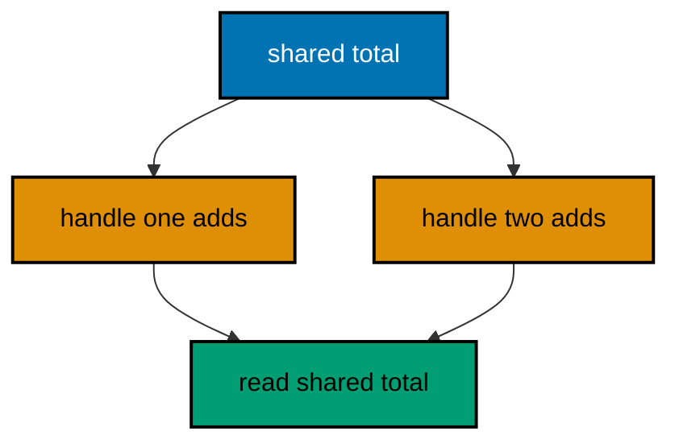

**`learning/code/ex-52-rc-refcell-shared-ownership/main.rs`**:

```rust
// Example 52: Rc and RefCell Share Ownership.
// => `Rc` clones the handle, not the value: many owners, one allocation.
// => `RefCell` checks borrows at runtime: mutation through a shared handle.
// => `borrow_mut` panics on conflicting borrows: single-threaded discipline.
// => Both handles below mutate the same total: updates are visible everywhere.
use std::cell::RefCell; // => runtime-checked interior mutability
use std::rc::Rc; // => single-threaded shared ownership
fn main() {
    // => one total shared by two handles: the classic counter shape.
    let shared = Rc::new(RefCell::new(0)); // => zero total, two mechanisms
    let first = Rc::clone(&shared); // => handle one: cheap pointer copy
    let second = Rc::clone(&shared); // => handle two: same value, new handle
    *first.borrow_mut() += 50; // => update through handle one
    *second.borrow_mut() += 75; // => update through handle two
                                // => both updates landed in the same cell: the total is their sum.
    println!("handles: {}", Rc::strong_count(&shared)); // => Output: handles: 3
    println!("total: {}", shared.borrow()); // => Output: total: 125
}
```

**Output** (`learning/code/ex-52-rc-refcell-shared-ownership/expected/main.stdout.txt`):

```text
handles: 3
total: 125
```

**Key takeaway**: `Rc::clone` shares ownership; `RefCell` permits mutation through shared handles on one thread.

**Why it matters**: Graphs, caches, and observer lists genuinely need shared mutable structures that single ownership cannot express, and reaching for these types keeps that sharing explicit and single-threaded. The runtime borrow check documents the trade: flexibility now in exchange for panics instead of compile errors if the discipline slips. UI trees, entity graphs, and observer lists all need this exact sharing shape, making it the standard single-threaded answer.

### Example 53: From and Into Conversions

`From` defines one infallible conversion and `Into` comes free, so APIs accept many shapes through one generic bound. This example converts raw text into a validated due amount through `TryFrom` and prints each verdict. (Concepts: co-10, co-14.)

**`learning/code/ex-53-from-into-conversions/main.rs`**:

```rust
// Example 53: From and Into Conversions.
// => `From` is the one-way infallible conversion: `Into` arrives automatically.
// => `TryFrom` covers fallible conversions: validation lives in the type.
// => Generic `Into<String>` parameters accept `&str` and `String` alike.
// => Conversion traits keep parsing at the boundary: inner code trusts types.
// => `ledger_name` shows the generic bound: two input shapes, one function.
use std::convert::TryFrom; // => the fallible conversion trait
#[derive(Debug, PartialEq)] // => `Debug` prints, `PartialEq` compares
struct Due {
    // => a validated positive amount: invalid states unrepresentable
    amount: i32, // => always positive by construction below
}
// => `TryFrom<&str>` parses and validates: failures name the input.
impl TryFrom<&str> for Due {
    // => the error type is a plain message
    type Error = String; // => callers match on text here, variants later
    fn try_from(raw: &str) -> Result<Due, String> {
        // => parse plus validate
        let amount = raw // => the raw text under test
            .trim() // => padding never decides validity
            .parse::<i32>() // => digits parse; junk fails here
            .map_err(|_| format!("bad amount: {}", raw))?; // => names the input
        if amount <= 0 {
            // => the domain rule: dues stay positive
            return Err(format!("negative refused: {}", raw)); // => refused loudly
        }
        Ok(Due { amount }) // => validated: the type guarantees positivity
    }
}
// => `Into<String>` accepts borrowed and owned text with one signature.
fn ledger_name<N: Into<String>>(name: N) -> String {
    // => generic over the input shape
    format!("ledger: {}", name.into()) // => convert once, render once
}
fn main() {
    // => three conversions: a good due, junk, and a refused negative.
    println!("{:?}", Due::try_from("50")); // => Output: Ok(Due { amount: 50 })
    println!("{:?}", Due::try_from("xyz")); // => Output: Err("bad amount: xyz")
    println!("{:?}", Due::try_from("-5")); // => Output: Err("negative refused: -5")
    println!("{}", ledger_name("sari")); // => Output: ledger: sari
    println!("{}", ledger_name("budi".to_string())); // => Output: ledger: budi
}
```

**Output** (`learning/code/ex-53-from-into-conversions/expected/main.stdout.txt`):

```text
Ok(Due { amount: 50 })
Err("bad amount: xyz")
Err("negative refused: -5")
ledger: sari
ledger: budi
```

**Key takeaway**: Validate at conversion with `TryFrom`; accept many text shapes with generic `Into<String>`.

**Why it matters**: Conversion traits push parsing and validation to the boundary where untrusted data enters, so inner functions work with types that guarantee their own invariants. Generic `Into` bounds then keep call sites ergonomic across borrowed and owned inputs without overloads, which is why standard APIs take them everywhere. Configuration loaders, CLI parsers, and protocol decoders all validate at conversion, making invalid states unrepresentable by construction.
