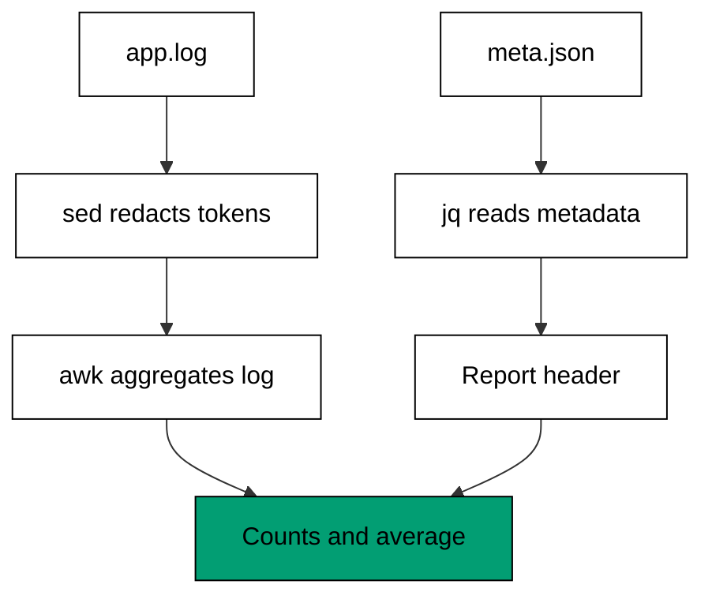

The capstone assembles the whole course into one realistic pipeline: a fixed-width
application log parsed with awk, sensitive tokens redacted with sed, JSON service
metadata reshaped with jq, and all three stages chained in one shell script that prints
a single summary report. Nothing here introduces a new concept -- every construct
appeared in Themes A through I -- but the composition is new, which is exactly the skill
a report pipeline demands: choosing the right tool per stage and joining the stages with
pipes and command substitution.

## The task

A small service writes one fixed-width log line per request and keeps its deployment
metadata (region, owner) in a JSON file. Build `report.sh`, a script that prints a
seven-line summary: the region and owner from JSON, the request/ok/fail counts and mean
latency from the log, and one redacted sample line proving no secret reaches the
report. Every input and the golden output are committed next to the script; the script
rewrites no file.

## How the stages fit



The order is deliberate and worth stating as a rule: redact before parsing. The sed
stage runs first so that every later stage -- the awk aggregation, the sample line,
any debugging printout -- can only ever see `token=REDACTED`. A pipeline that parses
first and redacts last leaks secrets through every intermediate step; a pipeline that
redacts first cannot leak, because the secret is gone before the second stage starts.
This is Theme H's safety habit applied to composition: the fence sits at the pipeline's
entrance, not at its exit.

The awk stage reads fixed columns with `substr` rather than splitting on whitespace,
because fixed-width logs keep their shape even when a field value contains a space --
`substr($0, 19, 4)` always lands on the status zone, trimmed with `gsub`, while `$3`
would drift the moment a hostname grew a suffix. Positional reading is the right call
exactly when the producer guarantees positions, which a fixed-width log does by
definition. The jq stage is two one-field reads; it stays small because metadata is a
header, not the dataset -- the log is the dataset, and jq's job is only to label the
report with where it ran and who owns it.

## The script

**`learning/capstone/code/report.sh`**:

```bash
#!/bin/bash
# => Capstone: parse a fixed-width log, redact secrets, reshape JSON metadata.
# => co-01: substr reads fixed columns out of each log record.
# => co-06: sed redacts every token value before parsing.
# => co-09: jq reads the region and owner out of the metadata object.
# => co-16: one shell script chains sed, awk, and jq into a single report.
set -euo pipefail  # => strict mode: fail fast on errors and unset names
echo "region: $(jq -r '.region' meta.json)"  # => header line one comes from JSON
echo "owner: $(jq -r '.owner' meta.json)"  # => header line two comes from JSON
redacted=$(sed -E 's/token=[^ ]*/token=REDACTED/' app.log)  # => redact every secret first
printf '%s\n' "$redacted" | awk '{ status = substr($0, 19, 4); gsub(/ /, "", status); ms = substr($0, 24, 3) + 0; n++; sum += ms; if (status == "OK") ok++; else fail++ } END { print "requests: " n; print "ok: " ok; print "fail: " fail; print "avg_ms: " sum / n }'  # => aggregate the fixed columns
printf '%s\n' "$redacted" | sed -n '1p' | sed 's/^/redacted_sample: /'  # => prove redaction on line one
# => no file is rewritten anywhere: the report is stdout, the proof is a prefix.
```

## The inputs

**Input** (`learning/capstone/code/app.log`):

```text
2026-10-21 web-01 OK   120 token=abc123
2026-10-21 web-02 FAIL 045 token=def456
2026-10-21 db-01  OK   200 token=ghi789
2026-10-21 web-01 OK   130 token=abc123
```

Four requests across three hosts: three `OK`, one `FAIL`, latencies 120, 45, 200, and
130 milliseconds. Each line carries a `token=` secret that must never reach the
report -- the fixture keeps real-looking values so the redaction stage has something
genuine to remove. Note the `db-01` line: the hostname field is space-padded to keep
every column at its fixed position, which is why the awk stage reads by position
rather than by field number.

**Input** (`learning/capstone/code/meta.json`):

```text
{"region": "east", "owner": "adi"}
```

The deployment metadata: one small object, two fields, read with two one-field jq
filters. It lives in JSON rather than in the log because it describes the deployment,
not any single request -- header facts belong in a header file.

## The golden output

**Output** (`learning/capstone/code/expected/main/main.stdout.txt`):

```text
region: east
owner: adi
requests: 4
ok: 3
fail: 1
avg_ms: 123.75
redacted_sample: 2026-10-21 web-01 OK   120 token=REDACTED
```

Read the report bottom-up to verify it: the sample line shows the redaction working on
real input; `avg_ms` is (120 + 45 + 200 + 130) / 4 = 123.75; the counts (4 requests, 3
ok, 1 fail) match the four fixture lines; the header names the region and owner from
the JSON file. Every number traces to a fixture fact in one step, which is what makes
this report checkable by hand -- the defining property of a summary worth trusting.

## What this proves

Run the script a second time and the output is byte-identical: the redaction
converges (`REDACTED` contains no `token=` value to re-redact), the aggregation is a
pure function of the fixtures, and the JSON reads are deterministic. Rerun the whole
capstone the way Examples 39 through 42 rerun their edits -- stability is the
acceptance test. Extend it the way a real report grows: a new JSON field becomes one
more `echo` line, a new log column becomes one more `substr`, a new secret shape
becomes one more sed alternative. The pipeline's shape -- redact, aggregate, label --
does not change, because the shape is the design and the stages are just its current
contents.

---

← Previous: [Theme I: Choosing the Right Tool](../theme-i-choosing-the-right-tool.md) · Next: [Drilling](/en/learn/courses/text-processing-with-awk-sed-and-jq/drilling/overview) →
