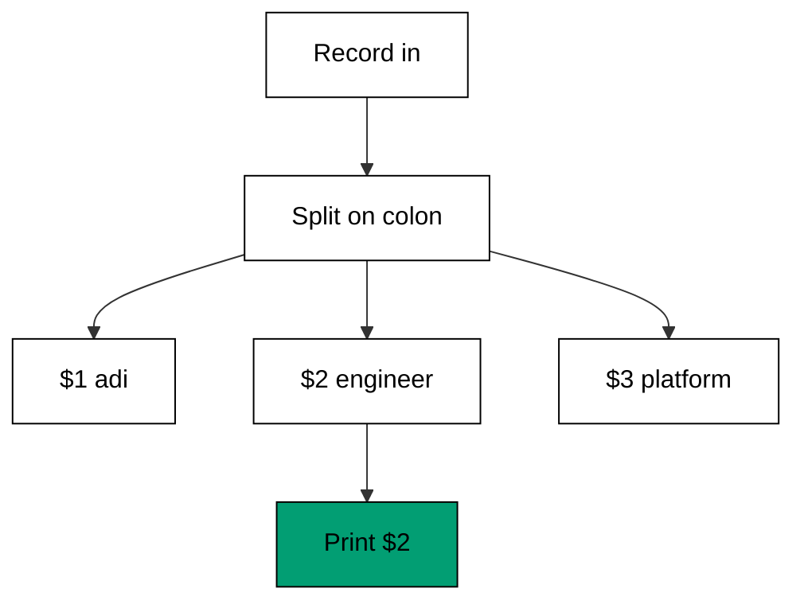
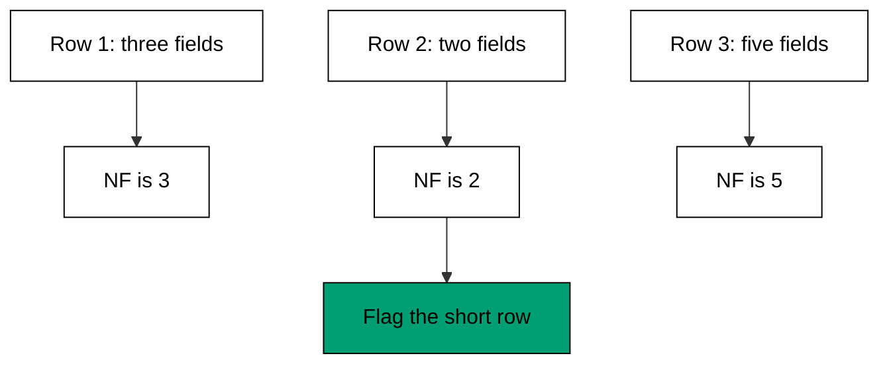

Examples 1-5 install the mental model every later awk example assumes: a line is a record,
a record splits into fields, and four builtin variables (`FS`, `NF`, `NR`, `OFS`) expose
that split (co-01, co-03). The first example prints one field; the last rebuilds whole rows
with a new separator. Read them as one ladder: select, separate, number, inspect, rebuild.

Work this theme with a terminal open beside the page: run each script, then change one
thing -- a different field number, a different separator, a header row of your own --
and predict the output before you run it. The five programs are deliberately tiny so
that every experiment finishes in seconds; the habit they build is naming the record
and the field before reaching for any other tool. By Example 5 you should be able to
look at any delimited file and state its separator, its header situation, and which
column answers your question, all before typing a command.

---

### Worked Example 1: Print the Second Field

_ex-01 &middot; exercises co-01_

Most log and account files are columns wearing a line's clothes: `name:role:team` is three
values glued with colons. awk's default move is to split each record into fields and hand
you any column by number, no `cut` invocation needed.



**`learning/code/ex-01-print-the-second-field/example.sh`**:

```bash
#!/bin/bash
# => Worked Example 1: print one column from colon-separated rows.
# => co-01: each line is a record, each colon chunk is a field.
set -euo pipefail  # => strict mode: fail fast on errors and unset names
awk -F: '{ print $2 }' users.txt  # => split every record on colons, print field 2
# => $2 is the role column here; $1 would be the name, $3 the team.
```

**Input** (`learning/code/ex-01-print-the-second-field/users.txt`):

```text
adi:engineer:platform
bima:designer:growth
citra:engineer:platform
dewi:manager:growth
eko:engineer:infra
```

**Output** (`learning/code/ex-01-print-the-second-field/expected/main.stdout.txt`):

```text
engineer
designer
engineer
manager
engineer
```

**Verify**: every output line is field 2 of the matching input row -- `users.txt` line 2
is `bima:designer:growth` and output line 2 is `designer`.

**Key takeaway**: `-F` names the separator, `$N` names the column; one awk program
replaces a `cut -d: -f2` call and stays extensible when the task grows.

**Why it matters**: column extraction is the most common text task in operations -- roles
from account dumps, hosts from inventory, statuses from logs. Naming the field by number
keeps the command readable when the next request is "now only the engineers" (Example 6
adds the condition without restructuring anything).

---

### Worked Example 2: Change the Field Separator

_ex-02 &middot; exercises co-01, co-03_

Real exports are rarely colon-separated: CSV uses commas, `/etc/passwd` uses colons, logs
use spaces. `-F` adapts one program to any of them, and `NR` (the current record number)
skips the header row that would otherwise pollute the result.

**`learning/code/ex-02-change-the-field-separator/example.sh`**:

```bash
#!/bin/bash
# => Worked Example 2: parse comma-separated values with -F.
# => co-01: CSV rows are records, comma chunks are fields.
# => co-03: NR counts records, so NR > 1 skips the header row.
set -euo pipefail  # => strict mode: fail fast on errors and unset names
awk -F, 'NR > 1 { print $2 ": " $3 }' orders.csv  # => skip header, print customer and total
# => -F, sets the field separator to a comma for this whole program.
```

**Input** (`learning/code/ex-02-change-the-field-separator/orders.csv`):

```text
order,customer,total
1001,adi,250
1002,bima,89
1003,citra,412
```

**Output** (`learning/code/ex-02-change-the-field-separator/expected/main.stdout.txt`):

```text
adi: 250
bima: 89
citra: 412
```

**Verify**: the header row `order,customer,total` produces no output line, and output line
3 (`citra: 412`) matches input row 4's fields 2 and 3.

**Key takeaway**: `NR > 1` is the standard header skip; changing `-F` re-targets the same
program at a new delimiter without touching its logic.

**Why it matters**: exports always arrive with a header and a delimiter you did not
choose. A program that names both facts up front survives the next export format, while a
hard-coded `cut` chain quietly includes the header in its arithmetic.

---

### Worked Example 3: Number Lines With NR

_ex-03 &middot; exercises co-03, co-13_

Before reformatting anything, orient yourself: number the lines. `NR` counts records as
awk reads them, one at a time, so numbering a million-line file costs constant memory --
this is streaming (co-13), not loading.

**`learning/code/ex-03-number-lines-with-nr/example.sh`**:

```bash
#!/bin/bash
# => Worked Example 3: stream line numbers without loading the file.
# => co-03: NR is the current record number, maintained by awk itself.
# => co-13: awk reads one record at a time, so this streams.
set -euo pipefail  # => strict mode: fail fast on errors and unset names
awk '{ printf "%d: %s\n", NR, $0 }' hosts.txt  # => prefix every line with its number
# => $0 is the whole record; printf formats the number and the line.
```

**Input** (`learning/code/ex-03-number-lines-with-nr/hosts.txt`):

```text
web-01
web-02
db-01
cache-01
```

**Output** (`learning/code/ex-03-number-lines-with-nr/expected/main.stdout.txt`):

```text
1: web-01
2: web-02
3: db-01
4: cache-01
```

**Verify**: output line 3 numbers input line 3 (`db-01`); no input line appears twice and
none is missing, which is exactly the guarantee a streaming counter gives.

**Key takeaway**: `NR` plus `$0` numbers any stream; because awk never holds more than one
record, the same program works on a four-line fixture and a four-gigabyte log.

**Why it matters**: numbered output turns "something is wrong near the database hosts"
into "line 3". Error reports, reviews, and follow-up extractions all become unambiguous
once every line has an address.

---

### Worked Example 4: Count Fields With NF

_ex-04 &middot; exercises co-03, co-01_

Not every row has the same shape: a missing column shifts every later field, and the bug
shows up far from its cause. `NF` (number of fields in the current record) makes ragged
rows visible before they corrupt a sum or a join.



**`learning/code/ex-04-count-fields-with-nf/example.sh`**:

```bash
#!/bin/bash
# => Worked Example 4: spot ragged rows by field count.
# => co-03: NF is the field count of the current record only.
# => co-01: rows with fewer or more fields break column assumptions.
set -euo pipefail  # => strict mode: fail fast on errors and unset names
awk '{ print NF ": " $0 }' ragged.txt  # => print each row prefixed by its field count
# => the 2-field row stands out next to the 3-field and 5-field rows.
```

**Input** (`learning/code/ex-04-count-fields-with-nf/ragged.txt`):

```text
adi 25 engineer
bima designer
citra 30 manager platform lead
```

**Output** (`learning/code/ex-04-count-fields-with-nf/expected/main.stdout.txt`):

```text
3: adi 25 engineer
2: bima designer
5: citra 30 manager platform lead
```

**Verify**: the middle row reports `NF` of 2 while its neighbors report 3 and 5 -- the
short row is the one missing the age column.

**Key takeaway**: print `NF` first when a column program misbehaves; a surprising count
explains a wrong `$3` faster than re-reading the program.

**Why it matters**: real data is ragged -- optional columns, wrapped lines, hand edits.
Checking `NF` before trusting `$N` is the one-line data-quality gate that prevents a
shifted column from silently becoming someone's salary figure.

---

### Worked Example 5: Reformat With OFS

_ex-05 &middot; exercises co-03, co-01_

Input and output rarely share a delimiter: space-separated metrics become a CSV import.
`OFS` (output field separator) controls the glue awk puts between fields, and touching
any field (`$1 = $1`) forces awk to rebuild the record with it.

**`learning/code/ex-05-reformat-with-ofs/example.sh`**:

```bash
#!/bin/bash
# => Worked Example 5: rebuild delimited rows with a new separator.
# => co-03: OFS is the separator awk puts between output fields.
# => co-01: assigning to $1 forces awk to rebuild the record with OFS.
set -euo pipefail  # => strict mode: fail fast on errors and unset names
awk 'BEGIN { OFS="," } { $1=$1; print }' metrics.txt  # => rebuild each row comma-separated
# => $1=$1 touches a field, so awk rejoins all fields using OFS.
```

**Input** (`learning/code/ex-05-reformat-with-ofs/metrics.txt`):

```text
cpu 42 pct
mem 71 pct
disk 55 pct
```

**Output** (`learning/code/ex-05-reformat-with-ofs/expected/main.stdout.txt`):

```text
cpu,42,pct
mem,71,pct
disk,55,pct
```

**Verify**: each output row has exactly two commas and the same three values in the same
order as its input row -- only the separator changed.

**Key takeaway**: set `OFS` in `BEGIN`, touch a field, `print` -- the three-step recipe
converts any delimiter to any other delimiter.

**Why it matters**: format conversion sits between every pair of tools that disagree
about delimiters. Owning this recipe means the monitoring export, the spreadsheet, and
the import script stop arguing about spaces versus commas.

---

← Previous: [Learning Overview](./overview.md) · Next: [Theme B: awk Patterns and Functions](./theme-b-awk-patterns-and-functions.md) →
