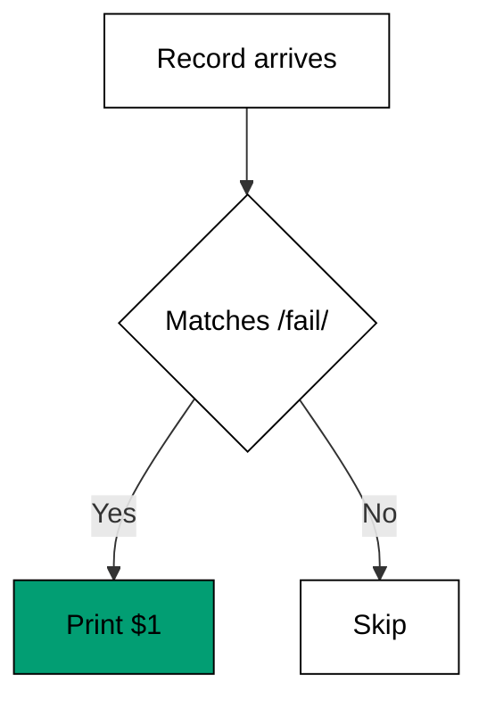
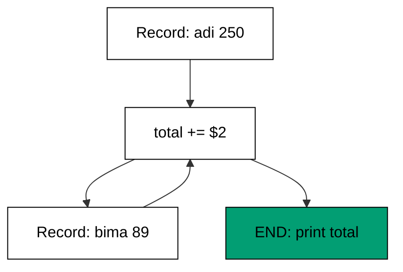

Examples 6-10 add the second half of every awk program: the pattern that decides whether a
record is processed at all (co-02), and the functions -- user-defined and built-in -- that
keep the action readable (co-04). Selection comes first (single pattern, range, the `END`
pattern for aggregation); abstraction closes the theme.

Read the first three examples as one question -- "which records?" -- asked three ways:
a test on each row, a span between markers, a verdict after the last row. Examples 8
and 9 then answer "and then what?" with accumulation and naming: the `END` report
turns a stream into a number, and the named function turns a repeated decision into a
word the action can use. The theme's arc is from throwing rows away to keeping exactly
the meaning they carried, and the built-ins in Example 10 are the cleanup crew that
makes kept values trustworthy.

---

### Worked Example 6: Select Rows By Pattern

_ex-06 &middot; exercises co-02_

An awk program is a list of pattern-action rules: the pattern tests the record, the action
runs only on matches. A bare `/fail/` pattern with a print action is `grep` with column
awareness -- the selection and the projection happen in one program.



**`learning/code/ex-06-select-rows-by-pattern/example.sh`**:

```bash
#!/bin/bash
# => Worked Example 6: keep rows matching a regular expression.
# => co-02: the /fail/ pattern tests each record; the action runs on matches.
set -euo pipefail                    # => strict mode: fail fast on errors and unset names
awk '/fail/ { print $1 }' scores.txt # => print the name field of failing rows only
# => rows without "fail" never reach the action; nothing prints for them.
```

**Input** (`learning/code/ex-06-select-rows-by-pattern/scores.txt`):

```text
adi 78 pass
bima 41 fail
citra 93 pass
dewi 55 fail
eko 88 pass
```

**Output** (`learning/code/ex-06-select-rows-by-pattern/expected/main.stdout.txt`):

```text
bima
dewi
```

**Verify**: only the two rows containing `fail` contribute their first field; the three
`pass` rows are tested and skipped.

**Key takeaway**: `pattern { action }` fuses filtering and projection -- write the test
once, and awk applies it to every record.

**Why it matters**: "all X where Y" is the shape of half of all data questions. A
pattern-action rule answers it in one pass with no temporary files, and the same rule
grows a second condition (Example 7) or an aggregation (Example 8) without rewriting.

---

### Worked Example 7: Select A Range Of Rows

_ex-07 &middot; exercises co-02_

Reports wrap sections in markers: `BEGIN` here, `END` there. A two-pattern range
`/BEGIN/,/END/` switches the action on at the first match and off after the second, so
one rule extracts exactly the marked section.

**`learning/code/ex-07-select-a-range-of-rows/example.sh`**:

```bash
#!/bin/bash
# => Worked Example 7: keep rows between two patterns.
# => co-02: a two-pattern range turns the action on at BEGIN, off after END.
set -euo pipefail              # => strict mode: fail fast on errors and unset names
awk '/BEGIN/,/END/' report.txt # => print every record from the BEGIN line to the END line
# => lines before BEGIN and after END never match, so they never print.
```

**Input** (`learning/code/ex-07-select-a-range-of-rows/report.txt`):

```text
daily report
BEGIN
task one
task two
END
notes
```

**Output** (`learning/code/ex-07-select-a-range-of-rows/expected/main.stdout.txt`):

```text
BEGIN
task one
task two
END
```

**Verify**: the output starts at the `BEGIN` line and stops at the `END` line -- the
`daily report` header and the trailing `notes` are both excluded.

**Key takeaway**: `start,end` ranges extract marked sections; the default print action
(no braces) means "print the matched records".

**Why it matters**: logs, dumps, and generated reports all delimit sections with marker
lines. Range patterns pull one section out of a large file without line numbers that
break the next time the file grows.

---

### Worked Example 8: Sum A Column

_ex-08 &middot; exercises co-02, co-03_

`END` is a pattern that matches once, after the last record -- the mirror of `BEGIN`.
Accumulate across records in a variable, report once in `END`: this is the whole
map-and-total idiom in two clauses.



**`learning/code/ex-08-sum-a-column/example.sh`**:

```bash
#!/bin/bash
# => Worked Example 8: aggregate in END after the stream ends.
# => co-02: END is a pattern that matches once, after the last record.
# => co-03: total accumulates field 2 across every record.
set -euo pipefail                                   # => strict mode: fail fast on errors and unset names
awk '{ total += $2 } END { print total }' sales.txt # => add each amount, print the sum once
# => no per-record action prints; the single END action prints the total.
```

**Input** (`learning/code/ex-08-sum-a-column/sales.txt`):

```text
adi 250
bima 89
citra 412
dewi 130
```

**Output** (`learning/code/ex-08-sum-a-column/expected/main.stdout.txt`):

```text
881
```

**Verify**: 250 + 89 + 412 + 130 equals 881, printed exactly once -- the per-record
action accumulates silently and only `END` speaks.

**Key takeaway**: `{ accumulate } END { report }` is awk's aggregation shape; averages,
minima, and counts are the same program with different arithmetic.

**Why it matters**: totals, averages, and histograms answer "how much" without leaving
the shell. Learning the accumulate-then-report shape here pays off again in `jq`'s
`reduce` (Example 31), which is the same idea in JSON.

---

### Worked Example 9: Write Your Own Function

_ex-09 &middot; exercises co-04_

When an action repeats a decision -- a threshold, a classification, a format -- name it
with `function`. The rule lives in one place, the action reads like the rulebook, and the
third use costs nothing.

**`learning/code/ex-09-write-your-own-function/example.sh`**:

```bash
#!/bin/bash
# => Worked Example 9: factor repeated logic into an awk function.
# => co-04: function status(t) names the fever rule once, reused per row.
set -euo pipefail                                                                                            # => strict mode: fail fast on errors and unset names
awk 'function status(t) { if (t >= 38) return "fever"; return "ok" } { print $1 ": " status($2) }' temps.txt # => label every temperature
# => the function reads like the rulebook; the action stays one line.
```

**Input** (`learning/code/ex-09-write-your-own-function/temps.txt`):

```text
adi 36
bima 39
citra 41
```

**Output** (`learning/code/ex-09-write-your-own-function/expected/main.stdout.txt`):

```text
adi: ok
bima: fever
citra: fever
```

**Verify**: 36 is below the 38 threshold (`ok`); 39 and 41 are at or above it (`fever`) --
the function applies the same rule to every row.

**Key takeaway**: `function name(args) { ... }` before the rules defines reusable logic;
call it from any action with ordinary arguments.

**Why it matters**: duplicated thresholds drift -- one copy says 38, another says 39.
A named function keeps the business rule in exactly one place, which is what makes the
next threshold change a one-line edit instead of a hunt.

---

### Worked Example 10: Clean Strings With Builtins

_ex-10 &middot; exercises co-04_

Raw input is messy: stray spaces, random case. awk's string built-ins -- `gsub` for
replacement, `tolower` for case folding, `length` for measuring -- clean a value before
anyone downstream trusts it.

**`learning/code/ex-10-clean-strings-with-builtins/example.sh`**:

```bash
#!/bin/bash
# => Worked Example 10: trim and normalize with string built-ins.
# => co-04: gsub, tolower, and length are built-in awk functions.
set -euo pipefail                                                                                                # => strict mode: fail fast on errors and unset names
awk '{ clean = $0; gsub(/ /, "", clean); clean = tolower(clean); print clean " (" length(clean) ")" }' messy.txt # => strip spaces, fold case, count
# => gsub edits in place; tolower returns the folded copy; length counts it.
```

**Input** (`learning/code/ex-10-clean-strings-with-builtins/messy.txt`):

```text
  ADI-007
BIMA-042
  citra-013
```

**Output** (`learning/code/ex-10-clean-strings-with-builtins/expected/main.stdout.txt`):

```text
adi-007 (7)
bima-042 (8)
citra-013 (9)
```

**Verify**: leading spaces are gone, every letter is lowercase, and the parenthesized
lengths (7, 8, 9) match the cleaned codes character for character.

**Key takeaway**: `gsub` rewrites, `tolower` folds, `length` measures -- three built-ins
turn hand-typed chaos into canonical identifiers.

**Why it matters**: joins and comparisons fail on invisible differences -- a leading
space, a capital letter. Normalizing at the intake, where the mess arrives, keeps every
later `select`, `group_by`, and equality test honest.

---

← Previous: [Theme A: awk Fields and Records](./theme-a-awk-fields-and-records.md) · Next: [Theme C: sed Addressing](./theme-c-sed-addressing.md) →
