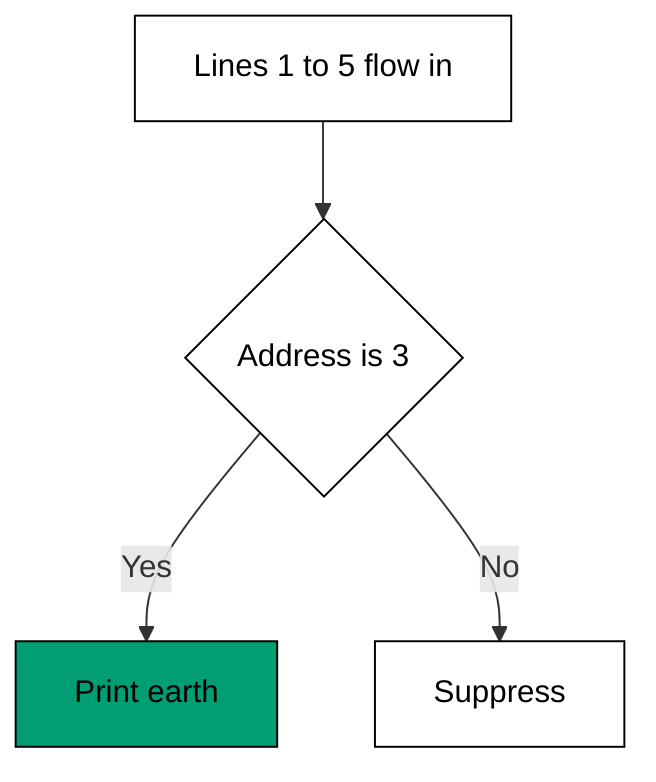
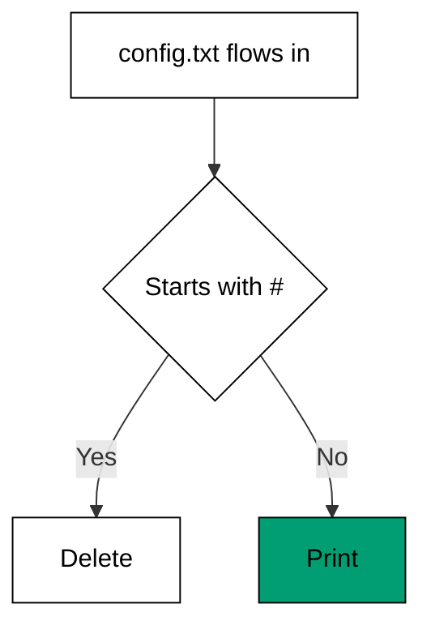

Examples 11-15 teach the first half of sed's mental model: the address that selects which
lines a command touches (co-05). Line numbers, ranges, patterns, and negation each name a
different set of lines; the `d` command shows deletion without ever rewriting the file,
which previews the idempotence habit Theme H makes explicit (co-14).

Treat every address as a promise about which lines a command may touch, and test the
promise by reading the output, not the command. Print queries (`p`) are the safe way
to audition an address: they show the selected set without changing anything, so the
address inside a later `d` or `s` is already proven. The theme moves from the most
fragile address (a line number) to the most robust (a negated pattern) precisely so
that by Example 15 you distrust numbers and trust meanings -- a distrust every later
edit repays.

---

### Worked Example 11: Print One Line

_ex-11 &middot; exercises co-05_

sed reads every line but, with `-n`, prints nothing unless told to. The address `3`
selects exactly line 3 and `p` prints it -- the smallest possible addressed command, and
the pattern every later address generalizes.



**`learning/code/ex-11-print-one-line/example.sh`**:

```bash
#!/bin/bash
# => Worked Example 11: print a single line by number.
# => co-05: the 3 address selects only line 3; -n suppresses the rest.
set -euo pipefail       # => strict mode: fail fast on errors and unset names
sed -n '3p' planets.txt # => print only line 3, nothing else
# => -n turns off automatic printing; p prints the addressed line.
```

**Input** (`learning/code/ex-11-print-one-line/planets.txt`):

```text
mercury
venus
earth
mars
jupiter
```

**Output** (`learning/code/ex-11-print-one-line/expected/main.stdout.txt`):

```text
earth
```

**Verify**: the single output line is input line 3 (`earth`); lines 1, 2, 4, and 5 are
read and suppressed.

**Key takeaway**: `sed -n 'Np'` prints line N and nothing else -- addressing plus
explicit printing is sed's basic vocabulary.

**Why it matters**: peeking at one line of a large file -- a header, a failing record, a
marker -- should not mean opening the whole file. A numbered address jumps straight
there, and `-n` keeps the other million lines quiet.

---

### Worked Example 12: Print A Line Range

_ex-12 &middot; exercises co-05_

One address names one line; two addresses joined by a comma name a slice. `2,4p` prints
lines 2 through 4, both ends inclusive -- the same idea as "rows 2 to 4" in a
spreadsheet, applied to a stream.

**`learning/code/ex-12-print-a-line-range/example.sh`**:

```bash
#!/bin/bash
# => Worked Example 12: print a slice of numbered lines.
# => co-05: the 2,4 address selects lines 2 through 4, inclusive.
set -euo pipefail         # => strict mode: fail fast on errors and unset names
sed -n '2,4p' planets.txt # => print lines 2, 3, and 4; skip lines 1 and 5
# => both ends of a line range are inclusive in sed.
```

**Input** (`learning/code/ex-12-print-a-line-range/planets.txt`):

```text
mercury
venus
earth
mars
jupiter
```

**Output** (`learning/code/ex-12-print-a-line-range/expected/main.stdout.txt`):

```text
venus
earth
mars
```

**Verify**: the output holds exactly input lines 2, 3, and 4 in order, with the
first and last planet lines excluded.

**Key takeaway**: `M,Np` slices numbered lines inclusively; reaching for a range beats
chaining `head` and `tail` because the slice is named, not counted twice.

**Why it matters**: samples, windows, and pages of a file are all ranges. Naming both
ends in one address keeps "lines 2 to 4" as one thought instead of a `head -4 | tail -3`
puzzle the next reader must decode.

---

### Worked Example 13: Print Matching Lines

_ex-13 &middot; exercises co-05_

Line numbers shift every time a file grows; patterns do not. A `/down/` address selects
lines by content, so the same command finds every down service no matter where each one
sits in the file.

**`learning/code/ex-13-print-matching-lines/example.sh`**:

```bash
#!/bin/bash
# => Worked Example 13: print lines by pattern instead of number.
# => co-05: the /down/ address selects lines by content, not position.
set -euo pipefail             # => strict mode: fail fast on errors and unset names
sed -n '/down/p' services.txt # => print every line containing "down"
# => line numbers may shift between runs; the pattern still finds its lines.
```

**Input** (`learning/code/ex-13-print-matching-lines/services.txt`):

```text
web:up
db:down
cache:up
queue:down
```

**Output** (`learning/code/ex-13-print-matching-lines/expected/main.stdout.txt`):

```text
db:down
queue:down
```

**Verify**: both output lines contain `down` (input lines 2 and 4); neither `up` line
appears.

**Key takeaway**: `/pattern/p` selects by meaning rather than position -- prefer it
whenever the file's layout can change.

**Why it matters**: production files grow, rotate, and reorder. Addresses tied to content
survive all three; addresses tied to line numbers break silently the first time someone
adds a row at the top.

---

### Worked Example 14: Delete By Address

_ex-14 &middot; exercises co-05, co-14_

`d` deletes addressed lines from the output -- not from the file. Without `-i`, sed is a
filter: the fixture on disk is untouched, so deleting comments is safe to run, inspect,
and rerun (co-14).



**`learning/code/ex-14-delete-by-address/example.sh`**:

```bash
#!/bin/bash
# => Worked Example 14: drop header and comment lines safely.
# => co-05: the /^#/ address selects every line starting with a hash.
# => co-14: sed prints to stdout here; config.txt on disk is untouched.
set -euo pipefail      # => strict mode: fail fast on errors and unset names
sed '/^#/d' config.txt # => delete comment lines, print everything else
# => no -i flag means the file is read, never rewritten: safe to rerun.
```

**Input** (`learning/code/ex-14-delete-by-address/config.txt`):

```text
# managed by ops
host=db-01
port=5432
# end of managed block
mode=prod
```

**Output** (`learning/code/ex-14-delete-by-address/expected/main.stdout.txt`):

```text
host=db-01
port=5432
mode=prod
```

**Verify**: both `#` lines are gone; all three settings survive in order; the input
file still holds five lines because nothing was rewritten.

**Key takeaway**: `/pattern/d` strips addressed lines from the stream while the file
stays intact -- deletion as a view, not an edit.

**Why it matters**: stripping comments and headers before parsing is a daily operation,
and doing it as a read-only filter means a wrong pattern costs you an output, never a
file. Save `-i` for the day Theme H's safety rules say you are ready.

---

### Worked Example 15: Invert An Address

_ex-15 &middot; exercises co-05_

Sometimes the exception is easier to name than the rule: "everything except lines 2 and
3". The `!` after an address negates it, so `2,3!p` prints the complement of the range.

**`learning/code/ex-15-invert-an-address/example.sh`**:

```bash
#!/bin/bash
# => Worked Example 15: print everything the address does not match.
# => co-05: the ! after an address negates it: match the complement.
set -euo pipefail          # => strict mode: fail fast on errors and unset names
sed -n '2,3!p' planets.txt # => print every line except lines 2 and 3
# => the excluded middle stays out no matter how long the file grows.
```

**Input** (`learning/code/ex-15-invert-an-address/planets.txt`):

```text
mercury
venus
earth
mars
jupiter
```

**Output** (`learning/code/ex-15-invert-an-address/expected/main.stdout.txt`):

```text
mercury
mars
jupiter
```

**Verify**: lines 2 (`venus`) and 3 (`earth`) are the only ones missing; lines 1, 4,
and 5 print in order.

**Key takeaway**: `address!command` applies the command everywhere the address does not
match -- negation turns "drop these" into "keep everything else".

**Why it matters**: exclusion lists ("all regions except the two under maintenance")
are more stable than inclusion lists because new entries default to included. Negated
addresses encode that default directly.

---

← Previous: [Theme B: awk Patterns and Functions](./theme-b-awk-patterns-and-functions.md) · Next: [Theme D: sed Substitution and Hold Space](./theme-d-sed-substitution-and-hold-space.md) →
