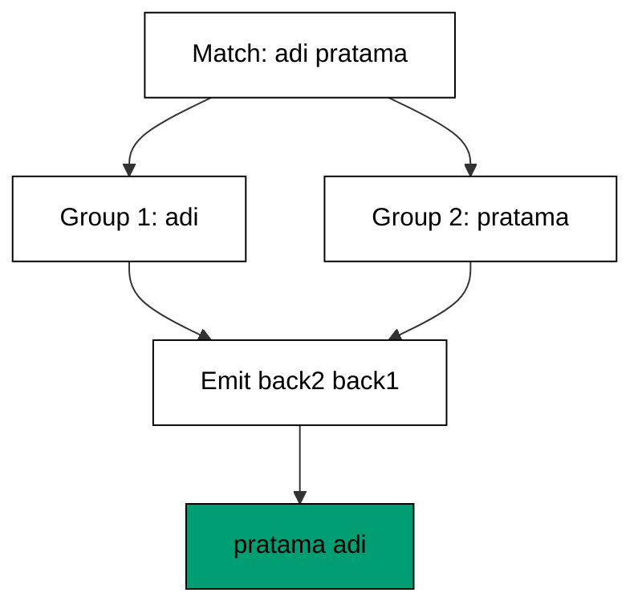
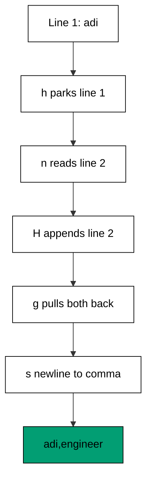

Examples 16-21 teach the second half of sed's model: the substitution that rewrites text
(co-06), the capture groups that remember parts of a match (co-07), and the hold space
that lets a one-line editor think in two lines (co-08). Every script uses `-E` extended
expressions, so parentheses and `+` mean grouping and repetition on every sed this course
runs on.

Notice the theme's two halves asking opposite questions: substitutions ask "what
changes on this line?" while the hold space asks "which lines belong together?" The
first four examples never leave the current line -- every edit is local, reviewable,
and undoable by re-running the original. The last two widen the window only as far as
the task needs: two lines for pairing, however many for continuations. Resist widening
it further; a sed program that juggles three lines is a program asking to become an
awk program, and Theme I will make that trade explicit.

---

### Worked Example 16: Replace The First Match

_ex-16 &middot; exercises co-06_

`s/old/new/` replaces the first match on each line and stops. The default is deliberately
conservative: most edits mean "the first occurrence", and sed makes that the behavior you
get without asking for anything extra.

**`learning/code/ex-16-replace-the-first-match/example.sh`**:

```bash
#!/bin/bash
# => Worked Example 16: substitute once per line on purpose.
# => co-06: s/hello/hi/ without a flag replaces only the first match.
set -euo pipefail  # => strict mode: fail fast on errors and unset names
sed 's/hello/hi/' greet.txt  # => replace the first hello on each line
# => later matches on the same line survive: first-only is the default.
```

**Input** (`learning/code/ex-16-replace-the-first-match/greet.txt`):

```text
hello hello hello
```

**Output** (`learning/code/ex-16-replace-the-first-match/expected/main.stdout.txt`):

```text
hi hello hello
```

**Verify**: only the first of the three greetings changed; the second and third still
read `hello`.

**Key takeaway**: a bare `s///` edits the first match per line -- reach for it when one
target (a prefix, a first column, a leading marker) is the whole job.

**Why it matters**: first-only is the safe default because most lines carry one thing
worth changing and several worth keeping. Knowing the default stops you from adding a
`g` "just in case" and rewriting text you never meant to touch.

---

### Worked Example 17: Replace Every Match

_ex-17 &middot; exercises co-06_

The `g` flag repeats the substitution for every match on the line. The program is
identical to Example 16 except for one letter, and the output differs on exactly the
lines with more than one match -- which makes the pair a perfect before-and-after of
what the flag means.

**`learning/code/ex-17-replace-every-match/example.sh`**:

```bash
#!/bin/bash
# => Worked Example 17: substitute globally with the g flag.
# => co-06: the trailing g repeats the replacement for every match.
set -euo pipefail  # => strict mode: fail fast on errors and unset names
sed 's/hello/hi/g' greet.txt  # => replace every hello on each line
# => compare with Example 16: the flag is the only difference.
```

**Input** (`learning/code/ex-17-replace-every-match/greet.txt`):

```text
hello hello hello
```

**Output** (`learning/code/ex-17-replace-every-match/expected/main.stdout.txt`):

```text
hi hi hi
```

**Verify**: all three greetings changed, versus one in Example 16 -- the same input,
the same pattern, only the flag differs.

**Key takeaway**: append `g` when every occurrence must change (normalizing a word,
redacting a token); leave it off when only the first one is yours to edit.

**Why it matters**: a missing `g` leaves stale copies behind; an extra `g` rewrites
text that was fine. The flag is a one-letter statement of intent, so state it on
purpose every time.

---

### Worked Example 18: Swap Fields With Groups

_ex-18 &middot; exercises co-07, co-06_

Parentheses capture part of a match; `\1`, `\2` replay it in the replacement. Swapping
two words is the canonical demo: match both, emit them reversed. With `-E`, groups are
plain parentheses -- no backslash ceremony.



**`learning/code/ex-18-swap-fields-with-groups/example.sh`**:

```bash
#!/bin/bash
# => Worked Example 18: reorder columns with capture groups.
# => co-07: (first) and (second) capture words; \2 and \1 reuse them swapped.
# => co-06: the s command still does the replacing; groups decide the order.
set -euo pipefail  # => strict mode: fail fast on errors and unset names
sed -E 's/([a-z]+) ([a-z]+)/\2 \1/' names.txt  # => swap the two lowercase words per line
# => -E selects extended expressions, so groups are plain parentheses.
```

**Input** (`learning/code/ex-18-swap-fields-with-groups/names.txt`):

```text
adi pratama
bima sakti
```

**Output** (`learning/code/ex-18-swap-fields-with-groups/expected/main.stdout.txt`):

```text
pratama adi
sakti bima
```

**Verify**: each output line holds the same two words as its input line, in reversed
order -- nothing added, nothing dropped.

**Key takeaway**: `(...)` remembers, `\N` replays; reordering is capture-then-reemit,
not delete-then-retype.

**Why it matters**: column swaps, name flips, and key-value inversions appear in every
migration. Groups express "same text, new order" directly, where manual retyping
invents typos.

---

### Worked Example 19: Reformat A Date

_ex-19 &middot; exercises co-07_

Dates are the classic capture-group job: year, month, and day sit in fixed positions and
must move as labeled units. Three groups capture the three parts; the replacement emits
them in day/month/year order with new separators.

**`learning/code/ex-19-reformat-a-date/example.sh`**:

```bash
#!/bin/bash
# => Worked Example 19: reshape dates with back-references.
# => co-07: three groups capture year, month, day; \3/\2/\1 reorders them.
set -euo pipefail  # => strict mode: fail fast on errors and unset names
sed -E 's/([0-9]{4})-([0-9]{2})-([0-9]{2})/\3\/\2\/\1/' dates.txt  # => rewrite each ISO date as day/month/year
# => \/ is an escaped separator inside the replacement; groups do the moving.
```

**Input** (`learning/code/ex-19-reformat-a-date/dates.txt`):

```text
2026-10-21
2025-01-05
```

**Output** (`learning/code/ex-19-reformat-a-date/expected/main.stdout.txt`):

```text
21/10/2026
05/01/2025
```

**Verify**: `2026-10-21` became `21/10/2026` -- group 3 (day) first, group 2 (month)
middle, group 1 (year) last; the leading zero in `05` survived because groups move
text, never numbers.

**Key takeaway**: fixed-width parts plus numbered groups make reformatting mechanical;
the pattern documents the input format while the replacement documents the output one.

**Why it matters**: every system exports dates in its own dialect, and every import
expects another. A group-based rewrite converts dialects without a date library, a
parser, or any code that knows what a month is.

---

### Worked Example 20: Join Lines With Hold Space

_ex-20 &middot; exercises co-08_

sed's pattern space holds one line; the hold space parks a second one. `h` copies the
current line into hold space, `n` reads the next line, `H` appends it below the parked
one, `g` pulls both back -- and one substitution joins the pair.



**`learning/code/ex-20-join-lines-with-hold-space/example.sh`**:

```bash
#!/bin/bash
# => Worked Example 20: pair lines using the hold space.
# => co-08: h parks line one in hold space; H appends line two below it.
set -euo pipefail  # => strict mode: fail fast on errors and unset names
sed -n 'h;n;H;g;s/\n/,/p' pairs.txt  # => join every two lines with a comma
# => g pulls both lines back, the substitution merges them, p prints.
```

**Input** (`learning/code/ex-20-join-lines-with-hold-space/pairs.txt`):

```text
adi
engineer
bima
designer
```

**Output** (`learning/code/ex-20-join-lines-with-hold-space/expected/main.stdout.txt`):

```text
adi,engineer
bima,designer
```

**Verify**: four input lines became two output lines; each pair merged in order with
exactly one comma and no leftover newline.

**Key takeaway**: `h`, `n`, `H`, `g` is the pair-and-merge dance -- park, advance,
append, retrieve -- and then the pair is one string like any other.

**Why it matters**: key-on-one-line-value-on-the-next is a real layout (config
stanzas, stacked records). The hold space handles it without leaving sed, where a
line-at-a-time tool would need state it does not have.

---

### Worked Example 21: Merge Continuation Lines

_ex-21 &middot; exercises co-08_

Wrapped lines end with a backslash and continue below. `N` appends the next line to the
pattern space so the substitution sees the break; a `:join` loop with `t` repeats until
no trailing backslash remains, merging three physical lines into one logical line.

**`learning/code/ex-21-merge-continuation-lines/example.sh`**:

```bash
#!/bin/bash
# => Worked Example 21: join wrapped lines with N.
# => co-08: N appends the next line, so one substitution sees both halves.
set -euo pipefail  # => strict mode: fail fast on errors and unset names
sed -e ':join' -e '/\\$/N' -e 's/\\\n//' -e 't join' wrapped.txt  # => merge backslash-continued lines
# => the loop repeats while a line ends with a backslash, then prints whole.
```

**Input** (`learning/code/ex-21-merge-continuation-lines/wrapped.txt`):

```text
total = one \
+ two \
+ three
count = 42
```

**Output** (`learning/code/ex-21-merge-continuation-lines/expected/main.stdout.txt`):

```text
total = one + two + three
count = 42
```

**Verify**: the three wrapped fragments merged into one line with the backslashes and
their newlines gone; the already-complete `count` line passed through unchanged.

**Key takeaway**: `N` widens sed's window to two lines and a branch loop widens it to
however many the continuation needs -- multi-line edits from one-line parts.

**Why it matters**: shells, configs, and Makefiles all wrap long lines with
backslashes. Unwrapping them first turns "three physical lines, one meaning" into input
every later tool can treat as a single record.

---

← Previous: [Theme C: sed Addressing](./theme-c-sed-addressing.md) · Next: [Theme E: jq Filters and the Pipe](./theme-e-jq-filters-and-the-pipe.md) →
