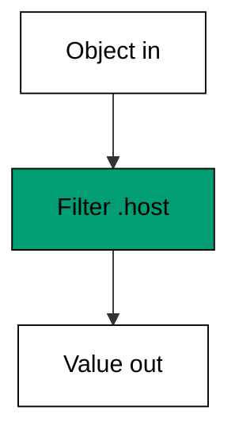
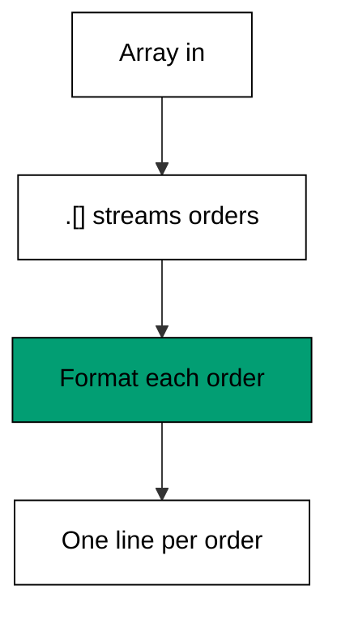

Examples 22-27 teach jq's core loop: a filter selects or transforms a JSON value (co-09),
and the pipe chains filters left to right (co-10). The first examples read; the middle
ones select and chain; the last two harden the pipeline against missing data and hand
plain text to the next shell tool.

Practice reading every chain backwards when it surprises you: cover the rightmost
filter and run what remains, then uncover one stage at a time. Because each stage's
output is legal input for the next, the halfway output is always inspectable -- there
is no hidden state, no loop variable, no accumulator to print. The theme's six filters
fit on one screen precisely so that this bisection habit stays cheap; a chain you can
halve is a chain you can debug, and jq chains halve cleanly by construction.

---

### Worked Example 22: Pick A Field

_ex-22 &middot; exercises co-09_

`.host` is the smallest jq program: a filter that selects one field from an object and
emits its value. The output is still JSON -- note the quotes -- because every filter
takes JSON in and emits JSON out.



**`learning/code/ex-22-pick-a-field/example.sh`**:

```bash
#!/bin/bash
# => Worked Example 22: read one value out of an object.
# => co-09: .host is a filter selecting the host field, nothing else.
set -euo pipefail  # => strict mode: fail fast on errors and unset names
jq '.host' server.json  # => print the host value, quoted as JSON
# => every filter takes JSON in and emits JSON out, even a single string.
```

**Input** (`learning/code/ex-22-pick-a-field/server.json`):

```text
{"host": "db-01", "port": 5432, "tls": true}
```

**Output** (`learning/code/ex-22-pick-a-field/expected/main.stdout.txt`):

```text
"db-01"
```

**Verify**: the output is the `host` value from the input object, with JSON string
quotes intact -- the other two fields are gone.

**Key takeaway**: `.field` reads one value; the quotes remind you the result is still
JSON, ready for the next filter (not yet plain text).

**Why it matters**: config lookups -- "which host?", "which port?" -- are the most
common JSON question in operations. A field filter answers it without a parser, a
library, or any code that knows what an object is.

---

### Worked Example 23: Walk An Array

_ex-23 &middot; exercises co-09_

`.[]` explodes an array into a stream of its elements: one value in, N values out. This
is how jq iterates -- not with a loop counter, but by turning the collection into a
stream the next filter receives one item at a time.

**`learning/code/ex-23-walk-an-array/example.sh`**:

```bash
#!/bin/bash
# => Worked Example 23: iterate array elements with .[].
# => co-09: .[] explodes one array into a stream of its elements.
set -euo pipefail  # => strict mode: fail fast on errors and unset names
jq '.[]' hosts.json  # => emit each array element as its own JSON value
# => three elements in, three values out, in the same order.
```

**Input** (`learning/code/ex-23-walk-an-array/hosts.json`):

```text
["web-01", "web-02", "db-01"]
```

**Output** (`learning/code/ex-23-walk-an-array/expected/main.stdout.txt`):

```text
"web-01"
"web-02"
"db-01"
```

**Verify**: three input elements became three output values in the same order; the
array brackets are gone because the stream, not the array, is the output.

**Key takeaway**: `.[]` turns "the list" into "each item" -- the iteration primitive
every later filter builds on.

**Why it matters**: APIs return lists: hosts, orders, alerts. Walking the array first
means every later filter thinks about one item, which is exactly the simplification
that keeps jq programs one line long.

---

### Worked Example 24: Keep Rows With Select

_ex-24 &middot; exercises co-09, co-10_

`select(condition)` keeps the values that pass and drops the rest -- the JSON sibling of
awk's pattern-action rule. Here `.[]` streams three service objects, `select` keeps the
two that are up, and `.name` projects their names.

**`learning/code/ex-24-keep-rows-with-select/example.sh`**:

```bash
#!/bin/bash
# => Worked Example 24: filter objects with select.
# => co-09: select(.up == true) keeps the object or drops it entirely.
# => co-10: the pipe feeds each object from .[] into select, then .name.
set -euo pipefail  # => strict mode: fail fast on errors and unset names
jq '.[] | select(.up == true) | .name' services.json  # => name every service that is up
# => select emits its input unchanged or nothing at all: a true filter.
```

**Input** (`learning/code/ex-24-keep-rows-with-select/services.json`):

```text
[{"name": "web", "up": true}, {"name": "db", "up": false}, {"name": "cache", "up": true}]
```

**Output** (`learning/code/ex-24-keep-rows-with-select/expected/main.stdout.txt`):

```text
"web"
"cache"
```

**Verify**: `web` and `cache` (both `up: true`) print; `db` (`up: false`) is dropped
entirely -- no empty line, no null, just absent.

**Key takeaway**: `.[] | select(test) | project` is the filter-then-shape pipeline;
`select` never transforms, it only admits or rejects.

**Why it matters**: "all X where Y" asked of JSON is `select`. Alert triage, inventory
checks, and report building all start by admitting the rows that matter and dropping
the rest in one pass.

---

### Worked Example 25: Chain Filters With Pipe

_ex-25 &middot; exercises co-10_

jq's `|` works like the shell's: the left filter's output becomes the right filter's
input. Chains read left to right -- stream the orders, format each one -- and each stage
stays small because the pipe carries the data between stages.



**`learning/code/ex-25-chain-filters-with-pipe/example.sh`**:

```bash
#!/bin/bash
# => Worked Example 25: pass values left to right through |.
# => co-10: each pipe hands the previous filter's output to the next filter.
set -euo pipefail  # => strict mode: fail fast on errors and unset names
jq '.[] | "\(.customer): \(.total)"' orders.json  # => format every order as one string
# => string interpolation builds the line; the pipe delivers each order to it.
```

**Input** (`learning/code/ex-25-chain-filters-with-pipe/orders.json`):

```text
[{"customer": "adi", "total": 250}, {"customer": "bima", "total": 89}, {"customer": "citra", "total": 412}]
```

**Output** (`learning/code/ex-25-chain-filters-with-pipe/expected/main.stdout.txt`):

```text
"adi: 250"
"bima: 89"
"citra: 412"
```

**Verify**: three input orders became three output strings in order; each string holds
its own order's customer and total, proving the pipe delivered each object intact.

**Key takeaway**: read a jq chain left to right -- "stream, then format" -- and test
each stage alone by deleting everything right of its pipe.

**Why it matters**: chains compose: today's "format each order" grows tomorrow's
`select` in the middle without disturbing either end. The pipe is what keeps jq
programs flat instead of nested.

---

### Worked Example 26: Fall Back With Defaults

_ex-26 &middot; exercises co-09_

Real objects are ragged: some carry a field, some do not. `//` supplies a default when
the left side is null or absent, so one format string handles both complete and
incomplete records without a conditional.

**`learning/code/ex-26-fall-back-with-defaults/example.sh`**:

```bash
#!/bin/bash
# => Worked Example 26: survive missing fields with //.
# => co-09: .role // "unknown" emits the field, or the default when absent.
set -euo pipefail  # => strict mode: fail fast on errors and unset names
jq '.[] | "\(.name): \(.role // "unknown")"' users.json  # => label every user, defaulting the missing role
# => // fires on null and on absent alike, so ragged objects format evenly.
```

**Input** (`learning/code/ex-26-fall-back-with-defaults/users.json`):

```text
[{"name": "adi", "role": "engineer"}, {"name": "bima"}]
```

**Output** (`learning/code/ex-26-fall-back-with-defaults/expected/main.stdout.txt`):

```text
"adi: engineer"
"bima: unknown"
```

**Verify**: `adi` keeps his real role while `bima`, who has no `role` key at all,
renders as `unknown` -- the default filled exactly one gap.

**Key takeaway**: `field // default` makes ragged data uniform at read time; the
fixture stays honest about what is missing.

**Why it matters**: APIs evolve and exports vary -- a field present today is absent in
yesterday's dump. Defaults at the read edge keep one program working across both,
instead of one program per schema version.

---

### Worked Example 27: Emit Raw Text

_ex-27 &middot; exercises co-09, co-10_

JSON quotes are for machines; the next shell tool wants plain columns. `jq -r`
outputs raw text -- strings without quotes -- so a jq filter becomes a row generator
that `awk`, `sort`, or `cut` can consume directly.

**`learning/code/ex-27-emit-raw-text/example.sh`**:

```bash
#!/bin/bash
# => Worked Example 27: print shell-ready lines with -r.
# => co-09: the string filter builds the line; -r unwraps its JSON quotes.
# => co-10: the pipe carries each object into the formatting filter.
set -euo pipefail  # => strict mode: fail fast on errors and unset names
jq -r '.[] | "\(.name),\(.role // "none")"' users.json  # => emit raw comma-separated lines
# => raw output drops the quotes, so downstream tools see plain columns.
```

**Input** (`learning/code/ex-27-emit-raw-text/users.json`):

```text
[{"name": "adi", "role": "engineer"}, {"name": "bima"}]
```

**Output** (`learning/code/ex-27-emit-raw-text/expected/main.stdout.txt`):

```text
adi,engineer
bima,none
```

**Verify**: no quotes and no brackets remain -- `adi,engineer` is two plain columns a
`cut -d, -f1` would accept, unlike Example 26's quoted output.

**Key takeaway**: `-r` is the JSON-to-text exit: same filters, but the output is lines
and columns instead of values.

**Why it matters**: jq rarely works alone -- its output feeds awk, sort, and reports.
Raw mode is the handoff format, and using it deliberately (Example 35 chains exactly
this into awk) is what makes combined pipelines boring instead of brittle.

---

← Previous: [Theme D: sed Substitution and Hold Space](./theme-d-sed-substitution-and-hold-space.md) · Next: [Theme F: jq Object and Array Construction](./theme-f-jq-object-and-array-construction.md) →
