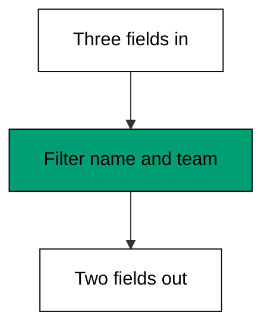
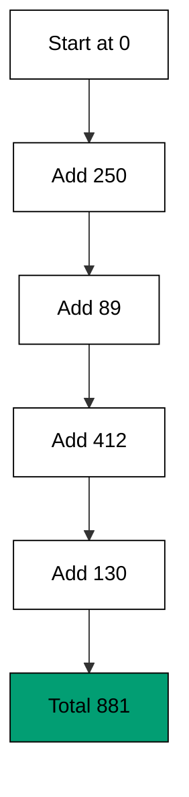

Examples 28-33 turn jq from a reader into a builder: new objects from old fields (co-11),
then whole-array reshaping -- mapping, reducing, grouping, sorting (co-12). Reading
extracts meaning; construction produces the next system's input, which is why reports,
migrations, and API adapters all live in this theme.

Keep the input fixtures open while you read: every example in this theme shows the
full before and after, and the filter is the only thing between them. That
before-filter-after triple is the whole debugging method for construction -- when an
output surprises you, the fixture tells you what went in and the filter tells you
what was asked, so the gap between them names the bug. Examples 28 and 29 reshape
single objects; Examples 30 through 33 reshape whole arrays; the skill transfers
because the triple looks the same at both scales.

---

### Worked Example 28: Build An Object

_ex-28 &middot; exercises co-11_

`{name, team}` constructs an object keeping only the named fields -- projection with a
new shape. The shorthand `{name}` means `{name: .name}`: the key is literal, the value is
a filter, and the two meet in the braces.



**`learning/code/ex-28-build-an-object/example.sh`**:

```bash
#!/bin/bash
# => Worked Example 28: assemble a new object from parts.
# => co-11: {name, team} builds an object keeping only the named fields.
set -euo pipefail           # => strict mode: fail fast on errors and unset names
jq '{name, team}' user.json # => project the user down to two fields
# => shorthand {name} means {name: .name}: same value, new shape.
```

**Input** (`learning/code/ex-28-build-an-object/user.json`):

```text
{ "name": "adi", "role": "engineer", "team": "platform" }
```

**Output** (`learning/code/ex-28-build-an-object/expected/main.stdout.txt`):

```text
{
  "name": "adi",
  "team": "platform"
}
```

**Verify**: the output holds exactly `name` and `team` with their input values; the
`role` field is gone and no value changed.

**Key takeaway**: braces build -- list the keys you want, each with the filter that
produces its value, and jq assembles the object.

**Why it matters**: downstream systems want fewer fields, not more. Projecting at the
source keeps secrets out of logs, shrinks payloads, and documents which fields the next
stage actually depends on.

---

### Worked Example 29: Rename Keys In Bulk

_ex-29 &middot; exercises co-11_

Systems disagree about names: `fn` here, `first` there. `{first: .fn}` remaps one key
while copying its value; wrapped in `map`, the rename applies to every object in the
array at once.

**`learning/code/ex-29-rename-keys-in-bulk/example.sh`**:

```bash
#!/bin/bash
# => Worked Example 29: remap keys across every object.
# => co-11: {first: .fn} renames a key while copying its value over.
set -euo pipefail                           # => strict mode: fail fast on errors and unset names
jq 'map({first: .fn, last: .ln})' rows.json # => rename fn/ln to first/last everywhere
# => the value expressions run per object; the new keys are literal names.
```

**Input** (`learning/code/ex-29-rename-keys-in-bulk/rows.json`):

```text
[
  { "fn": "adi", "ln": "pratama" },
  { "fn": "bima", "ln": "sakti" }
]
```

**Output** (`learning/code/ex-29-rename-keys-in-bulk/expected/main.stdout.txt`):

```text
[
  {
    "first": "adi",
    "last": "pratama"
  },
  {
    "first": "bima",
    "last": "sakti"
  }
]
```

**Verify**: both output objects carry `first` and `last`; both input keys `fn` and
`ln` are gone; every value moved to its renamed key unchanged.

**Key takeaway**: renaming is construction with new key names -- the values ride along
untouched while the labels change to the next system's dialect.

**Why it matters**: key renames are the bulk of integration glue between systems that
describe the same people differently. Doing it as a filter keeps the mapping visible
and reviewable instead of buried in application code.

---

### Worked Example 30: Transform An Array With Map

_ex-30 &middot; exercises co-12_

`map(f)` runs the filter `f` on every element and collects the results: one array in,
one array out, same count. It is the "do this to each" primitive -- no index, no loop
counter, no off-by-one.

**`learning/code/ex-30-transform-an-array-with-map/example.sh`**:

```bash
#!/bin/bash
# => Worked Example 30: reshape every element with map.
# => co-12: map runs the filter on each element, collecting the results.
set -euo pipefail         # => strict mode: fail fast on errors and unset names
jq 'map(. * 2)' nums.json # => double every number, keeping the array shape
# => one array in, one array out: map never changes the element count.
```

**Input** (`learning/code/ex-30-transform-an-array-with-map/nums.json`):

```text
[1, 2, 3, 4]
```

**Output** (`learning/code/ex-30-transform-an-array-with-map/expected/main.stdout.txt`):

```text
[
  2,
  4,
  6,
  8
]
```

**Verify**: four elements in, four out; each output is exactly twice its input element,
in the same positions.

**Key takeaway**: `map` means "same length, new values" -- reach for it whenever every
element needs the same treatment and none may disappear.

**Why it matters**: unit conversions, currency math, and string cleanup all apply one
rule to every row. `map` states that rule once and guarantees the count is preserved,
which a hand-rolled loop only promises.

---

### Worked Example 31: Total An Array With Reduce

_ex-31 &middot; exercises co-12_

`reduce .[] as $x (start; update)` folds a stream into one value: `$x` is the current
element, `.` is the running accumulator, `0` is where it begins. This is Example 8's
awk sum rewritten for JSON -- same accumulation shape, different data.



**`learning/code/ex-31-total-an-array-with-reduce/example.sh`**:

```bash
#!/bin/bash
# => Worked Example 31: fold an array into one number.
# => co-12: reduce walks the stream carrying an accumulator, starting at 0.
set -euo pipefail                            # => strict mode: fail fast on errors and unset names
jq 'reduce .[] as $x (0; . + $x)' sales.json # => add every element into one total
# => $x is the current element, . is the running total: same shape as awk's sum.
```

**Input** (`learning/code/ex-31-total-an-array-with-reduce/sales.json`):

```text
[250, 89, 412, 130]
```

**Output** (`learning/code/ex-31-total-an-array-with-reduce/expected/main.stdout.txt`):

```text
881
```

**Verify**: 250 + 89 + 412 + 130 equals 881 -- the same total Example 8 computed from
columns, now computed from an array.

**Key takeaway**: `reduce` is the many-to-one primitive: name the start, name the
update, and the fold carries the running value for you.

**Why it matters**: totals, merged objects, and "best so far" picks are all folds.
Learning the `reduce` shape once covers every aggregation that `map` (same count) and
`select` (fewer rows) cannot express.

---

### Worked Example 32: Group Rows By Key

_ex-32 &middot; exercises co-12_

`group_by(.dc)` buckets equal-key objects into sub-arrays: one flat list becomes one
array per data center. The input must arrive sorted by the key -- this fixture does --
or one group splits in two; when it does not, pipe through `sort_by` first.

**`learning/code/ex-32-group-rows-by-key/example.sh`**:

```bash
#!/bin/bash
# => Worked Example 32: bucket objects with group_by.
# => co-12: group_by(.dc) gathers equal-key objects into sub-arrays.
# => the fixture arrives sorted by dc, which group_by requires.
set -euo pipefail             # => strict mode: fail fast on errors and unset names
jq 'group_by(.dc)' fleet.json # => collect hosts into one array per data center
# => unsorted input would split one dc into two groups: sort_by first then.
```

**Input** (`learning/code/ex-32-group-rows-by-key/fleet.json`):

```text
[
  { "host": "web-01", "dc": "east" },
  { "host": "db-01", "dc": "east" },
  { "host": "web-02", "dc": "west" }
]
```

**Output** (`learning/code/ex-32-group-rows-by-key/expected/main.stdout.txt`):

```text
[
  [
    {
      "host": "web-01",
      "dc": "east"
    },
    {
      "host": "db-01",
      "dc": "east"
    }
  ],
  [
    {
      "host": "web-02",
      "dc": "west"
    }
  ]
]
```

**Verify**: two groups exist -- `east` with two hosts, `west` with one -- and every
input object appears in exactly one group.

**Key takeaway**: `group_by` turns "rows with a key" into "buckets per key"; feed it
sorted input (`sort_by`) or the buckets lie.

**Why it matters**: per-region, per-team, and per-status reports all start by
bucketing. Grouping in the filter keeps the report's structure visible, where
application-level grouping hides it behind a loop.

---

### Worked Example 33: Sort And Deduplicate

_ex-33 &middot; exercises co-12, co-10_

`unique` sorts values and keeps one of each -- the JSON sibling of `sort | uniq`.
Naming `sort` explicitly first states the contract up front: order, then dedupe, so a
reader never wonders whether the output order is accidental.

**`learning/code/ex-33-sort-and-deduplicate/example.sh`**:

```bash
#!/bin/bash
# => Worked Example 33: order rows and drop repeats.
# => co-12: unique sorts the values and emits each distinct one once.
# => co-10: the pipe sorts explicitly first, so the intent reads twice.
set -euo pipefail            # => strict mode: fail fast on errors and unset names
jq 'sort | unique' tags.json # => sort the tags, then keep one of each
# => unique alone would sort too; naming sort states the contract up front.
```

**Input** (`learning/code/ex-33-sort-and-deduplicate/tags.json`):

```text
["db", "web", "db", "cache", "web", "db"]
```

**Output** (`learning/code/ex-33-sort-and-deduplicate/expected/main.stdout.txt`):

```text
[
  "cache",
  "db",
  "web"
]
```

**Verify**: six input tags became three output tags -- `cache` once, `db` once, `web`
once -- in sorted order.

**Key takeaway**: `sort | unique` is the dedupe idiom: sorted order is the price of a
duplicate-free list, stated as two honest stages.

**Why it matters**: distinct-value lists -- tags, hosts, error kinds -- feed menus,
inventories, and follow-up queries. Deduplicating in the filter keeps every consumer
from re-solving the same "have I seen this" problem.

---

← Previous: [Theme E: jq Filters and the Pipe](./theme-e-jq-filters-and-the-pipe.md) · Next: [Theme G: Combined Pipelines](./theme-g-combined-pipelines.md) →
