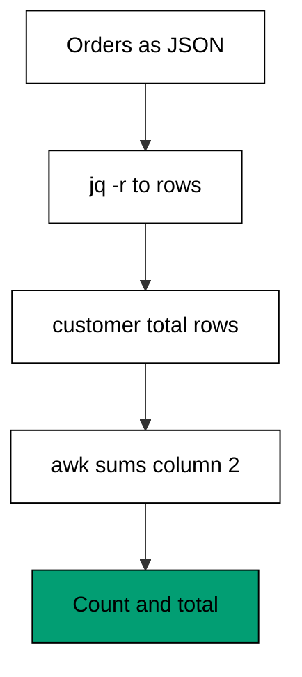
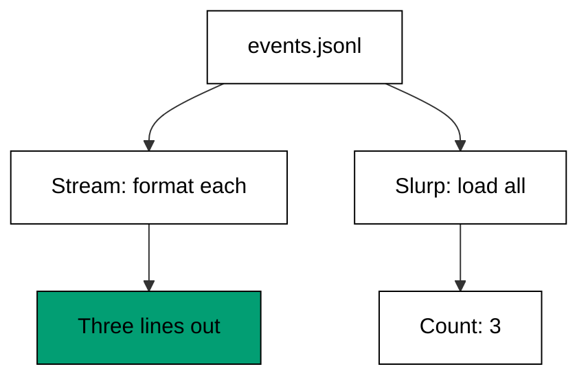

Examples 34-38 compose the tools with each other and with the classic shell line-up
(co-16): counting with `sort` and `uniq`, feeding jq's raw output into awk, cleaning log
lines for jq, narrowing with `grep`, and choosing between streaming and loading a whole
file (co-13). No tool wins alone; the pipeline wins.

Judge every pipeline in this theme by its stage boundaries: each `|` should join two
programs that each own one job, and you should be able to run either side alone and
read its output. Examples 34 and 37 show the classic narrow-then-shape pairing;
Examples 35 and 36 show the handoff between JSON and text in both directions; Example
38 shows the same file consumed two ways. If a stage's output is unreadable on its
own, the boundary is in the wrong place -- move it until both sides make sense
alone, and the pipeline will make sense together.

---

### Worked Example 34: Count Values With Sort And Uniq

_ex-34 &middot; exercises co-16_

`sort | uniq -c` counts distinct values -- the most-run pipeline in operations. `sort`
groups equal lines, `uniq -c` prefixes each group with its count, and awk reformats the
result, normalizing `uniq`'s padding so the output is identical on every machine.

**`learning/code/ex-34-count-values-with-sort-and-uniq/example.sh`**:

```bash
#!/bin/bash
# => Worked Example 34: rank values with sort and uniq.
# => co-16: sort orders, uniq -c counts, awk normalizes the padding.
export LC_ALL=C  # => byte order for sort, identical on every machine
sort deploys.txt | uniq -c | awk '{ print $2 ": " $1 }'  # => count each distinct value
# => awk splits on whitespace runs, so uniq's padding width never matters.
```

**Input** (`learning/code/ex-34-count-values-with-sort-and-uniq/deploys.txt`):

```text
web
db
web
cache
web
db
```

**Output** (`learning/code/ex-34-count-values-with-sort-and-uniq/expected/main.stdout.txt`):

```text
cache: 1
db: 2
web: 3
```

**Verify**: `web` appears three times in the input and reports 3; `db` appears twice
and reports 2; `cache` appears once and reports 1 -- every input line is counted
exactly once.

**Key takeaway**: `sort | uniq -c | awk` is the ranking pipeline -- order, count,
reformat -- and `LC_ALL=C` keeps the order byte-identical everywhere.

**Why it matters**: "which value occurs most" diagnoses hotspots, error bursts, and
skew. This pipeline answers it in one line, and the awk tail makes the answer readable
instead of padded.

---

### Worked Example 35: Feed jq Into awk

_ex-35 &middot; exercises co-16_

jq understands JSON; awk understands columns. `jq -r` is the bridge: it flattens
objects into text rows, and awk aggregates the rows exactly as if they had come from a
CSV file. Each tool does what it is best at, joined by a pipe.



**`learning/code/ex-35-feed-jq-into-awk/example.sh`**:

```bash
#!/bin/bash
# => Worked Example 35: flatten JSON to columns, then aggregate.
# => co-16: jq -r exits JSON into text; awk totals the numeric column.
set -euo pipefail  # => strict mode: fail fast on errors and unset names
jq -r '.[] | "\(.customer) \(.total)"' orders.json | awk '{ total += $2 } END { print "orders: " NR ", total: " total }'  # => count orders and sum totals
# => NR counts the flattened rows; $2 carries each row's total into the sum.
```

**Input** (`learning/code/ex-35-feed-jq-into-awk/orders.json`):

```text
[{"customer": "adi", "total": 250}, {"customer": "bima", "total": 89}, {"customer": "citra", "total": 412}]
```

**Output** (`learning/code/ex-35-feed-jq-into-awk/expected/main.stdout.txt`):

```text
orders: 3, total: 751
```

**Verify**: three orders in, `NR` of 3 out; 250 + 89 + 412 equals 751 -- the JSON
structure crossed the pipe as columns and arrived intact.

**Key takeaway**: `jq -r` is the JSON-to-columns exit; anything awk can do to a file it
can do to jq's output.

**Why it matters**: JSON APIs meet columnar reporting in every monthly summary. The
flatten-then-aggregate pipeline keeps JSON parsing in jq (where nesting is trivial)
and arithmetic in awk (where columns are trivial) instead of forcing one tool to fake
the other's job.

---

### Worked Example 36: Clean Text Before Parsing JSON

_ex-36 &middot; exercises co-16_

Logs wrap JSON in text: timestamps and tags precede every object. jq cannot parse the
wrapper, so sed strips it first -- one substitution per line removes the prefix, and jq
receives pure JSON on stdin.

**`learning/code/ex-36-clean-text-before-parsing-json/example.sh`**:

```bash
#!/bin/bash
# => Worked Example 36: strip log prefixes, then parse with jq.
# => co-16: sed returns each line to pure JSON; jq selects among objects.
set -euo pipefail  # => strict mode: fail fast on errors and unset names
sed -E 's/^[^ ]+ \[[^]]+\] //' mixed.log | jq -r 'select(.ok == true) | .host'  # => name the healthy hosts
# => the sed address of record is the prefix shape; everything after it is JSON.
```

**Input** (`learning/code/ex-36-clean-text-before-parsing-json/mixed.log`):

```text
2026-10-21T08:00:01Z [web] {"host": "web-01", "ok": true}
2026-10-21T08:00:02Z [db] {"host": "db-01", "ok": false}
2026-10-21T08:00:03Z [web] {"host": "web-02", "ok": true}
```

**Output** (`learning/code/ex-36-clean-text-before-parsing-json/expected/main.stdout.txt`):

```text
web-01
web-02
```

**Verify**: the `db-01` line (`ok: false`) is dropped by `select`; both `ok: true`
hosts print; no timestamp or tag leaks into jq's input or output.

**Key takeaway**: sed prepares, jq parses -- strip the non-JSON wrapper with a text
tool so the JSON tool never sees it.

**Why it matters**: structured logging still wraps JSON in a line prefix. The
strip-then-parse pipeline is the standard way to query log files with jq, and naming
the prefix shape in sed keeps the jq filter clean.

---

### Worked Example 37: Narrow With grep Then Shape With awk

_ex-37 &middot; exercises co-16_

`grep` is the fastest way to discard lines you will never need; awk then shapes the
survivors. Here `grep` keeps only `POST` requests and awk prints their paths and
statuses -- filter first, format second, each tool doing one job.

**`learning/code/ex-37-narrow-with-grep-then-shape-with-awk/example.sh`**:

```bash
#!/bin/bash
# => Worked Example 37: filter lines fast, then reformat.
# => co-16: grep narrows by content; awk shapes the survivors into columns.
set -euo pipefail  # => strict mode: fail fast on errors and unset names
grep 'POST' access.log | awk '{ print $2 ": " $3 }'  # => show path and status of POST requests
# => grep exits 0 because POST lines exist; awk never sees the GET noise.
```

**Input** (`learning/code/ex-37-narrow-with-grep-then-shape-with-awk/access.log`):

```text
GET /index 200
POST /login 401
GET /about 200
POST /login 200
GET /missing 404
```

**Output** (`learning/code/ex-37-narrow-with-grep-then-shape-with-awk/expected/main.stdout.txt`):

```text
/login: 401
/login: 200
```

**Verify**: both output lines come from `POST` input lines with matching path and
status; the three `GET` lines contribute nothing.

**Key takeaway**: narrow with `grep`, shape with awk -- the cheap filter runs first so
the expressive tool processes less.

**Why it matters**: access logs are mostly noise for any single question. Filtering
before formatting keeps the awk program simple and the pipeline fast, because awk only
ever sees the lines that matter.

---

### Worked Example 38: Stream JSON Lines

_ex-38 &middot; exercises co-13_

One file, two memory profiles. Plain `jq` reads a stream of values -- one object per
line, constant memory. `jq -s` slurps everything into an array first -- necessary for
`length` and `group_by`, expensive for large files. Choose per task, not per habit.



**`learning/code/ex-38-stream-json-lines/example.sh`**:

```bash
#!/bin/bash
# => Worked Example 38: process one object per line without slurping.
# => co-13: jq reads a stream of values; -s would load them all at once.
set -euo pipefail  # => strict mode: fail fast on errors and unset names
echo "stream:"  # => label the streaming pass, which holds one object at a time
jq -r '"\(.event): \(.user)"' events.jsonl  # => format each object as it arrives
echo "slurp count:"  # => label the whole-file pass, which loads everything first
jq -s 'length' events.jsonl  # => count the objects after loading the full array
# => same file, two memory profiles: stream for pipelines, slurp for totals.
```

**Input** (`learning/code/ex-38-stream-json-lines/events.jsonl`):

```text
{"event": "login", "user": "adi"}
{"event": "logout", "user": "bima"}
{"event": "login", "user": "citra"}
```

**Output** (`learning/code/ex-38-stream-json-lines/expected/main.stdout.txt`):

```text
stream:
login: adi
logout: bima
login: citra
slurp count:
3
```

**Verify**: the streaming pass prints one line per object in file order; the slurp
pass reports the same count of 3 -- identical answers, different memory profiles.

**Key takeaway**: default jq streams (constant memory); `-s` slurps (whole file in
memory) -- use the stream for pipelines, the slurp for whole-file questions.

**Why it matters**: JSONL event files grow without bound. Streaming keeps the pipeline
running on a file no machine could load, while slurping is reserved for the questions
-- sorting, grouping, counting -- that genuinely need the whole set.

---

← Previous: [Theme F: jq Object and Array Construction](./theme-f-jq-object-and-array-construction.md) · Next: [Theme H: Idempotence and Safety](./theme-h-idempotence-and-safety.md) →
