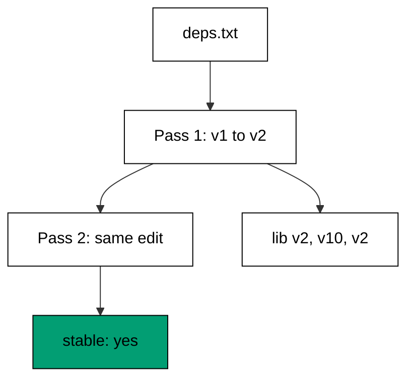
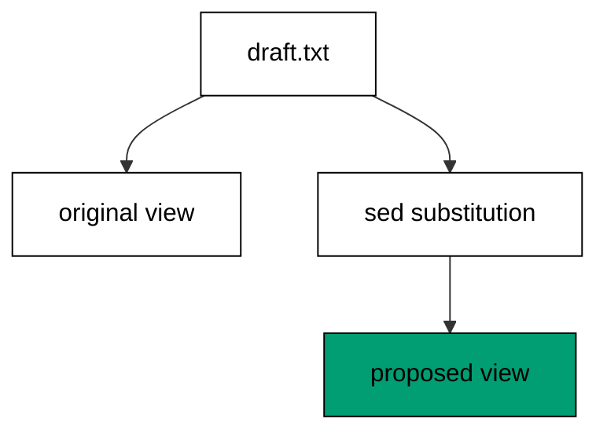

Examples 39-43 make edits safe to run twice (co-14): anchored patterns, fenced
addresses, converging normalizations, conditional defaults, and previews that change
nothing. An edit you cannot rerun is an edit you cannot trust in a script, a cron job,
or a teammate's hands.

Adopt the theme's verification ritual as your own default: write the edit, run it,
run it again, compare. The four techniques differ in mechanism -- anchors, fences,
convergence, conditional defaults -- but they share one proof shape, and that shape
fits in every script you will ever write: capture, rerun, compare, report. Example 43
adds the rehearsal before the proof: preview first, then prove. Together they turn
"it worked once" into "it works every time", which is the only claim a shared script
is allowed to make.

---

### Worked Example 39: Anchor A Substitution

_ex-39 &middot; exercises co-14_

`v1` is a prefix of `v10`: an unanchored substitution would corrupt the newer version
while upgrading the old one. The `$` anchor restricts the match to a trailing `v1`, so
`v10` and the already-upgraded `v2` never match -- and a second run proves it.



**`learning/code/ex-39-anchor-a-substitution/example.sh`**:

```bash
#!/bin/bash
# => Worked Example 39: anchor patterns so reruns change nothing.
# => co-14: v1$ matches only a trailing v1, so v10 and v2 never match.
set -euo pipefail                                                                # => strict mode: fail fast on errors and unset names
first=$(sed -E 's/v1$/v2/' deps.txt)                                             # => first pass: v1 becomes v2, v10 untouched
second=$(printf '%s\n' "$first" | sed -E 's/v1$/v2/')                            # => second pass over the result
printf '%s\n' "$first"                                                           # => the edited text, printed once
if [ "$first" = "$second" ]; then echo "stable: yes"; else echo "stable: no"; fi # => rerun proof
# => command substitution carries text between passes; no file is rewritten.
```

**Input** (`learning/code/ex-39-anchor-a-substitution/deps.txt`):

```text
lib v1
lib v10
lib v2
```

**Output** (`learning/code/ex-39-anchor-a-substitution/expected/main.stdout.txt`):

```text
lib v2
lib v10
lib v2
stable: yes
```

**Verify**: `lib v1` became `lib v2`; `lib v10` survived because `v1` is not trailing
there; the rerun comparison reports `stable: yes`.

**Key takeaway**: anchor the pattern to exactly what may change (`$`, `^`, word
boundaries in the address); a rerun that matches nothing is the proof the edit is
done.

**Why it matters**: scripts rerun -- cron retries, teammates re-apply, CI replays.
An edit that corrupts its own output on the second run turns every retry into an
incident; an anchored edit turns retries into no-ops.

---

### Worked Example 40: Fence A Substitution With An Address

_ex-40 &middot; exercises co-14, co-05_

A range address fences the substitution: only lines inside the web-tier block are
renamed, and the identically-shaped `db` line outside keeps its prefix. The address from
Theme C becomes the safety fence for the substitution from Theme D.

**`learning/code/ex-40-fence-a-substitution-with-an-address/example.sh`**:

```bash
#!/bin/bash
# => Worked Example 40: confine edits to addressed lines.
# => co-14: the range address fences the substitution; lines outside keep host=.
# => co-05: /# web/,/# db/ selects exactly the web-tier block.
set -euo pipefail                                 # => strict mode: fail fast on errors and unset names
sed -E '/# web/,/# db/s/host=/node=/' servers.txt # => rename host= only inside the web block
# => the db line keeps host= because it sits outside the addressed range.
```

**Input** (`learning/code/ex-40-fence-a-substitution-with-an-address/servers.txt`):

```text
# web tier
host=web-01
host=web-02
# db tier
host=db-01
```

**Output** (`learning/code/ex-40-fence-a-substitution-with-an-address/expected/main.stdout.txt`):

```text
# web tier
node=web-01
node=web-02
# db tier
host=db-01
```

**Verify**: both web lines were renamed; the `db` line still reads `host=db-01` --
same text shape, different block, different fate.

**Key takeaway**: `range s/old/new/` edits only inside the fence; everything outside
is automatically preserved.

**Why it matters**: files mix sections that look alike but mean different things.
Fencing the edit to its section is what stops a web-tier rename from silently
relabeling the database.

---

### Worked Example 41: Normalize Whitespace Twice

_ex-41 &middot; exercises co-14_

Some cleanups converge: rebuilding fields with `OFS` collapses every whitespace run to
one space, and rebuilding again changes nothing because single spaces are already
normal. Running the cleanup twice inside the script proves the convergence instead of
asserting it.

**`learning/code/ex-41-normalize-whitespace-twice/example.sh`**:

```bash
#!/bin/bash
# => Worked Example 41: run an awk cleanup twice, prove stability.
# => co-14: rebuilding fields with OFS converges: the second run is a no-op.
set -euo pipefail                                                                # => strict mode: fail fast on errors and unset names
first=$(awk '{$1=$1; print}' messy.txt)                                          # => first pass: collapse every whitespace run
second=$(printf '%s\n' "$first" | awk '{$1=$1; print}')                          # => second pass over the result
printf '%s\n' "$first"                                                           # => the cleaned text, printed once
if [ "$first" = "$second" ]; then echo "stable: yes"; else echo "stable: no"; fi # => rerun proof
# => normalized text rebuilds to itself, so the cleanup is safe to repeat.
```

**Input** (`learning/code/ex-41-normalize-whitespace-twice/messy.txt`):

```text
adi   25    engineer
bima  designer
```

**Output** (`learning/code/ex-41-normalize-whitespace-twice/expected/main.stdout.txt`):

```text
adi 25 engineer
bima designer
stable: yes
```

**Verify**: the triple spaces collapsed to single spaces on the first pass; the
second pass changed nothing, hence `stable: yes`.

**Key takeaway**: a normalizer that converges is idempotent by construction -- run it
twice in the script and let the comparison say so.

**Why it matters**: intake cleanup runs on every import, including imports of already
clean data. Converging cleanups make re-imports harmless, which is what lets a
pipeline rerun from scratch instead of from a checkpoint nobody trusts.

---

### Worked Example 42: Default Fields Without Duplicates

_ex-42 &middot; exercises co-14, co-09_

`//=` assigns only when the field is missing or null: existing values survive, gaps get
one default, and a second run finds no gaps left to fill. Conditional assignment is the
JSON version of the anchored substitution -- the edit carries its own guard.

**`learning/code/ex-42-default-fields-without-duplicates/example.sh`**:

```bash
#!/bin/bash
# => Worked Example 42: fill missing JSON fields idempotently.
# => co-14: //= writes the default only when the field is missing or null.
# => co-09: the filter selects each role field, defaulting exactly one gap.
set -euo pipefail                                                                # => strict mode: fail fast on errors and unset names
first=$(jq -c '.[] | (.role //= "unknown")' users.json)                          # => first pass: default the missing role
second=$(printf '%s\n' "$first" | jq -c '.role //= "unknown"')                   # => second pass over the result
printf '%s\n' "$first"                                                           # => the defaulted objects, printed once
if [ "$first" = "$second" ]; then echo "stable: yes"; else echo "stable: no"; fi # => rerun proof
# => existing values survive both passes; only the gap was ever filled.
```

**Input** (`learning/code/ex-42-default-fields-without-duplicates/users.json`):

```text
[{ "name": "adi", "role": "engineer" }, { "name": "bima" }]
```

**Output** (`learning/code/ex-42-default-fields-without-duplicates/expected/main.stdout.txt`):

```text
{"name":"adi","role":"engineer"}
{"name":"bima","role":"unknown"}
stable: yes
```

**Verify**: `adi` keeps `engineer` through both passes; `bima` gains `unknown` on the
first pass and keeps it on the second -- one fill, then stability.

**Key takeaway**: `field //= default` fills gaps without touching real values;
rerunning is safe because defaults, once written, satisfy their own condition.

**Why it matters**: backfilling a new field across old records is a one-time job that
gets run twice -- once by you, once by the teammate who did not see your message. A
conditional default makes the second run a no-op instead of a duplication bug.

---

### Worked Example 43: Preview Before Changing

_ex-43 &middot; exercises co-14_

The cheapest safety device is a preview: print the original, print the proposed edit,
change nothing. Eyes approve the transformation before any flag (`-i`, a redirect, a
commit) makes it real.



**`learning/code/ex-43-preview-before-changing/example.sh`**:

```bash
#!/bin/bash
# => Worked Example 43: print the diff-like preview, change nothing.
# => co-14: previewing first means the edit runs only after eyes approve it.
set -euo pipefail               # => strict mode: fail fast on errors and unset names
echo "original:"                # => label the untouched fixture below
cat draft.txt                   # => show the file exactly as it sits on disk
echo "proposed:"                # => label the edit that has not happened yet
sed 's/^TODO:/DONE:/' draft.txt # => show what the substitution would produce
# => stdout carries both views; the fixture file is never rewritten.
```

**Input** (`learning/code/ex-43-preview-before-changing/draft.txt`):

```text
TODO: write intro
TODO: add diagram
done: write outro
```

**Output** (`learning/code/ex-43-preview-before-changing/expected/main.stdout.txt`):

```text
original:
TODO: write intro
TODO: add diagram
done: write outro
proposed:
DONE: write intro
DONE: add diagram
done: write outro
```

**Verify**: the `original:` block matches the fixture byte for byte; the `proposed:`
block shows both `TODO:` lines rewritten and the lowercase `done:` line correctly
untouched; the fixture on disk still holds three original lines.

**Key takeaway**: original-then-proposed on stdout is the dry run -- review the
transformation as data before any write flag makes it permanent.

**Why it matters**: every destructive edit deserves one harmless rehearsal. The
preview habit catches the over-broad pattern while it is still output, not after it
became the file.

---

← Previous: [Theme G: Combined Pipelines](./theme-g-combined-pipelines.md) · Next: [Theme I: Choosing the Right Tool](./theme-i-choosing-the-right-tool.md) →
