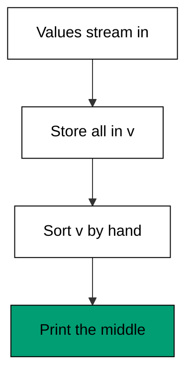
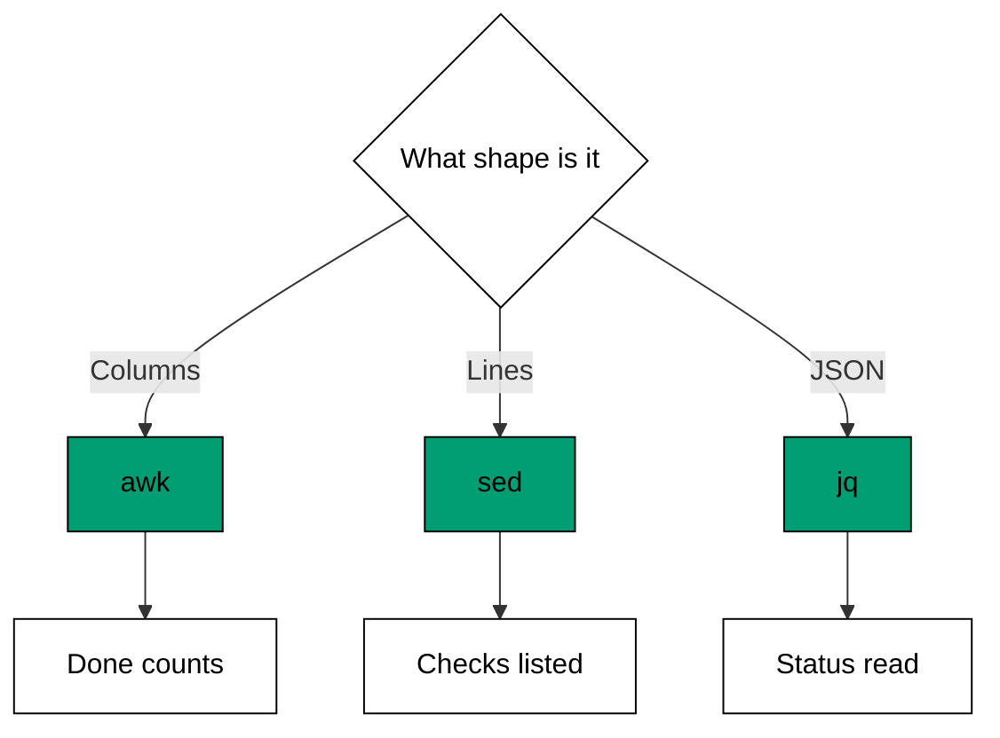

Examples 44-48 turn the whole course into one decision (co-15): columns mean awk,
addressed lines mean sed, nested JSON means jq -- and a general-purpose language means
the task outgrew all three. Each example proves its claim by running the right tool on a
task shaped for it, then names what the wrong tool would cost.

---

### Worked Example 44: Fields Mean awk

_ex-44 &middot; exercises co-15, co-01_

Averaging a column needs fields (split the row) and arithmetic (divide the sum).
awk does both; sed can only do the first half -- it has no division -- so a sed-first
attempt ends in a second tool anyway. Start where the whole job fits.

**`learning/code/ex-44-fields-mean-awk/example.sh`**:

```bash
#!/bin/bash
# => Worked Example 44: columnar math stays in awk.
# => co-15: fields plus arithmetic is awk's home ground, not sed's.
# => co-01: $3 selects the total column that the average needs.
set -euo pipefail                                                    # => strict mode: fail fast on errors and unset names
awk -F, 'NR > 1 { sum += $3; n++ } END { print sum / n }' orders.csv # => average the total column
# => sed could delete commas but cannot divide; awk fields and divides.
```

**Input** (`learning/code/ex-44-fields-mean-awk/orders.csv`):

```text
order,customer,total
1001,adi,250
1002,bima,89
1003,citra,412
```

**Output** (`learning/code/ex-44-fields-mean-awk/expected/main.stdout.txt`):

```text
250.333
```

**Verify**: (250 + 89 + 412) / 3 equals 250.333 -- the header row contributed no sum
and no count, and every data row contributed both.

**Key takeaway**: when the task needs both splitting and arithmetic, start in awk;
any other start adds a tool without removing a step.

**Why it matters**: tool choice is made at the first command, and the first command
sets the pipeline's shape. Picking the tool that covers the whole job keeps the
solution one stage long instead of three.

---

### Worked Example 45: Addresses Mean sed

_ex-45 &middot; exercises co-15, co-05_

Deleting lines by content is addressing plus deletion -- sed's two oldest verbs. awk
could test the same pattern, but `! /REMOVE/` wrapping a print action says in three
tokens what sed's `d` says in one. Brevity here is clarity, not golf.

**`learning/code/ex-45-addresses-mean-sed/example.sh`**:

```bash
#!/bin/bash
# => Worked Example 45: line surgery stays in sed.
# => co-15: deleting addressed lines is sed's home ground, not awk's.
# => co-05: the /REMOVE/ address selects exactly the lines to drop.
set -euo pipefail         # => strict mode: fail fast on errors and unset names
sed '/REMOVE/d' notes.txt # => delete every line containing REMOVE
# => awk could test the same pattern, but d states the intent directly.
```

**Input** (`learning/code/ex-45-addresses-mean-sed/notes.txt`):

```text
line one
REMOVE this line
line three
REMOVE this too
line five
```

**Output** (`learning/code/ex-45-addresses-mean-sed/expected/main.stdout.txt`):

```text
line one
line three
line five
```

**Verify**: both `REMOVE` lines are gone; the three clean lines survive in order; no
field was ever named because no field mattered.

**Key takeaway**: when no column is involved -- only "these lines go" -- sed's
address-plus-command is the shortest honest statement of the job.

**Why it matters**: line surgery is the most common edit, and the common edit
deserves the shortest tool. Saving awk for column work keeps each program's shape
matched to its problem.

---

### Worked Example 46: JSON Means jq

_ex-46 &middot; exercises co-15, co-09_

Prices nested two levels deep are invisible to line tools: `grep` sees the word
"price" but cannot pair it with its number, and cannot tell a book price from a
shipping price on the next line. jq walks the structure -- store, books, prices --
and adds exactly the numbers that belong together.

**`learning/code/ex-46-json-means-jq/example.sh`**:

```bash
#!/bin/bash
# => Worked Example 46: nested structure stays in jq.
# => co-15: navigating objects-inside-objects is jq's home ground, not grep's.
# => co-09: .store.books[].price walks two levels down to every price.
set -euo pipefail                           # => strict mode: fail fast on errors and unset names
jq '[.store.books[].price] | add' deep.json # => sum every book price in the store
# => grep sees the word price but cannot pair it with its number safely.
```

**Input** (`learning/code/ex-46-json-means-jq/deep.json`):

```text
{
  "store": {
    "books": [
      { "title": "A", "price": 8 },
      { "title": "B", "price": 12 }
    ]
  }
}
```

**Output** (`learning/code/ex-46-json-means-jq/expected/main.stdout.txt`):

```text
20
```

**Verify**: 8 + 12 equals 20 -- both book prices collected through the nesting, the
titles correctly ignored because the path names prices, not lines.

**Key takeaway**: nested data needs a tool that sees structure; line tools see text
and guess, jq sees the tree and knows.

**Why it matters**: APIs nest -- orders inside customers inside regions. A path
expression names the nesting once and stays correct when the file reorders, while a
line pattern breaks the first time two prices share a page.

---

### Worked Example 47: Know When To Stop

_ex-47 &middot; exercises co-15, co-13_

The median needs every value sorted, which needs every value in memory -- no stream
can answer it. This awk program does it: store all values, sort them by hand, pick
the middle. It works, and the hand-rolled sort is exactly the smell that says the
toolbox ends here and a general-purpose language begins.



**`learning/code/ex-47-know-when-to-stop/example.sh`**:

```bash
#!/bin/bash
# => Worked Example 47: whole-file awk aggregation and its limits.
# => co-15: the median needs every value at once, which strains the toolbox.
# => co-13: sorting forces whole-file memory; nothing here can stream.
set -euo pipefail                                                                                                                                                                                                                         # => strict mode: fail fast on errors and unset names
awk '{ v[NR] = $1 } END { n = NR; for (i = 1; i <= n; i++) for (j = i + 1; j <= n; j++) if (v[j] < v[i]) { t = v[i]; v[i] = v[j]; v[j] = t } if (n % 2 == 1) print v[(n + 1) / 2]; else print (v[n / 2] + v[n / 2 + 1]) / 2 }' values.txt # => median via a hand-rolled sort
# => this works, and the hand-rolled sort is exactly the smell: reach further here.
```

**Input** (`learning/code/ex-47-know-when-to-stop/values.txt`):

```text
12
7
25
9
30
```

**Output** (`learning/code/ex-47-know-when-to-stop/expected/main.stdout.txt`):

```text
12
```

**Verify**: sorted, the values are 7, 9, 12, 25, 30 -- five values, so the middle
(third) is 12, which is what prints.

**Key takeaway**: when the program needs its own sort routine, the task has outgrown
one-liners -- finish the thought in a general-purpose language instead.

**Why it matters**: knowing the toolbox's edge is what keeps one-liners small. awk
can sort, but "can" is not "should": the moment logic needs arrays, sorting, and
branches together, a real language is clearer, testable, and no longer than this.

---

### Worked Example 48: Run The Decision Checklist

_ex-48 &middot; exercises co-15, co-16_

The course in one script: name each task's shape, hand it to the matching tool.
Columns go to awk, addressed lines to sed (piped through awk for projection), nested
JSON to jq -- three tools, three shapes, zero contortions.



**`learning/code/ex-48-run-the-decision-checklist/example.sh`**:

```bash
#!/bin/bash
# => Worked Example 48: route three tasks to three tools, then verify.
# => co-15: columns go to awk, addressed lines to sed, nested JSON to jq.
# => co-16: one script chains all three tools, each owning its shape.
set -euo pipefail                                                           # => strict mode: fail fast on errors and unset names
echo "task columns:"                                                        # => columns mean awk: count the finished rows
awk -F, 'NR > 1 && $3 == "done" { n++ } END { print "done: " n }' tasks.csv # => two rows carry done
echo "task lines:"                                                          # => addressed lines mean sed: drop the comment lines
sed '/^#/d' checklist.txt | awk '{ print $1 }'                              # => print the first word of each check
echo "task json:"                                                           # => nested structure means jq: read the deploy status
jq '.deploy' status.json                                                    # => one field out of the status object
# => three shapes, three tools, zero contortions: the checklist works.
```

**Input** (`learning/code/ex-48-run-the-decision-checklist/tasks.csv`):

```text
task,owner,status
deploy,adi,done
backup,bima,todo
audit,citra,done
```

**Input** (`learning/code/ex-48-run-the-decision-checklist/checklist.txt`):

```text
# infra checks
ping ok
# app checks
health ok
```

**Input** (`learning/code/ex-48-run-the-decision-checklist/status.json`):

```text
{ "deploy": "done", "backup": "todo" }
```

**Output** (`learning/code/ex-48-run-the-decision-checklist/expected/main.stdout.txt`):

```text
task columns:
done: 2
task lines:
ping
health
task json:
"done"
```

**Verify**: two `done` rows counted by awk; both comment lines dropped by sed with
both checks projected by awk; the `deploy` field read by jq -- every tool answered
the task shaped for it.

Use this theme as a hiring rubric for your own commands for the next month: before
any text-processing one-liner, say the shape aloud -- columns, lines, or JSON -- and
check that the tool matches. The first three examples reward the match; Example 47
punishes the mismatch honestly, with a program that works and still should not exist;
Example 48 compresses the habit into a runnable checklist. Tool choice is the only
skill in this course that compounds: every future task starts with the same thirty
seconds, and the thirty seconds keep paying.

**Key takeaway**: ask "columns, lines, or JSON" first; the answer names the tool, and
this script is the checklist running.

**Why it matters**: tool choice is a habit, not a debate. The thirty seconds this
checklist takes saves the thirty minutes of forcing the wrong tool through a shape
it cannot see.

---

← Previous: [Theme H: Idempotence and Safety](./theme-h-idempotence-and-safety.md) · Next: [Capstone](./capstone/overview.md) →
