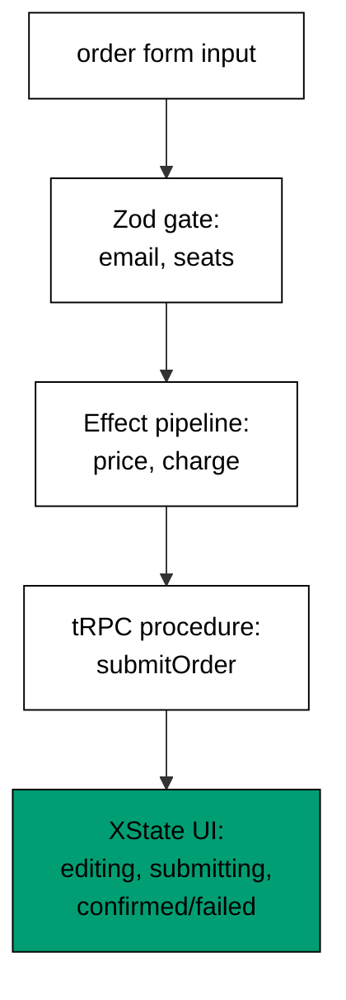

The capstone assembles the whole course into one realistic flow: an order
submission that validates its input with a Zod-shaped schema, charges through
an Effect-shaped pipeline with typed errors, exposes the pipeline as a
tRPC-shaped procedure, and drives the submission UI with an XState-shaped
machine. Nothing here introduces a new concept -- every construct appeared in
Themes A through I -- but the composition is new, which is exactly the skill a
typed full-stack flow demands: each tool guarding its own boundary while the
typed errors and shared shapes flow between them.

## The task

A small shop needs an order endpoint: a form posts an email and a seat count;
the server validates the payload, charges 25 per seat against the customer's
balance, and replies with a receipt or a typed error the UI can act on. Three
scenarios must behave exactly as specified: a funded order confirms with a
receipt, a broke order fails with a top-up hint naming what is held and what
is owed, and an invalid order fails with a fix hint naming the bad field. The
UI visits editing, submitting, and exactly one terminal state per scenario
(confirmed or failed), and the recorded trace proves all three.

## How the parts fit



The order is deliberate and worth stating as a rule: validate, then run, then
route, then render. The schema gate runs first (Example 7's boundary
discipline): untrusted form input becomes a trusted order or a typed `Invalid`
error before anything else happens. The Effect pipeline runs second (Examples
16 and 45): pricing and charging compose into one outcome whose failure is a
typed `ShortFunds` error carrying what is held and what is owed. The procedure
runs third (Examples 22 and 27): `submitOrder` composes the gate with the
pipeline and converts both error kinds into replies, with no network involved.
The machine runs last (Examples 38 and 46): the UI submits from editing,
lands in confirmed with the receipt or failed with the hint, and the trace
records every visited state.

The schema stage carries the boundary discipline from Theme B: the gate checks
the email shape and the positive-integer seats (Example 30's shared-shape
thinking), and the `Invalid` error names the field so the fix hint writes
itself. The Effect stage carries the typed-error discipline from Theme C: the
shortfall is data (`have` and `need`), not a message to parse, so the top-up
hint renders from fields rather than string surgery. The procedure stage
carries the composition habit from Theme E: gate first, pipeline second, reply
third, in that order, with the error union (`Invalid` or `ShortFunds`)
traveling to the UI the way procedure errors traveled to clients in Example 33. The machine stage carries the gating discipline from Theme G: only editing
submits, so double-submits are unrepresentable, and the trace is the test
assertion (Example 48's event-script seam applied to the whole flow).

## The model

**`learning/capstone/code/order-flow.ts`**:

```typescript
// => Capstone: a typed order-submission flow through all four tools.
// => Zod validates the input, an Effect pipeline charges with typed errors,
// => a tRPC procedure exposes it end to end, and an XState machine drives the UI.
type OrderInput = { email: string; seats: number }; // => the trusted order shape, post-schema
type OrderError = { kind: "Invalid"; issue: string } | { kind: "ShortFunds"; have: number; need: number }; // => every failure the flow admits
// => Zod's job: the boundary schema for the order form.
function checkOrder(input: unknown): { ok: true; order: OrderInput } | { ok: false; error: OrderError } {
  // => Zod's job: the boundary schema for the order form
  if (typeof input !== "object" || input === null) {
    // => non-objects carry no fields
    // => Funded: the receipt assembles from order and total.
    return { ok: false, error: { kind: "Invalid", issue: "expected object" } }; // => reject before any field read
  } // => object confirmed
  const record = input as Record<string, unknown>; // => narrow once for key reads
  if (typeof record["email"] !== "string" || !record["email"].includes("@")) {
    // => email rule shared with the client pre-check
    return { ok: false, error: { kind: "Invalid", issue: "email: expected email string" } }; // => field named
  } // => email settled
  if (typeof record["seats"] !== "number" || !Number.isInteger(record["seats"]) || record["seats"] < 1) {
    // => seats rule shared with the client pre-check
    return { ok: false, error: { kind: "Invalid", issue: "seats: expected positive integer" } }; // => field named
  } // => seats settled
  return { ok: true, order: { email: record["email"], seats: record["seats"] } }; // => trusted order out
}
// => Effect's job: price the seats and charge, with the shortfall typed.
function chargeFlow(
  order: OrderInput,
  balance: number,
): { ok: true; receipt: string } | { ok: false; error: OrderError } {
  // => Effect's job: price the seats and charge, with the shortfall typed
  const total: number = order.seats * 25; // => 25 per seat: the price list
  // => Insufficient funds: the typed failure with have and need.
  if (balance < total) {
    // => insufficient funds: the typed failure, shortfall included
    return { ok: false, error: { kind: "ShortFunds", have: balance, need: total } }; // => Effect error value
  } // => funded: fall through
  return {
    ok: true,
    receipt: "order for " + order.email + ": " + String(order.seats) + " seats, paid " + String(total),
  }; // => receipt out
}
// => tRPC's job: the procedure composes the gate with the pipeline.
function submitOrder(
  input: unknown,
  balance: number,
): { ok: true; receipt: string } | { ok: false; error: OrderError } {
  // => tRPC's job: the procedure composes the schema gate with the Effect pipeline
  const checked = checkOrder(input); // => schema gate first
  if (!checked.ok) {
    // => gate failed: the pipeline never runs
    return checked; // => gate error out
  } // => gate passed: fall through to the Effect
  return chargeFlow(checked.order, balance); // => Effect pipeline second
}
type UiState = "editing" | "submitting" | "confirmed" | "failed"; // => the XState-shaped UI states
// => XState's job: editing submits, the reply lands confirmed or failed.
function driveUi(input: unknown, balance: number): { trace: UiState[]; message: string } {
  // => XState's job: editing submits, the reply lands in confirmed or failed
  const trace: UiState[] = ["editing", "submitting"]; // => the UI states visited so far
  // => The procedure runs on submit: gate then pipeline.
  const reply = submitOrder(input, balance); // => the procedure runs on submit
  // => Success reply: the machine confirms with the receipt.
  if (reply.ok) {
    // => success reply: the machine confirms
    // => Confirmed state: the receipt flows to the UI.
    trace.push("confirmed"); // => confirmed state
    return { trace: trace, message: reply.receipt }; // => receipt shown
  } // => error reply: fall through to failure
  // => Failed state: the typed error flows to the hint.
  trace.push("failed"); // => failed state
  const error: OrderError = reply.error; // => name the typed error
  // => Recovery hint per kind: fix for invalid, top-up for short funds.
  const message: string =
    error.kind === "Invalid"
      ? "fix: " + error.issue
      : "top up: have " + String(error.have) + ", need " + String(error.need); // => recovery hint per kind
  return { trace: trace, message: message }; // => hint shown
}
// => Three scenarios: funded confirms, broke fails, invalid fails.
function main(): void {
  // => entry point; a funded order confirms, a broke order fails with a top-up hint
  // => the happy path: valid input, funded wallet, confirmation trace
  const happy = driveUi({ email: "ada@example.com", seats: 2 }, 100); // => 50 due, 100 held
  console.log("happy: " + happy.trace.join(">") + " | " + happy.message); // => Output: happy: editing>submitting>confirmed | order for ada@example.com: 2 seats, paid 50
  // => the broke path: valid input, thin wallet, failure trace with a hint
  const broke = driveUi({ email: "ada@example.com", seats: 4 }, 60); // => 100 due, 60 held
  console.log("broke: " + broke.trace.join(">") + " | " + broke.message); // => Output: broke: editing>submitting>failed | top up: have 60, need 100
  // => the invalid path: bad email, full wallet, failure trace with a fix hint
  const bad = driveUi({ email: "not-an-email", seats: 1 }, 100); // => schema-invalid input
  console.log("bad: " + bad.trace.join(">") + " | " + bad.message); // => Output: bad: editing>submitting>failed | fix: email: expected email string
}
main(); // => run once; a throw exits nonzero
```

**Output** (`learning/capstone/code/expected/main.stdout.txt`):

```text
happy: editing>submitting>confirmed | order for ada@example.com: 2 seats, paid 50
broke: editing>submitting>failed | top up: have 60, need 100
bad: editing>submitting>failed | fix: email: expected email string
```

## How to verify

Run the model and compare its transcript against the three scenarios: the
happy path traces editing to submitting to confirmed with the receipt naming
the email, seat count, and total; the broke path traces editing to submitting
to failed with the top-up hint naming 60 held against 100 owed; the invalid
path traces editing to submitting to failed with the fix hint naming the
email rule. Each trace is the assertion: extend the model with a fourth
scenario (an over-cap discount, a zero-seat order, a second item type) and the
trace tells you whether the new path composes or collides. A green extension
keeps every existing trace byte-identical while adding its own; a red one
means the new path broke a gate the old paths relied on, which is the
composition test doing its job.

## What changes in production

Three substitutions turn the model into a service, and none of them changes
the architecture. First, the schema gate becomes a real Zod schema
(`z.object({ email: z.string().email(), seats: z.number().int().positive() })`)
with `z.infer` deriving the order type. Second, the pipeline becomes real
Effect code (`Effect.gen` with a typed shortfall error, `Layer` for the
payments client) and the procedure becomes a real tRPC procedure with the
schema as its `.input()` and the pipeline as its body. Third, the machine
becomes a real XState actor (`setup` with guarded submit, `createActor`
driving the form) with the procedure invoked on submit. The boundaries stay
where the model put them, the error union stays the contract, and the trace
stays the test: production replaces the stand-ins, never the shape.

## References

- Zod documentation -- [Zod](https://zod.dev) (object schemas, email and integer refinements re-verified there at writing time)
- Effect documentation -- [Effect](https://effect.website) (typed errors, `Effect.gen` composition re-verified there at writing time)
- tRPC documentation -- [tRPC](https://trpc.io) (procedures with validated input, server-side callers re-verified there at writing time)
- XState documentation -- [XState](https://stately.ai/docs) (machines with guarded transitions and actor snapshots re-verified there at writing time)

---

← Previous: [Theme I: Choosing and Combining the Four Tools](../theme-i-choosing-and-combining-the-four-tools.md) · Next: [Drilling](/en/learn/courses/typescript-advanced-tooling-zod-effect-trpc-and-xstate/drilling/overview) →
