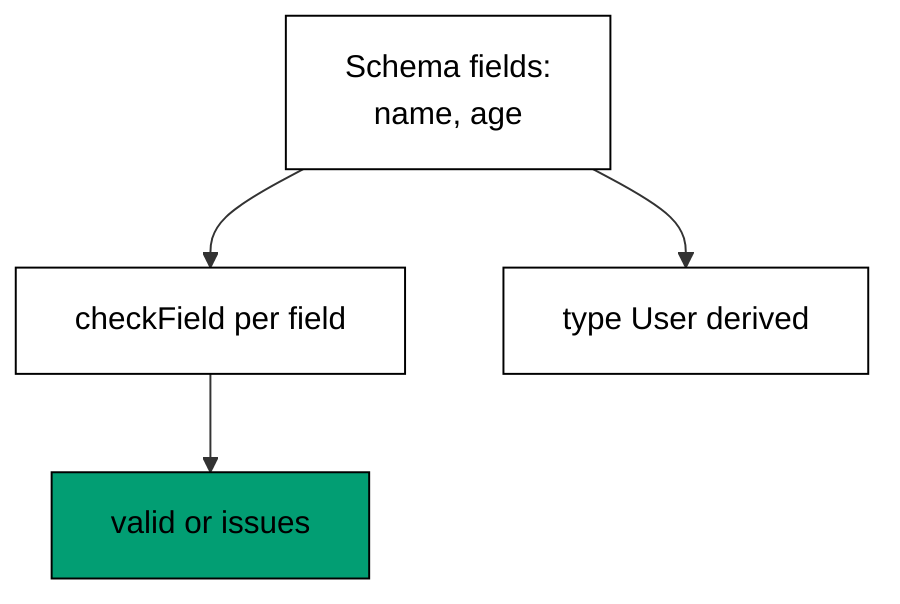

Examples 1-5 install the mental model every later theme assumes: a schema is a runtime
value that checks untrusted data, and the static type is derived from that same value
instead of written twice (co-01). The progression moves from a two-field schema to
nested objects, to optional and defaulted fields with refinements, to composing schemas
by extension and merge, and finally to discriminated unions that route on a tag. Every
model in this theme is dependency-free TypeScript that mirrors the real Zod API shape
(`z.object`, `z.string`, `.optional()`, `.default()`, `.refine()`, `.extend()`,
`.merge()`, `z.discriminatedUnion`), and the lesson text maps each model line to the
real construct it stands for.

Read the five examples as one claim worked out five ways: write the check once, run it
at the boundary, and let the compiler derive the type. When the text names a Zod
construct (`z.infer`, `.parse`, `.safeParse`), that construct is the production
behaviour the Zod documentation describes for the current major version; the runnable
model resolves the same inputs to the same verdicts a real schema would compute.

---

### Worked Example 1: First Zod Schema

_ex-01 · exercises co-01_

A schema is a value you run, not just a type you write. The model declares two fields
(name and age) as data, checks an untrusted payload against them, and derives the
`User` type from the same declaration the way `z.infer<typeof UserSchema>` does.



**`learning/code/ex-01-first-zod-schema/example.ts`**:

```typescript
// => Worked Example 1: a schema is a value you run, not just a type you write.
// => co-01: in Zod this is z.object({ name: z.string(), age: z.number() }).
type Primitive = "string" | "number"; // => the two leaf checks this tiny model supports
// => One schema field: the key to look for and the check to run.
interface Field {
  // => one schema field: the key to look for and the check to run
  name: string; // => the object key, e.g. "name"
  kind: Primitive; // => the runtime check for that key, e.g. "string"
}
interface Issue {
  // => one validation failure, shaped like a Zod issue
  path: string; // => which key failed, e.g. "age"
  message: string; // => why it failed, e.g. "expected number"
}
function checkField(value: unknown, field: Field): Issue | null {
  // => run one field check; null means this field is valid
  if (typeof value !== field.kind) {
    // => the runtime check itself: typeof must match the schema
    return { path: field.name, message: "expected " + field.kind }; // => wrong kind is a failure
  } // => kind matches: fall through to valid
  return null; // => no issue for this field
}
// => The inferred type below is what z.infer<typeof UserSchema> gives you:
// => derived from the schema by the compiler, never written by hand.
type User = { name: string; age: number }; // => static type, single-sourced from the schema
// => One list, two consumers: the checker maps over it, the type mirrors it.
const userSchema: Field[] = [
  // => the schema as a value: the same list drives checks and types
  { name: "name", kind: "string" }, // => first declared field
  { name: "age", kind: "number" }, // => second declared field
];
// => Two payloads prove both directions: valid passes, invalid names its field.
function main(): void {
  // => entry point; every print is a checkable fact about the model
  // => two payloads prove the two directions: valid passes, invalid names its field.
  // => a valid payload passes every field check
  const good: unknown = { name: "Ada", age: 36 }; // => untrusted input, correctly shaped
  const goodIssues: Issue[] = userSchema
    .map((f) => checkField((good as Record<string, unknown>)[f.name], f)) // => run each field check
    .filter((i): i is Issue => i !== null); // => keep only the failures
  const user: User = good as User; // => after validation, the cast is safe: this is z.infer in action
  console.log("valid: ok=" + String(goodIssues.length === 0) + " name=" + user.name); // => Output: valid: ok=true name=Ada
  // => a wrong-typed payload fails exactly one field check
  const bad: unknown = { name: "Ada", age: "thirty-six" }; // => untrusted input, wrong shape
  const badIssues: Issue[] = userSchema
    .map((f) => checkField((bad as Record<string, unknown>)[f.name], f)) // => same checks, new payload
    .filter((i): i is Issue => i !== null); // => keep only the failures
  console.log(
    "invalid: issues=" + String(badIssues.length) + " first=" + badIssues[0].path + ": " + badIssues[0].message,
  ); // => Output: invalid: issues=1 first=age: expected number
}
main(); // => run once; a throw exits nonzero
```

**Output** (`learning/code/ex-01-first-zod-schema/expected/main.stdout.txt`):

```text
valid: ok=true name=Ada
invalid: issues=1 first=age: expected number
```

**Verify**: the valid payload passes with the inferred name, and the wrong-typed
payload fails with exactly one issue naming the age field.

**Key takeaway**: one field list drives both the runtime check and the static type,
so the two can never drift apart.

**Why it matters**: every boundary in this course repeats this shape: declare the
expected shape once, check the untrusted value against it, and derive the trusted
type from the declaration. Hand-written types next to hand-written validators rot
independently; a schema keeps them identical by construction. Teams that adopt this
habit delete a whole class of bugs where the validator accepts what the type
forbids, or the type promises what the validator never checked.

---

### Worked Example 2: Nested Object Schema

_ex-02 · exercises co-01_

Objects nest, so schemas nest too. The model checks an address object inside a user
object level by level, and a blank nested leaf fails with its full dotted path
(`address.city`), the way a real Zod error path reads.

**`learning/code/ex-02-nested-object-schema/example.ts`**:

```typescript
// => Worked Example 2: objects nest, so schemas nest too.
// => co-01: in Zod this is z.object({ address: z.object({ city: z.string() }) }).
interface Issue {
  // => one validation failure with its full nested path
  path: string; // => dotted key path, e.g. "address.zip"
  message: string; // => why it failed at that path
}
function isRecord(value: unknown): value is Record<string, unknown> {
  // => narrow unknown to an object before reading keys from it
  return typeof value === "object" && value !== null; // => objects only; null is excluded
}
function checkString(record: Record<string, unknown>, path: string, key: string): Issue | null {
  // => check one string leaf and report its full dotted path
  const value: unknown = record[key]; // => read the leaf out of its parent object
  if (typeof value !== "string" || value.length === 0) {
    // => empty strings fail too: a present-but-blank city is not a city
    return { path: path + "." + key, message: "expected non-empty string" }; // => failure names the leaf
  } // => leaf valid: fall through
  return null; // => no issue at this path
}
function main(): void {
  // => entry point; nested input is checked level by level
  // => a fully valid nested payload passes every level
  const good: unknown = { name: "Ada", address: { city: "Surabaya", zip: "60111" } }; // => two levels, all strings
  const goodIssues: Issue[] = []; // => collect failures across levels here
  if (isRecord(good) && isRecord(good["address"])) {
    // => narrow both levels before touching leaves
    const address: Record<string, unknown> = good["address"]; // => the nested object under test
    const cityIssue: Issue | null = checkString(address, "address", "city"); // => check the city leaf
    if (cityIssue !== null) {
      // => only failures are recorded
      goodIssues.push(cityIssue); // => record the city failure, if any
    } // => city done
    const zipIssue: Issue | null = checkString(address, "address", "zip"); // => check the zip leaf
    if (zipIssue !== null) {
      // => only failures are recorded
      goodIssues.push(zipIssue); // => record the zip failure, if any
    } // => zip done
  } // => both levels checked
  console.log("valid: ok=" + String(goodIssues.length === 0)); // => Output: valid: ok=true
  // => a blank nested leaf fails with its full dotted path
  const bad: unknown = { name: "Ada", address: { city: "", zip: "60111" } }; // => city blank, zip fine
  const badIssues: Issue[] = []; // => fresh collector for the bad payload
  if (isRecord(bad) && isRecord(bad["address"])) {
    // => same narrowing, hostile payload
    const badAddress: Record<string, unknown> = bad["address"]; // => the nested object under test
    const badCity: Issue | null = checkString(badAddress, "address", "city"); // => the blank leaf fails here
    if (badCity !== null) {
      // => the failure is real, so record it
      badIssues.push(badCity); // => path reads "address.city", not just "city"
    } // => city done
  } // => narrowing done
  console.log("invalid: issues=" + String(badIssues.length) + " first=" + badIssues[0].path); // => Output: invalid: issues=1 first=address.city
}
main(); // => run once; a throw exits nonzero
```

**Output** (`learning/code/ex-02-nested-object-schema/expected/main.stdout.txt`):

```text
valid: ok=true
invalid: issues=1 first=address.city
```

**Verify**: the fully valid payload passes every level, and the blank city fails
with the dotted path `address.city`, not just `city`.

**Key takeaway**: nested schemas report nested paths, so the caller knows exactly
which leaf of which object failed.

**Why it matters**: real payloads are never flat: users have addresses, orders have
line items, responses wrap data envelopes. A flat validator forces the caller to
guess which level broke; a nested schema with dotted paths points at the leaf.
This precision compounds when payloads grow, because the fix for a blank city is
different from the fix for a missing address object, and only the path tells you
which one you need.

---

### Worked Example 3: Optional, Default, Refine

_ex-03 · exercises co-01_

Three field modifiers cover most real-world shapes: optional skips absent values,
default fills them, and refine rejects values that are well-typed but wrong.
The model parses a sparse member (age only) and rejects a too-young one.

**`learning/code/ex-03-optional-default-refine/example.ts`**:

```typescript
// => Worked Example 3: optional, defaulted, and refined fields.
// => co-01: in Zod this is z.string().optional(), z.string().default(), z.number().refine().
interface MemberInput {
  // => raw untrusted input: every field may be missing or wrong-typed
  nickname?: unknown; // => optional: absence is legal
  role?: unknown; // => absent means the default applies
  age?: unknown; // => must survive the adulthood refinement
}
interface Member {
  // => the trusted output type: what z.infer gives you after parsing
  nickname: string | undefined; // => optional stays optional in the output
  role: string; // => defaulted: always present after parsing
  age: number; // => refined: a number that passed the check
}
function parseMember(input: MemberInput): { ok: true; member: Member } | { ok: false; issue: string } {
  // => one parse function: optional, default, and refine in order
  if (input.nickname !== undefined && typeof input.nickname !== "string") {
    // => optional does not mean anything-goes when present
    return { ok: false, issue: "nickname: expected string" }; // => present-but-wrong still fails
  } // => nickname settled
  const role: string = typeof input.role === "string" ? input.role : "member"; // => default fills absence
  if (typeof input.age !== "number" || input.age < 13) {
    // => the refinement: old enough, and actually a number
    return { ok: false, issue: "age: must be a number aged 13 or older" }; // => refine rejects with a message
  } // => age settled
  const nickname: string | undefined = typeof input.nickname === "string" ? input.nickname : undefined; // => narrow once, reuse
  return { ok: true, member: { nickname: nickname, role: role, age: input.age } }; // => trusted output assembled
}
function main(): void {
  // => entry point; three payloads exercise the three modifiers
  // => absent nickname and role still parse: optional skips, default fills
  const sparse: MemberInput = { age: 36 }; // => only the refined field is present
  const parsedSparse = parseMember(sparse); // => parse the sparse payload
  if (parsedSparse.ok) {
    // => narrow the union before touching .member
    console.log("sparse: role=" + parsedSparse.member.role + " nickname=" + String(parsedSparse.member.nickname)); // => Output: sparse: role=member nickname=undefined
  } // => sparse done
  // => a too-young age fails the refinement even though it is a number
  const young: MemberInput = { nickname: "ada", role: "admin", age: 9 }; // => well-typed but too young
  const parsedYoung = parseMember(young); // => parse the young payload
  if (!parsedYoung.ok) {
    // => the failure branch carries the message
    console.log("young: rejected=" + parsedYoung.issue); // => Output: young: rejected=age: must be a number aged 13 or older
  } // => young done
}
main(); // => run once; a throw exits nonzero
```

**Output** (`learning/code/ex-03-optional-default-refine/expected/main.stdout.txt`):

```text
sparse: role=member nickname=undefined
young: rejected=age: must be a number aged 13 or older
```

**Verify**: the sparse payload parses with the member role defaulted, and the
nine-year-old is rejected by the refinement, not by a type error.

**Key takeaway**: optional is about absence, default is about filling absence,
and refine is about content: three different questions, three different answers.

**Why it matters**: modifiers are where schemas earn their keep over plain types.
A type can say a field is optional, but it cannot fill a default or reject a
nine-year-old admin; those are runtime judgments. Putting them in the schema
means every consumer of the parsed value inherits the guarantees without
re-implementing them. The alternative is scattered `?? "member"` defaults and
ad-hoc age checks that drift apart the moment two endpoints need them.

---

### Worked Example 4: Schema Composition

_ex-04 · exercises co-01_

Schemas compose by extension (base plus new fields) and merge (two schemas joined),
and both copy rather than mutate. The model extends a signup schema with timestamps
and merges profile with preferences, then proves the base is untouched.

**`learning/code/ex-04-schema-composition/example.ts`**:

```typescript
// => Worked Example 4: schemas compose by extension and merge.
// => co-01: in Zod this is Base.extend({...}) and SchemaA.merge(SchemaB).
interface Field {
  // => one schema field, reused across all four examples so far
  name: string; // => the key under test
  kind: "string" | "number"; // => the runtime check for that key
}
function keysOf(schema: Field[]): string {
  // => render a schema as its key list for easy comparison
  return schema.map((f) => f.name).join(","); // => names only: kinds are unchanged by composition
}
function main(): void {
  // => entry point; extend adds fields, merge joins two schemas
  // => the base signup schema both later schemas build on
  const base: Field[] = [
    // => two fields every account needs
    { name: "email", kind: "string" }, // => login identity
    { name: "password", kind: "string" }, // => login secret
  ];
  // => extension: base plus timestamps, like Base.extend({ createdAt: z.number() })
  const withTimestamps: Field[] = base.concat([{ name: "createdAt", kind: "number" }]); // => concat, never mutate
  console.log("extended: " + keysOf(withTimestamps) + " (base=" + String(base.length) + ")"); // => Output: extended: email,password,createdAt (base=2)
  // => merge: profile fields joined with preferences, like Profile.merge(Preferences)
  const profile: Field[] = [{ name: "displayName", kind: "string" }]; // => left side of the merge
  const preferences: Field[] = [{ name: "theme", kind: "string" }]; // => right side of the merge
  const merged: Field[] = profile.concat(preferences); // => every field from both sides
  console.log("merged: " + keysOf(merged)); // => Output: merged: displayName,theme
  // => the base is untouched: composition copies, it never edits in place
  console.log("base intact: " + keysOf(base)); // => Output: base intact: email,password
}
main(); // => run once; a throw exits nonzero
```

**Output** (`learning/code/ex-04-schema-composition/expected/main.stdout.txt`):

```text
extended: email,password,createdAt (base=2)
merged: displayName,theme
base intact: email,password
```

**Verify**: the extended schema carries all three keys, the merged schema carries
both sides, and the base still lists exactly its original two fields.

**Key takeaway**: extend grows one schema, merge joins two, and neither edits its
inputs, so shared bases stay safe to reuse.

**Why it matters**: signup, profile, admin, and public views of the same entity
overlap heavily but differ at the edges. Composition lets each endpoint declare
exactly its shape while sharing the common core, so a change to the email rule
propagates everywhere the base is used. Without it, every endpoint hand-rolls its
own copy of the user shape, and the copies diverge silently until a payload valid
at signup is rejected at checkout.

---

### Worked Example 5: Discriminated Union

_ex-05 · exercises co-01, co-02_

One schema per variant, picked by a tag. The model parses circles and squares
through a `kind` tag, computes the circle's area, and rejects an unknown tag at
the boundary so the area function never sees it.

**`learning/code/ex-05-discriminated-union/example.ts`**:

```typescript
// => Worked Example 5: one schema per variant, picked by a tag.
// => co-01: in Zod this is z.discriminatedUnion("kind", [Circle, Square]).
// => co-02: the tag is checked at the boundary, so handlers never guess.
type Shape = { kind: "circle"; radius: number } | { kind: "square"; side: number }; // => the inferred union: z.infer in one line
function area(shape: Shape): number {
  // => exhaustive over the tag: every variant handled, nothing else possible
  if (shape.kind === "circle") {
    // => the tag narrows the union to the circle variant
    return Math.PI * shape.radius * shape.radius; // => radius exists only on this branch
  } // => circle done
  return shape.side * shape.side; // => the only remaining variant is the square
}
function parseShape(input: unknown): { ok: true; shape: Shape } | { ok: false; issue: string } {
  // => boundary parse: tag first, then the matching variant body
  if (typeof input !== "object" || input === null) {
    // => non-objects cannot carry a tag
    return { ok: false, issue: "expected object with kind tag" }; // => reject before reading anything
  } // => object confirmed
  const record = input as Record<string, unknown>; // => narrow once for key reads
  if (record["kind"] === "circle" && typeof record["radius"] === "number") {
    // => tag matches circle and its body field checks out
    return { ok: true, shape: { kind: "circle", radius: record["radius"] } }; // => trusted circle out
  } // => circle branch done
  if (record["kind"] === "square" && typeof record["side"] === "number") {
    // => tag matches square and its body field checks out
    return { ok: true, shape: { kind: "square", side: record["side"] } }; // => trusted square out
  } // => square branch done
  return { ok: false, issue: "unknown kind: " + String(record["kind"]) }; // => no variant matched the tag
}
function main(): void {
  // => entry point; a good circle, a good square, and a bad tag
  // => a circle payload parses and its area follows from the tag
  const circle = parseShape({ kind: "circle", radius: 2 }); // => valid circle input
  if (circle.ok) {
    // => narrow before computing
    console.log("circle: area=" + circle.shape.kind + ":" + String(Math.round(area(circle.shape) * 100) / 100)); // => Output: circle: area=circle:12.57
  } // => circle done
  // => an unknown tag is rejected at the boundary, never inside area()
  const bad = parseShape({ kind: "triangle", side: 3 }); // => no variant carries this tag
  if (!bad.ok) {
    // => the failure branch names the tag
    console.log("bad tag: " + bad.issue); // => Output: bad tag: unknown kind: triangle
  } // => bad done
}
main(); // => run once; a throw exits nonzero
```

**Output** (`learning/code/ex-05-discriminated-union/expected/main.stdout.txt`):

```text
circle: area=circle:12.57
bad tag: unknown kind: triangle
```

**Verify**: the circle parses and its area computes from the tag-narrowed variant,
while the triangle tag is rejected at parse time, never inside the area function.

**Key takeaway**: the tag is checked once at the boundary, and every downstream
function trusts it, so impossible variants cannot reach the logic.

**Why it matters**: APIs return heterogeneous lists: notifications of many kinds,
events with different payloads, shapes with different fields. A union without a
tag forces every consumer to probe for distinguishing fields; a discriminated
union makes the tag the contract, and exhaustiveness checking makes unhandled
variants a compile error. This is parse-don't-validate at its most valuable:
one check at the door replaces a dozen defensive probes inside.

---

← Previous: [Learning Overview](./overview.md) · Next: [Theme B: Parsing Untrusted Input](./theme-b-parsing-untrusted-input.md) →
