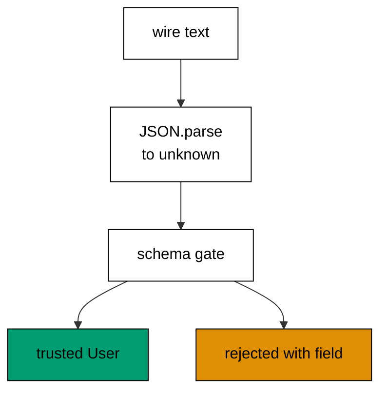

Examples 6-10 move the schema to the boundary where untrusted data enters: the
parse-don't-validate discipline (co-02). The progression starts with the two parse
styles (safeParse versus parse), crosses a JSON boundary, validates arrays item by
item with indexed errors, coerces and transforms wire shapes, and ends with branded
types that keep same-shaped strings distinct forever. The models mirror
`safeParse`, `z.array`, `z.coerce`, `.transform()`, and `z.brand()`; the lesson
text maps each model line to the real Zod construct.

Read the five examples as one rule applied five times: untrusted input becomes a
trusted value exactly once, at the boundary, and everything downstream receives the
trusted value, never the raw wire. When the text names a Zod construct, it names
the production behaviour the Zod documentation describes; the runnable model
resolves the same hostile inputs to the same verdicts.

---

### Worked Example 6: safeParse Versus parse

_ex-06 · exercises co-02_

Expected failure deserves a value; impossible failure deserves a throw. The model
runs the same hostile payload through both styles: safeParse returns a union the
caller branches on, while parse throws an exception the caller must catch.

**`learning/code/ex-06-safe-parse-vs-parse/example.ts`**:

```typescript
// => Worked Example 6: safeParse returns a value; parse throws.
// => co-02: in Zod, safeParse is for expected failure, parse for impossible failure.
interface Success {
  // => the valid branch: parsed data, ready to use
  ok: true; // => discriminant for narrowing
  name: string; // => trusted payload field
}
interface Failure {
  // => the invalid branch: a message, never an exception
  ok: false; // => discriminant for narrowing
  issue: string; // => what failed, as data
}
function safeParseName(input: unknown): Success | Failure {
  // => the safeParse shape: a union, not a throw
  if (typeof input === "object" && input !== null && typeof (input as Record<string, unknown>)["name"] === "string") {
    // => the check passes: wrap the trusted value
    return { ok: true, name: (input as Record<string, unknown>)["name"] as string }; // => data out, no throw
  } // => check failed: fall through to the failure value
  return { ok: false, issue: "name: expected string" }; // => failure as data, catchable with if
}
// => parse shares the gate: one check, two styles, identical verdicts.
function parseName(input: unknown): string {
  // => the parse shape: data or an exception, nothing in between
  const result: Success | Failure = safeParseName(input); // => reuse the same check
  if (!result.ok) {
    // => failure here is a programmer error, so throwing is honest
    throw new Error(result.issue); // => the throw: only for supposedly-impossible input
  } // => valid: fall through
  return result.name; // => trusted value out
}
function main(): void {
  // => entry point; hostile input meets both styles
  // => the same payload runs twice so the two verdicts can be compared directly.
  // => safeParse turns hostile input into a value the caller branches on
  const hostile: unknown = { name: 42 }; // => wrong-typed but plausible from a form
  const result: Success | Failure = safeParseName(hostile); // => no throw possible
  if (!result.ok) {
    // => branch on the discriminant, never try/catch
    console.log("safe: " + result.issue); // => Output: safe: name: expected string
  } // => safe done
  // => parse turns the same input into a caught exception
  try {
    // => the throwing call must sit inside try
    parseName(hostile); // => throws: the input violates the schema
    console.log("parse: unexpectedly valid"); // => unreachable for this input
  } catch (error) {
    // => the throw lands here
    console.log("parse: threw " + (error as Error).message); // => Output: parse: threw name: expected string
  } // => parse done
}
main(); // => run once; a throw exits nonzero
```

**Output** (`learning/code/ex-06-safe-parse-vs-parse/expected/main.stdout.txt`):

```text
safe: name: expected string
parse: threw name: expected string
```

**Verify**: the safeParse branch prints the issue as data, and the parse branch
prints the same message as a caught exception.

**Key takeaway**: safeParse is for input that may be wrong; parse is for input
that cannot be wrong, where a throw signals a programmer error.

**Why it matters**: the choice between a union and a throw is the choice between
a failure the caller plans for and one it cannot. Forms, query strings, and file
uploads are wrong routinely, so safeParse keeps them on the value path where
branching is cheap. Throwing on user input pushes routine failures into
exception handlers, where they are expensive, untyped, and easy to forget. The
rule of thumb survives every framework: values for the expected, exceptions for
the impossible.

---

### Worked Example 7: JSON Boundary

_ex-07 · exercises co-02, co-13_

`JSON.parse` returns unknown, and the schema decides what it means. The model
parses one honest payload and one lying payload (a numeric string where a number
belongs), rejecting the lie with the field named.



**`learning/code/ex-07-json-boundary/example.ts`**:

```typescript
// => Worked Example 7: JSON.parse returns unknown; the schema decides what it means.
// => co-02: every network boundary is a parse-dont-validate moment.
// => co-13: TypeScript checks the code at compile time; only the schema checks the wire at runtime.
interface User {
  // => the trusted type: exists only after the boundary check passes
  id: number; // => must arrive as a number, not a numeric string
  email: string; // => must arrive as a string containing an at-sign
}
function parseUserJson(text: string): { ok: true; user: User } | { ok: false; issue: string } {
  // => the whole boundary in one function: text in, trusted user or issue out
  let raw: unknown; // => JSON.parse can produce anything: typed unknown on purpose
  try {
    // => malformed JSON is the first failure mode
    raw = JSON.parse(text); // => still unknown: parsing text never proves shape
  } catch {
    // => syntax failure carries no schema information
    return { ok: false, issue: "malformed JSON" }; // => reject before any field read
  } // => text is valid JSON; shape still unknown
  if (typeof raw !== "object" || raw === null) {
    // => primitives and null cannot be users
    return { ok: false, issue: "expected object" }; // => reject the wrong top-level kind
  } // => object confirmed
  const record = raw as Record<string, unknown>; // => narrow once for key reads
  if (typeof record["id"] !== "number") {
    // => a string "7" is not an id: no silent coercion at the boundary
    return { ok: false, issue: "id: expected number" }; // => strictness is the feature
  } // => id settled
  if (typeof record["email"] !== "string" || !record["email"].includes("@")) {
    // => the cheapest email check: a real schema would use .email()
    return { ok: false, issue: "email: expected email string" }; // => shape right, content wrong
  } // => email settled
  return { ok: true, user: { id: record["id"], email: record["email"] } }; // => trusted user out
}
function main(): void {
  // => entry point; one honest payload, one lying payload
  // => honest JSON passes straight through to a trusted user
  const good = parseUserJson('{"id":7,"email":"ada@example.com"}'); // => the wire tells the truth
  if (good.ok) {
    // => narrow before reading the user
    console.log("good: id=" + String(good.user.id) + " email=" + good.user.email); // => Output: good: id=7 email=ada@example.com
  } // => good done
  // => a numeric-string id lies about its type and the boundary catches it
  const lying = parseUserJson('{"id":"7","email":"ada@example.com"}'); // => id is a string on the wire
  if (!lying.ok) {
    // => the failure names the field, not the whole payload
    console.log("lying: " + lying.issue); // => Output: lying: id: expected number
  } // => lying done
}
main(); // => run once; a throw exits nonzero
```

**Output** (`learning/code/ex-07-json-boundary/expected/main.stdout.txt`):

```text
good: id=7 email=ada@example.com
lying: id: expected number
```

**Verify**: the honest payload yields the trusted user, and the numeric-string id
is rejected with `id: expected number`.

**Key takeaway**: the wire is always lying until the schema says otherwise, so
every boundary parses and nothing downstream re-checks.

**Why it matters**: TypeScript checks the code at compile time, but no type
checker watches the network cable; only the schema checks the wire at runtime.
This is the runtime-versus-compile-time split the whole course rests on: types
prove the program consistent with itself, schemas prove the world consistent with
the program. Skipping the boundary check treats the network as typed, and the
network is never typed. Every injection, every `undefined is not a function` in
production, is this check performed nowhere.

---

### Worked Example 8: Array of Records

_ex-08 · exercises co-02_

Arrays validate per item, and every failure names its index. The model parses a
three-item cart where the middle item has a zero quantity, collecting the single
indexed issue the way Zod error paths do.

**`learning/code/ex-08-array-of-records/example.ts`**:

```typescript
// => Worked Example 8: arrays validate per item, and every failure names its index.
// => co-02: in Zod this is z.array(UserSchema): one schema, applied N times.
interface Item {
  // => the trusted item type after its index passes
  sku: string; // => stock-keeping key, non-empty
  qty: number; // => count, must be a positive number
}
interface ItemIssue {
  // => one item failure, indexed like Zod's error paths
  index: number; // => which array position failed
  message: string; // => what failed at that position
}
// => One element, one index: the index travels with every verdict it produces.
function parseItem(input: unknown, index: number): { ok: true; item: Item } | { ok: false; issue: ItemIssue } {
  // => parse one element with its index attached to any failure
  if (typeof input !== "object" || input === null) {
    // => non-objects cannot be items
    return { ok: false, issue: { index: index, message: "expected object" } }; // => index preserved
  } // => object confirmed
  const record = input as Record<string, unknown>; // => narrow once for key reads
  if (typeof record["sku"] !== "string" || record["sku"].length === 0) {
    // => blank skus fail like missing ones
    return { ok: false, issue: { index: index, message: "sku: expected non-empty string" } }; // => field named
  } // => sku settled
  if (typeof record["qty"] !== "number" || record["qty"] <= 0) {
    // => zero and negative quantities are not orderable
    return { ok: false, issue: { index: index, message: "qty: expected positive number" } }; // => field named
  } // => qty settled
  return { ok: true, item: { sku: record["sku"], qty: record["qty"] } }; // => trusted item out
}
// => The array parse never throws: failures collect, successes collect, then the split decides.
function parseItems(input: unknown): { ok: true; items: Item[] } | { ok: false; issues: ItemIssue[] } {
  // => the array parse: every item checked, every failure collected
  // => The top level must be an array before any index exists.
  if (!Array.isArray(input)) {
    // => the top level must be an array before any index exists
    return { ok: false, issues: [{ index: -1, message: "expected array" }] }; // => index -1 means "not an array at all"
  } // => array confirmed
  const items: Item[] = []; // => trusted outputs accumulate here
  const issues: ItemIssue[] = []; // => failures accumulate here, never thrown
  // => Every item checked: the index comes free from forEach.
  input.forEach((entry: unknown, index: number) => {
    // => index comes free from forEach
    const parsed = parseItem(entry, index); // => same item parse, indexed
    // => Each entry takes exactly one branch: stored as trusted or stored as indexed.
    if (parsed.ok) {
      // => valid items accumulate
      items.push(parsed.item); // => trusted item stored
    } else {
      // => invalid items accumulate as issues
      issues.push(parsed.issue); // => indexed issue stored
    } // => entry settled
  });
  // => Any failure fails the whole parse: partial arrays never leak downstream.
  if (issues.length > 0) {
    // => any failure fails the whole array parse
    return { ok: false, issues: issues }; // => all failures reported together
  } // => no failures: fall through
  return { ok: true, items: items }; // => trusted array out
}
// => A mixed cart proves the collection: valid items survive, one indexed issue reports.
function main(): void {
  // => entry point; a mixed cart shows per-index reporting
  // => two valid items survive, one indexed issue reports: collection, not short-circuit.
  // => two valid items and one bad quantity: two pass, one is named
  const cart: unknown = [
    { sku: "KB-01", qty: 2 }, // => index 0: valid
    { sku: "MS-02", qty: 0 }, // => index 1: qty fails
    { sku: "MN-03", qty: 1 }, // => index 2: valid
  ];
  const parsed = parseItems(cart); // => parse the whole cart
  // => The failure branch lists every bad index.
  if (!parsed.ok) {
    // => the failure branch lists every bad index
    console.log(
      "cart: issues=" + // => issue count first
        String(parsed.issues.length) +
        " at=" + // => then the bad index
        String(parsed.issues[0].index) +
        " " +
        parsed.issues[0].message, // => then the rule that failed
    ); // => Output: cart: issues=1 at=1 qty: expected positive number
  } // => cart done
}
main(); // => run once; a throw exits nonzero
```

**Output** (`learning/code/ex-08-array-of-records/expected/main.stdout.txt`):

```text
cart: issues=1 at=1 qty: expected positive number
```

**Verify**: the cart fails with exactly one issue at index 1 naming the quantity
rule, while the two valid items are identified by position.

**Key takeaway**: one schema applied N times gives N indexed verdicts, all
collected, so the caller sees every bad item in one pass.

**Why it matters**: batch payloads fail in batches, and stopping at the first
bad item wastes round trips: fix one, resubmit, discover the next. Collecting
all indexed failures lets the caller repair everything at once, which is what
form arrays and bulk imports need. The index is load-bearing here: without it,
"quantity is wrong" across a hundred line items is unactionable; with it, the
caller highlights exactly row 1.

---

### Worked Example 9: Coerce and Transform

_ex-09 · exercises co-02_

Coercion turns wire shapes into domain shapes, and transforms derive new values
from validated ones. The model coerces the query string `"42"` to an integer,
refuses the uncoercible `"forty-two"`, and slugifies a validated title.

**`learning/code/ex-09-coerce-and-transform/example.ts`**:

```typescript
// => Worked Example 9: coerce and transform turn wire shapes into domain shapes.
// => co-02: in Zod this is z.coerce.number() and .transform((s) => ...).
function toInt(input: unknown): { ok: true; value: number } | { ok: false; issue: string } {
  // => coerce a wire value into an integer, rejecting what cannot convert
  if (typeof input === "number" && Number.isInteger(input)) {
    // => already an integer: no work needed
    return { ok: true, value: input }; // => pass through
  } // => not a number: try the string form
  if (typeof input === "string" && input.trim() !== "" && Number.isInteger(Number(input))) {
    // => numeric strings coerce; blank strings do not
    return { ok: true, value: Number(input) }; // => the coerced integer
  } // => nothing coerced: fall through to failure
  return { ok: false, issue: "expected integer-like, got " + String(input) }; // => uncoercible input rejected
}
function slugify(input: string): string {
  // => transform a title into a URL slug: lowercase, spaces to dashes
  return input
    .toLowerCase() // => slugs are lowercase by convention
    .trim() // => no leading or trailing dashes
    .split(/\s+/) // => split on any whitespace run
    .join("-"); // => rejoin with dashes
}
function main(): void {
  // => entry point; a numeric string coerces, a title transforms
  // => the query string "42" arrives as text and leaves as an integer
  const page = toInt("42"); // => typical query-param shape
  if (page.ok) {
    // => narrow before using the value
    console.log("coerced: value=" + String(page.value)); // => Output: coerced: value=42
  } // => coerce done
  // => garbage does not coerce: the boundary says so explicitly
  const bad = toInt("forty-two"); // => no integer hiding in there
  if (!bad.ok) {
    // => the failure names the input it refused
    console.log("uncoercible: " + bad.issue); // => Output: uncoercible: expected integer-like, got forty-two
  } // => bad done
  // => the transform runs only after validation: slugify never sees garbage
  console.log("slug: " + slugify("Hello Typed World")); // => Output: slug: hello-typed-world
}
main(); // => run once; a throw exits nonzero
```

**Output** (`learning/code/ex-09-coerce-and-transform/expected/main.stdout.txt`):

```text
coerced: value=42
uncoercible: expected integer-like, got forty-two
slug: hello-typed-world
```

**Verify**: the numeric string coerces to 42, the word string is refused by name,
and the title transforms to its slug only after validation.

**Key takeaway**: coerce at the door for shapes the wire cannot express, and
transform inside for values derived from already-valid data.

**Why it matters**: query strings, form fields, and environment variables are
all text, but the program needs numbers, dates, and slugs. Coercion acknowledges
the wire's poverty without surrendering strictness: `"42"` becomes 42, while
`"forty-two"` is still rejected rather than silently becoming `NaN`. Transforms
go further, turning validated input into derived values, but they run after
validation, never before, because transforming garbage produces confident
garbage. The order is the discipline: validate, then derive.

---

### Worked Example 10: Branded Types

_ex-10 · exercises co-02, co-01, co-14_

Branded types make same-shaped strings incompatible: a user id and an order id
are both strings at runtime but different types at compile time. The model mints
each brand once at its boundary and proves a swapped prefix fails at minting,
never deep in the code.

**`learning/code/ex-10-branded-types/example.ts`**:

```typescript
// => Worked Example 10: branded types make same-shaped strings incompatible.
// => co-02: in Zod this is z.string().brand<"UserId">(): validated once, distinct forever.
// => co-01: the brand lives in the type, so no second schema is needed downstream.
type UserId = string & { readonly brand: "UserId" }; // => a string the compiler treats as distinct
type OrderId = string & { readonly brand: "OrderId" }; // => same runtime shape, different type
function toUserId(input: unknown): { ok: true; id: UserId } | { ok: false; issue: string } {
  // => the single boundary that mints UserIds: prefix-checked, then branded
  if (typeof input === "string" && input.startsWith("usr_") && input.length > 4) {
    // => prefix plus length: the whole UserId contract in one check
    return { ok: true, id: input as UserId }; // => brand applied exactly once, here
  } // => contract failed: fall through
  return { ok: false, issue: "expected usr_-prefixed id" }; // => rejected before any brand exists
}
function toOrderId(input: unknown): { ok: true; id: OrderId } | { ok: false; issue: string } {
  // => the single boundary that mints OrderIds: same shape, different brand
  if (typeof input === "string" && input.startsWith("ord_") && input.length > 4) {
    // => prefix plus length: the whole OrderId contract in one check
    return { ok: true, id: input as OrderId }; // => brand applied exactly once, here
  } // => contract failed: fall through
  return { ok: false, issue: "expected ord_-prefixed id" }; // => rejected before any brand exists
}
function ordersFor(user: UserId): string {
  // => downstream code takes the brand: callers cannot pass a raw string
  return "orders of " + user; // => the brand guarantees the prefix was checked
}
function main(): void {
  // => entry point; two ids, two brands, zero mix-ups
  // => both boundaries pass, and each brand flows to its own consumer
  const user = toUserId("usr_ada"); // => valid user id from the wire
  const order = toOrderId("ord_007"); // => valid order id from the wire
  if (user.ok && order.ok) {
    // => narrow both before use
    console.log("branded: " + ordersFor(user.id) + " + " + order.id); // => Output: branded: orders of usr_ada + ord_007
  } // => happy path done
  // => a swapped prefix fails at the minting boundary, not deep in the code
  const swapped = toUserId("ord_007"); // => an order id presented as a user id
  if (!swapped.ok) {
    // => the failure names the expected prefix
    console.log("swapped: " + swapped.issue); // => Output: swapped: expected usr_-prefixed id
  } // => swapped done
}
main(); // => run once; a throw exits nonzero
```

**Output** (`learning/code/ex-10-branded-types/expected/main.stdout.txt`):

```text
branded: orders of usr_ada + ord_007
swapped: expected usr_-prefixed id
```

**Verify**: both valid ids mint their brands and flow to their consumers, while
the order id presented as a user id is rejected at the minting boundary.

**Key takeaway**: validate once at the boundary, brand the result, and let the
type system carry the proof everywhere downstream for free.

**Why it matters**: stringly-typed code passes every string everywhere, and the
result is swapped ids, confused keys, and bugs that type-check. Brands cost one
check per boundary and repay it at every call site: `ordersFor` cannot receive
an order id because the program does not compile. For migration cost, this is
the cheapest adoption story in the course: wrap the existing string checks with
brands and the rest of the codebase gains safety without rewrites.

---

← Previous: [Theme A: Zod Schemas and Inference](./theme-a-zod-schemas-and-inference.md) · Next: [Theme C: Effect's Typed Errors](./theme-c-effect-s-typed-errors.md) →
