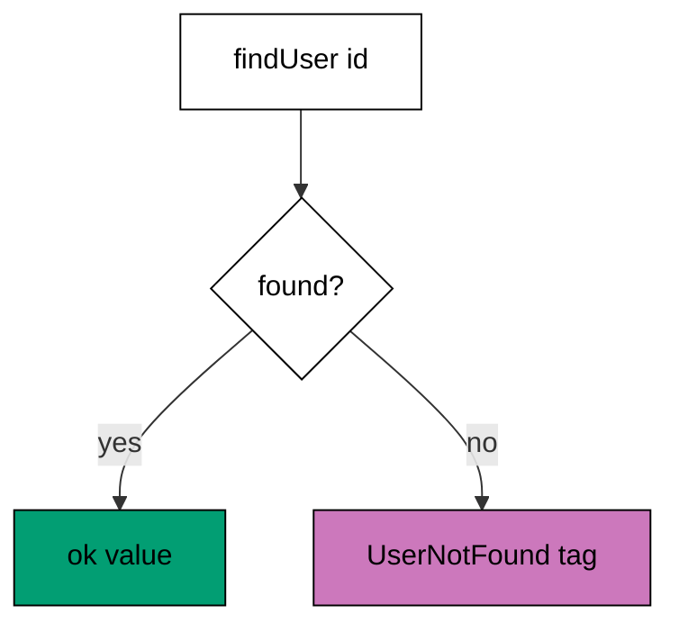

Examples 11-15 replace throwing with a typed error channel (co-03): a function
signature states what it can fail with. The progression introduces the single
typed error, unions of failure modes, catching one error by tag while others pass
through, the split between expected failures and defects, and the gates that bring
nullable and throwing edges into the typed world. The models mirror
`Effect.fail`, error unions, `Effect.catchTag`, `Effect.die`, `Option.fromNullable`,
and `Effect.try`; the lesson text maps each model line to the real Effect
construct it stands for.

Read the five examples as one inversion: failures are values the caller branches
on, not exceptions the caller hopes to catch. When the text names an Effect
construct, it names the production behaviour the Effect documentation describes;
the runnable model resolves the same failures to the same tagged errors.

---

### Worked Example 11: First Typed Error

_ex-11 · exercises co-03_

A lookup that can miss returns its failure instead of throwing it. The model
defines a tagged `UserNotFound` error, returns a hit as a value and a miss as
the tagged error, and the caller branches on the discriminant.



**`learning/code/ex-11-first-typed-error/example.ts`**:

```typescript
// => Worked Example 11: a function that states what it can fail with.
// => co-03: in Effect this is Effect<string, UserNotFound>: success and error both typed.
class UserNotFound {
  // => a typed error: data with a tag, not a thrown string
  readonly tag = "UserNotFound"; // => the tag catchTag matches on later
  readonly userId: string; // => the error carries its context
  constructor(userId: string) {
    // => plain parameter: strip-safe, assigned explicitly
    this.userId = userId; // => context stored on the instance
  }
}
type Outcome<A, E> = { ok: true; value: A } | { ok: false; error: E }; // => the Effect shape: value or typed error
function findUser(users: Record<string, string>, id: string): Outcome<string, UserNotFound> {
  // => the signature advertises its failure: missing users are expected, not exceptional
  const found: string | undefined = users[id]; // => lookup may miss: the honest type says so
  if (found === undefined) {
    // => the miss becomes a typed error value, never a throw
    return { ok: false, error: new UserNotFound(id) }; // => error as data, tag attached
  } // => found: fall through
  return { ok: true, value: found }; // => success carries the name
}
function main(): void {
  // => entry point; one hit and one miss against the same table
  // => a present user returns its name with no error in sight
  const users: Record<string, string> = { u1: "Ada" }; // => the tiny user table
  const hit: Outcome<string, UserNotFound> = findUser(users, "u1"); // => lookup that succeeds
  if (hit.ok) {
    // => narrow the union before reading the value
    console.log("hit: " + hit.value); // => Output: hit: Ada
  } // => hit done
  // => a missing user returns a tagged error the caller must handle
  const miss: Outcome<string, UserNotFound> = findUser(users, "u9"); // => lookup that fails
  if (!miss.ok) {
    // => the error branch reads the tag and the context
    console.log("miss: " + miss.error.tag + " id=" + miss.error.userId); // => Output: miss: UserNotFound id=u9
  } // => miss done
}
main(); // => run once; a throw exits nonzero
```

**Output** (`learning/code/ex-11-first-typed-error/expected/main.stdout.txt`):

```text
hit: Ada
miss: UserNotFound id=u9
```

**Verify**: the present user returns its name, and the missing user returns the
`UserNotFound` tag with the id, with no throw on either path.

**Key takeaway**: the signature advertises the failure, so the caller handles it
by branching, not by hoping a catch block exists.

**Why it matters**: thrown errors are invisible in the signature: nothing tells
the caller what can go wrong, so handling is optional and forgetting is silent.
A typed error channel makes failure handling mandatory and exhaustive, because
the value cannot be used without confronting the error branch. This flips
reliability from convention to construction: the program that ignores the miss
does not compile, rather than crashing on the first absent user in production.

---

### Worked Example 12: Error Union

_ex-12 · exercises co-03_

A function can fail in several ways, and the union lists every one. The model
reads a document with two failure modes (missing versus forbidden), and three
calls exercise success, denial, and absence, each matched by tag.

**`learning/code/ex-12-error-union/example.ts`**:

```typescript
// => Worked Example 12: an error union lists every failure mode up front.
// => co-03: in Effect this is Effect<User, NotFound | Forbidden>: callers see both.
class NotFound {
  // => first failure mode: the thing does not exist
  readonly tag = "NotFound"; // => matched by name in catchTag
  readonly id: string; // => which id was missing
  constructor(id: string) {
    // => plain parameter: strip-safe, assigned explicitly
    this.id = id; // => context stored on the instance
  }
}
class Forbidden {
  // => second failure mode: the thing exists but is off-limits
  readonly tag = "Forbidden"; // => matched by name in catchTag
  readonly id: string; // => which id was denied
  constructor(id: string) {
    // => plain parameter: strip-safe, assigned explicitly
    this.id = id; // => context stored on the instance
  }
}
type Outcome<A, E> = { ok: true; value: A } | { ok: false; error: E }; // => value or one of the listed errors
// => The union in the signature is the menu: two members, two recoveries, no surprises.
function readDoc(ids: string[], viewer: string, id: string): Outcome<string, NotFound | Forbidden> {
  // => the union in the signature is the complete failure menu
  if (!ids.includes(id)) {
    // => absent document: first failure mode
    return { ok: false, error: new NotFound(id) }; // => tagged NotFound
  } // => exists: fall through to the permission check
  if (viewer !== "admin" && id === "secret") {
    // => present but restricted: second failure mode
    return { ok: false, error: new Forbidden(id) }; // => tagged Forbidden
  } // => allowed: fall through
  return { ok: true, value: "doc:" + id }; // => success carries the document
}
function main(): void {
  // => entry point; three calls hit all three outcomes
  // => success, denial, and absence each print once: full coverage of the union.
  // => an admin reading a normal doc succeeds
  const ids: string[] = ["memo", "secret"]; // => the document table
  const ok: Outcome<string, NotFound | Forbidden> = readDoc(ids, "admin", "memo"); // => allowed read
  if (ok.ok) {
    // => narrow before reading the value
    console.log("read: " + ok.value); // => Output: read: doc:memo
  } // => read done
  // => a guest reading the secret doc fails with the permission error
  const denied: Outcome<string, NotFound | Forbidden> = readDoc(ids, "guest", "secret"); // => denied read
  if (!denied.ok) {
    // => the union narrows to the two error classes
    const error: NotFound | Forbidden = denied.error; // => name the union for the tag read
    console.log("denied: " + error.tag + " id=" + error.id); // => Output: denied: Forbidden id=secret
  } // => denied done
  // => anyone reading a missing doc fails with the absence error
  const missing: Outcome<string, NotFound | Forbidden> = readDoc(ids, "admin", "lost"); // => absent read
  if (!missing.ok) {
    // => the other union member surfaces here
    const error: NotFound | Forbidden = missing.error; // => same union, other tag
    console.log("missing: " + error.tag + " id=" + error.id); // => Output: missing: NotFound id=lost
  } // => missing done
}
main(); // => run once; a throw exits nonzero
```

**Output** (`learning/code/ex-12-error-union/expected/main.stdout.txt`):

```text
read: doc:memo
denied: Forbidden id=secret
missing: NotFound id=lost
```

**Verify**: the allowed read returns the document, the guest read returns the
`Forbidden` tag, and the missing read returns the `NotFound` tag.

**Key takeaway**: the error union is the complete failure menu, and matching on
it is exhaustive, so no failure mode goes unhandled by accident.

**Why it matters**: most real operations fail in more than one way, and each way
wants a different recovery: absence suggests creation, denial suggests
escalation. A single `Error` type erases that distinction, forcing callers to
parse messages; a union preserves it, letting each branch carry its own fix.
The union also documents the operation honestly: reading the signature tells
you everything that can go wrong, which is the first line of every runbook.

---

### Worked Example 13: Catch by Tag

_ex-13 · exercises co-03, co-04_

Catching is selective: one error recovers by tag while the other passes through
untouched. The model catches `NotFound` with a fallback value and proves the
`Forbidden` error survives the same catcher.

**`learning/code/ex-13-catch-by-tag/example.ts`**:

```typescript
// => Worked Example 13: catch one error by tag and let the other pass through.
// => co-03: in Effect this is Effect.catchTag(effect, "NotFound", () => fallback).
// => co-04: catching is composition: the pipeline continues with the fallback value.
class NotFound {
  // => the recoverable failure: a default fills it
  readonly tag = "NotFound"; // => the tag the catcher matches
  readonly id: string; // => context for the log line
  constructor(id: string) {
    // => plain parameter: strip-safe, assigned explicitly
    this.id = id; // => context stored on the instance
  }
}
class Forbidden {
  // => the unrecoverable failure: no default may invent permission
  readonly tag = "Forbidden"; // => a different tag, so the catcher skips it
  readonly id: string; // => context for the log line
  constructor(id: string) {
    // => plain parameter: strip-safe, assigned explicitly
    this.id = id; // => context stored on the instance
  }
}
type Outcome<A, E> = { ok: true; value: A } | { ok: false; error: E }; // => the shared Effect shape
// => The catcher is selective by construction: tag match recovers, anything else passes through.
function catchNotFound<E>(result: Outcome<string, NotFound | E>, fallback: string): Outcome<string, E> {
  // => catchTag for one tag: NotFound becomes the fallback, every other error passes through
  if (!result.ok && result.error instanceof NotFound) {
    // => tag match: recover with the fallback value
    return { ok: true, value: fallback + " (default for " + result.error.id + ")" }; // => recovered: error gone
  } // => no match: fall through untouched
  return result as Outcome<string, E>; // => Forbidden (or success) passes through unchanged
}
function main(): void {
  // => entry point; the same catcher meets a miss, a denial, and a hit
  // => a miss it heals, a denial it keeps: selectivity proven both directions.
  // => a miss is caught: the fallback value continues the pipeline
  const miss: Outcome<string, NotFound | Forbidden> = { ok: false, error: new NotFound("memo") }; // => recoverable failure
  const caught: Outcome<string, Forbidden> = catchNotFound(miss, "guest-doc"); // => catch the NotFound only
  if (caught.ok) {
    // => recovered: the pipeline sees a value, not an error
    console.log("caught: " + caught.value); // => Output: caught: guest-doc (default for memo)
  } // => caught done
  // => a denial passes through the same catcher untouched
  const denied: Outcome<string, NotFound | Forbidden> = { ok: false, error: new Forbidden("secret") }; // => unrecoverable failure
  const kept: Outcome<string, Forbidden> = catchNotFound(denied, "guest-doc"); // => tag does not match
  if (!kept.ok) {
    // => still an error, and still the Forbidden one
    console.log("kept: " + kept.error.tag + " id=" + kept.error.id); // => Output: kept: Forbidden id=secret
  } // => kept done
}
main(); // => run once; a throw exits nonzero
```

**Output** (`learning/code/ex-13-catch-by-tag/expected/main.stdout.txt`):

```text
caught: guest-doc (default for memo)
kept: Forbidden id=secret
```

**Verify**: the miss recovers to the fallback value naming the id, while the
denial passes through the catcher still tagged `Forbidden`.

**Key takeaway**: catchTag recovers exactly one failure mode, so fallbacks apply
where they are safe and never where they would hide a real problem.

**Why it matters**: blanket catching is how permission errors become default
content and outages become empty pages: the fallback hides the failure it was
never meant to cover. Selective catching composes instead: each failure mode
gets its own recovery, and unhandled modes keep traveling to the handler that
understands them. This is also composition in the pipeline sense: catching is
just another combinator, so the recovered value flows into the next step
unchanged, and the pipeline never learns that a failure happened.

---

### Worked Example 14: Fail Versus Defect

_ex-14 · exercises co-03, co-13_

Expected failures are values; only bugs are defects. The model runs division
through three lanes (value, expected failure, defect) and proves each lands on
its own: 3.5, handled division-by-zero, and a reported defect.

**`learning/code/ex-14-fail-vs-defect/example.ts`**:

```typescript
// => Worked Example 14: expected failures are values; only bugs are defects.
// => co-03: in Effect, fail is typed and catchable, die is an unrecoverable defect.
// => co-13: the compiler cannot check this split; the Effect model enforces it at runtime.
type Expected = { kind: "expected"; message: string }; // => a failure the signature admits
type Outcome<A> = { ok: true; value: A } | { ok: false; expected: Expected } | { crashed: true; defect: string }; // => three lanes: value, error, defect
function divide(a: number, b: number): Outcome<number> {
  // => division by zero is expected: it rides the error lane, never the defect lane
  if (b === 0) {
    // => a documented failure mode, not a bug
    return { ok: false, expected: { kind: "expected", message: "division by zero" } }; // => typed error value
  } // => divisor fine: fall through
  return { ok: true, value: a / b }; // => success value
}
function crashDemo(): Outcome<number> {
  // => a genuine bug: the defect lane, unreachable by catchTag-style handlers
  return { crashed: true, defect: "null dereference in divide" }; // => defects skip error handling
}
function runLane(result: Outcome<number>): string {
  // => one runner that treats the three lanes differently
  if ("crashed" in result && result.crashed) {
    // => defects are reported, never recovered here
    return "defect: " + result.defect; // => crash line: needs a code fix, not a fallback
  } // => not a defect: narrow to the two recoverable lanes
  if (!result.ok) {
    // => expected failure: handled like any other value
    return "handled: " + result.expected.message; // => handled line: the program continues
  } // => success: fall through
  return "value: " + String(result.value); // => success line
}
function main(): void {
  // => entry point; success, expected failure, and defect each take their lane
  // => normal division lands on the success lane
  console.log(runLane(divide(7, 2))); // => Output: value: 3.5
  // => division by zero lands on the expected-failure lane, handled not thrown
  console.log(runLane(divide(7, 0))); // => Output: handled: division by zero
  // => the bug lands on the defect lane: visible, uncaught, demanding a fix
  console.log(runLane(crashDemo())); // => Output: defect: null dereference in divide
}
main(); // => run once; a throw exits nonzero
```

**Output** (`learning/code/ex-14-fail-vs-defect/expected/main.stdout.txt`):

```text
value: 3.5
handled: division by zero
defect: null dereference in divide
```

**Verify**: the normal division returns its value, the zero division is handled
as an expected failure, and the bug reports as a defect on its own lane.

**Key takeaway**: fail is for the documented failure modes the signature
admits; die is for bugs, which skip error handling because no handler can fix
a broken program.

**Why it matters**: conflating failures with bugs produces two opposite
disasters: retrying a null dereference forever, or crashing on an empty search
result. The split keeps each response proportional: expected failures get
recovery, retries, and user messages, while defects get crash reports and code
fixes. The compiler cannot enforce this split, which is exactly why the model
matters: it is a runtime discipline, reviewed in code review rather than
checked by types, and the three-lane shape makes violations visible.

---

### Worked Example 15: Nullable and Throwing Edges

_ex-15 · exercises co-03, co-02_

Nullables and exceptions enter the typed world at one gate each. The model
converts a null name into an `EmptyName` error and a throwing `JSON.parse`
into a `JsonError`, so no null and no throw escapes either gate.

**`learning/code/ex-15-nullable-and-throwing-edges/example.ts`**:

```typescript
// => Worked Example 15: nullables and exceptions enter the typed world at one gate.
// => co-03: in Effect this is Option.fromNullable and Effect.try: untyped edges in, typed errors out.
// => co-02: the gate sits at the boundary, like a Zod schema for control flow.
class EmptyName {
  // => the typed error for a blank-or-missing name
  readonly tag = "EmptyName"; // => catchable by tag downstream
}
class JsonError {
  // => the typed error for a throwing JSON.parse
  readonly tag = "JsonError"; // => the throw is converted, never propagated
  readonly detail: string; // => the original message, preserved as data
  constructor(detail: string) {
    // => plain parameter: strip-safe, assigned explicitly
    this.detail = detail; // => message stored on the instance
  }
}
type Outcome<A, E> = { ok: true; value: A } | { ok: false; error: E }; // => the shared Effect shape
// => Nullables enter here: three empty shapes become one typed error.
function fromNullable(value: string | null | undefined): Outcome<string, EmptyName> {
  // => Option.fromNullable shape: null and undefined become one typed error
  if (value === null || value === undefined || value.length === 0) {
    // => all three empty shapes share one failure
    return { ok: false, error: new EmptyName() }; // => typed error, no null downstream
  } // => present and non-empty: fall through
  return { ok: true, value: value }; // => narrowed to string by the check
}
// => Throws enter here: the single fenced try in the whole program.
function tryJson(text: string): Outcome<unknown, JsonError> {
  // => Effect.try shape: a throwing call becomes a typed error
  try {
    // => the only throwing call in the program, fenced here
    return { ok: true, value: JSON.parse(text) }; // => success still untyped: shape comes next
  } catch (error) {
    // => the throw is caught at the gate and converted
    return { ok: false, error: new JsonError((error as Error).message) }; // => message preserved as data
  } // => gate done
}
function main(): void {
  // => entry point; a missing name and a broken payload both become typed errors
  // => null enters the gate and leaves as an EmptyName, never as a null
  const name: Outcome<string, EmptyName> = fromNullable(null); // => the nullable edge
  if (!name.ok) {
    // => the error branch names the tag
    console.log("nullable: " + name.error.tag); // => Output: nullable: EmptyName
  } // => nullable done
  // => broken JSON enters the gate and leaves as a JsonError, never as a throw
  const parsed: Outcome<unknown, JsonError> = tryJson("{oops"); // => the throwing edge
  if (!parsed.ok) {
    // => the error branch names the tag
    console.log("throwing: " + parsed.error.tag); // => Output: throwing: JsonError
  } // => throwing done
}
main(); // => run once; a throw exits nonzero
```

**Output** (`learning/code/ex-15-nullable-and-throwing-edges/expected/main.stdout.txt`):

```text
nullable: EmptyName
throwing: JsonError
```

**Verify**: the null name becomes the `EmptyName` tag and the broken JSON
becomes the `JsonError` tag, with no null and no throw downstream.

**Key takeaway**: every untyped edge gets exactly one conversion gate, and past
the gate the program is fully typed, including its failures.

**Why it matters**: no codebase is purely typed: JSON parsing throws, database
drivers return null, and legacy functions return undefined. The gate pattern
contains that reality instead of letting it leak: one function per edge, tested
once, trusted everywhere. Like the schema boundary in Theme B, this is a
boundary for control flow rather than data, and it pays the same dividend:
downstream code stops defending against nulls and catches because the gates
already proved they cannot arrive.

---

← Previous: [Theme B: Parsing Untrusted Input](./theme-b-parsing-untrusted-input.md) · Next: [Theme D: Effect Composition and Dependencies](./theme-d-effect-composition-and-dependencies.md) →
