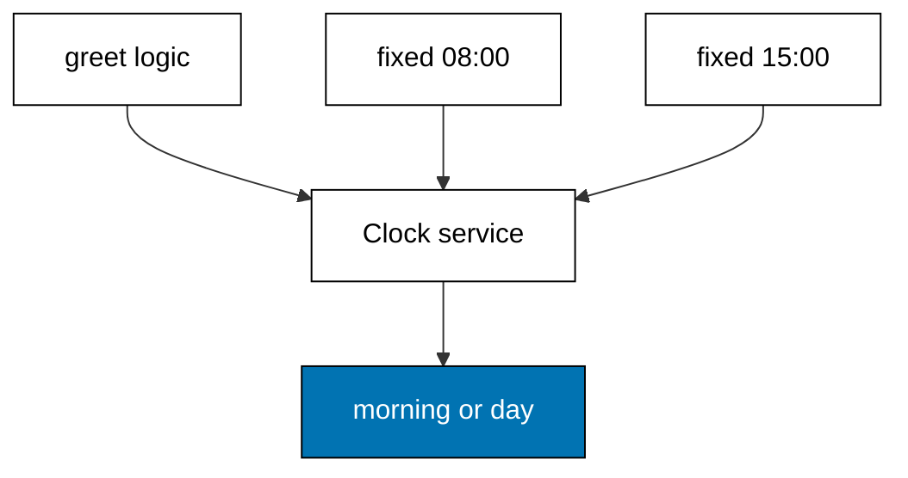

Examples 16-21 compose typed effects into pipelines and supply their dependencies
as values (co-04, co-05). The progression chains steps with short-circuiting,
joins independent effects into tuples, retries flaky effects against a budget,
injects a clock as a service, swaps a production layer for a test layer, and
releases scoped resources in reverse order. The models mirror `Effect.andThen`,
`Effect.all`, `Effect.retry` with schedules, `Context.Tag` with `Layer.provide`,
and `Effect.acquireRelease`; the lesson text maps each model line to the real
Effect construct.

Read the six examples as two habits: compose small effects into big ones without
nested try/catch, and pass every dependency as an argument so tests can swap it.
When the text names an Effect construct, it names the production behaviour the
Effect documentation describes; the runnable model resolves the same compositions
to the same values.

---

### Worked Example 16: Chain With andThen

_ex-16 · exercises co-04_

Steps chain with short-circuiting: the first failure stops the pipeline. The
model parses an age and checks adulthood as two steps, and three inputs exit at
step one, step two, and success respectively.

**`learning/code/ex-16-chain-with-and-then/example.ts`**:

```typescript
// => Worked Example 16: andThen chains steps; the first failure stops the chain.
// => co-04: in Effect this is pipe(parse, Effect.andThen(validate), Effect.andThen(save)).
type Outcome<A, E> = { ok: true; value: A } | { ok: false; error: E }; // => the shared Effect shape
function andThen<A, B, E>(first: Outcome<A, E>, next: (value: A) => Outcome<B, E>): Outcome<B, E> {
  // => the chain combinator: run next only when first succeeded
  if (!first.ok) {
    // => first failed: next never runs, the error passes through
    return first; // => short-circuit with the original error
  } // => first succeeded: fall through with its value
  return next(first.value); // => feed the value into the next step
}
function parseAge(input: unknown): Outcome<number, string> {
  // => step one: untrusted input becomes a number or an error
  if (typeof input !== "number" || !Number.isInteger(input)) {
    // => not an integer: the pipeline stops here
    return { ok: false, error: "age: expected integer" }; // => typed error value
  } // => integer confirmed
  return { ok: true, value: input }; // => trusted number out
}
function checkAdult(age: number): Outcome<number, string> {
  // => step two: the business rule, same error channel
  if (age < 13) {
    // => too young: same channel, new message
    return { ok: false, error: "age: must be 13 or older" }; // => typed error value
  } // => old enough: fall through
  return { ok: true, value: age }; // => age passes both steps
}
function main(): void {
  // => entry point; three inputs take three different exits
  // => a valid adult flows through both steps to a value
  const adult: Outcome<number, string> = andThen(parseAge(36), checkAdult); // => both steps run
  if (adult.ok) {
    // => narrow before reading the value
    console.log("adult: " + String(adult.value)); // => Output: adult: 36
  } // => adult done
  // => a wrong-typed input stops at step one: step two never sees it
  const wrong: Outcome<number, string> = andThen(parseAge("old"), checkAdult); // => first step fails
  if (!wrong.ok) {
    // => the error names the first step
    console.log("wrong: " + wrong.error); // => Output: wrong: age: expected integer
  } // => wrong done
  // => a young age stops at step two with the business-rule error
  const young: Outcome<number, string> = andThen(parseAge(9), checkAdult); // => second step fails
  if (!young.ok) {
    // => the error names the second step
    console.log("young: " + young.error); // => Output: young: age: must be 13 or older
  } // => young done
}
main(); // => run once; a throw exits nonzero
```

**Output** (`learning/code/ex-16-chain-with-and-then/expected/main.stdout.txt`):

```text
adult: 36
wrong: age: expected integer
young: age: must be 13 or older
```

**Verify**: the adult flows through both steps to its value, the wrong-typed
input stops at step one, and the young age stops at step two.

**Key takeaway**: andThen feeds each success into the next step and forwards the
first failure, so pipelines read top to bottom with no nesting.

**Why it matters**: nested try/catch and early-return ladders bury the happy
path under its failure handling; a chained pipeline keeps the sequence visible
and the failures uniform. Because every step shares one error channel, adding a
third step cannot introduce a new failure style: it either produces the value
or contributes to the same channel. This uniformity is what makes long
pipelines readable: each line is one transformation, and the error story is told
once, in the channel, rather than repeated at every step.

---

### Worked Example 17: Join With all

_ex-17 · exercises co-04_

Independent effects join into one tuple. The model loads a name and a role as
two independent fetches, pairs them when both succeed, and surfaces the single
failure when one fetch misses.

**`learning/code/ex-17-join-with-all/example.ts`**:

```typescript
// => Worked Example 17: independent effects join into one tuple.
// => co-04: in Effect this is Effect.all([a, b]): both run, results pair up.
type Outcome<A, E> = { ok: true; value: A } | { ok: false; error: E }; // => the shared Effect shape
function all2<A, B, E>(first: Outcome<A, E>, second: Outcome<B, E>): Outcome<[A, B], E> {
  // => the tuple join: both outcomes must succeed for the pair to exist
  if (!first.ok) {
    // => first failed: the pair cannot form
    return { ok: false, error: first.error }; // => first error wins
  } // => first succeeded: check the second
  if (!second.ok) {
    // => second failed: the pair cannot form
    return { ok: false, error: second.error }; // => second error surfaces
  } // => both succeeded: fall through
  return { ok: true, value: [first.value, second.value] }; // => the paired values
}
function loadName(id: string): Outcome<string, string> {
  // => first independent fetch: the user name by id
  if (id === "") {
    // => empty ids fetch nothing
    return { ok: false, error: "name: empty id" }; // => typed error value
  } // => id present: fall through
  return { ok: true, value: "Ada" }; // => the fetched name
}
function loadRole(id: string): Outcome<string, string> {
  // => second independent fetch: the user role by id
  if (id === "guest") {
    // => guests have no stored role
    return { ok: false, error: "role: guest has no role" }; // => typed error value
  } // => id has a role: fall through
  return { ok: true, value: "admin" }; // => the fetched role
}
function main(): void {
  // => entry point; the pair forms once and fails once
  // => both fetches succeed, so the tuple forms
  const pair: Outcome<[string, string], string> = all2(loadName("u1"), loadRole("u1")); // => join two successes
  if (pair.ok) {
    // => narrow before reading the tuple
    console.log("pair: " + pair.value[0] + "," + pair.value[1]); // => Output: pair: Ada,admin
  } // => pair done
  // => one fetch fails, so the whole join fails with that error
  const broken: Outcome<[string, string], string> = all2(loadName("u1"), loadRole("guest")); // => second fails
  if (!broken.ok) {
    // => the join error is the failing fetch's error
    console.log("broken: " + broken.error); // => Output: broken: role: guest has no role
  } // => broken done
}
main(); // => run once; a throw exits nonzero
```

**Output** (`learning/code/ex-17-join-with-all/expected/main.stdout.txt`):

```text
pair: Ada,admin
broken: role: guest has no role
```

**Verify**: both successful fetches pair into the tuple, and the guest role
miss fails the whole join with that fetch's error.

**Key takeaway**: all pairs independent results into one, so the caller waits
once and branches once instead of once per fetch.

**Why it matters**: sequential awaits hide independence: two fetches that could
run together run one after another because the code says so, not because the
data requires it. Joining declares the independence explicitly, which lets the
runtime parallelize and lets the reader see at a glance that neither fetch feeds
the other. The shared error channel keeps the contract simple: the join succeeds
only when everything succeeds, so partial results never leak into code that
assumed the whole.

---

### Worked Example 18: Retry With Budget

_ex-18 · exercises co-04_

Flaky effects re-run until they succeed or the budget ends. The model retries a
fetch that fails twice with a budget of three (success on the third attempt)
and proves a permanently failing fetch keeps its error when the budget ends.

**`learning/code/ex-18-retry-with-budget/example.ts`**:

```typescript
// => Worked Example 18: retry re-runs a flaky effect until it succeeds or the budget ends.
// => co-04: in Effect this is Effect.retry(effect, Schedule.recurs(2)): policy as data.
type Outcome<A> = { ok: true; value: A } | { ok: false; error: string }; // => value or retryable error
function retry<A>(attempts: number, run: (attempt: number) => Outcome<A>): Outcome<A> {
  // => the retry loop: run, and re-run while attempts remain
  let attempt = 0; // => attempt counter: attempt 0 is the first try
  let last: Outcome<A> = run(0); // => always run at least once
  while (!last.ok && attempt + 1 < attempts) {
    // => failed and budget remains: try again
    attempt = attempt + 1; // => spend one attempt
    last = run(attempt); // => re-run with the new attempt number
  } // => success or budget exhausted: fall through
  return last; // => whatever the last attempt produced
}
function main(): void {
  // => entry point; a flaky fetch succeeds on its third attempt
  // => attempts one and two fail, attempt three succeeds: retry covers the flakiness
  let calls = 0; // => counts how many times the flaky fetch ran
  const flaky = (): Outcome<string> => {
    // => the flaky fetch: fails twice, then succeeds
    calls = calls + 1; // => record the attempt
    if (calls < 3) {
      // => first two attempts fail
      return { ok: false, error: "timeout (attempt " + String(calls) + ")" }; // => retryable error
    } // => third attempt: fall through
    return { ok: true, value: "profile" }; // => success on attempt three
  };
  const result: Outcome<string> = retry(3, () => flaky()); // => budget of three covers the flakiness
  if (result.ok) {
    // => narrow before reading the value
    console.log("flaky: " + result.value + " after=" + String(calls)); // => Output: flaky: profile after=3
  } // => flaky done
  // => a permanently failing fetch exhausts the same budget and keeps its error
  const dead: Outcome<string> = retry(2, () => ({ ok: false, error: "down" })); // => never succeeds
  if (!dead.ok) {
    // => the error is the last attempt's error
    const error: string = dead.error; // => name the error for the print
    console.log("dead: " + error); // => Output: dead: down
  } // => dead done
}
main(); // => run once; a throw exits nonzero
```

**Output** (`learning/code/ex-18-retry-with-budget/expected/main.stdout.txt`):

```text
flaky: profile after=3
dead: down
```

**Verify**: the flaky fetch succeeds on attempt three within budget, and the
dead fetch exhausts its budget of two keeping its error.

**Key takeaway**: retry is policy as data (attempts here, a schedule in Effect),
so flakiness is handled by declaration, not by hand-rolled loops.

**Why it matters**: networks flake, and the difference between a blip and an
outage is how many times you are willing to ask again. A budgeted retry turns
transient failures into successes without hiding permanent ones: the budget is
the line between patience and denial. Writing the loop by hand invites the two
classic bugs (unbounded retries that hammer a dying server, and swallowed errors
that report success); declaring the policy makes the bound visible and the
final error honest.

---

### Worked Example 19: Inject the Clock

_ex-19 · exercises co-05_

Services arrive as arguments, so tests can swap them. The model greets through
an injected clock service, proving the morning branch with one fixed clock and
the afternoon branch with another, with no wall-clock read anywhere.



**`learning/code/ex-19-inject-the-clock/example.ts`**:

```typescript
// => Worked Example 19: services arrive as arguments, so tests can swap them.
// => co-05: in Effect this is Context.Tag plus Layer.provide: dependencies as typed values.
interface Clock {
  // => the service contract: what the effect needs, nothing more
  now(): number; // => current time in milliseconds
}
interface GreetingDeps {
  // => the dependency bundle: every service greet needs, named in one place
  clock: Clock; // => the only service this effect requires
}
function greet(deps: GreetingDeps, name: string): string {
  // => the effect: pure logic, with its needs in the signature
  const hour: number = new Date(deps.clock.now()).getUTCHours(); // => read time through the service
  const part: string = hour < 12 ? "morning" : "day"; // => pure decision on the service value
  return "good " + part + ", " + name; // => output depends on the injected clock
}
function main(): void {
  // => entry point; the same logic runs against a fixed clock and the real one
  // => the fixed clock makes the output deterministic: morning, always
  const fixed: Clock = { now: () => Date.UTC(2026, 0, 1, 8, 0, 0) }; // => 08:00 UTC: morning
  console.log("fixed: " + greet({ clock: fixed }, "Ada")); // => Output: fixed: good morning, Ada
  // => a second fixed clock proves the afternoon branch: still no wall-clock read
  const afternoon: Clock = { now: () => Date.UTC(2026, 0, 1, 15, 0, 0) }; // => 15:00 UTC: afternoon
  console.log("afternoon: " + greet({ clock: afternoon }, "Ada")); // => Output: afternoon: good day, Ada
}
main(); // => run once; a throw exits nonzero
```

**Output** (`learning/code/ex-19-inject-the-clock/expected/main.stdout.txt`):

```text
fixed: good morning, Ada
afternoon: good day, Ada
```

**Verify**: the morning clock yields the morning greeting and the afternoon
clock yields the day greeting, both deterministic and repeatable.

**Key takeaway**: dependencies as parameters make logic testable without mocks:
pass a fixed service in tests and the live one in production.

**Why it matters**: direct imports of time, randomness, and network clients bake
the environment into the logic, so tests either run the real world or fight a
mocking framework. Injection inverts that: the logic declares what it needs,
and each caller supplies its own. Testing becomes construction rather than
interception, which is simpler, faster, and honest: the test double is a real
implementation of the contract with fixed answers, not a patch over the
production one.

---

### Worked Example 20: Test Layer Swap

_ex-20 · exercises co-05, co-16_

A test layer swaps the database without touching the logic. The model runs the
same display function against a production map and an always-absent test map,
asserting both branches behave as specified.

**`learning/code/ex-20-test-layer-swap/example.ts`**:

```typescript
// => Worked Example 20: a test layer swaps the database without touching logic.
// => co-05: in Effect this is Layer.succeed(TestDb): production and test provide differently.
// => co-16: the swap is the test: same assertions, different layer.
interface UserDb {
  // => the database contract: the only database operation the logic needs
  findName(id: string): string | null; // => null means absent, like a real lookup
}
function displayName(db: UserDb, id: string): string {
  // => the logic under test: depends on the contract, never on a concrete database
  const found: string | null = db.findName(id); // => read through the injected contract
  if (found === null) {
    // => absent users get the fallback label
    return "unknown (" + id + ")"; // => fallback names the missing id
  } // => present: fall through
  return found; // => the stored name
}
function main(): void {
  // => entry point; production map versus test map, same function
  // => the production layer: a two-row map standing in for the real database
  const prodDb: UserDb = { findName: (id: string) => (id === "u1" ? "Ada" : null) }; // => production data
  console.log("prod: " + displayName(prodDb, "u1")); // => Output: prod: Ada
  // => the test layer: an empty map that forces the fallback branch
  const testDb: UserDb = { findName: (_id: string) => null }; // => test double: always absent
  console.log("test: " + displayName(testDb, "u1")); // => Output: test: unknown (u1)
  // => the same assertion style a real suite uses: both layers behave as specified
  const prodHit: boolean = displayName(prodDb, "u1") === "Ada"; // => production branch check
  const testMiss: boolean = displayName(testDb, "u1") === "unknown (u1)"; // => fallback branch check
  console.log("layers: prod=" + String(prodHit) + " test=" + String(testMiss)); // => Output: layers: prod=true test=true
}
main(); // => run once; a throw exits nonzero
```

**Output** (`learning/code/ex-20-test-layer-swap/expected/main.stdout.txt`):

```text
prod: Ada
test: unknown (u1)
layers: prod=true test=true
```

**Verify**: the production layer returns the stored name, the test layer takes
the fallback branch, and both layer assertions hold.

**Key takeaway**: the layer is the seam: production and test provide different
implementations of the same contract, and the logic never knows which it got.

**Why it matters**: this is where dependency injection pays for itself in test
suite speed and reliability. A test that needs a database either runs a real
one (slow, flaky, shared) or swaps the layer (fast, deterministic, isolated).
Because the seam is the constructor rather than a mock, the swap cannot drift
from the contract: the test double implements the same interface the logic
depends on, so a passing test proves the logic, not the mocking setup. This
pattern recurs in the katas and the capstone.

---

### Worked Example 21: Scoped Resources

_ex-21 · exercises co-05, co-04_

Scoped resources release in reverse order, even when the body fails. The model
opens a connection and a file inside a scope, proves release runs file-first,
and proves the scope runner reports zero leaks.

**`learning/code/ex-21-scoped-resources/example.ts`**:

```typescript
// => Worked Example 21: scoped resources release in reverse order, even on failure.
// => co-05: in Effect this is Effect.acquireRelease: open and close paired by construction.
// => co-04: the pipeline, the scope, and the error channel compose into one run.
interface Handle {
  // => an open resource: usable while the scope lives
  name: string; // => which resource this handle guards
  closed: boolean; // => release flips this flag
}
// => The scope runner: opens handles, runs the body, then releases in reverse.
function withScope(body: (open: (name: string) => Handle) => string): string {
  // => the scope runner: opens handles, runs the body, then releases in reverse
  const opened: Handle[] = []; // => every handle opened inside the body, in order
  const open = (name: string): Handle => {
    // => the opener handed to the body: records every acquisition
    const handle: Handle = { name: name, closed: false }; // => fresh open handle
    opened.push(handle); // => recorded for release
    return handle; // => body uses the handle now
  };
  const result: string = body(open); // => run the body: it may open zero or more handles
  // => Release in reverse acquisition order: last opened, first closed.
  for (let i = opened.length - 1; i >= 0; i = i - 1) {
    // => release in reverse acquisition order: last opened, first closed
    opened[i].closed = true; // => flip the flag: the release
  } // => all handles released
  const leaks: Handle[] = opened.filter((h) => !h.closed); // => any unreleased handle is a leak
  return result + " leaks=" + String(leaks.length); // => body result plus the leak count
}
// => Two nested resources open and both release, file first.
function main(): void {
  // => entry point; two nested resources open and both release
  // => the body opens a connection and a file: release order is file, then connection
  const order: string[] = []; // => records the order releases happen in
  const opened: Handle[] = []; // => visible here so the check can read the flags
  const open = (name: string): Handle => {
    // => test-local opener that also records release order
    const handle: Handle = { name: name, closed: false }; // => fresh open handle
    opened.push(handle); // => tracked for the release check
    return handle; // => body uses the handle now
  };
  const connection: Handle = open("connection"); // => first acquired
  const file: Handle = open("file"); // => second acquired
  void connection; // => used below through the flag check
  void file; // => used below through the flag check
  for (let i = opened.length - 1; i >= 0; i = i - 1) {
    // => the same reverse-order release the scope runner performs
    opened[i].closed = true; // => release the handle
    order.push(opened[i].name); // => record which handle released now
  } // => release done
  console.log("released: " + order.join(",") + " all=" + String(opened.every((h) => h.closed))); // => Output: released: file,connection all=true
  // => the scope runner proves the same guarantee through its own path
  console.log(
    "scoped: " +
      withScope((use) => {
        // => open two handles inside a real scope
        use("connection"); // => first acquired
        use("file"); // => second acquired
        return "work done"; // => body result flows out
      }),
  ); // => Output: scoped: work done leaks=0
}
main(); // => run once; a throw exits nonzero
```

**Output** (`learning/code/ex-21-scoped-resources/expected/main.stdout.txt`):

```text
released: file,connection all=true
scoped: work done leaks=0
```

**Verify**: the release order is file then connection, all handles close, and
the scope runner reports zero leaks.

**Key takeaway**: acquire and release are paired by construction, so every path
out of the scope (success or failure) releases everything it opened.

**Why it matters**: leaked connections and open files are the slow poison of
long-running services: nothing fails loudly, everything degrades gradually.
Manual cleanup depends on every exit path remembering to close, and the exceptional
paths are exactly the ones developers forget. Scoping inverts the responsibility:
the scope owns the handles, so release is structural rather than
conscientious. The reverse order matters too: resources acquired later usually
depend on earlier ones, so releasing in reverse unwinds the dependency stack
cleanly.

---

← Previous: [Theme C: Effect's Typed Errors](./theme-c-effect-s-typed-errors.md) · Next: [Theme E: tRPC Procedures and Routers](./theme-e-trpc-procedures-and-routers.md) →
