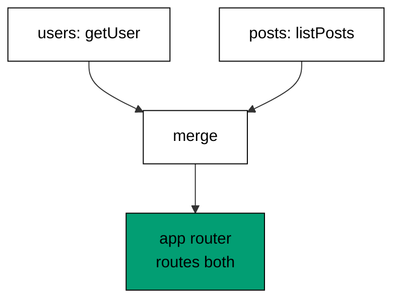

Examples 22-27 build end-to-end typed APIs from procedures and routers (co-07).
The progression defines the first query procedure, guards procedure input with a
schema, returns typed mutation errors, composes routers by merge, threads context
through middleware, and calls the whole router in-process with no network. The
models mirror `t.procedure`, `.input()`, routers, `mergeRouters`, middleware,
and `createCallerFactory`; the lesson text maps each model line to the real tRPC
construct it stands for.

Read the six examples as one server built in layers: procedures answer calls,
schemas guard their inputs, routers compose them, middleware authenticates them,
and the in-process caller tests them. When the text names a tRPC construct, it
names the production behaviour the tRPC documentation describes; the runnable
model resolves the same calls to the same replies.

---

### Worked Example 22: First Query Procedure

_ex-22 · exercises co-07_

A procedure is a named, typed remote function. The model defines a hello
procedure with a builder, calls it in-process, and prints the route name with
the call so routing is visible from the first example.

**`learning/code/ex-22-first-query-procedure/example.ts`**:

```typescript
// => Worked Example 22: a procedure is a named, typed remote function.
// => co-07: in tRPC this is t.procedure.query(() => ...): the unit of a typed call.
interface Procedure<I, O> {
  // => one procedure: its name, its input check, and its handler
  name: string; // => the route key the caller addresses
  checkInput: (input: unknown) => { ok: true; value: I } | { ok: false; issue: string }; // => input gate
  handle: (input: I) => O; // => the implementation, typed by the gate
}
// => The procedure builder: name plus handler, the tRPC shape.
function defineProcedure<I, O>(
  name: string, // => the route key the caller addresses
  checkInput: (input: unknown) => { ok: true; value: I } | { ok: false; issue: string }, // => the input gate for this procedure
  handle: (input: I) => O, // => the implementation, typed by the gate
): Procedure<I, O> {
  // => registration record out
  // => the procedure builder: t.procedure shape, name plus handler
  return { name: name, checkInput: checkInput, handle: handle }; // => registration record
}
// => The in-process caller: the same gate the network caller passes through.
function call<I, O>(proc: Procedure<I, O>, input: unknown): { ok: true; value: O } | { ok: false; issue: string } {
  // => the in-process caller: same gate the network caller would pass through
  const checked = proc.checkInput(input); // => input gate runs first
  if (!checked.ok) {
    // => bad input never reaches the handler
    return { ok: false, issue: checked.issue }; // => gate error out
  } // => input valid: fall through
  return { ok: true, value: proc.handle(checked.value) }; // => handler result out
}
// => One procedure called twice: the route travels with each call.
function main(): void {
  // => entry point; a greeting procedure called twice, once well and once badly
  // => the hello procedure takes no meaningful input and returns a greeting
  const hello: Procedure<null, string> = defineProcedure(
    "hello", // => the route key for this procedure
    (input: unknown) => {
      // => void input gate: anything passes, nothing is read
      void input; // => input deliberately unused
      return { ok: true, value: null }; // => unit value in
    },
    () => "hello from the server", // => the handler ignores input, returns greeting
  ); // => handler ignores input, returns greeting
  const good = call(hello, null); // => well-formed call
  if (good.ok) {
    // => narrow before reading the value
    console.log("hello: " + good.value); // => Output: hello: hello from the server
  } // => good done
  // => the procedure name travels with every call: routing starts here
  console.log("route: " + hello.name + " called"); // => Output: route: hello called
}
main(); // => run once; a throw exits nonzero
```

**Output** (`learning/code/ex-22-first-query-procedure/expected/main.stdout.txt`):

```text
hello: hello from the server
route: hello called
```

**Verify**: the call returns the server greeting, and the route name travels
with the call.

**Key takeaway**: the procedure is the unit of a typed API: a name, an input,
an output, and an implementation behind them.

**Why it matters**: REST spreads an endpoint across a route, a controller, a
validator, and a client type that must agree by convention; a procedure keeps
all four in one declaration. That locality is what makes the API typed end to
end later: because the procedure is one thing, its type can travel to the
client whole. Everything in Themes E and F builds on this unit, so the habit
to form now is reading each procedure as a contract first and an implementation
second.

---

### Worked Example 23: Validated Procedure Input

_ex-23 · exercises co-07, co-01_

A Zod schema guards the procedure input before the handler runs. The model
validates a signup payload (non-empty name, adult age), creates on valid input,
and stops a blank name at the gate with the field named.

**`learning/code/ex-23-validated-procedure-input/example.ts`**:

```typescript
// => Worked Example 23: a Zod schema guards the procedure input.
// => co-07: in tRPC this is .input(z.object({...})): validation before the handler.
// => co-01: the same schema object validates at the boundary and types the handler.
interface NewUser {
  // => the trusted input type: what the schema guarantees the handler
  name: string; // => non-empty after the check
  age: number; // => integer thirteen or older after the check
}
function checkNewUser(input: unknown): { ok: true; value: NewUser } | { ok: false; issue: string } {
  // => the Zod-shaped gate: z.object({ name: z.string().min(1), age: z.number().int().min(13) })
  if (typeof input !== "object" || input === null) {
    // => non-objects carry no fields
    return { ok: false, issue: "expected object" }; // => reject before any field read
  } // => object confirmed
  const record = input as Record<string, unknown>; // => narrow once for key reads
  if (typeof record["name"] !== "string" || record["name"].length === 0) {
    // => z.string().min(1): present and non-empty
    return { ok: false, issue: "name: expected non-empty string" }; // => field named
  } // => name settled
  if (typeof record["age"] !== "number" || !Number.isInteger(record["age"]) || record["age"] < 13) {
    // => z.number().int().min(13): integer and old enough
    return { ok: false, issue: "age: expected integer 13 or older" }; // => field named
  } // => age settled
  return { ok: true, value: { name: record["name"], age: record["age"] } }; // => trusted input out
}
function createUser(input: NewUser): string {
  // => the mutation handler: runs only on schema-valid input
  return "created " + input.name + " (" + String(input.age) + ")"; // => no re-checking inside
}
function main(): void {
  // => entry point; valid input creates, invalid input stops at the gate
  // => honest input passes the gate and the handler runs
  const good = checkNewUser({ name: "Ada", age: 36 }); // => valid signup payload
  if (good.ok) {
    // => narrow before calling the handler
    console.log("created: " + createUser(good.value)); // => Output: created: created Ada (36)
  } // => good done
  // => a blank name stops at the gate: the handler never runs
  const bad = checkNewUser({ name: "", age: 36 }); // => blank-name payload
  if (!bad.ok) {
    // => the gate error names the field
    console.log("rejected: " + bad.issue); // => Output: rejected: name: expected non-empty string
  } // => bad done
}
main(); // => run once; a throw exits nonzero
```

**Output** (`learning/code/ex-23-validated-procedure-input/expected/main.stdout.txt`):

```text
created: created Ada (36)
rejected: name: expected non-empty string
```

**Verify**: the valid payload creates the user, and the blank name is rejected
at the gate with its field named, the handler never running.

**Key takeaway**: the schema runs before the handler, so the handler trusts its
input completely and validates nothing itself.

**Why it matters**: this is the first composition of two course tools: Zod
validates, tRPC routes, and the boundary between them is the procedure's input
type. Without the gate, every handler re-validates defensively, and the checks
diverge; with it, validation lives in exactly one place per procedure. The
security angle matters too: the gate is the server's gate, not the client's
convenience check, because the wire is untrusted no matter what the form
validated. Client validation is courtesy; procedure input validation is the lock.

---

### Worked Example 24: Mutation and Typed Error

_ex-24 · exercises co-07, co-03_

Mutations return typed errors instead of status codes. The model signs up one
fresh email and one duplicate, returning a welcome for the first and a tagged
`Conflict` carrying the email for the second.

**`learning/code/ex-24-mutation-and-typed-error/example.ts`**:

```typescript
// => Worked Example 24: mutations return typed errors, not status codes.
// => co-07: in tRPC a failed mutation surfaces a typed TRPCError the client can match.
// => co-03: the error channel from Theme C reappears inside the procedure.
class Conflict {
  // => the typed mutation error: this email is already taken
  readonly tag = "Conflict"; // => matchable by the client
  readonly email: string; // => which email collided
  constructor(email: string) {
    // => plain parameter: strip-safe, assigned explicitly
    this.email = email; // => context stored on the instance
  }
}
type Mutation<T> = { ok: true; value: T } | { ok: false; error: Conflict }; // => success or typed conflict
function signup(emails: string[], email: string): Mutation<string> {
  // => the mutation: creates the account or reports the conflict by tag
  if (emails.includes(email)) {
    // => duplicate: the typed error, not an exception
    return { ok: false, error: new Conflict(email) }; // => Conflict out
  } // => fresh email: fall through
  emails.push(email); // => the write: recorded in the table
  return { ok: true, value: "welcome " + email }; // => success out
}
function main(): void {
  // => entry point; a fresh signup succeeds, a repeat collides
  // => the first signup writes and welcomes
  const emails: string[] = ["ada@example.com"]; // => the tiny account table
  const first: Mutation<string> = signup(emails, "grace@example.com"); // => fresh email
  if (first.ok) {
    // => narrow before reading the welcome
    console.log("first: " + first.value); // => Output: first: welcome grace@example.com
  } // => first done
  // => the same email again collides: the client matches the tag
  const repeat: Mutation<string> = signup(emails, "grace@example.com"); // => duplicate email
  if (!repeat.ok) {
    // => the error branch reads tag and context
    console.log("repeat: " + repeat.error.tag + " " + repeat.error.email); // => Output: repeat: Conflict grace@example.com
  } // => repeat done
}
main(); // => run once; a throw exits nonzero
```

**Output** (`learning/code/ex-24-mutation-and-typed-error/expected/main.stdout.txt`):

```text
first: welcome grace@example.com
repeat: Conflict grace@example.com
```

**Verify**: the fresh signup welcomes the email, and the repeat collides with
the `Conflict` tag and the colliding address.

**Key takeaway**: the mutation's failure is data with a tag, so the client
matches on it like any other typed value instead of decoding a status code.

**Why it matters**: HTTP status codes are a forty-word vocabulary for every
failure in every domain: 409 means conflict, but conflict of what, and what
should the user do? A typed error answers both: the tag names the failure and
the context carries the fix (which email collided, what to try next). The
client in Theme F will match on exactly these tags to render recovery UI, which
is only possible because the procedure's error type travels with its result
type. Status codes flatten meaning; typed errors preserve it.

---

### Worked Example 25: Router Composition

_ex-25 · exercises co-07_

Routers merge, and names stay unique by path. The model merges user and post
routers into one app router routing both calls, then refuses a merge whose
procedure name collides, naming the collision.



**`learning/code/ex-25-router-composition/example.ts`**:

```typescript
// => Worked Example 25: routers merge; names stay unique by path.
// => co-07: in tRPC this is mergeRouters(userRouter, postRouter): one app router from many.
type Handler = (input: unknown) => string; // => every procedure ends in a string reply here
interface Router {
  // => a router: a name plus its procedure table
  label: string; // => which domain this router owns
  routes: Record<string, Handler>; // => procedure name to handler
}
// => The merge: two tables become one, unless a name exists in both.
function mergeRouters(first: Router, second: Router): { ok: true; router: Router } | { ok: false; clash: string } {
  // => the merge: two tables become one, unless a name exists in both
  // => Every incoming name is checked against the accumulated table.
  for (const name of Object.keys(second.routes)) {
    // => every incoming name is checked against the accumulated table
    if (name in first.routes) {
      // => a clash: merging would silently shadow one handler
      return { ok: false, clash: name }; // => refuse with the clashing name
    } // => no clash for this name: continue
  } // => all names unique: fall through
  const routes: Record<string, Handler> = {}; // => fresh table for the merged router
  // => Copy the first table verbatim into the merged router.
  for (const name of Object.keys(first.routes)) {
    // => copy the first table verbatim
    routes[name] = first.routes[name]; // => first router's handlers
  } // => first copied
  // => Copy the second table verbatim into the merged router.
  for (const name of Object.keys(second.routes)) {
    // => copy the second table verbatim
    routes[name] = second.routes[name]; // => second router's handlers
  } // => second copied
  return { ok: true, router: { label: first.label + "+" + second.label, routes: routes } }; // => one router from two
}
// => A clean merge routes twice; a clashing merge refuses.
function main(): void {
  // => entry point; a clean merge routes twice, a clashing merge refuses
  // => two domain routers with disjoint names merge into one app router
  const users: Router = { label: "users", routes: { getUser: () => "user:Ada" } }; // => user domain
  const posts: Router = { label: "posts", routes: { listPosts: () => "posts:2" } }; // => post domain
  const merged = mergeRouters(users, posts); // => disjoint merge
  // => The clean merge routes both procedures through one table.
  if (merged.ok) {
    // => narrow before reading routes
    console.log(
      "merged: " +
        merged.router.label +
        " getUser=" +
        merged.router.routes["getUser"](null) +
        " listPosts=" +
        merged.router.routes["listPosts"](null),
    ); // => Output: merged: users+posts getUser=user:Ada listPosts=posts:2
  } // => merged done
  // => a second router reusing getUser clashes: the merge names the collision
  const impostors: Router = { label: "impostors", routes: { getUser: () => "user:mallory" } }; // => clashing domain
  const clashed = mergeRouters(users, impostors); // => overlapping merge
  if (!clashed.ok) {
    // => the refusal names the duplicated procedure
    console.log("clash: " + clashed.clash); // => Output: clash: getUser
  } // => clashed done
}
main(); // => run once; a throw exits nonzero
```

**Output** (`learning/code/ex-25-router-composition/expected/main.stdout.txt`):

```text
merged: users+posts getUser=user:Ada listPosts=posts:2
clash: getUser
```

**Verify**: the clean merge routes both procedures, and the clashing merge is
refused with the duplicated procedure name.

**Key takeaway**: merging composes domains additively, and the name check keeps
one domain from silently shadowing another's procedure.

**Why it matters**: real APIs grow by team: users, posts, billing, and search
each own a router, and the app router is their composition. Merging keeps that
growth conflict-free as long as names stay unique, and the refusal turns a
silent shadowing bug into a loud composition error. The alternative is one
giant router file that every team edits, where merge conflicts are textual
rather than semantic. Small routers plus checked merging scale the API the way
small modules scale a codebase.

---

### Worked Example 26: Middleware and Context

_ex-26 · exercises co-07, co-05_

Middleware builds context; procedures read it. The model authenticates a token
into a user-and-role context, serves the admin procedure on the admin token,
and refuses the anonymous context with the required role named.

**`learning/code/ex-26-middleware-and-context/example.ts`**:

```typescript
// => Worked Example 26: middleware builds context; procedures read it.
// => co-07: in tRPC this is t.middleware: auth runs before the handler, context carries the user.
// => co-05: context is dependency injection for procedures: same pattern as Theme D's layers.
interface Context {
  // => the request context: what middleware proved about the caller
  user: string | null; // => null means anonymous: middleware could not authenticate
  role: string; // => the caller's role when authenticated
}
function authMiddleware(token: unknown): Context {
  // => the auth step: a valid token becomes a user, anything else stays anonymous
  if (token === "token-admin") {
    // => the one valid token in this tiny model
    return { user: "Ada", role: "admin" }; // => authenticated context
  } // => any other token: fall through to anonymous
  return { user: null, role: "guest" }; // => anonymous context
}
function adminStats(context: Context): { ok: true; report: string } | { ok: false; issue: string } {
  // => a protected procedure: reads context, never the raw token
  if (context.user === null || context.role !== "admin") {
    // => anonymous or non-admin: refused before any data is touched
    return { ok: false, issue: "forbidden: admin only" }; // => typed refusal
  } // => admin confirmed: fall through
  return { ok: true, report: "stats for " + context.user }; // => handler trusts the context
}
function main(): void {
  // => entry point; an admin token passes, a missing token stops at the procedure
  // => the admin token authenticates and the protected procedure runs
  const admin: Context = authMiddleware("token-admin"); // => valid token through middleware
  const served = adminStats(admin); // => context into the procedure
  if (served.ok) {
    // => narrow before reading the report
    console.log("admin: " + served.report); // => Output: admin: stats for Ada
  } // => admin done
  // => no token means anonymous context, and the procedure refuses it
  const guest: Context = authMiddleware(null); // => missing token through middleware
  const refused = adminStats(guest); // => anonymous context into the procedure
  if (!refused.ok) {
    // => the refusal names the required role
    console.log("guest: " + refused.issue); // => Output: guest: forbidden: admin only
  } // => guest done
}
main(); // => run once; a throw exits nonzero
```

**Output** (`learning/code/ex-26-middleware-and-context/expected/main.stdout.txt`):

```text
admin: stats for Ada
guest: forbidden: admin only
```

**Verify**: the admin token authenticates and the procedure serves its report,
while the missing token yields an anonymous context the procedure refuses.

**Key takeaway**: authentication runs once in middleware and every procedure
trusts the context, so no handler re-checks tokens itself.

**Why it matters**: scattering auth checks through handlers guarantees the one
handler that forgot, and the forgotten one is always the sensitive one.
Middleware centralizes the proof (token to user) and context carries it, so
each procedure declares what it needs (admin role) instead of how to verify it.
This is dependency injection for requests, the same pattern as Theme D's
layers: the procedure's needs are explicit, so tests can supply an admin
context or an anonymous one without minting tokens.

---

### Worked Example 27: In-Process Caller

_ex-27 · exercises co-07, co-06_

The in-process caller tests the router with no network. The model binds an
addition router into a direct-call function, sums through it, and proves a
misspelled procedure fails at routing before any handler runs.

**`learning/code/ex-27-in-process-caller/example.ts`**:

```typescript
// => Worked Example 27: the in-process caller tests the router with no network.
// => co-07: in tRPC this is createCallerFactory(router)(ctx): the client without HTTP.
// => co-06: the caller shares the router's types, so drift is a compile error.
interface Router {
  // => the app router: procedure names to handlers, in one table
  routes: Record<string, (input: unknown) => unknown>; // => each handler takes unknown, returns unknown
}
function createCaller(
  router: Router, // => the app router under test
): (name: string, input: unknown) => { ok: true; value: unknown } | { ok: false; issue: string } {
  // => the caller factory: binds a router into a direct-call function
  // => Each call looks its procedure up by name.
  return (name: string, input: unknown) => {
    // => each call names its procedure and passes its input
    const handler: ((input: unknown) => unknown) | undefined = router.routes[name]; // => route lookup by name
    if (handler === undefined) {
      // => unknown procedure: the caller reports it like a 404
      return { ok: false, issue: "unknown procedure: " + name }; // => routing error, no network involved
    } // => procedure found: fall through
    return { ok: true, value: handler(input) }; // => handler runs in-process
  };
}
// => The test suite calls two procedures without any HTTP.
function main(): void {
  // => entry point; the test suite calls two procedures without any HTTP
  // => the router under test: one addition procedure
  const caller = createCaller({
    routes: {
      add: (input: unknown) => {
        // => the add handler: reads two numbers from the input
        const pair = input as { a: number; b: number }; // => narrow to the expected input shape
        return pair.a + pair.b; // => the sum
      },
    },
  }); // => router built inline, caller bound to it
  // => a valid call returns the sum through the caller
  const sum = caller("add", { a: 19, b: 23 }); // => in-process call, no socket
  // => The valid call returns the sum through the caller.
  if (sum.ok) {
    // => narrow before reading the value
    console.log("add: " + String(sum.value)); // => Output: add: 42
  } // => sum done
  // => a misspelled procedure name fails at routing, before any handler runs
  const typo = caller("ad", { a: 1, b: 2 }); // => no such procedure
  if (!typo.ok) {
    // => the routing error names the bad procedure
    console.log("typo: " + typo.issue); // => Output: typo: unknown procedure: ad
  } // => typo done
}
main(); // => run once; a throw exits nonzero
```

**Output** (`learning/code/ex-27-in-process-caller/expected/main.stdout.txt`):

```text
add: 42
typo: unknown procedure: ad
```

**Verify**: the valid call returns the sum through the caller, and the typo
fails at routing with the bad procedure name.

**Key takeaway**: the server-side caller exercises the real router and the real
handlers, so procedure tests need no HTTP and no mocks.

**Why it matters**: this caller is the testing seam for the whole API: every
Theme F inference claim and every kata router test runs through it. Because the
caller shares the router's types, a renamed procedure breaks the test build
the way it breaks the client build, which is exactly the drift detection the
course promises. No network also means no ports, no fixtures, and no flakes:
the suite runs the logic, and the logic is all there is to test. The
course-specific rule lives here: no example performs a real network call, ever.

---

← Previous: [Theme D: Effect Composition and Dependencies](./theme-d-effect-composition-and-dependencies.md) · Next: [Theme F: End-to-End Type Inference](./theme-f-end-to-end-type-inference.md) →
