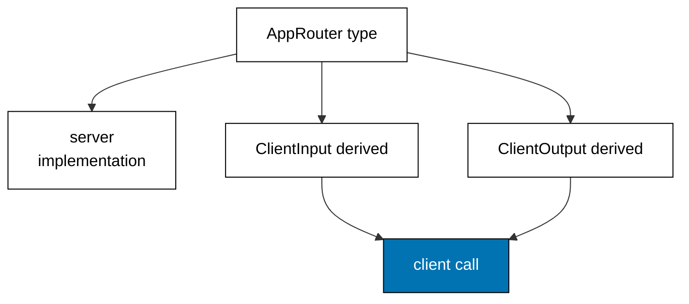

Examples 28-33 make the client and server share one source of truth for types
(co-06). The progression derives client types from the router, proves a server
rename breaks the client build instead of production, shares one schema across
the wire, shapes optimistic updates like server replies, batches keys into one
call, and types procedure errors end to end. The models mirror
`inferRouterInputs`, `inferRouterOutputs`, shared Zod schemas, optimistic
updates, batched loaders, and typed procedure errors; the lesson text maps each
model line to the real tRPC construct.

Read the six examples as the payoff for Theme E's procedures: because the API
is one router, its types can travel whole to the client, and drift becomes a
compile error. When the text names a tRPC inference construct, it names the
production behaviour the tRPC documentation describes; the runnable model
resolves the same type derivations to the same shapes.

---

### Worked Example 28: Derive Client Types

_ex-28 · exercises co-06_

The client reads the router's types, never a copy. The model declares one
router type, derives the client input and output types from it with conditional
types (the `inferRouterInputs` shape), and calls through the shared type.



**`learning/code/ex-28-derive-client-types/example.ts`**:

```typescript
// => Worked Example 28: the client reads the router's types, not a copy of them.
// => co-06: in tRPC this is inferRouterInputs<typeof router>: the client's types derive from the server.
interface SignupInput {
  // => declared once on the server: the procedure's input shape
  email: string; // => the client must supply exactly this
}
interface SignupOutput {
  // => declared once on the server: the procedure's output shape
  id: string; // => the client may rely on exactly this
}
interface AppRouter {
  // => the router type: the single source of truth both sides share
  signup: (input: SignupInput) => SignupOutput; // => input in, output out, one declaration
}
type RouterInput<T> = T extends { signup: (input: infer I) => unknown } ? I : never; // => inferRouterInputs shape: extract the input
type RouterOutput<T> = T extends { signup: (input: never) => infer O } ? O : never; // => inferRouterOutputs shape: extract the output
function main(): void {
  // => entry point; the client types come from the router type, never from duplication
  // => the server implements the router exactly once
  const router: AppRouter = { signup: (input: SignupInput) => ({ id: "usr_" + input.email }) }; // => server implementation
  // => the client derives its types from the router: no second declaration anywhere
  type ClientInput = RouterInput<AppRouter>; // => resolves to SignupInput
  type ClientOutput = RouterOutput<AppRouter>; // => resolves to SignupOutput
  const input: ClientInput = { email: "ada@example.com" }; // => client builds the derived input
  const output: ClientOutput = router.signup(input); // => client calls through the shared type
  console.log("client: id=" + output.id); // => Output: client: id=usr_ada@example.com
  // => the derivation is visible in the types: same shape, zero copies
  const sameShape: SignupInput = input; // => compiles only because ClientInput is SignupInput
  console.log("shared: email=" + sameShape.email); // => Output: shared: email=ada@example.com
}
main(); // => run once; a throw exits nonzero
```

**Output** (`learning/code/ex-28-derive-client-types/expected/main.stdout.txt`):

```text
client: id=usr_ada@example.com
shared: email=ada@example.com
```

**Verify**: the client builds the derived input, calls through the shared type,
and the derived shape is assignable to the declared one with zero copies.

**Key takeaway**: derivation replaces duplication: the router type is written
once and read on both sides, so it cannot drift from itself.

**Why it matters**: handwritten client types are a second source of truth that
rots from the day it is written: the server adds a field, the client type
misses it, and the feature silently under-reads. Derivation deletes the second
source: the client cannot be stale because there is nothing to be stale. The
cost is that the client must see the router type, which is a build-time
dependency, not a runtime one, and exactly the right kind: it breaks the build
when the contract changes, which is the earliest moment the breakage can be
caught.

---

### Worked Example 29: Server Change Breaks Client

_ex-29 · exercises co-06_

A server rename that breaks the client is caught at compile time. The model
runs version one (name field) and version two (displayName field) side by side
and proves the old field is absent from the new output while the new field
carries the value.

**`learning/code/ex-29-server-change-breaks-client/example.ts`**:

```typescript
// => Worked Example 29: a server change that breaks the client is caught at compile time.
// => co-06: with end-to-end inference, renaming a field breaks the client build, not production.
interface V1Output {
  // => version one of the procedure output: name only
  name: string; // => the field v1 clients read
}
interface V2Output {
  // => version two of the procedure output: the field renamed to displayName
  displayName: string; // => the field v2 clients must read instead
}
// => Version one: the old shape the old clients were built against.
function v1Procedure(): V1Output {
  // => the original server: returns the old field
  return { name: "Ada" }; // => old shape
}
// => Version two: the renamed shape that breaks stale readers at compile time.
function v2Procedure(): V2Output {
  // => the renamed server: returns the new field
  return { displayName: "Ada" }; // => new shape: old clients no longer compile
}
function main(): void {
  // => entry point; the old client works against v1 and fails its check against v2
  // => v1 client against the v1 server: the field exists, the read succeeds
  const v1: V1Output = v1Procedure(); // => matched versions
  console.log("v1: name=" + v1.name); // => Output: v1: name=Ada
  // => v2 server output carries only the new field: the old read is gone
  const v2: V2Output = v2Procedure(); // => renamed server
  const hasOldField: boolean = "name" in v2; // => runtime proof the old field is absent
  const hasNewField: boolean = v2.displayName === "Ada"; // => the new field carries the value
  console.log("v2: old=" + String(hasOldField) + " new=" + String(hasNewField)); // => Output: v2: old=false new=true
}
main(); // => run once; a throw exits nonzero
```

**Output** (`learning/code/ex-29-server-change-breaks-client/expected/main.stdout.txt`):

```text
v1: name=Ada
v2: old=false new=true
```

**Verify**: the v1 read succeeds on the v1 output, and the v2 output provably
lacks the old field while carrying the renamed one.

**Key takeaway**: with shared types, renames are build breaks; without them,
renames are production incidents discovered by users.

**Why it matters**: this is the economic argument for the whole theme. A rename
without inference ships a client that reads a field the server no longer sends:
undefined renders, fallbacks trigger, and the bug report arrives from a user.
The same rename with inference fails the client build in CI, where the fix is a
one-line field update by the author who made the change. Drift detection moves
from runtime monitoring to compile time, which is earlier, cheaper, and exact:
the compiler names the stale read instead of a dashboard naming a symptom.

---

### Worked Example 30: Shared Schema Across Wire

_ex-30 · exercises co-06, co-01_

One Zod schema validates both ends of the wire. The model runs the same RSVP
schema as a client pre-check and as a server gate, then proves a forged payload
that skipped the form still fails at the server.

**`learning/code/ex-30-shared-schema-across-wire/example.ts`**:

```typescript
// => Worked Example 30: one Zod schema validates both ends of the wire.
// => co-06: the schema is the shared contract: client forms and server procedures use the same one.
// => co-01: single source of truth again, now stretched across the network.
interface Rsvp {
  // => the shared shape: what the schema guarantees on both ends
  email: string; // => must contain an at-sign
  seats: number; // => must be a positive integer
}
function checkRsvp(input: unknown): { ok: true; value: Rsvp } | { ok: false; issue: string } {
  // => the one shared schema, run wherever untrusted data appears
  if (typeof input !== "object" || input === null) {
    // => non-objects carry no fields
    return { ok: false, issue: "expected object" }; // => reject before any field read
  } // => object confirmed
  const record = input as Record<string, unknown>; // => narrow once for key reads
  if (typeof record["email"] !== "string" || !record["email"].includes("@")) {
    // => email rule shared by client pre-check and server gate
    return { ok: false, issue: "email: expected email string" }; // => field named
  } // => email settled
  if (typeof record["seats"] !== "number" || !Number.isInteger(record["seats"]) || record["seats"] < 1) {
    // => seats rule shared by client pre-check and server gate
    return { ok: false, issue: "seats: expected positive integer" }; // => field named
  } // => seats settled
  return { ok: true, value: { email: record["email"], seats: record["seats"] } }; // => trusted RSVP out
}
function main(): void {
  // => entry point; the same schema runs in the form and in the procedure
  // => client-side pre-check: the form validates before sending anything
  const draft: unknown = { email: "ada@example.com", seats: 2 }; // => what the user typed
  const precheck = checkRsvp(draft); // => same schema, client side
  if (precheck.ok) {
    // => the form sends only schema-valid payloads
    console.log("client: sending seats=" + String(precheck.value.seats)); // => Output: client: sending seats=2
  } // => precheck done
  // => server-side gate: the procedure re-validates because the wire is untrusted
  const arrived: unknown = { email: "ada@example.com", seats: 2 }; // => what arrived (same bytes here)
  const gate = checkRsvp(arrived); // => same schema, server side
  if (gate.ok) {
    // => the procedure trusts the gate, not the wire
    console.log("server: accepted " + gate.value.email); // => Output: server: accepted ada@example.com
  } // => gate done
  // => a forged payload passes no gate: the client pre-check is convenience, the server gate is security
  const forged = checkRsvp({ email: "not-an-email", seats: 2 }); // => attacker bypasses the form
  if (!forged.ok) {
    // => the server gate catches what the missing pre-check let through
    console.log("forged: " + forged.issue); // => Output: forged: email: expected email string
  } // => forged done
}
main(); // => run once; a throw exits nonzero
```

**Output** (`learning/code/ex-30-shared-schema-across-wire/expected/main.stdout.txt`):

```text
client: sending seats=2
server: accepted ada@example.com
forged: email: expected email string
```

**Verify**: the client pre-check sends only valid payloads, the server gate
accepts the honest arrival, and the forged email fails at the server gate.

**Key takeaway**: the client check is courtesy (fast feedback); the server gate
is security (the wire is untrusted), and one schema serves both.

**Why it matters**: sharing the schema gives both ends the same rules with one
maintenance point: a seats-maximum change edits one schema, not a form
validator plus a procedure guard. But the two runs are not equal in authority:
attackers bypass forms, so the server gate is the real boundary and the client
check is a convenience that must never be trusted. Teams that confuse the two
ship client-only validation and learn about it from forged requests; teams that
share one schema get both fast feedback and a real gate for the price of one.

---

### Worked Example 31: Optimistic Update Shape

_ex-31 · exercises co-06_

The optimistic update wears the procedure's output type. The model renders an
instant temp-id todo, confirms it with the server's real-id reply, and
reconciles by swapping the id because every other field already matches.

**`learning/code/ex-31-optimistic-update-shape/example.ts`**:

```typescript
// => Worked Example 31: the optimistic update wears the procedure's output type.
// => co-06: the UI guesses with the same shape the server will confirm, so reconciliation is trivial.
interface Todo {
  // => the shared output shape: server, cache, and optimistic guess all use it
  id: string; // => real ids from the server, temp ids from the client
  title: string; // => the todo text
  done: boolean; // => new todos start undone
}
function optimisticTodo(title: string): Todo {
  // => the instant UI guess: same shape as the server reply, temp id
  return { id: "temp_" + title.length, title: title, done: false }; // => renders before the server answers
}
function serverTodo(title: string): Todo {
  // => the server confirmation: same shape, real id
  return { id: "todo_42", title: title, done: false }; // => authoritative reply
}
function reconcile(guess: Todo, confirmed: Todo): string {
  // => reconciliation: same shape in, one swap decision out
  if (guess.title === confirmed.title && guess.done === confirmed.done) {
    // => everything but the id matches: swap the temp id for the real one
    return "swap " + guess.id + " -> " + confirmed.id; // => id replacement only
  } // => content differs: fall through to the conflict path
  return "conflict: keep server"; // => the server wins content disputes
}
function main(): void {
  // => entry point; guess, confirm, and reconcile one todo
  // => the UI renders the guess instantly while the request flies
  const guess: Todo = optimisticTodo("Buy milk"); // => instant, temp-id todo
  console.log("guess: id=" + guess.id + " title=" + guess.title); // => Output: guess: id=temp_8 title=Buy milk
  // => the server reply arrives with the same shape and a real id
  const confirmed: Todo = serverTodo("Buy milk"); // => authoritative todo
  console.log("confirmed: id=" + confirmed.id); // => Output: confirmed: id=todo_42
  // => reconciliation swaps the id because the shared shape makes comparison trivial
  console.log(reconcile(guess, confirmed)); // => Output: swap temp_8 -> todo_42
}
main(); // => run once; a throw exits nonzero
```

**Output** (`learning/code/ex-31-optimistic-update-shape/expected/main.stdout.txt`):

```text
guess: id=temp_8 title=Buy milk
confirmed: id=todo_42
swap temp_8 -> todo_42
```

**Verify**: the guess renders with its temp id, the confirmation arrives with
its real id, and reconciliation swaps exactly the id.

**Key takeaway**: same shape in, same shape out: the guess and the confirmation
are one type, so reconciliation is an id swap, not a merge.

**Why it matters**: optimistic UI hides latency, but only if the guess looks
like the answer: a differently-shaped guess flashes, jumps, or duplicates when
the server replies. Sharing the output type makes the guess structurally
identical by construction, so the only unknown is the server-minted id. The
swap is then trivial and instant, and conflicts (same id, different content)
have an obvious policy: the server wins. Without the shared shape, every
optimistic feature hand-rolls its own reconciliation, and each one invents a
new way to flicker.

---

### Worked Example 32: Batched Loader

_ex-32 · exercises co-06, co-04_

One round trip serves many keys. The model batches three user lookups into a
single call whose reply carries every key's answer (hits and misses alike) and
proves the coverage: three keys asked, two resolved.

**`learning/code/ex-32-batched-loader/example.ts`**:

```typescript
// => Worked Example 32: one round trip serves many keys.
// => co-06: batching keeps the typed interface while collapsing N calls into one.
// => co-04: the batch composes per-key outcomes into one reply, like Effect.all.
function batchGet(keys: string[], table: Record<string, string>): Record<string, string | null> {
  // => the batched loader: one call, one reply carrying every key's answer
  const reply: Record<string, string | null> = {}; // => answers accumulate by key
  for (const key of keys) {
    // => each key resolves against the same table
    const found: string | undefined = table[key]; // => lookup may miss
    reply[key] = found === undefined ? null : found; // => misses become null, never absent keys
  } // => every key answered
  return reply; // => one reply for the whole batch
}
function main(): void {
  // => entry point; three keys travel in one call and return in one reply
  // => the table holds two of the three requested keys
  const table: Record<string, string> = { u1: "Ada", u2: "Grace" }; // => the server-side data
  const reply: Record<string, string | null> = batchGet(["u1", "u2", "u9"], table); // => one batched call
  console.log("batch: u1=" + String(reply["u1"]) + " u2=" + String(reply["u2"]) + " u9=" + String(reply["u9"])); // => Output: batch: u1=Ada u2=Grace u9=null
  // => the reply carries every key: the client never wonders which answers are missing
  const answered: number = Object.keys(reply).length; // => keys present in the reply
  const hits: number = Object.values(reply).filter((v) => v !== null).length; // => keys that resolved
  console.log("coverage: keys=" + String(answered) + " hits=" + String(hits)); // => Output: coverage: keys=3 hits=2
}
main(); // => run once; a throw exits nonzero
```

**Output** (`learning/code/ex-32-batched-loader/expected/main.stdout.txt`):

```text
batch: u1=Ada u2=Grace u9=null
coverage: keys=3 hits=2
```

**Verify**: the single reply carries all three keys with the miss as null, and
the coverage counts three keys asked with two hits.

**Key takeaway**: batching keeps the typed interface while collapsing N calls
into one, so the client stays simple and the network stays quiet.

**Why it matters**: per-key fetching is the N+1 of APIs: a list of thirty users
fires thirty requests, each paying latency, each typed separately. A batched
loader pays one round trip for the whole list while keeping per-key answers
addressable by key, so the client code reads like individual fetches without
costing like them. The null-for-miss convention matters: every asked key
appears in the reply, so the client never wonders whether an answer is missing
or merely slow. This is composition again (Theme D's `all` across the wire):
independent answers joined into one reply.

---

### Worked Example 33: Typed Procedure Errors

_ex-33 · exercises co-06, co-03_

Procedure errors arrive typed, so the client matches on kind. The model reads
one normal user, one missing user, and one restricted user through the same
procedure, rendering a greeting, a creation prompt, and an escalation prompt
from the typed contract.

**`learning/code/ex-33-typed-procedure-errors/example.ts`**:

```typescript
// => Worked Example 33: procedure errors arrive typed, so the client matches on kind.
// => co-06: the error type travels with the procedure type: no status-code guessing.
// => co-03: the same tagged-error discipline as Theme C, now across the wire.
type ProcError = { kind: "NotFound"; id: string } | { kind: "Forbidden"; id: string }; // => the procedure's error union, shared with the client
type ProcResult = { ok: true; name: string } | { ok: false; error: ProcError }; // => the full procedure contract
function getUser(ids: string[], viewer: string, id: string): ProcResult {
  // => the procedure: success or one of the two typed errors, never a throw
  if (!ids.includes(id)) {
    // => absent user: first union member
    return { ok: false, error: { kind: "NotFound", id: id } }; // => tagged NotFound
  } // => exists: fall through to permission
  if (viewer !== "admin" && id === "root") {
    // => restricted user: second union member
    return { ok: false, error: { kind: "Forbidden", id: id } }; // => tagged Forbidden
  } // => allowed: fall through
  return { ok: true, name: "user:" + id }; // => success
}
function clientMessage(result: ProcResult): string {
  // => the client: matches on kind, with a branch for every union member
  if (result.ok) {
    // => success branch
    return "hello " + result.name; // => render the user
  } // => error: narrow the union by kind
  if (result.error.kind === "NotFound") {
    // => absence branch: offer to create
    return "missing " + result.error.id + ": create it?"; // => recovery UX for absence
  } // => only Forbidden remains
  return "denied " + result.error.id + ": ask an admin"; // => recovery UX for denial
}
function main(): void {
  // => entry point; the client renders all three outcomes from the typed contract
  // => a normal read renders the greeting
  console.log(clientMessage(getUser(["ada", "root"], "guest", "ada"))); // => Output: hello user:ada
  // => a missing user renders the creation prompt
  console.log(clientMessage(getUser(["ada", "root"], "guest", "ghost"))); // => Output: missing ghost: create it?
  // => a restricted user renders the escalation prompt
  console.log(clientMessage(getUser(["ada", "root"], "guest", "root"))); // => Output: denied root: ask an admin
}
main(); // => run once; a throw exits nonzero
```

**Output** (`learning/code/ex-33-typed-procedure-errors/expected/main.stdout.txt`):

```text
hello user:ada
missing ghost: create it?
denied root: ask an admin
```

**Verify**: the normal read greets, the missing read offers creation, and the
restricted read asks for an admin, all from the one error union.

**Key takeaway**: the error union travels with the procedure type, so every
client branch is exhaustive and every failure renders its own recovery.

**Why it matters**: this closes the loop from Theme C: tagged errors created
inside Effects now cross the network to clients that match on them. The client
UX follows directly: absence renders creation, denial renders escalation, and
adding a new failure mode to the union breaks every client match until it
handles the newcomer. That breakage is the feature, not a cost: an unhandled
new error should fail the build, not render a blank screen. Status codes could
never do this, because no client exhaustively matches numbers it cannot see.

---

← Previous: [Theme E: tRPC Procedures and Routers](./theme-e-trpc-procedures-and-routers.md) · Next: [Theme G: XState Machines and Transitions](./theme-g-xstate-machines-and-transitions.md) →
