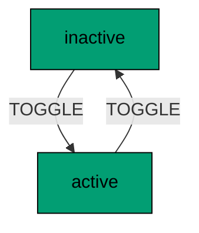
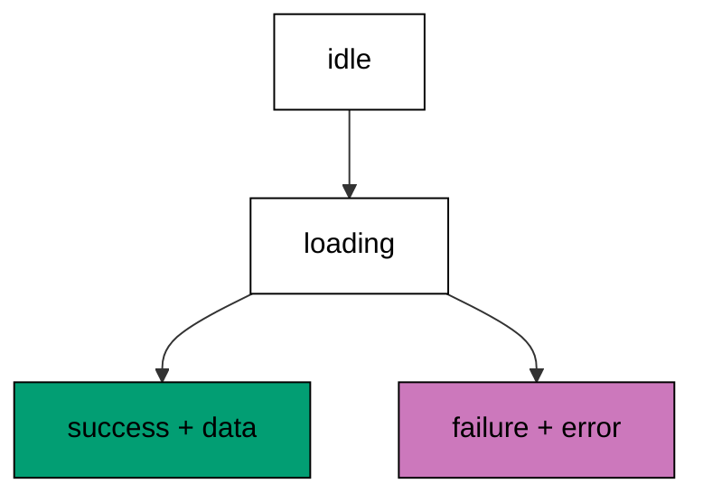

Examples 34-38 model UI flows as explicit state machines (co-08, co-10, co-11).
The progression builds the first toggle, guards a transition on context, runs
entry and exit actions at state edges, rejects an impossible move by name, and
models a fetch lifecycle with loading and failure as visible states. The models
mirror `createMachine`, guards, `entry`/`exit` with `assign`, and
`createActor` with `getSnapshot`; the lesson text maps each model line to the
real XState construct it stands for.

Read the five examples as the boolean-flag funeral: every flag combination the
old code allowed becomes a named state, and the transitions between them become
the only legal moves. When the text names an XState construct, it names the
production behaviour the XState documentation describes; the runnable model
resolves the same events to the same states.

---

### Worked Example 34: First Toggle Machine

_ex-34 · exercises co-08_

A machine names its states and its allowed moves. The model defines a toggle
with two states and one event, starts an actor at initial, and proves two
toggles return to the start.



**`learning/code/ex-34-first-toggle-machine/example.ts`**:

```typescript
// => Worked Example 34: a machine names its states and its allowed moves.
// => co-08: in XState this is createMachine({ initial, states }): states plus guarded transitions.
// => The complete state space in one line: nothing else exists, nothing else is reachable.
type ToggleState = "active" | "inactive"; // => the complete state space: nothing else exists
type ToggleEvent = { type: "TOGGLE" }; // => the only event this machine understands
interface ToggleMachine {
  // => the machine definition: initial state plus the transition table
  // => the table is the machine: every legal move listed, everything else ignored.
  initial: ToggleState; // => where every actor starts
  transitions: Record<ToggleState, Partial<Record<ToggleEvent["type"], ToggleState>>>; // => state plus event to next state
}
// => Two states, one event, two transitions: the smallest complete machine.
function defineToggle(): ToggleMachine {
  // => the machine: two states, one event, two transitions
  return {
    initial: "inactive", // => starts off, like a real toggle
    transitions: {
      inactive: { TOGGLE: "active" }, // => off plus toggle gives on
      active: { TOGGLE: "inactive" }, // => on plus toggle gives off
    },
  };
}
// => Sending is lookup: defined pairs move, undefined pairs hold the state.
function send(machine: ToggleMachine, current: ToggleState, event: ToggleEvent): ToggleState {
  // => the transition function: look the move up, stay put when undefined
  const next: ToggleState | undefined = machine.transitions[current][event.type]; // => table lookup
  if (next === undefined) {
    // => no transition defined: the event is ignored in this state
    return current; // => staying put is explicit, not a crash
  } // => transition found: fall through
  return next; // => the next state
}
function main(): void {
  // => entry point; two toggles return to the start
  // => away from initial and back again: the round trip proves the table.
  // => the actor starts at initial and toggles twice
  const machine: ToggleMachine = defineToggle(); // => machine defined once
  // => The actor starts at initial: every run begins from the same state.
  let state: ToggleState = machine.initial; // => actor starts inactive
  state = send(machine, state, { type: "TOGGLE" }); // => first toggle: inactive to active
  console.log("after one: " + state); // => Output: after one: active
  state = send(machine, state, { type: "TOGGLE" }); // => second toggle: active to inactive
  console.log("after two: " + state); // => Output: after two: inactive
}
main(); // => run once; a throw exits nonzero
```

**Output** (`learning/code/ex-34-first-toggle-machine/expected/main.stdout.txt`):

```text
after one: active
after two: inactive
```

**Verify**: one toggle reaches active and the second returns to inactive, with
the actor starting at the machine's initial state.

**Key takeaway**: the machine is data (initial plus a transition table), and
sending an event is a table lookup, so the flow is inspectable, not hidden in
callbacks.

**Why it matters**: boolean flags hide the flow: `isOpen` tells you nothing
about what opens it, what closes it, or whether both can happen at once. A
machine states the flow outright: these are the states, these are the events,
this is the table. That explicitness is what makes UI flows testable (send
events, assert states), visualizable (the table draws itself), and reviewable
(the diff of a flow change is a table diff). Every later example in this theme
and the next is this table with more structure: guards, actions, nesting, and
parallelism.

---

### Worked Example 35: Guarded Transition

_ex-35 · exercises co-10_

A guard conditions a transition on context. The model counts three presses into
a locked counter, proves the fourth press is swallowed, and restores everything
with an unguarded reset.

**`learning/code/ex-35-guarded-transition/example.ts`**:

```typescript
// => Worked Example 35: a guard conditions a transition on context.
// => co-10: in XState this is guard: ({ context, event }) => ...: the condition beside the move.
interface Counter {
  // => the machine context: data the guards and actions share
  count: number; // => how many times the button was pressed
}
type CounterState = "counting" | "locked"; // => pressing stops mattering once locked
type CounterEvent = { type: "PRESS" } | { type: "RESET" }; // => press advances, reset restores
interface Step {
  // => the actor snapshot: current state plus context, like getSnapshot()
  state: CounterState; // => which state the actor is in
  context: Counter; // => the data carried alongside
}
function step(snapshot: Step, event: CounterEvent): Step {
  // => the guarded transition: PRESS advances only while counting, RESET always restores
  if (event.type === "RESET") {
    // => reset is unguarded: allowed from every state
    return { state: "counting", context: { count: 0 } }; // => back to start, counter cleared
  } // => PRESS from here on
  if (snapshot.state === "locked") {
    // => locked ignores presses: the guard failed, the state holds
    return snapshot; // => no change: the event is swallowed
  } // => counting: the guard passes when the count stays below the limit
  const next: number = snapshot.context.count + 1; // => the press counts
  if (next >= 3) {
    // => the guard trips at three: further presses lock the machine
    return { state: "locked", context: { count: next } }; // => locked with the final count
  } // => below the limit: stay counting
  return { state: "counting", context: { count: next } }; // => counting with the new count
}
function main(): void {
  // => entry point; three presses lock, a fourth is ignored, reset restores
  // => press three times: the third press trips the guard into locked
  let snapshot: Step = { state: "counting", context: { count: 0 } }; // => fresh actor
  snapshot = step(snapshot, { type: "PRESS" }); // => count 1
  snapshot = step(snapshot, { type: "PRESS" }); // => count 2
  snapshot = step(snapshot, { type: "PRESS" }); // => count 3: locks
  console.log("locked: state=" + snapshot.state + " count=" + String(snapshot.context.count)); // => Output: locked: state=locked count=3
  // => a fourth press is swallowed: locked stays locked
  snapshot = step(snapshot, { type: "PRESS" }); // => ignored press
  console.log("ignored: state=" + snapshot.state + " count=" + String(snapshot.context.count)); // => Output: ignored: state=locked count=3
  // => reset restores the machine from any state
  snapshot = step(snapshot, { type: "RESET" }); // => unguarded reset
  console.log("reset: state=" + snapshot.state + " count=" + String(snapshot.context.count)); // => Output: reset: state=counting count=0
}
main(); // => run once; a throw exits nonzero
```

**Output** (`learning/code/ex-35-guarded-transition/expected/main.stdout.txt`):

```text
locked: state=locked count=3
ignored: state=locked count=3
reset: state=counting count=0
```

**Verify**: three presses lock with count three, the fourth press holds state
and count, and reset restores counting with count zero.

**Key takeaway**: guards decide at the edge: the transition runs only when its
condition holds, so illegal moves never start instead of failing halfway.

**Why it matters**: unguarded handlers check preconditions inside, which means
the illegal action begins before it is refused: the modal opens then closes,
the request fires then aborts, the animation starts then snaps back. Guards
refuse before anything happens, so the UI never flickers through a state it
should not have entered. The distinction shows in tests too: asserting that a
press in locked changes nothing is simpler and stronger than asserting that a
half-started effect was cleaned up. Conditions belong on transitions, not in
handlers.

---

### Worked Example 36: Entry and Exit Actions

_ex-36 · exercises co-10_

Entry and exit actions run side effects at state edges. The model enters
playing (unmute plus volume restore), exits it (fade-out announcement), and
proves the log order: entry first, exit on departure.

**`learning/code/ex-36-entry-exit-actions/example.ts`**:

```typescript
// => Worked Example 36: entry and exit actions run side effects at state edges.
// => co-10: in XState this is entry: and exit: plus assign: effects and context updates on transitions.
interface Player {
  // => the player context: the track and whether sound is audible
  track: string; // => currently loaded track
  volume: number; // => 0 means muted
}
type PlayerState = "stopped" | "playing"; // => audible only while playing
interface Log {
  // => the action log: every side effect the machine performed, in order
  entries: string[]; // => tests assert on this instead of on speakers
}
// => Arrival sets up: unmute plus volume restore, recorded for the test.
function enterPlaying(context: Player, log: Log): Player {
  // => the entry action for playing: unmute and announce
  log.entries.push("enter playing: unmute"); // => side effect recorded
  return { track: context.track, volume: 80 }; // => assign: volume restored
}
function exitPlaying(log: Log): void {
  // => the exit action for playing: announce the stop
  log.entries.push("exit playing: fade out"); // => side effect recorded
}
// => PLAY is one edge: run the entry action, then occupy the state.
function play(context: Player, log: Log): { state: PlayerState; context: Player } {
  // => the PLAY transition: exit nothing, enter playing
  const next: Player = enterPlaying(context, log); // => entry action runs on arrival
  return { state: "playing", context: next }; // => playing with restored volume
}
function stop(context: Player, log: Log): { state: PlayerState; context: Player } {
  // => the STOP transition: exit playing, no entry for stopped
  exitPlaying(log); // => exit action runs on departure
  return { state: "stopped", context: { track: context.track, volume: 0 } }; // => assign: muted
}
function main(): void {
  // => entry point; play then stop, and the log proves the edge order
  // => entry first, exit on departure: the log must read in that order.
  // => starting stopped and muted, the PLAY transition enters playing
  const log: Log = { entries: [] }; // => fresh action log
  const context: Player = { track: "anthem", volume: 0 }; // => stopped and muted
  const playing = play(context, log); // => PLAY: entry runs
  console.log("playing: state=" + playing.state + " volume=" + String(playing.context.volume)); // => Output: playing: state=playing volume=80
  // => the STOP transition exits playing: exit runs before the state changes
  const stopped = stop(playing.context, log); // => STOP: exit runs
  console.log("stopped: state=" + stopped.state + " log=" + log.entries.join(" | ")); // => Output: stopped: state=stopped log=enter playing: unmute | exit playing: fade out
}
main(); // => run once; a throw exits nonzero
```

**Output** (`learning/code/ex-36-entry-exit-actions/expected/main.stdout.txt`):

```text
playing: state=playing volume=80
stopped: state=stopped log=enter playing: unmute | exit playing: fade out
```

**Verify**: playing arrives with volume restored, and the stop lands muted with
the log reading entry then exit in order.

**Key takeaway**: edges own the side effects, so entering a state always sets
it up and leaving always tears it down, no matter which transition moved.

**Why it matters**: scattering setup and teardown across event handlers means
every path into playing must remember to unmute and every path out must
remember to fade: miss one path and the speakers stay silent or stay loud.
Edge actions centralize both, so adding a new transition into playing cannot
forget the setup (the edge runs it) and adding one out cannot forget the
teardown. Context updates (`assign`) ride the same edges, which keeps data and
effects synchronized: the volume and the unmute always change together because
one edge performs both.

---

### Worked Example 37: Impossible Move Rejected

_ex-37 · exercises co-08, co-11_

Impossible moves are rejected, not silently allowed. The model selects then
deletes through the legal path, then proves deleting from empty is refused by
name instead of corrupting state.

**`learning/code/ex-37-impossible-move-rejected/example.ts`**:

```typescript
// => Worked Example 37: impossible moves are rejected, not silently allowed.
// => co-08: an explicit table makes every allowed move visible and every other move impossible.
// => co-11: deleting without selecting is unrepresentable: no state exists for it.
type EditorState = "empty" | "selected"; // => text is either selected or it is not
type EditorEvent = { type: "SELECT" } | { type: "DESELECT" } | { type: "DELETE" }; // => the three editor events
function editorNext(
  current: EditorState,
  event: EditorEvent,
): { ok: true; state: EditorState } | { ok: false; rejected: string } {
  // => the transition table: every legal move listed, everything else rejected
  if (event.type === "SELECT") {
    // => selecting always lands in selected
    return { ok: true, state: "selected" }; // => legal from either state
  } // => SELECT done
  if (event.type === "DESELECT") {
    // => deselecting always lands in empty
    return { ok: true, state: "empty" }; // => legal from either state
  } // => DESELECT done
  if (current === "empty") {
    // => DELETE with nothing selected: no state exists for this, so refuse
    return { ok: false, rejected: "DELETE ignored in empty: nothing selected" }; // => impossible move named
  } // => selected: DELETE is legal
  return { ok: true, state: "empty" }; // => deletion consumes the selection
}
function main(): void {
  // => entry point; a legal delete works, an illegal one is named
  // => select then delete: the legal path through the machine
  let state: EditorState = "empty"; // => starts with nothing selected
  const selected = editorNext(state, { type: "SELECT" }); // => SELECT from empty
  if (selected.ok) {
    // => narrow before storing the state
    state = selected.state; // => now selected
  } // => select done
  const deleted = editorNext(state, { type: "DELETE" }); // => DELETE from selected: legal
  if (deleted.ok) {
    // => narrow before storing the state
    state = deleted.state; // => back to empty
  } // => delete done
  console.log("deleted: state=" + state); // => Output: deleted: state=empty
  // => DELETE from empty is refused: the machine names the impossible move
  const refused = editorNext(state, { type: "DELETE" }); // => DELETE from empty: illegal
  if (!refused.ok) {
    // => the rejection names the state and the event
    console.log("refused: " + refused.rejected); // => Output: refused: DELETE ignored in empty: nothing selected
  } // => refused done
}
main(); // => run once; a throw exits nonzero
```

**Output** (`learning/code/ex-37-impossible-move-rejected/expected/main.stdout.txt`):

```text
deleted: state=empty
refused: DELETE ignored in empty: nothing selected
```

**Verify**: the legal select-then-delete returns to empty, and the empty delete
is refused with the state and event named.

**Key takeaway**: an explicit table makes every allowed move visible and every
other move impossible, so illegal actions are named instead of performed.

**Why it matters**: this is invalid-state elimination in its simplest form:
deleting without a selection has no representation, so it cannot happen by
accident and is refused loudly when attempted. Boolean-flag code cannot do
this: `selected=false` plus a delete handler is a combination the code must
remember to check, and the check is one forgotten `if` away from data loss.
The machine inverts the default: moves are denied unless listed, so the safe
behavior is the absence of code rather than the presence of a check. Security
reviewers and QA engineers should read transition tables first, because the
table is where the missing check would hide.

---

### Worked Example 38: Fetch Lifecycle Machine

_ex-38 · exercises co-08, co-03_

A fetch lifecycle makes loading and failure visible states. The model wraps one
succeeding and one failing fetch, tracing idle to loading to success or
failure, with the typed error carried in context on the failure path.



**`learning/code/ex-38-fetch-lifecycle-machine/example.ts`**:

```typescript
// => Worked Example 38: a fetch machine makes loading and error visible states.
// => co-08: in XState the fetch lifecycle is idle, loading, success, failure: no boolean soup.
// => co-03: failure is a state carrying the typed error, not a catch block.
type FetchState = "idle" | "loading" | "success" | "failure"; // => the four lifecycle states, named
interface FetchContext {
  // => the fetch context: the data or the error, never both
  data: string | null; // => set on success only
  error: string | null; // => set on failure only
}
// => The machine run: idle to loading, then to success or failure.
function fetchMachine(fetch: () => { ok: true; data: string } | { ok: false; error: string }): {
  state: FetchState;
  context: FetchContext;
  trace: string[];
} {
  // => the machine run: idle to loading, then to success or failure with context
  const trace: string[] = ["idle", "loading"]; // => the states visited, in order
  const result = fetch(); // => the single effect the machine wraps
  if (result.ok) {
    // => success: data into context, success state
    trace.push("success"); // => visited success
    return { state: "success", context: { data: result.data, error: null }, trace: trace }; // => data set, error null
  } // => failure: fall through
  trace.push("failure"); // => visited failure
  return { state: "failure", context: { data: null, error: result.error }, trace: trace }; // => error set, data null
}
// => One fetch succeeds, one fails, both traces explicit.
function main(): void {
  // => entry point; one fetch succeeds, one fails, both traces are explicit
  // => the good fetch visits idle, loading, then success with data
  const good = fetchMachine(() => ({ ok: true, data: "profile" })); // => succeeding fetch
  console.log("good: state=" + good.state + " data=" + String(good.context.data) + " trace=" + good.trace.join(">")); // => Output: good: state=success data=profile trace=idle>loading>success
  // => the bad fetch visits idle, loading, then failure with the typed error
  const bad = fetchMachine(() => ({ ok: false, error: "timeout" })); // => failing fetch
  console.log("bad: state=" + bad.state + " error=" + String(bad.context.error) + " trace=" + bad.trace.join(">")); // => Output: bad: state=failure error=timeout trace=idle>loading>failure
}
main(); // => run once; a throw exits nonzero
```

**Output** (`learning/code/ex-38-fetch-lifecycle-machine/expected/main.stdout.txt`):

```text
good: state=success data=profile trace=idle>loading>success
bad: state=failure error=timeout trace=idle>loading>failure
```

**Verify**: the good fetch traces idle, loading, success with data set, and the
bad fetch traces idle, loading, failure with the typed error set.

**Key takeaway**: loading, data, and error are one state, never three flags, so
the UI cannot render loading and error at once or neither with data missing.

**Why it matters**: the boolean trio (`isLoading`, `data`, `error`) admits
eight combinations and only three make sense; the other five are where loading
spinners overlay error banners and empty states flicker. The machine admits
exactly the four meaningful states, and each one renders exactly one UI, so an
entire class of visual glitches becomes unrepresentable. The failure state also
reunites with Theme C: the typed error lives in context, which means the error
UI can match on its tag the way the client matched procedure errors in Theme F.

---

← Previous: [Theme F: End-to-End Type Inference](./theme-f-end-to-end-type-inference.md) · Next: [Theme H: State Charts (Nested and Parallel)](./theme-h-state-charts-nested-and-parallel.md) →
