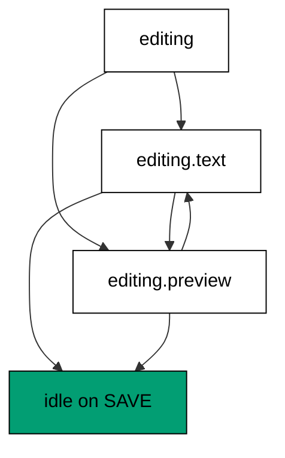
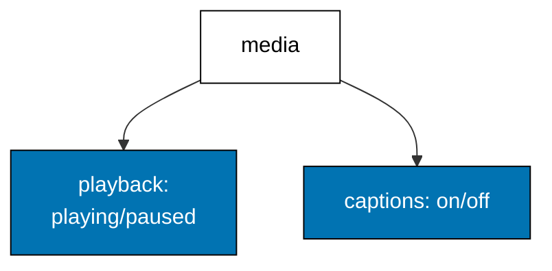
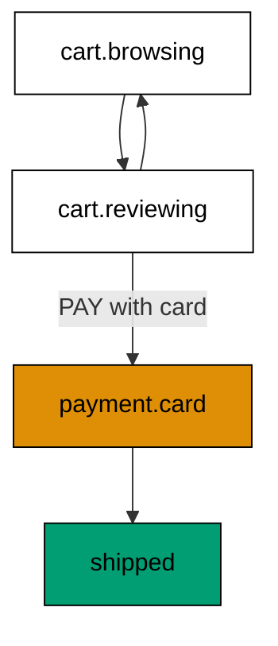

Examples 39-43 scale machines into state charts: nesting, parallelism, history,
invoked services, and a checkout chart combining all three (co-09). The
progression nests an editor inside editing states, runs playback and captions as
parallel regions, remembers the interrupted tab with history, invokes an async
service with its answer routed into transitions, and ships a checkout chart
where double-pay and early-ship are unrepresentable. The models mirror nested
states, `type: "parallel"`, history states, and `invoke` with `onDone`/`onError`;
the lesson text maps each model line to the real XState construct.

Read the five examples as one answer to growing flows: nesting shares
transitions, parallelism tracks independent concerns, history remembers
interruptions, and invocation brings async answers into the chart. When the text
names an XState chart construct, it names the production behaviour the XState
documentation describes; the runnable model resolves the same events to the same
chart states.

---

### Worked Example 39: Nested States

_ex-39 · exercises co-09_

Nested states share the parent's transitions. The model edits inside
`editing.text` and `editing.preview`, moves between the children freely, and
saves from either child through the parent's single shared exit.



**`learning/code/ex-39-nested-states/example.ts`**:

```typescript
// => Worked Example 39: nested states share the parent's transitions.
// => co-09: in XState, editing.text and editing.preview share editing's SAVE and CANCEL.
type EditorLeaf = "text" | "preview"; // => the two nested substates of editing
type EditorState = "idle" | "editing.text" | "editing.preview"; // => dotted names: parent.child
type EditorEvent = { type: "EDIT" } | { type: "PREVIEW" } | { type: "BACK" } | { type: "SAVE" } | { type: "CANCEL" }; // => five editor events
function editorNext(current: EditorState, event: EditorEvent): EditorState {
  // => child transitions first, then the parent's shared transitions
  if (current === "editing.text" && event.type === "PREVIEW") {
    // => child-to-child move: stays inside editing
    return "editing.preview"; // => text to preview
  } // => preview move done
  if (current === "editing.preview" && event.type === "BACK") {
    // => child-to-child move back: stays inside editing
    return "editing.text"; // => preview to text
  } // => back move done
  if ((current === "editing.text" || current === "editing.preview") && event.type === "SAVE") {
    // => parent transition: SAVE works from either child
    return "idle"; // => shared exit to idle
  } // => SAVE done
  if ((current === "editing.text" || current === "editing.preview") && event.type === "CANCEL") {
    // => parent transition: CANCEL works from either child
    return "idle"; // => shared exit to idle
  } // => CANCEL done
  if (current === "idle" && event.type === "EDIT") {
    // => entry into the parent lands in its initial child
    return "editing.text"; // => idle to editing.text
  } // => EDIT done
  return current; // => no transition defined: hold the state
}
function main(): void {
  // => entry point; edit, preview, back, then save through the shared exit
  // => EDIT enters the parent at its initial child
  let state: EditorState = "idle"; // => starts idle
  state = editorNext(state, { type: "EDIT" }); // => idle to editing.text
  console.log("editing: " + state); // => Output: editing: editing.text
  // => child moves stay inside the parent; the parent SAVE exits from either child
  state = editorNext(state, { type: "PREVIEW" }); // => text to preview
  state = editorNext(state, { type: "BACK" }); // => preview to text
  state = editorNext(state, { type: "PREVIEW" }); // => text to preview again
  state = editorNext(state, { type: "SAVE" }); // => parent SAVE from preview
  console.log("saved: " + state); // => Output: saved: idle
}
main(); // => run once; a throw exits nonzero
```

**Output** (`learning/code/ex-39-nested-states/expected/main.stdout.txt`):

```text
editing: editing.text
saved: idle
```

**Verify**: editing enters at the initial child, child moves stay inside the
parent, and the parent SAVE exits to idle from either child.

**Key takeaway**: children specialize, the parent generalizes: shared exits
live once on the parent instead of being repeated on every child.

**Why it matters**: flat machines duplicate shared transitions across every
state that needs them, and the copies drift: SAVE works from preview but
silently stops working from text after a refactor. Nesting states the sharing
outright, so the exit exists once and applies to all current and future
children. This is the same composition argument as schemas and routers:
declare the shared thing once, reference it everywhere. Flows with modes
(editing, reviewing, presenting) and sub-modes inside them are the natural
shape of real wizards, editors, and multi-step forms.

---

### Worked Example 40: Parallel Regions

_ex-40 · exercises co-09_

Parallel regions track independent concerns at once. The model plays and pauses
in the playback region while captions toggle independently, proving each event
touches exactly one region and carries the other over unchanged.



**`learning/code/ex-40-parallel-regions/example.ts`**:

```typescript
// => Worked Example 40: parallel regions track independent concerns at once.
// => co-09: in XState this is type: "parallel" with regions: playback and captions advance together.
interface MediaSnapshot {
  // => the parallel snapshot: one substate per region, side by side
  playback: "playing" | "paused"; // => the playback region
  captions: "on" | "off"; // => the captions region
}
type MediaEvent = { type: "PLAY" } | { type: "PAUSE" } | { type: "CAPTIONS_ON" } | { type: "CAPTIONS_OFF" }; // => region-scoped events
function mediaNext(current: MediaSnapshot, event: MediaEvent): MediaSnapshot {
  // => each event touches exactly one region; the other region carries over
  if (event.type === "PLAY") {
    // => playback region moves, captions region untouched
    return { playback: "playing", captions: current.captions }; // => play
  } // => PLAY done
  if (event.type === "PAUSE") {
    // => playback region moves, captions region untouched
    return { playback: "paused", captions: current.captions }; // => pause
  } // => PAUSE done
  if (event.type === "CAPTIONS_ON") {
    // => captions region moves, playback region untouched
    return { playback: current.playback, captions: "on" }; // => captions on
  } // => CAPTIONS_ON done
  if (event.type === "CAPTIONS_OFF") {
    // => captions region moves, playback region untouched
    return { playback: current.playback, captions: "off" }; // => captions off
  } // => every event handled: no fallthrough needed
  return current; // => unreachable, but total: every input maps to a snapshot
}
function main(): void {
  // => entry point; play, enable captions, pause: regions move independently
  // => starting paused without captions, PLAY moves only the playback region
  let snapshot: MediaSnapshot = { playback: "paused", captions: "off" }; // => initial regions
  snapshot = mediaNext(snapshot, { type: "PLAY" }); // => playback moves
  console.log("playing: " + snapshot.playback + "," + snapshot.captions); // => Output: playing: playing,off
  // => CAPTIONS_ON moves only the captions region; PAUSE moves only playback back
  snapshot = mediaNext(snapshot, { type: "CAPTIONS_ON" }); // => captions move
  snapshot = mediaNext(snapshot, { type: "PAUSE" }); // => playback moves back
  console.log("paused: " + snapshot.playback + "," + snapshot.captions); // => Output: paused: paused,on
}
main(); // => run once; a throw exits nonzero
```

**Output** (`learning/code/ex-40-parallel-regions/expected/main.stdout.txt`):

```text
playing: playing,off
paused: paused,on
```

**Verify**: play moves only playback, captions-on moves only captions, and
pause returns playback while captions stay on.

**Key takeaway**: regions are orthogonal by construction: no event can
accidentally couple two concerns that share a screen but not a logic.

**Why it matters**: the alternative is a cross product: playing-with-captions,
playing-without, paused-with, paused-without, each a state, each transition
repeated four times. Two regions of two states stay four declarations instead
of exploding into sixteen, and adding a third region (say, quality selection)
adds two declarations rather than doubling the machine. Whenever two parts of
a screen evolve independently but must be read together (player plus captions,
form plus autosave status), regions are the honest model and the cross product
is the bug farm.

---

### Worked Example 41: History State

_ex-41 · exercises co-09_

History remembers the interrupted substate. The model opens a dialog over the
settings tab and proves closing returns to settings, not to the default tab.

**`learning/code/ex-41-history-state/example.ts`**:

```typescript
// => Worked Example 41: history remembers the interrupted substate.
// => co-09: in XState this is history: "shallow": return where the dialog interrupted.
type TabLeaf = "profile" | "settings"; // => the two tabs the dialog can interrupt
type TabState = "profile" | "settings" | "dialog"; // => dialog overlays whichever tab was open
interface TabActor {
  // => the actor: current state plus the remembered tab for the dialog return
  state: TabState; // => where the actor is now
  history: TabLeaf; // => where the actor was when the dialog opened
}
// => Dialog open stores history; dialog close restores it.
function tabNext(
  actor: TabActor,
  event: { type: "OPEN_DIALOG" } | { type: "CLOSE" } | { type: "GOTO"; tab: TabLeaf },
): TabActor {
  // => dialog open stores history; dialog close restores it
  if (event.type === "OPEN_DIALOG" && (actor.state === "profile" || actor.state === "settings")) {
    // => opening from a tab: remember it, then show the dialog
    return { state: "dialog", history: actor.state }; // => history stored
  } // => open done
  if (event.type === "CLOSE" && actor.state === "dialog") {
    // => closing the dialog: return to the remembered tab
    return { state: actor.history, history: actor.history }; // => history restored
  } // => close done
  if (event.type === "GOTO" && actor.state !== "dialog") {
    // => manual navigation only outside the dialog: the dialog traps it
    // => tab navigation only outside the dialog: the dialog traps navigation
    return { state: event.tab, history: event.tab }; // => fresh history on manual navigation
  } // => goto done
  return actor; // => no transition: hold everything
}
// => Settings opens a dialog and returns to settings, not to profile.
function main(): void {
  // => entry point; settings opens a dialog and returns to settings, not to profile
  // => navigate to settings, open the dialog, close it: history restores settings
  let actor: TabActor = { state: "profile", history: "profile" }; // => starts on profile
  actor = tabNext(actor, { type: "GOTO", tab: "settings" }); // => manual navigation to settings
  actor = tabNext(actor, { type: "OPEN_DIALOG" }); // => dialog opens over settings
  console.log("dialog over: history=" + actor.history + " state=" + actor.state); // => Output: dialog over: history=settings state=dialog
  actor = tabNext(actor, { type: "CLOSE" }); // => dialog closes: history restored
  console.log("returned: " + actor.state); // => Output: returned: settings
}
main(); // => run once; a throw exits nonzero
```

**Output** (`learning/code/ex-41-history-state/expected/main.stdout.txt`):

```text
dialog over: history=settings state=dialog
returned: settings
```

**Verify**: the dialog opens over settings with settings remembered, and
closing restores settings rather than falling back to the default tab.

**Key takeaway**: history stores where the actor was when the interruption
arrived, so resuming continues the user's flow instead of restarting it.

**Why it matters**: dialogs, drawers, and overlays interrupt flows constantly,
and returning to a default instead of the interrupted place discards the user's
context: filters reset, scroll jumps, half-filled forms hide behind the wrong
tab. Manual return-target tracking spreads across every dialog opener and rots
the same way duplicated transitions do. A history state centralizes the memory
in the chart, so every interruption resumes correctly, including ones added
later by developers who never learned the original flow's return rules.

---

### Worked Example 42: Invoked Service

_ex-42 · exercises co-09, co-04_

Invoke runs an async service and routes its answer into transitions. The model
wraps a resolving and a rejecting service, taking the done transition into
ready with data and the error transition into failed with the error.

**`learning/code/ex-42-invoked-service/example.ts`**:

```typescript
// => Worked Example 42: invoke runs an async service and routes its answer.
// => co-09: in XState this is invoke with onDone and onError: the promise settles into a transition.
// => co-04: the service is an Effect-shaped outcome; the machine composes it like andThen.
type LoaderState = "loading" | "ready" | "failed"; // => the machine states around the service
interface LoaderContext {
  // => the loader context: the answer or the error, never both
  data: string | null; // => set when the service resolves
  error: string | null; // => set when the service rejects
}
// => The invoke: run the service, then take the done or error transition.
function invokeLoader(service: () => { ok: true; data: string } | { ok: false; error: string }): {
  state: LoaderState;
  context: LoaderContext;
} {
  // => the invoke: run the service, then take the onDone or onError transition
  const settled = service(); // => the service runs once, synchronously in this model
  if (settled.ok) {
    // => onDone: the answer assigns into context
    return { state: "ready", context: { data: settled.data, error: null } }; // => ready with data
  } // => onError: fall through
  return { state: "failed", context: { data: null, error: settled.error } }; // => failed with the error
}
// => A resolving service readies, a rejecting one fails.
function main(): void {
  // => entry point; a resolving service readies, a rejecting service fails
  // => the resolving service takes the onDone transition into ready
  const ready = invokeLoader(() => ({ ok: true, data: "feed" })); // => service resolves
  console.log("resolved: state=" + ready.state + " data=" + String(ready.context.data)); // => Output: resolved: state=ready data=feed
  // => the rejecting service takes the onError transition into failed
  const failed = invokeLoader(() => ({ ok: false, error: "offline" })); // => service rejects
  console.log("rejected: state=" + failed.state + " error=" + String(failed.context.error)); // => Output: rejected: state=failed error=offline
}
main(); // => run once; a throw exits nonzero
```

**Output** (`learning/code/ex-42-invoked-service/expected/main.stdout.txt`):

```text
resolved: state=ready data=feed
rejected: state=failed error=offline
```

**Verify**: the resolving service lands ready with its data, and the rejecting
service lands failed with its error, each through its own transition.

**Key takeaway**: the service settles once and the chart routes the settlement,
so async answers become states instead of callbacks that set flags.

**Why it matters**: this is where XState meets Effect: the invoked service is
an Effect-shaped outcome, and the machine composes it the way pipelines compose
steps. Without invocation, async answers land in callbacks that flip booleans,
recreating the flag soup the machine was supposed to replace; with it, every
async operation in the UI (loads, saves, uploads) follows the same
loading-to-settled shape with the answer in context. The error transition also
keeps the typed error flowing: the service's failure becomes the failure
state's context, ready for the error UI to match on.

---

### Worked Example 43: Checkout State Chart

_ex-43 · exercises co-09, co-11_

A checkout chart nests, guards, and rejects impossible moves. The model walks
the happy path (browse, review, guarded pay, ship) and proves double-pay and
early-ship are refused with the missing step named.



**`learning/code/ex-43-checkout-state-chart/example.ts`**:

```typescript
// => Worked Example 43: a checkout chart nests, guards, and rejects impossible moves.
// => co-09: nested cart, guarded payment, and parallel confirmation in one machine.
// => co-11: paying twice and shipping before payment have no transitions: unrepresentable.
type CheckoutState = "cart.browsing" | "cart.reviewing" | "payment.card" | "payment.done" | "shipped"; // => dotted nested states plus terminal states
type CheckoutEvent = { type: "REVIEW" } | { type: "BACK" } | { type: "PAY"; card: boolean } | { type: "SHIP" }; // => cart events, guarded pay, ship
// => The chart: nested cart moves, guarded payment, ship only after payment.
function checkoutNext(
  current: CheckoutState,
  event: CheckoutEvent,
): { ok: true; state: CheckoutState } | { ok: false; rejected: string } {
  // => the chart: nested cart moves, guarded payment, ship allowed only after payment
  if (current === "cart.browsing" && event.type === "REVIEW") {
    // => nested move inside the cart parent
    return { ok: true, state: "cart.reviewing" }; // => browsing to reviewing
  } // => review move done
  if (current === "cart.reviewing" && event.type === "BACK") {
    // => nested move back inside the cart parent
    return { ok: true, state: "cart.browsing" }; // => reviewing to browsing
  } // => back move done
  if (current === "cart.reviewing" && event.type === "PAY") {
    // => the guarded exit from the cart: payment needs a card
    if (!event.card) {
      // => guard fails: no card on file
      return { ok: false, rejected: "PAY refused: no card" }; // => impossible move named
    } // => guard passes: fall through
    return { ok: true, state: "payment.card" }; // => into payment
  } // => pay move done
  if (current === "payment.card" && event.type === "PAY") {
    // => paying twice: no transition exists, because done means done
    return { ok: false, rejected: "PAY refused in payment.card: use SHIP" }; // => double-pay unrepresentable
  } // => double-pay done
  if (current === "payment.card" && event.type === "SHIP") {
    // => ship allowed only after payment completed its state
    return { ok: true, state: "shipped" }; // => terminal state
  } // => ship done
  if (current === "cart.browsing" && event.type === "SHIP") {
    // => shipping before payment: no path exists through the chart
    return { ok: false, rejected: "SHIP refused in cart.browsing: pay first" }; // => early ship unrepresentable
  } // => early ship done
  return { ok: false, rejected: "no transition: " + event.type + " in " + current }; // => every other pair refused
}
// => The happy path ships; two impossible moves are refused.
function main(): void {
  // => entry point; the happy path ships, two impossible moves are refused
  // => browse, review, pay with a card, ship: the one legal path
  let state: CheckoutState = "cart.browsing"; // => starts browsing
  const path: Array<{ type: "REVIEW" } | { type: "BACK" } | { type: "PAY"; card: boolean } | { type: "SHIP" }> = [
    // => the happy-path event script
    { type: "REVIEW" }, // => into reviewing
    { type: "PAY", card: true }, // => guarded pay passes
    { type: "SHIP" }, // => ship after payment
  ];
  // => Walk the happy-path script through the chart, one transition at a time.
  for (const event of path) {
    // => walk the script through the chart
    const next = checkoutNext(state, event); // => each event must transition
    if (next.ok) {
      // => legal move: advance
      state = next.state; // => new current state
    } // => illegal moves cannot happen on the happy path
  }
  console.log("shipped: " + state); // => Output: shipped: shipped
  // => paying twice is refused: payment.card has no PAY transition
  const double = checkoutNext("payment.card", { type: "PAY", card: true }); // => second payment attempt
  if (!double.ok) {
    // => the refusal names the correct next event
    console.log("double pay: " + double.rejected); // => Output: double pay: PAY refused in payment.card: use SHIP
  } // => double done
  // => shipping from the cart is refused: payment must come first
  const early = checkoutNext("cart.browsing", { type: "SHIP" }); // => ship before paying
  if (!early.ok) {
    // => the refusal names the missing step
    console.log("early ship: " + early.rejected); // => Output: early ship: SHIP refused in cart.browsing: pay first
  } // => early done
}
main(); // => run once; a throw exits nonzero
```

**Output** (`learning/code/ex-43-checkout-state-chart/expected/main.stdout.txt`):

```text
shipped: shipped
double pay: PAY refused in payment.card: use SHIP
early ship: SHIP refused in cart.browsing: pay first
```

**Verify**: the happy path ships, the second pay is refused with the correct
next event named, and shipping from the cart is refused with payment named as
the missing step.

**Key takeaway**: nesting, guards, and terminal states compose into one chart
where money moves exactly once and in exactly the right order.

**Why it matters**: checkout is where impossible states cost real money:
double charges, shipments without payment, carts that pay without review. The
chart makes the legal money path singular and every deviation a named refusal,
which is precisely the assurance a payments review demands. Flag-based checkout
code can be correct, but its correctness lives in the reviewer's head; the
chart's correctness lives in the table, where the next developer, the auditor,
and the test suite can all read it. When money is involved, readability is a
safety property.

---

← Previous: [Theme G: XState Machines and Transitions](./theme-g-xstate-machines-and-transitions.md) · Next: [Theme I: Choosing and Combining the Four Tools](./theme-i-choosing-and-combining-the-four-tools.md) →
